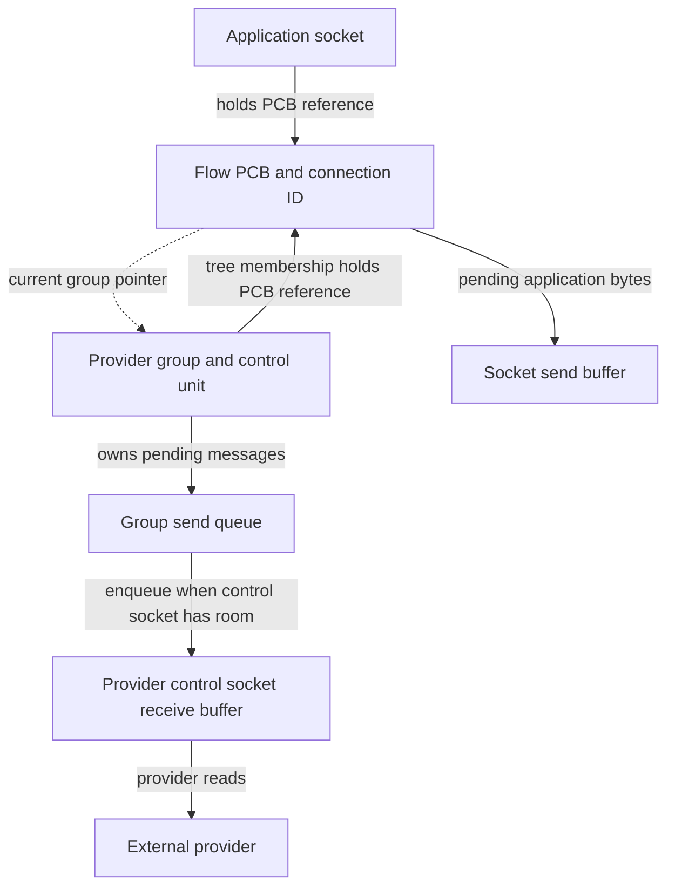
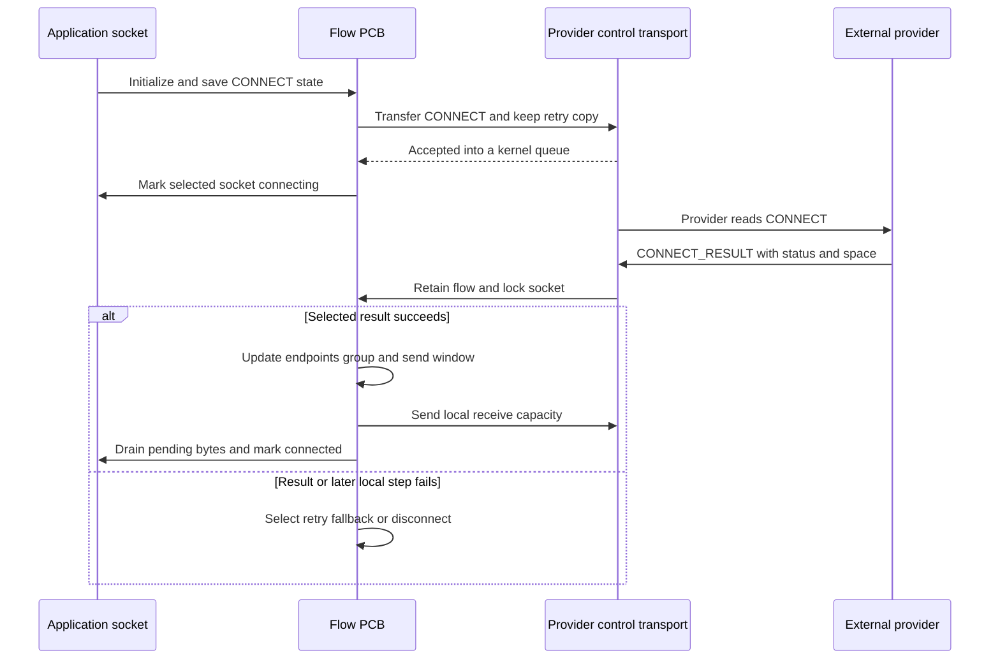
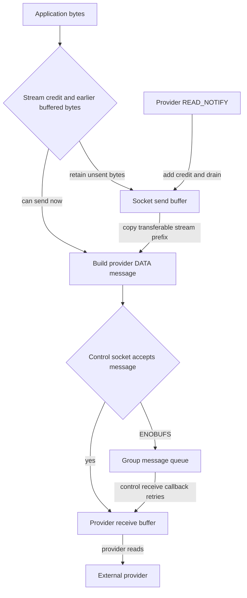

# Flow diversion, provider buffers, and socket lifetime

[Networking guide](README.md) · [Policy extensions](policy-extensions.md) · [NECP policy](necp-policy-evaluation.md) · [Kernel control sockets](kernel-control-sockets-and-network-statistics.md)

Flow diversion changes the socket's protocol operations so application data can travel through a provider's kernel-control connection. The kernel retains the application socket, flow identity, pending bytes and provider-facing state; the external provider decides how to carry those bytes onward. This chapter follows a selected TCP connection, then contrasts datagram buffering, fallback and teardown in `xnu-12377.121.6`.

The implementation is selected by `FLOW_DIVERT`; the ordinary TCP policy entry also depends on NECP. The source supplies IPv4 and IPv6 operations and an in-process provider model. Its presence does not identify which product enables the facility. The macOS-only responsible-process branch is identified separately below. [Configuration](../../../platydoc-data/xnu/config/MASTER#L75-L82), [source selection](../../../platydoc-data/xnu/bsd/conf/files#L297-L297).

## 1. The policy decision changes the socket's dispatch

For the selected IPv4 TCP `connect`, `tcp_usr_connect()` checks the PCB and applies configured content filtering before asking whether NECP selected diversion. A selected flow initializes its diversion PCB and calls `flow_divert_connect_out()`, returning from that branch before ordinary TCP connection setup. A rejected diversion setup is not an automatic ordinary-TCP fallback at this entry. [Caller and surrounding path](../../../platydoc-data/xnu/bsd/netinet/tcp_usrreq.c#L635-L684).

[Diversion selection — `tcp_usrreq.c`, lines 659–671](../../../platydoc-data/xnu/bsd/netinet/tcp_usrreq.c#L659-L671).

<!-- source-excerpt: ../../../platydoc-data/xnu/bsd/netinet/tcp_usrreq.c#L659-L671 -->
```c
#if FLOW_DIVERT
	if (necp_socket_should_use_flow_divert(inp)) {
		error = flow_divert_pcb_init(so);
		if (error == 0) {
			error = flow_divert_connect_out(so, nam, p);
		}
		return error;
	} else {
		so->so_flags1 |= SOF1_FLOW_DIVERT_SKIP;
	}
#endif /* FLOW_DIVERT */
#endif /* NECP */
	tp = intotcpcb(inp);
```

`flow_divert_pcb_init()` obtains NECP's policy control unit and aggregate mask. Its internal helper creates a PCB, selects a live group, inserts the flow into that group's tree, then publishes `so_fd_pcb` and `SOF_FLOW_DIVERT`. It replaces `so_proto` with a diversion protocol vector. Group insertion can be retried after `ENOENT`; unsuccessful initialization releases the new PCB's socket reference. [Initialization and publication](../../../platydoc-data/xnu/bsd/netinet/flow_divert.c#L4393-L4458), [protocol replacement](../../../platydoc-data/xnu/bsd/netinet/flow_divert.c#L4340-L4358).

The diversion vectors are built by copying ordinary protocol vectors and replacing selected connect, send, receive-notification, shutdown and close operations. Therefore the socket is still a BSD socket with ordinary buffer and locking machinery; its data path now invokes different callbacks. Read the actual assigned vector rather than inferring all operations from the name of a copied table. [Vector construction](../../../platydoc-data/xnu/bsd/netinet/flow_divert.c#L4966-L5033).

UDP can enter through `flow_divert_implicit_data_out()` on its first send. That wrapper creates a diversion PCB if absent and frees the supplied data/control on initialization failure. Once initialized, `flow_divert_data_out()` starts an implicit connection when necessary, accounts application bytes, hands the mbuf to `flow_divert_send_app_data()` and clears its local data pointer regardless of that helper's result. [UDP selection](../../../platydoc-data/xnu/bsd/netinet/udp_usrreq.c#L2706-L2714), [implicit wrapper](../../../platydoc-data/xnu/bsd/netinet/flow_divert.c#L4360-L4390), [send ownership](../../../platydoc-data/xnu/bsd/netinet/flow_divert.c#L4214-L4312).

## 2. A flow, a group and a control connection have different identities

| State | Representation and ownership |
| --- | --- |
| Application socket | `so_fd_pcb` names the flow PCB; the socket contributes one PCB reference |
| Flow PCB | `hash` is the provider-facing connection ID; `send_window`, flags, original/current endpoints, pending CONNECT and statistics describe this flow |
| Provider group | `ctl_unit` identifies its kernel-control unit; the group owns a PCB tree, a pending control-message queue, token key and signing-ID map |
| Policy choice | `policy_control_unit` and `aggregate_unit` retain selection/fallback information; `control_group_unit` records the currently selected group |
| Temporary operation | Group lookup retains the group; PCB lookup retains the flow before releasing the tree lock |

Sources: [PCB fields](../../../platydoc-data/xnu/bsd/netinet/flow_divert.h#L45-L73), [group fields](../../../platydoc-data/xnu/bsd/netinet/flow_divert.h#L94-L109), [lookup references](../../../platydoc-data/xnu/bsd/netinet/flow_divert.c#L262-L335).

[Flow identity and independent counters — `flow_divert.h`, lines 45–61](../../../platydoc-data/xnu/bsd/netinet/flow_divert.h#L45-L61).

<!-- source-excerpt: ../../../platydoc-data/xnu/bsd/netinet/flow_divert.h#L45-L61 -->
```c
struct flow_divert_pcb {
	decl_lck_mtx_data(, mtx);
	socket_t                        so;
	RB_ENTRY(flow_divert_pcb)       rb_link;
	uint32_t                        hash;
	mbuf_t                          connect_token;
	uint32_t                        flags;
	uint32_t                        send_window;
	struct flow_divert_group        *group;
	uint32_t                        control_group_unit;
	uint32_t                        aggregate_unit;
	uint32_t                        policy_control_unit;
	int32_t                         ref_count;
	uint64_t                        bytes_written_by_app;
	uint64_t                        bytes_sent;
	uint64_t                        bytes_received;
	uint8_t                         log_level;
```

The group tree contributes another PCB reference on insertion; removal clears `fd_cb->group` and drops that reference. The back-pointer to a group is not itself an independently retained group reference. Final PCB release frees retained CONNECT/token storage, application data and the saved endpoint. Socket detachment and group removal must therefore be distinguished from final storage release. [Insert/remove](../../../platydoc-data/xnu/bsd/netinet/flow_divert.c#L338-L357), [create/destructor/remove](../../../platydoc-data/xnu/bsd/netinet/flow_divert.c#L417-L465).



The diagram separates retained objects from data queues. It does not imply that the socket-buffer bytes and queued control-message bytes are duplicate outstanding copies of every send.

## 3. Provider admission and token parsing are separate decisions

`flow_divert_kctl_init()` registers `com.apple.flow-divert` with extended/setup callbacks and deliberately omits a blanket privileged-controller flag. `flow_divert_kctl_setup()` enforces the selected model: ordinary groups require the current credential to be superuser and receive a unit from 1 through 30; an in-process request allocates from a separate range and records the creator PID. Later in-process group lookup for a flow compares that PID with the socket's `last_pid`. `connect` validates the group prepared by setup rather than allocating a second group. [Registration](../../../platydoc-data/xnu/bsd/netinet/flow_divert.c#L4934-L4963), [setup/connect](../../../platydoc-data/xnu/bsd/netinet/flow_divert.c#L4706-L4793), [PID check](../../../platydoc-data/xnu/bsd/netinet/flow_divert.c#L305-L330), [unit constants](../../../platydoc-data/xnu/bsd/netinet/flow_divert_proto.h#L104-L109).

A control message starts with `flow_divert_packet_header`: a packet type and network-order connection ID. ID zero selects group operations, while a nonzero ID is looked up only in the sending group's tree. Field TLVs have a one-byte type and network-order 32-bit length. `flow_divert_packet_get_tlv()` locates a requested field, checks its extent, zeroes the destination and copies at most its capacity; a successful helper call does not universally establish that the field had exactly the expected scalar width. Individual handlers determine required fields, conversion and policy. [Header](../../../platydoc-data/xnu/bsd/netinet/flow_divert_proto.h#L111-L114), [TLV helpers](../../../platydoc-data/xnu/bsd/netinet/flow_divert.c#L494-L597), [input dispatch](../../../platydoc-data/xnu/bsd/netinet/flow_divert.c#L3499-L3591).

`SO_FLOW_DIVERT_TOKEN` is another setup route. The setter checks socket family/type/protocol, requires an ordinary TCP control block still in CLOSED state, copies the token into mbufs, extracts unit information, then initializes the flow. On `soopt_mcopyin()` failure that helper has freed the mbufs; the setter clears its token pointer before its common cleanup. [Socket-option dispatch](../../../platydoc-data/xnu/bsd/kern/uipc_socket.c#L5324-L5332), [setter](../../../platydoc-data/xnu/bsd/netinet/flow_divert.c#L4460-L4575), [copy ownership](../../../platydoc-data/xnu/bsd/kern/uipc_socket.c#L6367-L6397).

For ordinary units the token route attempts HMAC verification using the selected group's key. A missing HMAC field (`ENOENT`) is tolerated; other verification failures reject the token. Verification removes the HMAC suffix before computing the digest. The later `FLOW_DIVERT_HAS_HMAC` flag must be interpreted through its assignments: the error variable starts at zero and verification is conditional on the unit range. The flag alone is not a universal statement that every token route executed cryptographic verification. [Verification](../../../platydoc-data/xnu/bsd/netinet/flow_divert.c#L600-L679), [conditional check and flag](../../../platydoc-data/xnu/bsd/netinet/flow_divert.c#L4524-L4569).

Group initialization accepts a bounded token key and optional flags/order. CONNECT construction can use a signing ID from a token when the flag permits it, and otherwise derives process identity. The effective identity is checked against the group's signing-ID trie unless `NO_APP_MAP` applies. Delegated and real process identities are separate; the responsible-process override is specifically guarded by `XNU_TARGET_OS_OSX`. This chapter follows those consumers, not every trie-construction command or external policy producer. [Group initialization](../../../platydoc-data/xnu/bsd/netinet/flow_divert.c#L3135-L3210), [identity admission](../../../platydoc-data/xnu/bsd/netinet/flow_divert.c#L1063-L1107), [identity selection and platform guard](../../../platydoc-data/xnu/bsd/netinet/flow_divert.c#L1154-L1233), [CONNECT token use](../../../platydoc-data/xnu/bsd/netinet/flow_divert.c#L1296-L1339).

## 4. CONNECT acceptance is not completed connection establishment

`flow_divert_connect_out_internal()` checks attachment, provider and PCB state, rejects a repeated start, and records the original remote endpoint and IP state for possible fallback. It prepares local/remote endpoint information, checks interface restrictions and constructs the CONNECT message. Preconnect-data mode can retain that message without sending yet. Sending keeps a copy for retry/fallback and transfers the original to the control transport. [Entry and saved state](../../../platydoc-data/xnu/bsd/netinet/flow_divert.c#L3905-L3975), [decisions and publication](../../../platydoc-data/xnu/bsd/netinet/flow_divert.c#L4041-L4107), [retained CONNECT copy](../../../platydoc-data/xnu/bsd/netinet/flow_divert.c#L1459-L1492).

After sending, the flow sets `CONNECT_STARTED`. TCP and token-bearing datagrams enter `soisconnecting`; a datagram flow without a token can enter `soisconnected` immediately. Those socket states do not collapse the provider's later result into the initiating call. [Socket-state choice](../../../platydoc-data/xnu/bsd/netinet/flow_divert.c#L4083-L4107).

The selected CONNECT_RESULT needs error-code and available-space fields. On the success path it can update endpoints, interface scope and application data, or move the flow to another ordinary group. Group migration removes the old membership before attempting insertion into the new one; failure does not restore the old membership. The handler publishes the new send window and sends a response advertising the socket receive high-water mark. These mutations can precede a later failure. [Result parsing and eligibility](../../../platydoc-data/xnu/bsd/netinet/flow_divert.c#L2599-L2685), [endpoint and group changes](../../../platydoc-data/xnu/bsd/netinet/flow_divert.c#L2687-L2773), [response and final state](../../../platydoc-data/xnu/bsd/netinet/flow_divert.c#L2775-L2827), [response contents](../../../platydoc-data/xnu/bsd/netinet/flow_divert.c#L1495-L1538).

For a socket associated with an NECP client, successful result handling temporarily drops the socket lock to publish the assignment, then reacquires it and checks that diversion is still attached. Only the continuing success path drains buffered data and marks the socket connected. Provider-originated dispatch holds a PCB reference and its mutex around this operation; that retained PCB is distinct from assuming its socket remains attached across the unlocked callback. [Lock drop/recheck](../../../platydoc-data/xnu/bsd/netinet/flow_divert.c#L2802-L2817), [dispatch lifetime](../../../platydoc-data/xnu/bsd/netinet/flow_divert.c#L3542-L3587).



This sequence selects TCP without delayed preconnect and omits the optional NECP lock-drop callback. A successful control send means kernel acceptance of a message, not that the provider read it or reached a peer. Most result handlers return `void`; the kernel-control send's return is not a complete per-field acknowledgement. [Input return behavior](../../../platydoc-data/xnu/bsd/netinet/flow_divert.c#L3554-L3591).

## 5. Two different kinds of backpressure retain different buffers

The per-flow `send_window` is provider-advertised credit. The provider control socket has its own receive capacity. A third location, `group->send_queue`, holds already constructed messages when control enqueue reports `ENOBUFS` or earlier messages are queued. Those are distinct states from unsent application bytes in `so_snd`.

[Control congestion becomes queued success — `flow_divert.c`, lines 1262–1273](../../../platydoc-data/xnu/bsd/netinet/flow_divert.c#L1262-L1273).

<!-- source-excerpt: ../../../platydoc-data/xnu/bsd/netinet/flow_divert.c#L1262-L1273 -->
```c
	if (error == ENOBUFS) {
		if (!lck_rw_lock_shared_to_exclusive(&fd_cb->group->lck)) {
			lck_rw_lock_exclusive(&fd_cb->group->lck);
		}
		MBUFQ_ENQUEUE(&fd_cb->group->send_queue, packet);
		error = 0;
		OSTestAndSet(GROUP_BIT_CTL_ENQUEUE_BLOCKED, &fd_cb->group->atomic_bits);
	}

	lck_rw_done(&fd_cb->group->lck);

	return error;
```

`ctl_enqueuembuf()` consumes the message on successful receive-buffer append; on its error paths the caller still handles the mbuf. Flow diversion converts `ENOBUFS` into ownership by the group queue and returns zero. Other errors remain errors. Its data-message helper disconnects the original data from a failed temporary header so the caller can retain or free those bytes. [Control enqueue](../../../platydoc-data/xnu/bsd/kern/kern_control.c#L988-L1035), [data-message ownership](../../../platydoc-data/xnu/bsd/netinet/flow_divert.c#L1663-L1699).

For stream writes, the helper clamps immediate sending to provider credit and sends nothing new ahead of existing socket-buffer bytes:

[Stream ordering and credit — `flow_divert.c`, lines 1921–1927](../../../platydoc-data/xnu/bsd/netinet/flow_divert.c#L1921-L1927).

<!-- source-excerpt: ../../../platydoc-data/xnu/bsd/netinet/flow_divert.c#L1921-L1927 -->
```c
	if (to_send > fd_cb->send_window) {
		to_send = fd_cb->send_window;
	}

	if (fd_cb->so->so_snd.sb_cc > 0) {
		to_send = 0;    /* If the send buffer is non-empty, then we can't send anything */
	}
```

It splits a stream into chunks of at most `FLOW_DIVERT_CHUNK_SIZE` (65,600 bytes), transfers successful chunks and subtracts only that successful byte count from credit. It then resets its temporary send error before trying to append the unsent pieces to `so_snd`. An error after partial progress therefore does not reverse previously transferred chunks; successful buffering can hide a failed immediate transfer. The explicit no-space branch can free remaining data and return `ENOBUFS`. [Stream split, credit and remaining-data handling](../../../platydoc-data/xnu/bsd/netinet/flow_divert.c#L1929-L2002), [chunk limit](../../../platydoc-data/xnu/bsd/netinet/flow_divert_proto.h#L90-L90).

For an illustrative stream with 6,000 bytes of credit, an empty send buffer and an 8,000-byte write, assume all allocations/appends succeed. The helper transfers 6,000 bytes and retains 2,000 in `so_snd`. A later 1,000-byte write joins that buffer. A READ_NOTIFY granting 4,000 bytes lets the drain copy and transfer the buffered 3,000, remove those originals from `so_snd`, and retain 1,000 bytes of credit. “Transferred” here includes acceptance by the group queue during control congestion. [Buffered stream drain](../../../platydoc-data/xnu/bsd/netinet/flow_divert.c#L1804-L1852), [credit replenishment](../../../platydoc-data/xnu/bsd/netinet/flow_divert.c#L3112-L3132).

Datagrams preserve record boundaries. A positive immediate allowance can send an entire datagram even when it exceeds remaining credit, then clamp the credit to zero. Larger records use multiple control messages with fragment metadata; this is not IP fragmentation. The buffered datagram loop iterates records without using the stream loop's `sent < to_send` bound. Do not describe provider credit as one identical hard byte limit for both types. [Datagram send/buffer behavior](../../../platydoc-data/xnu/bsd/netinet/flow_divert.c#L2003-L2043), [fragment messages](../../../platydoc-data/xnu/bsd/netinet/flow_divert.c#L1702-L1801), [datagram drain](../../../platydoc-data/xnu/bsd/netinet/flow_divert.c#L1853-L1913).



This diagram shows the stream success/queue routes; other errors invoke the ownership rules above. The control receive callback clears the blocked bit, retries queued messages, then visits retained flow PCBs outside the group lock to retry socket-buffer draining. `OSTestAndClear()` returns false when it actually changes a set bit to clear, explaining the negated test. A repeated enqueue error sets the bit and returns early; the ordinary end-of-function release tail must not be assumed to run on that branch. [Retry body](../../../platydoc-data/xnu/bsd/netinet/flow_divert.c#L4879-L4931), [atomic implementation](../../../platydoc-data/xnu/libkern/gen/OSAtomicOperations.c#L170-L200).

## 6. Inbound data and application read notifications

Provider input retains a PCB from its group tree, takes the PCB mutex, then locks and references the attached socket before dispatch. `flow_divert_input()` frees the remaining input message after the handler; the DATA handler can split the payload away and transfer it to the socket-buffer machinery. [Lookup/locking/cleanup](../../../platydoc-data/xnu/bsd/netinet/flow_divert.c#L3542-L3591), [payload split](../../../platydoc-data/xnu/bsd/netinet/flow_divert.c#L3060-L3109).

When receive space is exactly zero, DATA handling returns `ENOBUFS` and sets `NOTIFY_ON_RECEIVED`. It does not retain that whole rejected message for a later application read. Once `pru_rcvd` observes positive space, it attempts a READ_NOTIFY and clears the flag only on successful send. This notification travels toward the provider; the READ_NOTIFY received from the provider instead replenishes outbound credit using a read-count TLV. [Full receive buffer](../../../platydoc-data/xnu/bsd/netinet/flow_divert.c#L3017-L3022), [application-read callback](../../../platydoc-data/xnu/bsd/netinet/flow_divert.c#L3743-L3761), [outbound-credit update](../../../platydoc-data/xnu/bsd/netinet/flow_divert.c#L3112-L3132).

Stream payloads go through `sbappendstream`; datagrams add source-address and control information through `sbappendaddr`. These append helpers can themselves invoke socket/content filters. The stream handler sets its accounting-success variable after handing off to `sbappendstream`, while waking readers depends on the append return. Thus `bytes_received` is not a universal counter of bytes immediately readable by the application. [Receive accounting](../../../platydoc-data/xnu/bsd/netinet/flow_divert.c#L3070-L3109), [append/filter ownership](../../../platydoc-data/xnu/bsd/kern/uipc_socket2.c#L982-L1042), [content filtering](socket-content-filtering.md).

## 7. Provider fallback changes dispatch again

The aggregate mask can describe ordinary groups ordered by their configured `order`; another model prefers an in-process group for the socket's PID and retains ordinary fallback selection. That selection is distinct from automatically retrying every disconnected provider. The CONNECT_RESULT error branch tries another group only under its control-unit/policy-unit condition; it calls `flow_divert_disable()` only when that attempt fails and the policy unit is zero. [Selection](../../../platydoc-data/xnu/bsd/netinet/flow_divert.c#L2153-L2233), [next-group operation](../../../platydoc-data/xnu/bsd/netinet/flow_divert.c#L2236-L2291), [conditional fallback](../../../platydoc-data/xnu/bsd/netinet/flow_divert.c#L2781-L2800).

Disabling restores saved IP family/interface state, clears selected endpoint fields, sets `SOF1_FLOW_DIVERT_SKIP`, disconnects the socket/PCB relationship and drops the socket's PCB reference. It then restores the ordinary protocol vector and, for an explicit connection, calls that protocol's connect operation using the saved destination. The input dispatch's separate PCB reference keeps the remaining helper context alive. [State and dispatch restoration](../../../platydoc-data/xnu/bsd/netinet/flow_divert.c#L2324-L2392), [retained input operation](../../../platydoc-data/xnu/bsd/netinet/flow_divert.c#L3542-L3587).

Buffered stream data is copied, the original send buffer flushed, and the copied data passed to ordinary protocol send. Datagram fallback extracts records into a temporary queue before sending them individually. These steps can make progress before failure; fallback is not a rollback restoring the exact pre-diversion state and every original buffer. This chapter does not generalize that selected fallback into the external provider's reconnection policy. [Stream fallback](../../../platydoc-data/xnu/bsd/netinet/flow_divert.c#L2394-L2431), [datagram fallback](../../../platydoc-data/xnu/bsd/netinet/flow_divert.c#L2432-L2518).

## 8. Shutdown, detach and provider death end different lifetimes

Local read/write closure and provider-side read/write closure occupy separate flag pairs. Shutdown marks the local direction closed, while a close message may wait for buffered sends to drain. The implementation records tunnel-close bits when `flow_divert_send_close()` returns anything other than `ENOBUFS`; its nearby “successfully sent” comment is broader than a literal `error == 0` predicate. [Flag update](../../../platydoc-data/xnu/bsd/netinet/flow_divert.c#L767-L787), [notification predicate](../../../platydoc-data/xnu/bsd/netinet/flow_divert.c#L1628-L1659), [shutdown](../../../platydoc-data/xnu/bsd/netinet/flow_divert.c#L3717-L3740).

Explicit close and detach attempt a forced buffered drain that ignores provider credit. It remains fallible and does not wait for peer delivery. Close retains a temporary PCB reference while removing group membership and disconnecting the socket. Detach additionally clears the socket's diversion pointers, flushes send/receive buffers, clears the PCB's socket pointer and releases the socket-owned reference. [Close](../../../platydoc-data/xnu/bsd/netinet/flow_divert.c#L3674-L3703), [forced drain](../../../platydoc-data/xnu/bsd/netinet/flow_divert.c#L1819-L1822), [detach](../../../platydoc-data/xnu/bsd/netinet/flow_divert.c#L3633-L3671).

[Detach lock handoff and reference release — `flow_divert.c`, lines 3660–3670](../../../platydoc-data/xnu/bsd/netinet/flow_divert.c#L3660-L3670).

<!-- source-excerpt: ../../../platydoc-data/xnu/bsd/netinet/flow_divert.c#L3660-L3670 -->
```c
	if (!fd_cb->plugin_locked) {
		socket_unlock(so, 0);
		FDLOCK(fd_cb);
	}
	fd_cb->so = NULL;
	if (!fd_cb->plugin_locked) {
		FDUNLOCK(fd_cb);
		socket_lock(so, 0);
	}

	FDRELEASE(fd_cb);       /* Release the socket's reference */
```

Provider-originated paths already hold the PCB mutex when setting `plugin_locked`; an ordinary detach must drop the socket lock before acquiring that mutex. This prevents treating two different lock-entry contexts as one unconditional nested-lock order. [Provider socket-lock helpers](../../../platydoc-data/xnu/bsd/netinet/flow_divert.c#L248-L259).

On provider control disconnection, the group is first removed from global lookup. `flow_divert_close_all()` drains its queued messages, retains a temporary list of flow PCBs and marks the group DEFUNCT under its lock. It then processes the retained flows outside that lock, taking each PCB/socket pair, removing membership and setting `ECONNABORTED`. This route disconnects attached flows; it is not the selected CONNECT-rejection fallback described above. Final group release clears/frees its token key and signing-map storage. [Unpublish and release](../../../platydoc-data/xnu/bsd/netinet/flow_divert.c#L4796-L4862), [group death](../../../platydoc-data/xnu/bsd/netinet/flow_divert.c#L3594-L3630), [final destructor](../../../platydoc-data/xnu/bsd/netinet/flow_divert.c#L4666-L4687).

## 9. Source-test evidence and remaining boundaries

| Local test | What the supplied assertions establish | What remains outside it |
| --- | --- | --- |
| [Token copy-failure case](../../../platydoc-data/xnu/tests/net/flow_divert_mbuf.c#L55-L78) | Requires socket creation, attempts a token copy from an invalid address and reaches completion without a crash | It logs the option result rather than asserting one particular errno; it does not establish successful token admission or data transfer |
| [Concurrent control-connect case](../../../platydoc-data/xnu/tests/flow_div_doubleconnect_55917185.c#L21-L74) | Asserts thread/socket creation, close and join around concurrent connect attempts | It does not require bind/connect success or test CONNECT_RESULT, credit, provider fallback or packet delivery |

The token test's introductory comment describes a historical failure. The current setter explicitly clears its local pointer after the consuming copy helper fails; the current body, not that comment, establishes the cleanup described here. No source test, provider session, network exchange or kernel build was executed.

This review covers selected policy/socket dispatch, ordinary and in-process group admission, token consumers, CONNECT/result state, stream and datagram buffering, control congestion, inbound handoff, fallback and teardown. It does not reconstruct the userspace Network Extension provider, its transport to a peer, all app-map/trie commands, Guard Proxy/content-filter combinations, statistics exporters, every token field or every concurrent interleaving. Cryptographic calls use the registered provider boundary. IPv6 endpoint handling remains configuration- and address-dependent; MPTCP is a separate transport overlay rather than a mode of this flow PCB.

<!-- BEGIN PLATYDOC DOCUMENTATION LICENSE -->
Original Platydoc text and diagrams are licensed under [CC BY 4.0](https://creativecommons.org/licenses/by/4.0/). Quoted source code and third-party material retain their respective licenses.
<!-- END PLATYDOC DOCUMENTATION LICENSE -->
