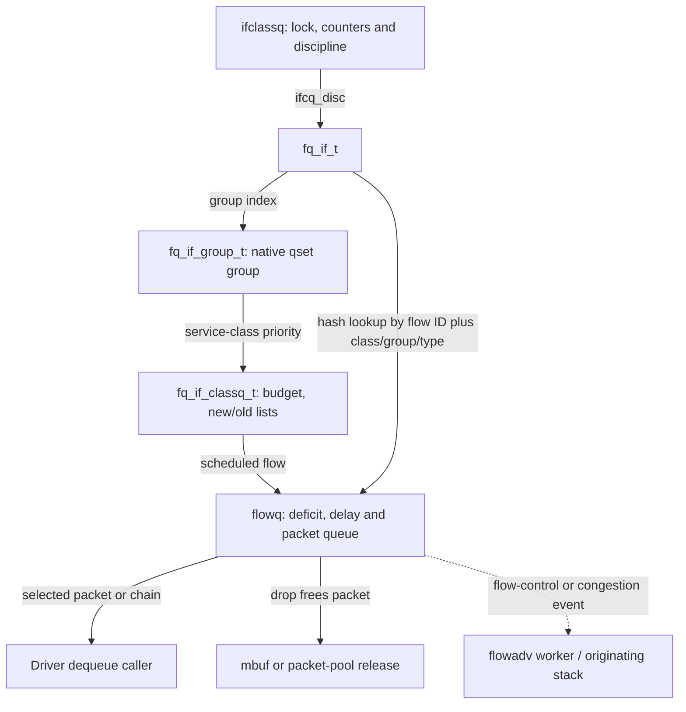
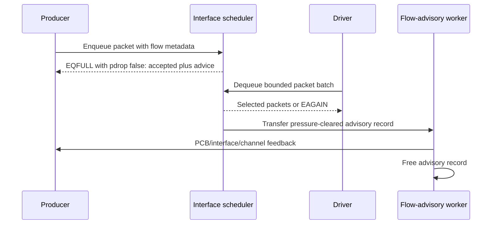

# Interface packet scheduling, FQ-CoDel, and congestion feedback

[Networking](README.md) · [Packets and interfaces](packets-routes-and-interfaces.md) · [Skywalk netif queues](skywalk-netif-links-queues-and-scheduling.md) · [TCP timers](tcp-connections-and-timers.md)

An interface can accept a packet long before its driver transmits it. XNU's `ifclassq` scheduler stores accepted packets, shares service among flows, measures time spent queued, applies congestion/drop decisions and returns batches when the driver asks. This chapter explains that local mechanism in `xnu-12377.121.6`. Its packet queues contain either BSD mbufs or Skywalk packets; they are distinct from a TCP socket's unacknowledged byte stream, a Skywalk flowswitch lookup entry, and a hardware transmit ring.

## 1. Select the scheduler and packet representation first

`ifclassq_setup()` initializes the interface backpointer, counters, flags and chosen scheduling discipline under `ifcq_lock`. A queue is ready/enabled only after setup succeeds. `ifclassq_pktsched_setup()` chooses packet representation from `IFEF_SKYWALK_NATIVE`: native interfaces use `QP_PACKET`, other paths use `QP_MBUF`. It independently chooses the scheduler implementation from the interface's output model and family. [`Queue setup`](../../../xnu/bsd/net/classq/classq_subr.c#L99-L157), [`selection`](../../../xnu/bsd/net/classq/classq_subr.c#L226-L266).

| Selected output model | Implementation in this snapshot |
| --- | --- |
| `IFNET_SCHED_MODEL_NORMAL` or `DRIVER_MANAGED`, Ethernet family except Wi-Fi | `PKTSCHEDT_FQ_CODEL_NEW` |
| Same normal/driver-managed models on other families, including Wi-Fi | `PKTSCHEDT_FQ_CODEL` legacy implementation |
| Explicit `FQ_CODEL` / `FQ_CODEL_DM` | Legacy implementation |
| Explicit `FQ_CODEL_NEW` / `FQ_CODEL_NEW_DM` | New implementation |

Both implementations share flow/class/group scheduling but select different `fqs_enqueue` and `fqs_dequeue` function pointers. The new path uses `fq_codel_enq()`/`fq_codel_dq()`; legacy uses their `_legacy` counterparts. “FQ-CoDel” alone therefore does not identify all predicates in the running branch. Runtime sysctls and provider capabilities impose further choices; the table describes source selection, not a claim about every shipping product. [`Discipline initialization`](../../../xnu/bsd/net/pktsched/pktsched_fq_codel.c#L1959-L2034).

## 2. One scheduler contains groups, classes and per-flow queues

| Structure | Important state | Role |
| --- | --- | --- |
| `ifclassq` | `ifcq_lock`, references, length/bytes, flags, `ifcq_ops`, `ifcq_disc`, token-bucket regulator | Public interface queue and discipline dispatch. |
| `fq_if_t` | Flow hash buckets, packet representation, class groups, combined-group list, flow-advisory list, empty-flow cache, pacemaker call | One FQ scheduler instance. |
| `fq_if_group_t` | Group index, counters, per-traffic-type delay targets/intervals, eligibility bitmaps, class array | Associates a native qset index with scheduling state. |
| `fq_if_classq_t` | Service-class priority, quantum, byte budget, new/old flow lists, next transmit time | Selects service among flows and accounts the class's current allowance. |
| `flowq` | Packet queue, flow ID, group/class/type, deficit, delay/drop state, cached transmit time, flow-control flags | Scheduler-local queue of packets for a key. It is not an `inpcb` or Skywalk `flow_entry`. |
| `pktsched_pkt_t` / `classq_pkt_t` | Representation tag and packet/chain pointers/counts | Shared operations over mbufs or Skywalk packet chains. |

Sources: [`ifclassq`](../../../xnu/bsd/net/classq/if_classq.h#L118-L164), [`groups/classes/scheduler`](../../../xnu/bsd/net/pktsched/pktsched_fq_codel.h#L129-L234), [`flow queue`](../../../xnu/bsd/net/classq/classq_fq_codel.h#L126-L214), [`packet abstractions`](../../../xnu/bsd/net/pktsched/pktsched.h#L60-L82).



Native AQM qsets share their logical link's `ifclassq`; each qset's index selects a group. Default links can share `ifp->if_snd`, while another logical link can have its own scheduler. A driver-managed interface maps service classes to four scheduling classes, BK, BE, VI and VO, within each group; normal scheduling keeps finer class distinctions. Lower priority indices win selection, but budgets and eligibility prevent interpreting that as unconditional strict priority. [`Qset scheduler setup`](../../../xnu/bsd/skywalk/nexus/netif/nx_netif_llink.c#L204-L285), [`service mapping`](../../../xnu/bsd/net/pktsched/pktsched_fq_codel.c#L665-L752).

`fq_if_hash_pkt()` first chooses a hash bucket from the supplied flow ID, then compares **flow ID, service-class index, traffic type and group**. Classic and L4S traffic can therefore occupy distinct scheduler queues for the same flow ID. It can reuse a cached empty queue or allocate a new one, initialize targets/flags and insert it into the hash. This lookup does not parse a packet's five-tuple; upstream producers supply the flow metadata. [`Flow lookup/allocation`](../../../xnu/bsd/net/pktsched/pktsched_fq_codel.c#L2037-L2104).

Enqueue timestamps also originate above the discipline. DLIL preserves an already valid timestamp or records nanouptime, then clears the public timestamp-valid marker before entering classq. The scheduler uses the stored nanoseconds internally. Do not substitute Mach absolute ticks or a packet's requested future transmit time in the queue-delay calculation. [`Timestamp preparation`](../../../xnu/bsd/net/dlil.c#L2959-L2993), [`new enqueue timestamp use`](../../../xnu/bsd/net/classq/classq_fq_codel.c#L945-L963).

## 3. Enqueue results carry ownership and feedback

`fq_if_enqueue()` wraps the input chain, acquires the scheduler lock, selects its group/class and applies background throttling before invoking the selected discipline. A native packet's `pkt_qset_idx` selects the group; the service class selects the priority. The chain has one scheduling identity at this interface—callers must supply batches compatible with that contract. [`Dispatch and admission`](../../../xnu/bsd/net/pktsched/pktsched_fq_codel.c#L760-L801).

| Discipline result | Caller-visible result | Incoming packet ownership |
| --- | --- | --- |
| `CLASSQEQ_SUCCESS` | zero, `pdrop=false` | Queued. |
| `CLASSQEQ_SUCCESS_FC` | `EQFULL`, `pdrop=false` | Queued; flow-control advice accompanies success. |
| `CLASSQEQ_CONGESTED` | `EQCONGESTED`, `pdrop=false` | Queued; congestion information should reach the producer. |
| `CLASSQEQ_COMPRESSED` | zero, `pdrop=false` | Accepted after scheduler compression handling. |
| `CLASSQEQ_DROP` | `ENOBUFS`, `pdrop=true` | Wrapper frees the incoming packet/chain. |
| `CLASSQEQ_DROP_FC` | `EQFULL`, `pdrop=true` | Wrapper frees the incoming packet/chain and reports flow control. |
| `CLASSQEQ_DROP_SP` / explicit background throttle | `EQSUSPENDED`, `pdrop=true` | Incoming packet/chain freed. |

[`Result translation and accounting`](../../../xnu/bsd/net/pktsched/pktsched_fq_codel.c#L811-L873), [`representation-specific drop`](../../../xnu/bsd/net/pktsched/pktsched.c#L477-L524).

There is a debug/development exception to the result table: when `ifclassq_flow_control_adv == 0`, the final branch rewrites `EQFULL` to zero without changing `pdrop`. A dropped packet can therefore accompany a zero return in that mode. Ownership must still be determined from the API contract and `pdrop`, rather than errno alone. [`Conditional feedback suppression`](../../../xnu/bsd/net/pktsched/pktsched_fq_codel.c#L865-L871).

The accepted-but-flow-controlled case is visible in the code:

[`pktsched_fq_codel.c:811–826`](../../../xnu/bsd/net/pktsched/pktsched_fq_codel.c#L811-L826):

<!-- source-excerpt: ../../../xnu/bsd/net/pktsched/pktsched_fq_codel.c#L811-L826 -->
```c
	if (__improbable(ret != 0)) {
		if (ret == CLASSQEQ_SUCCESS_FC) {
			/* packet enqueued, return advisory feedback */
			ret = EQFULL;
			*pdrop = FALSE;
		} else if (ret == CLASSQEQ_COMPRESSED) {
			ret = 0;
			*pdrop = FALSE;
		} else if (ret == CLASSQEQ_CONGESTED) {
			ret = EQCONGESTED;
			*pdrop = FALSE;
		} else {
			IFCQ_UNLOCK(ifq);
			*pdrop = TRUE;
			pktsched_drop_pkt(&pkt, ifq->ifcq_ifp, DROP_REASON_AQM_FULL,
			    __func__, __LINE__, 0);
```

An errno is thus insufficient to decide whether to retry or free input. The [Skywalk qset enqueue wrapper](skywalk-netif-links-queues-and-scheduling.md#3-queue-selection-and-admission-do-not-imply-transmission) can collapse feedback/drop counts into `EIO` after consuming the entire batch. BSD output similarly translates feedback at its own boundary. The original packet must not be resubmitted solely because the admission result is nonzero.

The new enqueue algorithm finds/allocates a flow queue, then checks the scheduler packet limit. At the limit it can drop queued packets from the largest flow, including the current flow, to admit new work; if no suitable existing victim exists it rejects the incoming chain. This is not simple tail-drop of every incoming packet at capacity. For an overwhelming non-TCP/non-QUIC producer with advisory metadata, it can install flow-control state and return success-with-feedback. A single-packet enqueue may replace a redundant queued ACK through `fq_compressor()`; a batch deliberately skips that compression scan. Successful admission updates flow bytes, class statistics and the largest-flow candidate, then activates a previously idle queue on the new-flow list with one quantum of deficit. [`New enqueue`](../../../xnu/bsd/net/classq/classq_fq_codel.c#L901-L1108), [`ACK compression`](../../../xnu/bsd/net/classq/classq_fq_codel.c#L246-L328).

## 4. Dequeue has two scheduling levels

A driver requests a packet and byte limit, optionally a service class and qset group. `ifclassq_dequeue()` first runs the scheduler/token-bucket path, then permits an installed netif dequeue hook to filter or alter the batch. A zero scheduler result with an empty output becomes `EAGAIN`. This can occur while queue length is nonzero, so “pending packets” and “available for immediate dequeue” differ. [`Dequeue wrapper`](../../../xnu/bsd/net/classq/classq_subr.c#L372-L509).

At the **class/group level**, `fq_if_dequeue_common()` uses four eligibility bitmaps: ER, IR, EB and IB. It selects the highest eligible class from the requested group or configured combined-group list. Exhausted eligible sets are replenished from waiting classes. A class with no positive budget receives `min(fcl_drr_max, flow_count) * quantum`; actual bytes dequeued reduce that budget. A still-active class with exhausted budget moves to IB, a paced class with remaining budget can move to IR, and an empty class is cleared. These states describe scheduler eligibility, not a blocked kernel thread. Driver-managed operation restricts the classes considered using the requested service. [`Class/group loop`](../../../xnu/bsd/net/pktsched/pktsched_fq_codel.c#L1096-L1294), [`state names`](../../../xnu/bsd/net/pktsched/pktsched_fq_codel.h#L105-L127).

At the **flow level**, the scheduler visits new flows before old flows. Packet length reduces `fq_deficit`; a depleted or emptied new queue receives another quantum and moves into old-flow handling. Old queues rotate when their deficit is spent and leave active service when empty. Separate packet/byte limits and the class budget can stop a batch before every eligible flow is visited. Helpers build result chains while decrementing queue counters; the driver receives only packets actually selected, not a borrowed pointer to the entire queued backlog. [`New/old flow servicing`](../../../xnu/bsd/net/pktsched/pktsched_fq_codel.c#L2434-L2613), [`Skywalk packet accounting`](../../../xnu/bsd/net/pktsched/pktsched_fq_codel.c#L357-L417), [`mbuf accounting`](../../../xnu/bsd/net/pktsched/pktsched_fq_codel.c#L420-L474).

### Worked deficit example

Assume an illustrative class quantum of 1,500 bytes, sufficient class budget, no pacing/drop and two new flows A and B. A has two 1,000-byte packets and B has one 500-byte packet. With a three-packet dequeue limit, A can supply both of its packets while spending 2,000 bytes: deficit becomes −500. It gains another quantum, leaving 1,000 credit, and moves into old-flow handling. B then supplies its packet. The algorithm budgets **bytes**, but it does not split packets to stop precisely at a quantum boundary. Real quantum, class budget, packet size and eligible groups are selected by configuration and state. [`Packet loop's deficit condition`](../../../xnu/bsd/net/pktsched/pktsched_fq_codel.c#L357-L417), [`new-flow transition`](../../../xnu/bsd/net/pktsched/pktsched_fq_codel.c#L2504-L2517).

## 5. New CoDel: sustained delay, marking and dropping

The new dequeue algorithm removes a candidate packet and evaluates how long it has remained queued. Classic traffic uses `codel_ok_to_drop()`: an empty queue or delay at/below the target clears `first_above_time`; the first excessive-delay observation starts an interval; a later excessive-delay observation after that interval permits a congestion action. One late packet does not immediately establish persistent congestion.

[`classq_fq_codel.c:1132–1142`](../../../xnu/bsd/net/classq/classq_fq_codel.c#L1132-L1142):

<!-- source-excerpt: ../../../xnu/bsd/net/classq/classq_fq_codel.c#L1132-L1142 -->
```c
	if (sojourn_time <= FQ_TARGET_DELAY(fq)) {
		codel_status->first_above_time = 0;
		goto end;
	}
	if (codel_status->first_above_time == 0) {
		codel_status->first_above_time = now += FQ_UPDATE_INTERVAL(fq);
	} else if (now >= codel_status->first_above_time) {
		ok_to_drop = true;
		KDBG(AQM_KTRACE_OK_TO_DROP, fq->fq_flowhash, sojourn_time,
		    *pkt_enq_time, now);
	}
```

`codel_status` retains dropping state, count, previous count and next action time. Once dropping is active, actions become more frequent through the local control law, which adds `interval / sqrt(count)` using an approximation. A dequeue can discard multiple packets before returning a usable one. Dropped packets are released through the appropriate representation-specific free path, and counters are adjusted separately from transmitted output. [`State/control law`](../../../xnu/bsd/net/classq/classq_fq_codel.c#L1111-L1178), [`new dequeue`](../../../xnu/bsd/net/classq/classq_fq_codel.c#L1181-L1386).

The action is not always a drop. The visible priority is:

1. Use supported local congestion feedback when the flow and packet carry the required metadata. For channel producers, attempt to enqueue a congestion report; in-PCB producers can observe updated congestion counts on subsequent admission.
2. Otherwise attempt ECN marking when the flow is marked ECN-capable.
3. Otherwise drop; an ECN-marking failure clears ECN capability for that flow.

`fq_if_report_congestion()` can fail to allocate a feedback entry, and its debug/development suppression branch can return success without queuing an entry. The classic CoDel callers do not test the helper's return before counting feedback or retaining the packet; an attempted notification is not guaranteed producer delivery. [`Report construction`](../../../xnu/bsd/net/pktsched/pktsched_fq_codel.c#L2407-L2430), [`classic callers`](../../../xnu/bsd/net/classq/classq_fq_codel.c#L1277-L1287), [`initial congestion branch`](../../../xnu/bsd/net/classq/classq_fq_codel.c#L1325-L1334).

Those branches have different counter/timer updates. The feedback branch in an already-dropping loop returns the selected packet without following the ECN branch's `drop_next` update; do not describe all successful notifications as identical to an ECN mark. [`Classic congestion decisions`](../../../xnu/bsd/net/classq/classq_fq_codel.c#L1261-L1369), [`enqueue feedback observation`](../../../xnu/bsd/net/classq/classq_fq_codel.c#L1076-L1105).

Before writing a packet's ECN field, the implementation converts its spin-held scheduler lock to ordinary mutex mode because the buffer can be pageable. The marking helper dispatches by packet representation and validates the IP/ECN representation in its specific helper. “Mark CE” is therefore a fallible buffer operation, not just updating a statistic. [`Lock conversion and marking`](../../../xnu/bsd/net/classq/classq_fq_codel.c#L1235-L1254), [`mark dispatch`](../../../xnu/bsd/net/pktsched/pktsched.c#L877-L889).

## 6. Legacy delay feedback and L4S are separate branches

Legacy dequeue computes queue-delay statistics and keeps the minimum measured delay over an update interval. At interval expiry it sets or clears `FQF_DELAY_HIGH`; enqueue then uses delay-high/overwhelming state to choose feedback, early drop or head drops. For flow-advisory-capable traffic, TCP/QUIC can be retained while other protocols take an early-drop path. Feedback allocation failure itself selects a drop. These are visible differences from the new implementation's persistent-delay/drop-state loop. [`Legacy admission`](../../../xnu/bsd/net/classq/classq_fq_codel.c#L331-L475), [`legacy measurement and feedback clearing`](../../../xnu/bsd/net/classq/classq_fq_codel.c#L729-L897).

When enabled and tagged as L4S, both algorithms use a distinct delay/CE branch. It compares queue delay against the configured CE threshold or group target, adding the intentional pacing interval to that threshold. It may produce a local channel report or mark ECN; failure increments marking-failure statistics. The new implementation does not simply run classic CoDel drop-state logic for these packets. Queue-capacity pressure still has its own enqueue checks, so a source comment about skipping dropping should not be read as immunity from every drop condition. [`New L4S handling`](../../../xnu/bsd/net/classq/classq_fq_codel.c#L1211-L1257), [`legacy L4S and pacing adjustment`](../../../xnu/bsd/net/classq/classq_fq_codel.c#L806-L868), [`new capacity check`](../../../xnu/bsd/net/classq/classq_fq_codel.c#L966-L1048).

The code initializes `fq_codel_enable_l4s` and pacing to enabled, but classic `fq_codel_enable_ecn` to disabled. These are configurable variables, not evidence that every flow has L4S or ECN metadata. Group target delays also depend on default/low-latency selection and interface family. [`Tunables`](../../../xnu/bsd/net/pktsched/pktsched_fq_codel.c#L105-L117), [`target selection`](../../../xnu/bsd/net/pktsched/pktsched_fq_codel.c#L489-L550).

## 7. Pacing, shaping and asynchronous feedback

Pacing uses a requested transmit timestamp carried in a Skywalk packet option or an mbuf AQM tag. `fq_get_next_tx_time()` caches the head packet's timestamp; dequeue/drop invalidates that cache. `fq_tx_time_ready()` accepts missing timestamps, times within the configured leeway and times implausibly far in the future; it postpones only a valid intermediate future deadline. A postponed flow is skipped without dropping its packet. The class/group loop records the earliest future time and can park wholly paced classes so it does not spin on them. [`Timestamp selection and readiness`](../../../xnu/bsd/net/classq/classq_fq_codel.c#L644-L726), [`class pacing`](../../../xnu/bsd/net/pktsched/pktsched_fq_codel.c#L2477-L2590).

A scheduled pacemaker thread call later invokes `ifnet_start_ignore_delay()` to request driver work. The helper requires pacing and L4S enabled. The surrounding dequeue body can schedule it when it has recorded a future time, including a pass that also returned ready packets; the comment saying “only when no packet can be dequeued” is narrower than that visible condition. A pending packet is consequently not enough to guarantee a nonempty immediate dequeue. [`Schedule condition`](../../../xnu/bsd/net/pktsched/pktsched_fq_codel.c#L1071-L1093), [`caller at dequeue exit`](../../../xnu/bsd/net/pktsched/pktsched_fq_codel.c#L1270-L1293), [`pacemaker callback`](../../../xnu/bsd/net/pktsched/pktsched_fq_codel.c#L477-L485).

Token-bucket shaping is another gate. `ifclassq_dequeue_common_default()` selects a single-packet loop when TBR is enabled; the regulator replenishes tokens from elapsed time up to its configured depth, returns no packet without credit, and subtracts the selected packet's scaled length. This controls interface output rate rather than per-flow fairness or persistent-delay detection. [`TBR dispatch`](../../../xnu/bsd/net/classq/classq_subr.c#L386-L480), [`token accounting`](../../../xnu/bsd/net/classq/classq_subr.c#L658-L719).

Flow-control records also have a lifetime beyond an enqueue call. `fq_if_add_fcentry()` creates/deduplicates an entry and can mark channel advisory state immediately. When pressure clears, `fq_if_flow_feedback()` removes the entry from scheduler state and transfers it to the global flow-advisory worker. That worker drops its list lock before dispatching to `inp_flowadv()`, `ifnet_flowadv()` or `kern_channel_flowadv_clear()`, then frees the record. Congestion-event records use a separate event type and channel-report branch. These are local producer notifications, not TCP ACKs from the peer. [`Advisory creation/transfer`](../../../xnu/bsd/net/pktsched/pktsched_fq_codel.c#L2328-L2430), [`worker dispatch and free`](../../../xnu/bsd/net/flowadv.c#L174-L255).



The diagram is one accepted-and-flow-controlled case. Drops, congestion reports and pacing are additional branches, and driver dequeue does not establish physical completion.

## 8. Empty queues, purge and scheduler destruction

An empty flow can remain in a cache for reuse rather than being freed on every idle transition. The source defines an empty-flow retention delay and a bounded purge count during normal dequeue. Purging removes hash membership, releases flow-control state where applicable and frees flow storage; complete scheduler destruction can request a full purge. This object cache is distinct from packet buffer caching. [`Empty-flow transitions/purge`](../../../xnu/bsd/net/pktsched/pktsched_fq_codel.c#L2137-L2324), [`retention constants`](../../../xnu/bsd/net/classq/classq_fq_codel.h#L115-L124).

`ifclassq_teardown()` disables shaping, tears down the discipline, verifies empty/reset state and marks the queue destroyed. `fq_if_destroy()` holds the scheduler lock, converts it to mutex mode, cancels/waits for and frees the pacemaker call, purges packets/flows and groups, and frees tables. Holding that lock prevents another enqueue/dequeue from scheduling new pacemaker work during cancellation; the callback itself only requests interface service. The function explicitly requires that the interface starter lock is not owned. [`Interface teardown`](../../../xnu/bsd/net/classq/classq_subr.c#L187-L223), [`pacemaker and flow destruction`](../../../xnu/bsd/net/pktsched/pktsched_fq_codel.c#L631-L662).

## 9. Evidence, tests and interpretation limits

| Checkable invariant | Local evidence |
| --- | --- |
| `EQFULL` does not alone prove packet rejection | `fq_if_enqueue()` sets `pdrop=false` for accepted flow-control feedback and `pdrop=true` for drop feedback. [`Translation`](../../../xnu/bsd/net/pktsched/pktsched_fq_codel.c#L811-L846). |
| Queued packet count can be nonzero while dequeue returns no packet | Pacing and TBR eligibility precede usable output; the wrapper translates an empty result to `EAGAIN`. [`Empty result`](../../../xnu/bsd/net/classq/classq_subr.c#L391-L421). |
| Classq does not choose a single universal CoDel algorithm | Interface model/family selects new versus legacy independently of mbuf versus Skywalk packet representation. [`Selection`](../../../xnu/bsd/net/classq/classq_subr.c#L226-L266). |
| Queue-delay statistics are exposed and have limited regression evidence | [`aqm_qdelay_utun.c`](../../../xnu/tests/aqm_qdelay_utun.c#L187-L267) configures a utun path, sends traffic, reads queue statistics and checks min ≤ average ≤ max. It does not prove every CoDel timing decision, flow fairness or device throughput. |
| Kernel queue exit is not transmission acknowledgment | Native ring transfer verifies consumed slot metadata; device behavior remains beyond the provider callback. [Netif transfer](skywalk-netif-links-queues-and-scheduling.md#4-native-output-doorbells-ring-refill-and-queue-dequeue). |

This chapter is source analysis; the test was inspected but not executed. It covers both selected scheduler implementations and their shared queue framework, with representative provider integration. Exhaustive class-group reconfiguration, every ACK-compression equivalence rule, packet expiry policy and hardware scheduling are narrower follow-ups. TCP congestion-control algorithms and Skywalk flow tracking remain separate from the interface queue mechanism described here.

<!-- BEGIN PLATYDOC DOCUMENTATION LICENSE -->
Original Platydoc text and diagrams are licensed under [CC BY 4.0](https://creativecommons.org/licenses/by/4.0/). Quoted source code and third-party material retain their respective licenses.
<!-- END PLATYDOC DOCUMENTATION LICENSE -->
