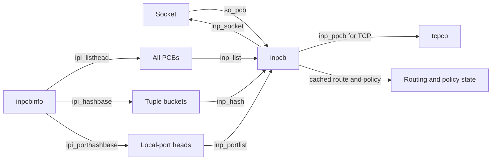
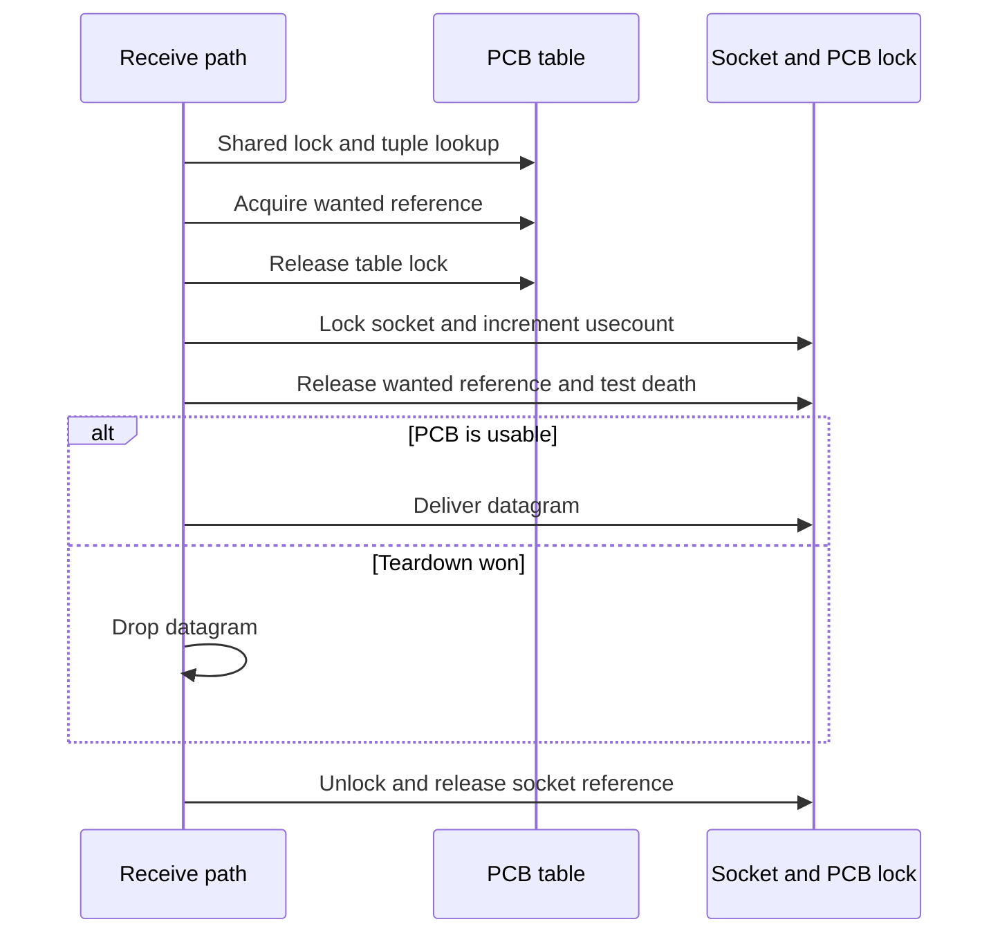

# Internet PCBs: address lookup, port allocation and lifetime

[Networking](README.md) · [UDP](udp-send-receive-and-errors.md) · [TCP timers](tcp-connections-and-timers.md) · [Skywalk namespaces](skywalk-lifecycles.md)

An Internet protocol control block (`inpcb`) connects a BSD socket to addresses, ports, routes and protocol lookup tables. Receiving a datagram first finds this object; it does not search file descriptors or copy directly into a process. This chapter follows allocation, publication, lookup and reclamation in `xnu-12377.121.6`. TCP and UDP share the PCB machinery, while their protocol-specific timers and final cleanup differ.

## The objects and the three kinds of protection

| Object/state | Role and protection |
| --- | --- |
| [`inpcb`](../../../xnu/bsd/netinet/in_pcb.h#L160) | `inp_socket` points back to the socket; `inp_ppcb` identifies protocol-specific state such as TCP's `tcpcb`. Address/port unions support IPv4 and IPv6. `inpcb_mtx` supplies the protocol socket lock when `PR_PCBLOCK` is set. |
| [`inpcbinfo`](../../../xnu/bsd/netinet/in_pcb.h#L652) | Per-protocol all-PCB list, counts, generation, tuple hash, local-port hash, allocation zone, port-search cursors and GC/timer callbacks. `ipi_lock` protects shared tables and membership. |
| [`inpcbport`](../../../xnu/bsd/netinet/in_pcb.h#L631) | A local-port head with a list of PCBs using that port. Reuse and wildcard decisions require more than one PCB per port. |
| `inp_wantcnt` | Atomic temporary protection for a found PCB while a caller leaves table protection and obtains socket protection. A stop-using sentinel closes this acquisition path. |
| `so_usecount` | Socket reference accounting, distinct from wanted references. Disposal checks that socket users have left. |
| `inp_state`, `INP2_INHASHLIST`, `SOF_PCBCLEARING` | Logical lifetime, hash membership and teardown progress. None is interchangeable with the reference counts. |



[`in_pcballoc()`](../../../xnu/bsd/netinet/in_pcb.c#L693) checks protocol memory accounting, allocates from `ipi_zone`, connects socket and PCB, initializes the mutex when required, applies initial policy/default flags, then inserts into the all-PCB list under exclusive `ipi_lock`. The allocation can be a larger combined structure, such as `inp_tp`; this function initializes the embedded `inpcb`. Allocation into the all-PCB list does not yet mean a local port was bound or a receive tuple published.

## Binding a port is a publication transaction

[`in_pcbbind()`](../../../xnu/bsd/netinet/in_pcb.c#L828) requires bind-in-progress state. It drops the socket lock while preserving the caller's socket reference, takes exclusive table protection, and checks whether another thread already bound the endpoint. It validates requested address ownership and port conflicts. Multicast reuse rules differ from ordinary unicast rules; `SO_REUSEADDR` can participate in multicast duplicate binding rather than simply permitting arbitrary identical unicast endpoints.

With an explicit port, conflict checks include wildcard/local-address rules, reuse flags and ownership restrictions. With port zero, the code selects low, default or high ephemeral ranges. The low range performs the reserved-port privilege check. The range's cursor (`ipi_lastlow`, `ipi_lastport`, or `ipi_lasthi`) is optionally randomized, then searched in the appropriate direction with a finite count. Restricted ports are skipped. Exhaustion returns `EADDRNOTAVAIL`; it does not loop indefinitely. Implicit binding forces unused-port lookup even when reuse options are present. See [range selection and search](../../../xnu/bsd/netinet/in_pcb.c#L1108-L1288).

Under `SKYWALK`, BSD TCP/UDP allocation also reserves the tuple's local namespace through `netns_reserve_in()` or `netns_reserve_in6()`. A free BSD hash slot alone is insufficient if the shared namespace rejects reservation. Externally reserved ports follow an NECP-provided token/flow-information branch instead. This is the bridge between BSD sockets and Skywalk port ownership; it does not make BSD sockets channel endpoints.

The socket lock is reacquired before committing local address and port. Because it was dropped, the function checks for a dead PCB and a competing bind, releases any tentative namespace reservation on failure, and only then publishes fields and invokes `in_pcbinshash()`. Hash insertion failure rolls back address, port, interface and anonymous-port state. See [commit and rollback](../../../xnu/bsd/netinet/in_pcb.c#L1289-L1345).

[`in_pcbinshash()`](../../../xnu/bsd/netinet/in_pcb.c#L2722) finds or allocates the local-port head, completes the namespace preregistration contract when configured, inserts into both lookup lists, and sets `INP2_INHASHLIST`. If it needs exclusive table protection while holding the socket lock, it first tries the table lock; on contention it drops/reacquires socket protection to avoid the documented inversion and rechecks death afterward.

[`bsd/netinet/in_pcb.c:2816–2823`](../../../xnu/bsd/netinet/in_pcb.c#L2816-L2823):

<!-- source-excerpt: ../../../xnu/bsd/netinet/in_pcb.c#L2816-L2823 -->
```c
	inp->inp_phd = phd;
	LIST_INSERT_HEAD(&phd->phd_pcblist, inp, inp_portlist);
	LIST_INSERT_HEAD(pcbhash, inp, inp_hash);
	inp->inp_flags2 |= INP2_INHASHLIST;

	if (!locked) {
		lck_rw_done(&pcbinfo->ipi_lock);
	}
```

## Lookup: exact tuple, wildcard fallback, then a lifetime handoff

[`in_pcblookup_hash_locked()`](../../../xnu/bsd/netinet/in_pcb.c#L2565) searches the exact foreign/local address and port tuple first. It filters by IPv4 eligibility and receive-interface restrictions, including NECP checks when compiled. Only when requested does it search the unconnected/wildcard bucket. A specific local address wins over an all-address bind; the code retains separate IPv4 and mapped-IPv6 wildcard candidates. The hash is an acceleration structure: equality and policy predicates still decide admission.

A successful result acquires `WNT_ACQUIRE` before leaving lookup. [`in_pcblookup_hash()`](../../../xnu/bsd/netinet/in_pcb.c#L2675) supplies shared `ipi_lock` around that operation and returns after dropping it. The caller must consume the wanted reference correctly; merely keeping the pointer does not keep the socket operational forever.

The acquire operation is a compare-and-swap loop on the count/sentinel:

[`bsd/netinet/in_pcb.c:3023–3031`](../../../xnu/bsd/netinet/in_pcb.c#L3023-L3031):

<!-- source-excerpt: ../../../xnu/bsd/netinet/in_pcb.c#L3023-L3031 -->
```c
		do {
			origwant = *wantcnt;
			if ((UInt16) origwant == 0xffff) {
				/* should stop using */
				return WNT_STOPUSING;
			}
			newwant = origwant + 1;
		} while (!OSCompareAndSwap(origwant, newwant, wantcnt));
		return WNT_ACQUIRE;
```

The nearby comment describes dead-state handling more broadly than this branch performs. This actual acquire branch tests the sentinel; `WNT_RELEASE`, under socket protection, checks `inp_state` and enters the stop-using path when dead. Consequently lookup success is provisional, and the receiver must revalidate after obtaining the socket lock.

For example, [`udp_input()`](../../../xnu/bsd/netinet/udp_usrreq.c#L826-L833) takes the UDP socket lock with a socket reference, releases the wanted reference while locked, and drops the packet if teardown won. [TCP timer dispatch](tcp-connections-and-timers.md) uses the same handoff across a different shared list. Table locks protect enumeration; wanted accounting protects the gap; socket locking protects endpoint decisions.



## Connect and disconnect change receive identity

[`in_pcbconnect()`](../../../xnu/bsd/netinet/in_pcb.c#L1833) selects a local address, searches for a conflicting exact tuple, binds a port if needed, then changes local/foreign fields under table protection. [`in_pcbrehash()`](../../../xnu/bsd/netinet/in_pcb.c#L2840) moves the PCB to the bucket for the new foreign address/port. Its contract does not support changing the local port: that would also require repairing the local-port list.

For UDP, a connected socket therefore has both a default send destination and a more specific receive lookup identity. [`in_pcbdisconnect()`](../../../xnu/bsd/netinet/in_pcb.c#L1934) clears foreign address/port and rehashes, with ntstat caching and content-filter state-generation updates. An unconnected `sendto()` need not establish this persistent identity; [UDP output](udp-send-receive-and-errors.md) uses per-send local variables for the destination.

## Death, stop-using and final disposal

[`in_pcbdetach()`](../../../xnu/bsd/netinet/in_pcb.c#L1971) notifies network statistics before losing endpoint information, marks the PCB dead through `WNT_STOPUSING`, releases options/routes and applicable policy state, sets `SOF_PCBCLEARING`, and schedules GC. Skywalk namespace tokens are released here unless the PCB is in TIME_WAIT. TCP's continued namespace/timer obligations must be considered separately from UDP teardown.

`WNT_STOPUSING` sets `inp_state = INPCB_STATE_DEAD`; it can install the wanted sentinel immediately only when no wanted users remain. The last wanted release can complete that transition later. Scheduling GC does not prove the PCB is immediately reclaimable.

[`udp_gc()`](../../../xnu/bsd/netinet/udp_usrreq.c#L2827) obtains exclusive PCB-table protection, selects stop-using PCBs, and tries the socket lock. A busy lock or nonzero socket usecount causes later retry. [`in_pcbdispose()`](../../../xnu/bsd/netinet/in_pcb.c#L2076) enforces the final gates, removes lists/hash ownership, tears down the protocol mutex and socket association, and returns storage through the protocol's allocation path.

[`bsd/netinet/udp_usrreq.c:2866–2882`](../../../xnu/bsd/netinet/udp_usrreq.c#L2866-L2882):

<!-- source-excerpt: ../../../xnu/bsd/netinet/udp_usrreq.c#L2866-L2882 -->
```c
		/*
		 * Keep gc active unless usecount is 0.
		 */
		so = inp->inp_socket;
		if (so->so_usecount == 0) {
			if (inp->inp_state != INPCB_STATE_DEAD) {
				if (SOCK_CHECK_DOM(so, PF_INET6)) {
					in6_pcbdetach(inp);
				} else {
					in_pcbdetach(inp);
				}
			}
			in_pcbdispose(inp);
		} else {
			socket_unlock(so, 0);
			os_atomic_inc(&ipi->ipi_gc_req.intimer_fast, relaxed);
		}
```

A useful failure scenario is a packet that found a PCB immediately before another thread closes it: the wanted count prevents premature reuse while the receiver waits for the socket lock; the receiver then sees stop-using on release and frees the packet; GC can reclaim only after socket users and wanted users have drained. No fd needs to remain open during this gap.

## Boundaries and follow-up evidence

This chapter reconstructs shared IPv4 PCB publication and lifetime, with IPv6 structures and configured namespace integration identified at their branches. IPv6 binding/source selection have their own bodies and are not identical copies of IPv4. Full NECP policy evaluation, every reuse restriction, TCP TIME_WAIT policy and multicast membership algorithms remain separate topics. No kernel or packet test was run for this source-based explanation; the [UDP guide](udp-send-receive-and-errors.md) identifies bounded in-tree API scenarios.

<!-- BEGIN PLATYDOC DOCUMENTATION LICENSE -->
Original Platydoc text and diagrams are licensed under [CC BY 4.0](https://creativecommons.org/licenses/by/4.0/). Quoted source code and third-party material retain their respective licenses.
<!-- END PLATYDOC DOCUMENTATION LICENSE -->
