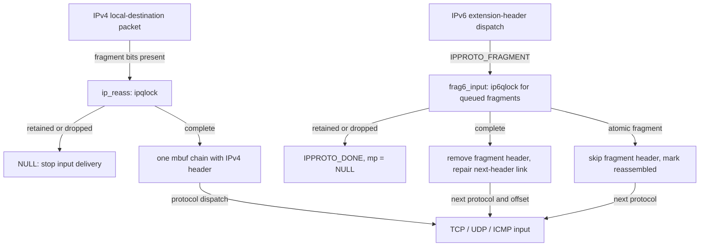
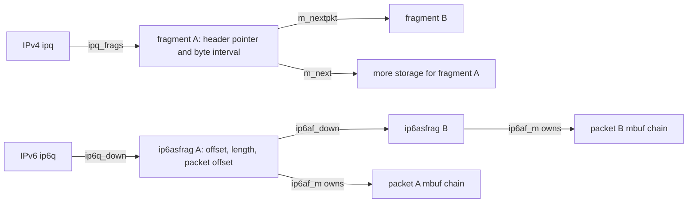
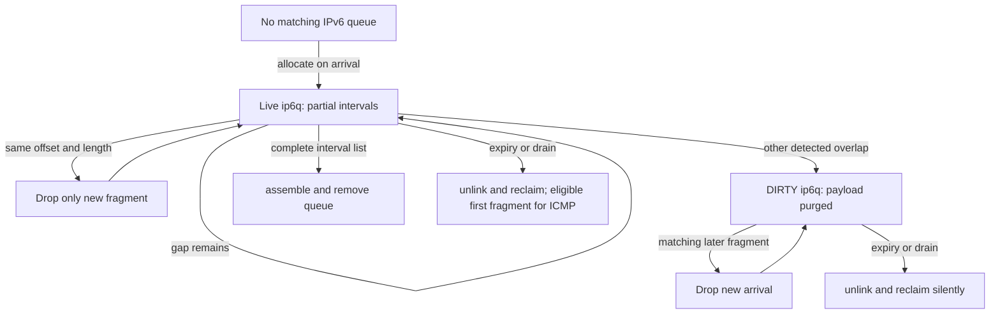
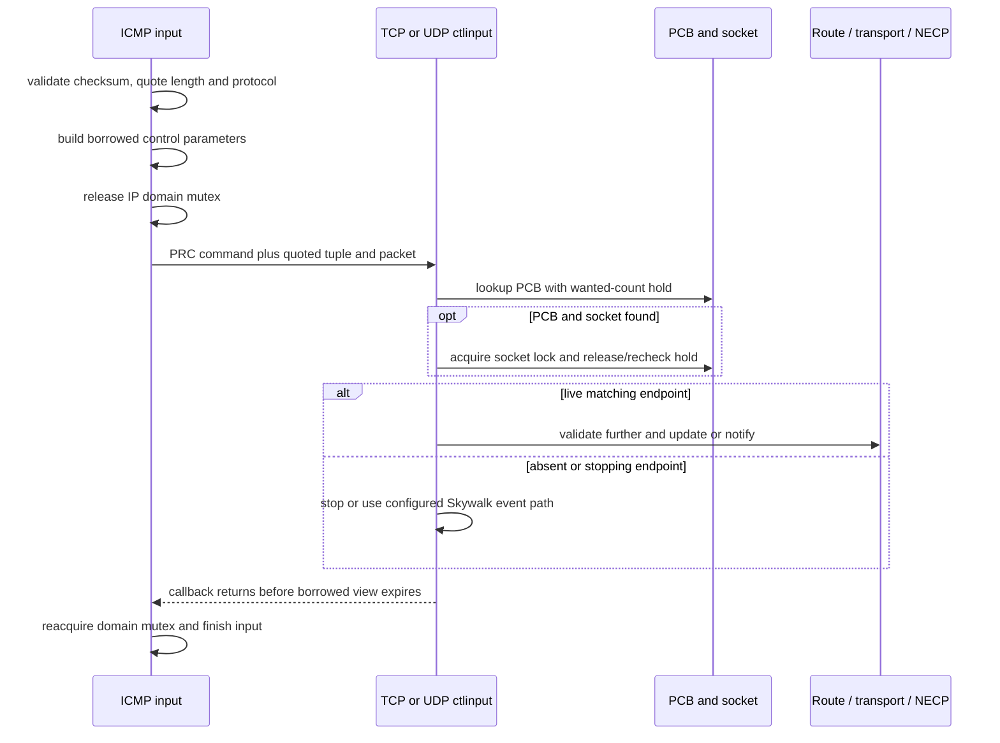

# IP fragment reassembly and ICMP error feedback

An incoming IP fragment owns packet storage but usually cannot yet be delivered to TCP or UDP. XNU retains that storage in an IP reassembly queue until the byte ranges form a complete datagram, a validation decision drops them, or a timer/drain reclaims them. ICMP runs beside this path: it can describe a failed datagram to its sender, and received ICMP can change a route's MTU or notify a transport endpoint long after the original send returned.

Return to [networking](README.md). Read [packet storage and interface delivery](packets-routes-and-interfaces.md), [IPv6 output and neighbor discovery](ipv6-output-and-neighbor-discovery.md), [UDP errors](udp-send-receive-and-errors.md), and [TCP connections](tcp-connections-and-timers.md) for the surrounding paths. [Skywalk fragment tracking](skywalk-fragments-reassembly-and-flow-tracking.md) uses separate objects and ownership; this chapter traces the common BSD IPv4/IPv6 implementation in `xnu-12377.121.6`.

The [IPv6 family guide](ipv6.md) connects these queues to [input/extension dispatch](ipv6-input-extension-headers-and-forwarding.md), [output fragmentation](ipv6-output-and-neighbor-discovery.md#software-fragmentation-replaces-one-packet-with-a-list), and the separate [ND/redirect](ipv6-neighbor-messages-and-reachability.md) and [MLD](ipv6-multicast-membership-and-mld.md) control paths.

Inspect the live [`ip6q`](../../structures/layout-browser.md?declaration=ip6q) layouts for the selected source configuration.

## Entry, delivery and the meaning of an incomplete result

IPv4 makes the local-destination decision before entering `ip_reass()`. The `ours` branch of `ip_input_second_pass()` checks fragment offset/flags, requires a single packet rather than a batched `m_nextpkt` list, and replaces its mbuf with the reassembly result. A null result means the caller no longer owns the input: the fragment may be queued or already freed. A completed result has an IP header again; input recomputes its header length, subtracts that length from `ip_len` for the upper-layer convention, and dispatches through `ip_input_dispatch_chain()`. Forwarded traffic follows `ip_forward()` instead of this local reassembly branch. See [destination and reassembly selection](../../../platydoc-data/xnu/bsd/netinet/ip_input.c#L1598-L1639) and [upper-layer handoff](../../../platydoc-data/xnu/bsd/netinet/ip_input.c#L1657-L1668).

The replacement contract is visible in [ip_input.c, lines 1622–1632](../../../platydoc-data/xnu/bsd/netinet/ip_input.c#L1622-L1632):

<!-- source-excerpt: ../../../platydoc-data/xnu/bsd/netinet/ip_input.c#L1622-L1632 -->
```c
	if (ip->ip_off & ~(IP_DF | IP_RF)) {
		VERIFY(npkts_in_chain == 1);
		m = ip_reass(m);
		if (m == NULL) {
			KERNEL_DEBUG(DBG_LAYER_END, 0, 0, 0, 0, 0);
			return;
		}
		ip = mtod(m, struct ip *);
		/* Get the header length of the reassembled packet */
		hlen = IP_VHL_HL(ip->ip_vhl) << 2;
	}
```

IPv6 represents extension headers as protocol dispatch steps. `ip6_protox[IPPROTO_FRAGMENT]` registers `frag6_input()` with `PR_PROTOLOCK`; the input loop therefore lets it manage its own synchronization. The routine receives `struct mbuf **mp` and `int *offp`. Completion returns the next protocol and updates both values; consumption returns `IPPROTO_DONE` with `*mp == NULL`. This is a dispatch result, not an errno. See [registration](../../../platydoc-data/xnu/bsd/netinet6/in6_proto.c#L262-L268), [dispatch and locking](../../../platydoc-data/xnu/bsd/netinet6/ip6_input.c#L1487-L1498), and [completion/consumption](../../../platydoc-data/xnu/bsd/netinet6/frag6.c#L915-L955).



The diagram omits earlier IP admission/filter checks and later transport validation. Reassembly completion alone does not guarantee socket delivery.

## Queue identity and the objects that own bytes

| Representation | State and ownership |
| --- | --- |
| IPv4 `struct ipq` | Hash-bucket linkage, source/destination, IP identifier and protocol, TTL, fragment count, checksum metadata, and `ipq_frags`. The queue owns each packet chain linked through `m_nextpkt`. |
| IPv4 fragment mbuf | `m_next` still links storage within one fragment. `m_pkthdr.pkt_hdr` remembers its IP header while `m_data` advances past that header. The stored `ip_off` is a **byte offset**, `ip_len` is fragment payload length, and `M_FRAG` records the more-fragments bit. |
| IPv6 `struct ip6q` | Global queue linkage, identification, scoped source/destination, TTL, ECN/checksum state, `ip6q_unfrglen`, `ip6q_nxt`, fragment count and `IP6QF_DIRTY`. Its fragment ring uses `ip6q_down/up`. |
| IPv6 `struct ip6asfrag` | Separately allocated descriptor with `ip6af_m` owning an mbuf chain, `ip6af_off` as reassembly byte offset, `ip6af_frglen` as fragmentable bytes, `ip6af_offset` as the offset **inside this packet** to those bytes, and `ip6af_mff`. |

Definitions and transformations: [`ipq`](../../../platydoc-data/xnu/bsd/netinet/ip_var.h#L95-L106), [IPv4 header hiding and queue publication](../../../platydoc-data/xnu/bsd/netinet/ip_input.c#L1978-L2057), [`ip6q`](../../../platydoc-data/xnu/bsd/netinet6/ip6_var.h#L114-L132), [`ip6asfrag`](../../../platydoc-data/xnu/bsd/netinet6/frag6.c#L96-L105), and [IPv6 descriptor initialization](../../../platydoc-data/xnu/bsd/netinet6/frag6.c#L619-L630).

The compact IPv4 queue definition is [ip_var.h, lines 95–106](../../../platydoc-data/xnu/bsd/netinet/ip_var.h#L95-L106):

<!-- source-excerpt: ../../../platydoc-data/xnu/bsd/netinet/ip_var.h#L95-L106 -->
```c
struct ipq {
	TAILQ_ENTRY(ipq) ipq_list;      /* to other reass headers */
	struct mbuf *ipq_frags;         /* to ip headers of fragments */
	u_char  ipq_ttl;                /* time for reass q to live */
	u_char  ipq_p;                  /* protocol of this fragment */
	u_short ipq_id;                 /* sequence id for reassembly */
	struct  in_addr ipq_src, ipq_dst;
	u_int32_t       ipq_nfrags;     /* # frags in this packet */
	uint32_t ipq_csum_flags;        /* checksum flags */
	uint32_t ipq_csum;              /* partial checksum value */
};

```

`ipqlock` protects IPv4's 64 hash buckets and queue operations. The hash uses source and identifier, but matching checks **identifier, source, destination and protocol**; a bucket hit is not a datagram identity. IPv6 searches a global doubly linked queue under `ip6qlock` and matches identification plus source/destination using scoped-address comparison. It does not use the IPv4 protocol-inclusive key: the next-header value comes from the accepted offset-zero fragment. See [IPv4 hash declarations](../../../platydoc-data/xnu/bsd/netinet/ip_input.c#L168-L180), [IPv4 comparison](../../../platydoc-data/xnu/bsd/netinet/ip_input.c#L1876-L1891), and [IPv6 comparison/initial state](../../../platydoc-data/xnu/bsd/netinet6/frag6.c#L464-L506).



Only forward links are drawn. IPv6 also maintains back-links and a sentinel; neither representation means that all payload bytes occupy one contiguous allocation.

## IPv4 insertion, overlap and assembly

### Normalize each fragment before ordering it

`ip_reass()` rejects all new fragments when either configured queue admission or per-packet fragment admission is zero. It looks up a queue under `ipqlock`, handles eligible UDP partial checksum metadata, and invalidates the incoming `CSUM_DATA_VALID` flag while reassembly is unresolved. It removes the IP header from the fragment payload length; a nonfinal fragment must contain a nonzero multiple of eight bytes. It shifts the encoded fragment offset into bytes and advances the mbuf data pointer past the IP header. The saved `pkt_hdr` pointer remains the route back to the header. See [admission](../../../platydoc-data/xnu/bsd/netinet/ip_input.c#L1858-L1874), [checksum normalization](../../../platydoc-data/xnu/bsd/netinet/ip_input.c#L1922-L1976), and [length/offset transformation](../../../platydoc-data/xnu/bsd/netinet/ip_input.c#L1978-L2024).

The first arrival allocates an `ipq` with `Z_NOWAIT | Z_ZERO`, installs it in the bucket and owns that fragment. “First arrival” need not mean offset zero. Later fragments increment the queue's fragment count before ECN/overlap decisions; a path dropping only the new fragment reverses that count. CE propagation preserves congestion indication, while specified CE/non-ECT mixtures reject the incoming fragment. See [new queue and ECN](../../../platydoc-data/xnu/bsd/netinet/ip_input.c#L2026-L2075), [drop cleanup](../../../platydoc-data/xnu/bsd/netinet/ip_input.c#L2278-L2296), and [allocation](../../../platydoc-data/xnu/bsd/netinet/ip_input.c#L2395-L2421).

### Overlap is trimmed rather than uniformly rejecting the datagram

The queue is ordered by byte offset. If a predecessor covers all incoming bytes, the new fragment is dropped. If it covers only the prefix, XNU trims that prefix and adjusts offset/length. Conversely, incoming data can trim a following fragment's prefix or fully replace later queued fragments. Removed later fragments go on a deferred-free queue; partial trimming invalidates accumulated checksum eligibility. See [predecessor handling](../../../platydoc-data/xnu/bsd/netinet/ip_input.c#L2077-L2111) and [successor handling](../../../platydoc-data/xnu/bsd/netinet/ip_input.c#L2113-L2137).

The concrete prefix adjustment is [ip_input.c, lines 2095–2105](../../../platydoc-data/xnu/bsd/netinet/ip_input.c#L2095-L2105):

<!-- source-excerpt: ../../../platydoc-data/xnu/bsd/netinet/ip_input.c#L2095-L2105 -->
```c
	if (p) {
		i = GETIP(p)->ip_off + GETIP(p)->ip_len - ip->ip_off;
		if (i > 0) {
			if (i >= ip->ip_len) {
				goto dropfrag;
			}
			m_adj(m, i);
			fp->ipq_csum_flags = 0;
			ip->ip_off += i;
			ip->ip_len -= i;
		}
```

Illustrative byte intervals, with no IP options: a queue holding `[0,1024)` receives `[768,1536)`. The overlap is 256 bytes, so the incoming fragment contributes `[1024,1536)`. If a queued successor begins at 1408, the incoming fragment also overlaps that successor and the next loop decides how much of the successor remains. This is IP payload geometry; it is unrelated to TCP sequence numbers. The exact retained bytes depend on predecessor/successor position, so describing this as a blanket “last fragment wins” rule is inaccurate.

### A complete interval list becomes one packet chain

Completion walks from byte offset zero and requires every fragment to start exactly at the end of the preceding fragment. The last fragment must clear `M_FRAG`. If a gap or more-fragments tail remains and the per-packet count exceeds `maxfragsperpacket`, XNU frees the whole queue. Completion is checked before that limit rejects an incomplete queue, allowing the extra arrival to finish a packet. Final header-plus-payload length must fit `IP_MAXPACKET`. See [contiguity, limit and size decisions](../../../platydoc-data/xnu/bsd/netinet/ip_input.c#L2152-L2203).

Successful assembly clears `m_nextpkt` links and concatenates fragment storage with `m_cat()`. It publishes eligible accumulated checksum information, rebuilds the first IP header's total length, sets `fp->ipq_frags = NULL`, and then frees the queue header. Clearing that owner pointer is what prevents queue destruction from freeing the returned packet. Finally it exposes the hidden first header, fixes aggregate mbuf length, releases the mutex and drains deferred frees. `m_cat()` can reorganize storage; the result is one packet chain, not a promise of one physically contiguous buffer. See [assembly and ownership transfer](../../../platydoc-data/xnu/bsd/netinet/ip_input.c#L2205-L2263).

## IPv6: atomic fragments, first-header validation and dirty queues

### Admission separates an atomic header from a queued datagram

`frag6_input()` ensures the fragment header is accessible, rejects a fragment header in a jumbogram, and checks the eight-byte rule for a nonfinal fragment. Its zero-limit admission rejection precedes the atomic-fragment shortcut. An atomic fragment has zero offset and a clear more-fragments bit: it bypasses queue lookup, advances the parser past the fragment header, and sets `PKTF_REASSEMBLED`. It does **not** perform the full reassembly path's removal/rewrite of that header. See [initial checks and atomic return](../../../platydoc-data/xnu/bsd/netinet6/frag6.c#L306-L387).

The flag remains security-relevant even when no queue was needed. `icmp6_input()` rejects router solicitation/advertisement, neighbor solicitation/advertisement and redirect messages marked `PKTF_REASSEMBLED`. Thus the atomic shortcut cannot erase the fact that an NDP packet carried a fragment header. See [NDP admission](../../../platydoc-data/xnu/bsd/netinet6/icmp6.c#L510-L528).

### The accepted offset-zero fragment establishes the interpretation

A new queue starts with `ip6q_unfrglen == -1`. Other fragments can arrive before the fragment that carries the initial headers. On offset zero, the code proposes an unfragmentable-part length and next protocol in **local variables**, checks maximum reconstructed length, verifies that the first fragment contains the upper-layer header through `ip6_pkt_has_ulp()`, and rechecks already queued fragments against the now-known length. The locals are committed only after the incoming fragment survives insertion/overlap checks. See [first-fragment decisions](../../../platydoc-data/xnu/bsd/netinet6/frag6.c#L521-L617), [upper-layer-header walker](../../../platydoc-data/xnu/bsd/netinet6/ip6_input.c#L2379-L2428), and [publication](../../../platydoc-data/xnu/bsd/netinet6/frag6.c#L784-L788).

The nearby comment warns that another offset-zero packet can overwrite the interpretation. The current body is more constrained: it initializes the locals only while the saved length is `-1`, handles duplicates/overlaps, and delays publication until acceptance. Follow those predicates rather than treating the old comment as an unconditional description of current behavior.

### Duplicate and overlapping fragments have different outcomes

The implementation finds the first queued descriptor with a strictly larger offset. It checks the predecessor and successor for overlaps. A same-offset, same-length predecessor causes **only the incoming fragment** to be dropped; the code does not compare all payload bytes. A same-offset different-length fragment, or another nonempty overlap, sets `drop_fragq`. This exception matters because the preceding comment describes dropping every overlapping chain. See [comparison and exception](../../../platydoc-data/xnu/bsd/netinet6/frag6.c#L658-L713).

The actual duplicate branch is [frag6.c, lines 680–692](../../../platydoc-data/xnu/bsd/netinet6/frag6.c#L680-L692):

<!-- source-excerpt: ../../../platydoc-data/xnu/bsd/netinet6/frag6.c#L680-L692 -->
```c
		if (af6->ip6af_up->ip6af_off == ip6af->ip6af_off) {
			if (af6->ip6af_up->ip6af_frglen != ip6af->ip6af_frglen) {
				drop_fragq = TRUE;
			} else {
				/*
				 * XXX Ideally we should be comparing the entire
				 * packet here but for now just use off and fraglen
				 * to ignore a duplicate fragment.
				 */
				ip6af_free(ip6af);
				drop_reason = DROP_REASON_IP6_FRAG_OVERLAPPING;
				goto dropfrag;
			}
```

For a detected overlap, XNU first links the new descriptor into the queue, then marks `IP6QF_DIRTY` and purges all payload descriptors/mbufs. The `ip6q` identity stays linked; subsequent matching arrivals hit the dirty check and are dropped. The overlap path also drains pending parameter-error mbufs without generating ICMP. Retaining this empty identity prevents a new matching arrival from simply starting reassembly again before expiry. See [dirty admission](../../../platydoc-data/xnu/bsd/netinet6/frag6.c#L516-L519) and [purge and silent cleanup](../../../platydoc-data/xnu/bsd/netinet6/frag6.c#L733-L781).

The retention decision is explicit in [frag6.c, lines 745–750](../../../platydoc-data/xnu/bsd/netinet6/frag6.c#L745-L750):

<!-- source-excerpt: ../../../platydoc-data/xnu/bsd/netinet6/frag6.c#L745-L750 -->
```c
	if (drop_fragq) {
		struct fq6_head dfq6 = {0};
		MBUFQ_INIT(&dfq6);      /* for deferred frees */
		q6->ip6q_flags |= IP6QF_DIRTY;
		/* Purge all the fragments but do not free q6 */
		frag6_purgef(q6, &dfq6, NULL);
```



### Completion rewrites the extension-header chain

As in IPv4, the intervals must begin at zero, be contiguous and finish with a clear more-fragments bit. IPv6 detaches each descriptor, chains later mbufs behind the first, and removes each later packet's leading headers using its own `ip6af_offset`. It reconstructs payload length, scoped addresses and ECN, removes the first packet's fragment header, and writes the saved next-header protocol into the preceding header via `ip6_get_prevhdr()`. It then removes `ip6q`, adjusts counters, fixes packet length, marks `PKTF_REASSEMBLED`, and publishes the new `*mp`, `*offp` and returned protocol. The less common `m_split()` removal branch can still fail after concatenation; it retires queue accounting and drops the assembled chain. See [contiguity and concatenation](../../../platydoc-data/xnu/bsd/netinet6/frag6.c#L790-L826) and [header rewrite, failure and return](../../../platydoc-data/xnu/bsd/netinet6/frag6.c#L849-L931).

Illustrative no-extension-header case: fragmentable offsets 0 and 1024 each refer to bytes **after** a 40-byte IPv6 header and an 8-byte fragment header. Each descriptor's packet offset is therefore 48. On assembly the later packet loses its first 48 bytes; the first packet loses only its fragment header, leaving the upper-layer header at offset 40. With pre-fragment extension headers, the packet offsets are larger, while reassembly offsets still count only fragmentable bytes.

## Resource bounds, timers and cleanup context

| Mechanism | IPv4 | IPv6 |
| --- | --- | --- |
| Admission controls | `maxnipq`, `maxfragsperpacket`; zero disables new fragments. | `ip6_maxfragpackets`, `ip6_maxfrags`; zero disables new fragments, including atomic shortcut admission. |
| Allocation accounting | `ipq_count` and `ipq_limit` are separate from linked `nipq`; allocation is nonblocking. | Separate `ip6q_count/limit` and `ip6af_count/limit`, with nonblocking typed allocation. |
| Limit boundary | Allocator rejects when count is **greater than** limit, so do not describe a positive limit as an exact hard cap. Queue trimming and per-packet completion checks are separate. | The allocators also use `>`; descriptor allocation pressure and linked queue count have different meanings. |
| Expiry | `IPFRAGTTL` is 30 one-second timer decrements from queue creation. | `IPV6_FRAGTTL` is 60 one-second timer decrements from queue creation. |
| Completion | Queue relinquishes mbufs before header destruction. | Descriptors relinquish their mbufs during concatenation; queue/header removal follows. |
| Expiry feedback | `frag_timeout()` frees queues; this path does not construct an ICMP reassembly-timeout response. | `frag6_timeout()` can retain offset-zero mbuf for an ICMPv6 time-exceeded response; dirty queues suppress that response. |

Sources: [IPv4 defaults](../../../platydoc-data/xnu/bsd/netinet/ip_input.c#L526-L533), [IPv4 limit/allocator](../../../platydoc-data/xnu/bsd/netinet/ip_input.c#L1763-L1789), [allocation comparison](../../../platydoc-data/xnu/bsd/netinet/ip_input.c#L2395-L2421), [IPv4 TTL definition](../../../platydoc-data/xnu/bsd/netinet/ip.h#L248), [IPv6 defaults](../../../platydoc-data/xnu/bsd/netinet6/frag6.c#L170-L180), [IPv6 allocators and controls](../../../platydoc-data/xnu/bsd/netinet6/frag6.c#L1200-L1292), and [IPv6 TTL definition](../../../platydoc-data/xnu/bsd/netinet/ip6.h#L301).

Both timers arm only while queues exist and rearm after scans. Their TTLs are not refreshed on every new fragment. IPv4 expires queues and applies lowered queue limits under `ipqlock`; `ip_drain()` also drains fragments before cached routes and ARP. Whole-queue IPv4 cleanup can free mbufs while holding the mutex, although replaced successor fragments in insertion use deferred freeing. It would be inaccurate to claim that every mbuf free occurs after unlocking. See [IPv4 freeing/timer/drain](../../../platydoc-data/xnu/bsd/netinet/ip_input.c#L2304-L2392) and [`ip_drain()`](../../../platydoc-data/xnu/bsd/netinet/ip_input.c#L2427-L2432).

IPv6's `frag6_purgef()` detaches descriptors and assigns mbufs to a free list or, when requested, an ICMP list for the offset-zero fragment. `frag6_freef()` additionally removes the queue and settles its logical counters. A dirty queue has already released payload storage but retains its queue/accounting state until that final removal; its counts must not be read as a precise live-mbuf inventory. Timeout and drain release `ip6qlock` before processing deferred frees and invoking ICMP. The overlap branch instead drains its discard lists while still inside its locked path. See [purge versus final removal](../../../platydoc-data/xnu/bsd/netinet6/frag6.c#L968-L1025), [timeout](../../../platydoc-data/xnu/bsd/netinet6/frag6.c#L1080-L1149), and [drain](../../../platydoc-data/xnu/bsd/netinet6/frag6.c#L1166-L1197).

The error-dispatch helpers assert that `ip6qlock` is not held. Parameter errors save their offending header offset in temporary mbuf context and restore/scrub it before calling ICMP; timeout errors use `ICMP6_TIME_EXCEED_REASSEMBLY`. This separates queue mutation from recursive output work. See [temporary context and deferred errors](../../../platydoc-data/xnu/bsd/netinet6/frag6.c#L184-L243).

## Generating an ICMP error consumes the offending packet

`icmp_error(n, type, code, dest, nextmtu)` owns the original IPv4 mbuf chain. It suppresses configured port-unreachable errors, link broadcast/multicast, noninitial fragments and errors in response to most ICMP errors. It checks contiguous header availability and derives a bounded quotation of the original packet, pulling up TCP headers when necessary. Pullup failure can already consume the original chain. It allocates a response mbuf/cluster, copies the quoted IP header and bytes, includes `icmp_nextmtu` for fragmentation-needed, restores the quote's network byte order, sends through `icmp_reflect()`, and frees the original chain at `freeit`. Suppression and allocation failure also finish at cleanup. See [suppression and quote bounds](../../../platydoc-data/xnu/bsd/netinet/ip_icmp.c#L208-L335), [response construction](../../../platydoc-data/xnu/bsd/netinet/ip_icmp.c#L337-L390), and [handoff/free](../../../platydoc-data/xnu/bsd/netinet/ip_icmp.c#L414-L432).

IPv6's `icmp6_error_flag()` also consumes its input, but builds the response by trimming the quotation and **prepending** IPv6/ICMPv6 headers to that chain. Its multicast suppression has explicit Packet Too Big and selected Parameter Problem exceptions; unspecified/multicast source addresses and error-on-error decisions impose additional limits. `M_PREPEND` can consume the chain on allocation failure. Reflection then owns the constructed response. See [IPv6 eligibility](../../../platydoc-data/xnu/bsd/netinet6/icmp6.c#L295-L395) and [trim/prepend/reflect](../../../platydoc-data/xnu/bsd/netinet6/icmp6.c#L401-L459).

These routines express a best-effort protocol response, not guaranteed delivery or an immediate error return to the process that sent the original packet. Output routing, filtering, packet suppression and device delivery still apply.

## Receiving ICMP: quoted headers become transport control input

The outer ICMP packet identifies the reporter. The **quoted inner IP and transport headers** identify the failed outbound operation. IPv4 `icmp_input()` checks minimum size and checksum, maps type/code into `PRC_*`, checks the quote's IP header and available bytes, and dispatches through the quoted protocol's `pr_ctlinput`. For example, fragmentation-needed becomes `PRC_MSGSIZE`; it does not directly call a socket's send routine. See [validation/type mapping](../../../platydoc-data/xnu/bsd/netinet/ip_icmp.c#L455-L578) and [quoted dispatch](../../../platydoc-data/xnu/bsd/netinet/ip_icmp.c#L579-L634).

`struct ipctlparam` is a borrowed view: it contains the live mbuf, the ICMP header, its quoted IP header and the byte offset of the quoted transport header. It lives on the caller's stack during the callback. The dispatcher drops `inet_domain_mutex` before invoking transport control, then reacquires it; TCP/UDP establish their own PCB/socket lifetime protection. See [ip_icmp.c, lines 618–632](../../../platydoc-data/xnu/bsd/netinet/ip_icmp.c#L618-L632):

<!-- source-excerpt: ../../../platydoc-data/xnu/bsd/netinet/ip_icmp.c#L618-L632 -->
```c
		if (ctlfunc) {
			struct ipctlparam ctl_param = {
				.ipc_m = m,
				.ipc_icmp = icp,
				.ipc_icmp_ip = &icp->icmp_ip,
				.ipc_off = hlen + offsetof(struct icmp, icmp_ip) + (IP_VHL_HL(icp->icmp_ip.ip_vhl) << 2)
			};
			LCK_MTX_ASSERT(inet_domain_mutex, LCK_MTX_ASSERT_OWNED);

			lck_mtx_unlock(inet_domain_mutex);

			(*ctlfunc)(code, SA(&icmpsrc),
			    (void *)&ctl_param, m->m_pkthdr.rcvif);

			lck_mtx_lock(inet_domain_mutex);
```



[Internet PCB lifetime](internet-pcbs-ports-and-lifetime.md) explains why lookup success is insufficient after taking the socket lock. In [`udp_ctlinput()`](../../../platydoc-data/xnu/bsd/netinet/udp_usrreq.c#L1074-L1110), the quoted ports and addresses select a connected PCB. `udp_notify()` sets `so_error` and wakes readers/writers. A `PRC_MSGSIZE` endpoint associated with a NECP client instead receives a protocol-control event and avoids also setting that socket error. With `SKYWALK`, the no-socket path can enqueue an event for flow processing. These are separate delivery outcomes, not a universal “ICMP sets errno” rule. See [UDP notification](../../../platydoc-data/xnu/bsd/netinet/udp_usrreq.c#L1030-L1035) and [Skywalk fallback](../../../platydoc-data/xnu/bsd/netinet/udp_usrreq.c#L1111-L1132).

IPv6's `icmp6_notify_error()` walks the quoted extension-header chain to find a usable next-header protocol and offset. It stops interpreting transport bytes after a noninitial fragment header; PMTU processing can still happen at that notification point. It forms scoped source/destination sockaddrs and `struct ip6ctlparam`, then drops `inet6_domain_mutex` around the selected `pr_ctlinput`. Its comments explicitly acknowledge that inner-packet scope is inferred from the received ICMP interface. See [quote walking](../../../platydoc-data/xnu/bsd/netinet6/icmp6.c#L967-L1130) and [scope/parameters/callback](../../../platydoc-data/xnu/bsd/netinet6/icmp6.c#L1133-L1196).

## Path MTU: route state, TCP state and validation occur at different points

### IPv4 TCP checks the quoted sequence before changing its route

`tcp_ctlinput()` selects `tcp_mtudisc` for `PRC_MSGSIZE`. It requires enough quoted TCP bytes for ports and sequence, looks up the PCB, locks its socket and checks the wanted-count release result. Except for redirect handling, the quoted TCP sequence must satisfy `snd_una <= seq < snd_max` using wrap-aware comparisons before notification. For fragmentation-needed, `tcp_handle_msgsize()` runs inside that accepted branch. See [selection and length check](../../../platydoc-data/xnu/bsd/netinet/tcp_subr.c#L2735-L2776) and [socket/sequence admission](../../../platydoc-data/xnu/bsd/netinet/tcp_subr.c#L2799-L2823).

`tcp_handle_msgsize()` selects the outbound scope from a usable cached route or the PCB's last output interface, obtains a referenced host route and locks it. A nonlocked route MTU can decrease to the advertised value, or to a table-derived lower value when the advertisement contains zero. For an implausibly small value the body sets `RTV_MTU`; although the earlier comment also mentions resetting MTU to interface size, the shown small-value branch does not perform that reset. It then unlocks and releases the route reference. See [scope/ref acquisition](../../../platydoc-data/xnu/bsd/netinet/tcp_subr.c#L2594-L2654) and [MTU body](../../../platydoc-data/xnu/bsd/netinet/tcp_subr.c#L2656-L2690).

`tcp_mtudisc()` reads the selected route MTU, applies effective-MTU policy, subtracts protocol/option overhead and reduces `t_maxopd`/`t_maxseg` when appropriate. It updates congestion-control state, clears the RTT measurement, resets `snd_nxt` to `snd_una` and asks `tcp_output()` to retransmit. A defunct/closed connection returns early. A missing route or zero route MTU first resets `t_maxopd` and `t_maxseg` to the IPv4/IPv6 default MSS and then returns; that failure to obtain a usable MTU can still change TCP state. This changes TCP segmentation and retries outstanding bytes; it does not reassemble the offending outbound packet. See [MTU/MSS decisions](../../../platydoc-data/xnu/bsd/netinet/tcp_subr.c#L3148-L3240) and [retransmission request](../../../platydoc-data/xnu/bsd/netinet/tcp_subr.c#L3241-L3257).

### IPv6 route PMTU update precedes transport-specific checks

`icmp6_notify_error()` invokes `icmp6_mtudisc_update(&ip6cp, 1)` for Packet Too Big **before** calling the selected transport handler. The literal `1` is a caller-supplied validated flag; it is not proof that a matching TCP socket and outstanding sequence were found. See [icmp6.c, lines 1180–1186](../../../platydoc-data/xnu/bsd/netinet6/icmp6.c#L1180-L1186):

<!-- source-excerpt: ../../../platydoc-data/xnu/bsd/netinet6/icmp6.c#L1180-L1186 -->
```c
		if (icmp6type == ICMP6_PACKET_TOO_BIG) {
			notifymtu = ntohl(icmp6->icmp6_mtu);
			ip6cp.ip6c_cmdarg = (void *)&notifymtu;
			icmp6_mtudisc_update(&ip6cp, 1);        /*XXX*/
		}

		ctlfunc = ip6_protox[nxt]->pr_ctlinput;
```

The update rejects values below IPv6 header + fragment header + eight bytes, rejects a false validated flag, clamps other sub-minimum values to `IPV6_MMTU`, and looks up a route using the receive-interface scope. It lowers MTU only for an unlocked host route when the proposed value is below both link MTU and the route's current MTU. The source comments call out the asymmetric-route limitation of that receive-interface choice. See [IPv6 route update](../../../platydoc-data/xnu/bsd/netinet6/icmp6.c#L1206-L1261).

`tcp6_ctlinput()` separately checks quoted length, ports, outstanding sequence and whether a proposed MTU is lower than its current segment-plus-header size before asking `tcp_mtudisc()` to act. For a very small offer its local notification comparison uses `IPV6_MMTU - 8`, while the earlier route update uses a 1280-byte floor. Keep these stages distinct: the route change may precede a later TCP rejection. See [TCPv6 parsing/offer handling](../../../platydoc-data/xnu/bsd/netinet/tcp_subr.c#L2910-L2937) and [socket admission/notification](../../../platydoc-data/xnu/bsd/netinet/tcp_subr.c#L2961-L2993).

## Review limits and source tests

This chapter reviews the common BSD local reassembly implementations, selected error construction and the quoted-header path into UDP/TCP/PMTU. It does not claim complete IP input/forwarding, option parsing, multicast membership, ICMP redirect/echo/node-information, PF/IPsec fragment normalization, or Skywalk fragment conformance. Configuration-dependent callbacks and external peers still affect end-to-end behavior.

Two test names need careful interpretation. [`tests/icmp_fragmented_payload.c`](../../../platydoc-data/xnu/tests/icmp_fragmented_payload.c#L328-L369) constructs a **truncated ICMP quotation of TCP**; it is useful evidence for control-input length checks, not an IP overlap-reassembly test. [`tests/net/ip6_frag_hbh_panic.c`](../../../platydoc-data/xnu/tests/net/ip6_frag_hbh_panic.c#L210-L265) exercises **outbound fragmentation** when unfragmentable headers exceed the selected MTU, not this chapter's incoming reassembly state machine. Its assertions accept send success or several nonfatal network errors as well as `EMSGSIZE`; passing it alone would not prove the size guard executed. The distinct [`tests/skywalk/skt_reass.c`](../../../platydoc-data/xnu/tests/skywalk/skt_reass.c) belongs to the Skywalk follow-up route. No kernel/network test was executed for this documentation change; overlap, expiry and PMTU explanations are source-derived.

<!-- BEGIN PLATYDOC DOCUMENTATION LICENSE -->
Original Platydoc text and diagrams are licensed under [CC BY 4.0](https://creativecommons.org/licenses/by/4.0/). Quoted source code and third-party material retain their respective licenses.
<!-- END PLATYDOC DOCUMENTATION LICENSE -->
