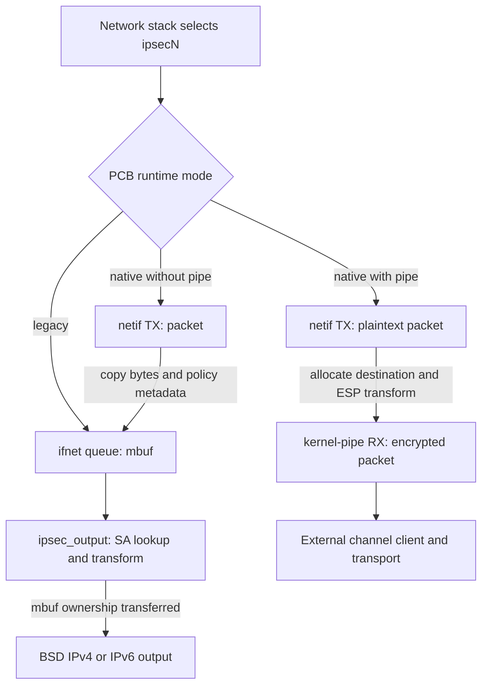
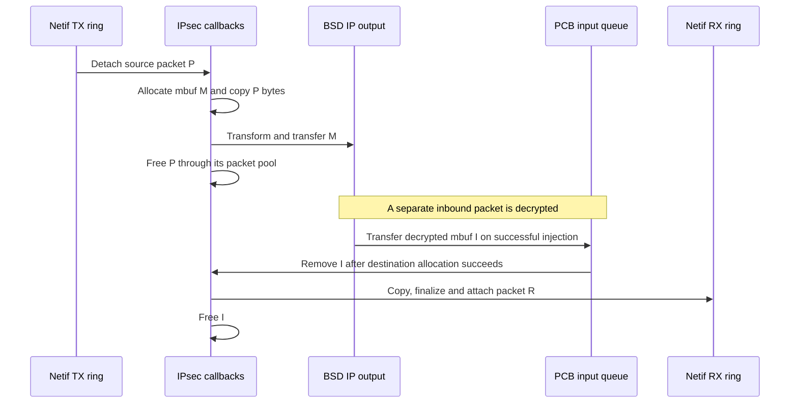
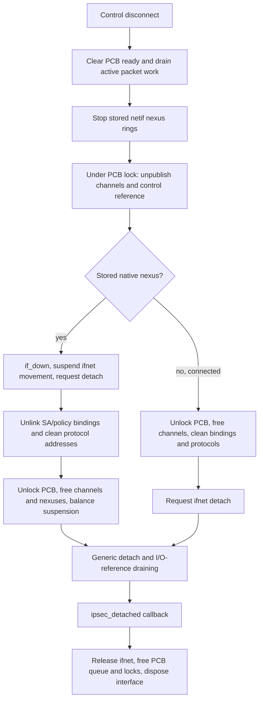

# IPsec interfaces, packet representations, and staged disconnect

[Networking guide](README.md) · [IPsec policy and transforms](ipsec-policy-associations-and-transforms.md) · [Skywalk pipes](skywalk-user-and-kernel-pipes.md) · [Packet and interface lifetime](packets-routes-and-interfaces.md)

An `ipsecN` interface supplies an interface identity for IPsec traffic and a lifetime shared by a kernel-control connection, an `ifnet`, association bindings and, optionally, Skywalk nexuses. Creating it does not negotiate keys or install a usable security association. This chapter follows the local interface implementation in `xnu-12377.121.6`, from control admission through output, input and asynchronous destruction. The [IPsec companion](ipsec-policy-associations-and-transforms.md) explains policy publication, association generations and transform internals.

## 1. One interface implementation has three packet paths

The build selects `if_ipsec.c` with `ipsec`. Within that file, `SKYWALK` defines `IPSEC_NEXUS`; this enables additional code, while each PCB's `ipsec_use_netif` and `ipsec_kpipe_count` select its runtime path. Binding initializes `ipsec_use_netif` to false. Requesting kernel pipes without enabling the native netif fails with `ENOTSUP` at connect. [Build selection](../../../platydoc-data/xnu/bsd/conf/files#L206-L206), [nexus guard](../../../platydoc-data/xnu/bsd/net/if_ipsec.c#L59-L66), [bind defaults](../../../platydoc-data/xnu/bsd/net/if_ipsec.c#L2548-L2590), [connect selection](../../../platydoc-data/xnu/bsd/net/if_ipsec.c#L2622-L2655).

| Selected path | Outbound representation and destination | Inbound representation and source |
| --- | --- | --- |
| Legacy ifnet | `ipsec_start()` dequeues mbufs; `ipsec_output()` transforms and submits them to BSD IP output | Decrypted mbuf enters `ipsec_inject_inbound_packet()`, family demux and `proto_input()` |
| Native netif, no kernel pipe | Netif TX packet is copied into a new mbuf, then follows `ipsec_output()` | Decrypted mbufs queue in the PCB, then copy into netif RX packets |
| Native netif with kernel pipes | Netif TX plaintext packet is transformed into a separately allocated kernel-pipe RX packet for the channel client | Channel TX encrypted packet is decrypted into a separately allocated netif RX packet |

Sources: [legacy start](../../../platydoc-data/xnu/bsd/net/if_ipsec.c#L3853-L3869), [native TX](../../../platydoc-data/xnu/bsd/net/if_ipsec.c#L1088-L1241), [pipe RX](../../../platydoc-data/xnu/bsd/net/if_ipsec.c#L743-L952), [native RX](../../../platydoc-data/xnu/bsd/net/if_ipsec.c#L1465-L1798), [mbuf input](../../../platydoc-data/xnu/bsd/net/if_ipsec.c#L4093-L4149).

TX and RX are relative to the endpoint: packets leaving the network stack through netif TX become packets the channel client receives on kernel-pipe RX. A channel client's TX becomes netif RX. The third path performs its ESP transforms in the kernel. The external client supplies transport and channel participation; this source does not supply that client's implementation.



The diagram shows successful ownership transfers; allocation, policy, association and transform failures can consume/drop the source packet before reaching the next destination.

## 2. Control admission creates identities before publishing an interface

`ipsec_register_control()` registers `com.apple.net.ipsec_control`, its setup/bind/connect/disconnect callbacks and IPv4/IPv6 protocol plumbers. The control is privileged and uses provider-managed setup. Generic kernel-control admission requires the appropriate socket type and a superuser credential for this flag; the provider is not itself the complete admission check. [Control name](../../../platydoc-data/xnu/bsd/net/if_ipsec.h#L64-L64), [registration and plumber unwind](../../../platydoc-data/xnu/bsd/net/if_ipsec.c#L359-L410), [generic admission](../../../platydoc-data/xnu/bsd/kern/kern_control.c#L425-L548).

[Registered lifecycle callbacks — `if_ipsec.c`, lines 369–382](../../../platydoc-data/xnu/bsd/net/if_ipsec.c#L369-L382).

<!-- source-excerpt: ../../../platydoc-data/xnu/bsd/net/if_ipsec.c#L369-L382 -->
```c

	bzero(&kern_ctl, sizeof(kern_ctl));
	strlcpy(kern_ctl.ctl_name, IPSEC_CONTROL_NAME, sizeof(kern_ctl.ctl_name));
	kern_ctl.ctl_name[sizeof(kern_ctl.ctl_name) - 1] = 0;
	kern_ctl.ctl_flags = CTL_FLAG_PRIVILEGED | CTL_FLAG_REG_SETUP; /* Require root */
	kern_ctl.ctl_sendsize = 64 * 1024;
	kern_ctl.ctl_recvsize = 64 * 1024;
	kern_ctl.ctl_setup = ipsec_ctl_setup;
	kern_ctl.ctl_bind = ipsec_ctl_bind;
	kern_ctl.ctl_connect = ipsec_ctl_connect;
	kern_ctl.ctl_disconnect = ipsec_ctl_disconnect;
	kern_ctl.ctl_send = ipsec_ctl_send;
	kern_ctl.ctl_setopt = ipsec_ctl_setopt;
	kern_ctl.ctl_getopt = ipsec_ctl_getopt;
```

`ipsec_ctl_setup()` holds the global `ipsec_lock` while reserving a control unit, choosing a separate unique ID, allocating a zeroed PCB and inserting it into `ipsec_head`. An explicit occupied unit fails with `EBUSY`; zero asks the provider to choose one. Setup publishes the PCB as control `unitinfo`, not a working network interface. Bind records the control reference and initializes the PCB locks and runtime defaults. Connect calls bind itself when necessary. [Unit and PCB allocation](../../../platydoc-data/xnu/bsd/net/if_ipsec.c#L2439-L2545), [bind](../../../platydoc-data/xnu/bsd/net/if_ipsec.c#L2548-L2590), [connect entry](../../../platydoc-data/xnu/bsd/net/if_ipsec.c#L2593-L2621).

| Identity or state | Representation and lifetime |
| --- | --- |
| Control endpoint | Kernel-control unit and `ipsec_ctlref`; socket operations find the PCB through `unitinfo` |
| Interface name | Control unit minus one gives `ipsecN`; unit 1 therefore gives `ipsec0` |
| Unique interface name | Independently allocated ID minus one gives `ipsecidN`, passed as the interface's unique ID |
| Network interface | `ipsec_ifp`; its `softc` points back to the PCB and its free callback is `ipsec_detached()` |
| Native resources | Per-interface netif and flowswitch provider/instance UUIDs, optional kernel-pipe instance UUIDs, pools and ring pointers |
| Datapath admission | PCB ready flag, active data-movement count and drainer count, distinct from ordinary ifnet references and I/O references |

Sources: [PCB fields](../../../platydoc-data/xnu/bsd/net/if_ipsec.c#L183-L240), [names and ifnet callbacks](../../../platydoc-data/xnu/bsd/net/if_ipsec.c#L2613-L2644), [data gate](../../../platydoc-data/xnu/bsd/net/if_ipsec.c#L4227-L4284).

Configuration is staged around interface publication. `IPSEC_OPT_ENABLE_NETIF`, channel count and channel PID/UUID binding require `ipsec_ifp == NULL`. Channel count accepts zero, one or the WMM ring count. Actual channel allocation additionally checks `PRIV_SKYWALK_REGISTER_KERNEL_PIPE`, then binds the client port to the configured executable UUID or PID, defaulting to the current process when appropriate. This binding is separate from the privilege needed to open the control. [Configuration checks](../../../platydoc-data/xnu/bsd/net/if_ipsec.c#L3150-L3264), [allocation privilege and binding](../../../platydoc-data/xnu/bsd/net/if_ipsec.c#L2332-L2433).

Other settings deliberately require an existing interface: delegated interface, external statistics, output traffic class and DSCP mapping. Several also repeat the superuser check. In particular, the header describes DSCP mapping as pre-connect, but its setter rejects a null `ipsec_ifp`; the function body establishes the behavior described here. [Option declarations](../../../platydoc-data/xnu/bsd/net/if_ipsec.h#L67-L105), [privileged options and connected settings](../../../platydoc-data/xnu/bsd/net/if_ipsec.c#L3027-L3148), [DSCP setter](../../../platydoc-data/xnu/bsd/net/if_ipsec.c#L3390-L3412).

The control socket is not a packet injection stream. Its send callback simply frees the supplied mbuf and returns zero. Packet traffic follows the ifnet or channel paths above. [Control send](../../../platydoc-data/xnu/bsd/net/if_ipsec.c#L3005-L3017).

## 3. Interface publication changes who owns final cleanup

Legacy connect fills `ifnet_init_eparams` with the PCB, `ipsec_start`, protocol callbacks, ioctl handler and `ipsec_detached`. It allocates an ifnet, applies attributes, then attaches it. The attributes include MTU 1500, point-to-point/multicast/up flags and `IFEF_NOAUTOIPV6LL`. BPF uses `DLT_NULL` in this path; native mode uses `DLT_RAW`. Connect sets `IFF_RUNNING` after the selected setup succeeds. [Attributes](../../../platydoc-data/xnu/bsd/net/if_ipsec.c#L457-L479), [legacy publication](../../../platydoc-data/xnu/bsd/net/if_ipsec.c#L2593-L2741).

Native connect first allocates requested kernel-pipe instances, then registers a NET_IF provider and allocates its instance, which supplies the ifnet. The netif uses explicit nexus attachment (`IFNET_INIT_NX_NOAUTO`), a virtual-device/user-accessible packet pool with one fragment per packet, and provider callbacks carrying the PCB as context. Context retain/release callbacks are null here: they are not an additional generic PCB reference-count protocol. A flowswitch provider/instance is subsequently attached to the netif instance. Its agent UUID is recorded for the option that advertises flowswitch service. [NET_IF provider and pool](../../../platydoc-data/xnu/bsd/net/if_ipsec.c#L1801-L1940), [flowswitch creation and attachment](../../../platydoc-data/xnu/bsd/net/if_ipsec.c#L1998-L2138), [service option](../../../platydoc-data/xnu/bsd/net/if_ipsec.c#L3202-L3238).

The kernel-pipe provider is shared: `ipsec_ncd_refcount` counts provider users under `ipsec_lock`, and only the first registration constructs its controller/provider and attributes. Each PCB still has its own instances and packet pool. A later caller reuses that provider; its registration does not replace the shared provider geometry. [Shared registration](../../../platydoc-data/xnu/bsd/net/if_ipsec.c#L2142-L2243), [last-user destruction](../../../platydoc-data/xnu/bsd/net/if_ipsec.c#L2246-L2260).

Failure cleanup must be read at the stage that failed:

| Failure stage | Visible action in the local caller/helper |
| --- | --- |
| Legacy ifnet allocation | Free PCB and clear `unitinfo` |
| Legacy attach | Release allocated ifnet, free PCB and clear `unitinfo` |
| Native instance allocation inside `ipsec_nexus_ifattach()` | Deregister that provider and destroy its pool on the helper's error exit |
| Native attach returned an error to connect | Connect frees PCB and clears `unitinfo` |
| Flowswitch attachment after native ifnet publication | Helper detaches native resources and calls `ifnet_detach()`; connect clears `unitinfo` but leaves PCB freeing to `ipsec_detached()` |

Sources: [native helper unwind](../../../platydoc-data/xnu/bsd/net/if_ipsec.c#L1893-L1940), [flowswitch unwind](../../../platydoc-data/xnu/bsd/net/if_ipsec.c#L2115-L2138), [connect errors](../../../platydoc-data/xnu/bsd/net/if_ipsec.c#L2670-L2727).

This table describes the shown local actions, not a transactional rollback of every previously created resource. For example, optional channels are allocated before native ifnet attachment, whereas the native-attach error arm calls `ipsec_free_pcb()` directly; that destructor frees queued mbufs and locks, not channel instances or pools. Keep the channel helper's own allocation unwind separate from later connect stages. The registration entry also calls `ipsec_register_nexus()` without using its return value, so control registration success alone is not proof that native provider setup succeeded. [Ordering](../../../platydoc-data/xnu/bsd/net/if_ipsec.c#L2670-L2688), [PCB destructor](../../../platydoc-data/xnu/bsd/net/if_ipsec.c#L2455-L2474), [channel helper unwind](../../../platydoc-data/xnu/bsd/net/if_ipsec.c#L2399-L2433), [nexus registration call](../../../platydoc-data/xnu/bsd/net/if_ipsec.c#L359-L367).

The generic control layer drops the socket lock around the provider's connect callback. If connect fails, it calls the disconnect callback, ignores that callback's return and clears the association. Several IPsec error arms have already set `unitinfo` to null, and IPsec disconnect returns `EINVAL` for that null value. Thus the generic fallback does not imply that the IPsec disconnect body ran through its normal teardown sequence. [Generic connect and failure](../../../platydoc-data/xnu/bsd/kern/kern_control.c#L589-L665), [null disconnect](../../../platydoc-data/xnu/bsd/net/if_ipsec.c#L2892-L2904).

## 4. Interface output selects an association and consumes the mbuf

Interface-associated policy and SA records are installed separately through PF_KEY. The IPsec-interface extension can resolve an interface name to an `ifnet`; outgoing-interface selection resolves another name to an index. These are different roles: `ipsecN` identifies the transform interface, while an outgoing interface constrains transport after transformation. [PF_KEY interface resolution](../../../platydoc-data/xnu/bsd/netkey/key.c#L6466-L6510), [SA-head interface ownership](../../../platydoc-data/xnu/bsd/netkey/key.c#L3782-L3830).

`ipsec_start()` dequeues mbufs and passes each to `ipsec_output()`, stopping on a nonzero result. The latter consumes the supplied packet through success and error. It first rejects a packet whose NECP last-interface index is already this interface, then marks the packet with the current interface for subsequent policy evaluation. This is a specific same-interface loop check, not a record of every interface the packet has ever visited. [Dequeue](../../../platydoc-data/xnu/bsd/net/if_ipsec.c#L3853-L3869), [output and cleanup](../../../platydoc-data/xnu/bsd/net/if_ipsec.c#L3622-L3851).

[Loop check and interface mark — `if_ipsec.c`, lines 3639–3646](../../../platydoc-data/xnu/bsd/net/if_ipsec.c#L3639-L3646).

<!-- source-excerpt: ../../../platydoc-data/xnu/bsd/net/if_ipsec.c#L3639-L3646 -->
```c
	// Make sure this packet isn't looping through the interface
	if (necp_get_last_interface_index_from_packet(data) == interface->if_index) {
		error = EINVAL;
		goto ipsec_output_err;
	}

	// Mark the interface so NECP can evaluate tunnel policy
	necp_mark_packet_from_interface(data, interface);
```

After basic IP header validation, the IPv4 or IPv6 adapter constructs endpoint selectors and calls `key_alloc_outbound_sav_for_interface()`. Under `sadb_mutex`, that lookup skips dead SA heads, requires the matching `ipsec_if` and outbound direction, and accepts an IPv4/IPv6 request. Its first pass checks transport-mode endpoint equality; a second pass relaxes that check. Within the chosen head it applies the configured old/new SA-state preference and acquires a referenced SA. Do not turn the first-pass comment into a guarantee of exact endpoint matching on both passes, or into a separate equality check against the SA head's address family. [Lookup body](../../../platydoc-data/xnu/bsd/netkey/key.c#L880-L962).

The adapters call the existing IPv4/IPv6 transform routines and release their SA reference afterward. The mbuf may be replaced, consumed on error, or already submitted by a cross-family tunnel helper. For a same-family result, `ipsec_output()` sets traffic-class/flow metadata and output arguments, then calls BSD IP output. IPv4 uses `IP_NOIPSEC` on this reinjection. Both families use the returned flow advisory to disable interface output on flow-control/suspension and report `ENOBUFS`; they do not propagate the IP output function's return value directly. [IPv4 adapter](../../../platydoc-data/xnu/bsd/netinet6/ipsec.c#L3613-L3668), [IPv6 adapter](../../../platydoc-data/xnu/bsd/netinet6/ipsec.c#L4455-L4518), [IPv4 reinjection](../../../platydoc-data/xnu/bsd/net/if_ipsec.c#L3678-L3744), [IPv6 reinjection and exit](../../../platydoc-data/xnu/bsd/net/if_ipsec.c#L3748-L3851).

A zero return does not prove transmission. In the mbuf adapters, missing SA lookup reaches a cleanup arm that frees `state->m`, clears it and can return the initially zero `error`. `ipsec_output()` observes the null packet and has nothing left to submit. The packet ownership result is therefore more informative than an isolated status check. The kernel-pipe adapters have their own error contract and explicitly return `ENOENT` for a missing SA. [Mbuf missing-SA path](../../../platydoc-data/xnu/bsd/netinet6/ipsec.c#L3613-L3668), [pipe missing-SA path](../../../platydoc-data/xnu/bsd/netinet6/ipsec.c#L3370-L3388).

## 5. Native TX changes representation before ordinary IPsec output

With no kernel pipe, `ipsec_netif_sync_tx()` begins a PCB data-movement operation and takes the PCB shared lock. It detaches each source packet from its TX slot and adds that packet to a local chain for later pool release. A new mbuf receives at most `MIN(packet_length, ipsec_slot_size)` bytes from the first buflet's data address plus offset. This is a copy into distinct storage; the mbuf and original Skywalk packet have separate disposal paths. [TX detach and copy](../../../platydoc-data/xnu/bsd/net/if_ipsec.c#L1138-L1180), [source-chain release](../../../platydoc-data/xnu/bsd/net/if_ipsec.c#L1226-L1239).

The adapter transfers policy and skip-policy IDs from packet metadata into the mbuf. `ipsec_netif_check_policy()` accepts an existing valid IP-layer policy mark; otherwise it evaluates IPv4/IPv6 policy bound to this interface and rejects DROP or SOCKET_DIVERT. The permitted mbuf then enters `ipsec_output()` and its same-interface loop check. Allocation/copy/policy failures free the new mbuf as appropriate; source packets already detached still reach the local pool cleanup. The callback itself returns zero after this processing, including drop branches. [Policy transfer and output](../../../platydoc-data/xnu/bsd/net/if_ipsec.c#L1172-L1239), [policy helper](../../../platydoc-data/xnu/bsd/net/if_ipsec.c#L1033-L1085).

### Worked packet: native netif without a kernel pipe

Assume a native interface with a 2,048-byte slot, no kernel pipe, a valid 1,000-byte IPv4 packet wholly within its one buflet, data offset 32, a policy allowing output, and an installed same-family ESP SA. These are illustrative inputs, not a claim about a live interface.

1. The TX slot holds source packet **P**, whose bytes begin at `buflet_address + 32`. Sync detaches P and remembers it on its local release chain.
2. `mbuf_gethdr()` and `mbuf_copyback()` create mbuf **M** with 1,000 bytes from that address. Metadata policy IDs are copied separately; copying payload bytes alone would not transfer those IDs.
3. `ipsec_output()` owns M. It marks the interface, selects a referenced SA, transforms the mbuf chain and hands the resulting mbuf to `ip_output()`. Its local pointer is cleared after that handoff. ESP overhead depends on the selected mode/algorithm; it is not a fixed addition to the illustrative 1,000 bytes.
4. TX sync frees P through `kern_pbufpool_free_chain()` and advances/reclaims the consumed source slots. P's storage is not held until remote delivery. The mbuf output path has its own ownership after the copy.
5. For a separate inbound 1,000-byte decrypted packet **I**, successful native injection transfers I into the PCB input queue. RX sync allocates destination packet **R** before removing I, copies I into R, sets offset zero and length 1,000, finalizes and attaches R to the RX slot, then frees I. A failed destination allocation leaves I queued; lack of an RX slot also leaves queued input pending.

Sources: [TX copy and source release](../../../platydoc-data/xnu/bsd/net/if_ipsec.c#L1138-L1239), [IP handoff](../../../platydoc-data/xnu/bsd/net/if_ipsec.c#L3698-L3744), [input ownership](../../../platydoc-data/xnu/bsd/net/if_ipsec.c#L4093-L4149), [RX allocation/dequeue](../../../platydoc-data/xnu/bsd/net/if_ipsec.c#L1499-L1535), [RX copy/publication/free](../../../platydoc-data/xnu/bsd/net/if_ipsec.c#L1653-L1698).



This sequence selects successful same-family processing and input small enough to avoid fragmentation. It omits notification and slot bookkeeping, not additional payload sharing.

## 6. Kernel pipes keep ESP processing in packet form

With allocated kernel pipes, native TX sync merely selects the corresponding pipe RX ring and notifies it after releasing the PCB lock. The pipe's RX callback performs the work: reclaim user-released RX slots, obtain the corresponding netif TX ring, allocate a destination packet, detach the source packet, validate its size, encrypt, finalize and attach the destination. Source packets accumulate on a local chain and are freed after the loop; failed destinations are returned to their pool. [Native notification branch](../../../platydoc-data/xnu/bsd/net/if_ipsec.c#L1118-L1136), [pipe receive loop](../../../platydoc-data/xnu/bsd/net/if_ipsec.c#L743-L952).

Ring entry can wait, so the callback drops the PCB shared lock before `kr_enter()`, reacquires it afterward and verifies that the ring pointer still matches the PCB's published ring. The active data-movement operation spans this interval. Publication and lifetime are handled by distinct mechanisms; a pointer obtained under a lock is not treated as permanently valid after the lock drop. [Lock drop and revalidation](../../../platydoc-data/xnu/bsd/net/if_ipsec.c#L790-L813), [ring init/fini](../../../platydoc-data/xnu/bsd/net/if_ipsec.c#L589-L641).

[Unlock, enter, revalidate — `if_ipsec.c`, lines 792–808](../../../platydoc-data/xnu/bsd/net/if_ipsec.c#L792-L808).

<!-- source-excerpt: ../../../platydoc-data/xnu/bsd/net/if_ipsec.c#L792-L808 -->
```c
	// Unlock ipsec before entering ring
	lck_rw_unlock_shared(&pcb->ipsec_pcb_lock);

	(void)kr_enter(tx_ring, TRUE);

	// Lock again after entering and validate
	lck_rw_lock_shared(&pcb->ipsec_pcb_lock);
	if (tx_ring != pcb->ipsec_netif_txring[ring_idx]) {
		// Ring no longer valid
		// Unlock first, then exit ring
		lck_rw_unlock_shared(&pcb->ipsec_pcb_lock);
		kr_exit(tx_ring);
		os_log_error(OS_LOG_DEFAULT, "%s: %s ring %s index %d bad netif_txring 2\n", __func__,
		    pcb->ipsec_if_xname, rx_ring->ckr_name, ring_idx);
		ipsec_data_move_end(pcb);
		return 0;
	}
```

`ipsec_encrypt_kpipe_pkt()` dispatches by IP version. The IPv4/IPv6 packet adapters use the same interface-SA lookup but deliberately support a narrower transform set: transport mode, ESP, MATURE/DYING SA state, and rejection of the listed old/derived/NAT-T/cyclic-sequence/padding flag combinations. They copy the IP header into the new destination and call `esp_kpipe_output()`. AH returns `EPROTONOSUPPORT`; tunnel mode returns `EINVAL`. Thus enabling a pipe is not a representation-only switch for every SA supported by the mbuf implementation. [Version dispatch](../../../platydoc-data/xnu/bsd/net/if_ipsec.c#L687-L740), [IPv4 packet adapter](../../../platydoc-data/xnu/bsd/netinet6/ipsec.c#L3331-L3473), [IPv6 packet adapter](../../../platydoc-data/xnu/bsd/netinet6/ipsec.c#L3476-L3610).

On the reverse path, pipe TX sync notifies netif RX. Native RX first services queued decrypted mbufs, then examines each pipe TX ring. For each source packet it allocates a separate netif destination and calls `ipsec_transform_kpipe_pkt_to_netif_pkt()`. That helper validates lengths/version, copies the IP header, serializes decrypt work with `ipsec_kpipe_decrypt_lock`, calls `esp_kpipe_input()`, transfers the recognized wake flag and finalizes destination metadata. The ESP helper looks up an inbound SA with the interface and SPI, and applies its own transport/flag/state checks. Successful destinations attach to netif RX; failed destinations are freed. The source remains attached to its TX slot here and is handled by advance/reclaim rather than the outbound callback's explicit detached-packet chain. [Pipe TX notification](../../../platydoc-data/xnu/bsd/net/if_ipsec.c#L644-L683), [packet decrypt adapter](../../../platydoc-data/xnu/bsd/net/if_ipsec.c#L1334-L1462), [RX pipe loop and reclaim](../../../platydoc-data/xnu/bsd/net/if_ipsec.c#L1700-L1798), [inbound SA checks](../../../platydoc-data/xnu/bsd/netinet6/esp_input.c#L1845-L1895).

The encrypt/decrypt mutexes serialize those operations per PCB; they do not replace `sadb_mutex`, SA references, PCB locking or ring entry. The [Skywalk pipe chapter](skywalk-user-and-kernel-pipes.md#7-kernel-pipes-delegate-packet-decisions-to-a-provider) supplies the surrounding channel/ring contract.

## 7. Inbound injection transfers ownership before delivery finishes

In the ordinary ESP mbuf path, the association head can supply `ipsec_if`. ESP obtains an ifnet reference under `sadb_mutex`, drops that lock, validates/repairs the decrypted IP packet and injects it through the interface. It releases its temporary ifnet reference after the injection call. On success it clears its local mbuf pointer; on failure it retains responsibility for the mbuf and reaches its error cleanup. A matching explicit interface argument can instead return the decrypted mbuf directly to that caller. [ESP interface handoff](../../../platydoc-data/xnu/bsd/netinet6/esp_input.c#L839-L922).

Legacy injection demultiplexes by IP version, sets the receive interface and invokes `proto_input()`. A protocol-input error increments the error statistic and frees the packet; the wrapper still returns zero because it consumed the packet. Native injection first obtains PCB data-movement admission, then takes the PCB shared lock and input-chain mutex. It appends the entire `m_nextpkt` list and notifies netif RX outside those locks. A missing RX ring does not undo the queue ownership transfer. [Legacy demux](../../../platydoc-data/xnu/bsd/net/if_ipsec.c#L3873-L3904), [legacy protocol ownership](../../../platydoc-data/xnu/bsd/net/if_ipsec.c#L4024-L4056), [native queue and notify](../../../platydoc-data/xnu/bsd/net/if_ipsec.c#L4093-L4149).

The queue admission predicate checks whether the existing count is already greater than `if_ipsec_max_pending_input`; it neither uses `>=` nor reserves space for the incoming list's full length. Treat that setting as this source's admission threshold, not a strict maximum queue length. `ENXIO` before admission and `ENOSPC` at this check leave ownership with the caller. [Queue admission](../../../platydoc-data/xnu/bsd/net/if_ipsec.c#L4099-L4128).

[Input queue rejection leaves the packet untouched — `if_ipsec.c`, lines 4108–4115](../../../platydoc-data/xnu/bsd/net/if_ipsec.c#L4108-L4115).

<!-- source-excerpt: ../../../platydoc-data/xnu/bsd/net/if_ipsec.c#L4108-L4115 -->
```c
		lck_mtx_lock(&pcb->ipsec_input_chain_lock);

		if (pcb->ipsec_input_chain_count > (u_int32_t)if_ipsec_max_pending_input) {
			lck_mtx_unlock(&pcb->ipsec_input_chain_lock);
			lck_rw_unlock_shared(&pcb->ipsec_pcb_lock);
			ipsec_data_move_end(pcb);
			return ENOSPC;
		}
```

Native RX allocates a destination before unlinking the queued mbuf, then removes one packet under the input-chain mutex. Oversized decrypted packets can be fragmented to the pool-buffer size or configured input-fragment size, with resulting fragments appended back onto the queue; the newly allocated but unused destination packet is freed. Otherwise it copies/finalizes/attaches as in the worked example and frees the mbuf. This is asynchronous queue-to-ring delivery, not a synchronous guarantee from `ipsec_inject_inbound_packet()`. [Allocation and dequeue](../../../platydoc-data/xnu/bsd/net/if_ipsec.c#L1499-L1535), [fragmentation and requeue](../../../platydoc-data/xnu/bsd/net/if_ipsec.c#L1564-L1652), [normal copy and free](../../../platydoc-data/xnu/bsd/net/if_ipsec.c#L1653-L1698).

## 8. Disconnect crosses several independent lifetime barriers

Four mechanisms must remain distinct:

| Mechanism | What it protects or waits for |
| --- | --- |
| PCB data-movement gate | Ready flag admits callbacks; an active count spans packet work and selected lock drops; a drainer clears ready and waits for the count to reach zero |
| Nexus ring stop | `kern_nexus_stop()` invokes nexus stop under the Skywalk lock before resource detach |
| ifnet data-movement suspension | Clears interface readiness, drains active ifnet data movements and flushes TX queues; suspension holds an I/O reference until resume |
| ifnet references and detached callback | Association references, connected-channel I/O references and the ifnet teardown machinery determine when final callback/storage cleanup can occur |

Sources: [PCB gate](../../../platydoc-data/xnu/bsd/net/if_ipsec.c#L4227-L4284), [nexus stop wrapper](../../../platydoc-data/xnu/bsd/skywalk/nexus/nexus_kern.c#L1320-L1326), [ifnet suspend/drain/resume](../../../platydoc-data/xnu/bsd/net/dlil.c#L4389-L4469), [connected/disconnected callbacks](../../../platydoc-data/xnu/bsd/net/if_ipsec.c#L537-L587), [generic ifnet lifetime](packets-routes-and-interfaces.md#interface-teardown-hide-quiesce-dismantle-release).

The common nexus connected callback obtains an ifnet I/O reference before setting PCB ready. Both netif and pipe provider tables use it. Their pre-disconnect callbacks clear ready and drain active PCB operations; disconnected clears the stored netif nexus pointer when it matches and releases the I/O reference. Ring fini clears the corresponding ring pointer. These callbacks explain why closing the control and destroying every channel-visible object are not a single instantaneous event. [Callback bodies](../../../platydoc-data/xnu/bsd/net/if_ipsec.c#L537-L641), [netif table](../../../platydoc-data/xnu/bsd/net/if_ipsec.c#L1813-L1834), [pipe table](../../../platydoc-data/xnu/bsd/net/if_ipsec.c#L2171-L2185).

[Admission counts active operations — `if_ipsec.c`, lines 4227–4239](../../../platydoc-data/xnu/bsd/net/if_ipsec.c#L4227-L4239).

<!-- source-excerpt: ../../../platydoc-data/xnu/bsd/net/if_ipsec.c#L4227-L4239 -->
```c
ipsec_data_move_begin(struct ipsec_pcb *pcb)
{
	boolean_t ret = 0;

	lck_mtx_lock_spin(&pcb->ipsec_pcb_data_move_lock);
	if ((ret = IPSEC_IS_DATA_PATH_READY(pcb))) {
		pcb->ipsec_pcb_data_move++;
	}
	lck_mtx_unlock(&pcb->ipsec_pcb_data_move_lock);

	return ret;
}

```

`ipsec_ctl_disconnect()` first clears PCB ready and waits for active operations, then stops the netif nexus rings when a stored nexus exists. It takes the PCB exclusive lock, moves allocated channel UUIDs/pool into a temporary detached-resources record, clears their PCB publication and clears `ipsec_ctlref`. The resources are freed later outside that lock. The mode branch uses the actual stored `ipsec_netif_nexus`, not just the configured `ipsec_use_netif` bit. [Disconnect entry](../../../platydoc-data/xnu/bsd/net/if_ipsec.c#L2892-L2932), [channel unpublication](../../../platydoc-data/xnu/bsd/net/if_ipsec.c#L2270-L2307), [channel freeing](../../../platydoc-data/xnu/bsd/net/if_ipsec.c#L2310-L2330).

For the native-nexus branch, the order is `if_down()`, ifnet suspend-and-drain, `ifnet_detach()`, association/policy unlinking and address/protocol cleanup. It then drops the PCB lock, frees detached channels, tears down flowswitch/netif providers and pools, and calls `ifnet_datamov_resume()` to release the suspension reference. Resume balances that reference during teardown; it does not mean the already-detaching interface becomes available again. [Native disconnect](../../../platydoc-data/xnu/bsd/net/if_ipsec.c#L2934-L2970), [nexus detach](../../../platydoc-data/xnu/bsd/net/if_ipsec.c#L1943-L1995), [resume reference release](../../../platydoc-data/xnu/bsd/net/dlil.c#L4459-L4469).

Without a stored native nexus, disconnect drops the PCB lock first, frees any detached channel record, unlinks policies/associations, cleans IPv4/IPv6 and finally calls `ifnet_detach()`. If only bound and never connected, there is no ifnet: it directly frees the PCB. Native detach failure panics in this body; the other branch logs detach failure and nevertheless returns zero. [Other disconnect branches](../../../platydoc-data/xnu/bsd/net/if_ipsec.c#L2970-L3002).



The diagram omits the bound-only direct-free arm and error branches. It separates teardown requests from the later final callback.

`key_delsp_for_ipsec_if()` works under `sadb_mutex`: matching policies and SA heads release their interface reference and clear their pointer; policies and selected SA generations are marked dead and references released. Outstanding users can still hold association references, so removal from interface selection is not equivalent to all association storage being freed immediately. Protocol cleanup attempts detach, removes addresses when the protocol reports `EBUSY`, then retries; it logs failures and closes its temporary privileged socket. [Binding removal](../../../platydoc-data/xnu/bsd/netkey/key.c#L10333-L10390), [protocol cleanup](../../../platydoc-data/xnu/bsd/net/if_ipsec.c#L2744-L2890).

Final cleanup belongs to `ipsec_detached()`: release the interface, hold the global IPsec lock while removing/freeing its PCB, and dispose the interface. `ipsec_free_pcb()` frees any residual input mbuf list, destroys locks, removes the PCB from the global list and frees its allocation. It is not the routine that stops rings or destroys providers; those obligations occur earlier. [Final callback](../../../platydoc-data/xnu/bsd/net/if_ipsec.c#L4010-L4020), [PCB destructor](../../../platydoc-data/xnu/bsd/net/if_ipsec.c#L2455-L2474).

[Final callback — `if_ipsec.c`, lines 4010–4020](../../../platydoc-data/xnu/bsd/net/if_ipsec.c#L4010-L4020).

<!-- source-excerpt: ../../../platydoc-data/xnu/bsd/net/if_ipsec.c#L4010-L4020 -->
```c
static void
ipsec_detached(ifnet_t interface)
{
	struct ipsec_pcb *__single pcb = ifnet_softc(interface);

	(void)ifnet_release(interface);
	lck_mtx_lock(&ipsec_lock);
	ipsec_free_pcb(pcb, true);
	(void)ifnet_dispose(interface);
	lck_mtx_unlock(&ipsec_lock);
}
```

## 9. Scope and external boundaries

This review covers the local IPsec interface's control callbacks, runtime mode selection, mbuf/native/pipe adapters, association-interface selection, input queue and staged disconnect. It follows representative IPv4/IPv6 handoffs into the existing transforms; the companion chapter remains the detailed route through PF_KEY, replay, ESP construction and rekeying. It does not claim that every control option, ioctl, traffic-class ring combination or allocation-failure interleaving has an independent end-to-end walkthrough.

The user process that creates and configures the interface, negotiates or provisions keys, chooses transport policy and services a kernel-pipe channel is outside these implementation bodies. Hardware drivers, remote peers and physical transmission remain downstream boundaries. Native provider declarations and callback registration are evidence of the local kernel contract, not evidence that a particular shipped product enables every mode. The source paths above are shared/configuration-conditioned rather than tied here to a macOS-only debugging interface. No runtime network or kernel test is implied by this source review.

<!-- BEGIN PLATYDOC DOCUMENTATION LICENSE -->
Original Platydoc text and diagrams are licensed under [CC BY 4.0](https://creativecommons.org/licenses/by/4.0/). Quoted source code and third-party material retain their respective licenses.
<!-- END PLATYDOC DOCUMENTATION LICENSE -->
