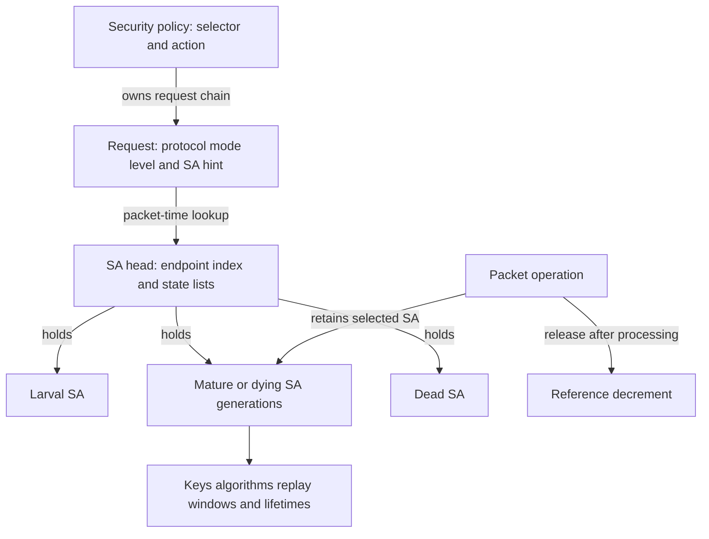
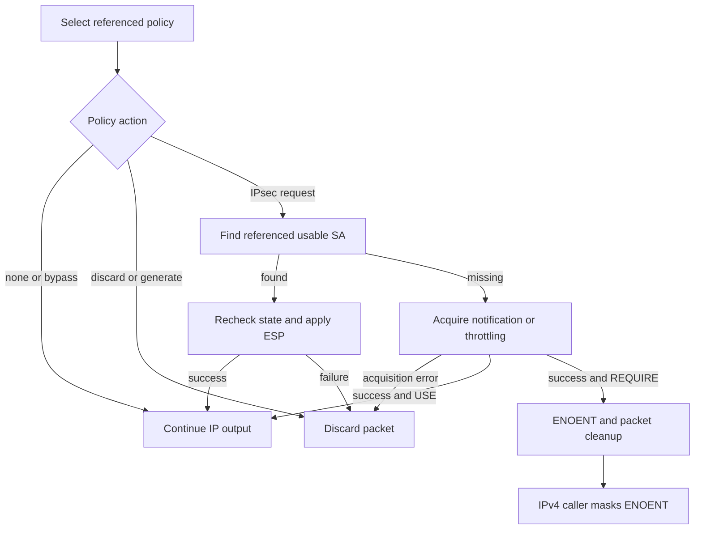
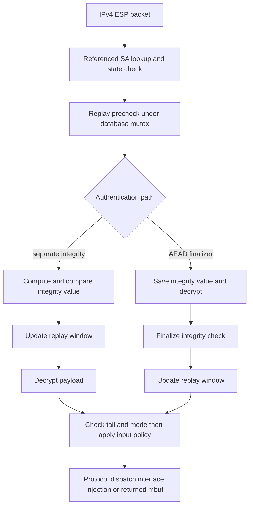
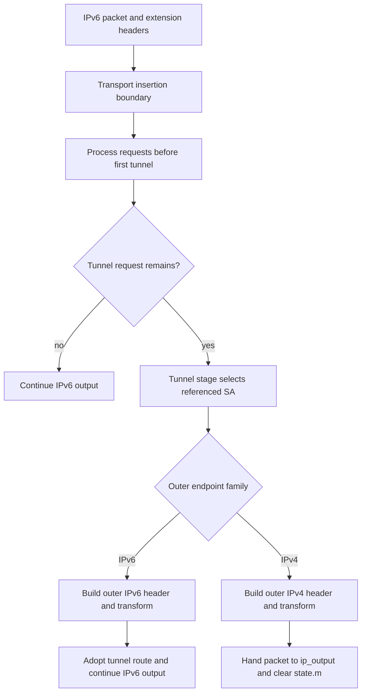
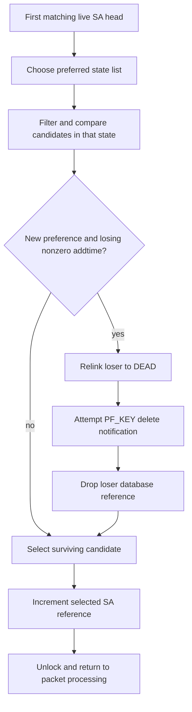

# IPsec policy, associations, and packet transforms

[Networking guide](README.md) · [Policy integration](policy-extensions.md) · [Packets and routes](packets-routes-and-interfaces.md) · [PF rule and state lifetime](pf-rules-states-and-packet-ownership.md)

An IPsec policy describes which packet needs processing; a security association supplies the keys, algorithm, sequence state and endpoints used to process it. Installing one does not automatically create the other. This chapter follows PF_KEY control messages into those objects and then traces a single-request IPv4 ESP policy through output, inbound association lookup, authentication, replay bookkeeping and cleanup in `xnu-12377.121.6`. Later sections extend that path with IPv6 transport/tunnel stages, request-chain ordering and SA selection during rekeying.

The source selects common IPsec and ESP separately through `IPSEC` and `IPSEC_ESP`. The shared implementation lives partly under `netinet6` even for IPv4. This review follows the mbuf path; interface-backed and Skywalk packet paths have separate entry points. [Configuration](../../../xnu/config/MASTER#L164-L165), [ESP build selection](../../../xnu/bsd/conf/files#L309-L310), [key database selection](../../../xnu/bsd/conf/files#L345-L345).

[IPsec interface lifecycle](ipsec-interface-lifecycle.md) follows the interface-backed entry points through privileged control setup, packet conversion, interface-selected transforms and staged disconnect. It connects this chapter's association/transform mechanisms to their mbuf and Skywalk interface clients.

## 1. Policy identity and association identity are different

| Object or field | What it identifies or stores | What it does not establish |
| --- | --- | --- |
| `secpolicyindex` | Packet direction, source/destination selectors, prefixes, upper-layer protocol, interface and optional ranges | An encryption key or an inbound SPI |
| `secpolicy` | Policy ID, live/dead state, references, action and request chain | A permanently attached SA for every request |
| `ipsecrequest` | One requested protocol/mode/level and SA lookup hint, plus next/back pointers | The current packet's acquired SA |
| `secasindex` | Association endpoints, ESP/AH protocol, mode, request ID and IPsec interface index | The identity of an individual rekey generation |
| `secashead` | That index, interface/routing state and lists of SAs grouped by state | The key material for every generation collapsed into one object |
| `secasvar` | One SA's SPI, keys, algorithms, replay windows, lifetimes, state and references | A policy selector authorizing every packet that finds it |

Sources: [policy and request structures](../../../xnu/bsd/netinet6/ipsec.h#L60-L134), [association index/head](../../../xnu/bsd/netkey/keydb.h#L40-L74), [SA and replay state](../../../xnu/bsd/netkey/keydb.h#L80-L142).

In particular, the current request structure has no `sav` pointer. The packet path obtains a referenced SA using the request's hint. Historical comments mentioning `isr->sav` must not be read as the current ownership model.

[Request representation — `ipsec.h`, lines 118–127](../../../xnu/bsd/netinet6/ipsec.h#L118-L127).

<!-- source-excerpt: ../../../xnu/bsd/netinet6/ipsec.h#L118-L127 -->
```c
struct ipsecrequest {
	struct ipsecrequest *next;
	/* pointer to next structure */
	/* If NULL, it means the end of chain. */
	struct secasindex saidx;/* hint for search proper SA */
	                        /* if __ss_len == 0 then no address specified.*/
	u_int level;            /* IPsec level defined below. */

	struct secpolicy *sp;   /* back pointer to SP */
};
```

An SPI is stored in network byte order in `secasvar`. It is neither a file descriptor nor a globally sufficient handle to an SA. Incoming lookup also considers protocol, address families, destination and, when supplied, the IPsec interface. The policy ID and `reqid` serve different searches from that inbound SPI lookup. [SPI field](../../../xnu/bsd/netkey/keydb.h#L81-L91), [incoming lookup](../../../xnu/bsd/netkey/key.c#L1323-L1429).



The lookup arrow is not a stored ownership edge from a request to one generation. List membership and temporary references are coordinated under `sadb_mutex`, while packet processing uses the acquired reference outside a continuously held database lock. That reference preserves storage; it does not freeze the SA's state or every mutable counter. [Lookup reference](../../../xnu/bsd/netkey/key.c#L1297-L1304), [state recheck](../../../xnu/bsd/netinet6/ipsec.c#L3168-L3186), [release](../../../xnu/bsd/netkey/key.c#L1681-L1708).

## 2. PF_KEY admission, parsing, and operation results

PF_KEY registers a raw socket protocol using `PF_KEY_V2`, `key_output` and `key_usrreqs`. `key_attach()` creates its PCB and delegates to the raw attach routine, which requires `SS_PRIV`. Socket creation sets that privilege bit after a successful `suser(kauth_cred_get())` check. This is an admission rule on this raw-socket route; it is separate from the content checks performed on each PF_KEY message. [Protocol registration](../../../xnu/bsd/netkey/keysock.c#L574-L584), [attach](../../../xnu/bsd/netkey/keysock.c#L388-L429), [raw admission](../../../xnu/bsd/net/raw_usrreq.c#L192-L205), [privilege bit](../../../xnu/bsd/kern/uipc_socket.c#L586-L588).

`key_output()` drops the socket lock before parser work, validates the base-header length against the mbuf packet length, then hands ownership of the message to `key_parse()`. It sets its local `m` to null after that call and reacquires the socket lock before returning. Thus the parser/handler path must dispose of or deliver the transferred message. [Output handoff](../../../xnu/bsd/netkey/keysock.c#L139-L193).

PF_KEY lengths use sixty-four-bit units. `key_parse()` checks the declared length, version and message type, rejects messages larger than `MCLBYTES`, and linearizes a chain when needed. `key_align()` builds an indexed view of extension pointers, offsets and lengths. It rejects unknown or repeated extension types, checks each extension against the remaining message and delegates its format checks to `key_validate_ext()`. A validated extension table is still only the input to the selected operation. [Base checks and linearization](../../../xnu/bsd/netkey/key.c#L9390-L9467), [extension walk](../../../xnu/bsd/netkey/key.c#L9623-L9753).

The parser then checks operation/SA-type compatibility and address-extension pairs before indexing `key_typesw`. Its error reply carries a different result channel from the socket send's return:

[Dispatch and protocol error reply — `key.c`, lines 9577–9595](../../../xnu/bsd/netkey/key.c#L9577-L9595).

<!-- source-excerpt: ../../../xnu/bsd/netkey/key.c#L9577-L9595 -->
```c
	if (msg->sadb_msg_type >= sizeof(key_typesw) / sizeof(key_typesw[0]) ||
	    key_typesw[msg->sadb_msg_type] == NULL) {
		PFKEY_STAT_INCREMENT(pfkeystat.out_invmsgtype);
		error = EINVAL;
		goto senderror;
	}

	error = (*key_typesw[msg->sadb_msg_type])(so, m, &mh);

	return error;

senderror:
	if (keyAligned) {
		bzero_keys(&mh);
	} else {
		bzero_mbuf(m);
	}
	msg->sadb_msg_errno = (u_int8_t)error;
	return key_sendup_mbuf(so, m, target);
```

When this `senderror` path delivers a reply successfully, the caller can receive a successful socket operation with a nonzero `sadb_msg_errno` inside the reply. Other parser failures return a direct errno after freeing the message. Readers must distinguish transport acceptance, PF_KEY operation status and subsequent packet behavior. Validating or copying a key extension is not evidence that an SA became usable. [Operation validation](../../../xnu/bsd/netkey/key.c#L9469-L9584), [direct extension errors](../../../xnu/bsd/netkey/key.c#L9688-L9750).

The parser and handlers explicitly clear key bytes or whole buffers on selected reply, replacement and error paths. These are source-visible buffer cleanup operations, not a claim about every copy held by external key-management software. [Linearization cleanup](../../../xnu/bsd/netkey/key.c#L9430-L9451), [ADD reply cleanup](../../../xnu/bsd/netkey/key.c#L7375-L7405).

### Publishing a policy changes the SPD separately

`key_spdadd()` validates policy/address extensions and direction, while `key_msg2sp()` constructs the request chain and checks protocol, mode, level, request ID and optional endpoint lengths. PF_KEY policy installation rejects ENTRUST/BYPASS; the socket-policy path has different admission rules. Packet lookup later skips dead or disabled policies, matches selectors and takes a reference while holding `sadb_mutex`. [Policy admission](../../../xnu/bsd/netkey/key.c#L2340-L2504), [request construction](../../../xnu/bsd/netkey/key.c#L1868-L2119), [runtime policy lookup](../../../xnu/bsd/netkey/key.c#L730-L798).

An SPDUPDATE is not an atomic replace with restoration on every failure. After finding the old policy, the handler marks it DEAD and releases its lookup reference before dropping the lock to allocate the replacement. Failure after that point does not restore the old ALIVE policy. A successful replacement receives its database reference, becomes ALIVE and joins the directional policy list under the mutex; reply allocation happens later and can fail after publication. [Old-policy retirement](../../../xnu/bsd/netkey/key.c#L2507-L2555), [new-policy publication](../../../xnu/bsd/netkey/key.c#L2633-L2673), [later reply construction](../../../xnu/bsd/netkey/key.c#L2694-L2719).

Policy deletion also separates eligibility from storage lifetime. The delete handler marks the policy DEAD and drops its lookup reference; the timer later processes the dead database entry. Final release unlinks it, releases interface references and frees its request chain. A held packet-policy reference can therefore outlive its eligibility for a new lookup. [Delete transition](../../../xnu/bsd/netkey/key.c#L2883-L2895), [timer release](../../../xnu/bsd/netkey/key.c#L5968-L5979), [reference and final cleanup](../../../xnu/bsd/netkey/key.c#L1648-L1675), [policy destructor](../../../xnu/bsd/netkey/key.c#L1716-L1764).

## 3. Publishing and retiring an SA

The concrete `SADB_ADD` handler requires an SA extension and both addresses, plus encryption material for ESP or authentication material for AH. It requires soft/hard lifetime extensions to be supplied together. It constructs the association index, finds or creates a head under `sadb_mutex`, rejects a conflicting custom-IPsec head and an existing SPI, then creates the candidate SA. [Required extensions](../../../xnu/bsd/netkey/key.c#L7257-L7296), [head and candidate selection](../../../xnu/bsd/netkey/key.c#L7298-L7339).

Allocation is not one uninterrupted locked operation. `key_newsav()` can drop `sadb_mutex` for blocking allocation. `key_add()` increments the head's `use_count` before entering that work and rechecks that the head is not dead afterward. The new SA records copied values, an initial database reference and LARVAL state, and joins the head's larval list. [Allocation lock drop](../../../xnu/bsd/netkey/key.c#L3924-L3936), [head pin and recheck](../../../xnu/bsd/netkey/key.c#L7323-L7348), [initial SA publication](../../../xnu/bsd/netkey/key.c#L4014-L4027).

`key_mature()` validates protocol-specific flags, SPI range, supported algorithm IDs and key-size bounds, then calls the algorithm's `mature` hook where present. Only afterward does it change the SA to MATURE. An algorithm table entry alone is not a mature, usable association. [Maturity validation](../../../xnu/bsd/netkey/key.c#L4595-L4737).

[Successful ADD retains database ownership — `key.c`, lines 7360–7373](../../../xnu/bsd/netkey/key.c#L7360-L7373).

<!-- source-excerpt: ../../../xnu/bsd/netkey/key.c#L7360-L7373 -->
```c
	/* check SA values to be mature. */
	if ((error = key_mature(newsav)) != 0) {
		goto fail;
	}

	key_get_flowid(newsav);

	newsah->use_count--;
	lck_mtx_unlock(sadb_mutex);

	/*
	 * don't call key_freesav() here, as we would like to keep the SA
	 * in the database on success.
	 */
```

Reply construction happens after that publication and lock release. If allocating the reply fails, `key_add()` returns an `ENOBUFS` protocol reply without undoing the already mature SA. In contrast, its earlier `fail` label marks a constructed candidate DEAD and drops its reference. This concrete ordering is why an error reply does not universally mean the database is unchanged. [Post-publication reply](../../../xnu/bsd/netkey/key.c#L7375-L7390), [candidate cleanup](../../../xnu/bsd/netkey/key.c#L7392-L7405).

`SADB_UPDATE` has a separate path for an existing association, with its own retained SA/head state and validation around `key_setsaval()`. The selected GETSPI→UPDATE sequence starts with a larval entry, but the actual SPI lookup scans MATURE, DYING and LARVAL states; UPDATE has no universal larval-only admission predicate. It is not the same operation as building a fresh candidate and swapping it transactionally. This chapter follows ADD as the publication example; it does not assign ADD's failure behavior to all PF_KEY commands. [Existing-SA update](../../../xnu/bsd/netkey/key.c#L6930-L7027), [SPI lookup states](../../../xnu/bsd/netkey/key.c#L4256-L4290).

### State changes stop selection before storage is reclaimed

`key_sa_chgstate()` removes the state-list link, changes `sav->state` and inserts the SA into the new list. It does not free keys or revoke references. Both MATURE and DYING are eligible in the valid-state order used by packet lookups; old/new preference controls their order and candidate choice. LARVAL and DEAD are not ordinary usable results. [State relinking](../../../xnu/bsd/netkey/key.c#L9933-L9953), [valid-state arrays](../../../xnu/bsd/netkey/key.c#L181-L194), [output selection](../../../xnu/bsd/netkey/key.c#L1045-L1101).

| State/lifetime event | Selected implementation action | Important boundary |
| --- | --- | --- |
| New candidate | LARVAL plus initial reference | Not yet a usable transform |
| Validation succeeds | Move to MATURE | Reply delivery is still later |
| Used SA crosses selected soft lifetime | Move to DYING and retain for expiry notification when collection capacity permits | DYING remains eligible for packet use |
| Unused SA crosses selected soft time limit | Can go directly to DEAD unless `always_expire` is set | Not every SA follows all four states |
| DYING SA crosses selected hard limit | Mark DEAD and drop database ownership, or send delete through the selected branch | Outstanding packet references can remain |
| Last reference released | Unlink, clear/free key and schedule storage, free replay/lifetime/IV state and SA | Logical death and final reclamation are distinct |

Sources: [soft expiry](../../../xnu/bsd/netkey/key.c#L6085-L6148), [hard expiry and retained dead entries](../../../xnu/bsd/netkey/key.c#L6151-L6217), [reference decrement](../../../xnu/bsd/netkey/key.c#L1681-L1708), [final unlink/free](../../../xnu/bsd/netkey/key.c#L4110-L4135), [associated cleanup](../../../xnu/bsd/netkey/key.c#L4049-L4103).

The timer's time and byte checks use concrete predicates, including a byte-limit `else if` after the configured time-limit branch. This table does not turn them into a generic rule that independently evaluates every possible lifetime field on every pass. Likewise, a DEAD-list walk does not repeatedly drop the database reference: the code explicitly leaves remaining references to their holders. [Timer predicates](../../../xnu/bsd/netkey/key.c#L6108-L6191), [dead-list rule](../../../xnu/bsd/netkey/key.c#L6194-L6217).

Closing the PF_KEY socket does not remove every installed SA. Its detach path removes registrations and invokes `key_delete_all_for_socket()`, which selects associations carrying `SADB_X_EXT_SA2_DELETE_ON_DETACH` with the matching `sav->so`. Other entries retain their own database lifetime. [Detach](../../../xnu/bsd/netkey/keysock.c#L452-L473), [registration cleanup](../../../xnu/bsd/netkey/key.c#L8726-L8756), [conditional SA deletion](../../../xnu/bsd/netkey/key.c#L8696-L8720).

## 4. A single-request IPv4 output operation

For this walkthrough, assume IPv4 output reaches the configured IPsec hook with one ESP request, no NAT traversal, and a normal mbuf chain. Bypass flags, IPsec interfaces, cross-family tunnels and multiple transforms have additional branches.

`ip_output()` obtains a referenced policy from the socket or packet addresses unless one was already supplied. A socket's policy can consult the system policy database or the default policy; privilege affects whether the socket's BYPASS or IPSEC choice can take precedence. Without a socket policy, `ipsec4_getpolicybyaddr()` builds packet selectors and looks up the SPD, then retains the default policy if no match exists. [Output entry](../../../xnu/bsd/netinet/ip_output.c#L1337-L1360), [socket decisions](../../../xnu/bsd/netinet6/ipsec.c#L374-L479), [address lookup/default](../../../xnu/bsd/netinet6/ipsec.c#L502-L561).

At the output hook, DISCARD/GENERATE discard, BYPASS/NONE skip transformation, and IPSEC needs a request chain. An IPSEC policy without requests calls `key_spdacquire()` then takes the packet's failure path. This policy acquisition differs from acquiring an SA for an existing request. [Policy action switch](../../../xnu/bsd/netinet/ip_output.c#L1364-L1407).

For an actual request, `ipsec4_output()` copies its SA hint and fills unspecified source/destination addresses from the current packet. `ipsec_get_reqlevel()` resolves DEFAULT using family/protocol/mode defaults and maps UNIQUE to REQUIRE; the request ID remains part of association selection. `key_allocsa_policy()` searches heads and eligible state lists under the database mutex and returns a referenced candidate. [Request construction](../../../xnu/bsd/netinet6/ipsec.c#L3697-L3747), [level resolution](../../../xnu/bsd/netinet6/ipsec.c#L1800-L1890), [candidate search/reference](../../../xnu/bsd/netkey/key.c#L1045-L1101), [candidate preference](../../../xnu/bsd/netkey/key.c#L1235-L1304).

No SA means an acquisition request may be sent even at USE level. The level decides what follows successful acquisition notification:

[Missing-SA outcome — `key.c`, lines 1012–1034](../../../xnu/bsd/netkey/key.c#L1012-L1034).

<!-- source-excerpt: ../../../xnu/bsd/netkey/key.c#L1012-L1034 -->
```c
	/* When there is SA. */
	if (*sav != NULL) {
		return 0;
	}

	/* There is no SA.
	 *
	 * Remove dst port - used for special natt support - don't call
	 * key_acquire with it.
	 */
	if (saidx->mode == IPSEC_MODE_TRANSPORT) {
		sin = SIN(&saidx->dst);
		sin->sin_port = IPSEC_PORT_ANY;
	}
	if ((error = key_acquire(saidx, isr->sp)) != 0) {
		/* XXX What should I do ? */
		ipseclog((LOG_ERR, "key_checkrequest: error %d returned "
		    "from key_acquire.\n", error));
		return error;
	}

	return level == IPSEC_LEVEL_REQUIRE ? ENOENT : 0;
}
```

With USE, a null SA and zero return lets output continue past that request. With REQUIRE, successful acquisition notification still produces `ENOENT`: the current packet is discarded. If acquisition itself fails, that error propagates for either level. This path does not queue the original packet waiting for key negotiation. [USE continuation](../../../xnu/bsd/netinet6/ipsec.c#L3749-L3774).

`key_acquire()` records/throttles requests in the configured acquire-list branch and builds a `SADB_ACQUIRE` notification for registered PF_KEY listeners. Returning zero can mean a repeated notification was suppressed. It does not mean that negotiation completed or the requested SA now exists. The external key manager must supply later control messages. [Acquire throttling](../../../xnu/bsd/netkey/key.c#L8133-L8195), [registered delivery](../../../xnu/bsd/netkey/key.c#L8230-L8266).

[Output failure owns the packet cleanup — `ipsec.c`, lines 3783–3790](../../../xnu/bsd/netinet6/ipsec.c#L3783-L3790).

<!-- source-excerpt: ../../../xnu/bsd/netinet6/ipsec.c#L3783-L3790 -->
```c
bad:
	if (sav) {
		key_freesav(sav, KEY_SADB_UNLOCKED);
	}
	m_freem(state->m);
	state->m = NULL;
	KERNEL_DEBUG(DBG_FNC_IPSEC_OUT | DBG_FUNC_END, error, 0, 0, 0, 0);
	return error;
```

The surrounding IPv4 caller reloads its packet pointer from `ipsec_state.m` and masks `ENOENT` to zero before final cleanup. Consequently a successful user-visible output result can coexist with this discarded packet while acquisition proceeds. The final IP-output exit separately releases the policy and copied route state. [Caller result handling](../../../xnu/bsd/netinet/ip_output.c#L1436-L1489), [policy/route release](../../../xnu/bsd/netinet/ip_output.c#L1846-L1857).



This diagram omits the separate no-request policy-acquisition path and interface redirection. An error arrow describes the caller's cleanup route; it is not a claim that every transform callback has identical buffer behavior.

## 5. ESP output changes the packet before completion

`ipsec4_output_internal()` rechecks that the held SA is MATURE or DYING. Tunnel mode adds an outer header and can change the route/destination; transport mode retains the existing outer IP header. After preparing the header mbuf, the code dispatches by the SA head's protocol to ESP or AH. [State check](../../../xnu/bsd/netinet6/ipsec.c#L3168-L3186), [tunnel/routing branch](../../../xnu/bsd/netinet6/ipsec.c#L3195-L3277), [transform dispatch](../../../xnu/bsd/netinet6/ipsec.c#L3279-L3316).

For selected non-old ESP, `esp_output()` requires replay/sequence state and resolves the encryption algorithm. It creates room for the ESP header/IV, assigns the SPI, increments sequence bookkeeping under `sadb_mutex`, and writes the sequence to the packet. It then appends padding plus the original next-header value, changes the IP next-protocol field to ESP, prepares the key schedule, encrypts and appends the integrity value when applicable. [Admission](../../../xnu/bsd/netinet6/esp_output.c#L308-L347), [sequence assignment](../../../xnu/bsd/netinet6/esp_output.c#L569-L596), [padding and trailer](../../../xnu/bsd/netinet6/esp_output.c#L598-L757), [encryption/integrity](../../../xnu/bsd/netinet6/esp_output.c#L759-L868).

The sequence increment precedes later allocation and transform failures. A failure is not a rollback of that counter or earlier packet edits. Padding/ICV storage may use trailing room or allocate another mbuf; the code avoids using external-buffer trailing space in these branches. [Trailer allocation](../../../xnu/bsd/netinet6/esp_output.c#L664-L695), [ICV allocation](../../../xnu/bsd/netinet6/esp_output.c#L836-L868).

For a concrete provider binding, the AES-GCM table selects an eight-byte explicit IV, sixteen-byte integrity value, schedule and encrypt/decrypt callbacks, plus separate finalizers. The implicit-IV flag changes the IV convention through the implementation; it is not covered by merely reading the table's default length. [AES-GCM operation table](../../../xnu/bsd/netinet6/esp_core.c#L265-L284), [IV-length decision](../../../xnu/bsd/netinet6/esp_rijndael.c#L742-L754).

`esp_schedule()` validates key length, locks the database, reuses an existing schedule or allocates storage and invokes the algorithm's schedule callback. AES-GCM builds encryption/decryption contexts from key material including the salt. These locally visible wrappers eventually use registered `g_crypto_funcs` GCM modes. The registration and wrapper contracts are present; cryptographic primitive correctness and the external provider implementation are not established by this packet trace. [Schedule lifecycle](../../../xnu/bsd/netinet6/esp_core.c#L360-L424), [GCM schedule](../../../xnu/bsd/netinet6/esp_rijndael.c#L687-L739), [crypto mode wrapper](../../../xnu/libkern/crypto/corecrypto_aes.c#L134-L143), [provider registration](../../../xnu/libkern/crypto/register_crypto.c#L34-L47).

On the successful ESP-output path, counters and SA transfer accounting update before returning to IP output. That success means the packet has passed this transform, not that an interface transmitted it or the peer accepted it. The `fail` label itself only returns the error; individual allocation/algorithm paths determine where an mbuf was freed. For example, a short first IPv4 mbuf and an unsupported algorithm explicitly free it. [Completion/error label](../../../xnu/bsd/netinet6/esp_output.c#L911-L938), [IPv4 wrapper](../../../xnu/bsd/netinet6/esp_output.c#L941-L954), [algorithm failure](../../../xnu/bsd/netinet6/esp_output.c#L338-L344).

## 6. Inbound lookup, authentication, and replay are separate decisions

`esp4_input_extended()` checks alignment/length, obtains contiguous headers as necessary, clears received checksum flags and extracts the packet's SPI. `key_allocsa()` searches the SPI hash under `sadb_mutex`, checks the SPI, optional interface, protocol and source/destination families, then compares the destination address and prefers eligible states. It does **not** compare the source-address bytes in this lookup. The selected SA receives a reference before unlocking. [Input setup](../../../xnu/bsd/netinet6/esp_input.c#L215-L287), [actual lookup predicates](../../../xnu/bsd/netkey/key.c#L1363-L1429).

The input routine rechecks state and resolves the algorithm. For the selected modern authenticated path it obtains the sequence number and performs an initial replay check. That check does not reserve a sequence number. It takes and drops `sadb_mutex` while inspecting the current window. Old ESP, absent replay state and configured authentication variants have explicit skip conditions. [State and algorithm](../../../xnu/bsd/netinet6/esp_input.c#L292-L315), [replay admission](../../../xnu/bsd/netinet6/esp_input.c#L326-L355), [precheck](../../../xnu/bsd/netinet6/ipsec.c#L2824-L2887).

| Selected authentication path | Integrity decision | Replay update relative to decryption |
| --- | --- | --- |
| Separate ESP authentication algorithm | Compute `esp_auth`, compare with `cc_cmp_safe`, set `M_AUTHIPDGM` | Update after that comparison, before payload decryption |
| Algorithm with `finalizedecrypt`, such as AES-GCM | Save received integrity bytes, decrypt, then invoke finalizer with saved bytes | Update only after successful finalization |

Sources: [separate authentication](../../../xnu/bsd/netinet6/esp_input.c#L357-L425), [decrypt and finalizer](../../../xnu/bsd/netinet6/esp_input.c#L470-L520).

For the AES-GCM mbuf path, `esp_gcm_decrypt_aes()` builds the nonce from salt plus explicit IV or the selected sequence convention, supplies the ESP header as additional authenticated data, and walks the payload mbufs for in-place decryption. Its finalizer delegates to the GCM wrapper, which finalizes and resets the context on success. This makes the transform's intermediate buffer edits distinct from the final integrity decision. [GCM packet body](../../../xnu/bsd/netinet6/esp_rijndael.c#L938-L1074), [finalizer wrapper](../../../xnu/bsd/netinet6/esp_rijndael.c#L767-L775), [provider-facing finalization](../../../xnu/libkern/crypto/corecrypto_aes.c#L311-L325).

[Authenticated replay update — `esp_input.c`, lines 499–520](../../../xnu/bsd/netinet6/esp_input.c#L499-L520).

<!-- source-excerpt: ../../../xnu/bsd/netinet6/esp_input.c#L499-L520 -->
```c
	if (algo->finalizedecrypt) {
		if (__improbable((*algo->finalizedecrypt)(sav, saved_icv, algo->icvlen))) {
			ipseclog((LOG_ERR, "esp4 packet decryption ICV failure: %s\n",
			    ipsec_logsastr(sav)));
			IPSEC_STAT_INCREMENT(ipsecstat.in_espauthfail);
			KERNEL_DEBUG(DBG_FNC_DECRYPT | DBG_FUNC_END, 1, 0, 0, 0, 0);
			goto bad;
		} else {
			m->m_flags |= M_AUTHIPDGM;
			IPSEC_STAT_INCREMENT(ipsecstat.in_espauthsucc);

			/*
			 * update replay window.
			 */
			if ((sav->flags & SADB_X_EXT_OLD) == 0 && sav->replay[replay_index] != NULL) {
				if (__improbable(ipsec_updatereplay(seq, sav, (u_int8_t)replay_index))) {
					IPSEC_STAT_INCREMENT(ipsecstat.in_espreplay);
					goto bad;
				}
			}
		}
	}
```

`ipsec_chkreplay()` returns one for acceptance and zero for rejection. `ipsec_updatereplay()` uses the opposite success convention: zero means update succeeded. Update takes the mutex again and repeats old/duplicate checks before setting the bitmap or shifting the window. The lock is not held continuously across cryptographic processing. [Check convention](../../../xnu/bsd/netinet6/ipsec.c#L2838-L2886), [update convention and locking](../../../xnu/bsd/netinet6/ipsec.c#L2890-L2930).

[Duplicate recheck during update — `ipsec.c`, lines 2952–2971](../../../xnu/bsd/netinet6/ipsec.c#L2952-L2971).

<!-- source-excerpt: ../../../xnu/bsd/netinet6/ipsec.c#L2952-L2971 -->
```c
		/* seq is equal or less than lastseq. */
		diff = replay->lastseq - seq;

		/* over range to check, i.e. too old or wrapped */
		if (diff >= wsizeb) {
			lck_mtx_unlock(sadb_mutex);
			return 1;
		}

		fr = frlast - diff / 8;

		/* this packet already seen ? */
		if ((replay->bitmap)[fr] & (1 << (diff % 8))) {
			lck_mtx_unlock(sadb_mutex);
			return 1;
		}

		/* mark as seen */
		(replay->bitmap)[fr] |= (1 << (diff % 8));

```

For an illustrative four-byte bitmap, the window covers 32 sequence positions. With `lastseq=100`, sequence 99 is within the window. If its bit is clear, the precheck can accept it. After an authenticated packet marks that bit, a later update for the same sequence rejects it even if its earlier precheck ran before the first update. Sequence zero and values outside the configured window have separate rejection rules; a zero-sized window takes an explicit bypass branch. [Window arithmetic](../../../xnu/bsd/netinet6/ipsec.c#L2838-L2886), [update and count handling](../../../xnu/bsd/netinet6/ipsec.c#L2909-L3001).



Each failed validation/transform follows a cleanup branch omitted from this success-flow diagram. The replay update occurs before later padding, tunnel and policy checks, so a packet discarded later can already have advanced replay state. Separate authentication can also advance replay state before a subsequent decrypt failure. [Tail validation after update](../../../xnu/bsd/netinet6/esp_input.c#L522-L540), [later policy decision](../../../xnu/bsd/netinet6/esp_input.c#L793-L798).

### Delivery consumes or transfers the mbuf

Transport processing removes ESP headers/trailer, restores the original next protocol and records IPsec history. Before dispatching a terminal protocol, the path can call `ipsec4_in_reject()`. That policy routine evaluates required protection using packet flags such as `M_DECRYPTED` and `M_AUTHIPHDR`; its body does not perform an exact comparison of every request against the recorded IPsec history. ESP's removed `isr->sav` check remains disabled under `#if 0`. [Transport reconstruction](../../../xnu/bsd/netinet6/esp_input.c#L760-L798), [actual policy enforcement](../../../xnu/bsd/netinet6/ipsec.c#L1900-L1987).

Ordinary delivery transfers the packet to `ip_proto_dispatch_in()` and clears the local `m`. An associated IPsec interface adds another path: retain the interface under the database lock, then inject outside it, or return the processed mbuf when the explicit interface argument matches. The success and failure exits both release the acquired SA; failure frees any remaining local mbuf. A successful cryptographic operation alone does not establish which of these delivery paths ran. [Interface handoff and protocol dispatch](../../../xnu/bsd/netinet6/esp_input.c#L839-L909), [failure cleanup](../../../xnu/bsd/netinet6/esp_input.c#L910-L921).

## 7. IPv6 output separates transport insertion from tunnel construction

The IPv6 operation begins with more state than an mbuf pointer. `ip6_output()` assembles the extension-header chain and retains `nexthdrp`, the address of the next-header byte to rewrite, and `mprev`, the mbuf immediately before the protected portion. A final destination-options header (`dest2`) is placed after that boundary; hop-by-hop and earlier destination options remain before it. Delayed transport checksums are completed before IPsec changes the packet. These are pointers into the current chain, not offsets that automatically survive every mutation. [Header assembly](../../../xnu/bsd/netinet6/ip6_output.c#L810-L875).

Before calling `ipsec6_output_trans()`, the caller clears its saved `dest2` pointer because the protected region can become inaccessible. It passes the referenced policy, packet state and insertion pointers, then reloads `m` from the returned state. The source also contains routing-header assembly and temporary `segleft` adjustment, but later explicitly rejects an outgoing routing header. Those preparation branches do not establish that this version sends such packets. [Transport call and pointer handling](../../../xnu/bsd/netinet6/ip6_output.c#L945-L993), [routing-header rejection](../../../xnu/bsd/netinet6/ip6_output.c#L997-L1001).

[The transport stage stops at the first tunnel request — `ipsec.c`, lines 3914–3919](../../../xnu/bsd/netinet6/ipsec.c#L3914-L3919).

<!-- source-excerpt: ../../../xnu/bsd/netinet6/ipsec.c#L3914-L3919 -->
```c
	*tun = 0;
	for (isr = sp->req; isr; isr = isr->next) {
		if (isr->saidx.mode == IPSEC_MODE_TUNNEL) {
			/* the rest will be handled by ipsec6_output_tunnel() */
			break;
		}
```

For each preceding transport request, the loop copies the SA hint and fills unspecified IPv6 endpoints from the current packet. Link-local addresses require scope treatment: the lookup sockaddr receives the packet's interface scope, while embedded scope bytes are cleared where that representation is enabled. A selected SA must still be MATURE or DYING when the internal helper runs. The helper records its outgoing interface, calls ESP or AH at the saved insertion boundary, and recomputes the IPv6 payload length. A transformed length above `IPV6_MAXPACKET` takes the error path; this helper does not produce an IPsec jumbogram. [Hint and scope construction](../../../xnu/bsd/netinet6/ipsec.c#L3921-L3959), [dispatch and length checks](../../../xnu/bsd/netinet6/ipsec.c#L3799-L3871).

For ESP, `esp6_output()` passes the IPv6 family and protected-region mbuf to the common transform. That routine finds the actual predecessor of the supplied mbuf, inserts the ESP header before it, saves the former next protocol in the ESP trailer and rewrites the preceding next-header byte. Thus `nexthdrp` describes a protocol link, while `mprev->m_next` identifies the bytes being protected. [IPv6 wrapper](../../../xnu/bsd/netinet6/esp_output.c#L955-L970), [predecessor check](../../../xnu/bsd/netinet6/esp_output.c#L378-L390), [ESP insertion](../../../xnu/bsd/netinet6/esp_output.c#L519-L544), [next-header and trailer update](../../../xnu/bsd/netinet6/esp_output.c#L711-L736).



This diagram shows successful stage transitions for a supplied request chain. Lookup failures, callback failures and unsupported combinations take the cleanup paths described below. An interface-selected SA can enter the internal helpers directly through `ipsec6_interface_output()`; that separate path does not traverse this SPD request loop. [Interface entry](../../../xnu/bsd/netinet6/ipsec.c#L4455-L4510).

### IPv6 outer headers replace the route used for the inner packet

When transport processing leaves a tunnel request, `ip6_output()` clears the extension-header bookkeeping, copies its current route into `ipsec_state.ro` and calls `ipsec6_output_tunnel()`. The tunnel loop starts at the first tunnel request in `sp->req`. Its internal helper requires the selected SA head to have TUNNEL mode before building an outer header. [Caller setup](../../../xnu/bsd/netinet6/ip6_output.c#L1092-L1117), [request-stage boundary](../../../xnu/bsd/netinet6/ipsec.c#L4328-L4338), [internal admission](../../../xnu/bsd/netinet6/ipsec.c#L4025-L4048).

`ipsec6_splithdr()` establishes a first mbuf containing exactly the IPv6 header, allocating and transferring packet-header metadata when necessary. Its allocation failure frees the supplied chain and returns null. With IPv6 SA endpoints, `ipsec6_encapsulate()` moves a copy of the inner IPv6 header behind the new outer header, sets the outer addresses from the SA index and sets its next protocol to IPv6. The subsequent ESP/AH transform protects the complete inner IPv6 packet. [Header split and failure ownership](../../../xnu/bsd/netinet6/ipsec.c#L4565-L4598), [IPv6 encapsulation](../../../xnu/bsd/netinet6/ipsec.c#L2377-L2450), [outer transform](../../../xnu/bsd/netinet6/ipsec.c#L4245-L4286).

The SA head owns a cached tunnel route. Under `sadb_mutex` and the applicable route lock, the helper invalidates an unusable or wrong-destination route, performs scoped route allocation when needed, chooses the gateway destination when appropriate, releases the old `state->ro` and copies the tunnel route into that state. No route produces `EHOSTUNREACH`; the wrapper frees any remaining packet. The mutex is dropped before ESP/AH dispatch. This is route-reference transfer alongside packet mutation, not one lock held over the entire transform. [Route selection and transfer](../../../xnu/bsd/netinet6/ipsec.c#L4191-L4243), [wrapper cleanup](../../../xnu/bsd/netinet6/ipsec.c#L4438-L4452).

After a successful IPv6 outer transform, `ip6_output()` uses the returned route/destination and clears the original explicit interface binding and packet-info interface index. Those constraints described the inner packet's output and cannot simply be reused for the outer endpoint. The ordinary IPv6 output path then continues with the new packet. [Returned route and interface-scope handling](../../../xnu/bsd/netinet6/ip6_output.c#L1123-L1163).

### An IPv4 outer header hands the packet to a different output routine

For IPv4 SA endpoints, the tunnel helper sets `must_be_last` and `state->tunneled = 4`, constructs an IPv4 outer header and takes a local copy of the SA's cached IPv4 route. It performs ESP/AH and calls IPv4 output itself. The assignment to `tunneled` precedes encapsulation and its possible failure; the value identifies the selected branch, not proof that a packet was transmitted. [Family decision and encapsulation](../../../xnu/bsd/netinet6/ipsec.c#L4071-L4093), [route copy and transform](../../../xnu/bsd/netinet6/ipsec.c#L4095-L4169).

[IPv4 output handoff and route copy-back — `ipsec.c`, lines 4170–4177](../../../xnu/bsd/netinet6/ipsec.c#L4170-L4177).

<!-- source-excerpt: ../../../xnu/bsd/netinet6/ipsec.c#L4170-L4177 -->
```c
			ip = mtod(state->m, struct ip *);
			ip->ip_len = ntohs(ip->ip_len);  /* flip len field before calling ip_output */
			error = ip_output(state->m, NULL, &ro4_copy, IP_OUTARGS, NULL, &ipoa);
			state->m = NULL;
			// grab sadb_mutex, to synchronize the sah's route cache with the local copy
			lck_mtx_lock(sadb_mutex);
			route_copyin(&ro4_copy, ro4, sizeof(struct route));
			lck_mtx_unlock(sadb_mutex);
```

After this call, the helper no longer owns the packet, including when `ip_output()` returns an error. It synchronizes the local route copy back under the database mutex. The IPv6 caller tests `tunneled == 4` before its ordinary tunnel-error switch, clears its own `m` and goes to packet-list evaluation. Therefore that branch must be read separately from the IPv6-outer error classification. Nothing here establishes peer receipt. [Helper return](../../../xnu/bsd/netinet6/ipsec.c#L4172-L4181), [caller branch order](../../../xnu/bsd/netinet6/ip6_output.c#L1117-L1147), [packet-list evaluation](../../../xnu/bsd/netinet6/ip6_output.c#L1595-L1665).

### Missing-SA and failure behavior differ from the IPv4 loop

Both IPv6 loops compare `key_checkrequest()` specifically with `ENOENT`. They do not assign and propagate every other nonzero return as `ipsec4_output()` does. On `ENOENT`, transport processing sends the packet to `icmp6_error()` with administrative-unreachable parameters, clears `state->m` and returns through cleanup; that call owns the packet and does not guarantee an ICMP packet will be emitted. The tunnel loop instead reaches its remaining-mbuf cleanup. [Transport missing-SA branch](../../../xnu/bsd/netinet6/ipsec.c#L3961-L3983), [tunnel branch](../../../xnu/bsd/netinet6/ipsec.c#L4388-L4400), [IPv4 comparison](../../../xnu/bsd/netinet6/ipsec.c#L3749-L3759).

This matters when acquisition returns another error with `sav == NULL`: the following IPv6 validity switch still decides by level, continuing for USE or entering the explicit REQUIRE panic branch. Describing all three loops as uniformly propagating acquisition errors would contradict these bodies. For normal IPv6 transport errors and IPv6-outer tunnel errors, the caller preserves selected routing/resource errors and suppresses `ENOENT` and the switch's other error class. Packet consumption and user-visible errno remain separate outcomes. [Acquisition return](../../../xnu/bsd/netkey/key.c#L1025-L1034), [transport null-SA switch](../../../xnu/bsd/netinet6/ipsec.c#L3985-L3995), [tunnel null-SA switch](../../../xnu/bsd/netinet6/ipsec.c#L4401-L4410), [caller error switches](../../../xnu/bsd/netinet6/ip6_output.c#L968-L989), [tunnel errors](../../../xnu/bsd/netinet6/ip6_output.c#L1127-L1147).

## 8. Multiple requests transform the current packet in list order

The consumer loops traverse `ipsecrequest.next`; they do not start each request from an untouched copy of the original packet. In IPv4, unspecified endpoints are filled from the packet at the start of each iteration. In IPv6 transport, successive helpers use the same insertion boundary, whose following mbuf now contains the preceding transform. The SA reference and the packet pointer are separate resources: consuming a packet does not release every SA selected earlier. [IPv4 loop](../../../xnu/bsd/netinet6/ipsec.c#L3697-L3774), [IPv6 loop](../../../xnu/bsd/netinet6/ipsec.c#L3914-L4005).

There is an important construction boundary in this snapshot. `key_msg2sp()` appends request objects through `p_isr` and decrements the remaining length, but each iteration obtains `xisr` from the unchanged `xpl0 + 1`; it does not advance that source cursor to a distinct serialized request. Consequently, the loop bodies below explain consumption of a given in-memory chain. They do not establish that a PF_KEY payload containing distinct transport and tunnel requests produces that chain here. [Source request selection](../../../xnu/bsd/netkey/key.c#L1910-L1940), [destination-chain advancement](../../../xnu/bsd/netkey/key.c#L2097-L2110).

### Worked order: one transport request followed by one IPv6 tunnel request

Consider an illustrative already-constructed chain with ESP transport request T followed by ESP tunnel request U, both with usable SAs, and no optional extension headers or NAT traversal. The operations are:

1. T transforms the original payload and changes the inner IPv6 next-header field to ESP. Its encrypted region contains the original upper-layer bytes plus the ESP trailer.
2. The transport loop stops at U, returns `tun = 1` and releases its selected SA reference before returning to `ip6_output()`.
3. The tunnel stage obtains U's SA and constructs a new outer IPv6 header. Its ESP protects the entire packet produced by T, including that packet's inner IPv6 header and ESP representation.
4. The tunnel wrapper releases its selected SA reference and returns the transformed mbuf and route state for continued IPv6 output.

The readable layout is therefore `outer IPv6 / ESP-U / protected(inner IPv6 / ESP-T / protected(payload))`. This is illustrative nesting, not a byte dump or an assertion that the serialized PF_KEY construction above creates this example. T executes first but appears inside U. [Transport stop, transform and release](../../../xnu/bsd/netinet6/ipsec.c#L3914-L3919), [stage completion](../../../xnu/bsd/netinet6/ipsec.c#L3997-L4010), [outer construction](../../../xnu/bsd/netinet6/ipsec.c#L4051-L4070), [outer transform and release](../../../xnu/bsd/netinet6/ipsec.c#L4245-L4286), [wrapper release](../../../xnu/bsd/netinet6/ipsec.c#L4438-L4446).

Two ESP transport requests within the transport loop similarly insert at the same boundary: the later ESP wraps the bytes already produced by the earlier transform. A later tunnel request can wrap an already tunneled IPv6 packet again. These are descriptions of the mutation order; the reference and mode constraints below limit any broader conclusion about arbitrary bundles. [Repeated insertion boundary](../../../xnu/bsd/netinet6/ipsec.c#L3997-L4005), [ESP insertion](../../../xnu/bsd/netinet6/esp_output.c#L519-L544), [tunnel iteration](../../../xnu/bsd/netinet6/ipsec.c#L4338-L4348).

### A later failure does not undo previous transforms or handoffs

Although the tunnel loop has an `else` branch that constructs a transport-mode hint after the first tunnel request, its internal helper rejects a selected SA whose mode is not TUNNEL. A request-chain traversal and a hint-construction branch are not sufficient evidence of support for transport-after-tunnel processing. A missing optional SA can still skip that request before reaching the internal helper. [Post-tunnel hint construction](../../../xnu/bsd/netinet6/ipsec.c#L4338-L4386), [mode admission](../../../xnu/bsd/netinet6/ipsec.c#L4032-L4036), [optional request skip](../../../xnu/bsd/netinet6/ipsec.c#L4401-L4410).

The IPv4-outer case has a further ordering constraint. The caller checks whether that transform was last only after the internal helper has returned successfully:

[The last-request check follows the helper — `ipsec.c`, lines 4423–4435](../../../xnu/bsd/netinet6/ipsec.c#L4423-L4435).

<!-- source-excerpt: ../../../xnu/bsd/netinet6/ipsec.c#L4423-L4435 -->
```c
		int must_be_last = 0;

		if ((error = ipsec6_output_tunnel_internal(state, sav, &must_be_last)) != 0) {
			goto bad;
		}

		if (must_be_last && isr->next) {
			ipseclog((LOG_ERR, "ipsec6_output_tunnel: "
			    "IPv4 must be outer layer, spi=%u\n",
			    (u_int32_t)ntohl(sav->spi)));
			error = EINVAL;
			goto bad;
		}
```

For the IPv4-outer branch, that helper has already called `ip_output()` and cleared `state->m`. A later `EINVAL` from this check therefore does not mean the packet never reached output. In other branches, a later failure frees the currently transformed mbuf if still owned; it does not restore prior packet bytes or reverse sequence/lifetime bookkeeping performed by earlier transforms. The error path is cleanup of what remains, not transactional rollback of the entire request list. [Handoff](../../../xnu/bsd/netinet6/ipsec.c#L4170-L4181), [remaining-packet cleanup](../../../xnu/bsd/netinet6/ipsec.c#L4442-L4452), [ESP sequence allocation](../../../xnu/bsd/netinet6/esp_output.c#L570-L596).

### The visible SA-reference accounting has a multi-iteration limit

`key_allocsa_policy()` returns a retained SA, but `key_checkrequest()` starts by assigning `*sav = NULL`; it does not release a reference previously stored there. Each of the three output loops passes the same local `sav` variable on successive iterations and releases only its current value at the success/failure exit. No per-iteration release appears between a successful transform and the next call to `key_checkrequest()`. [Retained result](../../../xnu/bsd/netkey/key.c#L1297-L1304), [output-pointer reset](../../../xnu/bsd/netkey/key.c#L972-L983), [IPv4 exits](../../../xnu/bsd/netinet6/ipsec.c#L3772-L3789), [IPv6 transport exits](../../../xnu/bsd/netinet6/ipsec.c#L3997-L4019), [IPv6 tunnel exits](../../../xnu/bsd/netinet6/ipsec.c#L4423-L4452).

The single-request paths and the illustrative one-request-per-stage example have a directly visible release for each selected SA. The same accounting cannot be asserted for arbitrary multiple selections within one loop from these bodies: a later output-pointer reset is not a reference transfer or release. This chapter records that source limit without claiming a corrected implementation or a runtime measurement.

## 9. Rekey selection is state-ordered and can retire candidates

Installing a new SA under an existing head does not replace every generation with one pointer. `key_allocsa_policy()` locks `sadb_mutex`, skips DEAD heads and selects the first matching head using `CMP_MODE | CMP_REQID`. The comparison checks protocol, applicable interface index, endpoints, the requested nonzero `reqid` and mode, with an ANY head mode as a wildcard. Endpoint ports are not compared by that flag combination; selected NAT-traversal port filtering happens afterward. Once a matching head is found, failure to find a candidate in its eligible lists returns null rather than resuming the head search. [Head search](../../../xnu/bsd/netkey/key.c#L1045-L1101), [index comparison](../../../xnu/bsd/netkey/key.c#L5448-L5510).

The preference setting is initialized to zero and exposed through `prefered_oldsa`. Its first effect is to choose which state list is searched first:

[Valid-state preference — `key.c`, lines 182–187](../../../xnu/bsd/netkey/key.c#L182-L187).

<!-- source-excerpt: ../../../xnu/bsd/netkey/key.c#L182-L187 -->
```c
static const u_int saorder_state_valid_prefer_old[] = {
	SADB_SASTATE_DYING, SADB_SASTATE_MATURE,
};
static const u_int saorder_state_valid_prefer_new[] = {
	SADB_SASTATE_MATURE, SADB_SASTATE_DYING,
};
```

Thus the default selects a usable MATURE candidate before looking at DYING; old-SA preference reverses that order. The search returns when one state supplies a candidate. It does not globally sort every generation across both states by timestamp. LARVAL and DEAD remain outside these valid-state arrays. [Default and control](../../../xnu/bsd/netkey/key.c#L154-L154), [sysctl registration](../../../xnu/bsd/netkey/key.c#L312-L314), [state-loop return](../../../xnu/bsd/netkey/key.c#L1076-L1101).

Within one state list, `key_do_allocsa_policy()` filters selected NAT-traversal associations by remote IKE port and tracks NAT and non-NAT candidates separately. For a plain, non-NAT candidate group, old preference keeps the smaller current-lifetime `addtime`; new preference keeps the greater value, retaining the earlier encountered candidate on equality. The new-preference branch also identifies the losing candidate for retirement. [Port filters and candidate groups](../../../xnu/bsd/netkey/key.c#L1205-L1233), [timestamp comparison](../../../xnu/bsd/netkey/key.c#L1235-L1271).

[Candidate retirement is guarded by its current add time — `key.c`, lines 1273–1280](../../../xnu/bsd/netkey/key.c#L1273-L1280).

<!-- source-excerpt: ../../../xnu/bsd/netkey/key.c#L1273-L1280 -->
```c
		/*
		 * prepared to delete the SA when there is more
		 * suitable candidate and the lifetime of the SA is not
		 * permanent.
		 */
		if (d->lft_c->sadb_lifetime_addtime != 0) {
			key_send_delete(d);
		}
```

The body uses `addtime != 0` for this decision; the comment's word “permanent” must not be expanded into a claim that every configured lifetime field is consulted here. The final choice between NAT and non-NAT candidates has further rules: a tunnel with a destination port chooses its NAT candidate, otherwise the greater add time wins, with equality choosing the non-NAT candidate. That final comparison also runs with old preference enabled. Moreover, the old-preference replacement branch tests `NATT_MULTIPLEUSERS`, while the initial group classification also recognizes tunnel `NATT`. These concrete branches should not be reduced to one universal “oldest SA” rule. [Old-preference replacement](../../../xnu/bsd/netkey/key.c#L1243-L1255), [final group selection](../../../xnu/bsd/netkey/key.c#L1283-L1295).



This diagram omits NAT subgroups and the fallback to the second state when the first has no candidate. Retirement can occur while the lookup scans; it is not postponed until the packet transform or network transmission succeeds. [Selection loop](../../../xnu/bsd/netkey/key.c#L1197-L1304).

`key_send_delete()` first moves the losing SA to DEAD, then attempts to construct and deliver `SADB_DELETE` to registered PF_KEY listeners. All its exits reach the reference drop, including notification-construction or delivery failure. Failure to notify does not restore the SA to MATURE/DYING. The selected winner receives its own reference before the lookup unlocks. Existing references to the loser retain its storage until released, but do not prevent the DEAD transition; later transform admission can observe that changed state. [Retire before notification](../../../xnu/bsd/netkey/key.c#L1104-L1123), [notification and release](../../../xnu/bsd/netkey/key.c#L1151-L1171), [winner reference](../../../xnu/bsd/netkey/key.c#L1297-L1304), [transform state admission](../../../xnu/bsd/netinet6/ipsec.c#L3814-L3823).

For a concrete non-NAT example, suppose one head contains two MATURE SAs A and B with nonzero current add times 100 and 200. With the default preference, B wins and A is retired by the lookup. If A is instead already DYING while B remains MATURE, the MATURE list can return B without scanning or retiring A. With old preference, a usable DYING A is considered before MATURE B. If both are in the same state, the plain-candidate comparison prefers the smaller add time. These are examples of the inspected predicates, not a claim about an external key manager's negotiated overlap interval.

Inbound `key_allocsa()` is a different search: it uses the received SPI, protocol, endpoint families/destination and optional interface index, then ranks eligible matches by the valid-state order. It does not invoke `key_do_allocsa_policy()` and does not perform that outbound timestamp-based retirement. Timer expiry, PF_KEY deletion and outbound candidate retirement are separate ways to change eligibility; none converts an outstanding reference into ownership of an immutable SA state. [Inbound lookup](../../../xnu/bsd/netkey/key.c#L1323-L1429), [timer retirement](../../../xnu/bsd/netkey/key.c#L6085-L6217), [reference destruction](../../../xnu/bsd/netkey/key.c#L1681-L1708).

## 10. Variants, tests, and implementation boundaries

Transport and tunnel mode change which addresses are selectors and which are outer endpoints. IPv4 tunnel output can construct an IPv4 outer header with an updated cached route, or an IPv6 outer header and a separate output handoff. Inbound tunnel processing strips the outer headers and checks the recovered inner packet through its tunnel-sanity path before reinjection. Those operations are additional to authenticating the outer ESP packet. [IPv4/cross-family tunnel output](../../../xnu/bsd/netinet6/ipsec.c#L3195-L3277), [inbound tunnel validation](../../../xnu/bsd/netinet6/esp_input.c#L577-L629).

IPv6 output has separate transport and tunnel stages. Its transport loop stops at the first tunnel request, and the tunnel stage resumes from that point. IPv6 input has its own extension-header offsets and `mbuf **` interface. A conclusion about the selected IPv4 success/error route should not be silently carried into those signatures or every nested transform combination. [IPv6 stage split](../../../xnu/bsd/netinet6/ipsec.c#L3914-L3925), [tunnel continuation](../../../xnu/bsd/netinet6/ipsec.c#L4328-L4340), [IPv6 input entry](../../../xnu/bsd/netinet6/esp_input.c#L924-L944).

The local source also contains legacy ESP, AH, NAT traversal, per-traffic-class replay windows, IPsec-interface and Skywalk packet callbacks. This chapter uses their guards and shared structures to bound the walkthrough; it does not claim to review every packet layout, algorithm, migration, offload or rekey combination. The old/new SA preference can itself choose among and retire candidates, so it is not adequately described as an immutable first-match table. [Candidate preference/retirement](../../../xnu/bsd/netkey/key.c#L1235-L1304), [traffic-class replay fields](../../../xnu/bsd/netkey/keydb.h#L76-L104), [packet-buffer variant](../../../xnu/bsd/netinet6/esp_input.c#L1741-L1765).

The local tests provide bounded evidence about the intended interfaces, not an executed validation result for this chapter:

| Local case | What its body checks | What it does not establish |
| --- | --- | --- |
| [PF_KEY GETSPI→UPDATE→DELETE](../../../xnu/tests/pfkey.c#L1341-L1393) | Reply SPI consistency through the selected sequence; nonzero protocol errno is tolerated only for UPDATE | That UPDATE succeeded or traffic was transformed |
| [SA statistics cases](../../../xnu/tests/pfkey.c#L1489-L1575) | One GETSASTAT request expects `EINVAL`; another requires successful replies and checks the returned session ID | All statistics, concurrency or lifetime transitions |
| [IPsec interface packet write](../../../xnu/tests/ipsec.m#L328-L363), [completion assertion](../../../xnu/tests/ipsec.m#L486-L493) | Two successful ADD replies precede the BPF packet write; the write is asserted to succeed | Peer decryption, payload comparison or end-to-end delivery |
| [SA-count stress case](../../../xnu/tests/net/ipsec_sav_count_overflow.c#L118-L155) | Socket creation and first full write are asserted; repeated later writes are attempted before close and test completion | Successful SA installation for every write, a measured SA count or an asserted enforcement threshold |

The expanded paths have additional local test boundaries:

| Local case | What its body checks | What it does not establish |
| --- | --- | --- |
| [IPv6 short-payload encapsulation case](../../../xnu/tests/ipsec.m#L605-L626), [write assertion](../../../xnu/tests/ipsec.m#L486-L493) | Configures an IPsec interface path, installs IPv4-endpoint SAs and writes the selected short IPv6 packet | A successful IPv6-to-IPv6 SPD bundle or peer-side reconstruction |
| [IPv6 ADD→MIGRATE reply sequence](../../../xnu/tests/pfkey.c#L1608-L1647) | Requires zero protocol errno and completes on the MIGRATE reply after the ADD response supplies an SPI | Which SA wins a packet-time old/new candidate search |
| [EXPIRE→MIGRATE sequence](../../../xnu/tests/pfkey.c#L1723-L1775) | Registers, installs an IPv6 SA, waits for a matching expiry SPI and requires successful migration | Simultaneous old/new traffic, all timer predicates or balanced arbitrary request-chain references |

These selected tests do not assert the illustrated nested packet layout or the candidate-retirement sequence. The request-consumer and rekey explanations above come from the implementation bodies, not from executing those tests.

The external key manager decides how to negotiate and when to install/replace associations. The kernel's ACQUIRE notification is a request to that boundary, not an IKE implementation in this path. Similarly, local AES-GCM wrappers expose calls through registered crypto modes; no cryptographic proof, external-provider audit or hardware/offload claim follows from this chapter. No PF_KEY test, live IPsec exchange, kernel build or packet experiment was executed during documentation work.

<!-- BEGIN PLATYDOC DOCUMENTATION LICENSE -->
Original Platydoc text and diagrams are licensed under [CC BY 4.0](https://creativecommons.org/licenses/by/4.0/). Quoted source code and third-party material retain their respective licenses.
<!-- END PLATYDOC DOCUMENTATION LICENSE -->
