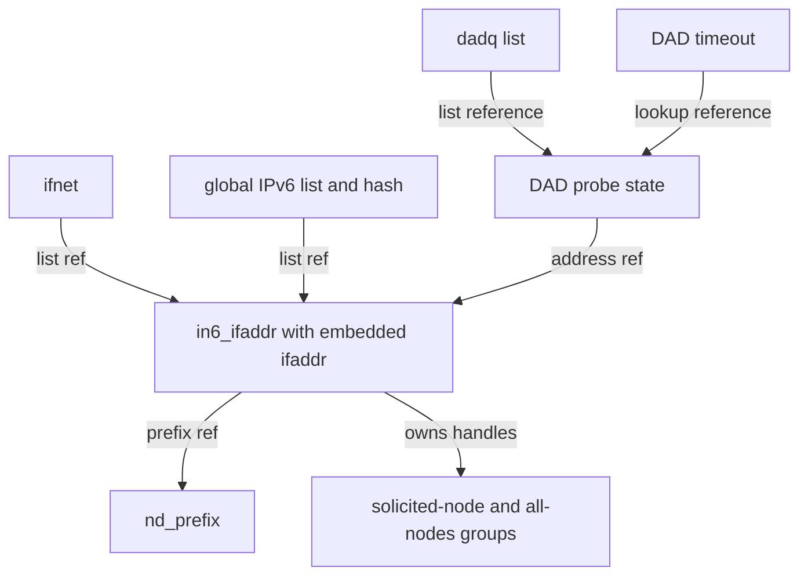
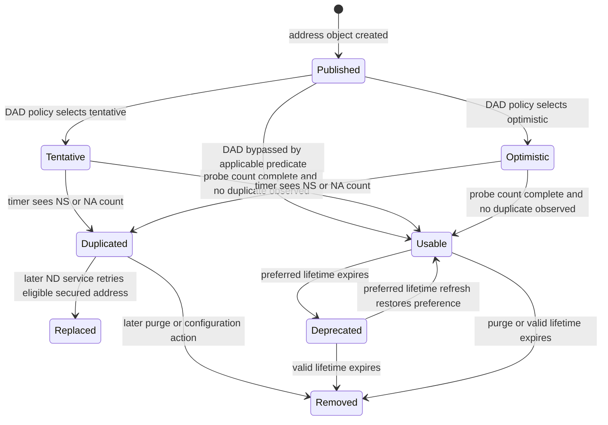

# IPv6 addresses, autoconfiguration and duplicate detection

[Networking](README.md) · [IPv6 guide](ipv6.md) · [Router advertisements and prefixes](ipv6-router-advertisements-and-prefix-lifetime.md) · [Scope and source selection](ipv6-source-selection-and-scopes.md)

An IPv6 address becomes usable through several separate operations: attach IPv6 to an interface, create and publish an interface-address object, install local and prefix routes, join required multicast groups, and complete or explicitly bypass duplicate address detection (DAD). Later preferred/valid lifetime changes can deprecate or remove it. This chapter follows those operations in `xnu-12377.121.6`; a successful address-configuration call does not imply that DAD succeeded or that a router can reach the Internet.

## The objects that outlive configuration

| Object or field | Meaning and owner |
| --- | --- |
| `ifnet.if_inet6data` / `in6_ifextra` | Interface IPv6 statistics, scope data, ND parameters and other per-interface configuration. Preliminary attachment allocates this extension permanently; reuse resets selected fields while deliberately retaining scope storage. |
| `in6_aliasreq` | Request carrying address, optional point-to-point destination, prefix mask, flags and lifetimes. Separate 32/64-bit ioctl forms are converted into a native request. It is not the persistent address object. |
| `in6_ifaddr.ia_ifa` | Embedded generic `ifaddr`: interface pointer, lock, reference count and address-list linkage. Interface-list membership and global IPv6-list membership each retain references. |
| `ia_addr`, `ia_prefixmask`, `ia_plen`, `ia_dstaddr` | Address identity, prefix and optional peer identity. Link-local identity also needs the interface zone; consult the scope companion for embedded versus explicit representations. |
| `ia6_flags` | Origin, usability and DAD state. `AUTOCONF`, `DYNAMIC`, `TEMPORARY` and `SECURED` describe different properties and can coexist. |
| `ia6_lifetime`, `ia6_createtime`, `ia6_updatetime` | Lifetime lengths and time bases; preferred lifetime is distinct from valid lifetime. |
| `ia6_ndpr` | Reference to a separately managed `nd_prefix`, where present. Address count and storage reference count are separate counters. Link-local prefix handling deliberately differs. |
| `ia6_memberships` | Kernel multicast membership handles owned by the address, including its solicited-node group. |
| `dadq` | Temporary DAD control object with an address reference, list reference, probe counts, observed NS/NA counts, latest nonce and a lock. It disappears after DAD; the address can remain. |

See [`in6_ifaddr`](../../../xnu/bsd/netinet6/in6_var.h#L159-L189), [the per-interface allocation/reset](../../../xnu/bsd/netinet6/in6_ifattach.c#L703-L798), [address flags](../../../xnu/bsd/netinet6/in6_var.h#L814-L841), and [`dadq`](../../../xnu/bsd/netinet6/nd6_nbr.c#L1652-L1674).

The flag masks make a consequential distinction: `IN6_IFF_DADPROGRESS` includes tentative **and** optimistic addresses, while `IN6_IFF_NOTREADY` includes tentative **and** duplicated addresses. Optimistic DAD is still a check in progress, but it is not classified as unready by that mask. Each consumer must be checked for its actual predicate; [source selection](ipv6-source-selection-and-scopes.md) explains the resulting eligibility rules.

[`bsd/netinet6/in6_var.h:834–841`](../../../xnu/bsd/netinet6/in6_var.h#L834-L841):

<!-- source-excerpt: ../../../xnu/bsd/netinet6/in6_var.h#L834-L841 -->
```c
/* Duplicate Address Detection [DAD] in progress. */
#define IN6_IFF_DADPROGRESS     (IN6_IFF_TENTATIVE|IN6_IFF_OPTIMISTIC)

/* do not input/output */
#define IN6_IFF_NOTREADY        (IN6_IFF_TENTATIVE|IN6_IFF_DUPLICATED)

/* SLAAC/DHCPv6 address */
#define IN6_IFF_NOTMANUAL       (IN6_IFF_AUTOCONF|IN6_IFF_DYNAMIC)
```



Arrows show retained ownership or lookup, not a universal lock order. The hash is an index into the address population, not a substitute for taking an `ifaddr` reference.

## Entry points and serialization

IPv6 interface ioctls enter [`in6_control()`](../../../xnu/bsd/netinet6/in6.c#L1225-L1361). It checks privilege for mutation, converts user ABI structures, verifies the supplied interface and dispatches several distinct operations:

| Request | Implementation and effect |
| --- | --- |
| `SIOCPROTOATTACH_IN6_32/64` | `in6_domifattach()`: plumb `PF_INET6`, initialize the per-interface extension; this alone is not a request to configure an ordinary link-local address. |
| `SIOCLL_START_32/64`, `SIOCLL_CGASTART_32/64` | Link-local address setup, using a supplied/default IID or the CGA path. |
| `SIOCAIFADDR_IN6_32/64` | `in6ctl_aifaddr()`: ensure attachment, create/update an address, then associate/create the prefix and consider a temporary address. |
| `SIOCDIFADDR_IN6` | Locate the address on the named interface, then purge it and adjust its prefix. |
| `SIOCSIFALIFETIME_IN6` | Update the located address's lifetime through `in6ctl_alifetime()`. |
| `SIOCAUTOCONF_START/STOP` | Enable acceptance of remote RAs, or clear that flag and purge autoconfigured addresses. Starting autoconfiguration does not itself prove receipt of an RA. |
| `SIOCSETROUTERMODE_IN6` | Switch disabled/exclusive/hybrid router mode; exclusive mode alters RA acceptance, prefix proxying and all-multicast behavior. |
| `SIOCPROTODETACH_IN6` | Purge addresses/routes/ND state, then unplumb IPv6. |

The [dispatch body](../../../xnu/bsd/netinet6/in6.c#L1320-L1490), [address validation and final dispatch](../../../xnu/bsd/netinet6/in6.c#L1531-L1690), and [autoconfiguration/router-mode functions](../../../xnu/bsd/netinet6/in6.c#L1932-L2047) establish these differences. A DHCPv6-assigned address can carry `IN6_IFF_DYNAMIC`; that flag is not an in-kernel DHCPv6 client implementation.

The socket lock is dropped before interface operations because handlers may call `ifnet_ioctl()`. A per-interface busy flag, protected by `if_inet6_ioctl_lock` and a sleep/wakeup protocol, serializes these ioctl operations without holding that mutex across the whole handler. Completion clears busy, wakes waiters, releases the address reference and relocks the socket. The lock does **not** serialize RA, DAD and timer work under one transaction; those paths use address, ND and list locks. [Serialization and cleanup](../../../xnu/bsd/netinet6/in6.c#L1289-L1316), [common completion](../../../xnu/bsd/netinet6/in6.c#L1667-L1688).

## Attaching a link and selecting a link-local IID

[`in6_domifattach()`](../../../xnu/bsd/netinet6/in6_ifattach.c#L668-L700) calls `proto_plumb()` and performs preliminary setup only when plumbing succeeds. If that setup fails it attempts to unplumb. [`in6_ifattach_prelim()`](../../../xnu/bsd/netinet6/in6_ifattach.c#L703-L798) normally requires multicast capability, initializes ND and scope state, creates loopback configuration for a loopback interface, and updates the maximum IPv6 MTU. The conditional `IFT_STF` exception is a source-selected variant, not the normal Ethernet path.

[`in6_ifattach_aliasreq()`](../../../xnu/bsd/netinet6/in6_ifattach.c#L806-L930) then handles an ordinary link-local address. It respects `ip6_auto_linklocal`, returns if one already exists, validates any supplied link-local address and zone, or builds `fe80::/64` plus an IID. The hardware path tries this interface, an explicit alternate interface, another interface with an eligible universal IID, and finally a random IID. Thus this body does not justify saying that every product address is always derived from the transmitting interface's MAC. [IID selection](../../../xnu/bsd/netinet6/in6_ifattach.c#L255-L466).

The selected ordinary address gets a `/64` mask and infinite valid/preferred lifetimes. [`in6_ifattach_linklocal()`](../../../xnu/bsd/netinet6/in6_ifattach.c#L469-L551) invokes the common address constructor with DAD delay and separately installs a static, never-expiring on-link link-local prefix. It posts `KEV_INET6_NEW_LL_ADDR`; that event is a configuration event, not a DAD result. The wrapper logs a failed link-local attachment and explicitly returns success in that branch, so callers must not interpret every zero return from the wrapper as proof that an address exists. [Wrapper result handling](../../../xnu/bsd/netinet6/in6_ifattach.c#L913-L929).

The CGA link-local entry is distinct. [`in6_ifattach_llcgareq()`](../../../xnu/bsd/netinet6/in6_ifattach.c#L932-L1022) requires SEND operation to be enabled and the interface not marked insecure, preserves an already configured link-local address, generates the requested CGA IID, and applies the interface scope. Its valid lifetime is infinite but its **preferred** lifetime comes from the request, permitting eventual deprecation of an identifying address. It shares the link-local constructor and its logged-but-nonfatal attachment result branch. A secured link-local address is not automatically an `AUTOCONF` address eligible for the later secured-SLAAC retry predicate.

A scoped example is `fe80::1234%en0`: the `1234` IID bits identify an address within one link; the interface/zone identifies which link. The identical wire address on `en1` is a different local configuration. The constructor validates/normalizes this association before publication rather than using a raw 128-bit value as a system-wide key. [Lookup normalization](../../../xnu/bsd/netinet6/in6.c#L2495-L2538), [scope conversion](../../../xnu/bsd/netinet6/in6.c#L2049-L2079).

## Constructing and publishing an interface address

[`in6_update_ifa()`](../../../xnu/bsd/netinet6/in6.c#L2428-L2730) is shared by manual, link-local, SLAAC and temporary address creation. Its essential sequence is:

1. Validate IPv6 sockaddr family/length, mask length and derived prefix length; require preferred lifetime no greater than valid lifetime. Explicit peer addresses are allowed only for point-to-point/loopback and require `/128`.
2. Search for an existing address on this interface after normalizing link-local scope. Reuse that object when found; otherwise allocate `in6_ifaddr` with `Z_WAITOK` or `Z_NOWAIT` according to `IN6_IFAUPDATE_NOWAIT`.
3. Initialize embedded `ifaddr` pointers and the `nd6_rtrequest` callback, address/mask/peer fields and membership list. Attach to the interface list and global address list, each with its reference.
4. Under the address lock set lifetimes, time bases, prefix length and request flags. Unlock, allowing concurrent readers, before the rest of initialization.
5. `in6_ifinit()` updates the global hash, notifies the interface when selected by `IN6_IFAUPDATE_1STADDR`, installs applicable point-to-point/local routes, and invalidates route caches.
6. `in6_ifaupdate_aux()` establishes DAD state, joins multicast groups and starts probing. Finally the constructor notifies address change and returns a referenced address to its caller.

Publication is visible in the actual reference operations:

[`bsd/netinet6/in6.c:2630–2639`](../../../xnu/bsd/netinet6/in6.c#L2630-L2639):

<!-- source-excerpt: ../../../xnu/bsd/netinet6/in6.c#L2630-L2639 -->
```c
		IFA_LOCK_SPIN(ifa);
		if_attach_ifa(ifp, ifa); /* holds reference for ifnet link */
		IFA_UNLOCK(ifa);
		ifnet_lock_done(ifp);

		lck_rw_lock_exclusive(&in6_ifaddr_rwlock);
		TAILQ_INSERT_TAIL(&in6_ifaddrhead, ia, ia6_link);
		ifa_addref(ifa); /* hold for in6_ifaddrs link */
		os_atomic_inc(&in6_ifaddrlist_genid, relaxed);
		lck_rw_done(&in6_ifaddr_rwlock);
```

The [later initialization](../../../xnu/bsd/netinet6/in6.c#L2670-L2730) and [`in6_ifinit()`](../../../xnu/bsd/netinet6/in6.c#L2936-L3021) matter when reasoning about errors. This is not an atomic “build privately, publish once” operation. A failed auxiliary group/route setup calls `in6_purgeaddr()`, but `in6_ifinit()`'s failure label removes the hash entry and the outer constructor's unwind drops its current reference; those labels do not uniformly reverse every previously published list attachment. The manual wrapper can also fail creating a prefix after a successful address update. This describes the visible cleanup distinctions, not a tested claim about a particular race or kernel defect. [Auxiliary unwind](../../../xnu/bsd/netinet6/in6.c#L2409-L2420), [constructor unwind](../../../xnu/bsd/netinet6/in6.c#L2717-L2729), [manual prefix sequencing](../../../xnu/bsd/netinet6/in6.c#L1745-L1817).

An existing address is not cloned into a new version by this API. Its lifetime/flag state is updated in place, and shared initialization is run again. Readers must honor the address lock and current flags rather than treating an old reference as an immutable configuration snapshot.

## Prefix association follows address publication

[`in6ctl_aifaddr()`](../../../xnu/bsd/netinet6/in6.c#L1692-L1870) creates the address before installing a prefix route because the route needs a usable interface address. A `/128` request bypasses this prefix association. Otherwise it builds a canonical masked prefix, marks it static, uses infinite prefix lifetimes for ordinary manual addresses, or the request lifetimes for autoconfigured/dynamic ones, and looks up/adds the prefix.

Associating `ia6_ndpr` increments both `ndpr_addrcnt` and the prefix reference count; genuinely manual addresses additionally increment `ndpr_manual_addrcnt`. The first appropriate autoconfigured address can trigger temporary address creation, subject to `ip6_use_tempaddr` and the ULA-specific setting. Temporary-creation failure is logged without rolling back the persistent address. This separation explains why counting configured addresses, counting prefixes and counting route entries produces different totals.

## SLAAC persistent addresses, CGA and privacy addresses

### Forming the persistent address

The [RA companion](ipv6-router-advertisements-and-prefix-lifetime.md) explains when a Prefix Information Option is admitted and when an existing address's lifetime is updated. When a new persistent address is needed, [`in6_pfx_newpersistaddr()`](../../../xnu/bsd/netinet6/nd6_rtr.c#L4068-L4265) requires a defined **64-bit** interface identifier and `prefix length + IID length == 128`. Despite a nearby diagnostic saying “64 octets,” the arithmetic is in bits. A non-/64 prefix can still have on-link meaning without this constructor producing a SLAAC address.

The constructor masks the advertised prefix and chooses an IID:

- With SEND operation disabled or `ND6_IFF_INSECURE` set, ordinary SLAAC copies the non-prefix bits from a referenced link-local address. It fails if no such address exists.
- The CGA path calls `in6_cga_generate()` under the global CGA lock, using an optional per-interface modifier and the collision count, and marks successful results `IN6_IFF_SECURED`. CLAT-specific address requests also use this branch and carry `IN6_IFF_CLAT46`.
- It rejects an already configured identical address with `EEXIST`, passes `AUTOCONF` and lifetimes to `in6_update_ifa()`, and requests non-waiting address allocation. Multicast RA reception requests a DAD delay.

The caller then attaches the **persistent stored** prefix object to `ia6_ndpr`; the temporary RA-parsing prefix is not retained. [Prefix attachment and temporary-address request](../../../xnu/bsd/netinet6/nd6_rtr.c#L2869-L2927).

### What the CGA code actually supplies

[`in6_cga_generate_iid()`](../../../xnu/bsd/netinet6/in6_cga.c#L155-L187) hashes the modifier, eight-byte prefix, collision counter, configured public key and optional interface network ID, then writes the IID and security-level bits. The SHA-1 operation here is address derivation. `IN6_IFF_SECURED` does not by itself prove that each incoming RA was signature-verified.

[`bsd/netinet6/in6_cga.c:167–176`](../../../xnu/bsd/netinet6/in6_cga.c#L167-L176):

<!-- source-excerpt: ../../../xnu/bsd/netinet6/in6_cga.c#L167-L176 -->
```c
	SHA1Init(&ctx);
	SHA1Update(&ctx, &prepare->cga_modifier.octets, 16);
	SHA1Update(&ctx, in6->s6_addr, 8);
	SHA1Update(&ctx, &collisions, 1);
	SHA1Update(&ctx, pubkey->iov_base, pubkey->iov_len);
	if (ifp->network_id_len) {
		SHA1Update(&ctx, &ifp->network_id, ifp->network_id_len);
	}
	/* FUTURE: extension fields */
	SHA1Final(sha1, &ctx);
```

[`in6_cga_start()`](../../../xnu/bsd/netinet6/in6_cga.c#L221-L279) installs validated preparation/key material; [`in6_cga_is_prepare_valid()`](../../../xnu/bsd/netinet6/in6_cga.c#L92-L126) checks the security-level work condition when nonzero. [`in6_cga_generate()`](../../../xnu/bsd/netinet6/in6_cga.c#L301-L327) returns `EADDRNOTAVAIL` without a configured public key. The source describes modifier search/preparation as an external responsibility. Its older comment also says collision regeneration is not performed, but the current ND service body **does** retry duplicated secured autoconfigured addresses as described below. Neither comment should replace inspection of the implemented caller chain.

### Temporary IID generation and lifetime bounds

[`in6_iid_mktmp()`](../../../xnu/bsd/netinet6/in6_ifattach.c#L1210-L1234) keeps per-interface random history, base IID seed and current random IID under `nd_ifinfo.lock`. [`in6_generate_tmp_iid()`](../../../xnu/bsd/netinet6/in6_ifattach.c#L154-L244) hashes 16 bytes of history/base seed with SHA-256, takes eight bytes for the IID, clears its universal bit, and retains the next eight digest bytes as history. Those buffers live in kernel interface state; the “stable storage” comment does not establish persistence across boots.

[`in6_tmpifadd()`](../../../xnu/bsd/netinet6/nd6_rtr.c#L4270-L4425) combines the prefix with the generated IID and checks for an already configured local collision, with bounded regeneration attempts. This local lookup does not replace network DAD. It computes valid lifetime as the smaller of remaining public-address lifetime and `ip6_temp_valid_lifetime`; preferred lifetime is bounded by remaining public preference and `ip6_temp_preferred_lifetime - ip6_desync_factor`. If the result does not exceed `ip6_temp_regen_advance`, it returns zero **without creating an address**.

It creates the address with `AUTOCONF | TEMPORARY`, then rechecks the public address's prefix association. If that public address was purged while locks were dropped, it purges the newly created temporary address and returns `EADDRNOTAVAIL`. Otherwise it takes the prefix association and reruns the on-link check. [Construction/race cleanup](../../../xnu/bsd/netinet6/nd6_rtr.c#L4358-L4419).

Two timers have different jobs: [`in6_tmpaddrtimer()`](../../../xnu/bsd/netinet6/in6_ifattach.c#L1237-L1267) periodically rotates the stored random IID; it does not create an address on every invocation. [`nd6_service_ip6_addr()`](../../../xnu/bsd/netinet6/nd6.c#L1451-L1634) handles address deprecation/expiry and invokes [`regen_tmpaddr()`](../../../xnu/bsd/netinet6/nd6.c#L1961-L2040). Regeneration needs a still-preferred public address for the same prefix and suppresses a new temporary address if another preferred temporary one exists.

## Starting DAD: flags, multicast and scheduling

[`in6if_do_dad()`](../../../xnu/bsd/netinet6/in6.c#L3917-L3986) excludes loopback, interfaces without `ND6_IFF_DAD`, alternate ND/local-private/direct-link interfaces, IPsec/utun families and specified special interface types. The ordinary branch also requires `IFF_UP | IFF_RUNNING`; address assignment while the interface is not ready therefore must not be simplified to “DAD always starts immediately.” [`in6_if_up_dad_start()`](../../../xnu/bsd/netinet6/in6.c#L3883-L3914) revisits addresses carrying DAD-in-progress flags on interface-up.

[`in6_ifaddr_set_dadprogress()`](../../../xnu/bsd/netinet6/nd6.c#L5034-L5119) chooses tentative versus optimistic state from category-specific `nd6_optimistic_dad` bits. Exclusive router mode and replicated interfaces disable the optimistic choice. Manual, dynamic, link-local, temporary and secured addresses do not all use the same category test.

[`in6_ifaupdate_aux()`](../../../xnu/bsd/netinet6/in6.c#L2114-L2191) sets this state **before** joining multicast groups, so an MLD response does not accidentally use a tentative source. It joins `ff02::1:ffXX:XXXX` from the low 24 address bits, then all-nodes and applicable node-information groups. When delayed DAD is requested it coordinates solicitation delay with the solicited-node group's pending MLD report. Optimistic addresses clear the normal delay request; `SWIFTDAD` is another explicit no-delay branch. Actual group ownership and MLD timers are covered by the multicast chapters.

The start predicate is exact, and does not equate “DAD capable interface” with “every address must probe”:

[`bsd/netinet6/in6.c:2354–2362`](../../../xnu/bsd/netinet6/in6.c#L2354-L2362):

<!-- source-excerpt: ../../../xnu/bsd/netinet6/in6.c#L2354-L2362 -->
```c
	/*
	 * Perform DAD, if:
	 * * Interface is marked to perform DAD, AND
	 * * Address is not marked to skip DAD, AND
	 * * Address is in a pre-DAD state (Tentative or Optimistic)
	 */
	IFA_LOCK_SPIN(ifa);
	if (in6if_do_dad(ifp) && (ia->ia6_flags & IN6_IFF_NODAD) == 0 &&
	    (ia->ia6_flags & IN6_IFF_DADPROGRESS) != 0) {
```

[`nd6_dad_start()`](../../../xnu/bsd/netinet6/nd6_nbr.c#L1751-L1844) additionally handles disabled probe count, anycast, interface-up and duplicate-start checks. It attaches a `dadq`, takes an address reference, then either sends a probe and schedules the retransmission timeout or schedules an initial delayed timeout. `dad_count` snapshots `ip6_dad_count`. The timeout argument is the address pointer; the attached DAD object retains that address and the callback reacquires a DAD reference through lookup.

## Probe transmission, duplicate observations and the nonce

[`nd6_dad_ns_output()`](../../../xnu/bsd/netinet6/nd6_nbr.c#L2238-L2280) increments trial count before checking interface-up/running, increments its outbound count before calling the NS output function, and generates a nonce for enhanced DAD on non-point-to-point interfaces. Therefore `dad_ns_ocount` is not a hardware completion counter or evidence that a peer saw a frame.

The NS packet uses the unspecified source and solicited-node multicast destination for DAD; the wire construction is in [`nd6_ns_output()`](../../../xnu/bsd/netinet6/nd6_nbr.c#L589-L935). NS and NA admission validates the message before handing a candidate address to the DAD helpers. [NS handoff](../../../xnu/bsd/netinet6/nd6_nbr.c#L457-L521), [NA/DAD dispatch](../../../xnu/bsd/netinet6/nd6_nbr.c#L1040-L1119).

A received DAD NS calls [`nd6_dad_ns_input()`](../../../xnu/bsd/netinet6/nd6_nbr.c#L2289-L2315), which looks up the address's DAD state and increments the input count. When enhanced DAD is enabled, matching the **latest** nonce identifies a likely looped-back local probe. The ignore is bounded by `nd6_dad_nonce_max_count`, and increments loopback counters; it is not a rule to ignore matching packets forever.

[`bsd/netinet6/nd6_nbr.c:1710–1729`](../../../xnu/bsd/netinet6/nd6_nbr.c#L1710-L1729):

<!-- source-excerpt: ../../../xnu/bsd/netinet6/nd6_nbr.c#L1710-L1729 -->
```c
		same_nonce = nonce != NULL &&
		    nonce->nd_opt_nonce_len == (ND_OPT_NONCE_LEN + 2) / 8 &&
		    memcmp(&nonce->nd_opt_nonce[0], &dp->dad_nonce[0],
		    ND_OPT_NONCE_LEN) == 0;

		if (same_nonce &&
		    dp->dad_same_nonce_count <= nd6_dad_nonce_max_count) {
			nd6log(error, "%s: a looped back NS message is "
			    "detected during DAD for if=%s %s. Ignoring.\n",
			    __func__,
			    if_name(ifa->ifa_ifp),
			    ip6_sprintf(IFA_IN6(ifa)));
			dp->dad_same_nonce_count++;
			dp->dad_ns_lcount++;
			++ip6stat.ip6s_dad_loopcount;
			DAD_UNLOCK(dp);
			continue;
		} else if (!same_nonce) {
			// Not the same nonce, reset counter
			dp->dad_same_nonce_count = 1;
```

Only one nonce is retained. The source explicitly notes that multiple outstanding probes may loop back out of order, so this is not a set of all previously transmitted nonces. The timer can extend probing under its enhanced-DAD loopback conditions. [Nonce generation limitation](../../../xnu/bsd/netinet6/nd6_nbr.c#L2263-L2279), [timer extension](../../../xnu/bsd/netinet6/nd6_nbr.c#L2036-L2070).

[`nd6_dad_na_input()`](../../../xnu/bsd/netinet6/nd6_nbr.c#L2330-L2416) takes an address reference and consumes an NA targeting a local address. It ignores the duplicate observation for replicated interfaces and for addresses no longer undergoing DAD. When link-layer evidence is available, it also ignores an NA whose Ethernet source disagrees with the target link-layer option, a sleep-proxy compatibility check. Otherwise it increments `dad_na_icount`. The nearby “remove the address” comment is **not** the behavior of that helper: it logs and frees the message; duplicate marking occurs when the timer evaluates the counts.

## DAD completion, failure and secured-address retries



This diagram omits retry-exhaustion and interface readiness branches; they are not success paths. Optimistic usability is consumer-dependent even while this diagram retains the `Optimistic` state.

[`nd6_dad_timer()`](../../../xnu/bsd/netinet6/nd6_nbr.c#L1942-L2108) takes a DAD reference, checks current address flags and retries until the outbound count reaches the target. Exceeding the trial bound detaches DAD state without the successful completion branch clearing the address's DAD flags. Once the target count is reached, observed NS/NA counts cause `nd6_dad_duplicated()`; otherwise, absent the enhanced-loopback retry case, it clears `DADPROGRESS`, optionally sends an unsolicited NA for replicated interfaces, posts `KEV_INET6_NEW_USER_ADDR`, detaches DAD state and releases references.

The duplicate state change is explicit:

[`bsd/netinet6/nd6_nbr.c:2195–2206`](../../../xnu/bsd/netinet6/nd6_nbr.c#L2195-L2206):

<!-- source-excerpt: ../../../xnu/bsd/netinet6/nd6_nbr.c#L2195-L2206 -->
```c
	ia->ia6_flags &= ~IN6_IFF_DADPROGRESS;
	ia->ia6_flags |= IN6_IFF_DUPLICATED;
	in6_event_enqueue_nwk_wq_entry(IN6_ADDR_MARKED_DUPLICATED,
	    ia->ia_ifa.ifa_ifp, &ia->ia_addr.sin6_addr,
	    0);
	IFA_UNLOCK(&ia->ia_ifa);

	/* increment DAD collision counter */
	++ip6stat.ip6s_dad_collide;

	/* We are done with DAD, with duplicated address found. (failure) */
	untimeout((void (*)(void *))nd6_dad_timer, (void *)ifa);
```

[`nd6_dad_duplicated()`](../../../xnu/bsd/netinet6/nd6_nbr.c#L2111-L2235) marks the address duplicated, enqueues an event, cancels the timer and posts a configuration notification. For a restricted hardware-derived link-local duplication case it can also disable IPv6 on the interface. It does not universally unlink the address here. The event consumer's policy is outside this source trace.

The kernel nevertheless has one concrete later recovery path: [`nd6_service_ip6_addr()`](../../../xnu/bsd/netinet6/nd6.c#L1451-L1499) recognizes `DUPLICATED | AUTOCONF | SECURED`. [`nd6_handle_duplicated_ip6_addr()`](../../../xnu/bsd/netinet6/nd6.c#L1375-L1439) requires a remaining collision retry budget and an associated prefix, retains the prefix, drops list/address locks, purges the old address, increments the collision count and attempts a replacement persistent CGA address. Failure to allocate the replacement does not restore the old one. This is a separate service-time operation, not the DAD receive handler retrying synchronously.

## Deprecation, expiry and complete teardown

The actual service predicates compare nonzero **absolute uptime deadlines**, `ia6ti_expire` and `ia6ti_preferred`, against the current uptime. Zero means no deadline in those macros. RA updates separately compute remaining durations using lifetime lengths and `ia6_updatetime`; temporary lifetime caps also use creation time. `in6ifa_setlifetime()` stores the internal deadlines/time bases, while `in6ifa_getlifetime(..., calendar_time=1)` converts deadlines for user reporting. The constructor's older comment saying expiration/preferred members are not consulted must not override these active predicates. [Time conversion and storage](../../../xnu/bsd/netinet6/in6.c#L3145-L3207), [constructor initialization/comment](../../../xnu/bsd/netinet6/in6.c#L2665-L2699), [service decisions](../../../xnu/bsd/netinet6/nd6.c#L1501-L1634).

[`bsd/netinet6/in6.h:464–469`](../../../xnu/bsd/netinet6/in6.h#L464-L469):

<!-- source-excerpt: ../../../xnu/bsd/netinet6/in6.h#L464-L469 -->
```c
#define IFA6_IS_DEPRECATED(a, t) \
	((a)->ia6_lifetime.ia6ti_preferred != 0 && \
	(a)->ia6_lifetime.ia6ti_preferred < (t))
#define IFA6_IS_INVALID(a, t) \
	((a)->ia6_lifetime.ia6ti_expire != 0 && \
	(a)->ia6_lifetime.ia6ti_expire < (t))
```

The lifetime ioctl likewise recomputes deadlines from current uptime plus the supplied durations rather than trusting supplied absolute deadline fields. Its getter marshals 32/64-bit calendar-time results; these are API representations, not the clock used by the timer. [Lifetime ioctl](../../../xnu/bsd/netinet6/in6.c#L965-L1083).

Deprecation sets `IN6_IFF_DEPRECATED` and may trigger temporary-address regeneration. It leaves the address valid for the remaining valid lifetime. Invalidity triggers `in6_purgeaddr()`. The service takes an extra address reference, drops locks before regeneration/purge, then restarts list traversal because those calls can change the population. This is also why resuming after a long idle interval can regenerate temporary addresses without keeping a stale list cursor.

[`in6_purgeaddr()`](../../../xnu/bsd/netinet6/in6.c#L2732-L2787) performs ordered cleanup: stop DAD, remove relevant point-to-point and own-address loopback routes, leave each owned multicast membership outside the address lock, unlink the address, post deletion and notify the interface. [`in6_unlink_ifa()`](../../../xnu/bsd/netinet6/in6.c#L2790-L2891) holds its own temporary reference, removes interface/global/hash linkage, adjusts the associated prefix counts/reference where applicable, drops list references and invalidates IPv6 route caches. Storage is freed only after the final `ifaddr` reference; removal from lookup structures and final reclamation are different events.

[`in6_purgeif()`](../../../xnu/bsd/netinet6/in6.c#L2894-L2929) repeatedly references, unlocks, purges and restarts until the interface's addresses are gone, then calls [`in6_ifdetach()`](../../../xnu/bsd/netinet6/in6_ifattach.c#L1029-L1207). Detach also purges neighbor/router/prefix state and residual interface configuration. It does not free the permanent `in6_ifextra` allocation as though it were an individual address.

## Worked lifetime example and boundaries

Assume an accepted `/64` autonomous prefix, a usable link-local IID, ordinary Ethernet DAD enabled, and temporary-address generation enabled. A persistent address is published and associated with the prefix; a temporary address may be added with a separately generated IID. Each has its own `in6_ifaddr`, DAD state and lifetime. Their common `ia6_ndpr` does not merge them into one address or one timer result.

If the public preferred lifetime has 600 seconds remaining while the temporary policy permits 3,600 seconds, the new temporary address receives at most 600 preferred seconds. If its valid lifetime is 7,200 seconds, deprecation after those 600 seconds does not remove it immediately. A later RA can refresh the persistent lifetime, but temporary addresses remain capped relative to their own creation time. A detected duplicate marks the affected address; it does not mark every address sharing the prefix duplicated.

These are illustrative values applied to the inspected branches, not defaults or a packet-capture result. The explanation does not implement the user-space configuration agent, DHCPv6 client, CGA preparation service, SEND signature verifier or hardware behavior. It also does not claim all address/ioctl variants were executed. In-tree [`test_set_ifaddr`](../../../xnu/tests/net/test_set_ifaddr.c#L50-L79) exercises malformed interface-address requests, while [`in6_selectsrc`](../../../xnu/tests/net/in6_selectsrc.c#L54-L100) exercises repeated raw-socket connect and packet-option operations; neither is a complete DAD/SLAAC lifecycle test. This documentation change validates source references, exact excerpts and diagrams, not a running XNU network stack.

<!-- BEGIN PLATYDOC DOCUMENTATION LICENSE -->
Original Platydoc text and diagrams are licensed under [CC BY 4.0](https://creativecommons.org/licenses/by/4.0/). Quoted source code and third-party material retain their respective licenses.
<!-- END PLATYDOC DOCUMENTATION LICENSE -->
