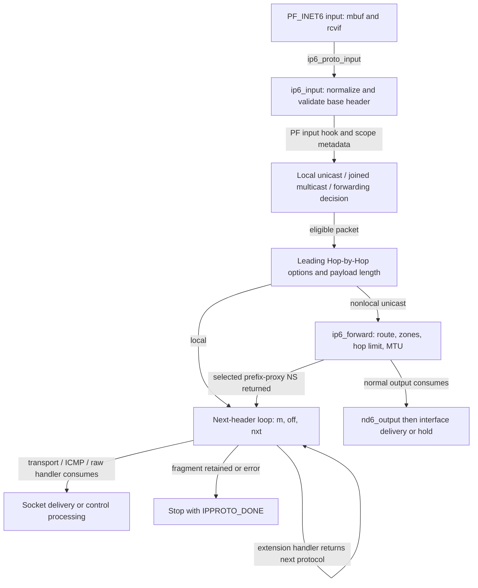
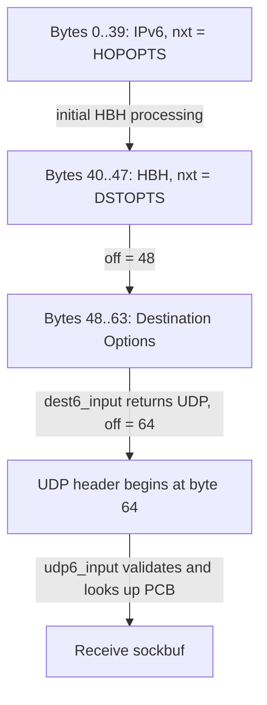
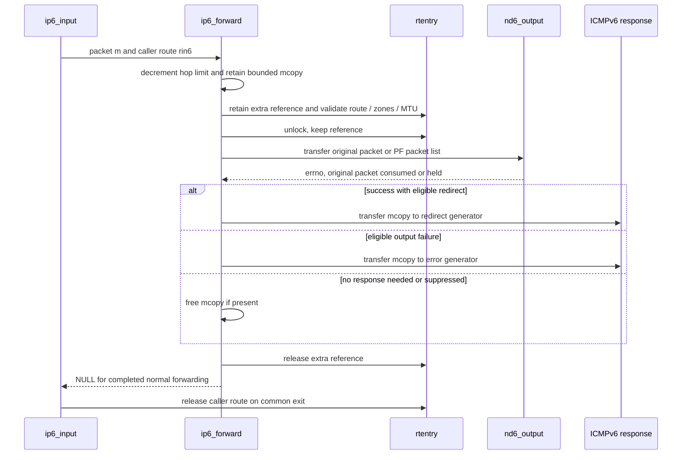

# IPv6 input, extension headers and forwarding

An IPv6 packet entering BSD is an mbuf chain plus receive-interface metadata. The kernel first decides whether the datagram belongs to this host or must be forwarded. For local delivery it walks the next-header chain, allowing each handler to replace the packet, advance a byte offset, or consume the packet entirely. Forwarding has a different path: it processes the leading Hop-by-Hop header but does not run the ordinary local transport/fragment dispatch loop before sending the packet onward.

Return to [IPv6](ipv6.md) and [networking](README.md). Read [packet and interface delivery](packets-routes-and-interfaces.md) for the earlier DLIL path, [IPv6 output](ipv6-output-and-neighbor-discovery.md) for local transmission, [reassembly and ICMP errors](ip-fragment-reassembly-and-icmp.md) for fragment queues and PMTU feedback, and [neighbor messages](ipv6-neighbor-messages-and-reachability.md) for the ICMPv6 control path. This chapter follows the common BSD implementation in `xnu-12377.121.6`; Skywalk has [separate flow and fragment processing](skywalk-fragments-reassembly-and-flow-tracking.md).

## Entry and the objects carried through input

`ip6_init()` registers `ip6_proto_input()` for `PF_INET6` with `proto_register_input()`. The wrapper calls `ip6_input()`; it does not represent a syscall or a transition from userspace. Packet injection and interface input can reach this same family registration. The receive context and serialization established by DLIL/protocol delivery precede this routine; the per-protocol mutex decision described below is an additional layer. See [registration](../../../xnu/bsd/netinet6/ip6_input.c#L505-L514) and [wrapper](../../../xnu/bsd/netinet6/ip6_input.c#L333-L350).

| Object | Meaning during this path |
| --- | --- |
| `struct mbuf *m` | Owner of the received packet chain. `m_next` links storage; it is not a next-header pointer. The first mbuf's packet header carries total length, `rcvif`, checksum state and flags such as `PKTF_HBH_CHKED` and `PKTF_REASSEMBLED`. |
| `struct ip6_hdr` | The 40-byte wire header: payload length, next protocol, hop limit, source and destination. IPv6 has no base-header checksum; upper-layer validation uses its own checksum rules. |
| `off`, `nxt` | Parser state. `off` is a byte offset from the start of the IPv6 header, initially 40; `nxt` selects `ip6_protox[nxt]`. Neither is an mbuf index or an address. |
| `struct ip6protosw` | Handler registration: `pr_input`, `pr_flags`, control input/output and socket operations. Its IPv6 input function receives `mbuf **`, `int *offp`, and protocol number. |
| Local `struct route_in6 rin6` | A destination and optional retained route used by the local-address check and forwarding. `ip6_input()` releases this route on its common exit. |
| `inifp`, `deliverifp` | The actual receive interface and selected local delivery interface. Weak-host acceptance and loopback routes can make them different. |

Definitions: [IPv6 header](../../../xnu/bsd/netinet/ip6.h#L110-L132), [protocol switch](../../../xnu/bsd/netinet6/ip6protosw.h#L155-L194), and [input locals and receive contract](../../../xnu/bsd/netinet6/ip6_input.c#L829-L855). [Scope and source selection](ipv6-source-selection-and-scopes.md) distinguishes interface indexes in packet metadata, socket scope IDs and optional embedded address scopes.



The diagram omits individual error exits. The proxy arrow is a specific `PKTF_PROXY_DST` case, not a general mechanism for retrying arbitrary forwarded traffic locally.

## Admission changes packet representation before delivery

### Normalize storage and reject invalid base addresses

`ip6_input()` checks the mbuf input contract, requires a receive interface, fixes header alignment, clears stale forwarded/authentication metadata and discards old IPv6 auxiliary data. Filter reinjection and configured dummynet tags have dedicated continuation paths; they are not fresh wire packets traversing every check again. See [entry and reinjection](../../../xnu/bsd/netinet6/ip6_input.c#L845-L901).

On ordinary ingress it rejects an interface with `IFEF_IPV6_DISABLED`, may copy a short multi-mbuf packet into a header/cluster allocation, checks that the IPv6 header is accessible, and validates the version. Address tests reject a non-looped packet with source `::1`, multicast source, unspecified destination, improperly received interface-local multicast, and IPv4-mapped source or destination. **Mapped IPv6 socket addresses are an API representation; they are not admitted as such on this native IPv6 wire path.** See [storage and base header](../../../xnu/bsd/netinet6/ip6_input.c#L929-L993), [address tests](../../../xnu/bsd/netinet6/ip6_input.c#L997-L1053), and [socket mapping](ipv6-sockets-and-packet-options.md).

With `PF` enabled, the inbound hook runs before scope embedding and destination classification. It receives `&m`, may replace or consume the packet, and input refreshes its `ip6` pointer afterward. The error/consumed branch requires a null packet: input must not free it again. See [PF admission](../../../xnu/bsd/netinet6/ip6_input.c#L1094-L1117). This chapter traces that contract, not the rule/state machine inside PF.

### Scope identifiers are internal metadata

For a non-looped physical arrival, link-local/scoped addresses must not already contain an interface identifier in the relevant address word. If `in6_embedded_scope` is selected, input inserts an interface index from `PKTF_IFAINFO` metadata or from `rcvif`. Otherwise the separate scope fields remain important to lookup. The bytes used in kernel address comparison can therefore differ from the address as received on the wire. See [wire validation and insertion](../../../xnu/bsd/netinet6/ip6_input.c#L1119-L1149).

### Local acceptance is more than a route lookup

`ip6_input_check_interface()` first scans the address hash under `in6_ifaddr_rwlock`, comparing the destination **and its zone** and excluding `IN6_IFF_NOTREADY`. A matching address on the arriving interface wins. A match on another interface can be accepted under weak-host behavior; with forwarding disabled, strong checking rejects it, and hybrid checking rejects the specified IPsec/utun-interface case. In this hash-match path, L2 multicast/broadcast framing with an L3 unicast destination also causes rejection. See [hash and interface policy](../../../xnu/bsd/netinet6/ip6_input.c#L605-L669).

The slow path retains a destination route. A direct host route to loopback, without `RTF_GATEWAY` or the prohibited cloned flag, can establish local ownership if its address is ready. If neither path finds local ownership, forwarding configuration chooses forward or drop. A drop performed inside the helper already consumes the packet; the caller's `bad` label goes to route cleanup rather than blindly freeing `m`. See [route-based acceptance](../../../xnu/bsd/netinet6/ip6_input.c#L672-L752) and [drop and return](../../../xnu/bsd/netinet6/ip6_input.c#L764-L803).

Multicast instead checks `(destination group, receive interface)` in the `in6_multi` list, briefly retaining the group object. A nonmember is dropped unless prefix-proxy handling may still claim a solicitation. This is interface membership admission, not a complete per-socket source-filter decision; see [input multicast path](../../../xnu/bsd/netinet6/ip6_input.c#L1151-L1192) and [multicast memberships and MLD](ipv6-multicast-membership-and-mld.md).

## Hop-by-Hop processing and the payload-length contract

The initial Hop-by-Hop header is special: `ip6_input()` handles it before normal forwarding and before the local next-header loop. It sets `PKTF_HBH_CHKED`, calls `ip6_hopopts_input()`, reloads the header pointer, and takes the following protocol from `ip6h_nxt`. A recognized MLD Router Alert can set `ours` while forwarding is enabled. The code's comment about passing to a multicast-routing daemon is intent at this branch; it does not establish an arbitrary multicast-forwarding provider. See [initial HBH path](../../../xnu/bsd/netinet6/ip6_input.c#L1229-L1297).

The extension's length is `(ip6h_len + 1) * 8`, including its first two bytes. `ip6_hopopts_input()` checks accessibility, then `ip6_process_hopopts()` handles padding, Router Alert, Jumbo Payload and unknown options. A valid Jumbo Payload requires a zero base-header payload length, a value greater than 65535, and no already accepted jumbo length. If the base length is zero and the first header is HBH but no jumbo value was obtained, input generates a parameter-problem error. See [HBH walker](../../../xnu/bsd/netinet6/ip6_input.c#L1630-L1659), [Router Alert and Jumbo decisions](../../../xnu/bsd/netinet6/ip6_input.c#L1682-L1769), and [missing jumbo rejection](../../../xnu/bsd/netinet6/ip6_input.c#L1251-L1269).

Unknown option types encode the action in their high bits:

| Action | Current body |
| --- | --- |
| Skip | Return its option-data length so the caller advances past the type/length bytes too. |
| Discard | Consume the packet without an ICMP response. |
| Force ICMP | Invoke `icmp6_error()` with parameter-problem/option, including for multicast subject to that helper's other suppression rules. |
| ICMP except multicast | Drop when the IPv6 destination or L2 flags indicate multicast/broadcast; otherwise invoke the error helper. |

Source: [`ip6_unknown_opt()`](../../../xnu/bsd/netinet6/ip6_input.c#L1807-L1838). The error pointer is an offset within the original IPv6 packet; it is not a pointer copied to the peer.

After HBH processing, a buffer shorter than the declared payload is dropped. Excess bytes normally get trimmed, with partial hardware-checksum metadata adjusted or invalidated. `ip6_input_adjust()` has a conditional branch that retains trailing bytes for direct TCP/UDP partial-checksum handling when adjustment is disabled. Thus `m_pkthdr.len == 40 + plen` is the normal result, not an invariant of every tunable combination. See [length decision](../../../xnu/bsd/netinet6/ip6_input.c#L1302-L1314) and [padding/checksum adjustment](../../../xnu/bsd/netinet6/ip6_input.c#L533-L602).

## The local next-header loop is a continuation protocol

`ip6_init()` fills every `ip6_protox[]` slot with the raw IPv6 handler, then substitutes registered nonzero protocols other than `IPPROTO_RAW`. Unknown values consequently have a defined raw-delivery route; the table is not a sparse array of only known transports. See [table construction](../../../xnu/bsd/netinet6/ip6_input.c#L390-L415).

Each handler can update `m` and `off`, then return the next protocol. `IPPROTO_DONE` terminates the loop after consumption, queueing or final processing. It is **not** `errno == 0`, and the caller must not infer that every terminal handler cleared `*mp`: some consumed-packet branches return without rewriting that caller-visible pointer. The decisive invariant is that input stops using it. See [dispatch and common exit](../../../xnu/bsd/netinet6/ip6_input.c#L1487-L1505) and the [raw terminal return](../../../xnu/bsd/netinet6/raw_ip6.c#L288-L311).

The lock selection is concrete in [ip6_input.c, lines 1487–1498](../../../xnu/bsd/netinet6/ip6_input.c#L1487-L1498):

<!-- source-excerpt: ../../../xnu/bsd/netinet6/ip6_input.c#L1487-L1498 -->
```c
		if ((pr_input = ip6_protox[nxt]->pr_input) == NULL) {
			m_drop(m, DROPTAP_FLAG_DIR_IN | DROPTAP_FLAG_L2_MISSING, DROP_REASON_IP_NO_PROTO, NULL, 0);
			m = NULL;
			nxt = IPPROTO_DONE;
		} else if (!(ip6_protox[nxt]->pr_flags & PR_PROTOLOCK)) {
			lck_mtx_lock(inet6_domain_mutex);
			nxt = pr_input(&m, &off, nxt);
			lck_mtx_unlock(inet6_domain_mutex);
		} else {
			nxt = pr_input(&m, &off, nxt);
		}
	}
```

`PR_PROTOLOCK` means the handler supplies its own synchronization. TCP, UDP, fragments and configured AH/ESP use that flag. Destination options, routing headers, raw IPv6 and ICMPv6 run under `inet6_domain_mutex` in this dispatcher. It does not mean the whole network stack is protected by one lock. Registrations are in [in6_proto.c](../../../xnu/bsd/netinet6/in6_proto.c#L164-L327).

| Next header | Implementation and continuation |
| --- | --- |
| Destination Options | `dest6_input()` validates complete header accessibility, walks padding/unknown options, advances `off` and returns `ip6d_nxt`. |
| Routing | `route6_input()` handles the local routing-header decision described below; it does not implement arbitrary source routing. |
| Fragment | `frag6_input()` may retain the mbuf and end dispatch; completion returns a replacement packet/offset and next protocol. See the dedicated reassembly chapter. |
| UDP / TCP | `udp6_input()` / `tcp6_input()` enter PCB lookup, checksum and transport processing; successful IP parsing alone does not establish a socket match. |
| ICMPv6 | `icmp6_input()` validates checksum and message-specific gates, then processes errors, echo, ND or MLD and eligible socket observation. |
| AH / ESP | Configured registrations invoke `ah6_input()` / `esp6_input()`; cryptographic and SA processing are separate from the generic header walker. |
| IPv4 / IPv6 encapsulation | Configured `encap6_input()` dispatches encapsulation handlers. |
| Unrecognized protocol / No Next Header | The raw fallback can offer data to matching raw PCBs. Without a match, No Next Header is discarded; other unknown protocols generate parameter-problem/next-header. |

Sources: [destination handler](../../../xnu/bsd/netinet6/dest6.c#L85-L140), [routing handler](../../../xnu/bsd/netinet6/route6.c#L77-L125), [registration](../../../xnu/bsd/netinet6/in6_proto.c#L173-L327), and [raw no-listener decision](../../../xnu/bsd/netinet6/raw_ip6.c#L288-L304).

### Accessibility checks constrain actual mbuf layout

`IP6_EXTHDR_CHECK` requires the bytes from the packet start through the requested header to be in the first mbuf. It may pull up an `M_LOOP` chain; in other multi-mbuf cases a short first mbuf is rejected even when later storage contains enough total bytes. On failure it frees the chain, nulls its local `m` and executes the caller-supplied action. Reloading header pointers after the macro is necessary because pullup can move storage. This is stricter than merely checking `m_pkthdr.len`. See [macro body](../../../xnu/bsd/netinet/ip6.h#L309-L350).

Destination Options validates each non-Pad1 option's length against remaining bytes. The exact check is [dest6.c, lines 106–112](../../../xnu/bsd/netinet6/dest6.c#L106-L112):

<!-- source-excerpt: ../../../xnu/bsd/netinet6/dest6.c#L106-L112 -->
```c
	for (optlen = 0; dstoptlen > 0; dstoptlen -= optlen, opt += optlen) {
		if (*opt != IP6OPT_PAD1 &&
		    (dstoptlen < IP6OPT_MINLEN || *(opt + 1) + 2 > dstoptlen)) {
			ip6stat.ip6s_toosmall++;
			drop_reason = DROP_REASON_IP_TOO_SMALL;
			goto bad;
		}
```

The HBH and destination walkers are distinct bodies. Do not infer that every length guard in one also exists in the other.

### Header nesting, filter reinjection and IPsec policy

The local loop limits dispatch iterations through `ip6_hdrnestlimit`, defaulting to 15 in this tree; the counter includes visits to the final transport handler, while the leading HBH processing occurred earlier. It also rejects an offset beyond total length. Its HBH guard tests `PKTF_HBH_CHKED`; this should not be described as a complete grammar validator for every possible header ordering. See [loop checks](../../../xnu/bsd/netinet6/ip6_input.c#L1397-L1427) and [default](../../../xnu/bsd/netinet6/in6_proto.c#L421).

With IPsec enabled, `PR_LASTHDR` triggers policy rejection at this layer. TCP/UDP/raw paths with their own PCB policy processing are deliberately treated separately. IP filters run for each dispatch step with current `(m, off, nxt)`. `EJUSTRETURN` means ownership was taken; another error causes a drop. Reinjection records which filter injected the packet and resumes traversal after that filter instead of repeating earlier callbacks. See [policy and filters](../../../xnu/bsd/netinet6/ip6_input.c#L1429-L1474) and [reinjection selection](../../../xnu/bsd/netinet6/ip6_input.c#L890-L901).

### Routing headers have no active route-type implementation here

The checked-in `route6_input()` switch has only a default case. A header with zero segments left is skipped using its advertised extension length. A nonzero value generates an ICMPv6 parameter problem identifying the routing-type field. Definitions such as `ip6_rthdr0` in headers do not prove that this kernel executes routing type 0, SRv6 or another routing-header algorithm. See [route6.c, lines 109–124](../../../xnu/bsd/netinet6/route6.c#L109-L124):

<!-- source-excerpt: ../../../xnu/bsd/netinet6/route6.c#L109-L124 -->
```c
	switch (rh->ip6r_type) {
	default:
		/* unknown routing type */
		if (rh->ip6r_segleft == 0) {
			rhlen = (rh->ip6r_len + 1) << 3;
			break;  /* Final dst. Just ignore the header. */
		}
		ip6stat.ip6s_badoptions++;
		icmp6_error(m, ICMP6_PARAM_PROB, ICMP6_PARAMPROB_HEADER,
		    (int)((caddr_t)&rh->ip6r_type - (caddr_t)ip6));
		return IPPROTO_DONE;
	}

	*mp = m;
	*offp += rhlen;
	return rh->ip6r_nxt;
```

The fixed routing header is checked before this branch; the next input-loop visit and handler perform subsequent offset/accessibility checks. The body does not pre-validate every byte of a skipped unknown routing header with the same full-header macro used by `dest6_input()`.

### Worked parsing example

Illustrative local packet: IPv6 base header, an eight-byte HBH header, a sixteen-byte Destination Options header, and UDP. Assume valid options, no fragments/IPsec, ordinary mbuf layout and a matching socket.



The offset is over packet bytes even if payload storage spans multiple mbufs. The HBH value `ip6h_len = 0` means eight total bytes; Destination Options `ip6d_len = 1` means sixteen. Replacing UDP with a Fragment header changes ownership: `frag6_input()` can stop the loop while holding only one fragment. See [reassembly entry/exit](ip-fragment-reassembly-and-icmp.md#entry-delivery-and-the-meaning-of-an-incomplete-result).

## Router forwarding is an output transaction with an error copy

### Admission, hop limit and prefix proxying

`ip6_forward()` receives the original packet and the caller's `route_in6`. It can replace a prefix-proxy route or discard a route inconsistent with PF-selected scope. Configured inbound IPsec policy is checked. L2 multicast/broadcast, multicast destination and unspecified source are rejected; a hop limit at or below one produces Time Exceeded and consumes the packet. See [forward entry](../../../xnu/bsd/netinet6/ip6_forward.c#L145-L247).

A selected prefix-proxy solicitation can be returned to `ip6_input()` for local ND processing. That branch avoids decrementing hop limit and skips outbound IPsec forwarding; ordinary forwarding decrements the header then makes a nonblocking bounded `mcopy` for a later ICMP error or redirect. Failure to allocate this copy does not necessarily prevent forwarding; it removes the saved bytes needed for those later responses. See [proxy and copy decision](../../../xnu/bsd/netinet6/ip6_forward.c#L249-L285).

The decrement and saved-copy ordering is [ip6_forward.c, lines 270–282](../../../xnu/bsd/netinet6/ip6_forward.c#L270-L282):

<!-- source-excerpt: ../../../xnu/bsd/netinet6/ip6_forward.c#L270-L282 -->
```c
	ip6->ip6_hlim -= IPV6_HLIMDEC;

	/*
	 * Save at most ICMPV6_PLD_MAXLEN (= the min IPv6 MTU -
	 * size of IPv6 + ICMPv6 headers) bytes of the packet in case
	 * we need to generate an ICMP6 message to the src.
	 * Thanks to M_EXT, in most cases copy will not occur.
	 *
	 * It is important to save it before IPsec processing as IPsec
	 * processing may modify the mbuf.
	 */
	mcopy = m_copym_mode(m, 0, imin(m->m_pkthdr.len, ICMPV6_PLD_MAXLEN),
	    M_DONTWAIT, NULL, NULL, M_COPYM_COPY_HDR);
```

With IPsec selected, outbound policy can discard, bypass or invoke `ipsec6_output_tunnel()`. That operation can replace/consume the packet and can send a tunneled result over IPv4. Its policy and route references have their own releases. These branches are an explicit boundary of the plain IPv6 forwarding trace; this chapter does not claim a complete SA/transform reconstruction. See [policy and tunnel handoff](../../../xnu/bsd/netinet6/ip6_forward.c#L286-L411).

### Route and zone decisions precede transmission

The routine takes an extra `rtentry` reference in addition to the caller's route ownership. It validates/relooks up unusable routes, retaining the extra reference across unlocked output. A missing route can produce Destination Unreachable using `mcopy`; the original is dropped. See [route references and retry](../../../xnu/bsd/netinet6/ip6_forward.c#L415-L485).

Source and destination addresses are tested against both receiving and outgoing interface zones with `in6_setscope()` on local copies. A source-zone mismatch normally produces Beyond Scope; a destination-zone mismatch is dropped. These are concrete scope comparisons, not a claim that the stack performs general reverse-path validation of every global source. Prefix-proxy handling has the explicit source-zone exception. See [zone checks](../../../xnu/bsd/netinet6/ip6_forward.c#L488-L568).

The plain forwarding MTU check compares the effective packet length with the outgoing interface's `if_mtu`. An oversized datagram yields Packet Too Big if a saved copy exists; the router does not call the normal local-source fragmentation loop to solve this condition. IPsec overhead can reduce the reported MTU, with the implemented lower-bound adjustment. PF can separately hand the routine an already refragmented packet list after its scrub processing, which is a different path. See [MTU rejection](../../../xnu/bsd/netinet6/ip6_forward.c#L570-L628) and [PF refragmented output](../../../xnu/bsd/netinet6/ip6_forward.c#L725-L784).

### Output, redirect and reference release

A gateway route changes the next-hop sockaddr handed to ND. Forwarding on the same interface can request a redirect if configured and the route was not dynamically modified by a redirect; the point-to-point case takes an immediate possible-loop rejection. The later redirect generator independently checks router mode, neighbor reachability of the source, destination and rate limits. See [next-hop and redirect selection](../../../xnu/bsd/netinet6/ip6_forward.c#L630-L668) and [redirect validation](ipv6-neighbor-messages-and-reachability.md#redirects-validate-the-current-first-hop-before-changing-routes).

The code clears embedded scopes for transmission, unlocks the route while retaining its reference, marks `PKTF_FORWARDED`, runs the configured outbound PF hook, and gives the packet to `nd6_output()`. ND consumes the packet on success and failure; a zero return can mean deferred neighbor resolution rather than a frame already transmitted. The output chapter explains this distinction and the held-list replacement policy. See [scope clearing and proxy return](../../../xnu/bsd/netinet6/ip6_forward.c#L669-L719), [output](../../../xnu/bsd/netinet6/ip6_forward.c#L721-L800), and [neighbor hold](ipv6-output-and-neighbor-discovery.md).



This sequence is the normal post-route path; early rejection, proxy return and IPsec diversion have their own exits. `EMSGSIZE` and `ENOBUFS` returned by final output free the saved copy without another error response here. Other reachability/output errors select address-unreachable. On success the copy is either consumed by the redirect generator or freed. See [post-output outcomes](../../../xnu/bsd/netinet6/ip6_forward.c#L801-L865).

## Raw and ICMP delivery boundaries

The raw fallback scans `ripcb` under its PCB-info shared lock, matches protocol and scoped local/foreign addresses, applies receive restrictions and optional checksum checks, then duplicates packets for earlier matching listeners and gives the final listener the original. It strips bytes through `off` before appending the data and ancillary information to a receive socket buffer. This is fan-out, not a single global raw receiver. See [matching and copying](../../../xnu/bsd/netinet6/raw_ip6.c#L153-L251) and [final append/no-listener handling](../../../xnu/bsd/netinet6/raw_ip6.c#L260-L311).

ICMPv6 has a separate `icmp6_rip6_input()` observation path after kernel message processing. For ND, kernel handling may receive a copy while the original continues to eligible sockets; failure to allocate the copy changes which audience gets the packet. [Neighbor messages](ipv6-neighbor-messages-and-reachability.md#icmpv6-admission-and-the-two-consumers-of-an-nd-message) traces that ownership split. A packet counted as IP-delivered can still fail later checksum, socket policy, buffer or control-message validation.

## Evidence and limits

The paths above were read in the checked-in common IPv6 stack, including its actual registration tables and cleanup branches. They are not a claim that every optional filter, IPsec transform, tunnel provider, prefix-proxy topology or device receive path was exercised. Existing [IP fragment/ICMP tests](../../../xnu/tests/net/ip6_frag_hbh_panic.c#L65-L84) include an oversized-HBH fragmentation regression, but that is not a general input/forwarding conformance test. No live network or kernel tests were run for this documentation.

<!-- BEGIN PLATYDOC DOCUMENTATION LICENSE -->
Original Platydoc text and diagrams are licensed under [CC BY 4.0](https://creativecommons.org/licenses/by/4.0/). Quoted source code and third-party material retain their respective licenses.
<!-- END PLATYDOC DOCUMENTATION LICENSE -->
