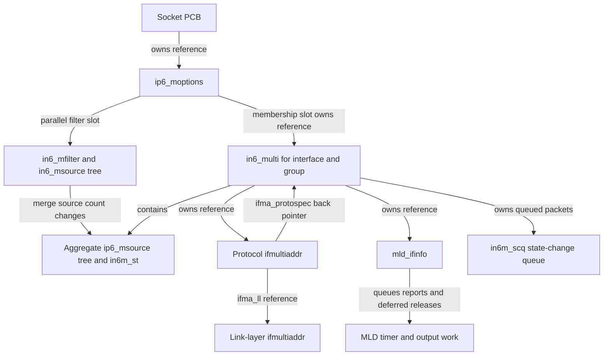
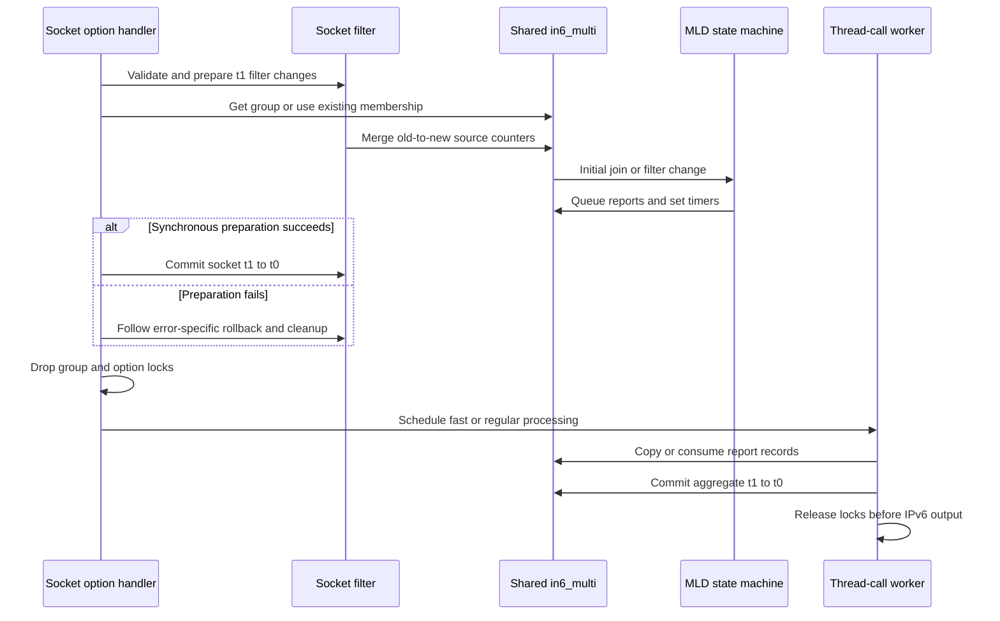
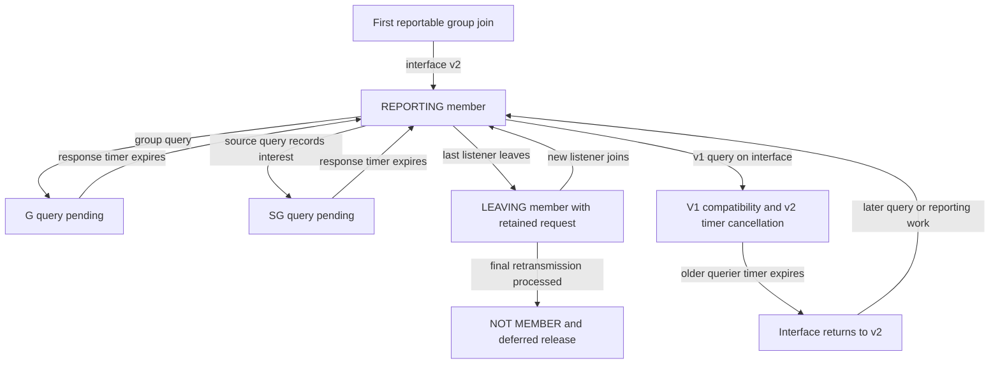
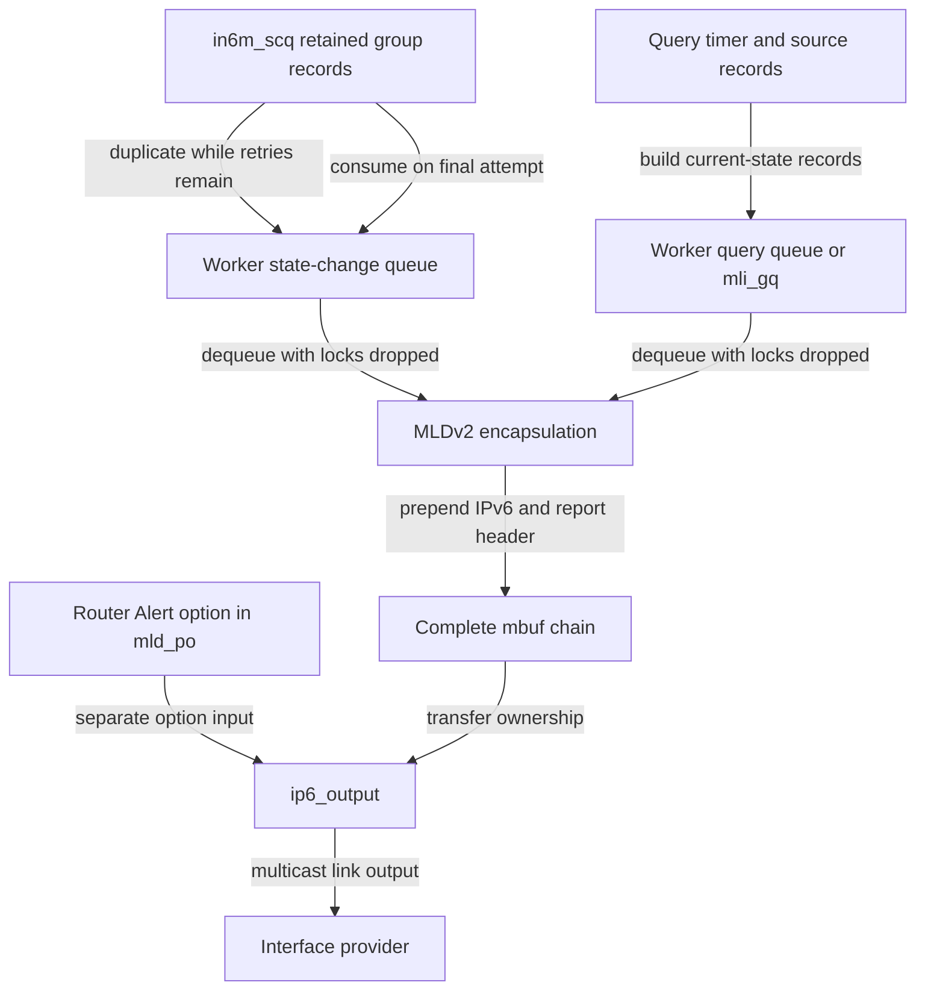
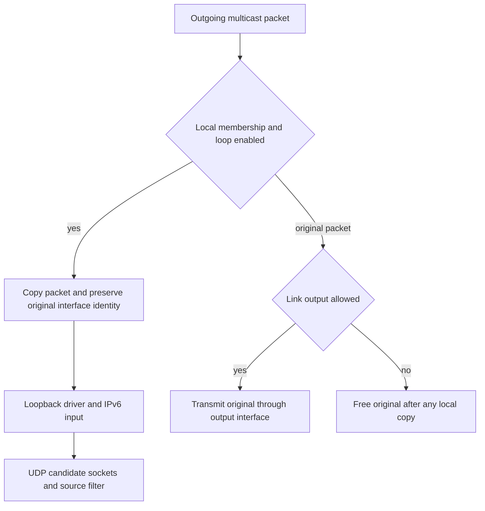
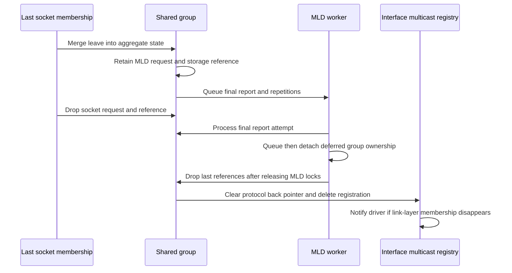

# IPv6 multicast membership, source filters and MLD

[Networking](README.md) · [IPv6 guide](ipv6.md) · [IPv6 sockets and packet options](ipv6-sockets-and-packet-options.md) · [IPv6 output](ipv6-output-and-neighbor-discovery.md)

An IPv6 multicast join changes several independently owned objects. A socket records the group and its source filter. The interface acquires a shared group record and, where required, a link-layer multicast address. MLD computes what this host should report to the link's multicast routers, queues those reports, and retains enough state to retransmit even after the last socket leaves. Receiving a multicast packet then makes a separate decision for each candidate socket. This chapter follows those operations in `xnu-12377.121.6`, including the places where the implementation is more specific than its comments.

Inspect the live [`ip6_moptions`](../../structures/layout-browser.md?declaration=ip6_moptions), [`in6_multi`](../../structures/layout-browser.md?declaration=in6_multi), [`in6_mfilter`](../../structures/layout-browser.md?declaration=in6_mfilter), [`mld_ifinfo`](../../structures/layout-browser.md?declaration=mld_ifinfo) layouts for the selected source configuration.

## Three meanings of membership

Keep these three questions separate:

1. **Does this socket request this group on this interface?** The answer is in `inpcb.in6p_moptions`, its membership array and its per-membership source filter.
2. **Does this host retain this group on this interface?** The shared `in6_multi` combines socket and kernel requests. It is also used by IPv6 input admission and multicast loopback.
3. **What has MLD scheduled or reported to other nodes?** `in6_multi` and `mld_ifinfo` retain protocol state, source counters, report queues and timers. A successful socket operation does not mean a report has reached a router.

The source deliberately distinguishes a group's **request count** from its **storage reference count**. The request count controls attachment to the global group list; a lookup, socket membership or pending final report may retain storage separately. See [`in6_multi`](../../../platydoc-data/xnu/bsd/netinet6/in6_var.h#L971-L1039), [`in6_multi_attach()` / `in6_multi_detach()`](../../../platydoc-data/xnu/bsd/netinet6/in6_mcast.c#L3259-L3334) and [final release](../../../platydoc-data/xnu/bsd/netinet6/in6_mcast.c#L3357-L3427).

| Object | Identity and important fields | Role and ownership |
| --- | --- | --- |
| `ip6_moptions` | `im6o_multicast_ifp`, `im6o_multicast_hlim`, `im6o_multicast_loop`; parallel `im6o_membership[]` and `im6o_mfilters[]` arrays; `im6o_refcnt` / `im6o_lock` | Per-PCB multicast output defaults and membership ownership. The output interface option is distinct from the interface recorded in each membership. |
| `in6_mfilter` | `im6f_sources` red-black tree, `im6f_nsrc`, `im6f_st[2]` | One socket's group mode and source list before/after a proposed update. |
| `in6_msource` | Source `im6s_addr`, `im6sl_st[2]` | A socket source node. The leading layout matches `ip6_msource` for shared tree helpers, but its state representation is different. |
| `in6_multi` | Scoped `in6m_addr` plus `in6m_ifp`; `in6m_reqcnt`, `in6m_refcount`; `in6m_ifma`, `in6m_mli`; `in6m_srcs`, `in6m_st[2]`; report state/timers/queue | One shared group on one interface. Owns an `ifmultiaddr` reference and an MLD-interface reference. |
| `ip6_msource` | `im6s_st[2].in` / `.ex`, `im6s_stp` | Aggregate INCLUDE/EXCLUDE source counts at two times, plus whether a source was recorded for a pending source-specific query. |
| `ifmultiaddr` | Protocol multicast address, optional `ifma_ll` link-layer record, `ifma_protospec` | Interface multicast registration; different IPv6 groups can share a link-layer registration. `ifma_protospec` points back to `in6_multi`. |
| `mld_ifinfo` | `mli_version`, query/robustness intervals, `mli_v1_timer`, `mli_v2_timer`, `mli_gq`, `mli_v1q`, `mli_relinmhead` | Per-interface MLD compatibility, output queues and deferred group-release work, protected by `mli_lock` and references. |
| `in6_multi_mship` | `i6mm_maddr` | A kernel consumer's membership wrapper, used by `in6_joingroup()` / `in6_leavegroup()` without a socket filter. |

Declarations: [`ip6_moptions`](../../../platydoc-data/xnu/bsd/netinet6/ip6_var.h#L132-L149), [source/filter types](../../../platydoc-data/xnu/bsd/netinet6/in6_var.h#L905-L949), [`mld_ifinfo`](../../../platydoc-data/xnu/bsd/netinet6/mld6_var.h#L177-L196), [kernel wrappers](../../../platydoc-data/xnu/bsd/netinet6/in6_mcast.c#L1215-L1255).



The diagram shows relationships, not simultaneous lock acquisition. In particular, the back pointer does not replace the references and locks required to use the group.

## Socket entry points and interface selection

[`ip6_ctloutput()`](../../../platydoc-data/xnu/bsd/netinet6/ip6_output.c#L2798-L2819) delegates multicast options to [`ip6_setmoptions()`](../../../platydoc-data/xnu/bsd/netinet6/in6_mcast.c#L2977-L3093). The latter accepts datagram or raw sockets and rejects divert sockets and other types with `EOPNOTSUPP`.

| Option | Operation in this implementation |
| --- | --- |
| `IPV6_JOIN_GROUP`, `MCAST_JOIN_GROUP` | Join an any-source membership, represented as EXCLUDE with no excluded sources. |
| `MCAST_JOIN_SOURCE_GROUP` | Create an INCLUDE membership or add a source to an existing INCLUDE membership. Mixing this operation with an existing EXCLUDE membership returns `EINVAL`; duplicate source requests return an error. |
| `IPV6_LEAVE_GROUP`, `MCAST_LEAVE_GROUP` | Remove the entire socket membership. |
| `MCAST_LEAVE_SOURCE_GROUP` | Prune one source from an INCLUDE membership; it does not take the whole-membership removal branch. |
| `MCAST_BLOCK_SOURCE`, `MCAST_UNBLOCK_SOURCE` | Modify a source in an existing EXCLUDE membership; applying this API to INCLUDE returns `EINVAL`. |
| `IPV6_MSFILTER` | Replace the proposed full filter mode/source state on an existing membership, subject to the source implementation details below. The getter returns socket state, not the aggregate host report. |
| `IPV6_MULTICAST_IF`, `IPV6_MULTICAST_HOPS`, `IPV6_MULTICAST_LOOP` | Select output defaults. None of these alone acquires a group membership. Hop limit accepts `-1` for the default or `0..255`; loop must be `0` or `1`. |

The [join handler](../../../platydoc-data/xnu/bsd/netinet6/in6_mcast.c#L1999-L2186) converts old and new APIs to `group_source_req`-style addresses, validates IPv6 address lengths and families, rejects a multicast source in source-specific requests, normalizes port/scope fields, and verifies that the selected interface supports multicast. An explicit index disambiguates the group. The legacy `ipv6_mreq` API can use index zero and [`in6p_lookup_mcast_ifp()`](../../../platydoc-data/xnu/bsd/netinet6/in6_mcast.c#L1924-L1960) to choose the bound/default/routed interface; the modern join-group/source API requires a nonzero valid interface index. Scoped groups are normalized for that interface before lookup. A bare `ff02::1234` is therefore not the complete membership key; the link matters.

Legacy `IPV6_JOIN_GROUP` with an IPv4-mapped multicast address is translated into `IP_ADD_MEMBERSHIP` and the IPv4 handler, after selecting the interface's IPv4 address where needed. That branch does not run this MLD mechanism. The [source-selection and scope chapter](ipv6-source-selection-and-scopes.md) explains the address representation; IPv4 IGMP is a separate protocol.

[`in6p_findmoptions()`](../../../platydoc-data/xnu/bsd/netinet6/in6_mcast.c#L1609-L1649) lazily allocates `ip6_moptions`, initializes the two arrays and publishes it to the PCB. It returns an extra reference for the caller, which explicitly takes `IM6O_LOCK`. The old introductory comment says it returns a locked PCB, but the body neither acquires a PCB lock nor returns `im6o_lock` held; the actual caller and socket entry context supply that serialization. Array growth allocates both replacements before publishing them, preserves matching indexes, initializes newly available filters, and returns `ETOOMANYREFS` above `IPV6_MAX_MEMBERSHIPS`. See [`im6o_grow()`](../../../platydoc-data/xnu/bsd/netinet6/in6_mcast.c#L265-L337).

## The join and filter-change transaction

### Socket state and aggregate state have separate clocks

At the socket layer, index `0` is the previously committed state and index `1` is the proposed/current state. Adding a source creates a node with old state UNDEFINED and new state INCLUDE or EXCLUDE; removing a source marks its new state UNDEFINED before freeing anything. `im6f_commit()` copies new to old, `im6f_rollback()` restores changed entries/removes newly added ones, and `im6f_reap()` only frees entries undefined at both times. See [graft/prune](../../../platydoc-data/xnu/bsd/netinet6/in6_mcast.c#L744-L788) and [rollback/commit/reap](../../../platydoc-data/xnu/bsd/netinet6/in6_mcast.c#L797-L883).

At the MLD layer, `in6m_st[1]` and each aggregate source's `im6s_st[1]` represent merged host interest. Index `0` is the baseline from which MLD computes another report. It is updated by `in6m_commit()`, separately from the socket commit. For normal MLDv2 reporting this happens in timer processing after the report is merged into the outgoing work queue, before successful interface transmission is known. It is neither a router acknowledgment nor necessarily the end of every retransmission. This is more precise than the field comment describing T0 in terms of the last report's retransmission timer. See [`in6m_commit()`](../../../platydoc-data/xnu/bsd/netinet6/in6_mcast.c#L1150-L1171) and the [timer's actual commit site](../../../platydoc-data/xnu/bsd/netinet6/mld6.c#L2159-L2187).

The per-socket commit itself is small:

[`bsd/netinet6/in6_mcast.c:845–856`](../../../platydoc-data/xnu/bsd/netinet6/in6_mcast.c#L845-L856):

<!-- source-excerpt: ../../../platydoc-data/xnu/bsd/netinet6/in6_mcast.c#L845-L856 -->
```c
static void
im6f_commit(struct in6_mfilter *imf)
{
	struct ip6_msource      *ims;
	struct in6_msource      *lims;

	RB_FOREACH(ims, ip6_msource_tree, &imf->im6f_sources) {
		lims = (struct in6_msource *)ims;
		lims->im6sl_st[0] = lims->im6sl_st[1];
	}
	imf->im6f_st[0] = imf->im6f_st[1];
}
```

### Acquiring the shared group and link-layer registration

For a new socket membership, the [join path](../../../platydoc-data/xnu/bsd/netinet6/in6_mcast.c#L2230-L2369) reserves an array slot, prepares its filter, calls `in6_mc_join()`, and installs the returned referenced group only on success. An existing membership instead merges its change directly under `IN6M_LOCK`.

[`in6_mc_get()`](../../../platydoc-data/xnu/bsd/netinet6/in6_mcast.c#L481-L609) first searches the global group list under `in6_multihead_lock`. Finding an attached record increments its request count and returns the lookup's storage reference. If absent, it calls `if_addmulti()` without holding the global group-list lock, then reacquires exclusive list protection and examines `ifma_protospec`. Another join may have won the race; a concurrently detached but still referenced group may also be reattached. Only after these checks does it allocate a new `in6_multi`, keep the returned `ifmultiaddr` reference, retain `MLD_IFINFO(ifp)`, attach to the global list and publish the back pointer.

[`if_addmulti_common()`](../../../platydoc-data/xnu/bsd/net/if.c#L5771-L5935) resolves the protocol address to the interface's link-layer representation through `dlil_resolve_multi()`, allocates records outside the interface lock, and checks again before insertion. A network-layer record can own a shared `ifma_ll` record. It emits `RTM_NEWMADDR` and asynchronously schedules `SIOCADDMULTI` only when a new relevant link-layer registration appears. The deferred driver notification avoids lock reordering; join success is not proof that a physical NIC has finished changing a hardware filter. Actual device behavior belongs to the registered interface provider.

### Merging counters and preparing MLD work

[`in6m_merge()`](../../../platydoc-data/xnu/bsd/netinet6/in6_mcast.c#L1013-L1147) applies one socket's old-to-new source changes to the aggregate counters. It processes potentially allocating source changes first, then updates counts of inclusive listeners, exclusive listeners and any-source listeners. Aggregate mode is EXCLUDE if there is any exclusive listener, otherwise INCLUDE if there are inclusive listeners, otherwise UNDEFINED. This last transition begins the group's MLD leave lifecycle.

[`bsd/netinet6/in6_mcast.c:1110–1119`](../../../platydoc-data/xnu/bsd/netinet6/in6_mcast.c#L1110-L1119):

<!-- source-excerpt: ../../../platydoc-data/xnu/bsd/netinet6/in6_mcast.c#L1110-L1119 -->
```c
	if (inm->in6m_st[1].iss_ex > 0) {
		MLD_PRINTF(("%s: transition to EX\n", __func__));
		inm->in6m_st[1].iss_fmode = MCAST_EXCLUDE;
	} else if (inm->in6m_st[1].iss_in > 0) {
		MLD_PRINTF(("%s: transition to IN\n", __func__));
		inm->in6m_st[1].iss_fmode = MCAST_INCLUDE;
	} else {
		MLD_PRINTF(("%s: transition to UNDEF\n", __func__));
		inm->in6m_st[1].iss_fmode = MCAST_UNDEFINED;
	}
```

`im6s_merge()` subtracts the socket source's old contribution and adds its new contribution. `im6s_get_mode()` turns counters into the mode used by report generation: EXCLUDE when all exclusive listeners count that source, INCLUDE when the source has inclusive references and no exclusive source references, otherwise UNDEFINED. These predicates are implementation evidence; a generic set-union explanation would hide their exact treatment of mixed references. See [source counter adjustment and mode](../../../platydoc-data/xnu/bsd/netinet6/in6_mcast.c#L952-L997).

[`bsd/netinet6/in6_mcast.c:952–966`](../../../platydoc-data/xnu/bsd/netinet6/in6_mcast.c#L952-L966):

<!-- source-excerpt: ../../../platydoc-data/xnu/bsd/netinet6/in6_mcast.c#L952-L966 -->
```c
im6s_get_mode(const struct in6_multi *inm, const struct ip6_msource *ims,
    uint8_t t)
{
	IN6M_LOCK_ASSERT_HELD(__DECONST(struct in6_multi *, inm));

	t = !!t;
	if (inm->in6m_st[t].iss_ex > 0 &&
	    inm->in6m_st[t].iss_ex == ims->im6s_st[t].ex) {
		return MCAST_EXCLUDE;
	} else if (ims->im6s_st[t].in > 0 && ims->im6s_st[t].ex == 0) {
		return MCAST_INCLUDE;
	}
	return MCAST_UNDEFINED;
}

```

After merging, [`mld_change_state()`](../../../platydoc-data/xnu/bsd/netinet6/mld6.c#L2484-L2535) compares old and new aggregate modes. UNDEFINED→defined selects `mld_initial_join()`, defined→UNDEFINED selects `mld_final_leave()`, and other updates select `mld_handle_state_change()`. Socket commit occurs when the synchronous downcall succeeds. The caller drops its locks and only then schedules MLD timer work, because timer scheduling acquires the global MLD lock in the opposite direction from an already-held group lock.



### Worked aggregate example

Assume one live multicast-capable interface, reportable group `ff3e::1234`, MLDv2 with a nonzero robustness value, sources `A=2001:db8::a` and `B=2001:db8::b`, and successful allocation/normal timer progress. The addresses and operation sequence are illustrative; counters and transitions follow the source.

| Operation | Aggregate listener/source state at T1 | Report consequence |
| --- | --- | --- |
| Socket 1 joins INCLUDE `{A}` | `iss_in=1`, `iss_ex=0`; `A.in=1`; mode INCLUDE | Initial INCLUDE report, or ALLOW_NEW form when `MLIF_USEALLOW` selects that encoding. |
| Socket 2 joins INCLUDE `{B}` | `iss_in=2`; `A.in=1`, `B.in=1`; still INCLUDE | After the earlier baseline has been committed, the same-mode change can report B as newly allowed. If it has not, queue replacement is computed against the older T0 baseline. |
| Socket 3 joins EXCLUDE `{}` | `iss_ex=1`, `iss_asm=1`; aggregate EXCLUDE | Any-source interest changes the aggregate mode; the MLD representation no longer needs an INCLUDE list of only A and B. |
| Socket 3 blocks B | `iss_ex=1`, `iss_asm=0`; `B.ex=1` and `B.in=1`; mode remains EXCLUDE | `im6s_get_mode()` selects EXCLUDE for B because `iss_ex == B.ex`, even while `B.in` is nonzero. This is the actual predicate, not an assumed mathematical union of accepted packets. |
| Socket 3 leaves | `iss_ex=0`, `iss_asm=0`; A and B remain inclusive | Host mode becomes INCLUDE again; the report describes the new mode/source state. |
| Both inclusive sockets leave | No active listener counts; T1 becomes UNDEFINED | MLDv2 retains the group for final report/retransmission work before removing the extra protocol request and references. |

Socket filters remain distinct throughout. Neither the aggregate mode nor an emitted MLD record should be used as a substitute for reading the UDP delivery predicate below.

## Failure and partial progress are not a universal rollback

The code has transactional helpers, but callers and error labels matter:

- `in6m_merge()` contains an inverse-merge path when obtaining an aggregate source fails, followed by reaping; `im6f_rollback()` handles the socket tree separately. A later MLD report-allocation error is a different failure point. The socket error paths call `im6f_rollback()` without a matching general inverse call for every already-merged aggregate change. Do not infer a cross-layer all-or-nothing guarantee from the word “transaction.” See [merge failure](../../../platydoc-data/xnu/bsd/netinet6/in6_mcast.c#L1030-L1070), [join failure](../../../platydoc-data/xnu/bsd/netinet6/in6_mcast.c#L1304-L1342), and [existing-member rollback](../../../platydoc-data/xnu/bsd/netinet6/in6_mcast.c#L2309-L2355).
- The full-state setter validates its outer structure and membership, then stores `im6f_st[1]` **before** allocating/copying the nonempty user source vector. Allocation and `copyin()` errors in that portion jump directly to `out_imo_locked`, bypassing `out_im6f_rollback`. A nonempty source vector triggers `im6f_leave()` before applying new nodes, but a zero-length vector skips that block. Therefore “the full-state setter always replaces the list atomically, including an empty list” is stronger than this body establishes. See [mode publication and vector handling](../../../platydoc-data/xnu/bsd/netinet6/in6_mcast.c#L2835-L2885) and [commit/error labels](../../../platydoc-data/xnu/bsd/netinet6/in6_mcast.c#L2915-L2963).
- Final whole-membership leave intentionally discards the return of `in6_mc_leave()`, commits/removes the socket slot and releases its group reference. Socket closure similarly proceeds through cleanup even if final reporting cannot be completed. See [whole leave versus source-only leave](../../../platydoc-data/xnu/bsd/netinet6/in6_mcast.c#L2607-L2678).
- Queueing a report is not sending it. Timers may advance and aggregate state may commit after a report-copy failure or before `ip6_output()` later rejects/drops the packet. The timer ignores the return of `mld_v2_merge_state_changes()` before commit; output errors are logged and counted, not returned to an already-completed `setsockopt()`.

The early copy fault branch makes the limited rollback scope concrete:

[`bsd/netinet6/in6_mcast.c:2867–2872`](../../../platydoc-data/xnu/bsd/netinet6/in6_mcast.c#L2867-L2872):

<!-- source-excerpt: ../../../platydoc-data/xnu/bsd/netinet6/in6_mcast.c#L2867-L2872 -->
```c
		error = copyin(tmp_ptr, kss,
		    (size_t) msfr.msfr_nsrcs * sizeof(*kss));
		if (error) {
			kfree_data(kss, (size_t) msfr.msfr_nsrcs * sizeof(*kss));
			goto out_imo_locked;
		}
```

These are source-derived control-flow observations, not runtime reproductions or claims that every failure state is externally reachable on every product. The supplied tests below do not establish those failure semantics.

## MLD states, queries and compatibility

### Initial join can be silent

[`mld_initial_join()`](../../../platydoc-data/xnu/bsd/netinet6/mld6.c#L2551-L2706) suppresses reports on loopback, links marked `MLIF_SILENT`, specified cellular link-local groups, node-local groups and the all-nodes link-local group `ff02::1`. The membership still exists. For a reportable group, MLDv1 queues a listener report and a randomized follow-up, while MLDv2 replaces the pending state-change queue, computes a report and sets `in6m_scrv` from the interface robustness variable.

The silent decision is especially relevant to DAD and ordinary IPv6 setup: a kernel `in6_joingroup()` request uses a synthesized any-source filter, but not every resulting group causes an MLD packet. See [reportability predicate](../../../platydoc-data/xnu/bsd/netinet6/mld6.c#L555-L571), [kernel-consumer synthesis](../../../platydoc-data/xnu/bsd/netinet6/in6_mcast.c#L1292-L1301), and [address setup/DAD](ipv6-addresses-autoconfiguration-and-dad.md).

| `in6m_state` | Meaning in the inspected paths |
| --- | --- |
| `MLD_NOT_MEMBER` | No active report lifecycle. Storage may still have owners. |
| `MLD_SILENT_MEMBER` | Joined group for which reports are suppressed. |
| `MLD_REPORTING_MEMBER` | Active reporting member; MLDv2 state-change retransmission can proceed here. |
| `MLD_IDLE_MEMBER` | MLDv1 reporter state after a report is queued/sent by its timer path. |
| `MLD_LAZY_MEMBER` | MLDv1 report suppressed after hearing another host. |
| `MLD_SLEEPING_MEMBER`, `MLD_AWAKENING_MEMBER` | Additional compatibility/suppression states handled by v1 queries and group timers; not sleeping CPUs or socket states. |
| `MLD_G_QUERY_PENDING_MEMBER` | MLDv2 group-specific current-state response pending. |
| `MLD_SG_QUERY_PENDING_MEMBER` | MLDv2 group-and-source-specific response pending; recorded source nodes select its contents. |
| `MLD_LEAVING_MEMBER` | Final MLDv2 report work retains the group's extra request/reference. |

See [state constants](../../../platydoc-data/xnu/bsd/netinet6/mld6_var.h#L118-L130), [v1 query updates](../../../platydoc-data/xnu/bsd/netinet6/mld6.c#L982-L1023), [v1 timer handling](../../../platydoc-data/xnu/bsd/netinet6/mld6.c#L2038-L2081), and [v2 group timers](../../../platydoc-data/xnu/bsd/netinet6/mld6.c#L2087-L2212).

### ICMPv6 hands host-protocol processing a packet copy

The [ICMPv6 input switch](../../../platydoc-data/xnu/bsd/netinet6/icmp6.c#L746-L777) validates the minimum MLD header length for listener queries and v1 reports, copies the packet and invokes `mld_input()` on the copy. If copying fails, it processes the original and then frees it, forfeiting the ordinary local raw delivery. When the copy succeeds, the original remains available for the later raw-ICMP delivery path. `mld_input()` returns `IPPROTO_DONE` if header extraction consumed/freed its packet; otherwise the caller frees the processed copy.

[`mld_input()`](../../../platydoc-data/xnu/bsd/netinet6/mld6.c#L1554-L1617) chooses v1 versus v2 **query format by message length**, then invokes the relevant query handler. A v2 query is still ICMPv6 type 130. Its switch also has v2-report and DONE cases, but the inspected ICMPv6 caller dispatches queries/v1 reports here; DONE is explicitly left to applications and no v2-report caller branch is shown. Receiving another host's MLDv2 report is not a mechanism that changes this host's socket memberships.

### Query validation and timer selection

Both [v1](../../../platydoc-data/xnu/bsd/netinet6/mld6.c#L846-L969) and [v2 query handlers](../../../platydoc-data/xnu/bsd/netinet6/mld6.c#L1031-L1230) require a link-local source. V1 general queries require the all-nodes destination. V2 bounds the source count, checks that the packet contains the advertised source vector, rejects an unspecified-group general query carrying sources, decodes the response/query timing fields and clamps an undersized robustness value to the initial default. Do not generalize these checks into a claim that this chapter verifies every MLD RFC validation: the local handlers and upstream ICMP/IPv6 validation must be read together.

There are three scheduling scopes:

- A **general query** arms `mli_v2_timer` for the interface. An already earlier pending general response is retained. Its expiration walks reportable groups and prepares current-state records.
- A **group-specific query** arms `in6m_timer`, clears an older recorded source set, and enters `MLD_G_QUERY_PENDING_MEMBER`.
- A **group-and-source-specific query** is rate-limited by `in6m_lastgsrtv`/`mld_gsrdelay`. Its source vector is read across the mbuf chain, matching/recording relevant sources through `in6m_record_source()`. If a broader group response is already pending, that broader response takes precedence. A successful recorded-source response uses `MLD_SG_QUERY_PENDING_MEMBER`.

[`mld_v2_process_group_query()`](../../../platydoc-data/xnu/bsd/netinet6/mld6.c#L1236-L1385) rechecks the interface MLD version before entering a v2-only pending state, because a concurrent v1 query may have changed compatibility while locks were dropped. Source records use `im6s_stp` and `iss_rec`; after answering, `in6m_clear_recorded()` clears those markers separately from socket source interest. See [recording](../../../platydoc-data/xnu/bsd/netinet6/in6_mcast.c#L618-L693).

### V1 compatibility and suppression

A v1 query starts an Older Version Querier Present timer of `robustness × query interval + response interval`. [`mld_set_version()`](../../../platydoc-data/xnu/bsd/netinet6/mld6.c#L2220-L2248) switches the interface to v1 and [`mld_v2_cancel_link_timers()`](../../../platydoc-data/xnu/bsd/netinet6/mld6.c#L2258-L2339) stops v2 current/state-change timers, drains queued v2 reports, clears recorded query sources and defers the release of any final-leave reference. V2 queries are ignored while that compatibility timer remains active. Normal timer expiration returns the interface to v2 when v2 is enabled.

[`mld_v1_input_report()`](../../../platydoc-data/xnu/bsd/netinet6/mld6.c#L1397-L1540) ignores looped-back/self reports, validates the source and group/destination relationship, looks up the scoped group and suppresses a pending v1 report by clearing its timer and moving relevant states to LAZY. It explicitly refuses to let a v1 report suppress this host's v2 reports. V1 final leave emits DONE only from the reporting/idle family of states; suppressed members do not all send their own leave packet.



This diagram condenses reportable v2 paths. Compatibility restoration changes the interface version; subsequent group/query processing determines report activity. Silent memberships and individual v1 suppression states follow the separate branches described above.

## Report buffers, timers and output ownership

### Report records are built before full IPv6 packets

[`mld_v2_enqueue_group_record()`](../../../platydoc-data/xnu/bsd/netinet6/mld6.c#L2920-L3310) chooses a record type from the aggregate mode transition or current-state request. A changed mode yields CHANGE_TO_INCLUDE/EXCLUDE; a query yields MODE_IS_INCLUDE/EXCLUDE. Same-mode source changes use [`mld_v2_enqueue_filter_change()`](../../../platydoc-data/xnu/bsd/netinet6/mld6.c#L3320-L3518) to produce ALLOW_NEW and BLOCK_OLD records. With `MLIF_USEALLOW`, selected inclusive initial/final transitions use ALLOW/BLOCK encoding instead of mode-change encoding. All are derived from MLD's aggregate T0/T1 source counters.

Records are appended to mbuf chains with room reserved conceptually for IPv6, Router Alert and report headers. The builder checks interface MTU, per-packet record count and queue capacity. Group/source-specific query responses are built in their own packet chains. A record source address has its internal scope encoding cleared before serialization; it is not a socket `sockaddr_in6` copied onto the wire.

Queue metadata lives in `m_pkthdr`: `vt_nrecs` is module-private scratch space for the record count, and `rcvif` temporarily saves the selected output interface. These fields are rewritten/scrubbed before ordinary output. See [context helpers](../../../platydoc-data/xnu/bsd/netinet6/mld6.c#L321-L344), [record serialization/selection](../../../platydoc-data/xnu/bsd/netinet6/mld6.c#L3092-L3250), and [queue bounds](../../../platydoc-data/xnu/bsd/netinet6/mld6_var.h#L150-L157).



[`mld_v2_merge_state_changes()`](../../../platydoc-data/xnu/bsd/netinet6/mld6.c#L3529-L3643) duplicates retained report chains with `m_dup(M_NOWAIT)` while more retransmissions remain. On the final attempt it removes/consumes the original queue entries. It may merge records for several groups into one worker packet subject to MTU and record-count limits. Failure to duplicate returns `ENOMEM`; it does not justify claiming that every queued record was transmitted.

### Fast work is not the one-second timer

The global scheduler tracks four work classes through `mld_tparams`: older-querier presence, interface query responses, per-group current-state responses and state changes. `mld_set_timeout()` records these under `mld_mtx` and selects the regular or fast thread call. The regular call uses the configured millisecond deadline/leeway; the fast call uses `thread_call_enter()` to schedule work immediately rather than waiting for the next regular second. See [scheduler](../../../platydoc-data/xnu/bsd/netinet6/mld6.c#L1625-L1659) and [two thread calls](../../../platydoc-data/xnu/bsd/netinet6/mld6.c#L1904-L1950).

[`bsd/netinet6/mld6.c:1945–1949`](../../../platydoc-data/xnu/bsd/netinet6/mld6.c#L1945-L1949):

<!-- source-excerpt: ../../../platydoc-data/xnu/bsd/netinet6/mld6.c#L1945-L1949 -->
```c
	if (!mld_fast_timeout_run &&
	    (current_state_timers_running6 || state_change_timers_running6)) {
		mld_fast_timeout_run = true;
		thread_call_enter(mld_fast_timeout_tcall);
	}
```

Both execute `mld_timeout()`. Fast processing skips the older-querier and interface-general-query timer block, whose counters represent regular time, and proceeds to current/state-change work. Expiring `in6m_sctimer` decrements `in6m_scrv`, schedules a randomized unsolicited-report interval if repetitions remain, merges reports, and commits aggregate state. Expiring a group query timer queues a current-state report and clears recorded sources. The normal worker re-arms itself only while work remains. General query responses have their own queue and burst limit, with another timer when records remain. See [worker](../../../platydoc-data/xnu/bsd/netinet6/mld6.c#L1665-L1901), [group timers](../../../platydoc-data/xnu/bsd/netinet6/mld6.c#L2105-L2212), and [general query burst output](../../../platydoc-data/xnu/bsd/netinet6/mld6.c#L3649-L3712).

### Output drops locks and checks attachment again

The lock order when locks are nested is `mld_mtx → in6_multihead_lock → in6m_lock → mli_lock`. `ip6_moptions.im6o_lock` protects socket option state on socket-side paths; it is not held by the timer while walking every membership. See the [MLD locking contract](../../../platydoc-data/xnu/bsd/netinet6/mld6.c#L138-L165).

[`mld_dispatch_queue_locked()`](../../../platydoc-data/xnu/bsd/netinet6/mld6.c#L501-L540) dequeues one packet, drops the per-interface/global MLD locks, and only then calls `mld_dispatch_packet()`. It reacquires them before continuing. Its callers retain the `mld_ifinfo` and compare the global interface-list generation after output; changed lists restart iteration and `MLIF_PROCESSED` prevents repeated processing. A reference preserves storage, while the generation check protects the traversal's assumptions.

[`bsd/netinet6/mld6.c:520–530`](../../../platydoc-data/xnu/bsd/netinet6/mld6.c#L520-L530):

<!-- source-excerpt: ../../../platydoc-data/xnu/bsd/netinet6/mld6.c#L520-L530 -->
```c
		if (mli != NULL) {
			MLI_UNLOCK(mli);
		}
		MLD_UNLOCK();

		mld_dispatch_packet(m);

		MLD_LOCK();
		if (mli != NULL) {
			MLI_LOCK(mli);
		}
```

[`mld_dispatch_packet()`](../../../platydoc-data/xnu/bsd/netinet6/mld6.c#L3721-L3821) restores the saved interface and drops the packet if it is no longer fully attached. It allocates temporary multicast options, selects that interface, sets hop limit one and disables loopback. V2 encapsulation prepends IPv6 plus the report header, selects a suitable link-local source or `::` if none is available, addresses the report to `ff02::16`, copies the record count and calculates the ICMPv6 checksum. The Router Alert hop-by-hop option is supplied separately through `mld_po`; `ip6_output()` inserts it in its normal extension-header construction. See [encapsulation](../../../platydoc-data/xnu/bsd/netinet6/mld6.c#L3834-L3901) and [MLD option initialization](../../../platydoc-data/xnu/bsd/netinet6/mld6.c#L3929-L3939).

`ip6_output()` consumes the packet on both success and error. MLD releases its temporary option object and any returned interface reference; it does not free the transferred packet again. This is host protocol output, not a user socket send and not neighbor resolution for a unicast peer.

## Receive filtering and multicast loopback

### Group admission and per-socket delivery are separate

[`ip6_input()`](../../../platydoc-data/xnu/bsd/netinet6/ip6_input.c#L1151-L1186) checks the incoming interface's group membership before ordinary local multicast processing. A missing group is dropped in the ordinary host path; the `nd6_prproxy` branch is a separate proxy exception. UDP then walks candidate PCBs under its PCB list lock, obtains wanted references and socket locks, checks ports/restrictions, and, when a PCB has multicast options, calls `im6o_mc_filter()` with the group, source and receive interface. Connected-peer matching and NECP checks still apply. See [IPv6 UDP fanout](../../../platydoc-data/xnu/bsd/netinet6/udp6_usrreq.c#L340-L526), [PCB lifetime](internet-pcbs-ports-and-lifetime.md), and [UDP delivery](udp-send-receive-and-errors.md).

A passing socket receives one mbuf chain via `udp6_append()`. If reuse permits continued fanout, UDP prepares `m_copy()` before transferring the current packet; copy failure or a non-reuse socket stops further iteration. Packet copying may share external storage. Missing multicast listeners do not cause the unicast port-unreachable response. A PCB without `in6p_moptions` skips this particular per-socket filter call; do not rewrite the branch as an unconditional requirement that every matching UDP socket has explicitly joined.

### Read the receive predicate literally

The helper first finds the group/interface membership and returns `MCAST_NOTGMEMBER` if absent. Its source test is:

[`bsd/netinet6/in6_mcast.c:461–469`](../../../platydoc-data/xnu/bsd/netinet6/in6_mcast.c#L461-L469):

<!-- source-excerpt: ../../../platydoc-data/xnu/bsd/netinet6/in6_mcast.c#L461-L469 -->
```c
	mode = imo->im6o_mfilters[gidx].im6f_st[1];
	ims = im6o_match_source(imo, gidx, src);

	if ((ims == NULL && mode == MCAST_INCLUDE) ||
	    (ims != NULL && ims->im6sl_st[0] != mode)) {
		return MCAST_NOTSMEMBER;
	}

	return MCAST_PASS;
```

Thus no source entry rejects INCLUDE but passes EXCLUDE. An existing entry is rejected when its committed source mode differs from the current group mode. In particular, an existing EXCLUDE entry **equal** to the group mode passes this predicate. That does not implement the conventional “reject each source in the EXCLUDE list” wording of the preceding comment. [`im6o_match_source()`](../../../platydoc-data/xnu/bsd/netinet6/in6_mcast.c#L399-L423) performs a tree lookup, without inverting the mode, and the [block operation](../../../platydoc-data/xnu/bsd/netinet6/in6_mcast.c#L1545-L1552) grafts the EXCLUDE mode. The discrepancy is therefore retained explicitly instead of silently replacing the body with expected protocol semantics. No packet test was run to establish product-level effects.

### Local loopback is a packet copy

[`ip6_output_list()`](../../../platydoc-data/xnu/bsd/netinet6/ip6_output.c#L1374-L1435) marks a multicast packet, requires an interface supporting multicast, looks up the shared group on that output interface, and loops a copy when the host is a member and the caller's multicast loop option permits it. This lookup is host-wide, so the sender need not be the socket that owns the relevant membership.

After local loopback, a zero hop limit, loopback output interface or interface-local multicast scope suppresses external transmission of the original packet. [`ip6_mloopback()`](../../../platydoc-data/xnu/bsd/netinet6/ip6_output.c#L4196-L4268) copies with a separate writable IPv6 header, clears embedded scope bits for the input representation, finishes a deferred checksum if needed, records the **original interface** in `m_pkthdr.rcvif`, and injects via `dlil_output(lo_ifp, PF_INET6, ...)`. Retaining original-interface identity is necessary because membership filtering depends on the selected link, not merely on arrival through the loopback driver.



## Leave, close, deferred release and interface detach

A whole socket leave first changes its filter to INCLUDE with no active source entries. `in6_mc_leave()` merges that removal under the global group-list and group locks, runs the MLD state change, and decrements the request count through `in6_multi_detach()`. The socket then releases its stored group reference, compacts both arrays together and reinitializes the unused tail slot. Removing one source uses the merge/downcall path but retains the membership slot. See [leave handling](../../../platydoc-data/xnu/bsd/netinet6/in6_mcast.c#L2564-L2678).

For a final MLDv2 leave from the reporting/query-pending states with a nonzero retransmission budget, `mld_final_leave()` deliberately adds a storage reference, a request count and a deferred-release count before the socket's request is dropped. A zero `in6m_scrv` takes the immediate NOT_MEMBER branch, and silent/nonreporting states bypass this retention. The group remains discoverable while it retransmits the final state. This is why closing the last socket does not immediately remove every group/link-layer record.

[`bsd/netinet6/mld6.c:2850–2855`](../../../platydoc-data/xnu/bsd/netinet6/mld6.c#L2850-L2855):

<!-- source-excerpt: ../../../platydoc-data/xnu/bsd/netinet6/mld6.c#L2850-L2855 -->
```c
				IN6M_ADDREF_LOCKED(inm);
				VERIFY(inm->in6m_debug & IFD_ATTACHED);
				inm->in6m_reqcnt++;
				VERIFY(inm->in6m_reqcnt >= 1);
				inm->in6m_nrelecnt++;
				VERIFY(inm->in6m_nrelecnt != 0);
```

When the final report attempt has been processed, the timer changes LEAVING to NOT_MEMBER and queues the existing retained ownership for release. `mld_flush_relq()` first moves entries to a temporary list under `mli_lock`, drops that lock, obtains global group-list protection, decrements the deferred/request ownership, and detaches when appropriate. The last storage release is deferred again until all MLD locks are dropped, because deleting the interface multicast registration can issue driver notifications. See [timer completion](../../../platydoc-data/xnu/bsd/netinet6/mld6.c#L2188-L2210), [release queue](../../../platydoc-data/xnu/bsd/netinet6/mld6.c#L1958-L2031), and [post-lock release](../../../platydoc-data/xnu/bsd/netinet6/mld6.c#L1887-L1901).

A new join while a group is LEAVING reuses the group and queues the older lifecycle's retained reference for release instead of accumulating an unbalanced dying-group reference. Compatibility changes also enqueue that release. See [overlapping lifecycle](../../../platydoc-data/xnu/bsd/netinet6/mld6.c#L2596-L2610) and [v2 cancellation](../../../platydoc-data/xnu/bsd/netinet6/mld6.c#L2303-L2325).

The following sequence shows that reportable MLDv2 case with a nonzero retransmission budget:



PCB detach clears `inp->in6p_moptions` before releasing the option object's reference. [`udp6_defunct()`](../../../platydoc-data/xnu/bsd/netinet6/udp6_usrreq.c#L1444-L1479) can release the memberships earlier when the socket is made defunct. Output paths retain options across unlocked transmission, so actual [`im6o_remref()` destruction](../../../platydoc-data/xnu/bsd/netinet6/ip6_output.c#L3593-L3640) waits for the last reference: it leaves every group, purges socket filters, releases group references and frees both arrays. See [PCB detach](../../../platydoc-data/xnu/bsd/netinet6/in6_pcb.c#L922-L947) and [UDP output retention](../../../platydoc-data/xnu/bsd/netinet6/udp6_output.c#L590-L625).

Final [`in6m_remref()`](../../../platydoc-data/xnu/bsd/netinet6/in6_mcast.c#L3357-L3427) must serialize against a new join finding `ifma_protospec`. It temporarily restores a reference, drops the group lock, takes shared global-list protection, reacquires the group lock and checks whether another owner appeared. If so, reclamation stops. Otherwise it purges source/report state, clears ownership pointers and `ifma_protospec`, frees the group and deletes/releases the interface multicast record. [`if_delmulti_common()`](../../../platydoc-data/xnu/bsd/net/if.c#L5972-L6065) only sends a link-layer delete notification when the relevant shared registration's final request disappears.

Interface detach has another boundary: [`mld_domifdetach()` / `mli_delete()`](../../../platydoc-data/xnu/bsd/netinet6/mld6.c#L649-L700) drain deferred response queues and releases, remove the MLD interface from the active list and increment its generation. They deliberately leave remaining group records and source entries intact for possible interface reattachment. [`mld_domifreattach()`](../../../platydoc-data/xnu/bsd/netinet6/mld6.c#L618-L643) restores interface MLD state/list attachment. This is not a promise that old queued packets will be transmitted after reattach: dispatch separately checks that its interface is fully attached, and detach drains the specified work queues.

## Inspecting state and tests available in this tree

The multicast sysctls expose separate limits for sources per aggregate group and per socket. `net.inet6.ip6.mcast.filters` takes an interface index plus group address and emits the current aggregate filter mode followed by in-mode IPv6 source addresses. This is distinct from `IPV6_MSFILTER` getsockopt, which copies a socket filter. See [sysctl declarations](../../../platydoc-data/xnu/bsd/netinet6/in6_mcast.c#L145-L165), [aggregate readout](../../../platydoc-data/xnu/bsd/netinet6/in6_mcast.c#L3107-L3182), and [socket readout](../../../platydoc-data/xnu/bsd/netinet6/in6_mcast.c#L1656-L1827).

The socket getter's comment says it always reports the required buffer size, but the body increments `ncsrcs` only when it actually copies an entry into the temporary vector, then publishes that count. A zero-capacity probe should therefore not be documented as a proven total-size query merely from that comment. Source getters, like setters, require inspecting the loop and output publication.

| Test source | Actual assertion or exercise | What it does not establish |
| --- | --- | --- |
| [`multicast_mld_ssm`](../../../platydoc-data/xnu/tests/mcast_ssm.c#L80-L113) | Creates an IPv6 feth interface and repeatedly asserts success from `MCAST_JOIN_SOURCE_GROUP` for changed source addresses. | No report capture, router reception, INCLUDE/EXCLUDE packet-delivery assertions or low-memory rollback proof. The IPv4 test in the same file is separate. |
| [`ipv6_join_group_inet6_udp`](../../../platydoc-data/xnu/tests/sockopt_ipv6.c#L900-L940) | Joins/leaves/rejoins `ff02::1` on `lo0` and expects success. | This deliberately silent/loopback case does not validate MLD wire transmission. |
| [`v4mappedv6_join_group`](../../../platydoc-data/xnu/tests/v4mappedv6_join_group.c#L29-L48) | Asserts `EADDRNOTAVAIL` for its mapped-address/interface input. | Does not exercise native IPv6 MLD source filters. |
| [`ip6_frag_hbh_panic`](../../../platydoc-data/xnu/tests/net/ip6_frag_hbh_panic.c#L165-L251) | Constructs an oversized hop-by-hop option and a multicast output request to exercise the MTU/error path. | Does not validate membership reports or multicast routing. |

These Darwin tests were inspected, not executed. No packet-level MLD interoperability or allocator-failure injection was performed. The source explains the host listener implementation, socket/aggregate state and interface handoff; multicast-router forwarding tables, routing daemons, switch snooping and device-specific filter programming are separate implementations. IPv4 IGMP shares concepts but is not covered by this chapter.

<!-- BEGIN PLATYDOC DOCUMENTATION LICENSE -->
Original Platydoc text and diagrams are licensed under [CC BY 4.0](https://creativecommons.org/licenses/by/4.0/). Quoted source code and third-party material retain their respective licenses.
<!-- END PLATYDOC DOCUMENTATION LICENSE -->
