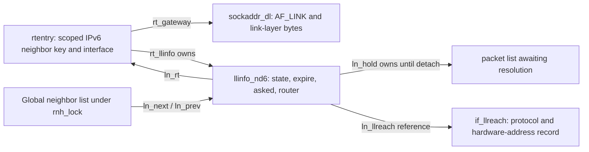
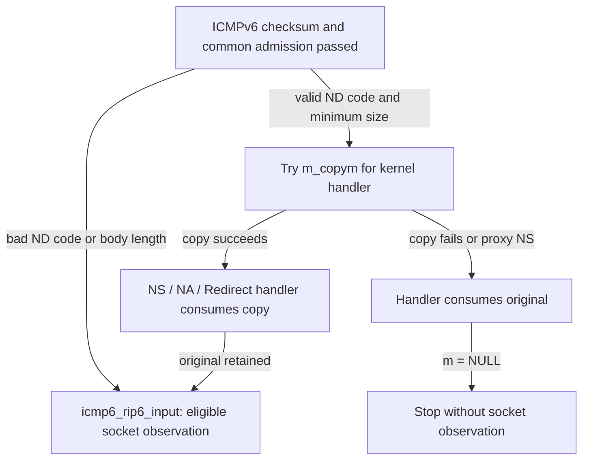
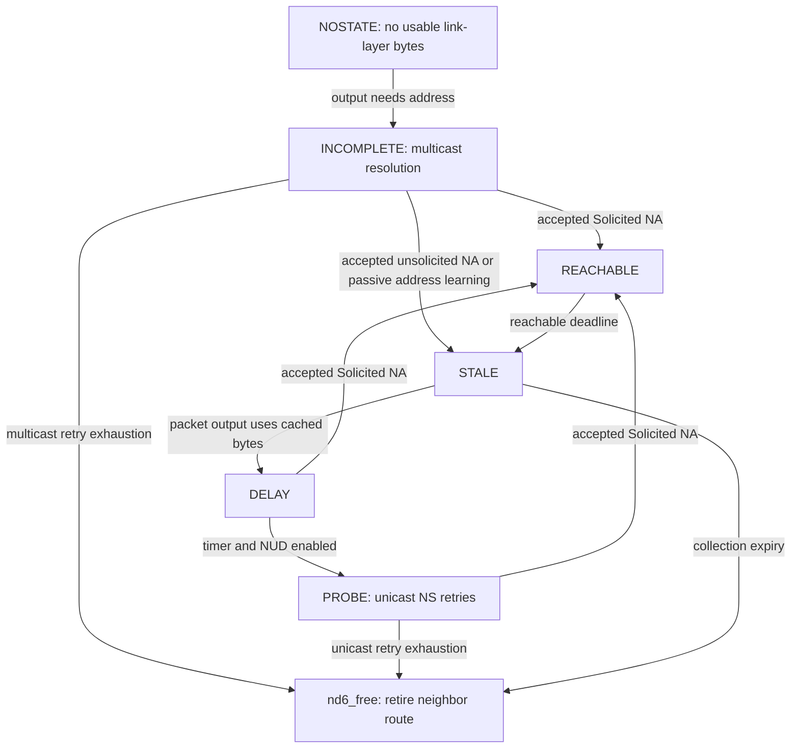
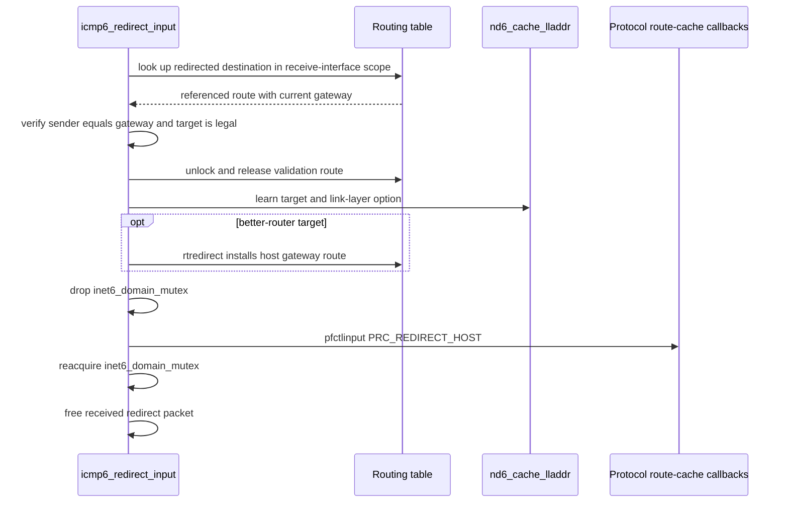

# IPv6 neighbor messages, reachability and redirects

Neighbor Discovery turns an IPv6 next hop on a particular interface into usable link-layer information, and later decides whether that information is still trustworthy. The cache is represented through routes: `rtentry` holds an `AF_LINK` gateway and points to `llinfo_nd6`, which carries reachability state, timers and held packets. A Neighbor Solicitation can teach the cache about its **source**; a Neighbor Advertisement updates an existing entry for its **target**. Those operations have different admission and state rules.

Return to [IPv6](ipv6.md) and [networking](README.md). The [output chapter](ipv6-output-and-neighbor-discovery.md) explains initial route selection, deferred output and held-packet ownership. This companion follows received NS/NA messages, the transitions they cause, the asynchronous NUD worker and redirects. [Address configuration and DAD](ipv6-addresses-autoconfiguration-and-dad.md) owns duplicate-address detection; [router advertisements and prefix lifetime](ipv6-router-advertisements-and-prefix-lifetime.md) owns RA/default-router/prefix decisions. [Input and forwarding](ipv6-input-extension-headers-and-forwarding.md) explains how packets reach these handlers.

## Cache representation: address, route, link-layer bytes and state

| Object or field | What it represents |
| --- | --- |
| Neighbor route key | Scoped IPv6 address of a node considered directly reachable through one interface. This can be a router's next-hop address rather than the final destination of the original datagram. |
| `rt->rt_gateway` | An `AF_LINK` `sockaddr_dl` for a neighbor entry. `sdl_alen` says whether a link-layer address is known; `LLADDR(sdl)` points at its bytes. |
| `rt->rt_llinfo` | The route-owned `llinfo_nd6`; its `ln_rt` points back to the route. A usable route reference keeps the attached state available across the documented unlocked operations. |
| `ln_state`, `ln_asked`, `ln_expire` | Current NDP state, sent-probe count, and absolute uptime deadline for state progression or collection. An expiry of zero participates in permanent-entry semantics. |
| `ln_hold` | A held packet list linked by `m_nextpkt`, awaiting resolution. It is not an unlimited per-destination backlog; another unresolved output can replace the held list. |
| `ln_router` | Neighbor Discovery's IsRouter fact. This is distinct from `RTF_ROUTER`, the routing flag used by several notification/reachability paths. |
| `ln_llreach`, `ln_lastused` | A link-layer reachability record and timestamp of use. These do not replace the NDP state machine. |
| `nd_ifinfo` | Per-interface parameters such as retransmission time, reachable interval and `ND6_IFF_PERFORMNUD`. |

The field-lock split is explicit in [nd6.h, lines 85–103](../../../xnu/bsd/netinet6/nd6.h#L85-L103):

<!-- source-excerpt: ../../../xnu/bsd/netinet6/nd6.h#L85-L103 -->
```c
	/*
	 * The following are protected by rnh_lock
	 */
	struct  llinfo_nd6 *ln_next;
	struct  llinfo_nd6 *ln_prev;
	struct  rtentry *ln_rt;
	/*
	 * The following are protected by rt_lock
	 */
	struct ifnet *ln_exclifp; /* excluded interface (prefix proxy) */
	struct  mbuf *ln_hold;  /* last packet until resolved/timeout */
	uint32_t ln_asked;      /* # of queries already sent for this addr */
	short   ln_state;       /* reachability state */
	short   ln_router;      /* 2^0: ND6 router bit */
	u_int32_t ln_flags;     /* flags; see below */
	u_int64_t ln_expire;    /* lifetime for NDP state transition */
	u_int64_t ln_lastused;  /* last used timestamp */
	struct  if_llreach *ln_llreach; /* link-layer reachability record */
};
```

`rnh_lock` protects list topology and the route association; each route lock protects its mutable neighbor fields. The state constants include `NOSTATE` and `PURGE` as well as the five familiar resolution/NUD states. `ND6_IS_LLINFO_PROBREACH` tests `state > INCOMPLETE`, so “probably reachable” includes stale/delay/probe states with a usable cached address; it does not mean a recent solicited advertisement was received. See [constants and predicates](../../../xnu/bsd/netinet6/nd6.h#L110-L154), [lookup](../../../xnu/bsd/netinet6/nd6.c#L2339-L2468), and [output replacement](../../../xnu/bsd/netinet6/nd6.c#L4265-L4307).



The route key identifies the IPv6 neighbor. The Ethernet address in the separate reachability record can be shared by several protocol-address records for the same hardware peer.

## ICMPv6 admission and the two consumers of an ND message

`icmp6_input()` receives an offset after the IPv6/extension headers. Before entering NS/NA/redirect handlers it checks message accessibility, rejects NDP messages marked `PKTF_REASSEMBLED`, applies the configured rate limit, checks multicast membership with the prefix-proxy exception, and verifies the ICMPv6 checksum. The reassembled flag also covers the atomic-fragment shortcut: a fragment header cannot be used to bypass this NDP gate merely because no queue was needed. See [common validation](../../../xnu/bsd/netinet6/icmp6.c#L468-L582) and [atomic fragments](ip-fragment-reassembly-and-icmp.md#ipv6-atomic-fragments-first-header-validation-and-dirty-queues).

Code and minimum body length are checked before each ND handler call. However, the `badcode` and `badlen` labels increment counters and continue to ICMP socket delivery; they do not invoke the ND state-changing handler. Therefore “invalid for ND processing” does not universally mean “invisible to raw observers.” See [message dispatch](../../../xnu/bsd/netinet6/icmp6.c#L857-L915) and [common observation path](../../../xnu/bsd/netinet6/icmp6.c#L947-L964).

For ordinary NS/NA/redirect, input tries to duplicate the mbuf chain for the kernel handler, preserving the original for `icmp6_rip6_input()`. A nonblocking copy failure instead gives the original to the ND handler and abandons socket delivery. Prefix-proxy NS uses this consume-original path deliberately. The NA branch is [icmp6.c, lines 888–896](../../../xnu/bsd/netinet6/icmp6.c#L888-L896):

<!-- source-excerpt: ../../../xnu/bsd/netinet6/icmp6.c#L888-L896 -->
```c
		if ((n = m_copym(m, 0, M_COPYALL, M_DONTWAIT)) == NULL) {
			/* give up local */
			nd6_na_input(m, off, icmp6len);
			m = NULL;
			goto freeit;
		}
		nd6_na_input(n, off, icmp6len);
		/* m stays. */
		goto rate_limit_checked;
```



The final arrow means the bad-code/bad-length counter path, after earlier common validation. Later kernel-handler rejection of a copied NS or NA also does not retract the independently retained original from socket observation.

## ND options: bounded parsing and preserved first occurrences

`nd6_option_init()` creates a `union nd_opts` cursor over the trailing bytes after the fixed message body. Each option has a type and length in **eight-byte units**. `nd6_option()` checks the length byte is present, rejects zero length, rejects an option exceeding the remaining buffer, and advances or marks completion. On a malformed option it zeroes the parser state; `nd6_options()` recognizes that condition and returns `-1`. See [cursor and single-option parser](../../../xnu/bsd/netinet6/nd6.c#L602-L671).

The multi-option pass keeps the first Source/Target Link-Layer Address, MTU, Redirected Header or Nonce occurrence; duplicate occurrences are logged, not automatically rejected. Prefix and Route Information options have additional first/last tracking for their specialized consumers. Unknown options are skipped. The option-count limit is subtler than a reject threshold: the body increments the too-many-options counter and **breaks with a success return**, leaving the already collected subset available. See [selection](../../../xnu/bsd/netinet6/nd6.c#L680-L760) and [nd6.c, lines 762–775](../../../xnu/bsd/netinet6/nd6.c#L762-L775):

<!-- source-excerpt: ../../../xnu/bsd/netinet6/nd6.c#L762-L775 -->
```c
skip1:
		i++;
		if (i > nd6_maxndopt) {
			icmp6stat.icp6s_nd_toomanyopt++;
			nd6log(info, "too many loop in nd opt\n");
			break;
		}

		if (ndopts->nd_opts_done) {
			break;
		}
	}

	return 0;
```

NS/NA/redirect callers additionally check link-layer option size against `(if_addrlen + 2 + 7) & ~7`. For an illustrative six-byte Ethernet address this is eight bytes: two option-header bytes and six address bytes, encoded as length one. A generic parse success alone does not establish that a link-layer address option has the right size for its receiving interface. See [NS check](../../../xnu/bsd/netinet6/nd6_nbr.c#L459-L469), [NA check](../../../xnu/bsd/netinet6/nd6_nbr.c#L1018-L1030), and [redirect check](../../../xnu/bsd/netinet6/icmp6.c#L2677-L2685).

## Neighbor Solicitation: validate the target, learn the source, answer

### Wire validation and local ownership

`nd6_ns_input()` scopes a local copy of the target to the receiving interface and requires hop limit 255. The high hop limit is a received-field check that excludes normal routed decrements; it is not cryptographic peer authentication. A multicast target is invalid. For an unspecified source, the destination must be a solicited-node multicast address and a Source Link-Layer Address option is forbidden: this is the DAD branch. For an ordinary source, the optional `nd6_onlink_ns_rfc4861` policy determines whether an additional `nd6_is_addr_neighbor()` check is required. See [scope/hop-limit/source checks](../../../xnu/bsd/netinet6/nd6_nbr.c#L291-L373).

The handler searches for its target as an address on the receiving interface. Failing that, it checks an `RTF_ANNOUNCE` route with an `AF_LINK` gateway for single-entry proxy service, and selected prefix-proxy cases. It retains the chosen `ifaddr`, snapshots flags under the address lock and later drops the reference. A target not owned or proxied is ignored after any prefix-proxy handoff. A duplicated local address does not answer. See [target lookup and retained address](../../../xnu/bsd/netinet6/nd6_nbr.c#L397-L456).

DAD-progress addresses transfer into the [DAD rules](ipv6-addresses-autoconfiguration-and-dad.md): ordinary resolution is ignored for a non-optimistic tentative address, an optimistic address can answer with Override cleared, and unspecified-source probes enter the DAD counter/nonce path. This branch is not equivalent to removing the address immediately. See [handoff](../../../xnu/bsd/netinet6/nd6_nbr.c#L481-L523).

### Which address is learned and which advertisement is generated

For an ordinary solicitation, the handler calls `nd6_cache_lladdr()` with the **IPv6 source**, Source Link-Layer Address option, and type `ND_NEIGHBOR_SOLICIT`. It then advertises the requested target to that source with Solicited set. Override is suppressed for anycast, proxy, absent target-address-option selection, or the optimistic condition. The Router flag derives from the interface's advertising-router mode, not simply from the global forwarding switch. See [reply decisions](../../../xnu/bsd/netinet6/nd6_nbr.c#L525-L564).

For unspecified-source DAD, the handler must not create/update an entry for `::`; it answers to all-nodes multicast when appropriate, without Solicited set. Solicitation destination affects the reply's Target Link-Layer Address option: the implementation selects it for a multicast NS and omits it for unicast NS. The latter can confirm an already cached neighbor without repeating its hardware address. See [option selection](../../../xnu/bsd/netinet6/nd6_nbr.c#L376-L394) and [DAD response](../../../xnu/bsd/netinet6/nd6_nbr.c#L528-L552).

The ordinary learn-and-answer sequence is [nd6_nbr.c, lines 551–557](../../../xnu/bsd/netinet6/nd6_nbr.c#L551-L557):

<!-- source-excerpt: ../../../xnu/bsd/netinet6/nd6_nbr.c#L551-L557 -->
```c
	nd6_cache_lladdr(ifp, &saddr6, lladdr, lladdrlen,
	    ND_NEIGHBOR_SOLICIT, 0, NULL);

	nd6_na_output(ifp, &saddr6, &taddr6,
	    ((anycast || proxy || !tlladdr || oflgclr) ? 0 : ND_NA_FLAG_OVERRIDE) |
	    (advrouter ? ND_NA_FLAG_ROUTER : 0) | ND_NA_FLAG_SOLICITED,
	    tlladdr, proxy ? SA(&proxydl) : NULL);
```

### Passive learning is not positive reachability confirmation

`nd6_cache_lladdr()` first rejects an unspecified address, then looks up an entry and creates one if absent. It returns without changing an existing `RTF_STATIC` entry. It requires a direct `RTF_LLINFO` route, neighbor state and `AF_LINK` gateway; inconsistent representation takes a remove/free path. See [lookup and representation checks](../../../xnu/bsd/netinet6/nd6.c#L3565-L3611).

| Existing entry and incoming address | Normal learning result |
| --- | --- |
| New entry without a link-layer address | `NOSTATE`; an address is known as a neighbor candidate but cannot yet resolve output. |
| New entry with a link-layer address | Store it and use `STALE`; no solicited proof of forward reachability has arrived. |
| Existing entry gains its first address or changes it | Store the address and move to `STALE`. |
| Existing entry with the same address, or no new address | Preserve the existing NDP state in this decision block. |

Source: [cache update decisions](../../../xnu/bsd/netinet6/nd6.c#L3613-L3664). Interfaces that do not perform NUD or use `IFEF_IPV6_ND6ALT` select permanent-reachable handling in the implemented update path; the `do_update` predicate still controls whether that state assignment is executed. See [alternate mode and publication](../../../xnu/bsd/netinet6/nd6.c#L3666-L3683).

A transition to usable state detaches `ln_hold` before dropping the route lock and calling `nd6_output_list()`. It preserves the existing route reference across that call. Message type updates `ln_router` separately: new NS entries are not routers, RS clears the bit, accepted RA learning uses its address-availability predicates, and a better-router redirect sets it. Changed/resolved notifications and default-router reachability work follow. See [held-list detach](../../../xnu/bsd/netinet6/nd6.c#L3685-L3716), [type-specific router rules](../../../xnu/bsd/netinet6/nd6.c#L3747-L3787), and [route notifications](../../../xnu/bsd/netinet6/nd6.c#L3789-L3851).

## Neighbor Advertisement: the target entry and three independent flags

### Admission does not normally create a new entry

`nd6_na_input()` rejects ordinary NA processing on an alternate-NDP interface. It requires hop limit 255, a non-multicast target, and forbids Solicited on an advertisement sent to a multicast destination. It scopes the target, parses options and validates any target link-layer address. Before ordinary cache processing, `nd6_dad_na_input()` can consume it as evidence concerning a tentative local address; prefix proxying also has a distinct hook. See [NA admission](../../../xnu/bsd/netinet6/nd6_nbr.c#L958-L1044).

Ordinary NA lookup uses the **target**, with `create == 0`. An unsolicited advertisement does not automatically allocate an arbitrary new neighbor entry here. Prefix-proxy forwarding can fall back to an unscoped lookup and move an existing route to the arriving interface, purging old link-layer caching, adjusting interface route references and unlocked-MTU state. See [existing-entry lookup and proxy adjustment](../../../xnu/bsd/netinet6/nd6_nbr.c#L1046-L1084).

The Solicited, Override and Router flags are separate:

- **Solicited** controls whether an accepted advertisement confirms reachability.
- **Override** controls whether a changed cached link-layer address may replace the old one in the already-resolved case.
- **Router** updates neighbor/router relationships and can trigger default-route/prefix work; it is not simply a packet-routing permission.

The exact flag extraction is [nd6_nbr.c, lines 982–986](../../../xnu/bsd/netinet6/nd6_nbr.c#L982-L986):

<!-- source-excerpt: ../../../xnu/bsd/netinet6/nd6_nbr.c#L982-L986 -->
```c
	flags = nd_na->nd_na_flags_reserved;
	is_router = ((flags & ND_NA_FLAG_ROUTER) != 0);
	is_solicited = ((flags & ND_NA_FLAG_SOLICITED) != 0);
	is_override = ((flags & ND_NA_FLAG_OVERRIDE) != 0);

```

### INCOMPLETE is a separate branch

For `INCOMPLETE`, an interface with link-layer addresses requires a Target Link-Layer Address option. The handler records the address and moves to `REACHABLE` for Solicited or to `STALE` otherwise. Solicited resolution refreshes the reachable deadline only when `ln_expire != 0`, preserving the permanent-expiry case; the unsolicited branch sets the stale collection deadline. The Override distinction used for an existing resolved address does not block initial resolution. It emits `ROUTE_LLENTRY_RESOLVED`; learning that a formerly unreachable node is a router can update default-router reachability, walk route consumers and rerun prefix on-link decisions. See [initial resolution](../../../xnu/bsd/netinet6/nd6_nbr.c#L1098-L1176).

The route remains referenced while the handler drops its lock to acquire `rnh_lock` for scheduling or to call router/prefix helpers. Those calls can do routing work and cannot be treated as field updates performed under a single uninterrupted route lock.

### Already-resolved entries: an override veto wins over Solicited

For other states, `llchange` records whether the supplied hardware address differs from the stored one, including a previously absent stored address. The following table describes the implemented branch order:

| Condition | Address and state result |
| --- | --- |
| Override clear **and** an option proposes a changed address | Keep the old address. If currently `REACHABLE`, change to `STALE`; otherwise retain the state. Exit before the normal Router update and held-packet completion. Solicited does not override this veto. |
| Accepted address/no-option case, Solicited set | Copy an address if supplied; move to `REACHABLE`, refresh the nonpermanent expiry and schedule maintenance. |
| Accepted case, unsolicited changed address | Copy it and move to `STALE` with collection expiry. |
| Accepted case, unsolicited unchanged/absent address | Retain current reachability state, while other applicable Router/notification work can still happen. |

Source: [comparison and branch table](../../../xnu/bsd/netinet6/nd6_nbr.c#L1177-L1267). The veto is [nd6_nbr.c, lines 1215–1227](../../../xnu/bsd/netinet6/nd6_nbr.c#L1215-L1227):

<!-- source-excerpt: ../../../xnu/bsd/netinet6/nd6_nbr.c#L1215-L1227 -->
```c
		if (!is_override && (lladdr != NULL && llchange)) {  /* (1) */
			/*
			 * If state is REACHABLE, make it STALE.
			 * no other updates should be done.
			 */
			if (ln->ln_state == ND6_LLINFO_REACHABLE) {
				ND6_CACHE_STATE_TRANSITION(ln, ND6_LLINFO_STALE);
				ln_setexpire(ln, timenow + nd6_gctimer);
			}
			RT_REMREF_LOCKED(rt);
			RT_UNLOCK(rt);
			drop_reason = DROP_REASON_IP6_BAD_ND_STATE;
			goto freeit;
```

Illustrative cache: target `fe80::2%en0`, hardware address A, `REACHABLE`. A valid Solicited NA proposes B but clears Override. XNU preserves A and makes the entry stale; it does not accept B merely because the response says Solicited. A later accepted Override+Solicited advertisement can publish B and return the entry to reachable. These addresses and events are illustrative, not results from a packet-injection test.

### Router changes and held-packet release

An accepted hardware-address change queues `ROUTE_LLENTRY_CHANGED`; when the peer remains a router, route consumers using that gateway are notified. If an existing neighbor loses Router, the handler looks up/removes its default-router record or explicitly flushes routes if no such record exists. The source contains a remaining note about Route Information Option router lists; do not describe this branch as proven exhaustive teardown of every router-list variant. See [changed-router notifications](../../../xnu/bsd/netinet6/nd6_nbr.c#L1269-L1314) and [Router cleared](../../../xnu/bsd/netinet6/nd6_nbr.c#L1317-L1357).

Completion clears `RTF_REJECT`, updates the separate link-layer record, resets `ln_asked`, detaches the entire held list and sends its packets individually while dropping/reacquiring the route lock. It clears each `m_nextpkt` link before calling `nd6_output()`. The route reference persists until all those calls finish. A released held packet can still fail later output; the NA processing does not roll back its accepted cache update. See [completion and ownership](../../../xnu/bsd/netinet6/nd6_nbr.c#L1382-L1419).

## NUD is driven by use, messages and asynchronous maintenance

A resolved address remains usable in `STALE`, `DELAY` and `PROBE`. On first output through `STALE`, `nd6_output()` clears the probe count, changes to `DELAY`, arms `nd6_delay`, and sends using the cached address. It does not hold every packet until a fresh NA. After the delay, NUD sends a **unicast** NS to the neighbor; initial `INCOMPLETE` resolution instead calls NS output without a destination, causing solicited-node multicast construction. See [stale use](../../../xnu/bsd/netinet6/nd6.c#L4210-L4259), [initial resolution](../../../xnu/bsd/netinet6/nd6.c#L4280-L4307), and [timer probe calls](../../../xnu/bsd/netinet6/nd6.c#L1079-L1115).



This is the ordinary dynamic-entry path. The diagram omits unchanged/override-veto messages, no-NUD/alternate interfaces, static/permanent entries, explicit refresh, pressure-driven purge and prefix-proxy routing effects.

### The worker restarts traversal after dropping routing locks

`nd6_service_neighbor_cache()` enters with `rnh_lock`, locks each route and marks `ND6_LNF_TIMER_SKIP` before work that may restart the scan. It cannot keep the global routing lock across NS output, ICMP generation or neighbor removal because those operations may reacquire routing locks. It takes an extra route reference, unlocks the route/global lock, calls the operation, releases the reference, reacquires `rnh_lock`, and restarts at `again`. Already-seen markers prevent processing the same surviving entry twice in that pass; a final pass clears them. See [traversal contract](../../../xnu/bsd/netinet6/nd6.c#L837-L904) and [second pass](../../../xnu/bsd/netinet6/nd6.c#L1159-L1179).

The multicast retry branch shows the lifetime handoff in [nd6.c, lines 964–981](../../../xnu/bsd/netinet6/nd6.c#L964-L981):

<!-- source-excerpt: ../../../xnu/bsd/netinet6/nd6.c#L964-L981 -->
```c
		case ND6_LLINFO_INCOMPLETE:
			if (ln->ln_asked < nd6_mmaxtries) {
				ifnet_ref_t exclifp = ln->ln_exclifp;
				ln->ln_asked++;
				ln_setexpire(ln, timenow + retrans / 1000);
				RT_ADDREF_LOCKED(rt);
				RT_UNLOCK(rt);
				lck_mtx_unlock(rnh_lock);
				if (ip6_forwarding) {
					nd6_prproxy_ns_output(ifp, exclifp,
					    NULL, &dst->sin6_addr, ln);
				} else {
					nd6_ns_output(ifp, NULL,
					    &dst->sin6_addr, ln, NULL, 0);
				}
				RT_REMREF(rt);
				ap->aging++;
				lck_mtx_lock(rnh_lock);
```

`INCOMPLETE` retries until `nd6_mmaxtries`; the deadline uses `ndi->retrans / 1000` because the interface retransmit value is in milliseconds while these expiries use uptime seconds. Exhaustion detaches held packets first, gives each eligible packet to ICMPv6 address-unreachable generation, sends route/router failure notifications, removes neighbor state with `nd6_free()`, and releases the retained route. `PROBE` has its separate `nd6_umaxtries` limit. `REACHABLE` expiry becomes `STALE` and notifies consumers; stale/purge expiration invokes removal. See [resolution exhaustion](../../../xnu/bsd/netinet6/nd6.c#L982-L1035), [aging](../../../xnu/bsd/netinet6/nd6.c#L1037-L1077), and [unicast exhaustion](../../../xnu/bsd/netinet6/nd6.c#L1101-L1155).

An `nd6_free()` request marks the route `RTF_CONDEMNED`, retains it, and performs router/prefix work before requesting `RTM_DELETE`. For a default router it temporarily sets `INCOMPLETE` so prefix checks and replacement-router selection see the failed reachability state; that temporary assignment does **not** keep the route as a reusable incomplete entry. Routing-table removal and final storage release remain separate because references can outlive removal. See [retirement and router selection](../../../xnu/bsd/netinet6/nd6.c#L2621-L2709) and [router/prefix lifetime](ipv6-router-advertisements-and-prefix-lifetime.md).

### Link-layer reachability is a second observation channel

The Ethernet receive module records the sender hardware address through `nd6_llreach_set_reachable()`, even before the higher IPv6/ICMP checks described earlier. `ifnet_llreach_set_reachable()` looks up an existing `(EtherType, hardware address)` record under the interface's reachability-tree lock and updates `lr_lastrcvd`; it does not create a missing entry or directly assign `ln_state`. This evidence means recent L2 traffic, not proof that a particular IPv6 peer answered an NDP solicitation. See [Ethernet input hook](../../../xnu/bsd/net/ether_inet6_pr_module.c#L119-L135) and [record update](../../../xnu/bsd/net/if_llreach.c#L242-L265).

`nd6_llreach_alloc()` creates/reuses eligible Ethernet records when neighbor addresses are learned, purging the old reference if the hardware address changes. `nd6_llreach_use()` records output use in `ln_lastused`; the getter callbacks export receive/send reachability information. Separately, the route's `rt_llinfo_refresh` callback can expedite an eligible nonpermanent entry into `PROBE`, while alternate-NDP interfaces have APIs that publish permanent reachable state and device quality metrics. See [record attachment](../../../xnu/bsd/netinet6/nd6_nbr.c#L183-L243), [use](../../../xnu/bsd/netinet6/nd6_nbr.c#L248-L253), [refresh](../../../xnu/bsd/netinet6/nd6.c#L405-L430), [routing-socket refresh invocation](../../../xnu/bsd/net/rtsock.c#L951-L967), and [alternate node update](../../../xnu/bsd/netinet6/nd6_nbr.c#L2559-L2629).

## Constructing NS and NA packets

`nd6_ns_output()` receives an interface, optional IPv6 destination, target and optional referenced neighbor state. With no destination it constructs `ff02::1:ffXX:XXXX` from the target's low 24 bits and sets scope for the interface; a destination supplied by the NUD timer is used for unicast probing. The sender first tries a suitable source from the held packet on that interface, then calls `in6_selectsrc()`. The non-null nonce argument selects the DAD unspecified-source path. See [allocation and destination](../../../xnu/bsd/netinet6/nd6_nbr.c#L589-L701), [source selection](../../../xnu/bsd/netinet6/nd6_nbr.c#L702-L810), and [DAD](ipv6-addresses-autoconfiguration-and-dad.md).

Both NS/NA builders use nonblocking mbuf/cluster allocation, set hop limit 255, clear embedded scope bytes from advertised target fields, compute the ICMPv6 checksum and bind output to the interface. Multicast control packets use a temporary `ip6_moptions` with loopback disabled. NS includes a Source Link-Layer Address option for ordinary suitable sources; an optimistic source omits it, a deliberate deviation explained in the source comment. NA includes the target option only when selected and a valid local/proxy MAC is available; otherwise it clears Override. See [NS options](../../../xnu/bsd/netinet6/nd6_nbr.c#L814-L868) and [NA source/option construction](../../../xnu/bsd/netinet6/nd6_nbr.c#L1550-L1624).

The generated packets use control service class on transmit-start interfaces and set `IP6OAF_SKIP_PF` and `IP6OAF_DONT_FRAG` before `ip6_output()`. The NS path also marks probes resolving a router with `PKTF_RESOLVE_RTR`. These are specific generated-neighbor control-packet choices; they are not a general claim that arbitrary ICMPv6 packets bypass filtering. Output consumes the mbuf; the builder releases its temporary multicast options, route and address/interface references on the appropriate exits. See [NS publication/cleanup](../../../xnu/bsd/netinet6/nd6_nbr.c#L869-L920) and [NA publication/cleanup](../../../xnu/bsd/netinet6/nd6_nbr.c#L1625-L1650).

## Redirects validate the current first hop before changing routes

### Received redirect: admission and two kinds of target

`icmp6_redirect_input()` ignores redirects on an interface in exclusive advertising-router mode, or when `icmp6_rediraccept` is disabled. It requires a link-local sender and hop limit 255. Crucially, a route lookup for the **redirected destination**, scoped to the receiving interface, must find an IPv6 gateway equal to that sender with matching scope. A random neighbor is not accepted merely because it sends a well-formed redirect. See [mode and basic checks](../../../xnu/bsd/netinet6/icmp6.c#L2537-L2602) and [current-gateway validation](../../../xnu/bsd/netinet6/icmp6.c#L2603-L2642).

The redirected destination must be unicast. The target must either be link-local (a better router) or equal the destination (the destination is on-link). The helper then parses ND options, checks target link-layer address length, and calls `nd6_cache_lladdr()` for the **target**, not for the redirect sender. It parses the Redirected Header option into local variables, but this body does not use its quoted payload to perform another request/response correlation check. See [target and option decisions](../../../xnu/bsd/netinet6/icmp6.c#L2643-L2690).

A better-router result calls `rtredirect()` with host+gateway flags. The on-link case relies on neighbor-cache learning rather than taking that same `rtredirect()` branch. Both proceed to `pfctlinput(PRC_REDIRECT_HOST, destination)` to invalidate/update protocol route caches; configured IPsec calls `key_sa_routechange()` too. This sequence is not an all-or-nothing transaction: cache learning precedes route-change notification, and these helpers do not provide one combined rollback result to the incoming packet. See [publication](../../../xnu/bsd/netinet6/icmp6.c#L2688-L2749).

The mutex boundary matters: ICMPv6 arrived under `inet6_domain_mutex`, but protocol cache notification may lock raw sockets through that same domain mutex. The redirect code explicitly drops and reacquires it around the fan-out. See [icmp6.c, lines 2744–2752](../../../xnu/bsd/netinet6/icmp6.c#L2744-L2752):

<!-- source-excerpt: ../../../xnu/bsd/netinet6/icmp6.c#L2744-L2752 -->
```c
		LCK_MTX_ASSERT(inet6_domain_mutex, LCK_MTX_ASSERT_OWNED);
		lck_mtx_unlock(inet6_domain_mutex);

		pfctlinput(PRC_REDIRECT_HOST, SA(&sdst));
#if IPSEC
		key_sa_routechange(SA(&sdst));
#endif

		lck_mtx_lock(inet6_domain_mutex);
```



### Sending a redirect consumes the saved packet copy

Forwarding requests a redirect only for its eligible same-interface case. `icmp6_redirect_output()` then independently requires a live route, global forwarding, **exclusive** advertising-router mode on that interface, a neighbor source and non-multicast destination, and rate-limit admission. It selects the outgoing interface's ready link-local source. The target is either a link-local better router or the original destination itself for on-link delivery. See [generator checks](../../../xnu/bsd/netinet6/icmp6.c#L2765-L2846) and [source/target construction](../../../xnu/bsd/netinet6/icmp6.c#L2872-L2937).

The generator builds at most the IPv6 minimum MTU of 1280 bytes, conditionally includes known target hardware information, and adds a bounded Redirected Header option from the forwarded packet copy. It can truncate/pad that saved data and splice it behind the newly allocated control header; encrypted/decrypted-data conditions select their own omission path. It computes the checksum, binds the interface and sets do-not-fragment before ordinary IPv6 output. Failure paths free the newly built packet and saved input copy as applicable. See [target option and saved-header construction](../../../xnu/bsd/netinet6/icmp6.c#L2943-L3052) and [send/cleanup](../../../xnu/bsd/netinet6/icmp6.c#L3055-L3097).

## Evidence and boundaries

These mechanisms are reconstructed from the checked-in NS/NA, generic ND, ICMPv6, Ethernet-input and route callback bodies. Prefix proxying and alternate device-managed neighbors have visible integration points, but their complete topologies/provider behavior are separate from this ordinary on-link trace. The existing [nd6lookup regression](../../../xnu/tests/net/nd6lookup.c#L56-L92) checks a sysctl argument-length case; it does not prove the NS/NA state matrix, timers or redirect semantics. The diagrams and examples describe source behavior; no live network tests were executed.

<!-- BEGIN PLATYDOC DOCUMENTATION LICENSE -->
Original Platydoc text and diagrams are licensed under [CC BY 4.0](https://creativecommons.org/licenses/by/4.0/). Quoted source code and third-party material retain their respective licenses.
<!-- END PLATYDOC DOCUMENTATION LICENSE -->
