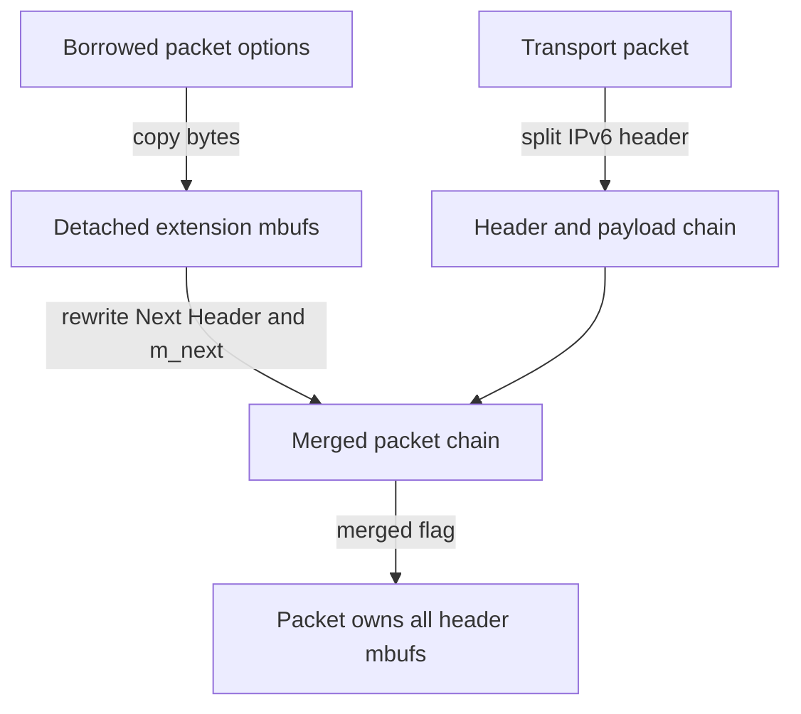
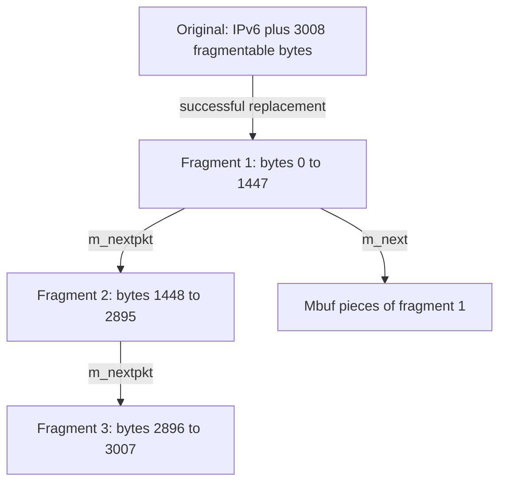
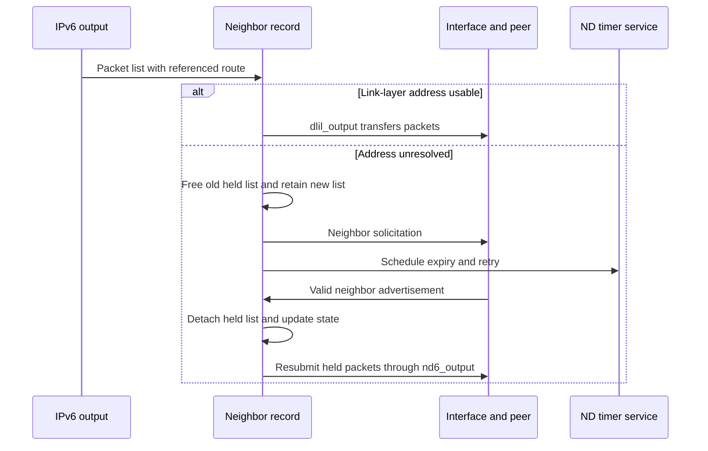

# IPv6 output, next-hop resolution and neighbor lifetime

[IPv6](ipv6.md) · [Networking](README.md) · [UDP](udp-send-receive-and-errors.md) · [Routes and interface lifetime](packets-routes-and-interfaces.md)

Choosing a route does not mean that the next hop's link-layer address is known. IPv6 output selects and validates the route/interface, applies packet policy and fragmentation decisions, then transfers packet ownership to neighbor discovery. Neighbor discovery can send immediately, retain a packet list while resolving an address, or discard it. This chapter traces that boundary and its asynchronous completion in `xnu-12377.121.6`.

Inspect the live [`route_in6`](../../structures/layout-browser.md?declaration=route_in6), [`ip6_exthdrs`](../../structures/layout-browser.md?declaration=ip6_exthdrs), [`ip6_out_args`](../../structures/layout-browser.md?declaration=ip6_out_args) layouts for the selected source configuration.

## Addresses, routes and neighbor records

| Object | State used along the path |
| --- | --- |
| `inpcb`, `ip6_pktopts`, `ip6_out_args` | Endpoint defaults versus per-packet source/interface/options and output restrictions. The option block is not consumed with the packet. |
| `sockaddr_in6` / `in6_addr` | Destination/source address and scope. A link-local address needs a zone; the address bits alone are insufficient to choose a link. |
| `route_in6`, `rtentry` | Cached destination route and referenced route entry; the gateway can require a second route lookup. |
| `ifnet`, `in6_ifaddr` | Selected interface and source/interface-address objects, independently referenced during output. |
| `llinfo_nd6` | Neighbor state, retry count, expiry, held packet list and link-layer reachability association, attached to a route. |
| `nd_ifinfo` | Per-interface neighbor-discovery parameters such as retransmission and reachable times, with its own lock. |

The [ND locking contract](../../../xnu/bsd/netinet6/nd6.c#L138-L166) places global neighbor-list linkage under `rnh_lock`, and `ln_hold`, `ln_asked`, `ln_expire`, `ln_state` and related per-neighbor fields under the route's `rt_lock`. The neighbor record lives as long as its route entry. Removing a route from the global structure is not immediate destruction of every retained route/neighbor reference.

## Source selection precedes the packet-to-link handoff

A native IPv6 UDP send uses [`in6_selectsrc()`](../../../xnu/bsd/netinet6/in6_src.c#L734) through its output path. Explicit packet-info source addresses are validated as usable node addresses with a consistent zone/interface. Otherwise PCB defaults and the source-selection machinery choose among eligible addresses, subject to scope and interface restrictions. Source selection and forwarding-route selection are connected but distinct: the former chooses a local source, the latter chooses where this packet goes.

[`ip6_output()`](../../../xnu/bsd/netinet6/ip6_output.c#L249) wraps [`ip6_output_list()`](../../../xnu/bsd/netinet6/ip6_output.c#L272). The latter accepts a skeletal IPv6 header plus options, constructs extension-header state, and owns the packet chain. Its contract says the packet is freed/consumed while the supplied option block is not. It tracks the current packet, remaining input chain and completed send chain separately, so failure must account for all three.

[`in6_selectroute()`](../../../xnu/bsd/netinet6/in6_src.c#L1601) is called only once for the selected output route in the packet-list path. It may return a referenced interface even on failure. The [caller](../../../xnu/bsd/netinet6/ip6_output.c#L1191-L1228) therefore releases returned references at the common cleanup label rather than assuming nonzero errno implies no ownership. After selection, NECP and output-interface restrictions can still reject the packet.

The outgoing interface must agree with the source/destination zones, except the specified loopback/local cases. `origifp` preserves the relevant original interface for scope and loopback handling; it is not always the same object as the interface used to transmit. See [scope checks](../../../xnu/bsd/netinet6/ip6_output.c#L1264-L1337). Policy or IPsec tunnel processing can also change the route/address context; the full policy engine is covered separately from this output trace.

## Extension headers become an owned mbuf chain

Output copies the borrowed `ip6_pktopts` header bytes into new mbufs; it does not splice the PCB's allocations into the packet. `ip6_exthdrs` records pointers to these detached headers while they are assembled. `ip6_copyexthdr()` uses nonblocking mbuf/cluster allocation and rejects a header exceeding its cluster bound. See [construction](../../../xnu/bsd/netinet6/ip6_output.c#L550-L595), [scratch layout](../../../xnu/bsd/netinet6/ip6_var.h#L183-L204) and [copy allocation](../../../xnu/bsd/netinet6/ip6_output.c#L2015-L2041).

Two lengths serve different purposes. `optlen` counts extension headers between IPv6 and the upper-layer payload. `unfragpartlen` includes the base IPv6 header and extensions that precede a Fragment header; final-destination options are counted in `optlen` but excluded from this unfragmentable prefix. Splitting the base header from payload permits insertion and IPsec transformation. See [lengths and split](../../../xnu/bsd/netinet6/ip6_output.c#L749-L792).

The builder inserts final-destination options, then hop-by-hop, pre-routing destination and routing headers, rewriting preceding `Next Header` fields. `m_next` links data pieces of one packet. Once `exthdrs.merged` is set, the scratch pointers alias the packet chain and cannot be freed individually. [`ip6_output.c:863–868`](../../../xnu/bsd/netinet6/ip6_output.c#L863-L868):

<!-- source-excerpt: ../../../xnu/bsd/netinet6/ip6_output.c#L863-L868 -->
```c
	MAKE_CHAIN(exthdrs.ip6e_hbh, mprev, nexthdrp, IPPROTO_HOPOPTS);
	MAKE_CHAIN(exthdrs.ip6e_dest1, mprev, nexthdrp, IPPROTO_DSTOPTS);
	MAKE_CHAIN(exthdrs.ip6e_rthdr, mprev, nexthdrp, IPPROTO_ROUTING);

	/* It is no longer safe to free the pointers in exthdrs. */
	exthdrs.merged = TRUE;
```



The historical composition machinery is broader than supported transmission: any routing header triggers `EINVAL` after the IPsec stage. Its accepted setter format does not make type-0 routing operational. Jumbo-payload handling inserts a jumbo option and sets `ip6_plen = 0`; that representation later prohibits ordinary fragmentation. See [jumbo insertion](../../../xnu/bsd/netinet6/ip6_output.c#L793-L812), [routing-header rejection](../../../xnu/bsd/netinet6/ip6_output.c#L996-L1001) and [socket-option decisions](ipv6-sockets-and-packet-options.md#important-option-decisions).

## MTU, checksum and fragments are explicit decisions

[`ip6_getpmtu()`](../../../xnu/bsd/netinet6/ip6_output.c#L2352) resolves the applicable path MTU. [`ip6_fragment_packet()`](../../../xnu/bsd/netinet6/ip6_output.c#L1754) then considers per-packet do-not-fragment flags, forwarding, packet length, link/path MTU and supported checksum/segmentation offload. Forwarded packets are forced into the nonfragmenting branch. The bypass also includes supported TSO and `CSUM_FRAGMENT_IPV6` hardware fragmentation. The selected behavior is not simply “fragment every packet larger than the route MTU.”

[`bsd/netinet6/ip6_output.c:1780–1789`](../../../xnu/bsd/netinet6/ip6_output.c#L1780-L1789):

<!-- source-excerpt: ../../../xnu/bsd/netinet6/ip6_output.c#L1780-L1789 -->
```c
	/* Access without acquiring nd_ifinfo lock for performance */
	if (dontfrag && tlen > IN6_LINKMTU(ifp)) {      /* case 2-b */
		/*
		 * We do not notify the connection in the same outbound path
		 * to avoid lock ordering issues.
		 * The returned error should imply that the packet is too big
		 * and the application should query the PMTU for a given destination.
		 */
		return EMSGSIZE;
	}
```

A nonfragmenting packet larger than the link MTU returns `EMSGSIZE`. Otherwise the implementation can finish output checksums and pass through, or construct a new `m_nextpkt` list of fragments through `ip6_do_fragmentation()`. Packet-chain linkage and each packet's `m_next` data-fragment linkage have different meanings. The original packet can be replaced/consumed during fragmentation, so the caller passes its address (`&m`) and uses the returned representation.

After filtering, checksum and fragmentation work, `ip6_output_list()` gathers completed packets and calls `nd6_output_list()`. It deliberately falls through to reference cleanup even on error because ND consumes the send chain in both outcomes. See [handoff](../../../xnu/bsd/netinet6/ip6_output.c#L1580-L1689). IP output cannot then free that chain again.

### Path MTU, link MTU and minimum-MTU policy

`ip6_getpmtu()` can distinguish a next-hop route from the final destination's PMTU route. It validates/rebuilds that cache, reads `rt_rmx.rmx_mtu`, and clamps a zero or excessive value to `IN6_LINKMTU(ifp)`. If `RTV_MTU` does not lock the route MTU, the corrected value is written back. These performance-path accesses intentionally omit the ordinary route/ND-info locks. With only an interface it uses that interface's MTU; with neither route nor interface it returns `EHOSTUNREACH`. See [the helper](../../../xnu/bsd/netinet6/ip6_output.c#L2352-L2420).

Minimum-MTU policy is another step: an explicit flag or `IP6PO_MINMTU_ALL` caps the selected value at 1280, and multicast uses that cap unless disabled. This differs from prohibiting fragmentation. The `dontfrag` rejection compares length against **link MTU**; a packet above path MTU but within link MTU can follow the nonfragmenting branch and receive later network feedback. Forwarded packets force `dontfrag` and discard inappropriate inherited partial-checksum transmit state. See [policy cap](../../../xnu/bsd/netinet6/ip6_output.c#L1444-L1470), [decision](../../../xnu/bsd/netinet6/ip6_output.c#L1754-L1825) and [ICMPv6 feedback](ip-fragment-reassembly-and-icmp.md).

### Checksums describe unfinished work

UDP/TCP can seed the transport checksum and record delayed work in `m_pkthdr.csum_flags`/`csum_data`. `ip6_output_checksum()` compares requested work with `if_hwassist`. Disabling transmit offload causes software completion; extension headers also force completion of this delayed transport work in software. Without extensions, partial offload can specify start/stuff offsets; the partial-offload branch requires packet length within MTU, and UDP additionally needs zero-inversion capability on both the interface and packet metadata. See [the full decision](../../../xnu/bsd/netinet6/ip6_output.c#L4303-L4374).

For plain IPv6/UDP, that partial-offload representation starts at the 40-byte IPv6 boundary and places the checksum at that start plus the UDP checksum-field offset. These are packet offsets, not DMA addresses. Before software fragmentation, `in6_delayed_cksum_offset()` completes the checksum over the original datagram, so the fragments carry portions of already checksummed data. See [pre-fragment completion](../../../xnu/bsd/netinet6/ip6_output.c#L1918-L1920) and [delayed checksum calculation](../../../xnu/bsd/netinet6/ip6_output.c#L2071-L2174). Device execution remains a provider boundary.

### Software fragmentation replaces one packet with a list

`ip6_do_fragmentation()` rejects an outstanding TSO packet, MTU below 1280 and jumbo payload. It clamps excessive MTU to `IPV6_MAXPACKET`, checks that the unfragmentable prefix, 8-byte Fragment header and at least 8 payload bytes fit, then subtracts and aligns the data budget. The guard precedes unsigned subtraction. [`ip6_output.c:1894–1904`](../../../xnu/bsd/netinet6/ip6_output.c#L1894-L1904):

<!-- source-excerpt: ../../../xnu/bsd/netinet6/ip6_output.c#L1894-L1904 -->
```c
#define IPV6_FRAG_UNIT  8       /* fragment offset granularity (octets) */
		if ((hlen + sizeof(struct ip6_frag) + IPV6_FRAG_UNIT) > mtu) {
			in6_ifstat_inc(ifp, ifs6_out_fragfail);
			return EMSGSIZE;
		}

		len = (mtu - hlen - sizeof(struct ip6_frag)) & ~(IPV6_FRAG_UNIT - 1);
		if (len < IPV6_FRAG_UNIT) {
			in6_ifstat_inc(ifp, ifs6_out_fragfail);
			return EMSGSIZE;
		}
```

The last unfragmentable header's `Next Header` becomes `IPPROTO_FRAGMENT`; each new Fragment header preserves the previous next protocol. Each iteration allocates a packet-header mbuf, copies unfragmentable headers, writes offset/more-fragments/identification, copies the corresponding data portion, and transfers classifier/PF/NECP metadata. `m_next` describes one fragment's pieces; `m_nextpkt` links complete fragments. All fragments share the identification passed to this operation. See [construction](../../../xnu/bsd/netinet6/ip6_output.c#L1916-L2001).

Worked example, **illustrative values**: native UDP, 3000 application bytes, no extension headers or offload, MTU 1500, fragmentation allowed. The original is `40 + 8 + 3000 = 3048` bytes. The fragmentable part is 3008 bytes, including UDP. The data budget is `(1500 - 40 - 8) & ~7 = 1448` bytes.

| Fragment | Byte offset within fragmentable part | Encoded offset units | Fragment data | Whole packet | More flag |
| --- | ---: | ---: | ---: | ---: | --- |
| First | 0 | 0 | 1448 | 1496 | Set |
| Second | 1448 | 181 | 1448 | 1496 | Set |
| Third | 2896 | 362 | 112 | 160 | Clear |

Only the first fragment starts with the UDP header. The [Fragment header layout](../../../xnu/bsd/netinet/ip6.h#L279-L293) uses the low three bits for two reserved bits and the More flag, giving the 8-byte-unit offset interpretation above. [Reassembly](ip-fragment-reassembly-and-icmp.md) restores the upper-layer datagram before UDP delivery.



Construction failure frees all newly created fragments; the original remains owned by the caller's error path. Its header may already have changed, so it is not a pristine retry buffer. Success frees the original and replaces `*mptr` with the fragment list. No fragment is submitted to the interface from this loop. See [failure and replacement](../../../xnu/bsd/netinet6/ip6_output.c#L1995-L2011).

### Packet-list cleanup has three owners

`ip6_output_list()` tracks remaining `inputchain`, current `m` and completed `sendchain`. A fragmented `m` can contain several packets, so gathering walks to its last `m_nextpkt`. The next input resets extension/IPsec scratch state, including `merged`. The normal path hands the gathered chain to ND after processing the list; ND consumes it on both outcomes. See [gather and handoff](../../../xnu/bsd/netinet6/ip6_output.c#L1598-L1651).

Before merging, `freehdrs` releases detached header allocations. Its guards panic if asked to separately free a merged header. After merging the packet owns those headers. The `bad` path frees remaining inputs, gathered outputs and the current packet, then `done` releases local routes, addresses, interfaces and conditional policy references. See [cleanup](../../../xnu/bsd/netinet6/ip6_output.c#L1653-L1731).

## Neighbor lookup can change which route is held

[`nd6_output_list()`](../../../xnu/bsd/netinet6/nd6.c#L3911) first takes an extra reference on the supplied route. Multicast and interfaces that do not need an ND cache bypass ordinary neighbor resolution. For unicast it checks whether the route remains up, resolves gateway routes where needed, and validates that the gateway is an appropriate neighbor. Point-to-point exceptions have their own checks.

The function sometimes drops `rt_lock` before calls that take `rnh_lock`; after acquiring global routing protection or doing a lookup, it verifies that the route remains up and that its gateway has not changed. The [gateway lookup/revalidation branch](../../../xnu/bsd/netinet6/nd6.c#L4008-L4070) rejects a missing or circular gateway route rather than following stale pointers. Route references preserve storage across the unlocked interval; they do not freeze route contents.

Once a usable neighbor record is found, known link-layer state can send immediately. A stale entry is moved toward delayed reachability probing while still allowing output. A missing address instead enters the incomplete-resolution path.

## The held packet is replaced, not appended forever

The unresolved path assigns the latest packet list to `ln_hold`. If another list is already held, that list is freed first. The list can contain multiple packets produced by batching/fragmentation, but repeated sends do not grow an unlimited per-neighbor queue.

[`bsd/netinet6/nd6.c:4280–4286`](../../../xnu/bsd/netinet6/nd6.c#L4280-L4286):

<!-- source-excerpt: ../../../xnu/bsd/netinet6/nd6.c#L4280-L4286 -->
```c
	if (ln->ln_state == ND6_LLINFO_NOSTATE) {
		ND6_CACHE_STATE_TRANSITION(ln, ND6_LLINFO_INCOMPLETE);
	}
	if (ln->ln_hold) {
		m_freem_list(ln->ln_hold);
	}
	ln->ln_hold = m0;
```

The first attempt increments `ln_asked`, sets expiry from the interface retransmission interval, drops the route lock while retaining the route, and sends a neighbor solicitation. The code schedules ND service under routing protection. Its zero return records accepted/retained work; the payload has not necessarily reached the interface or another host. See [solicitation and timer setup](../../../xnu/bsd/netinet6/nd6.c#L4290-L4335).



## Advertisement validation and release of held packets

[`nd6_na_input()`](../../../xnu/bsd/netinet6/nd6_nbr.c#L937) checks the required hop limit, target address, solicited/multicast combination and option lengths before using link-layer information. It invokes duplicate-address-detection handling where applicable. It does not blindly create a neighbor entry for every unsolicited advertisement: absent-cache/proxy conditions have explicit branches.

For an incomplete entry, link-layer information can resolve it. For existing entries, solicited and override flags plus whether the link-layer address changed decide whether to replace the address and mark reachable or stale. An advertisement without override that conflicts with a reachable address may mark it stale without replacing it. See [update decisions](../../../xnu/bsd/netinet6/nd6_nbr.c#L1176-L1288).

The final path resets retries, removes `ln_hold` from the record before sending, splits the held packet list, and calls `nd6_output()` with `rt_lock` dropped around each submission. Clearing the owner pointer before the call prevents two paths from treating the same list as still retained by the neighbor. The route remains referenced until this operation finishes.

[`bsd/netinet6/nd6_nbr.c:1395–1407`](../../../xnu/bsd/netinet6/nd6_nbr.c#L1395-L1407):

<!-- source-excerpt: ../../../xnu/bsd/netinet6/nd6_nbr.c#L1395-L1407 -->
```c
		m_hold = ln->ln_hold;
		ln->ln_hold = NULL;
		for (; m_hold; m_hold = m_hold_next) {
			m_hold_next = m_hold->m_nextpkt;
			m_hold->m_nextpkt = NULL;
			/*
			 * we assume ifp is not a loopback here, so just set
			 * the 2nd argument as the 1st one.
			 */
			RT_UNLOCK(rt);
			nd6_output(ifp, ifp, m_hold, &sin6, rt, NULL);
			RT_LOCK_SPIN(rt);
		}
```

[`nd6_ns_input()`](../../../xnu/bsd/netinet6/nd6_nbr.c#L262) is the corresponding solicitation receive entry, including address validation, local-target/DAD/proxy decisions and advertisement generation. The [neighbor-message companion](ipv6-neighbor-messages-and-reachability.md) expands the NS/NA flags, cache-learning predicates, NUD and redirects; [address/DAD](ipv6-addresses-autoconfiguration-and-dad.md) and [RA/prefix lifetime](ipv6-router-advertisements-and-prefix-lifetime.md) follow their separate state changes.

## Timer transitions, failed resolution and teardown

[`nd6_service_neighbor_cache()`](../../../xnu/bsd/netinet6/nd6.c#L789) implements the cache-aging work. The useful simplified transition map is:

| State | Relevant transition and ownership effect |
| --- | --- |
| `INCOMPLETE` | Retransmit solicitations up to the configured maximum; on exhaustion, detach `ln_hold`, produce eligible ICMPv6 unreachable responses, notify route consumers and free the neighbor route. |
| `REACHABLE` | Expiry makes it `STALE`, with route notification and later collection scheduling. |
| `STALE` | Output can move toward `DELAY`; aging can remove expired unused entries. |
| `DELAY` | If neighbor-unreachability detection applies, start `PROBE` with unicast solicitation; otherwise return to stale handling. |
| `PROBE` | Retry unicast solicitation up to its own limit, then invalidate unreachable state. |

The timer code takes route references before dropping locks for packet generation or notification, then reacquires global routing state and restarts traversal when entries may have changed. See [retry and failure](../../../xnu/bsd/netinet6/nd6.c#L964-L1035) and [reachable/delay/probe](../../../xnu/bsd/netinet6/nd6.c#L1037-L1118). A textbook state diagram without these retained references would miss the mechanism that makes unlocked calls safe.

[`nd6_purge()`](../../../xnu/bsd/netinet6/nd6.c#L2295) coordinates interface-related purge helpers; [`nd6_purge_interface_llinfo()`](../../../xnu/bsd/netinet6/nd6.c#L2246) removes neighbor information for an interface. The final transmit branch also checks `IFEF_IPV6_DISABLED`, rejects loopback addresses escaping onto a physical link, and calls DLIL with the correct original interface for loopback delivery. See [final send checks](../../../xnu/bsd/netinet6/nd6.c#L4338-L4396).

## Scope of this reconstruction

This path explains packet ownership, route/scope/MTU decisions, ND resolution and asynchronous reclamation. The [IP reassembly and ICMP companion](ip-fragment-reassembly-and-icmp.md) follows incoming fragments, dirty-queue lifetime and quoted-header PMTU feedback. The expanded [IPv6 guide](ipv6.md) connects source-address ranking, DAD, router/prefix lifetimes, input/forwarding, redirects and multicast membership to their detailed companions. External routers, hardware neighbor offloads and device providers are not reconstructed from these call sites. [Neighbor lookup tests](../../../xnu/tests/net/nd6lookup.c) provide an in-tree follow-up route; no network test was executed for this chapter.

<!-- BEGIN PLATYDOC DOCUMENTATION LICENSE -->
Original Platydoc text and diagrams are licensed under [CC BY 4.0](https://creativecommons.org/licenses/by/4.0/). Quoted source code and third-party material retain their respective licenses.
<!-- END PLATYDOC DOCUMENTATION LICENSE -->
