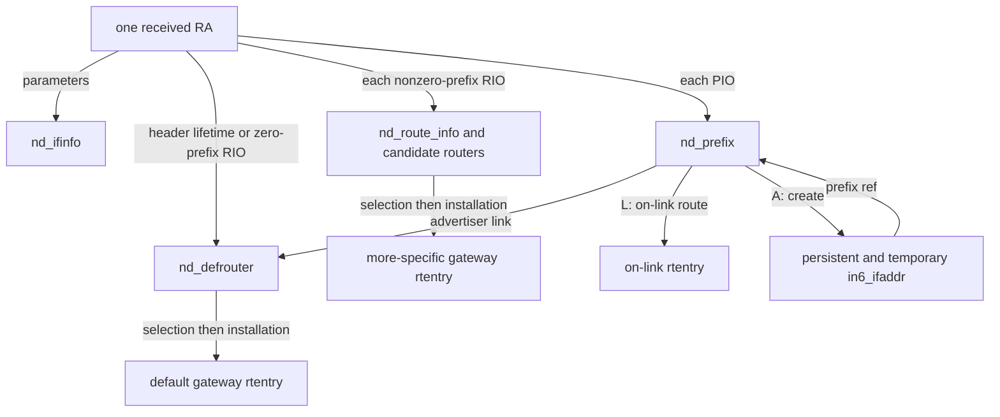
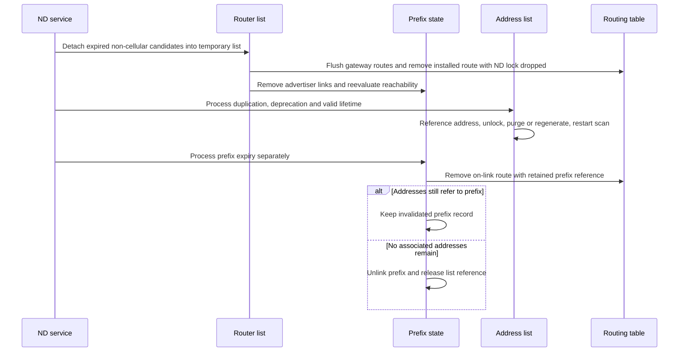

# IPv6 router advertisements, prefixes and route lifetime

[Networking](README.md) · [IPv6 guide](ipv6.md) · [Addresses and DAD](ipv6-addresses-autoconfiguration-and-dad.md) · [Output and neighbor resolution](ipv6-output-and-neighbor-discovery.md) · [Routing control](routing-control-and-ipv4-arp.md)

Receiving a Router Advertisement (RA) can change an interface's ND parameters, default-router candidates, more-specific gateway routes, on-link prefixes and autoconfigured addresses. Those are different objects with different lifetimes. This chapter follows the actual sequence in `xnu-12377.121.6`, including changes that remain after a later option is rejected. It complements the packet/neighbor chapter: an `nd_defrouter` is not the neighbor-cache entry or the `rtentry` used for a particular transmitted packet.

Inspect the live [`nd_defrouter`](../../structures/layout-browser.md?declaration=nd_defrouter), [`nd_prefix`](../../structures/layout-browser.md?declaration=nd_prefix) layouts for the selected source configuration.

## State is split between routers, prefixes, addresses and routes

| Object | Identity and contents | Lifetime relationship |
| --- | --- | --- |
| `nd_ifinfo` | Per-interface reachable/retransmit parameters, current hop limit, link MTU, router and prefix counts, flags. | Survives individual RA packets and address objects. |
| `nd_defrouter` | Router IPv6 address plus `ifp`; advertisement preference/flags, lifetime/expiry, installed/scoped/ineligible/local/mapped state, reachability boolean and last route-install error. | Global or route-information list holds a reference; lookups/operations take temporary references. |
| `nd_route_info` | Destination prefix and prefix length, with its own router list. | Global RIO list owns the object; freeing requires its router list to be empty. |
| `nd_prefix` | Prefix, mask and interface, received L/A flags, effective state, times, address counters, advertising-router list and an optional retained route. | Global list, address associations and temporary operations hold references. Expiry need not free it while addresses remain. |
| `nd_pfxrouter` | Link from one prefix to one advertiser's `nd_defrouter`. | Created/removed under ND/prefix serialization. Its body stores the router pointer without adding an independent router reference; router deletion removes these links before release. |
| `in6_ifaddr` | A concrete configured address, DAD/usability flags and its own valid/preferred lifetimes. | Refers to its prefix when associated; does not expire merely because a default router expires. |
| `rtentry` / `llinfo_nd6` | Lookup route and neighbor state used by packet output. | Referenced by routing users and sometimes by `nd_prefix`; router-list membership is not equivalent to having an installed route. |

Declarations: [`nd_defrouter`](../../../platydoc-data/xnu/bsd/netinet6/nd6.h#L491-L510), [`nd_route_info`](../../../platydoc-data/xnu/bsd/netinet6/nd6.h#L554-L559), [`nd_prefix`](../../../platydoc-data/xnu/bsd/netinet6/nd6.h#L576-L610), [`nd_pfxrouter`](../../../platydoc-data/xnu/bsd/netinet6/nd6.h#L681-L685). For the uncounted advertiser link, compare [`pfxrtr_add()/del()`](../../../platydoc-data/xnu/bsd/netinet6/nd6_rtr.c#L2271-L2297) with [router deletion](../../../platydoc-data/xnu/bsd/netinet6/nd6_rtr.c#L1450-L1465); do not infer ownership solely from a pointer diagram.



Creation arrows are not retained references. The actual retained ownership is stated in the table and teardown sections.

## ICMPv6 entry and admission

[`icmp6_input()`'s RA case](../../../platydoc-data/xnu/bsd/netinet6/icmp6.c#L840-L858) requires code zero and a sufficiently large RA header. It normally copies the mbuf for `nd6_ra_input()` and keeps the original for the remaining ICMPv6/raw path. If copying fails it gives the original to RA processing and abandons that separate local delivery. `nd6_ra_input()` consumes whichever packet it receives; it is not returning the RA mbuf to its caller.

[`nd6_ra_input()`](../../../platydoc-data/xnu/bsd/netinet6/nd6_rtr.c#L375-L488) admits remote RAs only if the receiving interface has `IFEF_ACCEPT_RTADV`, but also recognizes a source matching a local address and permits that locally generated RA case. It deliberately uses per-interface policy rather than rejecting all RAs whenever global forwarding is enabled. A machine can therefore have host and router roles on different interfaces. Development/debug builds additionally honor `ip6_accept_rtadv` here.

The handler then requires hop limit 255 and a link-local source. Those checks constrain the packet to the intended link context; they are not a cryptographic authentication protocol. It linearizes/checks the ICMP portion as needed and parses the ND options before mutating configuration.

[`in6_autoconf()`](../../../platydoc-data/xnu/bsd/netinet6/in6.c#L1932-L1995) sets or clears `IFEF_ACCEPT_RTADV`. Exclusive router mode rejects the start request with `EBUSY`; stop purges autoconfigured addresses. [`in6_setrouter()`](../../../platydoc-data/xnu/bsd/netinet6/in6.c#L2002-L2047) handles exclusive/hybrid/disabled mode, router reselection and prefix-proxy/all-multicast changes. These controls do not implement a user-space router-advertisement daemon.

The receive-side Router Solicitation body is narrower: [`nd6_rs_input()`](../../../platydoc-data/xnu/bsd/netinet6/nd6_rtr.c#L270-L357) requires forwarding and a router-mode interface, checks hop limit and neighbor status, validates the source-link-layer option and updates neighbor information. It does not construct an RA response in this body. In particular, a source of `::` skips its neighbor update because there is no address to cache.

## Option parsing is bounded but not all-or-nothing

[`nd6_option()`](../../../platydoc-data/xnu/bsd/netinet6/nd6.c#L619-L672) advances by an option's eight-byte length unit, rejecting zero length, a missing length byte or an overrun of the remaining buffer. [`nd6_options()`](../../../platydoc-data/xnu/bsd/netinet6/nd6.c#L680-L779) retains the first singleton option, records the first/last PIO and RIO positions for later loops, and ignores unsupported options.

The iteration limit has a particular outcome: after `nd6_maxndopt` it increments the “too many options” statistic and **breaks with success**, retaining the options already parsed. This is not the same return as a malformed option length, which clears parser state and returns `-1`.

[`bsd/netinet6/nd6.c:762–777`](../../../platydoc-data/xnu/bsd/netinet6/nd6.c#L762-L777):

<!-- source-excerpt: ../../../platydoc-data/xnu/bsd/netinet6/nd6.c#L762-L777 -->
```c
skip1:
		i++;
		if (i > nd6_maxndopt) {
			icmp6stat.icp6s_nd_toomanyopt++;
			nd6log(info, "too many loop in nd opt\n");
			break;
		}

		if (ndopts->nd_opts_done) {
			break;
		}
	}

	return 0;
}

```

The parser deliberately ignores PVD, RDNSS, DNSSL and captive-portal options in this kernel consumer. RIO collection is conditional on `nd6_process_rti`. Do not interpret a known option number or a raw-socket delivery opportunity as an in-kernel DNS configuration implementation. [Option classification](../../../platydoc-data/xnu/bsd/netinet6/nd6.c#L712-L755).

Within a parsed RA, processing order is significant:

1. Update interface reachable time, retransmit time and current hop limit.
2. Process RIOs, including a `::/0` RIO override, and otherwise update the header's default-router candidate.
3. Process each PIO and possibly create/update addresses.
4. Apply a valid MTU option.
5. Validate the source-link-layer option's interface-specific length, update the neighbor cache, post the RA event and reevaluate on-link reachability.

Thus a later bad source-link-layer length can drop/count the RA after router/prefix/address changes already occurred. The common error label frees the packet and temporary notification records; it does not roll back every earlier mutation. Individual invalid PIOs/RIOs are often skipped while processing continues. [Ordered body and late rejection](../../../platydoc-data/xnu/bsd/netinet6/nd6_rtr.c#L489-L943).

## Interface parameters from the RA

[`nd6_ra_input()` updates `nd_ifinfo`](../../../platydoc-data/xnu/bsd/netinet6/nd6_rtr.c#L489-L536) under its lock:

| Field | Decision |
| --- | --- |
| Reachable time | A nonzero advertised value must be no greater than `MAX_REACHABLE_TIME`; a changed base recomputes randomized `reachable` and resets the recalculation timer. |
| Retransmission time | A nonzero value must be less than `MAX_RA_RETRANS_TIMER`; an excessive value is ignored. |
| Current hop limit | A nonzero value can raise `ndi->chlim`; a lower value is logged and ignored. |
| Link MTU | The option must have the expected size, be at least `IPV6_MMTU`, and be no larger than a known `ndi->maxmtu`. A changed accepted value updates the global maximum calculation. |

The MTU option acts on link configuration, whereas a Packet Too Big message affects destination path MTU. The [ICMP feedback chapter](ip-fragment-reassembly-and-icmp.md#ipv6-route-pmtu-update-precedes-transport-specific-checks) explains the latter. Receiving a hop-limit field of zero means no update here, not “send future packets with hop limit zero.” [MTU branch](../../../platydoc-data/xnu/bsd/netinet6/nd6_rtr.c#L845-L891).

## Default-router candidates and zero-lifetime advertisements

The RA parser builds a temporary `nd_defrouter` with source address/interface, preference flags, lifetime and uptime expiry. [`defrtrlist_update_common()`](../../../platydoc-data/xnu/bsd/netinet6/nd6_rtr.c#L2051-L2238) looks up address plus interface, updates or allocates a persistent object, enforces `ip6_maxifdefrouters`, increments generation/count state and inserts into preference order. It returns a reference for its caller. A stored candidate is not proof that adding its gateway route succeeded; the route-install result is recorded separately in `dr->err`.

A zero router lifetime deserves more precision than “delete the router”:

- The RA parser converts zero into a two-hour lifetime plus `NDDRF_INELIGIBLE`. This permits bookkeeping for a router that advertises prefixes but is not eligible as a default gateway.
- If a matching **eligible** entry already exists, the updater unlinks and deletes it, drops references and returns `NULL`.
- If an ineligible entry already exists, the refresh can retain/update it. If no entry exists, the updater can create an ineligible one.
- A later eligible advertisement clears the ineligible state and triggers selection as required.

The decisive existing-entry branch is:

[`bsd/netinet6/nd6_rtr.c:2087–2094`](../../../platydoc-data/xnu/bsd/netinet6/nd6_rtr.c#L2087-L2094):

<!-- source-excerpt: ../../../platydoc-data/xnu/bsd/netinet6/nd6_rtr.c#L2087-L2094 -->
```c
		if ((new->stateflags & NDDRF_INELIGIBLE) != 0 &&
		    (dr->stateflags & NDDRF_INELIGIBLE) == 0) {
			TAILQ_REMOVE(nd_router_listp, dr, dr_entry);
			defrtrlist_del(dr, nd_router_listp);
			NDDR_REMREF(dr);        /* remove list reference */
			NDDR_REMREF(dr);
			dr = NULL;
			return NULL;
```

Compare it with [the RA header conversion](../../../platydoc-data/xnu/bsd/netinet6/nd6_rtr.c#L658-L696). A statement that every zero-lifetime RA leaves a two-hour dummy entry would miss the deletion branch.

### Selection uses both preference and reachability

[`defrouter_select()`](../../../platydoc-data/xnu/bsd/netinet6/nd6_rtr.c#L1599-L2048) normally selects for an interface; if none is supplied it uses `nd6_defifp`. It skips an exclusive router interface, ineligible candidates and locally hosted router addresses on non-cellular interfaces. With exactly one default router on the interface, its fast path avoids a neighbor-reachability search.

With multiple candidates it scans preference order and consults the candidate's `llinfo_nd6` through `nd6_lookup()` for “probably reachable” state. Static routers get special preference treatment. The currently installed reachable/static router can remain when the new candidate is not better. If no candidate is found reachable, selection can rotate through eligible routers rather than treating a failed probe as proof that every possible default must be removed. [Candidate scan](../../../platydoc-data/xnu/bsd/netinet6/nd6_rtr.c#L1718-L1899), [fallback and installed-router preservation](../../../platydoc-data/xnu/bsd/netinet6/nd6_rtr.c#L1901-L1985).

This routine drops `nd6_mutex` for route lookups and route mutation. A busy/waiter protocol serializes selectors, temporary router references retain storage, and `nd6_defrouter_genid` detects list changes across unlocks. On mismatch it discards candidate/installed references and restarts or exits if the interface has no routers. Reference ownership preserves a router object; the generation check preserves the meaning of the traversal. [Serialization](../../../platydoc-data/xnu/bsd/netinet6/nd6_rtr.c#L1702-L1715), [revalidation](../../../platydoc-data/xnu/bsd/netinet6/nd6_rtr.c#L1866-L1900).

### Selection becomes a real route in a separate step

[`defrouter_addreq()`](../../../platydoc-data/xnu/bsd/netinet6/nd6_rtr.c#L973-L1110) constructs destination/mask/gateway sockaddrs, then calls `rtrequest_scoped(RTM_ADD, ...)`. Default routes use `::/0`; RIO routes use their advertised prefix. The route normally gets an interface scope when its interface is not the default ND interface. A returned route generates a routing-socket notification and marks `NDDRF_INSTALLED`, plus `NDDRF_IFSCOPE` when applicable. Failure can leave the candidate present with an error and without an installed route.

A cellular compatibility branch maps a gateway address that conflicts with a manually configured local link-local address, when ND reachability checks are disabled for that link. The router retains both advertised `rtaddr` and mapped `rtaddr_mapped`; routing operations and neighbor updates consult the mapped state. This is a narrow branch, not an arbitrary rewrite of every RA source. [Mapped gateway branch](../../../platydoc-data/xnu/bsd/netinet6/nd6_rtr.c#L1046-L1082).

### Choosing the default interface and adding a static candidate

The choice of `nd6_defifp` is explicit configuration. [`nd6_setdefaultiface()`](../../../platydoc-data/xnu/bsd/netinet6/nd6_rtr.c#L4562-L4628), reached through ND interface control, validates the index, updates the default interface, reruns selection for the old/new interfaces, synchronizes prefix route scoping on the new interface, and updates default zone policy through `scope6_setdefault()`. It deliberately leaves RIO route scoping unchanged. Replacing the default interface can therefore cause gateway routes to be reinstalled with different scope without changing the routers' IPv6 address bits.

The privileged `SIOCDRADD_IN6_32/64` and `SIOCDRDEL_IN6_32/64` requests instead manipulate a default-router candidate. [`defrtrlist_ioctl()`](../../../platydoc-data/xnu/bsd/netinet6/nd6_rtr.c#L1284-L1365) converts the ABI, validates a live IPv6-initialized interface and scoped address, then dispatches static add/delete. [`defrtrlist_add_static()`](../../../platydoc-data/xnu/bsd/netinet6/nd6_rtr.c#L1484-L1516) retains only preference bits, sets `NDDRF_STATIC`, supplies an indefinite lifetime with zero expiry, and refuses to replace a same-identity nonstatic entry through this API. It uses the common updater/selector and returns the stored route-install error; failed add handling attempts static-entry cleanup. This is not equivalent to writing an arbitrary `RTM_ADD` route with no ND candidate. The generic routing socket path is explained in [routing control](routing-control-and-ipv4-arp.md).

## Route Information Options have their own candidate lists

An RIO is a route through a router, not an instruction to create a local address in that prefix. This checkout processes RIOs in the RA body only for Ethernet interfaces, after parser enablement. It validates option length from one to three eight-byte units, prefix length up to 128, sufficient bytes for that prefix, and non-reserved preference. A `::/0` RIO supplies default-router preference/lifetime instead of the header fields. Nonzero prefixes go to `nd6_rtilist_update()`. [RIO validation and dispatch](../../../platydoc-data/xnu/bsd/netinet6/nd6_rtr.c#L551-L654).

[`nd6_rtilist_update()`](../../../platydoc-data/xnu/bsd/netinet6/nd6_rti.c#L103-L132) uses a global prefix/length lookup and creates or refreshes that prefix's router list using the common router updater. `nd_route_info` begins with `nd_drhead`, intentionally allowing the shared selector to recognize and recover the containing RIO object. RIO route selection currently treats routes as **unscoped** and considers candidates across interfaces; that differs from default-router selection for a particular interface. [Layout contract](../../../platydoc-data/xnu/bsd/netinet6/nd6.h#L547-L559), [selector RIO branch](../../../platydoc-data/xnu/bsd/netinet6/nd6_rtr.c#L1615-L1699).

The RIO path also has its own `nd6_rti_list_busy` sleep/wakeup protocol around operations that may drop `nd6_mutex`. Its teardown removes candidates through `defrtrlist_del()` before freeing an empty RIO object. Timer expiry and interface detach have explicit RIO passes; a more-specific route is not reclaimed solely by walking the default-router list. [RIO serialization and free invariant](../../../platydoc-data/xnu/bsd/netinet6/nd6_rti.c#L45-L84), [purge](../../../platydoc-data/xnu/bsd/netinet6/nd6_rti.c#L135-L156), [expiry pass](../../../platydoc-data/xnu/bsd/netinet6/nd6.c#L1280-L1362).

Do not infer that every zero-lifetime RIO executes the same immediate deletion as an ineligible default entry. For a new absent RIO, lifetime zero is ignored; an existing RIO is passed through the common updater with the fields the RA parser supplied. The default router's explicit `NDDRF_INELIGIBLE` conversion is not repeated by that nonzero-prefix call site. [Caller assignments](../../../platydoc-data/xnu/bsd/netinet6/nd6_rtr.c#L647-L654), [update branches](../../../platydoc-data/xnu/bsd/netinet6/nd6_rti.c#L111-L129).

## Prefix Information Options: L and A answer different questions

A PIO must have the fixed option length, prefix length no greater than 128 and a non-unspecified/non-multicast/non-link-local prefix after masking off host bits. The parser copies L (on-link), A (autonomous), valid lifetime and preferred lifetime into a temporary `nd_prefix`. It can clear A for disallowed 6to4 or non-ULA prefixes according to the relevant settings, while leaving on-link processing possible. Preferred lifetime exceeding valid lifetime rejects that PIO's lifetime initialization. [PIO parsing](../../../platydoc-data/xnu/bsd/netinet6/nd6_rtr.c#L698-L843), [lifetime validation](../../../platydoc-data/xnu/bsd/netinet6/nd6_rtr.c#L4429-L4460).

| Advertised flags | Potential result |
| --- | --- |
| `L=1, A=0` | Maintain an on-link prefix route; do not create/update SLAAC addresses from this PIO's autonomous-processing branch. |
| `L=0, A=1` | Permit SLAAC processing; this PIO alone does not claim that other destinations in the prefix are directly reachable on the link. |
| `L=1, A=1` | Both mechanisms, each with its own admission/failure path. |
| `L=0, A=0` | A new absent prefix is not created by `prelist_update()`; an existing object's stored flags are not simply cleared by those zeros. |

[`prelist_update()`](../../../platydoc-data/xnu/bsd/netinet6/nd6_rtr.c#L2589-L2715) looks up prefix **and length and interface**. Existing stored L/A bits are only raised from zero to one in this update branch. Lifetime refresh of the on-link prefix object is conditional on the incoming L bit. Autonomous address processing, however, tests the incoming A bit, not merely the remembered A bit. Those distinctions prevent a simplistic model where one pair of stored flags fully explains every RA update.

[`bsd/netinet6/nd6_rtr.c:2629–2642`](../../../platydoc-data/xnu/bsd/netinet6/nd6_rtr.c#L2629-L2642):

<!-- source-excerpt: ../../../platydoc-data/xnu/bsd/netinet6/nd6_rtr.c#L2629-L2642 -->
```c
		lck_mtx_lock(nd6_mutex);
		NDPR_LOCK(pr);
		if (new->ndpr_raf_onlink == 1) {
			pr->ndpr_raf_onlink = 1;
		}
		if (new->ndpr_raf_auto == 1) {
			pr->ndpr_raf_auto = 1;
		}
		if (new->ndpr_raf_onlink) {
			pr->ndpr_vltime = new->ndpr_vltime;
			pr->ndpr_pltime = new->ndpr_pltime;
			(void) in6_init_prefix_ltimes(pr); /* XXX error case? */
			pr->ndpr_lastupdate = net_uptime();
		}
```

[`nd6_prelist_add()`](../../../platydoc-data/xnu/bsd/netinet6/nd6_rtr.c#L2338-L2433) enforces the per-interface prefix limit, initializes/canonicalizes a new prefix, links it with a list reference, increments `nprefixes`, attempts on-link route installation if requested, and associates the advertiser. A route-install failure is logged and processing can continue. `ndpr_raf_onlink` records an advertised property; `NDPRF_ONLINK` records effective route state. They are not interchangeable.

### Installing the interface route

[`nd6_prefix_onlink_common()`](../../../platydoc-data/xnu/bsd/netinet6/nd6_rtr.c#L3720-L3951) checks whether the same prefix already has an effective route on another interface and chooses scoped/unscoped installation accordingly. It prefers a ready non-anycast link-local `ifaddr` as route-associated address, falls back to another IPv6 address, and can return zero without installation when no address exists. It derives cloning flags from interface/ND needs, drops `nd6_mutex`, and calls `rtrequest_scoped()`.

For an unscoped direct prefix, it checks a conflicting indirect RIO route and removes that installed RIO route before adding the direct one. It then updates effective flags and retains the returned route reference in `ndpr_rt`. `EEXIST` can still mark the prefix on-link while `ndpr_rt` remains `NULL`; the source explicitly calls out this missing association. Therefore neither a zero return nor an on-link flag alone proves that this prefix object owns a specific new route pointer. Prefix proxy bookkeeping is updated under `proxy6_lock`; full proxy NS/NA behavior remains a distinct mechanism.

## Address lifetimes and the two-hour rule

The A-bit path scans only appropriate autoconfigured, non-anycast addresses associated with the matching stored prefix. It updates each address's valid/preferred lifetime; if none matches and valid lifetime is nonzero, it calls `in6_pfx_newpersistaddr()` and optionally creates a temporary address. DAD, CGA, privacy generation and prefix-reference publication are explained in [address construction](ipv6-addresses-autoconfiguration-and-dad.md#slaac-persistent-addresses-cga-and-privacy-addresses).

For a matching address, let `R` be remaining valid lifetime and `V` the new advertised valid lifetime. The implemented update is:

| Condition | New remaining valid lifetime |
| --- | --- |
| `V > 7200` or `R < V` | `V` |
| Otherwise `R <= 7200` | Keep `R`, except use `V` when the authentication predicate is true. |
| Otherwise | 7200 seconds |

Preferred lifetime uses the advertised preferred value without this two-hour floor. Temporary addresses are additionally capped by configured privacy limits and by their creation-time age, so repeated RAs cannot extend the same temporary address indefinitely. [Matching and lifetime calculation](../../../platydoc-data/xnu/bsd/netinet6/nd6_rtr.c#L2720-L2868).

[`bsd/netinet6/nd6_rtr.c:2792–2808`](../../../platydoc-data/xnu/bsd/netinet6/nd6_rtr.c#L2792-L2808):

<!-- source-excerpt: ../../../platydoc-data/xnu/bsd/netinet6/nd6_rtr.c#L2792-L2808 -->
```c
		if (TWOHOUR < new->ndpr_vltime ||
		    remaininglifetime < new->ndpr_vltime) {
			lt6_tmp.ia6t_vltime = new->ndpr_vltime;
		} else if (remaininglifetime <= TWOHOUR) {
			if (auth) {
				lt6_tmp.ia6t_vltime = new->ndpr_vltime;
			}
		} else {
			/*
			 * new->ndpr_vltime <= TWOHOUR &&
			 * TWOHOUR < remaininglifetime
			 */
			lt6_tmp.ia6t_vltime = TWOHOUR;
		}

		/* The 2 hour rule is not imposed for preferred lifetime. */
		lt6_tmp.ia6t_pltime = new->ndpr_pltime;
```

Here “authenticated” is the local predicate requiring both `M_AUTHIPHDR` and `M_AUTHIPDGM` when those flags are defined; otherwise `auth` remains zero. It is not inferred from `IN6_IFF_SECURED`, the router's name, or mere RA admission. [Authentication predicate](../../../platydoc-data/xnu/bsd/netinet6/nd6_rtr.c#L2605-L2614).

For example, an ordinary existing address with `R=10800` and an unauthenticated advertisement `V=0, preferred=0` gets 7200 valid seconds but zero preferred seconds. A later `V=0` while `R=6000` keeps those 6000 valid seconds rather than resetting to another 7200. The on-link prefix's own lifetime can already be zero: prefix route expiry and address expiry are deliberately separate. These are illustrative arithmetic examples, not claims about a default RA policy.

## Reachability changes deprecate without immediately removing the prefix route

[`find_pfxlist_reachable_router()`](../../../platydoc-data/xnu/bsd/netinet6/nd6_rtr.c#L3231-L3259) walks a prefix's advertiser links, using the router's cached reachability state; cellular advertisers have a special always-reachable treatment here. [`pfxlist_onlink_check()`](../../../platydoc-data/xnu/bsd/netinet6/nd6_rtr.c#L3275-L3571) then distinguishes two situations:

- With evidence of an available advertised prefix/router, nonstatic L-bit prefixes lacking a reachable advertiser can be marked `NDPRF_DETACHED`.
- Without such evidence, it clears detached state rather than assuming that all prefixes simultaneously became unusable; it cannot distinguish every router failing from a genuine link change solely from that observation.

The current implementation explicitly **retains interface routes for detached prefixes**. It makes their preferred lifetime zero and caps their remaining valid lifetime to two hours without extending a shorter remaining lifetime. It can install a missing route again for an attached prefix. The historical comments that describe making a prefix “off-link” should be read alongside this body, not as a promise of immediate route deletion. [Effective handling](../../../platydoc-data/xnu/bsd/netinet6/nd6_rtr.c#L3389-L3463).

Address consequences are a separate pass over a referenced address-list snapshot. If it finds reachable-prefix evidence, it deprecates affected autoconfigured addresses and caps remaining valid time similarly. The code updates lifetimes; the next ND service pass sets address deprecation flags and posts notifications. It leaves manual addresses out of this autonomous update. If the `M_NOWAIT` address-list allocation fails, the address pass returns and can be retried by a later RA, NA or link change. [Address propagation](../../../platydoc-data/xnu/bsd/netinet6/nd6_rtr.c#L3469-L3571).

This behavior is especially important after movement between links or loss of one router: a route, prefix record and formerly preferred address can all still exist while new source selection prefers another address.

## Expiry, deletion and interface detach

[`nd6_service()`](../../../platydoc-data/xnu/bsd/netinet6/nd6.c#L1724-L1777) serializes the service operation across dropped locks. It starts under `rnh_lock` for neighbor-cache work, releases that lock before taking `nd6_mutex`, then services default routers, RIOs, addresses and prefixes in separate passes. A timer callback is not holding the entire routing/ND/address hierarchy locked continuously.



### Router expiry and deletion

[`nd6_service_expired_default_router()`](../../../platydoc-data/xnu/bsd/netinet6/nd6.c#L1176-L1276) removes expired non-cellular routers to a temporary list while holding ND serialization, then invokes cleanup on that private list because deletion drops locks. The cellular branch instead advances expiry by the stored lifetime to accommodate that link's deployment/wake behavior. Explicit withdrawal/detach remains separate from this timer exception.

[`defrtrlist_del()`](../../../platydoc-data/xnu/bsd/netinet6/nd6_rtr.c#L1375-L1481) requires the candidate already be unlinked, increments the router generation, flushes matching nonstatic host routes using its link-local gateway, deletes its installed route, removes prefix advertiser links for a default-router entry, reevaluates prefix reachability, decrements the interface router count and selects a replacement. Extra references cover calls made outside `nd6_mutex`. The gateway flush is intentionally narrower than deleting all routes: [`rt6_flush()/rt6_deleteroute()`](../../../platydoc-data/xnu/bsd/netinet6/nd6_rtr.c#L4493-L4559) only process link-local gateways and preserve static/non-host routes. Losing the last counted router resets applicable interface ND/MTU state. A router's logical removal precedes final reference-counted destruction.

### Prefix expiry is not address expiry

[`nd6_service_expired_prefix()`](../../../platydoc-data/xnu/bsd/netinet6/nd6.c#L1637-L1718) skips prefixes still associated with manual addresses and checks valid expiry independently of address expiry. It marks processed entries because removal can require restarting from the list head. Its comment explicitly forbids calling address purge as a side effect of prefix expiry.

[`bsd/netinet6/nd6.c:1676–1684`](../../../platydoc-data/xnu/bsd/netinet6/nd6.c#L1676-L1684):

<!-- source-excerpt: ../../../platydoc-data/xnu/bsd/netinet6/nd6.c#L1676-L1684 -->
```c
		if (pr->ndpr_expire != 0 && pr->ndpr_expire < timenow) {
			/*
			 * address expiration and prefix expiration are
			 * separate. NEVER perform in6_purgeaddr here.
			 */
			pr->ndpr_stateflags |= NDPRF_PROCESSED_SERVICE;
			NDPR_ADDREF(pr);
			prelist_remove(pr);
			NDPR_UNLOCK(pr);
```

[`prelist_remove()`](../../../platydoc-data/xnu/bsd/netinet6/nd6_rtr.c#L2439-L2584) clears valid/preferred lifetime, removes the on-link route and handles scoped/unscoped prefix replacement. It sets `DEFUNCT` only when no associated addresses remain; after dropping and reacquiring locks it rechecks the count. If addresses remain it retains the invalidated prefix object and clears `DEFUNCT`. Otherwise it unlinks the prefix, removes advertiser records, decrements `nprefixes` and drops the list reference. Final memory reclamation still waits for every address/temporary reference to be released.

The direct route and prefix association can therefore disappear at different times. An expired RA prefix may remain as an object needed to interpret an address's history without remaining an active advertised on-link route.

### Complete interface purge

[`nd6_purge()`](../../../platydoc-data/xnu/bsd/netinet6/nd6.c#L2295-L2330) separately purges default routers, prefixes, RIOs and neighbor-cache entries, clears default-interface selection when applicable and reruns router selection. [`in6_ifdetach()`](../../../platydoc-data/xnu/bsd/netinet6/in6_ifattach.c#L1029-L1207) combines that with address and multicast cleanup. Prefix purge can drop ND locks while purging referencing addresses; busy protocols and temporary references preserve traversal across those calls. [Interface-prefix purge](../../../platydoc-data/xnu/bsd/netinet6/nd6.c#L2104-L2165).

## Events, partial results and implementation boundaries

`nd6_ra_input()` collects temporary `nd_prefix_list` records for [`nd6_post_msg()`](../../../platydoc-data/xnu/bsd/netinet6/nd6.c#L1906-L1954). That helper posts `KEV_ND6_RA` payloads while iterating the prefix records, with prefix index/count and optional MTU data. There is no unconditional standalone post after the loop: a call with no prefix records sends no message from this helper, even if an MTU was considered. The records are notification snapshots, not handles transferring ownership of the persistent prefix objects.

There are several intentionally nonfatal outcomes: prefix route installation can fail while retaining prefix state; temporary-address creation can fail after persistent address creation; CLAT address creation failure is recorded but does not make the entire PIO update fail. Late link-layer-option rejection can occur after earlier mutations. Reading the RA handler as a transactional packet-to-configuration commit would miss all of them.

The source inspected here includes RA/RS admission, option parsing, per-interface parameters, default/RIO candidate selection, PIO creation/update, two-hour address lifetime handling, reachability propagation, timer expiry and interface purge. It does not implement the user-space network-configuration agent, DNS consumer, DHCPv6 state machine, RA transmission daemon or a complete SEND packet signature protocol. `nd6_send.c` exposes CGA configuration and operating state, which is a narrower body than those missing policies. [CGA control surface](../../../platydoc-data/xnu/bsd/netinet6/nd6_send.c#L48-L84), [configuration admission](../../../platydoc-data/xnu/bsd/netinet6/nd6_send.c#L90-L190).

Full prefix-proxy behavior, NAT64/CLAT translation, IPsec security-association lifetime and every router-mode combination remain separate subjects. No Darwin runtime packet tests were run for this documentation change; branch descriptions come from the linked local implementation, and diagrams omit incidental statistics and logging.

<!-- BEGIN PLATYDOC DOCUMENTATION LICENSE -->
Original Platydoc text and diagrams are licensed under [CC BY 4.0](https://creativecommons.org/licenses/by/4.0/). Quoted source code and third-party material retain their respective licenses.
<!-- END PLATYDOC DOCUMENTATION LICENSE -->
