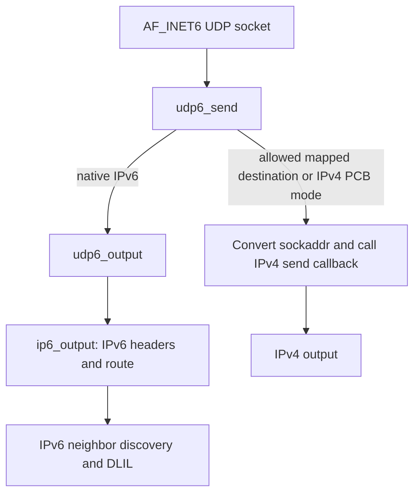
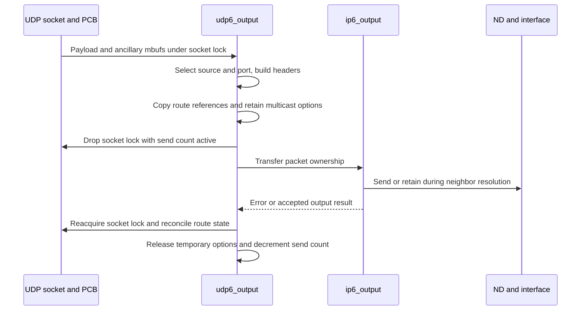
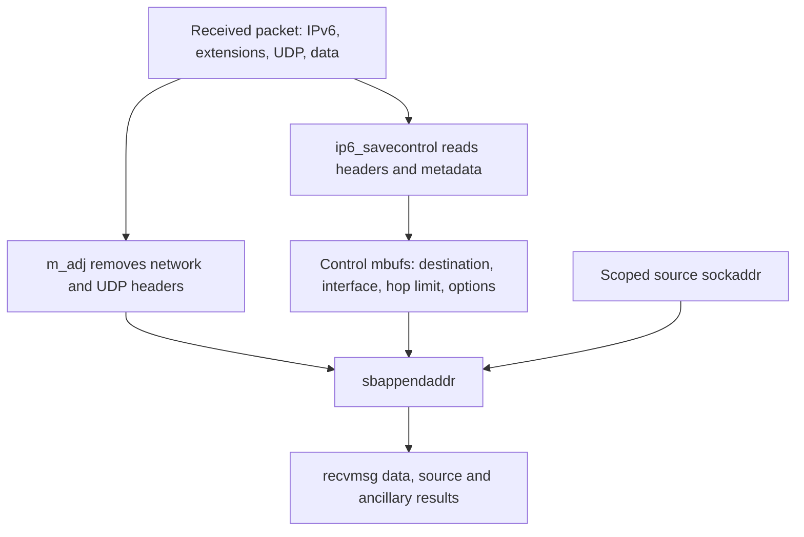

# IPv6 sockets, packet options and transport handoffs

An `AF_INET6` socket reaches IPv6 through a shared Internet PCB, protocol-specific socket callbacks and per-send packet state. This chapter follows native and mapped UDP, bind/connect publication, sticky versus ancillary options, receive controls and raw/ICMPv6 sockets in `xnu-12377.121.6`. It explains where a successful API operation changes state before a later operation can fail.

Parent routes: [IPv6](ipv6.md), [networking](README.md). Read [Internet PCB lifetime](internet-pcbs-ports-and-lifetime.md) and [UDP](udp-send-receive-and-errors.md) for shared mechanisms; [source selection and scopes](ipv6-source-selection-and-scopes.md), [output](ipv6-output-and-neighbor-discovery.md) and [multicast](ipv6-multicast-membership-and-mld.md) cover the IPv6-specific continuations.

Inspect the live [`ip6_pktopts`](../../structures/layout-browser.md?declaration=ip6_pktopts) layouts for the selected source configuration.

## Protocol registration chooses the callback family

[`inet6sw`](../../../xnu/bsd/netinet6/in6_proto.c#L164-L267) registers separate `SOCK_DGRAM/IPPROTO_UDP`, `SOCK_STREAM/IPPROTO_TCP`, raw IPv6, raw ICMPv6 and datagram ICMPv6 entries. UDP uses `udp6_usrreqs`, `udp6_input` and `udp_ctloutput`; the [control-output wrapper](../../../xnu/bsd/netinet/udp_usrreq.c#L1137-L1161) delegates applicable IPv6 option levels to `ip6_ctloutput`; TCP has its own IPv6 request/input wrappers around the common TCP machinery. Extension-header entries in the same table are input dispatch entries with `nousrreqs`, not evidence that every header type is a usable application socket protocol.

Despite the `in6pcb` spelling, [`in6pcb` is a macro alias for `inpcb`](../../../xnu/bsd/netinet/in_pcb.h#L617-L641). The common object holds the socket, local/foreign ports, IPv6 addresses and scopes, protocol/version flags, a route union, output options, multicast options, checksum offset and lifecycle state. It is allocated through `in_pcballoc()`, indexed in the protocol's `inpcbinfo`, and eventually retired through the common wanted-count machinery. IPv6 does not have a second independent PCB lifetime system.

| State owner | Important state | Lifetime consequence |
| --- | --- | --- |
| Socket/PCB | Bound/connected tuple, `inp_vflag`, `IN6P_IPV6_V6ONLY`, `in6p_outputopts`, `in6p_route`, multicast pointer | Survives individual sends and can change while output temporarily drops the socket lock. |
| `ip6_pktopts` | Hop limit, traffic class, MTU and temporary-address policies, packet info, next-hop/header allocations and cached next-hop/routing-header routes | Sticky object belongs to the PCB; a successfully parsed ancillary object is temporary for one send. |
| Local `route_in6 ro` | References copied out of the PCB for output | Must be reconciled or released after output; it is not a shallow unowned pointer snapshot. |
| `mbuf` packet | IPv6/UDP bytes, packet metadata, checksum work, flow identifier, scope metadata | Ownership transfers into output, then ND/DLIL or a drop path. |
| Control mbuf | User-supplied ancillary records copied into kernel memory | Parsed separately and freed by the send path; it is not sent as payload. |

The option layout is [`struct ip6_pktopts`](../../../xnu/bsd/netinet6/ip6_var.h#L206-L250); packet/output state appears in [`udp6_output()`](../../../xnu/bsd/netinet6/udp6_output.c#L154-L208).

## Native IPv6 and mapped IPv4 are different output paths

`udp6_attach()` initializes IPv6 participation, optionally IPv4 participation under the mapped-address policy, default hop-limit selection (`-1`) and disabled generic raw checksum offset (`-1`). `udp6_bind()` temporarily adjusts version flags around binding. A wildcard bind can participate in both families; a mapped address converts to an IPv4 sockaddr and calls `in_pcbbind()`. Failure restores the saved flags. See [attach/bind](../../../xnu/bsd/netinet6/udp6_usrreq.c#L879-L972).

`udp6_send()` detects the allowed mapped/IPv4 case, converts the destination representation where necessary, and calls the **IPv4 protocol's send callback**. That path does not put an IPv4 packet inside an IPv6 header. Native traffic reaches `udp6_output()`. Content-filter saved destinations, flow diversion and Skywalk port protection introduce earlier conditional branches; they do not change this basic dispatch distinction. See [send wrapper](../../../xnu/bsd/netinet6/udp6_usrreq.c#L1213-L1343).

`IPV6_V6ONLY` is accepted only before the PCB has a local port or a non-unspecified local IPv6 address. Its setter changes both the option flag and IPv4 participation in `inp_vflag`; trying to change it after binding returns `EINVAL`. See [the setter](../../../xnu/bsd/netinet6/ip6_output.c#L2653-L2673).



## Binding publishes a tuple under table protection

`in6_pcbbind()` requires the bind-in-progress state established by its caller. It takes the PCB table lock in the required order, potentially dropping the socket lock, and rechecks whether another operation already installed a local address/port. The supplied sockaddr is copied and scope-normalized before lookup; port and flow fields are cleared for an interface-address search. A specific local address must exist and must not be anycast, not-ready, detached or CLAT46-reserved. This bind path permits deprecated addresses, unlike the raw bind path below. See [entry and address validation](../../../xnu/bsd/netinet6/in6_pcb.c#L189-L314).

Port admission combines several mechanisms rather than one hash lookup:

- Multicast binding treats `SO_REUSEADDR` as reuse permission in the multicast-specific case.
- Under `SKYWALK`, an external-port socket obtains and validates its reserved port through NECP namespace state; ordinary TCP/UDP binding reserves namespace tokens as well as PCB entries.
- Restricted ports have a task/protocol permission check. The explicit low-port privilege branch shown here is also conditioned by `XNU_TARGET_OS_OSX`, the address and external-port state; it is not an unconditional all-platform test.
- Existing IPv6 and applicable IPv4 bindings, wildcard/reuse policy and credential ownership participate in conflict detection.

Read [namespace and admission checks](../../../xnu/bsd/netinet6/in6_pcb.c#L315-L559). After reacquiring socket protection, the code rechecks publication state. It installs local address/scope, chooses an ephemeral port if needed, or inserts an explicit port into the hash. Failures clear the partially installed address/port/scope and release the applicable reservations. The exact rollback differs by branch; no single generic “undo everything” operation covers the whole function. See [publication and failure labels](../../../xnu/bsd/netinet6/in6_pcb.c#L560-L631).

### Ephemeral port allocation is bounded and revalidated

`in6_pcbsetport()` selects the ordinary, high or low configured range. Low-range allocation checks privilege; random-port policy changes the starting cursor. It walks the finite range, wraps as needed, skips restricted ports, checks local PCB conflicts and, under Skywalk, tries namespace reservations. A dual-family wildcard can reserve both IPv4 and IPv6 namespaces. Exhaustion returns `EAGAIN`, rather than searching forever. See [range and search](../../../xnu/bsd/netinet6/in6_src.c#L1642-L1808).

If the helper had to drop the socket lock to acquire the table lock, it first checks whether another thread already assigned a port. That is success, not a second allocation. After finding a candidate it sets `inp_lport` and `INP_ANONPORT`, then inserts into the hash; insertion failure clears that publication and the shown reservation state. See [final commit](../../../xnu/bsd/netinet6/in6_src.c#L1809-L1836).

## Connect changes lookup identity without sending a handshake

For UDP, connecting selects a peer/source and changes how subsequent sends and receives identify the PCB. `in6_pcbconnect()` obtains a source and referenced interface through `in6_pcbladdr()`, checks whether the complete scoped tuple already exists, binds a local port if necessary, installs a previously wildcard local address, then publishes foreign address/port/scope and rehashes under table protection. It must release the returned interface on failure too. The duplicate lookup's wanted reference is released separately from the interface reference. See [local-address selection](../../../xnu/bsd/netinet6/in6_pcb.c#L633-L731) and [connect](../../../xnu/bsd/netinet6/in6_pcb.c#L734-L835).

`in6_pcbdisconnect()` clears foreign address, port, scope and flow-label state and rehashes; socket-level UDP disconnect performs its own surrounding work. Disconnect is not the same as final PCB disposal. `in6_pcbdetach()` marks wanted-count state `WNT_STOPUSING`, removes namespace ownership when appropriate, frees output options, releases routes, detaches multicast ownership and marks the object dead. Other wanted users can still delay final storage reclamation. See [disconnect](../../../xnu/bsd/netinet6/in6_pcb.c#L838-L872), [detach](../../../xnu/bsd/netinet6/in6_pcb.c#L874-L956) and the [common PCB lifetime chapter](internet-pcbs-ports-and-lifetime.md).

## One native UDP send, from ancillary records to output

`udp6_output()` starts with payload and optional control mbufs, with the socket protected. It derives output restrictions and flow-advisory state, then chooses either the borrowed sticky option object or a temporary option object parsed from ancillary data. It increments `inp_sndinprog_cnt` before the interval in which output can drop socket protection. See [entry through destination choice](../../../xnu/bsd/netinet6/udp6_output.c#L154-L304).

For `sendto`, it validates the destination port, rejects an explicit peer on an already-connected socket, normalizes scope, selects a source, and obtains an ephemeral local port when necessary. It does not have to permanently connect the socket to this destination. For a connected send it uses the PCB tuple, subject to the content-filter saved-state branch. See [destination/source selection](../../../xnu/bsd/netinet6/udp6_output.c#L278-L443).

The function prepends space for IPv6 and UDP, fills addresses and ports, chooses a hop limit, writes the UDP length (zero for the jumbo-length case), and seeds checksum work with the IPv6 pseudo-header. It records `CSUM_UDPIPV6` and zero-inversion requirements for later software/hardware completion. Allocation can fail **after** an ephemeral port or flow identity has been assigned. A failed send therefore need not restore the socket to its pre-send state. See [header construction](../../../xnu/bsd/netinet6/udp6_output.c#L444-L529).

NECP and IPsec checks can reject before output. A route with the wrong family is discarded, route references are copied out, multicast options are retained, and packet metadata records flow/service/scope information. Then the ownership handoff is explicit. [`udp6_output.c:618–622`](../../../xnu/bsd/netinet6/udp6_output.c#L618-L622):

<!-- source-excerpt: ../../../xnu/bsd/netinet6/udp6_output.c#L618-L622 -->
```c
		socket_unlock(so, 0);
		error = ip6_output(m, optp, &ro, flags, im6o, NULL, &ip6oa);
		m = NULL;
		socket_lock(so, 0);

```

`ip6_output()` consumes the packet on success and failure. After relocking, the caller releases multicast ownership, reconciles route state, records interface/statistics/QoS results and handles flow-control feedback. A flow advisory can produce `ENOBUFS` at this stage. The returned errno is not a delivery acknowledgement from the peer. In particular, ND may have retained the packet while resolving a neighbor. See [post-output processing](../../../xnu/bsd/netinet6/udp6_output.c#L623-L745) and [ND hold ownership](ipv6-output-and-neighbor-discovery.md#the-held-packet-is-replaced-not-appended-forever).



At completion, the last in-progress send wakes option setters waiting on `inp_sndinprog_cnt`. `ip6_ctloutput()` waits before changing IPv6 options specifically because output borrowed those options while the socket was unlocked. This is why dropping the socket lock does not permit an option setter to freely overwrite the object being used by the send. See [wait](../../../xnu/bsd/netinet6/ip6_output.c#L2450-L2470) and [cleanup/wakeup](../../../xnu/bsd/netinet6/udp6_output.c#L755-L785).

## Sticky and ancillary options are allocated representations

`ip6_initpktopts()` initializes hop limit and traffic class to `-1`, minimum-MTU policy to multicast-only, and temporary-address preference to the system setting. `ip6_pcbopt()` creates sticky storage if needed and applies an individual option. `ip6_setpktopts()` initializes temporary storage, copies selected sticky state and overlays IPv6 control records; it expects the control information in a single mbuf and skips records at other protocol levels. See [initialization](../../../xnu/bsd/netinet6/ip6_output.c#L3297-L3320) and [ancillary parser](../../../xnu/bsd/netinet6/ip6_output.c#L3690-L3747).

The copy is deliberately not a raw structure copy: pointers need fresh allocations and cached routes are not duplicated. There is another version-specific detail: `copypktopts()` copies `ip6po_hlim`, `ip6po_tclass` and `ip6po_flags`, but **does not copy `ip6po_minmtu` or `ip6po_prefer_tempaddr`**. A freshly initialized ancillary object retains defaults for those two scalar fields unless the control records set them. Therefore “ancillary options inherit every sticky option” overstates the body. See [the complete copy helper](../../../xnu/bsd/netinet6/ip6_output.c#L3491-L3526).

[`ip6_output.c:3498–3500`](../../../xnu/bsd/netinet6/ip6_output.c#L3498-L3500):

<!-- source-excerpt: ../../../xnu/bsd/netinet6/ip6_output.c#L3498-L3500 -->
```c
	dst->ip6po_hlim = src->ip6po_hlim;
	dst->ip6po_tclass = src->ip6po_tclass;
	dst->ip6po_flags = src->ip6po_flags;
```

### Important option decisions

| Option | Validation and downstream effect |
| --- | --- |
| `IPV6_PKTINFO` | Exact structure size and valid interface index. A zero address/interface clears an existing option; when none exists the later path can allocate a zero-valued object. TCP disallows a sticky nonzero explicit source. Full address usability is deferred to source selection, where zone/interface context is available. |
| `IPV6_HOPLIMIT` | Modern form is ancillary-only; range is `-1..255`. A separate unicast-hop option controls the PCB default. |
| `IPV6_TCLASS` | `-1..255`; later output fills unset DSCP/ECN portions rather than unconditionally overwriting all flow bits. |
| `IPV6_NEXTHOP` | Privileged; requires an IPv6, non-unspecified, non-multicast sockaddr and scope normalization. Route selection later requires an appropriate directly reachable neighbor. |
| Hop-by-hop and destination options | Privilege and encoded-length checks; separately allocated headers. Modern destination-before-routing and final-destination forms use different pointers. Legacy form placement depends on existing routing-header state. |
| `IPV6_RTHDR` | Setter accepts only the type-0 shape it validates; **packet output rejects any routing header**. Successful `setsockopt` is not proof that sending it is supported. |
| `IPV6_USE_MIN_MTU` | Accepts multicast-only, disabled or all-packets policy; affects the output MTU choice. |
| `IPV6_DONTFRAG` | Boolean packet flag for applicable transports; TCP clears/ignores this option in this setter. |
| `IPV6_PREFER_TEMPADDR` | System/default, do-not-prefer or prefer; consumed by automatic source ranking, after earlier ranking rules. |

Validation is in [`ip6_setpktopt()`](../../../xnu/bsd/netinet6/ip6_output.c#L3758-L4185); [traffic-class application](../../../xnu/bsd/netinet6/ip6_output.c#L1035-L1056) and [source ranking](ipv6-source-selection-and-scopes.md) are separate stages. The routing-header contradiction is resolved by reading the output body, not its historical header-composition comments. [`ip6_output.c:996–1001`](../../../xnu/bsd/netinet6/ip6_output.c#L996-L1001):

<!-- source-excerpt: ../../../xnu/bsd/netinet6/ip6_output.c#L996-L1001 -->
```c
	/* If there is a routing header, discard the packet. */
	if (exthdrs.ip6e_rthdr != NULL) {
		error = EINVAL;
		goto bad;
	}

```

### Errors do not imply option-state rollback

The legacy bulk `ip6_pcbopts()` clears old option contents before parsing a replacement; a failed replacement does not restore them. Several individual setters validate the new shape, clear the old allocation, then allocate its replacement, so allocation failure can leave the option removed. See [bulk replacement](../../../xnu/bsd/netinet6/ip6_output.c#L3248-L3288), [next-hop replacement](../../../xnu/bsd/netinet6/ip6_output.c#L3940-L4000) and [routing-header replacement](../../../xnu/bsd/netinet6/ip6_output.c#L4119-L4127).

Ancillary parse cleanup also needs a precise qualification. `copypktopts()` clears partial copies on its own allocation failure, but later validation/option errors in `ip6_setpktopts()` return directly. In the UDP caller, `optp = &opt` occurs only after successful parsing, while the cleanup calls `ip6_clearpktopts()` only when `optp == &opt`. The visible path does **not** establish an unconditional cleanup of every partially built ancillary object after a later parse failure. This is a bounded static-source observation, not a reproduced allocation-leak test. See [parser returns](../../../xnu/bsd/netinet6/ip6_output.c#L3690-L3747), [caller assignment](../../../xnu/bsd/netinet6/udp6_output.c#L254-L266), and [cleanup predicate](../../../xnu/bsd/netinet6/udp6_output.c#L755-L767).

## Native UDP receive: exact tuple, wildcard and wanted references

`udp6_input()` receives a packet after IPv6 extension processing supplies the transport offset. It verifies a readable UDP header, compatible lengths and a nonzero destination port, then verifies the checksum. IPv6 UDP zero checksums are rejected unless the packet already carries the trusted `CSUM_DATA_VALID` state used by the special paths described in the source. Hardware/partial checksums require pseudo-header and offset adjustments; otherwise software computes the checksum. See [input validation](../../../xnu/bsd/netinet6/udp6_usrreq.c#L258-L389) and [checksum helper](../../../xnu/bsd/netinet6/udp6_usrreq.c#L1350-L1442).

For unicast, `in6_pcblookup_hash()` first checks the exact scoped source/destination addresses and ports, then eligible wildcard candidates. The hash uses only part of the foreign address plus ports to choose a bucket; **full scoped equality checks** establish identity inside that bucket. Interface receive restrictions and NECP admission apply before a candidate is returned. An exact local-address wildcard-peer match wins before the fully wildcard local candidate. A successful lookup acquires a wanted hold, not an indefinitely valid unprotected pointer. See [lookup](../../../xnu/bsd/netinet6/in6_pcb.c#L1499-L1594).

The receive path locks the socket and releases/revalidates that hold through `WNT_RELEASE`; a concurrently retiring PCB can stop delivery. It creates requested control data while headers are still available, strips the IPv6/extensions/UDP prefix with `m_adj()`, then appends the source sockaddr, payload and controls to the socket receive buffer. `sbappendaddr()` consumes the supplied data/control chain even when it cannot append it; the caller clears local ownership accordingly. Successful append wakes the receiver. No match can produce ICMPv6 no-port, subject to the implementation's suppression, policy and rate-limit conditions. See [unicast delivery](../../../xnu/bsd/netinet6/udp6_usrreq.c#L562-L749).

Multicast takes a separate fanout path with group/source filters and packet copies for multiple sockets; see [membership and receive filtering](ipv6-multicast-membership-and-mld.md). It is not the ordinary unicast hash lookup repeated for each listener.

## Receive controls preserve metadata before headers disappear

`ip6_savecontrol()` builds control mbufs before transport delivery removes the network headers. Its shared helper handles timestamps, traffic class, wake metadata and packet info; the IPv6 path can add hop limit, traffic class and requested extension headers. `IPV6_PKTINFO` returns the destination address with any embedded scope cleared, plus the receive interface index. That is different from the **source sockaddr** accompanying the datagram. See [base controls and packet info](../../../xnu/bsd/netinet6/ip6_input.c#L1859-L2003) and [IPv6 controls](../../../xnu/bsd/netinet6/ip6_input.c#L2005-L2168).

Mapped IPv4 receive has explicit handling: it constructs a mapped IPv6 packet-info destination from the IPv4 destination and reports IPv4 traffic-class information through the corresponding control option. The extension walker preserves header order but stops when a needed header lies outside the first mbuf's contiguous data or is not a recognized extension. It is not a new arbitrary-chain reassembly engine. Allocation failure is returned to the transport, which drops the packet and frees the partial control chain.



## Raw IPv6 and ICMPv6 datagram sockets

`rip6_attach()` requires `proc_suser()`, reserves socket buffers, allocates a PCB in `ripcbinfo`, records the protocol number and allocates an initially pass-all ICMPv6 filter. Raw bind validates a local address and additionally rejects deprecated addresses. Raw connect selects a source and installs local/foreign address/scope state without the UDP port-tuple semantics. See [raw attach](../../../xnu/bsd/netinet6/raw_ip6.c#L1002-L1031) and [bind/connect](../../../xnu/bsd/netinet6/raw_ip6.c#L1073-L1221).

`rip6_output()` receives upper-layer data and creates the IPv6 header; its `israw` argument affects source selection, not an unconditional promise to transmit an application-supplied complete IPv6 header unchanged. It computes ICMPv6 checksums at the ICMP header's checksum field, or a configured raw checksum offset, after checking that the payload contains that field. It then applies policy and calls ordinary IPv6 output. See [destination handling](../../../xnu/bsd/netinet6/raw_ip6.c#L364-L475), [source/header/checksum](../../../xnu/bsd/netinet6/raw_ip6.c#L600-L738) and [output handoff](../../../xnu/bsd/netinet6/raw_ip6.c#L785-L937).

`IPV6_CHECKSUM` accepts a nonnegative even offset for applicable raw protocols. ICMPv6 accepts only its standard checksum-field offset. Although raw PCB initialization uses `-1` to mean disabled, this setter rejects negative input; initialization and accepted setter values are not identical contracts. See [`ip6_raw_ctloutput()`](../../../xnu/bsd/netinet6/ip6_output.c#L3170-L3242).

General raw receive walks `ripcbinfo` under its shared table lock, filters protocol/local/foreign scoped addresses and interface eligibility, validates checksum where configured, and uses copies for earlier matching recipients while delivering the original to the last one. It strips intermediate headers before socket append. With no recipient, `IPPROTO_NONE` is dropped; an unknown next-header path can produce an ICMPv6 parameter problem. See [`rip6_input()`](../../../xnu/bsd/netinet6/raw_ip6.c#L153-L305). ICMPv6 observation uses its own [`icmp6_rip6_input()`](../../../xnu/bsd/netinet6/icmp6.c#L2115-L2280), including the ICMP type-filter bitmap; do not assume the generic raw walk is the only ICMP delivery path.

Datagram ICMPv6 is deliberately separate from privileged raw attach. `icmp6_dgram_attach()` does not enforce root privilege, but requires `IPPROTO_ICMPV6`. For a non-root socket credential, `icmp6_dgram_send()` allows only echo request with code 0 and the listed node-information query codes; other messages return `EPERM`. Root credentials bypass that message-type restriction. Both enter `rip6_output(..., israw = 0)`. See [send admission](../../../xnu/bsd/netinet6/icmp6.c#L3249-L3310) and [attach](../../../xnu/bsd/netinet6/icmp6.c#L3316-L3349).

## Review limits

This is the classic BSD socket path. Skywalk reservations and NECP/content-filter/IPsec calls are traced as boundaries; this chapter does not infer missing providers or claim every packet takes all configured hooks. TCP's stream, retransmission and connection machinery remains in the TCP chapters. No socket or network integration test was executed; the explanations and noted edge cases were checked against the cited bodies.

<!-- BEGIN PLATYDOC DOCUMENTATION LICENSE -->
Original Platydoc text and diagrams are licensed under [CC BY 4.0](https://creativecommons.org/licenses/by/4.0/). Quoted source code and third-party material retain their respective licenses.
<!-- END PLATYDOC DOCUMENTATION LICENSE -->
