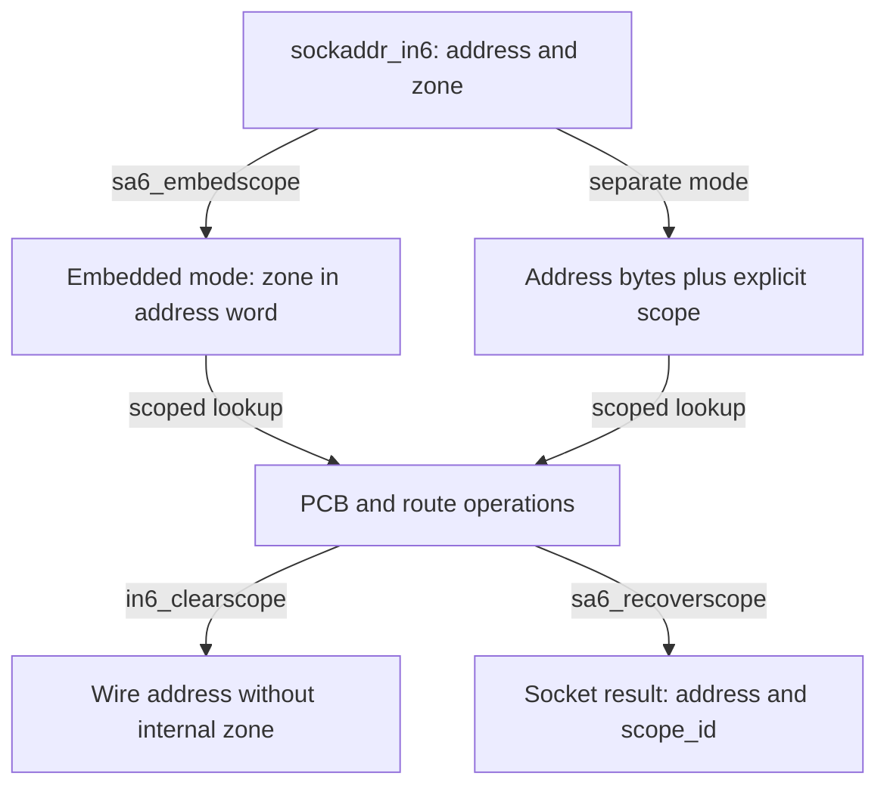
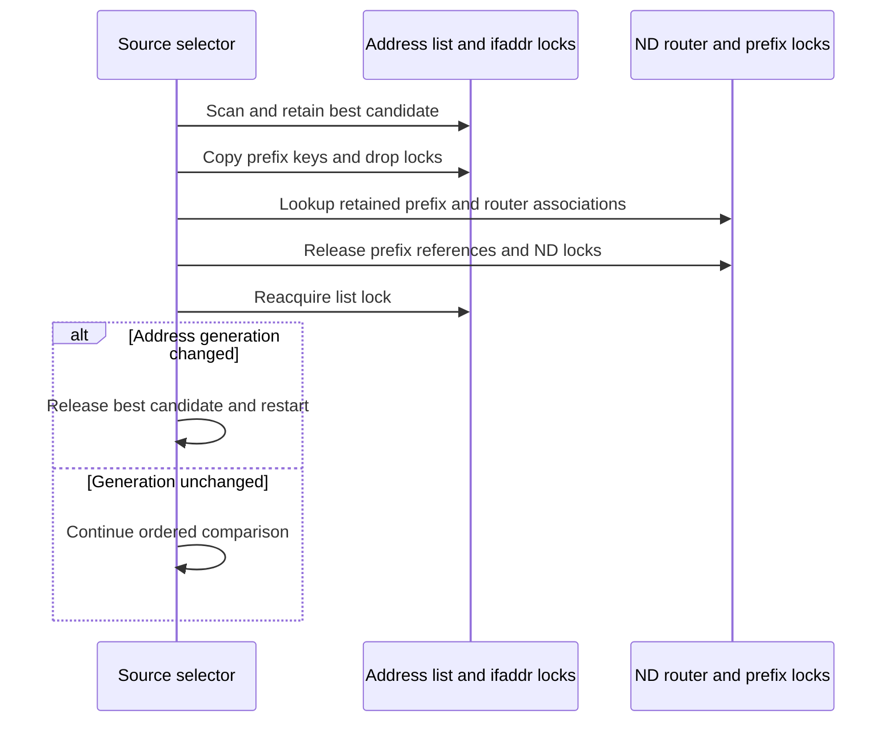

# IPv6 scopes, source-address selection and route-cache ownership

An IPv6 send needs both a local source address and a usable outgoing interface. They are related decisions, but neither an address nor a route alone identifies all the state needed to send. This chapter follows the scoped-address representations, candidate ranking and reference transfers in `in6_src.c` and `scope6.c` for `xnu-12377.121.6`.

Start with the [IPv6 guide](ipv6.md) and [networking overview](README.md). Address creation and validity are covered in [address configuration and DAD](ipv6-addresses-autoconfiguration-and-dad.md); the selected router and prefix relationships come from [router advertisements](ipv6-router-advertisements-and-prefix-lifetime.md). Continue into [socket operations](ipv6-sockets-and-packet-options.md) and [packet output](ipv6-output-and-neighbor-discovery.md).

## Three different meanings of interface selection

| Representation | What it answers | Source |
| --- | --- | --- |
| `sockaddr_in6.sin6_scope_id` | Which zone disambiguates a scoped address supplied through the socket API? | [`sa6_embedscope()`](../../../platydoc-data/xnu/bsd/netinet6/scope6.c#L218-L258) |
| `scope6_id.s6id_list[]` attached to an interface | Which zone does this interface belong to for a particular address scope? Interface-local and link-local entries start with the interface index. | [`scope6_ifattach()`](../../../platydoc-data/xnu/bsd/netinet6/scope6.c#L97-L118) |
| `inp_lifscope`, `inp_fifscope` | Separate local/foreign address scope identifiers in the shared Internet PCB, used when scoped address bytes do not contain the zone. | [`struct inpcb`](../../../platydoc-data/xnu/bsd/netinet/in_pcb.h#L166-L208) |
| `ip6_out_args.ip6oa_boundif` and `IP6OAF_BOUND_IF` | Which interface constrains route lookup for this operation? This can constrain a global destination too. | [`in6_selectsrc()`](../../../platydoc-data/xnu/bsd/netinet6/in6_src.c#L734-L797) |
| `in6_pktinfo.ipi6_ifindex` | Per-packet or sticky outgoing-interface selection, also used to interpret an explicitly supplied source. | [`selectroute()`](../../../platydoc-data/xnu/bsd/netinet6/in6_src.c#L1012-L1093) |
| `route_in6` and its `ro_rt`/`ro_srcia` | Cached forwarding result and retained source-interface address used to validate that result. | [cache validation and publication](../../../platydoc-data/xnu/bsd/netinet6/in6_src.c#L1100-L1405) |

For example, `fe80::1234` on interface 7 and the same bytes on interface 9 are different link-local endpoints. A global destination does not need this link-local zone distinction, but a bound interface can still constrain which route reaches it. Do not treat `sin6_scope_id` as a universal replacement for socket interface binding.

### Embedded and separate scope representations

`in6_embedded_scope` is initialized to 1 in this tree. In this mode, link-local/interface-local addresses use the second 16-bit address word to carry an internal zone. `sa6_embedscope()` validates a supplied/default zone against the interface table, writes that word, and clears the external `sin6_scope_id`; `sa6_recoverscope()` performs the reverse conversion. When embedded mode is disabled, code must carry and compare a separate scope identifier. See [configuration](../../../platydoc-data/xnu/bsd/netinet6/scope6.c#L70-L90), [embedding](../../../platydoc-data/xnu/bsd/netinet6/scope6.c#L218-L258) and [recovery](../../../platydoc-data/xnu/bsd/netinet6/scope6.c#L283-L334).

Illustrative example, with interface index 7: external `fe80::1234` plus `sin6_scope_id = 7` becomes internal `fe80:7::1234` in embedded mode. This is an internal lookup representation, not an address to transmit. `in6_clearscope()` removes the internal word before output; the wire header again contains `fe80::1234`. The exact output calls are [here](../../../platydoc-data/xnu/bsd/netinet6/ip6_output.c#L1473-L1478).



The equality helper makes the two representations explicit. [`scope6.c:475–484`](../../../platydoc-data/xnu/bsd/netinet6/scope6.c#L475-L484):

<!-- source-excerpt: ../../../platydoc-data/xnu/bsd/netinet6/scope6.c#L475-L484 -->
```c
in6_are_addr_equal_scoped(const struct in6_addr *addr_a, const struct in6_addr *addr_b, uint32_t ifscope_a, uint32_t ifscope_b)
{
	if (!IN6_ARE_ADDR_EQUAL(addr_a, addr_b)) {
		return false;
	} else if (IN6_IS_SCOPE_EMBED(addr_a) && !in6_embedded_scope) {
		return ifscope_a == ifscope_b;
	}

	return true;
}
```

`in6_setscope()` derives a zone using the chosen interface; it rejects loopback address `::1` on a non-loopback interface and checks the interface's IPv6 state before using its scope table. This is separate from `in6_embedscope()`, the transport helper that resolves competing API inputs: a packet-info interface takes precedence, followed by the multicast interface when applicable, then a supplied destination zone. Read [interface-to-zone conversion](../../../platydoc-data/xnu/bsd/netinet6/scope6.c#L387-L449) and [transport input normalization](../../../platydoc-data/xnu/bsd/netinet6/in6_src.c#L2209-L2320). A non-NULL interface returned by the latter is referenced; callers must release it.

## Source selection has three entry cases

`in6_selectsrc()` accepts destination sockaddr, packet options, optional PCB, route cache, optional returned interface, caller-owned source storage and a bound-interface index. It can return a pointer into the supplied storage **or into the PCB**. A caller must not free the returned address pointer or assume its lifetime is independent of the socket. The three cases are visible in [the implementation](../../../platydoc-data/xnu/bsd/netinet6/in6_src.c#L734-L910):

1. **Explicit nonzero packet-info source.** Select an outgoing interface, apply its zone to the requested address, and look up a real local interface-address object. Reject anycast, not-ready or CLAT46 addresses and a prohibited socket/interface combination. Copy the accepted address to the caller's storage, then release the address reference.
2. **Already-bound PCB source.** Return `&inp->in6p_laddr`. This path does not rerun the general candidate-ranking loop. Later route/output checks can still reject the send.
3. **No source yet.** Find an outgoing interface with `in6_selectif()`, choose the temporary-address preference from the per-packet option or system setting, and run `in6_selectsrc_core()`. The returned source interface is checked against socket restrictions before the result is accepted.

The bound-source branch is deliberately short. [`in6_src.c:852–858`](../../../platydoc-data/xnu/bsd/netinet6/in6_src.c#L852-L858):

<!-- source-excerpt: ../../../platydoc-data/xnu/bsd/netinet6/in6_src.c#L852-L858 -->
```c

	/*
	 * Otherwise, if the socket has already bound the source, just use it.
	 */
	if (inp != NULL && !IN6_IS_ADDR_UNSPECIFIED(&inp->in6p_laddr)) {
		src_storage = &inp->in6p_laddr;
		goto done;
```

The explicit-source and automatically ranked paths have different eligibility predicates; do not substitute one for the other when explaining deprecated, detached or optimistic addresses. The general loop's filters are [here](../../../platydoc-data/xnu/bsd/netinet6/in6_src.c#L322-L396), whereas the explicit-source check is [here](../../../platydoc-data/xnu/bsd/netinet6/in6_src.c#L830-L850).

`in6_selectif()` can use a temporary route if the caller has none. It rejects reject/blackhole routes even during source selection and translates a loopback route to the interface owning the route's address when appropriate. It releases the temporary route before returning while preserving the separate returned interface reference. A returned interface can be non-NULL **on error**, so the error path must release it too. See [the wrapper and cleanup](../../../platydoc-data/xnu/bsd/netinet6/in6_src.c#L1524-L1588).

## The candidate loop is an ordered decision procedure

`in6_selectsrc_core()` scans the global `in6_ifaddrhead` under `in6_ifaddr_rwlock`, taking each address's `ifa_lock` to inspect its fields. It retains the current best candidate across iteration. It first excludes addresses that cannot serve the request: mismatched CLAT46 purpose, incompatible source/destination zones, not-ready/anycast/detached addresses, disallowed deprecated addresses, and disallowed optimistic DAD candidates. See [setup and admission](../../../platydoc-data/xnu/bsd/netinet6/in6_src.c#L272-L396).

`ip6_select_src_strong_end` defaults to 1, restricting candidates to the outgoing interface before ranking. When it is disabled, eligible addresses from other interfaces can reach the ranking rules. This switch changes the candidate set; it is not merely a small preference adjustment. See [the tunable](../../../platydoc-data/xnu/bsd/netinet6/in6_src.c#L151-L154) and [the filter](../../../platydoc-data/xnu/bsd/netinet6/in6_src.c#L327-L350).

| Order in the body | Decision and consequence |
| --- | --- |
| Same address | An eligible source identical to the destination wins immediately. |
| Appropriate scope | Prefer a source whose scope is sufficient for the destination; compare broader/narrower choices according to the destination's scope. |
| Avoid deprecated, then optimistic | Prefer a usable preferred address over a deprecated one, then a non-optimistic address over an optimistic one. These are distinct tests. |
| Home-address rule | Appears as an unimplemented TODO; do not invent a Mobile IPv6 selection step. |
| Outgoing interface | Matters when strong-end filtering was disabled and more than one interface supplied candidates. |
| Advertising next-hop prefix | Prefer an address whose prefix is associated with the selected default router, when the router/prefix comparison is applicable. |
| Matching policy label | Compare the source and destination labels obtained from the address-policy table. |
| Temporary-address preference | Apply the system or packet-specific temporary-versus-public preference. This does not override earlier decisions. |
| Alive interface | Apply the interface liveness preference in the implementation. |
| Longest matching prefix | Break remaining ties by source/destination common-prefix length. |

These are ordered comparisons with jumps to retain/replace the best candidate, not a summed numerical score. The code and source-rule counters are [in6_src.c:397–646](../../../platydoc-data/xnu/bsd/netinet6/in6_src.c#L397-L646). The optional expensive-secondary-interface policy is applied in later replacement/final-selection branches; the immediate same-address winner bypasses that later path. It should not be described as an unconditional early eligibility filter. See [replacement and final return](../../../platydoc-data/xnu/bsd/netinet6/in6_src.c#L648-L724).

### Worked source-choice example

Assume strong-end mode, outgoing interface 7, a global destination, and three valid same-scope addresses on interface 7: a deprecated stable address A, a preferred stable address B and a preferred temporary address C. If earlier router-prefix and policy-label comparisons tie, A loses to a preferred address; the temporary-address preference chooses between B and C before the longest-prefix comparison. Changing the socket's explicit source to A takes the explicit-source path instead, with that path's validation, rather than asking the general ranking loop to choose A.

This is an illustrative ordering example, not a claim that every deployed configuration has these three addresses or that a temporary address always wins. Address creation, deprecation and validity come from the [address-lifetime chapter](ipv6-addresses-autoconfiguration-and-dad.md); source selection consumes those flags.

### Router-prefix comparison must drop locks and restart

Rule 5.5 needs ND router/prefix objects while iterating interface addresses. The code copies the relevant prefix keys, drops the address locks, takes the ND locks and references, checks `pfxrtr_lookup()`, releases the prefix references and ND locks, then reacquires the address-list lock. It compares `in6_ifaddrlist_genid` because a retained best-address reference does not guarantee that the list being traversed stayed unchanged. The selected router reference remains held until the core function's final cleanup. On a generation change, it drops the best address reference and restarts. See [the full handoff](../../../platydoc-data/xnu/bsd/netinet6/in6_src.c#L460-L560).

[`in6_src.c:533–545`](../../../platydoc-data/xnu/bsd/netinet6/in6_src.c#L533-L545):

<!-- source-excerpt: ../../../platydoc-data/xnu/bsd/netinet6/in6_src.c#L533-L545 -->
```c
			lck_rw_lock_shared(&in6_ifaddr_rwlock);
			if (genid != os_atomic_load(&in6_ifaddrlist_genid, acquire)) {
				SASEL_LOG("Address list seems to have changed. Restarting source "
				    "address selection.\n");
				genid = in6_ifaddrlist_genid;
				/*
				 * We are starting from scratch. Free up the reference
				 * on ia_best and also reset it to NULL.
				 */
				ifa_remref(&ia_best->ia_ifa);
				ia_best = NULL;
				goto addrloop;
			}
```



## Policy labels are not a user-space destination sort

`addrsel_policy_init()` builds entries including loopback, the default IPv6 prefix, mapped IPv4, 6to4 and other classified prefixes. `in6_addrsel_lookup_policy()` calls a longest-mask-prefix matcher and increments the selected entry's use counter. The source selector uses the **label** relation between a candidate and its destination; the table's `preced` member is not a general destination-ordering implementation inside this loop. See [initialization](../../../platydoc-data/xnu/bsd/netinet6/in6_src.c#L1857-L2018) and [lookup](../../../platydoc-data/xnu/bsd/netinet6/in6_src.c#L2021-L2079).

The policy ioctl names do not establish a working mutation API. `in6_src_ioctl()` validates the command, label and mask, normalizes trailing prefix bits, then returns `ENOTSUP` for both add and delete. That boundary matters when tracing an ioctl catalog into its implementation. See [the complete handler](../../../platydoc-data/xnu/bsd/netinet6/in6_src.c#L2159-L2193).

## Route selection reuses state only after validation

`in6_selectroute()` is a wrapper around `selectroute()`. The same internal routine serves `in6_selectif()`, with a flag allowing certain interface-only results without a full forwarding route. The source file explicitly assumes serialized output per PCB when changing route-cache flags; it is not a lock-free cache. See [contract](../../../platydoc-data/xnu/bsd/netinet6/in6_src.c#L913-L932) and [wrappers](../../../platydoc-data/xnu/bsd/netinet6/in6_src.c#L1524-L1608).

The major decisions are:

1. Reject an unspecified destination. Interpret an explicit packet-info interface, multicast interface, bound-interface scope and destination scope. Some interface-only multicast requests can finish here.
2. If source-interface selection is requested, find an address object owning the source. Reuse `ro_srcia` only with a usable cache and the matching source-selection state; otherwise perform a scoped lookup. Explicitly bound global routes have special cases, including the NAT66 rationale in the source, so ownership is not a universal one-line equality check.
3. If `IPV6_NEXTHOP` supplied a next hop, require an IPv6, directly usable neighbor route (`RTF_LLINFO`) and use the option's own next-hop route cache. A next-hop override is not permission to supply an arbitrary recursive gateway.
4. Validate the destination route against family, scoped destination, interface, source selection and route generation. IPv4 and IPv6 share a PCB route union, so an old IPv4 cache entry must not be interpreted as a valid IPv6 sockaddr.
5. Release unusable cached references, look up an appropriate scoped route, recheck interface/source ownership and publish retained source-address state plus the generation used for validation.
6. Apply the helper's interface restrictions and IPv6-disabled check, returning an interface-denied indication or error where appropriate.

These branches are [input/interface choice](../../../platydoc-data/xnu/bsd/netinet6/in6_src.c#L931-L1115), [source and explicit-next-hop handling](../../../platydoc-data/xnu/bsd/netinet6/in6_src.c#L1116-L1267), [destination-cache replacement](../../../platydoc-data/xnu/bsd/netinet6/in6_src.c#L1268-L1421), and [final restrictions/returns](../../../platydoc-data/xnu/bsd/netinet6/in6_src.c#L1423-L1517).

Read `CHECK_RESTRICTIONS` literally in this snapshot: cellular, expensive, constrained and internal-coprocessor terms are joined by `||`, while the final AWDL, management and ultra-constrained terms are joined by `&&`. It must not be summarized as seven independent OR-ed denials or silently replaced with another helper's policy predicate. This is a source-level observation, not a runtime claim about which interface flag combinations a product creates. See [the exact macro](../../../platydoc-data/xnu/bsd/netinet6/in6_src.c#L1427-L1440).

### References returned by these helpers

| Result | Ownership rule |
| --- | --- |
| `retifp` from `selectroute()` / `ifpp` from source selection | Non-NULL carries an interface reference, including certain error returns. Release with `ifnet_release()`. |
| `retsrcia` from route selection | Optional separate retained address reference; caller releases it. |
| `retrt` | Returned only on success, borrowed from the route-cache ownership established by the operation; this assignment does not itself acquire another route reference. |
| `ro->ro_rt`, `ro->ro_srcia` | Cache-owned references, released/replaced by route-cache operations. |
| Best candidate in `in6_selectsrc_core()` | Retained during comparison; released at return unless explicitly transferred through the address-result variant. The ordinary API copies its address bytes. |

The decisive cleanup/assignment code is [in6_src.c:1460–1517](../../../platydoc-data/xnu/bsd/netinet6/in6_src.c#L1460-L1517), with [core return ownership](../../../platydoc-data/xnu/bsd/netinet6/in6_src.c#L674-L724). UDP uses [`in6p_route_copyout()` / `in6p_route_copyin()`](../../../platydoc-data/xnu/bsd/netinet6/in6_pcb.c#L1680-L1707) around output while the socket lock is dropped. A route reference keeps storage alive; generation and content checks establish whether it remains a suitable forwarding result.

## Boundaries and useful follow-up checks

This chapter reconstructs selection and lifetime from local code. It does not claim an RFC conformance test, a product's sysctl defaults beyond the initializers shown, or complete behavior of NECP, translators and external interface providers. The in-tree [`in6_selectsrc` test](../../../platydoc-data/xnu/tests/net/in6_selectsrc.c#L54-L100) is a connect/setsockopt lifetime regression exercise; its name does not make it an assertion suite for the ranking rules. No network test was run for this documentation.

<!-- BEGIN PLATYDOC DOCUMENTATION LICENSE -->
Original Platydoc text and diagrams are licensed under [CC BY 4.0](https://creativecommons.org/licenses/by/4.0/). Quoted source code and third-party material retain their respective licenses.
<!-- END PLATYDOC DOCUMENTATION LICENSE -->
