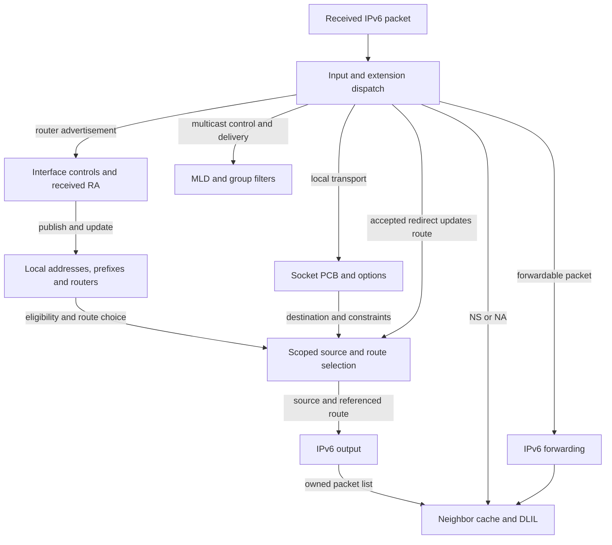

# IPv6: configuration, packet paths and object lifetime

IPv6 in XNU is a family of cooperating mechanisms: interface addresses and their validity, advertised routers and prefixes, scoped route/source selection, transport PCBs, packet parsing/output, neighbor reachability and multicast membership. These chapters explain the classic BSD implementation in `xnu-12377.121.6`, following actual state and ownership rather than treating IPv6 as one protocol function.

[Networking overview](README.md) · [Internet PCBs](internet-pcbs-ports-and-lifetime.md) · [Packets, routes and interfaces](packets-routes-and-interfaces.md) · [Complete contents](../../table-of-contents.md)

## Reading order

| Chapter | Main operation and decisions |
| --- | --- |
| [Addresses, autoconfiguration and DAD](ipv6-addresses-autoconfiguration-and-dad.md) | Interface attach and address ioctls; address publication; link-local, stable and temporary addresses; tentative/optimistic state, duplicate detection, deprecation, expiry and purge. |
| [Router advertisements and prefix lifetime](ipv6-router-advertisements-and-prefix-lifetime.md) | RA validation, default-router and RIO handling, on-link versus autonomous prefixes, address lifetimes, reachability-driven selection and independent object cleanup. |
| [Scopes, source selection and route ownership](ipv6-source-selection-and-scopes.md) | External/embedded/separate zones, explicit versus ranked source choice, prefix/router preference, lock-drop restart, route-cache validation and references. |
| [Sockets and packet options](ipv6-sockets-and-packet-options.md) | Native/mapped PCBs, bind/connect/port publication, sticky and ancillary options, UDP send/receive, controls, raw and datagram ICMPv6 admission. |
| [Input, extension headers and forwarding](ipv6-input-extension-headers-and-forwarding.md) | Receive dispatch, local/forward classification, parser offsets, hop-by-hop/destination/routing/fragment handlers, policy hooks, hop limit, MTU and error ownership. |
| [Output and neighbor handoff](ipv6-output-and-neighbor-discovery.md) | Header composition, MTU and checksum/offload choices, numeric fragmentation example, packet-list cleanup, unresolved-neighbor holds and resubmission. |
| [Neighbor messages and reachability](ipv6-neighbor-messages-and-reachability.md) | NS/NA validation and generation, solicited/override/router flags, NUD transitions and timers, route/lock handoffs, link-layer observations and redirects. |
| [Multicast membership and MLD](ipv6-multicast-membership-and-mld.md) | Socket source filters versus interface aggregates, join/leave transactions, MLDv1/v2 queries/reports, timer/output queues, fanout and final-leave ownership. |
| [IP reassembly and ICMP feedback](ip-fragment-reassembly-and-icmp.md) | Existing shared IPv4/IPv6 companion: fragment queues and invalidation, timer reclamation, quoted-header parsing and UDP/TCP/PMTU feedback. |

The output chapter retains a short ND lifetime trace so a send can be read end to end. The neighbor chapter supplies the detailed message/state decisions; the configuration chapters supply DAD and advertised prefix/router behavior. This separation avoids mixing three different reasons for receiving an ICMPv6 packet.

The [structure layout browser](../../structures/layout-browser.md?declaration=ip6_hdr) includes IPv6 address and packet headers, socket options, route caches, neighbor discovery and multicast records. Each companion below links its supported structures directly. The browser reports field offsets in the selected C declaration; for packet headers, interpreting multi-byte values also requires the protocol’s byte order.

## Objects that must not be conflated

| Object | Owns or represents | Does not establish by itself |
| --- | --- | --- |
| `in6_ifaddr` | A local address, its flags, deadlines and associated prefix/interface state | A usable default route or a known next-hop link-layer address |
| `nd_prefix` | A received/configured prefix with on-link/autonomous/lifetime and advertiser relationships | One address per prefix, or an always-installed on-link route |
| `nd_defrouter` / RIO router state | An advertised router and selection/lifetime information | A complete neighbor cache record or permission to use every advertised option |
| `route_in6` / `rtentry` | Cached route result and referenced forwarding/interface/address state | That the cache is still valid after a lock drop or policy change |
| `llinfo_nd6` | Neighbor-resolution/reachability state, retries, expiry and a held packet list | A local address or an RA prefix; a successful send call may only have populated its hold |
| `inpcb` | Socket endpoint tuple/scopes, policy, options, route cache and lifecycle | One dedicated IPv6 allocation type; `in6pcb` aliases the common structure |
| `ip6_moptions`, `in6_mfilter`, `in6_multi` | Socket membership/filter state and shared interface/group aggregate | One MLD report per socket or identical commit timing at all layers |
| `mbuf` | Packet data and metadata, with `m_next` for pieces and `m_nextpkt` for packet lists | A userspace address or hardware DMA mapping |

Definitions and implementation anchors: [`in6_ifaddr`](../../../xnu/bsd/netinet6/in6_var.h), [ND objects](../../../xnu/bsd/netinet6/nd6.h), [common PCB](../../../xnu/bsd/netinet/in_pcb.h#L166-L231), [IPv6 options](../../../xnu/bsd/netinet6/ip6_var.h#L183-L250), [multicast state](../../../xnu/bsd/netinet6/in6_var.h), and [mbuf layout](../../../xnu/bsd/sys/mbuf.h). Each companion links the particular fields and branches used in its explanation.

The diagram shows state effects as well as packet calls; the redirect arrow represents a route update, not a new source-selection request. NS/NA update neighbor state, RA updates router/prefix/address state, and MLD updates membership/report state through distinct handlers; none is a generic “update IPv6” callback. [Protocol registration](../../../xnu/bsd/netinet6/in6_proto.c#L164-L267), [ICMPv6 dispatch](../../../xnu/bsd/netinet6/icmp6.c) and the detailed receive chapters establish those actual calls.

## One host operation across the chapters

Consider an illustrative host with interface index 7, a link-local address and an advertised global prefix. Interface configuration publishes address objects; DAD controls whether an address remains tentative or becomes usable. An accepted RA can update several independently owned records: interface ND parameters, a default router, a prefix, a prefix/router association, an on-link route and one or more autoconfigured addresses. A later failure does not necessarily undo the earlier updates. The address and RA chapters follow these boundaries.

A UDP socket sends to a global destination. Binding or the first send allocates a local port. The source selector distinguishes an explicit source from a bound source and from automatic ranking, using the outgoing interface, address validity, policy labels and router/prefix relationships. The route cache owns references but must still be validated. UDP builds IPv6/UDP bytes, copies route ownership for unlocked output and records delayed checksum work. Output applies options, scopes, policy and MTU decisions before passing packet ownership to ND.

If the selected router's link-layer address is unknown, ND can retain the packet list and send a solicitation. A later valid advertisement can detach and resubmit it; another send may replace the held list, and timeout may discard it. Thus a zero return from the original send does not prove that the router received data. On reply, input validates headers and walks extensions, fragment processing may retain the packet until reassembly completes, and UDP looks up a scoped tuple with wanted-reference protection before appending payload plus source/control information to the socket buffer.

At teardown, socket options/routes/multicast ownership, address objects, prefix/router objects and neighbor routes have separate release paths. Deleting a logical endpoint, expiring an advertised lifetime and freeing the final referenced storage are distinct events. The companion chapters explain where references survive lock drops, callbacks and timers.

## Source map and coverage limits

| Source group | Mechanism followed here |
| --- | --- |
| `in6.c`, `in6_ifattach.c`, `nd6_nbr.c` | Interface/address control, stable/privacy construction, DAD and lifetime cleanup |
| `nd6_rtr.c`, `nd6_rti.c`, `nd6.c` | RA options, default and route-information routers, prefixes, ND service and route integration |
| `scope6.c`, `in6_src.c`, `in6_pcb.c` | Address representation, ranked source/route selection, PCB/port publication and references |
| `in6_proto.c`, `udp6_usrreq.c`, `udp6_output.c`, `raw_ip6.c` | Protocol callbacks, socket options, transport headers, demultiplexing and raw delivery |
| `ip6_input.c`, `dest6.c`, `route6.c`, `ip6_forward.c`, `ip6_output.c` | Parser and forwarding control, header construction, checksums, MTU and fragmentation |
| `frag6.c`, `icmp6.c` | Reassembly, control dispatch, errors, quoted packets and PMTU feedback |
| `in6_mcast.c`, `mld6.c` | Socket/group filters, MLD state, queries/reports, timers and teardown |

This is source-reviewed coverage of selected implementations, not a claim that every branch or configuration in `bsd/netinet6` has been audited or exercised. In particular:

- DHCPv6 daemons, resolver/address-destination sorting, router software and concrete device/firmware behavior are not reconstructed from kernel call sites.
- Classic BSD IPv6 and Skywalk packet paths share mechanisms but differ in ownership and entry points; use the [flowswitch](skywalk-flowswitch-classification-routes-and-datapaths.md), [fragment/offload](skywalk-fragments-reassembly-and-flow-tracking.md) and [netif](skywalk-netif-links-queues-and-scheduling.md) chapters for those paths.
- NECP, PF, IPsec, translation, encapsulation and proxy/offload hooks are identified where encountered; every policy, tunnel, NAT64/CLAT46 and platform-provider variant is not expanded here. See [policy extensions](policy-extensions.md).
- Static inspection cannot establish external interoperability, timing behavior or every concurrent teardown. In-tree test references describe what their bodies actually assert; no network tests were executed for this expansion.

Several current-source distinctions deserve special care: routing-header setter acceptance versus output rejection, embedded versus separate zones, independent address/prefix/router deadlines, nontransactional option/filter updates, and report-state commit versus successful packet transmission. Those are explained beside their source evidence rather than hidden behind a generic standards description.

<!-- BEGIN PLATYDOC DOCUMENTATION LICENSE -->
Original Platydoc text and diagrams are licensed under [CC BY 4.0](https://creativecommons.org/licenses/by/4.0/). Quoted source code and third-party material retain their respective licenses.
<!-- END PLATYDOC DOCUMENTATION LICENSE -->
