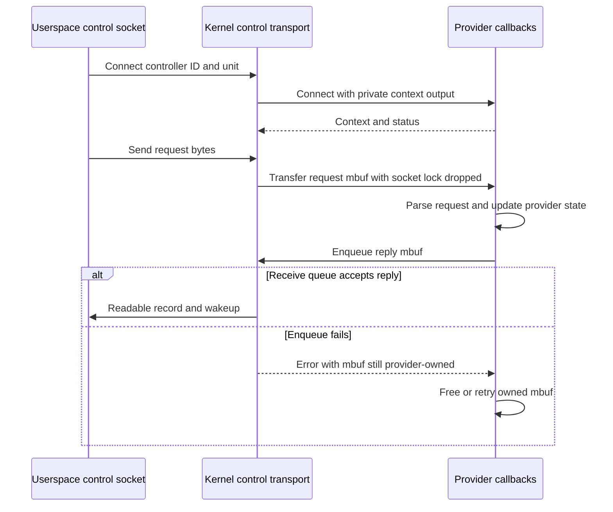

# Kernel control sockets and network statistics subscriptions

[Networking](README.md) · [Socket ownership](socket-lifecycle-and-io.md) · [Internet PCB lifetime](internet-pcbs-ports-and-lifetime.md) · [Policy consumers](policy-extensions.md)

A kernel control socket connects a userspace socket to a registered kernel callback table. It does not use an Internet port or a Mach port. XNU's NetworkStatistics service (`ntstat.c`) is a concrete consumer: requests select providers and subscribe to source objects, and replies/events arrive in the control socket's receive queue. This chapter traces both layers in `xnu-12377.121.6`.

## Registration, naming and per-connection identity

[`kern_ctl_reg`](../../../xnu/bsd/sys/kern_control.h#L356) supplies the controller name, flags, buffer sizes and setup/bind/connect/disconnect/send/option callbacks. [`ctl_register()`](../../../xnu/bsd/kern/kern_control.c#L1658) validates the registration, requires a connect callback, creates a `kctl`, chooses or validates an ID, and publishes the controller under `ctl_mtx`. Dynamic registrations require a unique name. Registration creates a provider, not a client connection.

| Object | Identity and lifetime |
| --- | --- |
| [`kctl`](../../../xnu/bsd/kern/kern_control.c#L64) | Registered provider: name, numeric ID, flags, callback table and connected `ctl_cb` list. `kern_ctl_ref` is its checked API reference. |
| [`ctl_cb`](../../../xnu/bsd/kern/kern_control.c#L101) | One socket's control PCB, with mutex, socket pointer, selected provider, `sockaddr_ctl`, provider `userdata` and in-flight/clearing counters. |
| `sockaddr_ctl` | `sc_id` selects a controller; `sc_unit` selects or requests a connection unit within it. It is not a TCP/UDP address. |
| Socket receive/send buffers | Transport buffering for provider messages and generic descriptor readiness/receive operations. |

The userspace discovery route uses a system control socket and `CTLIOCGINFO` to resolve a registered name to an ID; [`ctl_ioctl()`](../../../xnu/bsd/kern/kern_control.c#L1442) implements that lookup. The returned ID is then supplied in the control address. The provider's callback protocol determines what message bytes mean after connection.

## Connecting safely while callbacks run without the socket lock

[`ctl_setup_kctl()`](../../../xnu/bsd/kern/kern_control.c#L425) checks the control address size, finds the controller by ID/unit, verifies stream versus datagram compatibility, and enforces `CTL_FLAG_PRIVILEGED` when set. A provider-specific setup callback can choose a unit/private context. Otherwise explicit unit conflicts fail or an unused unit is chosen from the ordered connection list. It links the connection, reserves socket buffers, and removes the association again if reservation fails.

[`ctl_connect()`](../../../xnu/bsd/kern/kern_control.c#L589) coordinates destructive/exclusive transitions with the `kcb_usecount` and `require_clearing_count` helpers. Ordinary callback activity waits while clearing is required; the clearing operation waits for other active operations. These counters solve callback concurrency independently from the receive queue's buffering and from the provider's own locks. See [the helper protocol](../../../xnu/bsd/kern/kern_control.c#L350-L388).

After setup, connect marks the socket connecting, drops its lock, invokes the provider's connect callback with `&userdata`, and reacquires the lock before publishing connected state. A failed provider connect can invoke disconnect for partial cleanup, then removes controller membership and clears unit/provider state. Therefore a provider must support failure cleanup as well as ordinary close.

[`bsd/kern/kern_control.c:618–625`](../../../xnu/bsd/kern/kern_control.c#L618-L625):

<!-- source-excerpt: ../../../xnu/bsd/kern/kern_control.c#L618-L625 -->
```c
	soisconnecting(so);
	socket_unlock(so, 0);
	error = (*kcb->kctl->connect)(kcb->kctl->kctlref, &kcb->sac, &kcb->userdata);
	socket_lock(so, 0);
	if (error) {
		goto end;
	}
	soisconnected(so);
```

## Sending and receiving have different buffer contracts

[`ctl_send()`](../../../xnu/bsd/kern/kern_control.c#L803) discards unsupported ancillary control data, validates the connection and records in-flight use. With a send callback, it drops the socket lock and transfers the data mbuf to that callback. Without a usable provider/callback it frees the mbuf and reports an error. A callback's nonzero return does not give the original socket layer permission to free the already-transferred mbuf again.

The reverse direction uses [`ctl_enqueuembuf()`](../../../xnu/bsd/kern/kern_control.c#L988): find the socket from provider reference/unit, obtain its lock/reference, test receive capacity, set record-end flags if requested, and append with `sbappend_nodrop()`. **On failure this API leaves the supplied mbuf with its caller.** On success receive-buffer ownership replaces provider ownership, and wakeup can be suppressed by `CTL_DATA_NOWAKEUP` for batching.

[`bsd/kern/kern_control.c:1001–1018`](../../../xnu/bsd/kern/kern_control.c#L1001-L1018):

<!-- source-excerpt: ../../../xnu/bsd/kern/kern_control.c#L1001-L1018 -->
```c
	if (ctl_rcvbspace(so, len, kctlflags, flags) != 0) {
		error = ENOBUFS;
		OSIncrementAtomic64((SInt64 *)&kctlstat.kcs_enqueue_fullsock);
		goto bye;
	}
	if ((flags & CTL_DATA_EOR)) {
		m->m_flags |= M_EOR;
	}

	so_recv_data_stat(so, m, 0);
	if (sbappend_nodrop(&so->so_rcv, m) != 0) {
		if ((flags & CTL_DATA_NOWAKEUP) == 0) {
			sorwakeup(so);
		}
	} else {
		error = ENOBUFS;
		OSIncrementAtomic64((SInt64 *)&kctlstat.kcs_enqueue_fullsock);
	}
```

[`ctl_enqueuedata()`](../../../xnu/bsd/kern/kern_control.c#L1170) instead accepts raw kernel bytes and constructs transport storage internally. Critical-message flags and the controller's critical registration participate in admission policy; they do not make allocations or receive queues infallible.



## Ntstat installs that transport and adds a provider/source model

[`nstat_client_register()`](../../../xnu/bsd/net/ntstat.c#L5881) fills a control registration with `nstat_client_connect`, `nstat_client_disconnect` and `nstat_client_send`. Its flags include extended and critical support. It does not set the transport's privileged flag here; applicable reporting and provider filters must be read at their actual checks rather than inferred from the word “kernel.”

[`nstat_client_connect()`](../../../xnu/bsd/net/ntstat.c#L5935) allocates client state, initializes the per-client request mutex, saves provider reference/unit and process details, publishes the client under the global ntstat lock and schedules idle maintenance when needed.

| Ntstat object | Relationship |
| --- | --- |
| [`nstat_client`](../../../xnu/bsd/net/ntstat.c#L532) | One connected observer: source queue, subscriptions/filter masks, accumulated output, request mutex and continuation context/sequence. |
| [`nstat_provider`](../../../xnu/bsd/net/ntstat.c#L558) | Callback table for lookup, gone/counts/details/descriptor queries, watcher add/remove, cookie release and reporting filters. Route, kernel TCP/UDP, interface and userland-reporting providers differ. |
| [`nstat_src`](../../../xnu/bsd/net/ntstat.c#L575) | A source as seen by a particular client: client-visible `nts_srcref`, provider pointer, provider-private cookie and links into client/locus queues. |
| [`nstat_sock_locus`](../../../xnu/bsd/net/ntstat.c#L1818) | Shared kernel-socket reporting state, tied to an `inpcb` and potentially several observing sources. |

A source reference in a message is client-scoped reporting identity, not a raw PCB pointer or socket fd. The provider cookie is kernel-private and interpreted by its selected provider.

## Request dispatch and adding a source

[`nstat_client_send()`](../../../xnu/bsd/net/ntstat.c#L7684) validates header availability, copies a split header when necessary, normalizes the legacy length/flags case and takes `ntc_user_mtx` to serialize client requests. It dispatches add one/all sources, remove, counts query, descriptor, update/details and system-information subscription requests. On error it may prepend an error record to the request mbuf and try to enqueue it, or construct a separate error message; every path accounts for the request's final owner.

[`nstat_client_handle_add_request()`](../../../xnu/bsd/net/ntstat.c#L6776) validates bounded parameter length, copies noncontiguous parameter bytes if needed, calls provider lookup, sanitizes the resulting cookie for the client, and attempts publication. If publication fails, the provider's release callback relinquishes the acquired cookie. Not all provider methods support all requests: [`nstat_tcp_lookup()`](../../../xnu/bsd/net/ntstat.c#L2015) explicitly returns `ENOTSUP` for lookup of a particular connection. Subscription/watch creation supplies a different route to observing kernel TCP sources.

[`nstat_client_source_add()`](../../../xnu/bsd/net/ntstat.c#L6929) allocates a source and client-visible reference under exclusive ntstat protection. When a source-added notification is required, it must enqueue successfully before linking the source into the client's list and optional locus list. On enqueue failure it frees both provisional source and still-owned message. The caller remains responsible for the cookie release contract. This keeps publication and announcement ordered while still exposing queue-capacity failure.

## Queries can make partial progress

[`nstat_client_handle_query_request()`](../../../xnu/bsd/net/ntstat.c#L7078) walks selected sources, applies provider reporting filters, and emits or accumulates counts. Allocation/queue failures can stop a query after some replies have been enqueued. The client can therefore observe partial output even when the request path reports a problem.

[`nstat_client_begin_query()`/`nstat_client_end_query()`](../../../xnu/bsd/net/ntstat.c#L7356-L7405) implement explicit continuation state. A new continuation context increments the client's sequence; per-source sequences prevent repeating already-reported entries for that continuation. If traversal is incomplete the result flags request another continuation. Replacing an unfinished context can report `EAGAIN` for the previous one. This is not a globally atomic snapshot of all networking state.

Counts, detailed counts and descriptors are distinct provider methods. A provider can report that its source is gone while supplying final counters; source removal and final delivery still need queue/error handling. [`nstat_idle_check()`](../../../xnu/bsd/net/ntstat.c#L5764) performs maintenance and deferred source cleanup, rather than keeping every no-longer-live source forever.

## PCB lifetime and observer teardown

[`nstat_sock_locus_alloc_internal()`](../../../xnu/bsd/net/ntstat.c#L1852) allocates socket reporting state and acquires a PCB wanted reference. Its paired [`nstat_sock_locus_release()`](../../../xnu/bsd/net/ntstat.c#L1914) releases that reference after freeing reporting state. This is another real consumer of the [PCB lifetime protocol](internet-pcbs-ports-and-lifetime.md), not just statistics counters embedded in a live socket.

[`nstat_pcb_detach()`](../../../xnu/bsd/net/ntstat.c#L2215) runs while endpoint information is still available. Under exclusive ntstat protection it sends goodbye data where possible, removes sources from client/locus linkage, removes the locus from protocol lists and clears `inp_nstat_locus`. It moves sources to a private dead list, drops the global lock, then invokes provider release/free cleanup and finally releases the locus's wanted reference. This ordering avoids doing all final release work while holding the global ntstat lock.

[`nstat_client_disconnect()`](../../../xnu/bsd/net/ntstat.c#L5976) similarly removes the observer, stops watchers, sets cleanup state, frees accumulated output and detaches sources under global protection; it frees the detached sources and process details afterward. The transport's [`ctl_disconnect()`](../../../xnu/bsd/kern/kern_control.c#L666) serializes clearing, invokes provider disconnect with the socket lock dropped and waits for relevant lookup users before unlinking controller membership. [`ctl_deregister()`](../../../xnu/bsd/kern/kern_control.c#L1814) returns `EBUSY` while connections remain rather than destroying a provider still in use.

## Limits

This chapter follows generic control transport and selected ntstat connection, request, reporting and teardown operations. It does not specify every NetworkStatistics message field/provider filter or userspace client behavior. Other control consumers such as content filters, flow diversion and tunnel providers supply different callback protocols. Their presence in the same transport does not imply shared private state, admission rules or message ownership beyond the transport API contract. No live privileged controller or statistics test was run.

<!-- BEGIN PLATYDOC DOCUMENTATION LICENSE -->
Original Platydoc text and diagrams are licensed under [CC BY 4.0](https://creativecommons.org/licenses/by/4.0/). Quoted source code and third-party material retain their respective licenses.
<!-- END PLATYDOC DOCUMENTATION LICENSE -->
