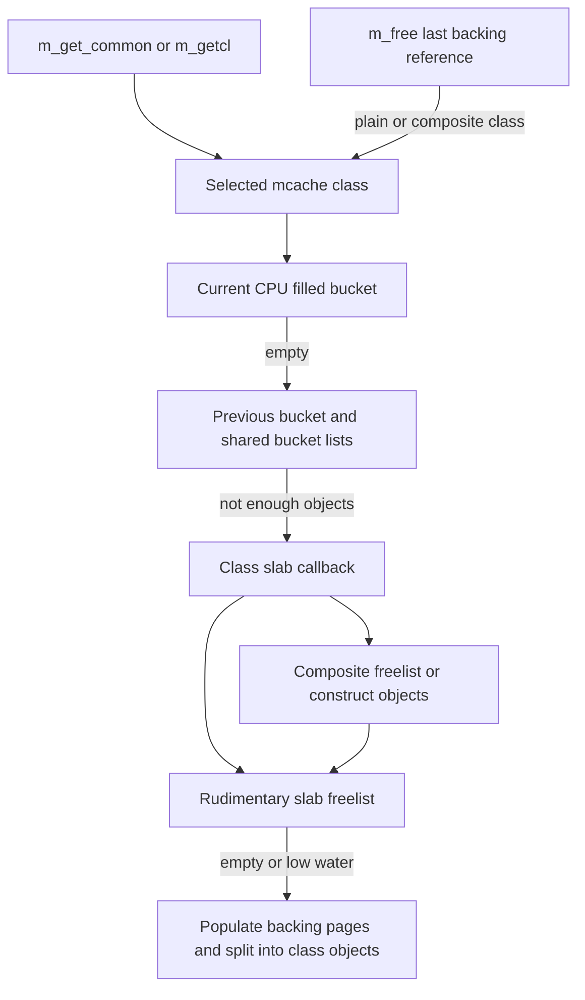

# Mbuf allocation classes, CPU caches and memory pressure

[Networking](README.md) · [Packet storage and sharing](packets-routes-and-interfaces.md) · [Kernel allocation](../vm/kernel-allocation.md) · [Skywalk memory](skywalk-memory-arenas-and-mapping.md)

The [mbuf structure companion](../../structures/mbufs-and-external-storage.md) compares both configuration-dependent layouts and the alternative zone backend, then follows current byte views, shared-reference flags, packet metadata, paired rings and final release. This chapter retains the deeper MCACHE pressure and slab route.

The mbuf is a packet representation, but allocating one does not always allocate a new VM object or a new payload buffer. With `CONFIG_MBUF_MCACHE`, XNU caches plain mbufs, payload clusters, and already-constructed mbuf-plus-cluster objects through a per-CPU cache layer backed by mbuf-specific slabs. This chapter follows that configured implementation in `xnu-12377.121.6`, including partial batches, shared backing and reclamation.

## Select the allocator before following a same-named function

[`bsd/conf/files`](../../../xnu/bsd/conf/files#L476-L477) includes `uipc_mbuf_mcache.c` for `config_mbuf_mcache`. [`uipc_mbuf.c`](../../../xnu/bsd/kern/uipc_mbuf.c#L1518-L1532) also contains allocator bodies guarded by `!CONFIG_MBUF_MCACHE`, including a zone-backed `m_get_common()`. The following cache path must not be conflated with that alternate implementation. Common public wrappers and packet manipulation still reside in `uipc_mbuf.c`.

The configured objects are enumerated in [`mbuf_class_t`](../../../xnu/bsd/sys/mbuf.h#L1878-L1888) and instantiated in [`mbuf_table`](../../../xnu/bsd/kern/uipc_mbuf_mcache.c#L630-L655):

| Class | Cached object | Backing relationship |
| --- | --- | --- |
| `MC_MBUF` | Plain mbuf metadata and its internal data area | Rudimentary slab object. |
| `MC_CL` | Regular external cluster | Rudimentary payload object. |
| `MC_BIGCL` | Big cluster | Rudimentary payload object, sized by its class definition. |
| `MC_16KCL` | Jumbo cluster | Rudimentary payload object, with page geometry handled explicitly. |
| `MC_MBUF_CL` | Mbuf with regular cluster attached | Constructed from a plain mbuf, cluster and external-reference object. |
| `MC_MBUF_BIGCL` | Mbuf with big cluster attached | Same composition with `MC_BIGCL`. |
| `MC_MBUF_16KCL` | Mbuf with jumbo cluster attached | Same composition with `MC_16KCL`. |

The old introductory comment lists five caches; the current enum/table includes seven. Use the actual class table and configured size macros for arithmetic. A slab page can be 4 KiB or 16 KiB in the examined backing code; this is not the same distinction as choosing a regular versus big cluster.

## Initialization connects generic caches to networking slabs

[`mbinit()`](../../../xnu/bsd/kern/uipc_mbuf_mcache.c#L983) establishes pool limits and backing geometry, creates required minimum free objects, starts the mbuf worker and creates the separate `ext_ref` cache. For each class it installs callbacks into `mcache_create_ext()`: rudimentary classes use `mbuf_slab_alloc/free`, whereas composites use `mbuf_cslab_alloc/free`. Audit/log/notification hooks are selected alongside allocation hooks.

[`bsd/kern/uipc_mbuf_mcache.c:1180–1205`](../../../xnu/bsd/kern/uipc_mbuf_mcache.c#L1180-L1205):

<!-- source-excerpt: ../../../xnu/bsd/kern/uipc_mbuf_mcache.c#L1180-L1205 -->
```c
	for (m = 0; m < MC_MAX; m++) {
		void *allocfunc, *freefunc, *auditfunc, *logfunc;
		u_int32_t flags;

		flags = mbuf_debug;
		if (m_class(m) == MC_MBUF_CL || m_class(m) == MC_MBUF_BIGCL ||
		    m_class(m) == MC_MBUF_16KCL) {
			allocfunc = mbuf_cslab_alloc;
			freefunc = mbuf_cslab_free;
			auditfunc = mbuf_cslab_audit;
			logfunc = mleak_logger;
		} else {
			allocfunc = mbuf_slab_alloc;
			freefunc = mbuf_slab_free;
			auditfunc = mbuf_slab_audit;
			logfunc = mleak_logger;
		}

		if (!mclfindleak) {
			flags |= MCF_NOLEAKLOG;
		}

		m_cache(m) = mcache_create_ext(m_cname(m), m_maxsize(m),
		    allocfunc, freefunc, auditfunc, logfunc, mbuf_slab_notify,
		    (void *)(uintptr_t)m, flags, MCR_SLEEP);
	}
```

[`mcache_t` and `mcache_cpu_t`](../../../xnu/bsd/sys/mcache.h#L149-L200) track per-CPU current/previous buckets, shared full/empty bucket lists, synchronization and slab callbacks. [`mcl_slab`](../../../xnu/bsd/kern/uipc_mbuf_mcache.c#L428) describes the mbuf backing slab, including allocation accounting and neighboring slab relationships. The generic cache decides where an available object comes from; mbuf-specific callbacks decide how packet storage is backed and composed.



## Fast allocation and the slow path

[`m_get_common()`](../../../xnu/bsd/kern/uipc_mbuf_mcache.c#L3055) converts sleep policy to cache flags, requests one `MC_MBUF`, initializes its packet/header/type fields, and updates type statistics. [`m_getcl()`](../../../xnu/bsd/kern/uipc_mbuf_mcache.c#L3273) instead requests `MC_MBUF_CL`; it preserves the preattached cluster/reference state across mbuf reinitialization. [`m_mclget()`](../../../xnu/bsd/kern/uipc_mbuf_mcache.c#L3311) adds cluster backing to an existing ordinary mbuf and therefore has a different object path.

[`mcache_alloc_ext()`](../../../xnu/bsd/kern/mcache.c#L423) returns a count plus a linked object list. Under the current CPU's cache lock it removes as many objects as possible from the filled bucket. If necessary it swaps in the previous bucket, then obtains shared full buckets, before invoking the slab allocator after leaving CPU-cache protection. Requests can be partially satisfied; the single-object wrapper converts that result to a pointer or null. Retrying reacquires the current CPU cache because execution may no longer be on the original CPU.

At the rudimentary layer, [`mbuf_slab_alloc()`](../../../xnu/bsd/kern/uipc_mbuf_mcache.c#L1614) serializes freelist work with `mbuf_mlock`. It takes objects from `slab_alloc()`, opportunistically replenishes below a low watermark, and calls `freelist_populate()` when empty. If memory remains unavailable, it checks whether higher caches have reusable objects, applies watchdog/reclaim logic, and either returns a short batch or waits according to flags. It does not hold a CPU bucket lock while sleeping for VM-backed resources.

[`freelist_populate()`](../../../xnu/bsd/kern/uipc_mbuf_mcache.c#L2699) obtains page-sized or larger backing through `m_clalloc()`. Smaller classes split a page-sized superclass into objects, respecting superclass minimum and target-class maximum limits. Its asserted geometry chooses `MC_BIGCL` as the page superclass for 4 KiB pages or `MC_16KCL` for 16 KiB pages. For an illustrative configured object size `S` dividing page size `P`, one superclass page supplies `P / S` objects; actual `S` comes from `m_maxsize(class)`, not from the packet's current payload length.

## Composite allocation is a three-resource transaction

[`mbuf_cslab_alloc()`](../../../xnu/bsd/kern/uipc_mbuf_mcache.c#L2021) first consumes already-constructed composites. To construct more, it obtains plain mbufs, the chosen payload-cluster class and `ext_ref` objects from their respective caches. The final constructed count is bounded by the smallest available component count; leftovers are returned. Allocation flags include composite-origin information and, for a sleep-capable request, `MCR_FAILOK` on component allocation so it need not wait indefinitely for one component while reusable composites may exist elsewhere.

[`bsd/kern/uipc_mbuf_mcache.c:2083–2106`](../../../xnu/bsd/kern/uipc_mbuf_mcache.c#L2083-L2106):

<!-- source-excerpt: ../../../xnu/bsd/kern/uipc_mbuf_mcache.c#L2083-L2106 -->
```c
	if (class == MC_MBUF_CL) {
		cl_class = MC_CL;
	} else if (class == MC_MBUF_BIGCL) {
		cl_class = MC_BIGCL;
	} else {
		VERIFY(class == MC_MBUF_16KCL);
		cl_class = MC_16KCL;
	}
	needed = mcache_alloc_ext(m_cache(cl_class), &clp_list, needed, wait);
	if (needed == 0) {
		ASSERT(clp_list == NULL);
		goto fail;
	}

	needed = mcache_alloc_ext(ref_cache, &ref_list, needed, wait);
	if (needed == 0) {
		ASSERT(ref_list == NULL);
		goto fail;
	}

	/*
	 * By this time "needed" is MIN(mbuf, cluster, ref).  Any left
	 * overs will get freed accordingly before we return to caller.
	 */
```

The resulting composite keeps cluster/reference association through cache reuse. A composite-cache free usually preserves this construction. A purge can dismantle it, reset external-reference state and return components to rudimentary storage. See [`cslab_free()`](../../../xnu/bsd/kern/uipc_mbuf_mcache.c#L1879-L1970). Thus “free packet,” “cache composite,” “return cluster to slab” and “return pages to VM” are separate events.

## Shared external buffers determine what a free can release

[`m_free()`](../../../xnu/bsd/kern/uipc_mbuf_mcache.c#L3082) saves the next mbuf pointer, rejects double free, releases packet tags and completion callbacks, then processes external storage. Paired buffers have their own branch. For ordinary external storage it saves flags/free callback/minimum reference state **before** decrementing the external count: another thread can release the reference record once this caller no longer owns it.

[`bsd/kern/uipc_mbuf_mcache.c:3101–3110`](../../../xnu/bsd/kern/uipc_mbuf_mcache.c#L3101-L3110):

<!-- source-excerpt: ../../../xnu/bsd/kern/uipc_mbuf_mcache.c#L3101-L3110 -->
```c
		/*
		 * Make sure that we don't touch any ext_ref
		 * member after we decrement the reference count
		 * since that may lead to use-after-free
		 * when we do not hold the last reference.
		 */
		const bool composite = !!(MEXT_FLAGS(m) & EXTF_COMPOSITE);
		const m_ext_free_func_t m_free_func = m_get_ext_free(m);
		const uint16_t minref = MEXT_MINREF(m);
		const uint16_t refcnt = m_decref(m);
```

If this was not the final effective external reference, the payload remains alive while the current mbuf metadata can return to `MC_MBUF`. On the last reference, noncomposite backing returns to its cluster cache or invokes the registered external free callback, then releases the reference record. Composite backing instead resets the mbuf to reusable `M_EXT`/`MT_FREE` form and returns it to the appropriate composite class. A copy operation sharing a cluster therefore extends backing lifetime without extending every original mbuf header's lifetime.

The callback classification matters: a driver-supplied external buffer is not automatically a member of the regular cluster allocator. Likewise, a packet metadata free is not proof that a device has completed DMA; callers must satisfy device ownership before invoking final release. Use [driver DMA lifetime](../drivers/dma-preparation-and-mapping.md) for that independent contract.

## Freeing, pressure and waking blocked allocators

[`mcache_free_ext()`](../../../xnu/bsd/kern/mcache.c#L725) puts objects into CPU buckets, swapping/flushing through shared buckets when needed. A free can notify slab waiters even though the object was returned to a higher cache rather than its global freelist. Rudimentary/composite slab callbacks wake the mbuf wait channel after returning storage under `mbuf_mlock`.

[`mbuf_sleep()`](../../../xnu/bsd/kern/uipc_mbuf_mcache.c#L4519) first retries higher-cache and reclaim possibilities. Only a permitted blocking path increments waiter accounting, requests worker expansion and sleeps while atomically releasing the mutex. On wake it rechecks availability. `MCR_NOSLEEP`, `MCR_FAILOK` and try-hard behavior are distinct choices; nonblocking means no allocator sleep, not that reclamation work or retries cannot occur.

[`m_reclaim()`'s tail](../../../xnu/bsd/kern/uipc_mbuf_mcache.c#L3027-L3051) can request protocol-domain draining and asynchronous cache purges, or a bounded cache reap. [`mbuf_worker_thread()`](../../../xnu/bsd/kern/uipc_mbuf_mcache.c#L4594) services expansion/recovery work outside the requesting network operation. [`mbuf_drain_locked()`](../../../xnu/bsd/kern/uipc_mbuf_mcache.c#L5862) has interval/utilization guards, optionally purges caches, dismantles eligible composites and considers completely unused slabs for backing reclamation. It cannot return a page merely because one payload from that page was freed.

The drain implementation includes backing/DMA-related checks and mapping maintenance. Those are allocator protection mechanisms, not a general permission for hardware to access released storage. Shared users, cached composites and device references must all be understood before interpreting “unused.”

## Reading limits

The selected cache implementation, component allocation/free and pressure paths were read; no kernel allocator stress test was executed. The alternate `!CONFIG_MBUF_MCACHE` zone implementation, all paired-buffer conventions, every debug leak/watchdog branch and driver-specific external frees remain separate paths. Skywalk's [`skmem_cache`](skywalk-memory-arenas-and-mapping.md) has similar cache/slab concepts but different objects, regions and mapping contracts; the two allocators are not interchangeable.

<!-- BEGIN PLATYDOC DOCUMENTATION LICENSE -->
Original Platydoc text and diagrams are licensed under [CC BY 4.0](https://creativecommons.org/licenses/by/4.0/). Quoted source code and third-party material retain their respective licenses.
<!-- END PLATYDOC DOCUMENTATION LICENSE -->
