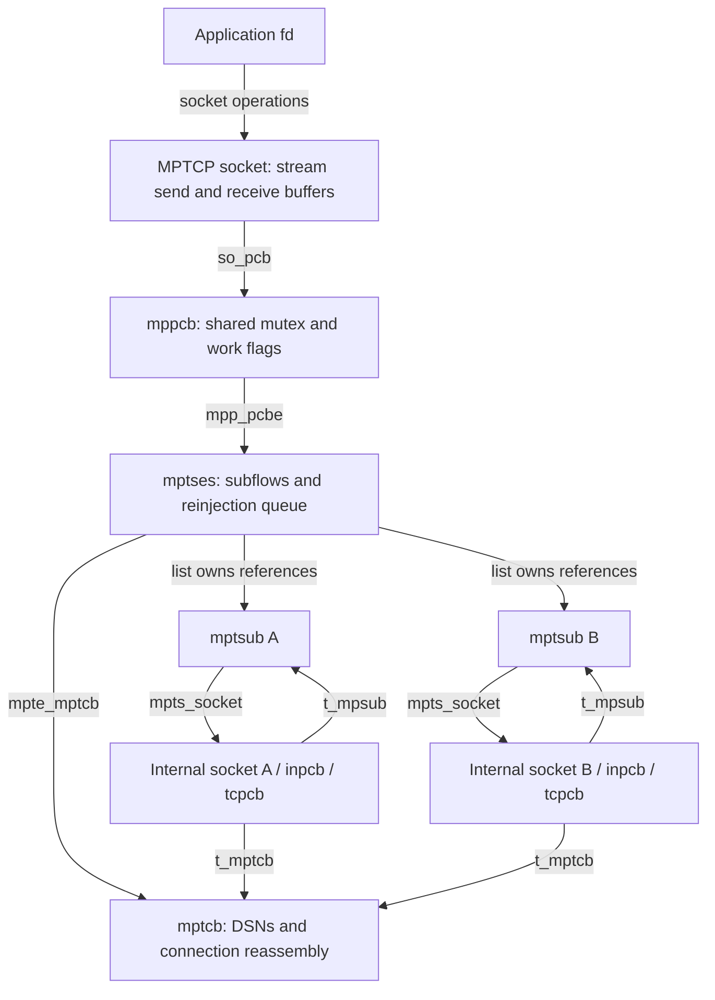
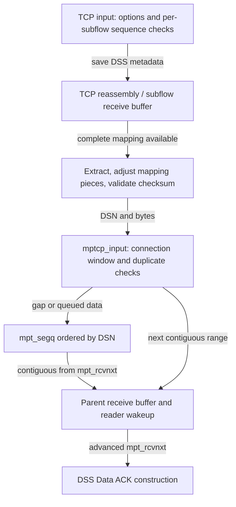
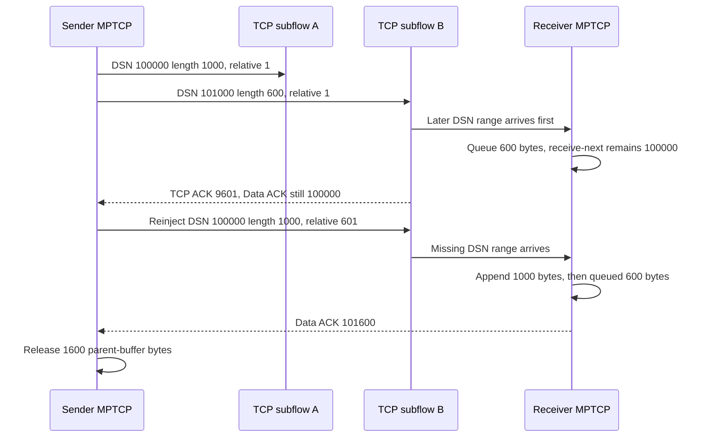

# MPTCP sessions and TCP subflows

MPTCP presents one application byte stream while using several internal TCP connections. Each TCP connection orders and acknowledges its own bytes; the MPTCP session maps those bytes into a separate connection-wide sequence space, reassembles them, and retains data until the connection-level acknowledgment advances. This chapter follows the local implementation in `xnu-12377.121.6`, including subflow publication, selected scheduling and reinjection, fallback, and deferred destruction.

Start with the [networking guide](README.md), [policy extensions](policy-extensions.md), [TCP connections and timers](tcp-connections-and-timers.md), and [TCP recovery](tcp-loss-recovery-and-congestion-control.md). [NECP clients and flow registration](necp-clients-and-flow-registration.md) explains the policy objects referenced here. The examples describe source behavior, not an observed network exchange or a promise about device configuration.

## 1. One application socket, several transport identities

The `PF_MULTIPATH` domain registers a `SOCK_STREAM`, `IPPROTO_TCP` protocol whose callbacks are MPTCP operations. It is distinct from an ordinary IPv4/IPv6 TCP socket. Its user-request table supplies `connectx`, send, receive notification, shutdown and detach operations. The selected implementation is an active-open client: the MPTCP state enum labels `LISTEN` as unimplemented, and this user-request table supplies no MPTCP listen/accept implementation. Protocol initialization fills omitted accept, listen and ordinary connect slots with `EOPNOTSUPP` stubs; the implemented active-open operation here is `connectx`. [Domain registration](../../../platydoc-data/xnu/bsd/netinet/mp_proto.c#L45-L73), [user requests](../../../platydoc-data/xnu/bsd/netinet/mptcp_usrreq.c#L86-L103), [state definitions](../../../platydoc-data/xnu/bsd/netinet/mptcp_var.h#L329-L342), [callback defaults](../../../platydoc-data/xnu/bsd/kern/uipc_socket2.c#L2243-L2257), [unsupported operations](../../../platydoc-data/xnu/bsd/kern/uipc_socket2.c#L2032-L2058), [listen stub](../../../platydoc-data/xnu/bsd/kern/uipc_socket2.c#L2107-L2112), [initialization call](../../../platydoc-data/xnu/bsd/kern/uipc_domain.c#L174-L177).

| Object or identifier | What it represents |
| --- | --- |
| Application socket, `mp_so` | The fd-facing stream buffers, connection state, errors and readiness |
| `mppcb` | Multipath PCB, socket backpointer, mutex, global-list membership and deferred-work flags |
| `mptses` | Session extension: subflow list/count, option records, association/connection IDs, active subflow, interface information and reinjection queue |
| `mptcb` | Connection-level protocol state, keys/tokens, Data Sequence Numbers, receive reassembly and timers |
| `mptsub` | One subflow's connection ID, flags, socket/session pointers, interface scope, relative send sequence and current receive mapping |
| Subflow socket → `inpcb` → `tcpcb` | An internal IPv4/IPv6 TCP endpoint with its own address/port tuple, TCP sequence space, buffers, congestion state and timers |
| `sae_connid_t`, association ID, address ID, token | Different namespaces: local subflow handle; session association; protocol address identifier; key-derived protocol token. None is an application fd or a TCP sequence number. |

The multipath PCB, session and MPTCP control block occupy one `mpp_mtp` allocation. Session creation initializes the backlinks, lists and closed state. Initial association/last-connection IDs are `ANY`; the first connected event later chooses the association ID from that subflow's connection ID. [Aggregate layout](../../../platydoc-data/xnu/bsd/netinet/mptcp_var.h#L464-L472), [session initialization](../../../platydoc-data/xnu/bsd/netinet/mptcp_subr.c#L262-L308), [subflow fields](../../../platydoc-data/xnu/bsd/netinet/mptcp_var.h#L244-L270), [association assignment](../../../platydoc-data/xnu/bsd/netinet/mptcp_subr.c#L4123-L4130).



Each TCP control block points back to its own `mptsub` and to the shared `mptcb`. Internal subflow sockets start without an fd reference. An address tuple belongs to that subflow's Internet PCB, not to the application socket's multipath PCB. [Attachment](../../../platydoc-data/xnu/bsd/netinet/mptcp_subr.c#L1366-L1392), [internal socket creation](../../../platydoc-data/xnu/bsd/netinet/mptcp_subr.c#L1477-L1534).

## 2. Connect admission precedes several kinds of publication

`mptcp_usr_connectx()` rejects a missing/dead PCB, fallback mode, unsupported address families and incorrect IPv4/IPv6 sockaddr sizes. It performs the service-type entitlement check once and records initial source/destination addresses before calling `mptcp_subflow_add()`. That check has extended-privilege/delegation and developer-mode branches; aggregation is specifically restricted by its body. It does not prove that every interface or later policy decision permits traffic. [Connect callback](../../../platydoc-data/xnu/bsd/netinet/mptcp_usrreq.c#L288-L391), [service admission](../../../platydoc-data/xnu/bsd/netinet/mptcp_usrreq.c#L223-L261).

With the parent socket locked, `mptcp_subflow_add()` rejects states at or after `CLOSE_WAIT`, checks the subflow count, copies endpoint information, validates the scope against the interface-index bound, and creates the TCP socket. The count predicate is literally `mpte_numflows > MPTCP_MAX_NUM_SUBFLOWS`, with the constant defined as 256; it is not a `>= 256` admission test. Checking an index bound also does not establish current connectivity. [Admission and copied addresses](../../../platydoc-data/xnu/bsd/netinet/mptcp_subr.c#L2513-L2613), [count constant](../../../platydoc-data/xnu/bsd/netinet/mptcp_var.h#L65-L70).

Creation has an ownership boundary. Before `mptcp_subflow_socreate()`, the new `mptsub` is private and can be freed directly. That callee takes ownership: it either frees an unattached record or attaches it and uses abort/event cleanup on later errors. Once attached, deletion must use `mptcp_subflow_del()`. Attachment links the session list, increments its count, takes two `mptsub` references—list and socket—and increments the parent socket usecount. These changes precede TCP connection establishment. [Ownership handoff](../../../platydoc-data/xnu/bsd/netinet/mptcp_subr.c#L2608-L2618), [attachment references](../../../platydoc-data/xnu/bsd/netinet/mptcp_subr.c#L1366-L1392), [creation error exits](../../../platydoc-data/xnu/bsd/netinet/mptcp_subr.c#L1469-L1502), [post-attachment abort](../../../platydoc-data/xnu/bsd/netinet/mptcp_subr.c#L1730-L1738).

The add path then assigns a local connection ID, initializes `mpts_rel_seq = 1`, and installs write/control upcalls. The initial subflow initializes the local MPTCP key/token/initial DSN and marks the parent connecting. Further subflows can exist in the list with `CONNECT_PENDING` until the connection becomes join-ready. The actual conditional call and ID publication are visible together. [Source: `mptcp_subr.c`, lines 2680–2695](../../../platydoc-data/xnu/bsd/netinet/mptcp_subr.c#L2680-L2695).

<!-- source-excerpt: ../../../platydoc-data/xnu/bsd/netinet/mptcp_subr.c#L2680-L2695 -->
```c
	mpts->mpts_flags |= MPTSF_CONNECTING;

	/* connect right away if first attempt, or if join can be done now */
	if (!(mpts->mpts_flags & MPTSF_CONNECT_PENDING)) {
		error = mptcp_subflow_soconnectx(mpte, mpts);
	}

	if (error) {
		goto out_err_close;
	}

	if (pcid) {
		*pcid = mpts->mpts_connid;
	}

	return 0;
```

Returning a connection ID here therefore does not establish a completed handshake. `mptcp_subflow_soconnectx()` clears pending state, supplies initial/join authentication state, calls the ordinary socket connect machinery, and saves the TCP initial send sequence. The initial address ID is zero; secondary subflows have separate join flags and authentication records. [IDs and pending decision](../../../platydoc-data/xnu/bsd/netinet/mptcp_subr.c#L2627-L2678), [TCP connect](../../../platydoc-data/xnu/bsd/netinet/mptcp_subr.c#L1845-L1917), [initial versus join setup](../../../platydoc-data/xnu/bsd/netinet/mptcp_subr.c#L1782-L1807).

The connected event derives `MP_CAPABLE` from TCP's negotiated flag. On the first connection it sets the MPTCP state established and calls `soisconnected(mp_so)`, including the ordinary-TCP fallback case. A later status event converts `MPTSF_MP_READY` into connection-wide `MPTCPF_JOIN_READY`; the workloop then attempts queued joins. A secondary connection that failed MPTCP negotiation is reset instead of becoming another ordinary TCP carrier. [Connected event](../../../platydoc-data/xnu/bsd/netinet/mptcp_subr.c#L4049-L4214), [ready/fallback publication](../../../platydoc-data/xnu/bsd/netinet/mptcp_subr.c#L4272-L4325), [pending joins](../../../platydoc-data/xnu/bsd/netinet/mptcp_subr.c#L4958-L4972).

The connect-with-data callback also drops the parent lock around `pru_sosend`, reports the consumed `uio` amount on success/`EWOULDBLOCK`, and translates the latter to `EINPROGRESS`. Its `error` variable is overwritten by that send when an `auio` is present. This path must be read as staged connect/send progress, not an atomic connect-plus-data transaction. [Combined operation](../../../platydoc-data/xnu/bsd/netinet/mptcp_usrreq.c#L390-L405).

## 3. Lock switching and deferred callbacks protect the session

After attachment, a subflow's `tcp_lock()` routes to the parent MPTCP socket lock. It checks `SOF_MP_SUBFLOW` again after acquiring the selected lock and retries if attachment/detachment changed which mutex applies. The parent callbacks use `mpp_lock`; requested reference accounting changes the parent usecount and `mpp_inside`. Thus separate TCP PCBs do not imply independent simultaneous mutation of this session. [TCP lock selection and retry](../../../platydoc-data/xnu/bsd/netinet/tcp_subr.c#L3523-L3555), [parent lock/refcount callbacks](../../../platydoc-data/xnu/bsd/netinet/mptcp_subr.c#L4990-L5056).

Two creation steps deliberately release the parent lock:

| Unlocked operation | Why and what follows |
| --- | --- |
| `socreate_internal(..., SOCF_MPTCP, ...)` | TCP attachment needs Internet-PCB table locking. After creation the code holds the original TCP mutex while installing the parent relationship and changing the lock-selection flag. |
| `necp_client_register_socket_flow()` when a client UUID is present | Existing NECP callbacks require NECP-before-socket ordering. After relocking, the code checks for `TIME_WAIT`/later state or fallback before proceeding. |

[Socket creation and lock switch](../../../platydoc-data/xnu/bsd/netinet/mptcp_subr.c#L1486-L1534), [NECP registration and revalidation](../../../platydoc-data/xnu/bsd/netinet/mptcp_subr.c#L1550-L1579). This explicit recheck belongs to that NECP branch; it should not be inferred after every unlocked call.

Input/output can themselves cause socket upcalls. `MPP_INSIDE_INPUT`, `MPP_INSIDE_OUTPUT`, `MPP_INPUT_HANDLE` and `MPP_WUPCALL` defer recursive work, recording pending wakeups/workloop execution instead. The eventual helper clears the current guard and services deferred work when no other guard remains. The event workloop has its own `IN_WORKLOOP`/`WORKLOOP_RELAUNCH` guard and temporarily retains both subflow record and socket while dispatching events. [Defer predicate](../../../platydoc-data/xnu/bsd/netinet/mp_pcb.h#L75-L91), [deferred dispatch](../../../platydoc-data/xnu/bsd/netinet/mptcp.c#L1267-L1294), [event lifetime and relaunch](../../../platydoc-data/xnu/bsd/netinet/mptcp_subr.c#L4846-L4911), [loop exit](../../../platydoc-data/xnu/bsd/netinet/mptcp_subr.c#L4976-L4983).

## 4. Assign DSNs before choosing a TCP carrier

`mptcp_usr_send()` accepts connected or permitted preconnect data, rejects unsupported destination/OOB/control forms, calls `mptcp_insert_dsn()`, and appends to the parent send buffer. Every participating mbuf carries packet-header metadata. `SB_NOCOMPRESS` prevents socket-buffer compression from erasing those boundaries. After append the callback sets its local mbuf pointer to null: later output/wait errors do not return ownership of already queued data to the caller. [Send ownership](../../../platydoc-data/xnu/bsd/netinet/mptcp_usrreq.c#L1052-L1117), [buffer setup](../../../platydoc-data/xnu/bsd/netinet/mptcp_usrreq.c#L177-L218).

The enqueue-time operation is exact. [Source: `mptcp_subr.c`, lines 5437–5445](../../../platydoc-data/xnu/bsd/netinet/mptcp_subr.c#L5437-L5445).

<!-- source-excerpt: ../../../platydoc-data/xnu/bsd/netinet/mptcp_subr.c#L5437-L5445 -->
```c
	while (m) {
		VERIFY(m->m_flags & M_PKTHDR);
		m->m_pkthdr.pkt_flags |= (PKTF_MPTCP | PKTF_MPSO);
		m->m_pkthdr.mp_dsn = mp_tp->mpt_sndmax;
		VERIFY(m_pktlen(m) >= 0 && m_pktlen(m) < UINT16_MAX);
		m->m_pkthdr.mp_rlen = (uint16_t)m_pktlen(m);
		mp_tp->mpt_sndmax += m_pktlen(m);
		m = m->m_next;
	}
```

Despite the field comment calling `mpt_sndmax` the maximum byte sent, this body advances it when application data is numbered and queued. For this path it is the right edge of assigned data, while `mpt_sndnxt` tracks progress through selected output and `mpt_snduna` is the oldest data not cumulatively acknowledged at the MPTCP level. Do not substitute the TCP meaning of `snd_max` for this enqueue behavior. Initially these three DSNs equal `mpt_local_idsn + 1`. [Sequence fields](../../../platydoc-data/xnu/bsd/netinet/mptcp_var.h#L398-L413), [initial numbers](../../../platydoc-data/xnu/bsd/netinet/mptcp_subr.c#L5340-L5379).

An outgoing mapping connects three quantities:

| Quantity | Meaning |
| --- | --- |
| `mp_dsn`, 64-bit connection DSN | First connection byte represented by the mapping |
| `mp_rseq`, relative subflow sequence | Start of the mapping in this TCP subflow, relative to its initial sequence |
| `mp_rlen`, 16-bit mapping length | Extent of the mapping; it can cover several mbufs and packets |

In the ordinary, non-TFO example, a mapping `(D, R, L)` relates subflow TCP sequence `ISS + R + i` to DSN `D + i` for `0 <= i < L`. The arithmetic deliberately avoids wraparound. TFO uses additional saved-ISS/rewind handling and is not modeled by this example. [Subflow sequence fields](../../../platydoc-data/xnu/bsd/netinet/mptcp_var.h#L264-L270), [mapping lookup](../../../platydoc-data/xnu/bsd/netinet/mptcp_subr.c#L5570-L5612), [receive use of relative sequence plus IRS](../../../platydoc-data/xnu/bsd/netinet/mptcp_subr.c#L2265-L2274).

`mptcp_subflow_output()` chooses from the reinjection queue first, otherwise the parent buffer at the connection output offset. It caps the transfer by connection-window accounting where applicable, subflow capacity, and `UINT16_MAX`. It copies mbuf representations using `m_copym_mode(..., M_COPYM_MUST_COPY_HDR)`, preserves the DSN and supplies the selected subflow's current relative sequence. Copying an mbuf representation need not copy all underlying external storage. [Queue/offset selection](../../../platydoc-data/xnu/bsd/netinet/mptcp_subr.c#L3080-L3225), [limits and copy](../../../platydoc-data/xnu/bsd/netinet/mptcp_subr.c#L3227-L3305).

[Source: `mptcp_subr.c`, lines 3289–3293](../../../platydoc-data/xnu/bsd/netinet/mptcp_subr.c#L3289-L3293).

<!-- source-excerpt: ../../../platydoc-data/xnu/bsd/netinet/mptcp_subr.c#L3289-L3293 -->
```c
		m->m_pkthdr.pkt_flags |= PKTF_MPTCP;
		m->m_pkthdr.pkt_flags &= ~PKTF_MPSO;
		m->m_pkthdr.mp_dsn = mpt_dsn;
		m->m_pkthdr.mp_rseq = mpts->mpts_rel_seq;
		m->m_pkthdr.len = mlen;
```

All mbufs made for that output mapping receive its total length; the subflow relative sequence advances by the total copied bytes. The internal TCP send consumes the copied chain. Successful ordinary output advances `mpt_sndnxt`; reinjection and probing deliberately do not. A reported send error rolls back the relative-sequence increment, while queue operations already performed must still be accounted for. The outer `mptcp_output()` handles subflow errors locally and returns zero rather than treating them as application-send failures. Neither return establishes packet delivery. [Mapping completion and send](../../../platydoc-data/xnu/bsd/netinet/mptcp_subr.c#L3308-L3417), [output error policy](../../../platydoc-data/xnu/bsd/netinet/mptcp.c#L741-L800).

TCP output separately calls `mptcp_setup_opts()`. Its DSS construction retrieves mapping metadata from the subflow send buffer; ordinary TCP still supplies the packet sequence and handles packetization/retransmission. A DSS mapping can outlive a particular packet, so one mapping must not be drawn as necessarily one packet. [TCP integration](../../../platydoc-data/xnu/bsd/netinet/tcp_output.c#L2208-L2216), [DSS output lookup](../../../platydoc-data/xnu/bsd/netinet/mptcp_opt.c#L551-L561), [mapping lookup body](../../../platydoc-data/xnu/bsd/netinet/mptcp_subr.c#L5570-L5612).

## 5. Select an eligible subflow, then apply the service policy

`mptcp_can_send_more()` admits queued reinjection first. Otherwise it checks the assigned-data edge, connection send window, pending Data FIN and closing state. `mptcp_get_subflow()` then chooses a carrier. Its capacity helper computes `min(snd_wnd, snd_cwnd) - subflow_send_buffer_bytes`, further limited by `sbspace`; this is not just the raw congestion-window value. [Connection output predicate](../../../platydoc-data/xnu/bsd/netinet/mptcp.c#L646-L678), [capacity calculation](../../../platydoc-data/xnu/bsd/netinet/mptcp_var.h#L210-L217).

The normal selection scan requires an output interface, no pending interface feedback, MPTCP-capable state, a connected socket and an established TCP state no later than `CLOSE_WAIT`. Degraded and preconnect cases are handled earlier as explicit exceptions. It chooses separate noncellular and cellular candidates using RTT and retransmission state, then applies the service-type branch. [Eligibility](../../../platydoc-data/xnu/bsd/netinet/mptcp.c#L858-L919), [candidate comparison](../../../platydoc-data/xnu/bsd/netinet/mptcp.c#L800-L828).

| Service branch | Selected decision in the local body |
| --- | --- |
| Pure handover | Prefer the noncellular candidate when both categories exist |
| Handover | Consider cellular when noncellular quality is not good and its retransmission state meets the slow-path test |
| Interactive | Compare scaled RTT thresholds, retransmission state and RTO thresholds; quality input can reduce thresholds |
| Aggregate-or-higher branch | Rank the two candidates by RTT, using the other if the preferred candidate has no capacity |

[Service branches](../../../platydoc-data/xnu/bsd/netinet/mptcp.c#L946-L1030), [slow-subflow predicate](../../../platydoc-data/xnu/bsd/netinet/mptcp.c#L840-L852). A single available category has an earlier return. The body does not promise round-robin striping, universal lowest-RTT selection, or that an alternate with room will be chosen in every service mode. `mpte_active_sub` records the latest selected active carrier; it does not mean other subflows have no outstanding bytes. [Output loop and active-carrier update](../../../platydoc-data/xnu/bsd/netinet/mptcp.c#L702-L788).

Path creation is a separate policy operation. `mptcp_check_subflows_and_add()` examines interface capability/address information, current subflows, service type, Wi-Fi quality and cellular permission; later branches can request a Symptoms decision before creation. NECP callbacks and the privileged Symptoms control channel provide inputs. The local kernel receiver is present, while the external adviser's policy and actual interfaces/peer behavior are outside this trace. [Creation policy](../../../platydoc-data/xnu/bsd/netinet/mptcp_subr.c#L688-L898), [advisory receiver and registration](../../../platydoc-data/xnu/bsd/netinet/mptcp_subr.c#L6553-L6631).

## 6. Reinjection preserves the connection range

A transmit-failure hint enters the subflow event path through `mptcp_act_on_txfail()`. `mptcp_subflow_failover_ev()` first copies eligible outstanding mappings to `mpte_reinjectq`, then looks for an alternate usable subflow. If none qualifies, the hint does not manufacture one. [Hint production](../../../platydoc-data/xnu/bsd/netinet/mptcp_subr.c#L5665-L5686), [failover event](../../../platydoc-data/xnu/bsd/netinet/mptcp_subr.c#L3783-L3836).

`mptcp_reinject_mbufs()` skips mappings already marked reinjected or entirely covered by the connection's Data ACK. If TCP acknowledgment has consumed part of a mapping, it can recover the data from the parent send buffer by DSN. It copies the mapping, inserts by DSN with coverage checks, and marks the original mapping's mbufs so the same scan does not continually enqueue them. Allocation failure stops this pass. This is distinct from TCP retransmitting at its original TCP sequence. [Copy and parent-buffer lookup](../../../platydoc-data/xnu/bsd/netinet/mptcp_subr.c#L3582-L3650), [ordered insertion and coverage checks](../../../platydoc-data/xnu/bsd/netinet/mptcp_subr.c#L3420-L3496).

The next selected carrier receives the same DSN with its own fresh `mpts_rel_seq`. A candidate whose send buffer already covers the reinjection's starting DSN is avoided by the selected output branch. Reinjection queue records are trimmed/removed as that output prepares data, and fully Data-ACK-covered queue entries are removed by cleanup. The original TCP copy can still exist and undergo TCP recovery; reinjection is not an ownership transfer that erases the original transmission. [Duplicate-carrier check](../../../platydoc-data/xnu/bsd/netinet/mptcp_subr.c#L3002-L3024), [reinjection selection](../../../platydoc-data/xnu/bsd/netinet/mptcp_subr.c#L3185-L3204), [queue consumption and sequence update](../../../platydoc-data/xnu/bsd/netinet/mptcp_subr.c#L3308-L3382), [acknowledged cleanup](../../../platydoc-data/xnu/bsd/netinet/mptcp_subr.c#L3658-L3670).

There is also a connection retransmission timer for missing Data-ACK progress. Its selected timeout branch compares `mpt_snduna` with the tracked DSN, rewinds `mpt_sndnxt` and calls output while retrying, or records a soft timeout error after its retry limit. This is separate from each TCP subflow's retransmission timers. The timer source supplies local behavior; no network timing or complete retry-policy validation was performed here. [Connection timer](../../../platydoc-data/xnu/bsd/netinet/mptcp_timer.c#L76-L111), [tracked starting sequence](../../../platydoc-data/xnu/bsd/netinet/mptcp_timer.c#L165-L179).

## 7. Receive mappings feed a second reassembly layer

TCP option processing decodes DSS variants into the subflow's `mpts_rcv_map`. A zero-length mapping takes the infinite-mapping/fallback notification path; a finite one records DSN, relative sequence, length and checksum. Before TCP trimming/reassembly can obscure the option, `mptcp_insert_rmap()` copies the metadata into the packet header. The TCP input call site is explicit. [DSS receive state](../../../platydoc-data/xnu/bsd/netinet/mptcp.c#L1107-L1155), [metadata embedding](../../../platydoc-data/xnu/bsd/netinet/mptcp_subr.c#L5625-L5660), [TCP call site](../../../platydoc-data/xnu/bsd/netinet/tcp_input.c#L3666-L3675).

The custom subflow receive callback extracts data from the TCP receive buffer without a user `uio`. It obeys socket-buffer serialization, waits by returning `EWOULDBLOCK` when a mapping or its complete bytes are not yet available, and can scan later mbufs for mapping metadata. It distinguishes early missing-DSS fallback on the initial subflow from a reset request on a secondary subflow. [Receive admission and empty buffer](../../../platydoc-data/xnu/bsd/netinet/mptcp_subr.c#L2090-L2145), [mapping search and absence](../../../platydoc-data/xnu/bsd/netinet/mptcp_subr.c#L2181-L2250), [complete-mapping requirement](../../../platydoc-data/xnu/bsd/netinet/mptcp_subr.c#L2265-L2286).

`mptcp_adj_rmap()` splits an mbuf at a mapping boundary when needed and rewrites each extracted piece to `DSN + offset`, `relative_sequence + offset`, and that piece's byte length. The extraction removes subflow receive-buffer accounting; checksum validation is conditional on negotiated checksum state and precedes handing the chain upward. A split/checksum failure requests failure handling rather than delivering an unexplained byte range. [Mapping adjustment](../../../platydoc-data/xnu/bsd/netinet/mptcp_subr.c#L1920-L1994), [extraction and checksum](../../../platydoc-data/xnu/bsd/netinet/mptcp_subr.c#L2288-L2350), [checksum gates and failure](../../../platydoc-data/xnu/bsd/netinet/mptcp.c#L1160-L1226).

The input driver temporarily retains the subflow record/socket and passes the extracted chain to `mptcp_input()`. That function checks the connection receive window, trims or discards already-received DSNs, and either appends the next contiguous bytes to the parent receive buffer or queues them by DSN in `mpt_segq`. `mptcp_reass()` has a queue limit, allocation failure and overlap handling. `mptcp_reass_present()` releases consecutive entries only when the first DSN equals `mpt_rcvnxt`, advancing the connection boundary and waking readers. Bytes ordered by one TCP subflow can therefore remain unavailable to the application until another subflow fills a DSN gap. [Input ownership](../../../platydoc-data/xnu/bsd/netinet/mptcp_subr.c#L2890-L2998), [connection window/duplicate handling](../../../platydoc-data/xnu/bsd/netinet/mptcp.c#L527-L629), [queue insertion](../../../platydoc-data/xnu/bsd/netinet/mptcp.c#L268-L394), [contiguous release](../../../platydoc-data/xnu/bsd/netinet/mptcp.c#L209-L265).



The diagram selects negotiated MPTCP; fallback, incomplete mappings and failure exits are described in the surrounding text. Reader wakeup means data is available in the socket, not that the application has consumed it.

## 8. Data ACK releases the parent send buffer

DSS ACK processing reconstructs a full Data ACK where necessary and accepts its progress only when it lies between `mpt_snduna` and `mpt_sndmax`. `mptcp_data_ack_rcvd()` computes the delta, drops acknowledged bytes from the **parent** send buffer, advances `mpt_snduna`, cleans reinjection entries and wakes writers. Its preceding comment says that actual `sbdrop` happens in the MPTCP layer; the body shown here performs that drop itself. [ACK range validation](../../../platydoc-data/xnu/bsd/netinet/mptcp_opt.c#L1170-L1198), [32-bit extension](../../../platydoc-data/xnu/bsd/netinet/mptcp_opt.c#L1236-L1255), [full ACK body](../../../platydoc-data/xnu/bsd/netinet/mptcp_opt.c#L1084-L1139).

[Source: `mptcp_opt.c`, lines 1108–1113](../../../platydoc-data/xnu/bsd/netinet/mptcp_opt.c#L1108-L1113).

<!-- source-excerpt: ../../../platydoc-data/xnu/bsd/netinet/mptcp_opt.c#L1108-L1113 -->
```c
			sbdrop(&mp_so->so_snd, (int)mp_so->so_snd.sb_cc);
		} else {
			sbdrop(&mp_so->so_snd, (int)acked);
		}

		mp_tp->mpt_snduna += acked;
```

The ACK-only DSS constructors use the receiver's `mpt_rcvnxt`; they do not report the application's read offset. A TCP ACK acknowledges the receiving TCP subflow's sequence space. During negotiated MPTCP it does not by itself establish connection-level contiguous receipt, advance the Data ACK, or prove application delivery. The fallback path deliberately translates selected TCP buffer-release progress back into connection bookkeeping, so that exception must remain separate. [DSS ACK construction](../../../platydoc-data/xnu/bsd/netinet/mptcp_opt.c#L643-L692), [fallback translation](../../../platydoc-data/xnu/bsd/netinet/mptcp_subr.c#L5449-L5504).

## 9. Worked example: two subflows and one missing connection range

Select established, negotiated MPTCP with two usable subflows, no TFO, no Data FIN, no sequence wrap, adequate receive buffers and successful allocations/checksums. Use an authorized aggregate service for the initial scheduling example. Values are decimal, half-open ranges name bytes, and mapping boundaries are chosen for clarity rather than assumed packet sizes. Applying the local receiver rules to a hypothetical other endpoint illustrates ordering; it does not establish a real peer's implementation.

Initially the sender has `mpt_snduna = mpt_sndnxt = mpt_sndmax = 100000`. Subflow A is noncellular with TCP `ISS = 1000`; B is cellular with `ISS = 9000`; both relative send cursors start at 1. They therefore occupy the selector's two candidate categories. Enqueue 1,600 bytes. The parent retains `[100000, 101600)`, and `mpt_sndmax` becomes 101600 **before output**. Assume A has the preferred RTT and capacity for exactly 1,000 bytes, while B has capacity for 1,000; when A's capacity is consumed, B can carry the remaining 600. The aggregate branch can select them in that order.

| Output | Connection DSN range | Mapping `(DSN, relative sequence, length)` | TCP byte range |
| --- | --- | --- | --- |
| First 1,000 bytes on A | `[100000, 101000)` | `(100000, 1, 1000)` | `[1001, 2001)` |
| Next 600 bytes on B | `[101000, 101600)` | `(101000, 1, 600)` | `[9001, 9601)` |

After successful submission, `mpt_sndnxt = 101600`, A's relative cursor is 1001 and B's is 601. Assume A's range is delayed/lost and B's arrives. B's receiver can acknowledge TCP sequence **9601**, but connection receive-next stays **100000**: the 600 bytes wait in MPTCP reassembly. A Data ACK of 100000 frees zero parent bytes; the parent still retains all 1,600 bytes. Assume previous valid DSS acknowledgment state already confirmed MPTCP, so this is not the early missing-DSS fallback case.

Now a failover event scans A's unacknowledged mapping. Assume A still has zero capacity because its 1,000 bytes remain TCP-unacknowledged, while B's previous TCP ACK restores its 1,000-byte capacity and all other eligibility conditions remain satisfied. The aggregate selector can choose B; assume the relevant copy succeeds. The reinjected mapping is `(100000, 601, 1000)`, occupying B's TCP range **`[9601, 10601)`**. Its DSN is unchanged even though its TCP range differs from A's. Neither `mpt_sndmax` nor ordinary `mpt_sndnxt` advances for this reinjection.



B's TCP sequence stream remains contiguous: its original 600 bytes precede its reinjected 1,000. At the connection layer those two ranges are delivered in the opposite order, according to DSN. Once the missing range is present, `mpt_rcvnxt` advances through 101000 to 101600; Data ACK 101600 lets the sender release 1,600 parent-buffer bytes. A later copy of A's original range is already below receive-next and is discarded at the connection layer. TCP recovery/ACK cleanup of A remains a separate obligation. None of these acknowledgments establishes that the receiving application has read the bytes.

## 10. Fallback changes the numbering contract used for delivery

Initial TCP establishment can succeed without MPTCP negotiation. The first connected event then requests fallback; failure of a later join requests reset instead. Missing DSS metadata before full establishment also distinguishes the initial subflow from secondary ones. These are specific local branches, not a claim that every malformed or absent option causes the same recovery. [Negotiation result](../../../platydoc-data/xnu/bsd/netinet/mptcp_subr.c#L4123-L4203), [missing mapping](../../../platydoc-data/xnu/bsd/netinet/mptcp_subr.c#L2181-L2210).

The status handler marks the session `FALLBACK_TO_TCP`, clears `JOIN_READY` and frees the reinjection queue. The workloop requests reset of other subflows that have not already been marked degraded, while the selected fallback flow remains the stream carrier. The receive path discards data from a degraded subflow that is not active; the nearby comment says “all but one,” but the predicate implements acceptance only from the active degraded flow. Parent input then accepts the surviving stream without ordinary DSS reassembly. [Status transition](../../../platydoc-data/xnu/bsd/netinet/mptcp_subr.c#L4307-L4322), [workloop cleanup](../../../platydoc-data/xnu/bsd/netinet/mptcp_subr.c#L4929-L4957), [active-flow receive predicate](../../../platydoc-data/xnu/bsd/netinet/mptcp_subr.c#L2927-L2933), [fallback input](../../../platydoc-data/xnu/bsd/netinet/mptcp.c#L430-L489).

Send-side fallback has explicit synchronization flags and adjusts which parent bytes must be resent. `mptcp_fallback_sbdrop()` derives connection acknowledgment progress from the surviving TCP buffer's mappings, conservatively handling a drop in the middle of an mbuf. This bridges the bookkeeping after Data ACKs cease; it must not be applied to the negotiated two-subflow example above. [Output synchronization](../../../platydoc-data/xnu/bsd/netinet/mptcp_subr.c#L3146-L3168), [Data-ACK interaction](../../../platydoc-data/xnu/bsd/netinet/mptcp_opt.c#L1113-L1125), [TCP-derived release](../../../platydoc-data/xnu/bsd/netinet/mptcp_subr.c#L5449-L5504).

## 11. Subflow loss, stream close and storage release are different events

A disconnected subflow clears its connection/capability flags and returns a delete result to the workloop. The handler can terminate the session before initial establishment or when the active fallback carrier dies; an ordinary established multipath subflow disappearing is not automatically the same as closing the parent stream. The workloop calls `mptcp_subflow_soclose()`, whose `CLOSED` flag prevents repeated close. The TCP PCB/socket can remain until its own references and timer/PCB conditions permit disposal. [Disconnected event](../../../platydoc-data/xnu/bsd/netinet/mptcp_subr.c#L4220-L4266), [workloop close](../../../platydoc-data/xnu/bsd/netinet/mptcp_subr.c#L4882-L4909), [subflow close](../../../platydoc-data/xnu/bsd/netinet/mptcp_subr.c#L1749-L1779).

TCP garbage collection eventually calls `mptcp_subflow_del()` after the subflow is no longer searchable and its socket usecount is zero. Deletion removes the session-list entry, disables callbacks, removes its authentication record, drops the parent usecount, clears session/socket pointers and drops the two attachment references. It clears `SOF_MP_SUBFLOW` and TCP backlinks before the collector releases the parent lock and disposes the Internet PCB. That ordering ends parent lock routing before the underlying TCP storage disappears. [GC handoff](../../../platydoc-data/xnu/bsd/netinet/tcp_timer.c#L722-L765), [unlink and references](../../../platydoc-data/xnu/bsd/netinet/mptcp_subr.c#L2740-L2783), [final subflow free](../../../platydoc-data/xnu/bsd/netinet/mptcp_subr.c#L1330-L1362).

Closing the application stream instead enters `mptcp_disconnect()`/`mptcp_usrclosed()`. Abortive or pre-established cases close immediately at the protocol level; the graceful route drives a connection-level Data FIN state machine. Data FIN consumes one DSN and is distinct from each TCP FIN. The local-close path can wait for outstanding output, and the output loop has a further all-data-acknowledged condition before finishing shutdown. Received Data FIN advances receive-next and makes the parent unable to receive more. [Disconnect decisions](../../../platydoc-data/xnu/bsd/netinet/mptcp_usrreq.c#L900-L940), [shutdown helpers](../../../platydoc-data/xnu/bsd/netinet/mptcp_usrreq.c#L972-L1014), [output close gate](../../../platydoc-data/xnu/bsd/netinet/mptcp.c#L790-L795), [Data FIN state machine](../../../platydoc-data/xnu/bsd/netinet/mptcp.c#L1036-L1105).

`mptcp_close()` marks the protocol terminated, frees connection reassembly, marks the parent disconnected and requests subflow disconnection. It does not free the combined PCB allocation. `mp_pcbdetach()` marks the multipath PCB dead and schedules GC. The MPTCP collector waits for parent usecount to reach zero, then destroys session-owned option/interface/reinjection state, removes the PCB from the global list, disposes NECP state and socket buffers, and frees storage. Session destruction asserts the subflow list is empty. [Logical close](../../../platydoc-data/xnu/bsd/netinet/mptcp_subr.c#L4692-L4713), [dead marking](../../../platydoc-data/xnu/bsd/netinet/mp_pcb.c#L230-L238), [GC and disposal](../../../platydoc-data/xnu/bsd/netinet/mptcp_subr.c#L4591-L4663), [session destruction](../../../platydoc-data/xnu/bsd/netinet/mptcp_subr.c#L494-L516), [PCB disposal](../../../platydoc-data/xnu/bsd/netinet/mp_pcb.c#L241-L292).

## 12. Configuration and evidence limits

The selected source includes `MPTCP` as a build option and lists the MPTCP bodies as optional `mptcp` files. The multipath group appears in ARM64 iPhoneOS configuration descriptions as well as other targets; it is not a macOS-only mechanism. These files and configuration descriptions do not establish which options a shipping kernel enabled. [Build option](../../../platydoc-data/xnu/config/MASTER#L73-L78), [source selection](../../../platydoc-data/xnu/bsd/conf/files#L298-L305), [iPhoneOS group](../../../platydoc-data/xnu/config/MASTER.arm64.iPhoneOS#L45-L49).

Runtime enablement, cached/forced protocol versions, service-type admission, interface state and peer negotiation further select behavior. Local initialization handles versions 0 and 1 with different key-digest choices; this chapter does not replace their option/HMAC implementation with a generic protocol specification. The wire-option implementation is present, but the exact peer's implementation, network path, Symptoms policy producer and product-specific authorization are external evidence. [Runtime controls](../../../platydoc-data/xnu/bsd/netinet/mptcp.c#L111-L137), [version controls](../../../platydoc-data/xnu/bsd/netinet/mptcp.c#L169-L200), [key/token/IDSN initialization](../../../platydoc-data/xnu/bsd/netinet/mptcp_subr.c#L5340-L5398), [option implementation](../../../platydoc-data/xnu/bsd/netinet/mptcp_opt.c#L1170-L1255).

This review covers the active session/subflow lifecycle and selected common data paths. It does not exhaust TFO rewind, every DSS width/checksum combination, JOIN authentication, ADD_ADDR/NAT64/address selection, service-policy heuristics, urgent-progress timers, option replay, diagnostics, or all allocation/failure interleavings. Those bodies are additional local code to review, not automatically missing providers. No kernel, network or userspace test was executed; the numerical exchange is a worked source model.

<!-- BEGIN PLATYDOC DOCUMENTATION LICENSE -->
Original Platydoc text and diagrams are licensed under [CC BY 4.0](https://creativecommons.org/licenses/by/4.0/). Quoted source code and third-party material retain their respective licenses.
<!-- END PLATYDOC DOCUMENTATION LICENSE -->
