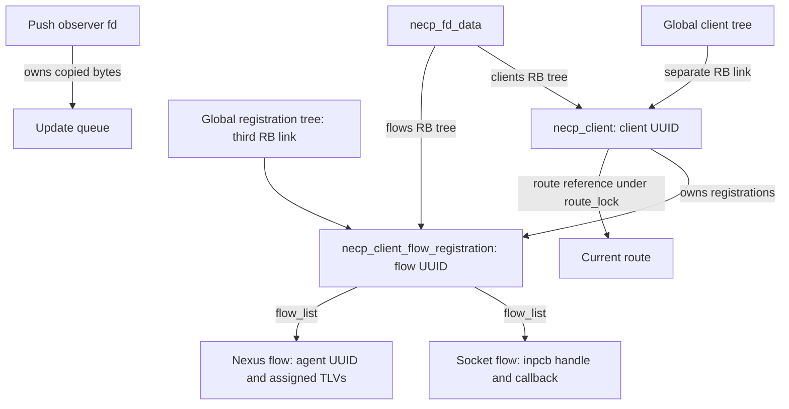
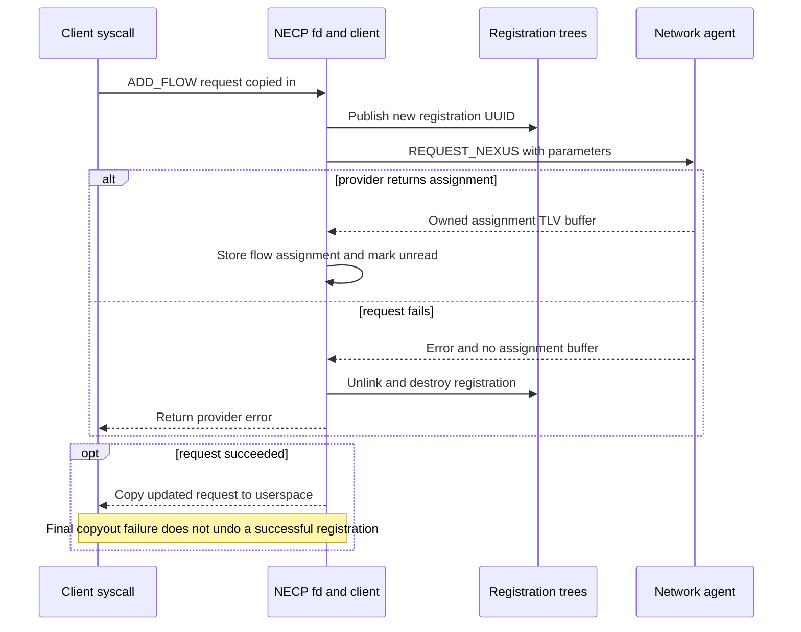
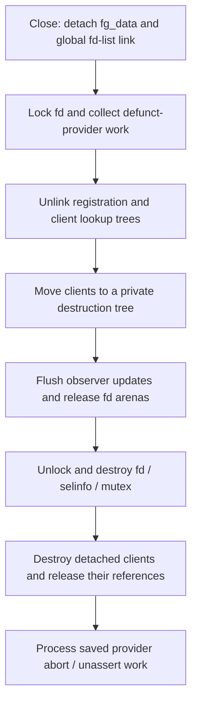

# NECP clients, flow registrations and agent assignments

[Networking](README.md) · [Policy compilation and evaluation](necp-policy-evaluation.md) · [Skywalk lifecycles](skywalk-lifecycles.md) · [Netif agents](skywalk-netif-agents-and-traffic-rules.md)

A NECP client is a persistent request for a network path, identified by a UUID and owned by a NECP file descriptor. A flow registration attaches concrete socket or nexus flows to that request. Policy evaluation can say that an interface and provider are suitable before any provider has assigned a nexus port; assignment can then change independently of the base policy result. This chapter follows those objects, the syscall actions that manipulate them, provider callbacks and user-visible notifications in `xnu-12377.121.6`. [Client implementation](../../../platydoc-data/xnu/bsd/net/necp_client.c#L461-L600), [action ABI](../../../platydoc-data/xnu/bsd/net/necp.h#L620-L646).

## 1. The fd is a control and readiness object

`necp_open()` creates a `DTYPE_NETPOLICY` fd whose private data starts with `necp_fd_type_client`. It is close-on-exec and close-on-fork. The file is marked `FREAD`, but its operations use `fo_no_read`/`fo_no_write`; actions go through `necp_client_action()`, while select/kqueue report whether an action can retrieve new state. This is separate from the privileged policy-writer session described in the companion. [Open and publication](../../../platydoc-data/xnu/bsd/net/necp_client.c#L8098-L8191), [file operations](../../../platydoc-data/xnu/bsd/net/necp_client.c#L413-L422), [fd validation](../../../platydoc-data/xnu/bsd/net/necp_client.c#L2397-L2414).

An ordinary client fd does not require the policy-writer privilege. Opening with either `OBSERVER` or `PUSH_OBSERVER` requires the Skywalk privilege check or `PRIV_NET_PRIVILEGED_NETWORK_STATISTICS`; MACF also has an open hook and a per-action hook. `OBSERVER` permits queries of clients owned by other fds. `PUSH_OBSERVER` puts the fd on the observer list, seeds updates for existing clients and forbids ADD. The header describes using the flags together, but the implementation tests them separately: push mode alone must not be described as automatically authorizing the global-query fallback. [Flag definitions](../../../platydoc-data/xnu/bsd/net/necp.h#L614-L616), [admission](../../../platydoc-data/xnu/bsd/net/necp_client.c#L8106-L8121), [observer publication](../../../platydoc-data/xnu/bsd/net/necp_client.c#L8154-L8175), [global-query check](../../../platydoc-data/xnu/bsd/net/necp_client.c#L9460-L9519).

The action dispatcher takes a file reference, validates the fd kind, invokes the MACF hook when configured, dispatches, and drops the file reference. Individual handlers take the fd/client locks they need; there is no single global action mutex. [Dispatcher](../../../platydoc-data/xnu/bsd/net/necp_client.c#L12395-L12532).

| Actions | Object and purpose |
|---|---|
| ADD, CLAIM, REMOVE | Create, transfer or remove a client request and its ownership. |
| COPY_PARAMETERS, COPY_RESULT, COPY_UPDATED_RESULT, COPY_UPDATED_RESULT_FINAL | Copy stored request bytes or a composite of current base, group and flow results. |
| ADD_FLOW, REMOVE_FLOW | Publish or remove a flow registration below a client. |
| REQUEST_NEXUS_INSTANCE | Legacy client-is-flow route to a provider, selected by the `SKYWALK` build guard. |
| AGENT, COPY_AGENT, AGENT_USE, ACQUIRE_AGENT_TOKEN | Trigger/assert/unassert agents, inspect their data or use their token/use-count interfaces. |
| COPY_LIST, COPY_CLIENT_UPDATE | Enumerate clients or drain a push observer's copied updates. |
| COPY_INTERFACE, GET_INTERFACE_ADDRESS, COPY_ROUTE_STATISTICS | Query interface/address/route information. |
| UPDATE_CACHE, MAP_SYSCTLS, GET_FLOW_STATISTICS | Heuristic/cache and statistics-related operations; some are configuration-dependent. |
| SIGN, VALIDATE, GET_SIGNED_CLIENT_ID, SET_SIGNED_CLIENT_ID | Signed answer/identity operations, separate from policy compilation. |

The numbering is 1–27, with deprecated `SET_STATISTICS` returning `ENOTSUP` in the `SKYWALK` dispatcher branch; unknown/unsupported switch cases return `EINVAL`. This chapter traces the client/flow/notification lifecycle. The signed-query algorithms, every cache heuristic and mapped statistics ABI remain additional surfaces, not completed merely by this table. [Action definitions](../../../platydoc-data/xnu/bsd/net/necp.h#L620-L646), [conditional cases](../../../platydoc-data/xnu/bsd/net/necp_client.c#L12443-L12524).

## 2. UUIDs name different levels of state

| Structure | Representation and ownership |
|---|---|
| `necp_fd_data` | Owner PID/flags, fd mutex, per-fd client and registration RB trees, push-update queue/count, `selinfo`, and statistics-arena state. |
| `necp_client` | Client UUID; fd/global-tree links; mutex/refcount; owned parameter bytes; fixed base-result array and read bits; policy/skip IDs; process/delegated identity; flow-registration tree; agent assertions; current route under a separate route mutex; interface options and optional namespace reservation. |
| `necp_client_flow_registration` | Registration UUID; links in client, fd and global registration trees; client backpointer; flow list; requested flags, unread/defunct state and statistics references. |
| `necp_client_flow` | One socket, nexus or interface flow: assigned/viable/invalid flags, interface/endpoints, a union containing socket handle/callback or nexus-agent UUID, owned assignment TLVs and protocol-event/offload state. |
| `necp_client_update` | An observer queue item containing a copied client UUID and copied parameter/result/remove notification bytes. It does not keep the original client alive. |

Sources: [flow and registration](../../../platydoc-data/xnu/bsd/net/necp_client.c#L461-L524), [client](../../../platydoc-data/xnu/bsd/net/necp_client.c#L536-L600), [fd](../../../platydoc-data/xnu/bsd/net/necp_client.c#L692-L728), [observer allocation](../../../platydoc-data/xnu/bsd/net/necp_client.c#L1922-L1951).

UUID byte 9 has bit 0 clear for a client and set for a flow registration. Lookup uses that discriminator: a flow UUID finds the registration and then its owning client; a client UUID finds the client directly. A registration UUID is neither a packet-flow hash nor a Skywalk port number. Agent UUIDs and nexus instance UUIDs are different namespaces again. [UUID creation/discrimination](../../../platydoc-data/xnu/bsd/net/necp_client.c#L1032-L1047), [lookup helpers](../../../platydoc-data/xnu/bsd/net/necp_client.c#L1050-L1156).



`necp_client_create_flow_registration()` requires both fd and client locks, allocates/initializes the record, inserts all three RB links, and initially marks flow results read. Publication precedes provider assignment. The client owns the registration's eventual destruction; the fd/global links provide other lookup routes, not three independently reference-counted copies. [Creation](../../../platydoc-data/xnu/bsd/net/necp_client.c#L3930-L3972).

## 3. Lock order, references and the route

The implementation documents this precedence:

[Source: `bsd/net/necp_client.c`, lines 784–791](../../../platydoc-data/xnu/bsd/net/necp_client.c#L784-L791).

<!-- source-excerpt: ../../../platydoc-data/xnu/bsd/net/necp_client.c#L784-L791 -->
```c
// Precedence, where 1 is the first lock that must be taken
// 1. NECP_FD_LIST_LOCK
// 2. NECP_FD_LOCK (any)
// 3. NECP_CLIENT_TREE_LOCK
// 4. NECP_CLIENT_LOCK (any)
// 5. NECP_FLOW_TREE_LOCK
// 6. NECP_STATS_LIST_LOCK
// 7. NECP_CLIENT_ROUTE_LOCK (any)
```

The corresponding locks protect distinct things: fd-list traversal keeps the fd discoverable; the fd mutex protects its trees and update queue; global-tree locks protect publication/lookup; the client mutex protects its mutable result and flow state; the route mutex protects the current route. A helper looking up a flow through the global flow tree releases that tree lock before taking the client mutex while still relying on the surrounding client-tree lock. Follow that helper's contract rather than taking every lock in diagram order. [Lock definitions and notes](../../../platydoc-data/xnu/bsd/net/necp_client.c#L745-L791), [global lookup](../../../platydoc-data/xnu/bsd/net/necp_client.c#L1100-L1156).

Client references are separate from tree membership. ADD initializes a reference held until close/removal and temporarily retains around NetworkStatistics setup after dropping the fd lock. Remove/claim/flow-removal paths similarly retain where work crosses an ownership boundary. `necp_client_release_locked()` unlocks and frees on the last reference; its boolean return tells callers whether they still need to unlock. Final free releases parameter/group/extra-interface storage and destroys both client mutexes. [Reference helpers](../../../platydoc-data/xnu/bsd/net/necp_client.c#L1862-L1920), [initial/temporary references](../../../platydoc-data/xnu/bsd/net/necp_client.c#L8228-L8232), [statistics setup](../../../platydoc-data/xnu/bsd/net/necp_client.c#L8475-L8488).

`necp_calculate_client_result()` obtains a referenced route from application policy matching, then replaces the client's route under `route_lock`, freeing the previous route. Error/unsatisfied branches must be read separately: failure frees the newly returned route; a failed agent-requirement check clears the proposed aggregate result and returns before the normal route-replacement block. “A refresh always clears the old route first” is not the implementation. [Calculation and route ownership](../../../platydoc-data/xnu/bsd/net/necp_client.c#L4939-L5067).

## 4. ADD copies a request, checks privileges and publishes a client

The main sequence is:

1. Reject push observers and require a 16-byte UUID output plus a nonempty parameter buffer of at most 2048 bytes.
2. Allocate the client and owned parameter storage, initialize locks, copyin the parameters and establish the initial reference/process identity.
3. Generate the client UUID and copy it to userspace **before** later parameter-dependent authorization and publication.
4. Under `SKYWALK`, parse parameters and apply delegation, interpose, custom-protocol and AOP-offload admission checks. Listener TCP/UDP clients reserve the requested local namespace; an ephemeral reservation can rewrite the owned parameter bytes with the selected port.
5. Notify push observers of ADD, insert in the fd and global client trees, prime the result under the client lock, and register NetworkStatistics state while holding a temporary client reference.

Sources: [allocation/copy boundary](../../../platydoc-data/xnu/bsd/net/necp_client.c#L8199-L8244), [admission checks](../../../platydoc-data/xnu/bsd/net/necp_client.c#L8246-L8310), [listener reservation](../../../platydoc-data/xnu/bsd/net/necp_client.c#L8312-L8381), [publication](../../../platydoc-data/xnu/bsd/net/necp_client.c#L8466-L8497). Namespace reservation is explained further in [Skywalk namespaces](skywalk-namespaces-and-flow-lookup.md).

Returning UUID bytes is not proof that ADD succeeded: a later privilege/reservation failure still frees the unpublished client. Conversely, the first result evaluation's boolean is explicitly discarded after publication, so ADD success does not prove that evaluation produced a new complete result. Parent/child UDP demultiplexing has additional checks for parent existence, matching protocol/endpoints and a permitted demux pattern; those checks set `validated_parent` only after the sequence succeeds. [Early UUID copyout](../../../platydoc-data/xnu/bsd/net/necp_client.c#L8234-L8244), [parent validation](../../../platydoc-data/xnu/bsd/net/necp_client.c#L8383-L8462), [ignored initial update return](../../../platydoc-data/xnu/bsd/net/necp_client.c#L8475-L8478).

### Parsing produces a validity mask, not an all-or-nothing decoded request

`necp_client_parse_parameters()` zeroes a `necp_client_parsed_parameters`, then decodes recognized TLVs into fields and `valid_fields` bits. It bounds arrays of interface/agent requirements, validates address forms and handles local port separately from whether a local address is specific. Unknown types and various too-short fields do not become valid fields. [Parsed structure](../../../platydoc-data/xnu/bsd/net/necp_client.c#L365-L396), [parameter parser](../../../platydoc-data/xnu/bsd/net/necp_client.c#L3305-L3797).

An outer TLV whose declared length exceeds the remaining bytes logs and breaks the loop without assigning an error in that branch:

[Source: `bsd/net/necp_client.c`, lines 3332–3342](../../../platydoc-data/xnu/bsd/net/necp_client.c#L3332-L3342).

<!-- source-excerpt: ../../../platydoc-data/xnu/bsd/net/necp_client.c#L3332-L3342 -->
```c
	memset(parsed_parameters, 0, sizeof(struct necp_client_parsed_parameters));

	while ((offset + sizeof(struct necp_tlv_header)) <= parameters_size) {
		u_int8_t type = necp_buffer_get_tlv_type(parameters, parameters_size, offset);
		u_int32_t length = necp_buffer_get_tlv_length(parameters, parameters_size, offset);

		if (length > (parameters_size - (offset + sizeof(struct necp_tlv_header)))) {
			// If the length is larger than what can fit in the remaining parameters size, bail
			NECPLOG(LOG_ERR, "Invalid TLV length (%u)", length);
			break;
		}
```

Other paths, including signed resolver-tag validation, can explicitly return errors. ADD uses a separate `parse_error` to gate several parameter-dependent operations; it does not simply assign every parser error to the syscall's final `error`. Do not generalize this parser into “every malformed TLV is rejected and nothing is created.” [Resolver-tag handling and parser exit](../../../platydoc-data/xnu/bsd/net/necp_client.c#L3700-L3797), [ADD's parse-error tests](../../../platydoc-data/xnu/bsd/net/necp_client.c#L8246-L8313).

## 5. Path evaluation updates base results and concrete flow viability

`necp_update_client_result()` first marks nonsocket flows invalid, parses the owned request, and calls `necp_calculate_client_result()`. Policy results can adjust parsed constraints; the updater recalculates at most once after that adjustment. It saves policy and skip IDs, decides whether multiple flows are allowed, and translates the aggregate decision into result TLVs. A listener is satisfied while not policy-dropped; an ordinary client requires a routed interface. These are policy/path flags, not proof that every flow has been assigned. [Update entry and retry](../../../platydoc-data/xnu/bsd/net/necp_client.c#L5099-L5144), [multiple-flow/satisfaction decisions](../../../platydoc-data/xnu/bsd/net/necp_client.c#L5153-L5191).

Interface selection is not “always pick the first interface.” An explicit required interface wins directly. With no interface/agent restrictions the matcher can remain unscoped. Otherwise `necp_find_matching_interface_index()` walks ordered interfaces and compares requirements/prohibitions and preference counts; some searches include unranked interfaces, while preference-only requests can fall back to an unscoped match. A request with only agent requirements can defer agent validation to the policy result. In the specific secondary-interface branch, prohibiting either expensive or constrained interfaces causes both properties to be excluded there; follow the predicate, not an imagined one-to-one flag translation. [Selection body](../../../platydoc-data/xnu/bsd/net/necp_client.c#L6517-L6653).

The fixed base array is 1024 bytes. It contains flags/reason, client ID, routing decision and applicable interface, filter/divert, netagent, gateway and interface-option records. Assignment data belongs to individual flows and is appended only when a copy action serializes a result. The updater writes TLVs only when different, compares final length, refreshes flow viability, and makes the base unread/pushes an observer update if something changed. [Result storage](../../../platydoc-data/xnu/bsd/net/necp_client.c#L536-L600), [initial TLVs](../../../platydoc-data/xnu/bsd/net/necp_client.c#L5193-L5257), [final comparison and flow update](../../../platydoc-data/xnu/bsd/net/necp_client.c#L5622-L5652).

Refresh is not a rollback transaction: invalidation starts before parsing/calculation, and those operations can return false before rebuilding the result. The enclosing caller decides whether that means a readiness notification. Normal deferred refresh traverses fds under the fd-list shared lock, finds the owning process, locks each fd and updates its clients; it processes collected defunct-provider work after leaving that traversal. [Update entry](../../../platydoc-data/xnu/bsd/net/necp_client.c#L5115-L5135), [per-fd update](../../../platydoc-data/xnu/bsd/net/necp_client.c#L5753-L5784), [callout](../../../platydoc-data/xnu/bsd/net/necp_client.c#L5805-L5851).

`necp_update_all_clients()` coalesces work through a thread call: normal delay is 100 ms with 50 ms leeway, and immediate requests use 10 ms with 10 ms leeway. It does not keep pushing an already-earlier scheduled call farther into the future. Shortening a scheduled call drops the scheduling lock before `thread_call_cancel_wait()`. This asynchronous client refresh is distinct from the socket policy cache generation checked directly in the packet/socket path. [Scheduling](../../../platydoc-data/xnu/bsd/net/necp_client.c#L5854-L5933), [socket cache generation](necp-policy-evaluation.md#9-socket-caching-and-invalidation).

## 6. ADD_FLOW publishes a registration, then requests provider work

`ADD_FLOW` copies a `necp_client_add_flow` request after checking its bounded size, locates the owned client under the fd/client locks, retains it and copies the nexus parameters. It creates a registration and returns its UUID in the in-kernel request structure. Override-address/protocol and on-behalf-of variants alter the provider request; they do not change which new registration the fd owns. [Request validation and creation](../../../platydoc-data/xnu/bsd/net/necp_client.c#L9965-L10087), [parameter variants](../../../platydoc-data/xnu/bsd/net/necp_client.c#L10088-L10157).

With `ALLOW_NEXUS`, the requested agent must be one of the client's interface options. A nonzero accumulated flow-divert control unit rejects this route; scoped/tunnel decisions must agree with a nonzero chosen interface. The helper adds a nexus flow if needed and sends `REQUEST_NEXUS`, selecting the registration/on-behalf-of UUID or the client UUID for the legacy flag. This call occurs with the fd and client locks held. A returned assignment is installed synchronously; absence of a result buffer can mean a later asynchronous assignment. An override endpoint may be recorded as a placeholder without setting `assigned`. [Agent/interface validation and request](../../../platydoc-data/xnu/bsd/net/necp_client.c#L10127-L10214).

Browse/resolve registrations send `CLIENT_ASSERT` instead, after finding the agent's interface and establishing a flow record. Some statistics initialization failures are ignored; other errors, such as provider/AOP initialization failure, reach the common registration rollback. [Browse/resolve path](../../../platydoc-data/xnu/bsd/net/necp_client.c#L10246-L10284), [statistics/offload setup](../../../platydoc-data/xnu/bsd/net/necp_client.c#L10218-L10243).



The diagram shows the immediate-assignment and request-error cases. A successful request with no immediate assignment also reaches the final copyout, leaving assignment for a later provider response.

The failure boundary is visible directly:

[Source: `bsd/net/necp_client.c`, lines 10286–10312](../../../platydoc-data/xnu/bsd/net/necp_client.c#L10286-L10312).

<!-- source-excerpt: ../../../platydoc-data/xnu/bsd/net/necp_client.c#L10286-L10312 -->
```c
	if (error != 0) {
		// Encountered an error in adding the flow, destroy the flow registration
#if SKYWALK
		necp_destroy_flow_stats(fd_data, new_registration, NULL, false);
#endif /* SKYWALK */
		NECP_FLOW_TREE_LOCK_EXCLUSIVE();
		RB_REMOVE(_necp_client_flow_global_tree, &necp_client_flow_global_tree, new_registration);
		NECP_FLOW_TREE_UNLOCK();
		RB_REMOVE(_necp_fd_flow_tree, &fd_data->flows, new_registration);
		necp_destroy_client_flow_registration(client, new_registration, fd_data->proc_pid, true);
		new_registration = NULL;
	}

	NECP_CLIENT_UNLOCK(client);
	NECP_FD_UNLOCK(fd_data);

	necp_client_release(client);

	if (error != 0) {
		goto done;
	}

	// Copy the request back out to the caller with assigned fields
	error = copyout(add_request, uap->buffer, buffer_size);
	if (error != 0) {
		NECPLOG(LOG_ERR, "necp_client_add_flow copyout add_request error (%d)", error);
	}
```

For an error detected before unlocking, the handler removes global/fd links and destroys the new registration with abort semantics. The final request copyout runs **after** that cleanup decision and after dropping locks/releasing the temporary client reference. A fault there leaves successful provider/registration state alive.

The legacy `REQUEST_NEXUS_INSTANCE` path is different. It marks the client `legacy_client_is_flow`, selects the first nexus agent in interface options, creates a registration with `ALLOW_NEXUS | USE_CLIENT_ID`, and calls the provider. Its provider-error branch unlocks and returns without removing the registration already created. Optional statistics buffer copy errors are logged separately. Do not describe this older action as an alias with ADD_FLOW's rollback contract. [Legacy path](../../../platydoc-data/xnu/bsd/net/necp_client.c#L10333-L10485).

## 7. Kernel and userspace agents return assignments differently

`netagent_client_message_with_params()` finds the agent under the network-agent list/registration locks, validates message type and appropriate capabilities, and requires active status for nexus operations. A kernel agent has control unit zero and an event callback. The dispatcher drops the global list lock but retains the registration lock during that callback; the source explicitly forbids the callback from causing agent registration/unregistration. A failing callback must leave no assignment buffer. [Validation](../../../platydoc-data/xnu/bsd/net/network_agent.c#L2826-L2921), [kernel callout](../../../platydoc-data/xnu/bsd/net/network_agent.c#L2923-L2941).

For a userspace agent, it sends a kernel-control message; `ABORT_NEXUS` is translated to `CLOSE_NEXUS`. Sending the request is not synchronous completion of the provider's work. A later userspace assignment message enters `necp_assign_client_result()`, which searches the normal fd list, locks the fd/client and locates the registration. The network-agent receive handlers free the result buffer if this assignment fails. [Userspace dispatch](../../../platydoc-data/xnu/bsd/net/network_agent.c#L2943-L2974), [asynchronous assignment](../../../platydoc-data/xnu/bsd/net/necp_client.c#L4722-L4773), [assignment receive path](../../../platydoc-data/xnu/bsd/net/network_agent.c#L1834-L1907).

`necp_assign_client_result_locked()` only accepts a nexus flow whose agent UUID matches. It frees the prior assignment buffer, parses the replacement, updates viability, sets `assigned`, takes the new buffer/length, marks registration results unread and optionally wakes the fd. If no matching flow is updated, the caller still owns the new buffer. `assigned` and `viable` are separate bits: receipt of a provider response is not equivalent to successful current policy/path validation. [Assignment body](../../../platydoc-data/xnu/bsd/net/necp_client.c#L4662-L4719).

[Source: `bsd/net/necp_client.c`, lines 4687–4709](../../../platydoc-data/xnu/bsd/net/necp_client.c#L4687-L4709).

<!-- source-excerpt: ../../../platydoc-data/xnu/bsd/net/necp_client.c#L4687-L4709 -->
```c
			void * __single nexus_stats = NULL;
			if (assigned_results != NULL && assigned_results_length > 0) {
				int error = necp_client_parse_result(assigned_results, (u_int32_t)assigned_results_length,
				    flow, assigned_from_userspace_agent ? NULL : &nexus_stats); // Only assign stats from kernel agents
				VERIFY(error == 0);
			}

			flow->viable = necp_client_flow_is_viable(proc, client, flow);

			flow->assigned = TRUE;
			flow->assigned_results = assigned_results;
			flow->assigned_results_length = assigned_results_length;
			flow_registration->flow_result_read = FALSE;
#if SKYWALK
			if (nexus_stats != NULL) {
				if (flow_registration->nexus_stats != NULL) {
					flow_stats_release(flow_registration->nexus_stats);
				}
				flow_registration->nexus_stats = nexus_stats;
			}
#endif /* SKYWALK */
			client_updated = TRUE;
			break;
```

Assignment TLVs can describe a nexus instance UUID, nexus port, key, flow-advisory index, endpoints, Ethernet address, unique flow tag and an internal statistics pointer. `necp_create_nexus_assign_message()` calculates the encoded size and allocates this buffer. Kernel-origin statistics pointers transfer a reference through the parser into registration statistics state; a userspace-origin response passes no pointer-output destination. The parser always zeroes the pointer TLV bytes before exposing the stored assignment to user copyout. This is a concrete boundary between internal metadata and externally copied bytes. [Assignment construction](../../../platydoc-data/xnu/bsd/net/necp_client.c#L13022-L13100), [pointer extraction/zeroing](../../../platydoc-data/xnu/bsd/net/necp_client.c#L3895-L3912).

The parser selectively decodes recognized well-sized TLVs; it is not proof that every provider-specific byte has been semantically validated. Skywalk's local callbacks and binding checks are present and covered in [controller/provider lifetimes](skywalk-controller-provider-and-port-lifetime.md), [netif agent assignments](skywalk-netif-agents-and-traffic-rules.md) and [flowswitch lifecycles](skywalk-lifecycles.md). External userspace agent implementations and their policy decisions are not supplied by this source.

## 8. Socket registration connects an inpcb to the client

`SO_NECP_CLIENTUUID` applies to INET/INET6 sockets; multipath has its own path. The socket option first unregisters any old UUID, copies in the replacement, rejects null, and calls `necp_client_register_socket_flow()` with the current PID and PCB handle. If registration fails, the PCB UUID is cleared. If the socket already has a local port, it immediately attempts assignment from its socket state. Replacement is therefore not transactional: failure does not restore the old association. [Socket option body](../../../platydoc-data/xnu/bsd/kern/uipc_socket.c#L5369-L5409).

The registration helper scans client fds, checks process ownership unless its internal caller supplied PID zero, and finds or creates the appropriate registration. A socket-flow record stores the PCB handle and callback. A listener must have the expected namespace reservation; ordinary socket flows can use a specific flow UUID or, in the supported empty-client case, create a registration from the client UUID. `SOF1_HAS_NECP` records that the socket participates. [Socket-flow creation](../../../platydoc-data/xnu/bsd/net/necp_client.c#L3975-L3987), [lookup/admission](../../../platydoc-data/xnu/bsd/net/necp_client.c#L3990-L4053).

`necp_client_unregister_socket_flow()` removes matching socket-flow records, frees assignment bytes, marks the registration unread and notifies the fd. It does not necessarily remove the containing registration or client. `necp_inpcb_remove_cb()` calls it and clears the PCB UUID; PCB lifetime still belongs to the socket/PCB code, not to this raw-handle field. [Unregistration](../../../platydoc-data/xnu/bsd/net/necp_client.c#L4293-L4347), [PCB removal bridge](../../../platydoc-data/xnu/bsd/net/necp_client.c#L13103-L13109), [PCB lifetimes](internet-pcbs-ports-and-lifetime.md).

## 9. Readiness, result serialization and partial copyout

`necp_fd_notify()` wakes select and kqueue. Normal fd readiness is true when some client has unread base/group/flow state or a pending flow-divert event. Push-mode readiness instead tests its update queue. The readable event does not contain a snapshot; an action must later lock and serialize the state. [Notification/readiness](../../../platydoc-data/xnu/bsd/net/necp_client.c#L962-L1029), [select/kqueue operations](../../../platydoc-data/xnu/bsd/net/necp_client.c#L1172-L1298).

COPY_PARAMETERS returns the stored bytes. Result actions serialize:

```text
client base-result TLVs
assigned group-member TLVs, if any
FLOW outer TLV for each included concrete flow
    registration UUID + flags + interface
    nexus agent metadata, where applicable
    provider assignment TLVs
    pending protocol event / applicable offload metadata
```

This is an illustrative layout, not a packed C structure. A client UUID selects all its registrations; a flow UUID selects that registration. A null/wildcard request can select the next unread owned client. An explicit UUID not found locally can use the global lookup only with the observer flag. [Selection](../../../platydoc-data/xnu/bsd/net/necp_client.c#L9396-L9519), [total sizing](../../../platydoc-data/xnu/bsd/net/necp_client.c#L9295-L9324), [flow encoding](../../../platydoc-data/xnu/bsd/net/necp_client.c#L9071-L9270).

| Case | State/result behavior |
|---|---|
| UPDATED or FINAL with everything already read | Return zero bytes. |
| Ordinary result buffer too small | Return `EINVAL` before base/flow copyout. |
| FINAL buffer too small | Return `EINVAL` **and mark base plus all registration results read**. That branch does not set `group_members_read` and has no observer exemption. |
| Successful owner copy | Mark copied registration results and base/group state read. |
| Ordinary successful observer copy | Preserve those read bits; the special FINAL branch and event-consumption side effects still matter. |
| Copy fault after earlier components | Earlier bytes/side effects are not rolled back. The entire composite is not atomically committed. |

Sources: [updated/no-data and final-size behavior](../../../platydoc-data/xnu/bsd/net/necp_client.c#L9287-L9324), [sequential copies and final bits](../../../platydoc-data/xnu/bsd/net/necp_client.c#L9343-L9389), [per-registration read bit](../../../platydoc-data/xnu/bsd/net/necp_client.c#L9263-L9269).

The protocol-control event is cleared after its successful copy, regardless of `client_is_observed`; flow heuristics may also be updated while forming the output. Thus “observer reads never mutate client state” is too broad. A later failure in another flow does not restore an event already consumed or an earlier registration's read bit. [Event copy/reset](../../../platydoc-data/xnu/bsd/net/necp_client.c#L9203-L9230), [heuristics at serialization](../../../platydoc-data/xnu/bsd/net/necp_client.c#L9096-L9115). Flow-divert event handling in the outer copy path has its own clearing/copy boundary. [Outer event path](../../../platydoc-data/xnu/bsd/net/necp_client.c#L9466-L9483).

## 10. Push observers receive bounded copies, not a lossless journal

ADD, base-result update and REMOVE notifications allocate independent queue entries containing copied bytes. Enqueue locks the observer fd, enforces `necp_observer_message_limit` (default 256), then appends/notifies. At the limit it returns without adding that update. The inspected path provides no promise of an overflow-resynchronization record or a lossless history. [Limit](../../../platydoc-data/xnu/bsd/net/necp_client.c#L185-L193), [observer enqueue paths](../../../platydoc-data/xnu/bsd/net/necp_client.c#L1953-L2080).

COPY_CLIENT_UPDATE removes the first queue element and decrements the count **before** copying its UUID and data:

[Source: `bsd/net/necp_client.c`, lines 9543–9559](../../../platydoc-data/xnu/bsd/net/necp_client.c#L9543-L9559).

<!-- source-excerpt: ../../../platydoc-data/xnu/bsd/net/necp_client.c#L9543-L9559 -->
```c
	NECP_FD_LOCK(fd_data);
	struct necp_client_update *client_update = TAILQ_FIRST(&fd_data->update_list);
	if (client_update != NULL) {
		TAILQ_REMOVE(&fd_data->update_list, client_update, chain);
		VERIFY(fd_data->update_count > 0);
		fd_data->update_count--;
	}
	NECP_FD_UNLOCK(fd_data);

	if (client_update != NULL) {
		error = copyout(client_update->client_id, uap->client_id, sizeof(uuid_t));
		if (error) {
			NECPLOG(LOG_ERR, "Copy client update copyout client id error (%d)", error);
		} else {
			if (uap->buffer_size < client_update->update_length) {
				NECPLOG(LOG_ERR, "Buffer size cannot hold update (%zu < %zu)", (size_t)uap->buffer_size, client_update->update_length);
				error = EINVAL;
```

It frees that element even if the user buffer is too small or copyout faults. An empty queue returns `ENOENT`. Unlike ordinary current-state queries, retrying this action does not retrieve an update already dequeued by a failing call. This behavior, queue admission loss, and the initial walk of existing clients are why a push observer is a notification consumer rather than an authoritative transactional log. [Completion/free](../../../platydoc-data/xnu/bsd/net/necp_client.c#L9560-L9576), [initial seed](../../../platydoc-data/xnu/bsd/net/necp_client.c#L8160-L8169).

## 11. Claim, explicit removal and close

CLAIM transfers a client created for the caller's delegated unique process ID. It rejects a flow UUID and requires an empty registration tree. Under fd-list traversal and fd/client locks, it removes the client from its old owner, retains it across the move, updates owner PID/agent handle/platform status, inserts it into the new fd and recalculates the result. The global client identity remains the same; this is not creating a second client with the same UUID. [Claim](../../../platydoc-data/xnu/bsd/net/necp_client.c#L8500-L8575).

REMOVE unlinks a client's registrations from global/fd trees after statistics cleanup, removes the client from global/fd client trees, drops the fd lock and destroys the client with abort semantics. Optional final-statistics copyin errors are treated as nonfatal by that path. REMOVE_FLOW removes just the selected registration's global/fd links, retains its client, then destroys the registration under the client lock; ordinary removal requests close semantics, while AOP-offload removal selects abort. The latter action can retain an optional-statistics copyin error even after doing the removal, so an error is not a universal proof that the registration survived. [Client removal](../../../platydoc-data/xnu/bsd/net/necp_client.c#L8580-L8676), [flow removal](../../../platydoc-data/xnu/bsd/net/necp_client.c#L8694-L8761).

Registration destruction sends CLOSE_NEXUS or ABORT_NEXUS for eligible nondefunct nexus flows, or UNASSERT for browse/resolve flows without `ALLOW_NEXUS`. Agent-call errors are logged while local cleanup proceeds. It releases assignment storage, flow/advisory/statistics/offload state and route-event registration, frees concrete flow records, removes the client-tree registration link and frees the registration. “Provider has been told to close” and “provider acknowledged physical resource teardown” are different boundaries; the local destructor does not wait for a userspace acknowledgment. [Registration destructor](../../../platydoc-data/xnu/bsd/net/necp_client.c#L2081-L2175).

Client destruction closes NetworkStatistics state, releases any parent reference, sends an observer REMOVE, frees its current route under the route lock, destroys registrations, releases its namespace reservation and unasserts remaining agents before dropping its owning reference. Storage persists until the final reference is released. [Client destructor](../../../platydoc-data/xnu/bsd/net/necp_client.c#L2178-L2238), [final reference behavior](../../../platydoc-data/xnu/bsd/net/necp_client.c#L1895-L1920).

Closing the fd separates unpublication from final destruction:



The close path clears clients' `agent_handle` before freeing the fd, destroys fd-owned arenas and observer updates, then frees fd storage before destroying detached clients. Defunct work contains the copied agent/flow identity and parameters needed for later abort/unassert processing. It is gathered while protected state is available and processed outside the fd traversal. [Close](../../../platydoc-data/xnu/bsd/net/necp_client.c#L2283-L2384), [defunct record construction](../../../platydoc-data/xnu/bsd/net/necp_client.c#L1792-L1846), [deferred provider work](../../../platydoc-data/xnu/bsd/net/necp_client.c#L2244-L2280).

## 12. Worked path: a client with one nexus flow

Assume `SKYWALK`, an admitted application, a non-listener request and a policy result that offers active agent A on interface I. UUID letters below are illustrative.

1. ADD copies remote endpoint/protocol parameters and returns client UUID C. The fd and global client trees hold C; base evaluation records policy/route/interface options. There is no nexus port assignment yet.
2. ADD_FLOW(C, A, ALLOW_NEXUS) creates registration F in three trees. Its nexus flow names A and I. The agent call uses F unless `USE_CLIENT_ID` is set.
3. A kernel provider returns an assignment buffer containing nexus instance N, port P and key K. The locked assignment helper verifies A, transfers that buffer into the flow, separately computes viability, and marks F unread. N/P/K are the provider's connection/binding data; none is C or F.
4. COPY_RESULT(C) emits the base result plus a FLOW TLV naming F and its assignment. On full owner success, base and F become read. A later provider result frees/replaces the old assignment and marks F unread again.
5. A policy/interface change schedules reevaluation. The base decision or viability may change even if N/P/K do not. A policy drop can mark a registration defunct and queue provider abort work.
6. REMOVE_FLOW(F) first makes F unavailable in fd/global lookup, then destroys it and requests provider close/abort as applicable. C remains for new flow registrations. REMOVE(C) or fd close removes the remaining client state.

This example follows [ADD publication](../../../platydoc-data/xnu/bsd/net/necp_client.c#L8466-L8488), [registration creation](../../../platydoc-data/xnu/bsd/net/necp_client.c#L3930-L3972), [request/assignment](../../../platydoc-data/xnu/bsd/net/necp_client.c#L10158-L10234), [copyout](../../../platydoc-data/xnu/bsd/net/necp_client.c#L9295-L9389) and [removal](../../../platydoc-data/xnu/bsd/net/necp_client.c#L8723-L8752). A userspace provider splits step 3 across a later control message instead of returning bytes on the callback stack.

## 13. Review boundaries and useful invariants

Useful source-review invariants are the UUID kind bit, registration membership in three trees, fd/client lock assertions at creation/assignment, explicit transfer of the assignment buffer, no result buffer on a failed kernel provider callback, and separation of read/assigned/viable/defunct flags. Fault analysis must consider where publication or dequeue occurs relative to copyout; a single syscall `errno` cannot summarize those state transitions.

This chapter covers client creation, path refresh, flow publication/assignment, observer/read paths, socket attachment and selected destruction bodies. It does not claim every signed resolver answer, group membership operation, multipath callback, heuristic cache, AOP Ethernet route-monitoring branch or statistics-arena implementation has been expanded. The local network-agent dispatcher and selected Skywalk providers are visible; external policy writers, userspace agent services and hardware/firmware implementations remain external. No privileged live policy/provider test was run: the described behavior is derived from this checkout, with exact excerpts and source-link checks validating the documentary evidence.

<!-- BEGIN PLATYDOC DOCUMENTATION LICENSE -->
Original Platydoc text and diagrams are licensed under [CC BY 4.0](https://creativecommons.org/licenses/by/4.0/). Quoted source code and third-party material retain their respective licenses.
<!-- END PLATYDOC DOCUMENTATION LICENSE -->
