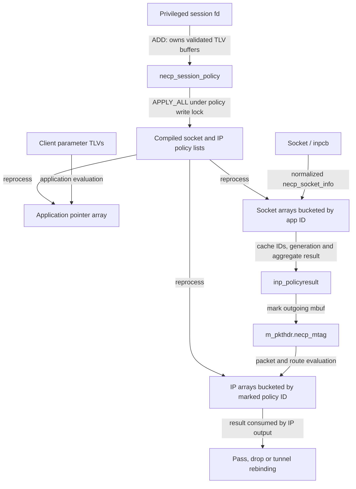

# NECP policy sessions, compilation and packet decisions

[Networking](README.md) · [Policy overview](policy-extensions.md) · [NECP clients and flow registration](necp-clients-and-flow-registration.md) · [Socket/PCB lifetime](internet-pcbs-ports-and-lifetime.md)

NECP evaluates rules at three related points: an application asks what network path is available, a socket acquires or refreshes policy state, and an IP packet is checked on output. The policy writer supplies session rules; the kernel converts those rules into ordered socket and IP policies. This chapter follows that conversion and the local consumers in `xnu-12377.121.6`. The companion follows client UUIDs, notifications and provider assignments. A policy result describes a decision; it does not itself deliver a packet or prove that an external tunnel, filter or agent has completed work.

## 1. Entry points and objects

There are two kinds of `DTYPE_NETPOLICY` file descriptor. `necp_session_open()` creates the privileged policy-writer session; `necp_open()` creates the application/observer client fd. The first byte of their private data distinguishes the kind, and each action dispatcher checks it after taking a file reference. Ordinary `read()` and `write()` are not the policy protocol. The relevant syscall slots are 460 for one-shot matching, 501/502 for clients, and 522/523 for sessions. [Session fd lookup](../../../xnu/bsd/net/necp.c#L1106-L1123), [client fd lookup](../../../xnu/bsd/net/necp_client.c#L2397-L2414), [syscall declarations](../../../xnu/bsd/kern/syscalls.master#L785-L827), [one-shot declaration](../../../xnu/bsd/kern/syscalls.master#L711).

| Object | State that matters |
|---|---|
| `necp_session` | Mutex, control unit, requested priority, derived session order, process identity, dirty bit, owned session-policy list and domain-filter/trie lists. |
| `necp_session_policy` | Session-local ID/order; owned result, condition and route-rule TLV buffers; `applied`, `pending_deletion`, `pending_update`; IDs of derived socket/IP policies and retained mapping identities. |
| `necp_kernel_socket_policy` | Global kernel ID, session/order, condition and negation masks, decoded identity/address/interface values, result and parameter union. |
| `necp_kernel_ip_output_policy` | Global kernel ID, session/order/suborder, packet-facing conditions including an upstream policy ID and last interface. |
| `necp_socket_info` | Temporary normalized lookup input assembled from the PCB, process identity, addresses, interface, client flags and selected socket attributes. |
| `necp_inpcb_result` | Cached policy/skip IDs, application ID, generation, flow hash, and aggregate routing/filter/diversion/route-rule result stored in `inpcb.inp_policyresult`. |

Sources: [session](../../../xnu/bsd/net/necp.c#L314-L341), [temporary lookup input](../../../xnu/bsd/net/necp.c#L343-L375), [compiled and session structures](../../../xnu/bsd/net/necp.h#L1326-L1432), [PCB result](../../../xnu/bsd/net/necp.h#L1434-L1453).



Arrays contain pointers to compiled policies protected by the global policy lock; they are not independent copies with separately published lifetimes.

## 2. Opening and controlling a policy session

Opening requires a platform-signed binary **and**, unless the effective UID is zero, `PRIV_NET_PRIVILEGED_NECP_POLICIES`. Root does not bypass the platform-binary check. The fd is close-on-exec and close-on-fork. Creation initializes the mutex and lists, allocates an available control-unit number under the global policy write lock, derives its session order and publishes the session in the global list. [Admission and fd publication](../../../xnu/bsd/net/necp.c#L1034-L1086), [session construction](../../../xnu/bsd/net/necp.c#L2382-L2430).

The dispatcher holds a file reference and the session mutex across its handler, including handler copyin/copyout and apply. `LOCK_SESSION_TO_PROC` records the locked state against the executable UUID maintained by session actions, not a task-local port right or a numeric PID alone. There is a return-value wrinkle in this snapshot: on UUID mismatch the dispatcher assigns `EPERM` to `error` and jumps to `done`, but returns the separate `return_value`, initialized to zero. The requested action is skipped; the source does not support saying that this branch returns `EPERM` to userspace. [Identity check and dispatch](../../../xnu/bsd/net/necp.c#L1724-L1758), [dispatch exit](../../../xnu/bsd/net/necp.c#L1834-L1838), [lock operation](../../../xnu/bsd/net/necp.c#L1410-L1416).

| Session action | Local behavior |
|---|---|
| ADD / GET / LIST | Store a new rule or copy staged rules/IDs. Adding alone does not rebuild packet lookup tables. |
| DELETE / DELETE_ALL | Mark rules pending deletion and the session dirty; apply performs compiled-policy removal. |
| APPLY_ALL | Process additions/deletions/updates and rebuild maps, then schedule client refresh. |
| SET_SESSION_PRIORITY | Recompute order and mark every session policy pending update. Selected privileged priorities require an additional privilege check. |
| REGISTER_SERVICE / UNREGISTER_SERVICE | Accepted and ignored in this dispatcher. |
| Domain filter/trie operations and dumps | Separate auxiliary data/control operations; not equivalent to adding a socket rule. |

The full action numbering is in [necp.h](../../../xnu/bsd/net/necp.h#L108-L125); dispatch is in [necp_session_action](../../../xnu/bsd/net/necp.c#L1755-L1832). The detailed domain-filter/trie construction and dump formats remain outside this chapter.

## 3. TLV parsing transfers owned buffers into a staged policy

The wire TLV header is a packed byte type followed by a 32-bit length. Helpers copy scalar lengths rather than assuming aligned headers. The session handler caps the whole ADD buffer at `1024 + 512 + 4096` bytes, requires room to return a policy ID, and copies input into kernel memory before parsing. Inner result/condition/route-rule sizes have separate limits of 512, 4096 and 1024 bytes. These are different limits, not a single unlimited TLV stream. [Header and helpers](../../../xnu/bsd/net/necp.h#L1203-L1239), [size constants](../../../xnu/bsd/net/necp.c#L273-L294), [ADD copy boundary](../../../xnu/bsd/net/necp.c#L1126-L1174).

`necp_handle_policy_add()` finds order and result TLVs, allocates the result buffer, validates its result type and parameter shape, then gathers condition and, where required, route-rule TLVs. It counts encoded bytes using checked addition before allocating each collected array. Result/condition-specific validators check permitted types, lengths and combinations; they are not a general policy language interpreter. The handler rejects mixed default/nondefault conditions, a condition that requires an application condition without one, multiple default route rules, and a kernel-PID condition whose result is not pass/skip. [Result validation](../../../xnu/bsd/net/necp.c#L2507-L2580), [condition validation](../../../xnu/bsd/net/necp.c#L2649-L2847), [gathering and semantic checks](../../../xnu/bsd/net/necp.c#L2932-L3204).

The TLV copy helper explicitly checks the remaining input and destination capacity:

[Source: `bsd/net/necp.c`, lines 2330–2348](../../../xnu/bsd/net/necp.c#L2330-L2348).

<!-- source-excerpt: ../../../xnu/bsd/net/necp.c#L2330-L2348 -->
```c
	// Validate that buffer has enough room for this TLV
	u_int32_t tlv_length = necp_buffer_get_tlv_length(buffer, buffer_length, tlv_offset);
	if (tlv_length > buffer_length - (tlv_offset + sizeof(u_int8_t) + sizeof(u_int32_t))) {
		NECPLOG(LOG_ERR, "necp_get_tlv_at_offset buffer_length is too small for TLV of length %u (%u < %lu)",
		    tlv_length, buffer_length, tlv_offset + sizeof(u_int8_t) + sizeof(u_int32_t) + tlv_length);
		return EINVAL;
	}

	if (out_buffer != NULL && out_buffer_length > 0) {
		// Validate that out buffer is large enough for  value
		if (out_buffer_length < tlv_length) {
			NECPLOG(LOG_ERR, "necp_get_tlv_at_offset out_buffer_length is too small for TLV value (%u < %u)",
			    out_buffer_length, tlv_length);
			return EINVAL;
		}

		// Get value pointer
		u_int8_t * __indexable tlv_value = necp_buffer_get_tlv_value(buffer, buffer_length, tlv_offset, NULL);
		if (tlv_value == NULL) {
```

Successful `necp_policy_create()` takes ownership of the three buffers, assigns a session-local policy ID, inserts by policy order and marks the session dirty. Failed parsing frees provisional buffers. A different failure boundary exists afterward: if returning the new ID through `copyout()` fails, ADD frees only its temporary input buffer; it does **not** remove the already-created policy. A caller cannot infer “no rule was staged” from that copyout error. [Ownership transfer](../../../xnu/bsd/net/necp.c#L3844-L3876), [parse cleanup](../../../xnu/bsd/net/necp.c#L3189-L3204), [ID copyout](../../../xnu/bsd/net/necp.c#L1153-L1174).

## 4. Session priority and compiled order

`necp_allocate_new_session_order()` treats unknown/out-of-range priority as default and computes `control_unit + (priority - 1) * 1000`. Lower session orders are traversed first. Within a session, lower user policy orders precede higher ones. Equal-order insertion uses `>=`, so equal keys are not a stable append order. Changing priority changes staged metadata immediately but marks compiled policies for replacement at the next apply. [Formula](../../../xnu/bsd/net/necp.c#L909-L921), [priority update](../../../xnu/bsd/net/necp.c#L1361-L1407), [insertion macros](../../../xnu/bsd/net/necp.c#L204-L234), [socket insertion](../../../xnu/bsd/net/necp.c#L5062-L5072).

IP policies carry four suborder slots for ID/tunnel and direct-condition variants. Read their insertion macro literally when comparing equal session and policy orders: its earlier second-key `>=` test already admits equal second keys, so the third-key clause does not provide a general lexicographic tie-break independent of insertion order. The compiler's actual insertion sequence and enabled variants matter. [Suborder definitions](../../../xnu/bsd/net/necp.c#L4055-L4058), [three-key macro](../../../xnu/bsd/net/necp.c#L226-L234), [IP insertion](../../../xnu/bsd/net/necp.c#L7094-L7101).

Drop-all configuration adds an order threshold to evaluation; it is not appended as an ordinary session policy. The first order for a priority is `(priority - 1) * 1000 + 1`; matching checks that threshold alongside per-process drop order and destination-drop rules. [Threshold calculation](../../../xnu/bsd/net/necp.c#L925-L951), [matching cutoffs](../../../xnu/bsd/net/necp.c#L10178-L10203).

## 5. One session rule can produce several kernel policies

`necp_policy_apply()` runs with the global policy lock exclusively held. It decodes condition TLVs into masks and concrete values, creating/referring to application UUID, account, netagent and route-rule mappings as needed. Some conditions exist only at application/socket level; a packet cannot directly recover the process's executable UUID or domain string from its IP header. [Compiler state and condition loop](../../../xnu/bsd/net/necp.c#L4071-L4153), [identity mappings](../../../xnu/bsd/net/necp.c#L6576-L6720).

The result controls which layers receive a derived rule:

| Result and conditions | Derived behavior |
|---|---|
| PASS with socket-only conditions | A socket rule evaluates identity; an IP rule matches the resulting socket policy ID. |
| PASS with packet-compatible conditions | Also emit a direct IP-condition rule for traffic not selected through the socket identity path. |
| DROP with socket-only conditions | Drop at socket matching; no need to reproduce unavailable identity fields in a packet rule. |
| DROP with packet-compatible conditions | Socket rule plus direct IP rule restricted to unmarked traffic through a policy-ID-none condition. |
| SOCKET_FILTER / SOCKET_DIVERT | Socket-layer result; filter accumulation and terminal/transparent diversion are interpreted by the matcher. |
| IP_TUNNEL | Socket/ID/direct variants as applicable, with additional last-interface/ID rules for traffic returning from a tunnel. |
| Agent, scope and route-rule results | Produce the applicable socket result or shared route-rule identity; interface lookup/mapping availability affects compilation. |

These are the actual decisions in the [result switch](../../../xnu/bsd/net/necp.c#L4590-L4760) and [derived policy creation](../../../xnu/bsd/net/necp.c#L4762-L4826). The two extra tunnel creation blocks both test `ip_output_layer_tunnel_condition_from_id` in this snapshot; do not silently substitute the similarly named `_from_non_id` variable because a comment suggests it.

For example, a rule matching application A with PASS creates a socket policy S. TCP later marks the mbuf with S; an IP policy P matching S can pass the packet without reobtaining A's process identity. S and P are global kernel IDs. Neither is the session-local policy ID returned by ADD, nor a client/flow UUID.

## 6. Apply and removal are serialized, but not a rollback transaction

`APPLY_ALL` takes the global write lock while walking the dirty session. Pending deletion un-applies and frees a rule; a new rule is compiled; pending update un-applies then recompiles. It updates the UUID policy table and rebuilds socket/IP maps before clearing the dirty bit. After unlocking it requests asynchronous client reevaluation and posts the policy-change event. [Apply body](../../../xnu/bsd/net/necp.c#L4833-L4878).

[Source: `bsd/net/necp.c`, lines 4845–4869](../../../xnu/bsd/net/necp.c#L4845-L4869).

<!-- source-excerpt: ../../../xnu/bsd/net/necp.c#L4845-L4869 -->
```c
			if (policy->pending_deletion) {
				if (policy->applied) {
					necp_policy_unapply(policy);
				}
				// Delete the policy
				necp_policy_delete(session, policy);
			} else if (!policy->applied) {
				necp_policy_apply(session, policy);
			} else if (policy->pending_update) {
				// Must have been applied, but needs an update. Remove and re-add.
				necp_policy_unapply(policy);
				necp_policy_apply(session, policy);
			}
		}

		necp_kernel_socket_policies_update_uuid_table();
		necp_kernel_socket_policies_reprocess();
		necp_kernel_ip_output_policies_reprocess();

		// Clear dirty bit flags
		session->dirty = FALSE;
	}

	lck_rw_done(&necp_kernel_policy_lock);

```

The boolean results of individual apply and map-reprocess calls are not checked here. `necp_policy_apply()` can return false after earlier derived policies/mappings were created, and its `fail` label does not undo them. Map rebuilding frees old arrays before allocating replacements; its allocation-failure path clears lookup state rather than restoring the old map. The outer syscall helper still returns zero after its void apply call. These facts bound the success contract: this is serialized incremental maintenance, not an all-or-nothing configuration transaction. [Compiler failure exit](../../../xnu/bsd/net/necp.c#L4762-L4830), [map allocation and failure](../../../xnu/bsd/net/necp.c#L5693-L5770), [apply syscall helper](../../../xnu/bsd/net/necp.c#L1281-L1287).

Unapply releases mapping/route-rule references and deletes every recorded socket/IP policy ID before clearing `applied`. Compiled-policy destruction releases its own referenced interface/string/filter data. Session close marks all policies for deletion, applies that change, then removes/frees the session. The auxiliary domain-filter/trie lifecycle should be separately checked before claiming that every auxiliary object has the same teardown path. [Unapply](../../../xnu/bsd/net/necp.c#L3988-L4053), [socket policy deletion](../../../xnu/bsd/net/necp.c#L5094-L5138), [close](../../../xnu/bsd/net/necp.c#L1089-L1103), [session destructor](../../../xnu/bsd/net/necp.c#L2433-L2460).

## 7. Maps reduce candidates without replacing rule evaluation

Socket reprocessing constructs one application-level array and five socket buckets. Bucket zero is for application ID zero; nonzero IDs select `id % 4 + 1`. A positive application-ID condition goes into its bucket; no application-ID condition or a negated one goes into every bucket. Agent-type conditions remain in the application array but are excluded from socket arrays. Combined condition masks tell input construction which attributes may be needed. Every selected candidate still passes the full predicate; a hash bucket is not an exact match. [Map representation](../../../xnu/bsd/net/necp.c#L399-L439), [socket rebuild](../../../xnu/bsd/net/necp.c#L5628-L5744).

IP maps similarly use five buckets keyed by the mbuf's policy ID. Non-ID, local-network and SKIP rules are copied to all appropriate buckets. Reprocessing omits SKIP rules that cannot skip a useful later policy in their session. Optional overlap/deduplication checks exist, but `necp_dedup_policies` defaults to zero here; the source's introductory “optimized maps” description is not proof that every product run deduplicates policies. [Default](../../../xnu/bsd/net/necp.c#L169-L178), [IP rebuild](../../../xnu/bsd/net/necp.c#L7320-L7458).

Successful socket reprocessing increments `necp_kernel_socket_policies_gencount`; the macro wraps near `INT32_MAX` to one. IP reprocessing has no separate per-packet cache generation in this path. [Generation declaration](../../../xnu/bsd/net/necp.c#L386-L398), [successful increment](../../../xnu/bsd/net/necp.c#L5742-L5744).

## 8. Matching accumulates secondary results before a terminal decision

`necp_socket_check_policy()` tests applicable conditions and returns false on the first mismatch. Its initial interface rule is easy to miss: without `ALL_INTERFACES`, a rule with no bound-interface or interface-flag condition requires an unbound lookup. A zero condition mask is therefore not an unconditional match for every bound socket. For interface flags, positive conditions require some matching bit in each nonempty flag class, not equality of the entire flags word. Identity, protocol, address range/subnet, domain, client flags and entitlement conditions then apply their own comparisons and supported negation rules. [Interface admission](../../../xnu/bsd/net/necp.c#L9136-L9202), [remaining predicate](../../../xnu/bsd/net/necp.c#L9204-L9777).

The ordered array walker maintains separate outputs:

| Matched result | Continue or stop? |
|---|---|
| SOCKET_FILTER | Accumulate filter units. `NO_FILTER` overrides ordinary accumulation; preserve-existing-connections survives only when all contributing filters preserve. Continue. |
| ROUTE_RULES | Append a bounded route-rule ID. Continue. |
| USE/SCOPED/REMOVE NETAGENT or REMOVE TYPE | Add/update bounded agent IDs and use/remove flags. Continue. |
| Transparent SOCKET_DIVERT | OR its control unit into the aggregate diversion result. Continue. |
| SKIP | Skip lower-order rules up to the requested order, or through the current session when no order is supplied. Continue. |
| ALLOW_UNENTITLED | Clear the lookup's process drop-order restriction. Continue. |
| Ordinary terminal result | Return this compiled-policy pointer and stop. |

[Accumulation and terminal selection](../../../xnu/bsd/net/necp.c#L10273-L10439). A filter match alone can leave the terminal result at NONE while still requiring filtering. A no-match result is not equivalent to an empty aggregate.

SKIP carries both an order and `session_order + 1`; the next session clears it. The socket matcher records a skip-policy ID for the IP layer only when needed to preserve skipped IP-facing decisions. Global/per-process drop boundaries and destination restrictions can stop the scan before a later pass is considered. [Skip mechanics](../../../xnu/bsd/net/necp.c#L10178-L10242), [skip result](../../../xnu/bsd/net/necp.c#L10382-L10406).

## 9. Socket caching and invalidation

The PCB embeds the following cache record at [`inpcb.inp_policyresult`](../../../xnu/bsd/netinet/in_pcb.h#L241). The aggregate result contains the terminal result/parameter plus accumulated filter, diversion and route-rule values; it is copied state, not a reference to a compiled policy.

[Source: `bsd/net/necp.h`, lines 1443–1451](../../../xnu/bsd/net/necp.h#L1443-L1451).

<!-- source-excerpt: ../../../xnu/bsd/net/necp.h#L1443-L1451 -->
```c
struct necp_inpcb_result {
	u_int32_t                                       app_id;
	necp_kernel_policy_id                           policy_id;
	necp_kernel_policy_id                           skip_policy_id;
	int32_t                                         policy_gencount;
	u_int32_t                                       flowhash;
	u_int32_t                                       network_denied_notifies;// Notification count
	struct necp_aggregate_socket_result             results;
};
```

`necp_socket_find_policy_match()` normalizes valid overrides, performs configured empty-policy and loopback/intercoprocessor fast paths, then takes the policy read lock. `necp_socket_fillout_info_locked()` starts from zeroed storage, fills relevant identity/credential/interface fields, normalizes mapped IPv4 and embedded IPv6 scope representations, and can obtain a datagram `soflow` entry. A referenced process and `soflow` are released on exit. [Input construction](../../../xnu/bsd/net/necp.c#L9787-L10094), [fast paths](../../../xnu/bsd/net/necp.c#L10595-L10687).

The cache key is a hash of the **temporary structure bytes**, seeded by policy generation. Some members are pointers; this is not an independent deep hash of every string's contents. The cache hit also requires a non-NONE prior policy ID and equal generation:

[Source: `bsd/net/necp.c`, lines 10693–10700](../../../xnu/bsd/net/necp.c#L10693-L10700).

<!-- source-excerpt: ../../../xnu/bsd/net/necp.c#L10693-L10700 -->
```c
	// Check info
	u_int32_t flowhash = necp_socket_calc_flowhash_locked(&info);
	if (inp->inp_policyresult.policy_id != NECP_KERNEL_POLICY_ID_NONE &&
	    inp->inp_policyresult.policy_gencount == necp_kernel_socket_policies_gencount &&
	    inp->inp_policyresult.flowhash == flowhash) {
		// If already matched this socket on this generation of table, skip

		if (info.soflow_entry != NULL) {
```

After evaluation, the function copies values into `inp_policyresult`, not a policy pointer that can outlive the lock. It verifies required agent activity, aggregates route rules, and applies additional missing-client/restricted-multicast checks. Policy changes can mark an already-connected socket defunct, or require TCP tunnel MSS/TSO recalculation; the latter runs after dropping the policy lock to avoid recursive locking. [Result publication and connected socket effects](../../../xnu/bsd/net/necp.c#L10785-L10985), [hash implementation](../../../xnu/bsd/net/necp.c#L9781-L9784).

The send/receive helper has a distinct shortcut: a connected socket, or a lookup without address overrides, may reuse its saved policy when generation matches, but still checks route/interface allowance. Otherwise it constructs current input and performs its own lookup. It rejects ordinary traffic for DROP, SOCKET_DIVERT, or a tunnel result arriving on the wrong input interface. It also maintains datagram-flow filter state so a policy-generation change can be observed without replacing the first filter result on every same-generation datagram. [Reuse conditions](../../../xnu/bsd/net/necp.c#L12931-L12986), [datagram filter update](../../../xnu/bsd/net/necp.c#L13160-L13236).

Do not describe every network change as a generation increment. This inspected generation is bumped by successful socket-map rebuilding; client reevaluation scheduling and route/interface validation are separate mechanisms. Some empty-policy checks deliberately read counts without the global lock, as their source comments acknowledge.

## 10. Packet tags connect socket policy to IP output

TCP output calls the send/receive allowance helper before marking a newly constructed mbuf; failure follows its packet cleanup path. TCP input performs its own receive check. UDP also marks outgoing packets after its per-datagram policy decisions. [TCP output](../../../xnu/bsd/netinet/tcp_output.c#L3227-L3237), [TCP input](../../../xnu/bsd/netinet/tcp_input.c#L3244-L3255), [UDP marking](../../../xnu/bsd/netinet/udp_usrreq.c#L2079-L2086).

`necp_mark_packet_from_socket()` writes `m_pkthdr.necp_mtag`: selected policy ID, route-rule ID, compact application ID, skip-policy ID and a reset last-interface index. A stored NO_MATCH/NONE combination is treated like pass for tagging. The skip field also has an overloaded NO_MATCH sentinel for “skip filters”; readers must use the matching accessors rather than equating every nonzero skip value with a real policy ID. [Tag construction](../../../xnu/bsd/net/necp.c#L13324-L13385), [skip/filter accessors](../../../xnu/bsd/net/necp.c#L13468-L13501).

[Source: `bsd/sys/mbuf.h`, lines 342–348](../../../xnu/bsd/sys/mbuf.h#L342-L348).

<!-- source-excerpt: ../../../xnu/bsd/sys/mbuf.h#L342-L348 -->
```c
struct necp_mtag_ {
	u_int32_t       necp_policy_id;
	u_int32_t       necp_skip_policy_id;
	u_int32_t       necp_route_rule_id;
	u_int16_t       necp_last_interface_index;
	u_int16_t       necp_app_id;
};
```

The built-in tag carries compact IDs and an interface index, not client parameter/result TLVs, a policy pointer or an executable UUID. The application mapping therefore has to translate between process identity and the compact ID before packet output. [Built-in tag placement](../../../xnu/bsd/sys/mbuf.h#L350-L357), [packet marking's application mapping](../../../xnu/bsd/net/necp.c#L13359-L13375).

IPv4 output extracts IP addresses/protocol and, when available, TCP/UDP ports. IPv6 uses `ip6_lasthdr()` to find the transport offset; this is different from the direct-next-header parser used by Skywalk traffic rules. Both combine those bytes with the mbuf tags, output scope, route and PF tag under the policy read lock. IP matching accumulates route rules and interprets SKIP before choosing a terminal result. [IPv4 wrapper](../../../xnu/bsd/net/necp.c#L11350-L11521), [IPv6 header walk](../../../xnu/bsd/net/necp.c#L11587-L11636), [IP matcher](../../../xnu/bsd/net/necp.c#L11234-L11332).

The wrapper returns an ID and copies its result/parameter. It does not itself free or tunnel the mbuf. `ip_output()` marks the packet with the resulting IP-policy ID and consumes the decision: drop becomes `EHOSTUNREACH` and packet cleanup; tunnel can select/rebind an interface/route; a PASS result can proceed to `skip_ipsec` unless `PASS_NO_SKIP_IPSEC` requests otherwise, after the relevant interface allowance check. The IPv6 caller has its own corresponding path. [IPv4 consumer](../../../xnu/bsd/netinet/ip_output.c#L1230-L1329), [IPv6 consumer](../../../xnu/bsd/netinet6/ip6_output.c#L527-L626).

## 11. Application evaluation also asks whether a route is usable

`necp_match_policy()` is a one-shot syscall with a 1024-byte input limit and a fixed `necp_aggregate_result` output. It does not create the persistent client from the companion. Persistent clients call the same internal application matcher with `has_client=true`, a selected interface and optional returned route. [One-shot body](../../../xnu/bsd/net/necp_client.c#L12535-L12584), [application entry](../../../xnu/bsd/net/necp.c#L7944-L8020).

The application path parses identity, endpoint, domain and other TLVs, forms `necp_socket_info`, and uses the application array rather than an app-ID socket bucket. It then resolves route/interface state, validates a requested local address against the selected interface, gathers direct/local/reachability/QoS-related flags, and applies collected route rules. Route rules can deny an interface, alter agent participation or select diversion. The loop separates rules matching agents from other rules so earlier agent modifications affect later agent-dependent decisions; a denial stops further route-rule processing. [Shared matcher call](../../../xnu/bsd/net/necp.c#L8393-L8424), [route/local-address processing](../../../xnu/bsd/net/necp.c#L8528-L8817), [route-rule passes](../../../xnu/bsd/net/necp.c#L8874-L9004).

When requested, ownership of the selected referenced route passes through `returned_route`; otherwise the function releases it. It drops policy locking and retained process/credential references before returning. The client stores that route behind its own route mutex. [Application route/output cleanup](../../../xnu/bsd/net/necp.c#L9010-L9063), [client route replacement](../../../xnu/bsd/net/necp_client.c#L5054-L5067).

## 12. Worked update and verification boundaries

Suppose session Q has order-10 SOCKET_FILTER for application A and order-20 PASS for A. After ADD, only Q's staged list changes. APPLY compiles and republishes lookup arrays. A subsequent socket evaluation accumulates the filter at 10, stops at pass at 20, and caches the resulting values with generation G. Output marks the socket policy ID for IP evaluation; filter handling still applies even though the terminal result is PASS.

Now Q marks order 20 for deletion. Until APPLY, compiled decisions remain. Applying removes it, rebuilds the arrays and advances generation. The next relevant socket check cannot reuse the old generation; it may produce a different terminal decision while retaining an accumulated filter. Persistent NECP clients learn changes through their scheduled reevaluation/readability path, not by directly reading `inp_policyresult`. This example assumes ordinary successful allocation and no overriding higher-priority, bypass or drop-all rule.

The chapter establishes the local staging/compiler/map/matcher/cache/result-consumer path. It does not exhaust every TLV, domain-trie/bloom algorithm, route-rule action, signed-resolver policy, drop-destination control operation or product entitlement configuration. It does not provide the absent userspace policy producer, Network Extension provider or hardware implementation. Exact snippets and citations are checked against this source tag; no policy-changing runtime tests were executed.

<!-- BEGIN PLATYDOC DOCUMENTATION LICENSE -->
Original Platydoc text and diagrams are licensed under [CC BY 4.0](https://creativecommons.org/licenses/by/4.0/). Quoted source code and third-party material retain their respective licenses.
<!-- END PLATYDOC DOCUMENTATION LICENSE -->
