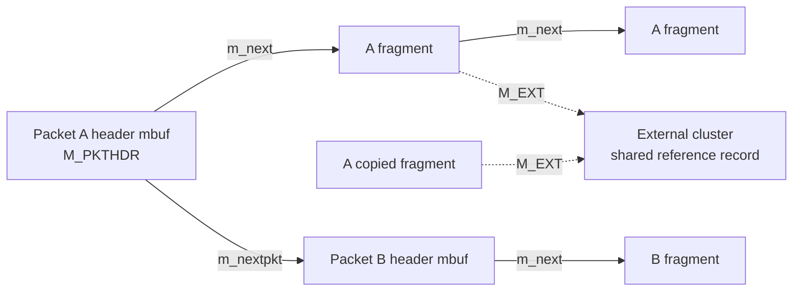
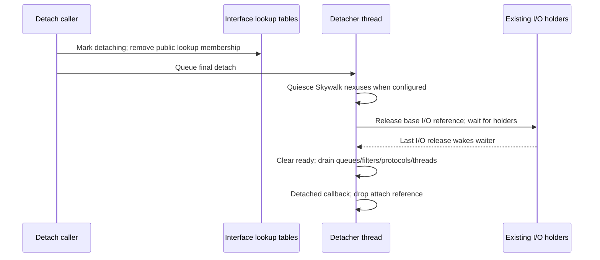

# Packet storage, route references, and interface teardown

[Networking](README.md) · [TCP/IP overview](tcp-ip-interfaces.md) · [Socket ownership](socket-lifecycle-and-io.md) · [Skywalk lifecycles](skywalk-lifecycles.md)

Below the transport layer, three independent objects often travel together: an mbuf carrying packet bytes, a referenced route used as an output hint, and an interface whose data path must remain available during processing. Their lifetimes differ. A packet may be consumed by address resolution before driver output. A route can remain allocated after removal from the routing table. An interface can disappear from lookup tables before its existing I/O operations finish. This chapter follows those distinctions through [`ip_output()`](../../../xnu/bsd/netinet/ip_output.c#L284), [`dlil_output()`](../../../xnu/bsd/net/dlil_output.c#L65), [`rtfree_common()`](../../../xnu/bsd/net/route.c#L1206), and [`ifnet_detach()`](../../../xnu/bsd/net/dlil.c#L5362).

## Mbuf chains, packet lists, and external storage

The [mbuf allocator companion](mbuf-allocation-caches-and-pressure.md) follows the allocation classes, CPU caches, slabs and pressure paths that supply this storage. [IPv6 output and ND](ipv6-output-and-neighbor-discovery.md) follows retained packet ownership while next-hop resolution is pending.

An mbuf is not necessarily a whole packet or a separately owned payload allocation. `m_next` links fragments of one packet or socket record; `m_nextpkt` links distinct packets/records. `m_len` describes the current fragment. A leading `M_PKTHDR` mbuf additionally carries aggregate packet length, receive-interface information, checksum/offload metadata, classification, and tags. A packet-list operation must preserve the second linkage while working on the first. See [`mbuf` representations](../../../xnu/bsd/sys/mbuf.h#L642), [`packet-list free`](../../../xnu/bsd/kern/uipc_mbuf.c#L2628), and [socket records](socket-lifecycle-and-io.md#the-objects-and-independent-forms-of-protection).



`M_EXT` selects external storage instead of the mbuf's inline data area. The external descriptor records a buffer, size, optional destructor and argument, and a reference record. The actual mbuf layout differs under `CONFIG_MBUF_MCACHE`; consumers outside XNU are explicitly directed to size-query routines instead of depending on private `_MLEN`/`_MHLEN` constants. This makes a diagram of logical ownership more useful than one fixed byte layout. See [`m_ext`](../../../xnu/bsd/sys/mbuf.h#L607) and [`configuration boundary`](../../../xnu/bsd/sys/mbuf.h#L625).

`m_copym_mode()` allocates new mbuf descriptors. For external storage it copies the descriptor and increments the shared storage reference; for inline bytes it copies the bytes. Copying an mbuf chain therefore does not establish exclusive access to every payload byte:

[Copying an external fragment shares its backing storage](../../../xnu/bsd/kern/uipc_mbuf.c#L3129)

<!-- source-excerpt: ../../../xnu/bsd/kern/uipc_mbuf.c#L3129-L3134 -->
```c
		n->m_len = MIN(len, (m->m_len - off));
		if (m->m_flags & M_EXT) {
			n->m_ext = m->m_ext;
			m_incref(m);
			n->m_data = m->m_data + off;
			n->m_flags |= M_EXT;
```

The function also distinguishes moving from duplicating a packet header. On allocation failure it frees the partial new chain. The source chain's ownership remains with its caller; moving packet-header metadata is a separate operation from freeing that chain. The payload-sharing distinction matters to TCP output, cloning for observers, and transformations that modify headers. Those callers must use the relevant writable/copy preparation contract rather than infer writability from having a different `struct mbuf *`. See [`m_copym_mode()`](../../../xnu/bsd/kern/uipc_mbuf.c#L3051).

`m_free()` frees one descriptor and returns its original `m_next`. Before freeing an `M_PKTHDR` object it removes tags and invokes transmit-completion callback handling. For external storage it saves reference metadata before decrementing the shared count: after a nonfinal decrement, touching that reference record could race its destruction. Final release dispatches to the appropriate cluster cache or external destructor; composite objects have a different recycling path. Thus “free packet” can mean returning objects to caches rather than returning physical pages. See [`m_free()`](../../../xnu/bsd/kern/uipc_mbuf.c#L1652) and [callback-backed mbuf caches](../vm/read-only-and-special-zones.md).

`m_freem()` follows `m_next` only. `m_freem_list()` follows the packet-list links and frees each constituent chain, batching cache returns. Passing a packet list to a single-chain free routine is an ownership error. Conversely, a routine processing one packet commonly detaches its `m_nextpkt` first so an error cannot accidentally consume unrelated packets. See [`m_freem()`](../../../xnu/bsd/kern/uipc_mbuf.c#L2869), [`m_freem_list()`](../../../xnu/bsd/kern/uipc_mbuf.c#L2628), and [`input detachment`](../../../xnu/bsd/net/dlil_input.c#L825).

Contiguous-header preparation has its own destructive failure rule. `m_pullup()` may retain the first descriptor or allocate a new leading mbuf, copy bytes from subsequent fragments, and free fully consumed fragments. Its failure path frees the remaining input chain and returns null. Callers must replace their chain variable with the result and treat null as loss of that input ownership, not as permission to free the original pointer again. See [`m_pullup()`](../../../xnu/bsd/kern/uipc_mbuf.c#L3466) and [`failure cleanup`](../../../xnu/bsd/kern/uipc_mbuf.c#L3537).

## Routes: a cache entry is a reference, not a permanent decision

`struct route` is a small cached lookup result: `ro_rt`, an optional source-interface address reference, flags, and destination. The larger `rtentry` contains radix-tree nodes, its mutex/reference count, flags/generation, gateway, selected interface/address, metrics, link-layer state, and references to gateway/parent routes. Internet PCBs and other output contexts can hold a `struct route`; the route entry is not owned exclusively by that one connection. See [`route`](../../../xnu/bsd/net/route_private.h#L105) and [`rtentry`](../../../xnu/bsd/net/route_private.h#L156).

The cache validity predicate is explicit:

[An allocated route can already be unusable](../../../xnu/bsd/net/route_private.h#L119)

<!-- source-excerpt: ../../../xnu/bsd/net/route_private.h#L119-L122 -->
```c
#define ROUTE_UNUSABLE(_ro)                                             \
	((_ro)->ro_rt == NULL ||                                        \
	((_ro)->ro_rt->rt_flags & (RTF_UP|RTF_CONDEMNED)) != RTF_UP ||  \
	RT_GENID_OUTOFSYNC((_ro)->ro_rt))
```

This tests table membership/state and generation, not just pointer validity. `rtalloc_ign_common_locked()` inspects a cached route while holding the global routing lock, releases an unusable entry, performs a scoped lookup, and synchronizes the returned generation. `ip_output()` additionally compares the cache's address family and destination; source-interface selection and bound-interface policy can require other choices. Its fast cache test deliberately reads selected route flags without the route lock, treating the cached route as a hint that lower layers or subsequent sends can revalidate. See [`cached lookup`](../../../xnu/bsd/net/route.c#L948), [`IPv4 cache checks`](../../../xnu/bsd/netinet/ip_output.c#L612), and [`interface selection`](../../../xnu/bsd/netinet/ip_output.c#L785).

The routing source states two locking domains:

| Lock or mechanism | Responsibility |
| --- | --- |
| `rnh_lock` | Radix-tree lookup/insertion/removal and fields needing global route serialization. |
| `rt_lock` | Entry reference count, mutable flags, gateway-route reference, metrics, and link-layer state. |
| Both locks | Mutations of the route key, gateway, interface, and interface address. Acquire `rnh_lock` before `rt_lock` when both are needed. |
| `RTF_CONDEMNED` | Prevents selected identity fields from changing after a removal decision and prevents new lookup selection. It is not a replacement for all locking. |
| Reference count | Keeps an entry alive for its users; it does not mean the entry remains in the tree. |

These are documented contracts in [`route.c` synchronization notes](../../../xnu/bsd/net/route.c#L127). Individual paths sometimes exploit immutable fields or explicit atomic assumptions; do not turn the table into a claim that every read takes both locks.

Deletion and final release are distinct. The `RTM_DELETE` path removes the radix node and marks the entry down/condemned while existing holders can still reference it. `rtfree_common()` first decrements under the route lock. At zero it may need the global lock to run close/removal/free processing. It cannot simply acquire `rnh_lock` while retaining `rt_lock`: that would reverse lock order. Instead it takes a temporary reference, drops the entry lock, acquires the global lock, relocks, and rechecks whether another lookup acquired a reference. A raced lookup can keep the entry alive. See [`route deletion`](../../../xnu/bsd/net/route.c#L2018) and [`last-reference lock transition`](../../../xnu/bsd/net/route.c#L1224).

Even a zero-reference route may remain cached while up. The address-family `rnh_close` callback can decide whether to purge immediately or retain it. Resource reclamation requires that the entry is down and unreferenced; it then releases associated addresses/routes/link-layer state. “Reference count zero” therefore does not universally mean “free now” in this subsystem. See [`close callback and reclaim condition`](../../../xnu/bsd/net/route.c#L1275).

For a gateway route, the original destination route and the route to its next hop can both be involved. `route_to_gwroute()` takes additional references, checks whether either entry is down, drops/reacquires locks around lookup, and rechecks that the gateway relationship did not change. Its successful nonnull output is both referenced and locked: the caller must release both forms of ownership. The original hint is preserved because the caller may still cache it. See [`route_to_gwroute()` contract and implementation](../../../xnu/bsd/net/route.c#L4204).

## Output: protocol media work can retain a packet

An ordinary IPv4 output has already selected routing/interface policy before entering `dlil_output()`. DLIL first obtains a data-movement reference on the interface and finds a referenced protocol attachment for the address family. That `if_proto` supplies media-specific pre-output handling; it is different from the socket's `protosw`. The interface supplies framing, filtering, and lower output callbacks. See [`DLIL acquisition`](../../../xnu/bsd/net/dlil_output.c#L94), [`pre-output selection`](../../../xnu/bsd/net/dlil_output.c#L217), and [callback families](README.md).

Pre-output can resolve or initiate resolution of the next-hop link address. An `EJUSTRETURN` means the packet has been consumed/queued by that operation. DLIL proceeds to the next packet; it must not free or submit the consumed packet to the driver. Other pre-output errors free the current packet and enter cleanup for the unprocessed remainder. A successful pre-output result can be reused for the remainder of a same-destination packet list. See [`pre-output contract and branches`](../../../xnu/bsd/net/dlil_output.c#L200).

Interface filters and framing may likewise alter or consume the packet. After that work, `if_output_dlil` accepts either individual packets or a packet list according to interface capability flags. In the `IFEF_ENQUEUE_MULTI` branch, DLIL submits packets separately then starts the interface when work was accepted. A conventional wrapper calls `if_output`; other configurations can connect this boundary to queues or Skywalk. It is inaccurate to interpret every `if_output_dlil()` invocation as synchronous hardware transmission. See [`output modes`](../../../xnu/bsd/net/dlil_output.c#L430), [`output wrapper`](../../../xnu/bsd/net/dlil_ctl.c#L358), and [`ifnet_start_common()`](../../../xnu/bsd/net/dlil.c#L2203).

Flow-control returns carry information beyond ordinary errno. DLIL maps `EQFULL`/`EQSUSPENDED` and selected congestion returns into `flowadv` codes while normalizing the return value along those paths. TCP can later use that feedback when deciding whether to send; it is separate from network congestion inferred through ACKs/loss. Cleanup releases the protocol attachment, remaining unprocessed packet list, interface data-movement reference, and any temporary route. Already submitted/retained packets are not returned by this cleanup. See [`single-packet feedback`](../../../xnu/bsd/net/dlil_output.c#L459), [`list feedback`](../../../xnu/bsd/net/dlil_output.c#L507), and [`cleanup`](../../../xnu/bsd/net/dlil_output.c#L570).

## Input: queueing and protocol dispatch change the processing context

Drivers enter `ifnet_input()` or an extended/polling variant, all reaching `ifnet_input_common()`. Invalid arguments or an unavailable interface cause the supplied packet list to be freed. For a usable non-loopback interface, `ifnet_datamov_begin()` protects the call. The routine validates or computes the list tail and packet/byte totals, then invokes the configured `if_input_dlil`; it releases its data-movement reference on return. This is an acceptance/dispatch boundary, not a guarantee that TCP has already processed the packet. See [`input entry points`](../../../xnu/bsd/net/dlil.c#L2050) and [`common input`](../../../xnu/bsd/net/dlil.c#L2073).

An asynchronous input implementation queues packets on DLIL input-thread state; other modes use direct/polling behavior. Consequently, the packet list can outlive the initial driver call. `dlil_input_packet_list_common()` obtains its own data-movement protection, detaches packets one at a time, initializes classifier metadata, and invokes interface demultiplexing under a shared interface lock. It handles translation/checksum/filter branches before finding a referenced protocol attachment. See [`asynchronous input`](../../../xnu/bsd/net/dlil_input.c#L356), [`packet processing`](../../../xnu/bsd/net/dlil_input.c#L766), and [`demultiplexing`](../../../xnu/bsd/net/dlil_input.c#L882).

Protocol attachment lookup groups compatible packets for dispatch. KPI-v1 protocol inputs receive one packet plus its saved frame-header pointer; KPI-v2 inputs can receive a packet list. Their error contracts determine whether DLIL frees the packet(s): nonzero errors other than `EJUSTRETURN` are dropped by the dispatcher. Unknown protocol attachments are dropped before dispatch. This refcounted attachment boundary permits callbacks without holding a global interface-list lock across arbitrary protocol processing. See [`attachment lookup and grouping`](../../../xnu/bsd/net/dlil_input.c#L1068) and [`dlil_ifproto_input()`](../../../xnu/bsd/net/dlil_input.c#L318).

The IPv4/IPv6 family paths then perform their own header, filter, reassembly, local-delivery, or forwarding decisions. Follow [the TCP/IP overview](tcp-ip-interfaces.md) for their concrete protocol dispatch, and [TCP input state transitions](tcp-connections-and-timers.md) for connection behavior. Receive-interface metadata and checksum validity must survive these transformations correctly; this chapter does not claim to audit every offload flag or translation branch.

## Interface teardown: hide, quiesce, dismantle, release

`ifnet_allocate*()` configures an interface and callbacks before attachment. `ifnet_attach()` serializes attachment with the DLIL interface lock because it temporarily releases the global interface-head lock while the object remains embryonic. Attachment is not merely insertion of a pointer into a list. See [`allocation`](../../../xnu/bsd/net/kpi_interface.c#L210) and [`attach serialization`](../../../xnu/bsd/net/dlil.c#L4858).

There are several protections to distinguish:

| Protection | Meaning |
| --- | --- |
| `ifnet_reference()` / `ifnet_release()` | Manipulate the underlying `dlil_ifnet` object reference count under `dl_if_lock`. |
| Interface/head locks | Serialize fields and membership in interface lookup structures. |
| `if_refio` I/O references | Prevent final teardown of fields needed by active operations. |
| Data-movement tracking | Adds readiness/quiescence requirements for the packet path, used by DLIL and Skywalk interaction. |
| `if_proto` references | Keep a particular protocol attachment available during its callback/dispatch use. |

See [`object references`](../../../xnu/bsd/net/dlil_subr.c#L399), [`I/O-reference acquisition`](../../../xnu/bsd/net/dlil.c#L4279), [`data-movement acquisition`](../../../xnu/bsd/net/dlil.c#L4354), and [`input protocol references`](../../../xnu/bsd/net/dlil_input.c#L1077).

`ifnet_detach()` marks the interface down, changes `IFRF_ATTACHED` to `IFRF_DETACHING`, removes it from `ifnet_head` and `ifindex2ifnet`, clears association/state, and schedules final detach work. It explicitly warns that fields protected by the fully-attached/I/O-reference contract cannot be dismantled yet. Lookup invisibility therefore precedes the end of existing callback activity. See [`detach transition`](../../../xnu/bsd/net/dlil.c#L5362) and [`detacher queue/thread`](../../../xnu/bsd/net/dlil.c#L5555).



`ifnet_detach_final()` first notifies/quiesces Skywalk when enabled, then drops the base `if_refio` reference and waits for the remaining count to reach zero. Only after that barrier does it clear readiness, tear down the send queue, remove filters and addresses, unplumb protocol attachments, and stop the starter/poller/input threads. The exact sequence has separate lock drops for callbacks and waits. See [`final detach barrier`](../../../xnu/bsd/net/dlil.c#L5645) and [`queue/protocol dismantling`](../../../xnu/bsd/net/dlil.c#L5712).

At the end it releases cached routes, publishes the detached event, clears detaching state, calls the saved detached callback, removes the permanent link-address slot, clears the internal in-use bit, and releases the reference held by attach. Outstanding object references and the interface allocator's reuse policy remain separate from whether its data path is attached. An interface pointer surviving in a holder is not permission to invoke callbacks after teardown. See [`final detach completion`](../../../xnu/bsd/net/dlil.c#L5995) and [`object release behavior`](../../../xnu/bsd/net/dlil_subr.c#L419).

## Sources inspected and limits

| Source area | Depth and remaining work |
| --- | --- |
| `mbuf.h`, `uipc_mbuf.c` | Read chain/storage layouts and copy, pullup, one-chain/list free, and external-reference release. Cache internals, all tag formats, and every packet-completion callback are outside this trace. |
| `route_private.h`, `route.c`, `ip_output.c` | Read synchronization contracts, cached lookup/invalidation, gateway resolution, selected delete and final-release bodies. Scoped selection details, routing-socket commands, neighbor resolution, multicast, and all address-family maintenance are not fully audited. |
| `dlil.c`, `dlil_input.c`, `dlil_output.c`, `dlil_subr.c`, interface KPI | Read packet dispatch/consumption, references, attach serialization, and detach barriers/cleanup. Driver hardware rings, interrupt handling, and DMA completion are provider-specific and not established here. |

The conventional mbuf path and Skywalk's packet-pool path meet at specific adapters. See [Skywalk lifecycles](skywalk-lifecycles.md) before transferring an mbuf ownership rule to channel packets.

<!-- BEGIN PLATYDOC DOCUMENTATION LICENSE -->
Original Platydoc text and diagrams are licensed under [CC BY 4.0](https://creativecommons.org/licenses/by/4.0/). Quoted source code and third-party material retain their respective licenses.
<!-- END PLATYDOC DOCUMENTATION LICENSE -->
