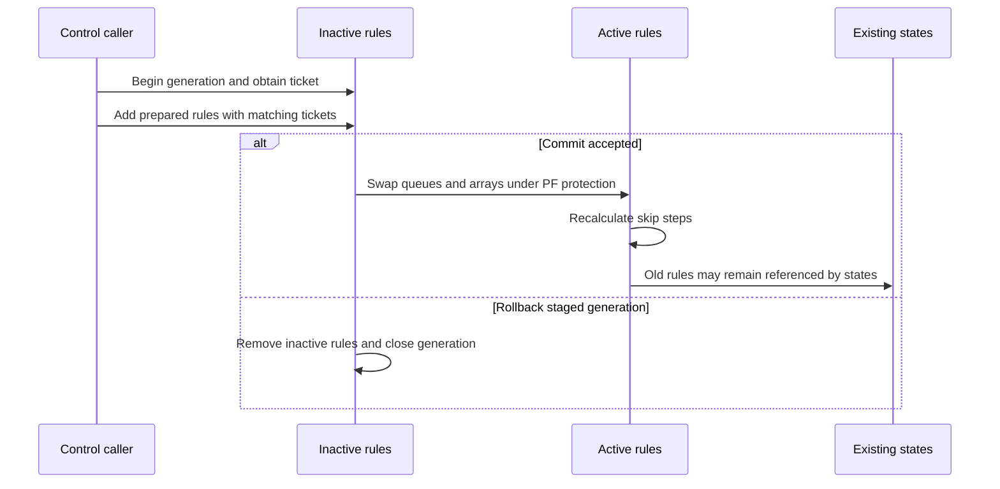
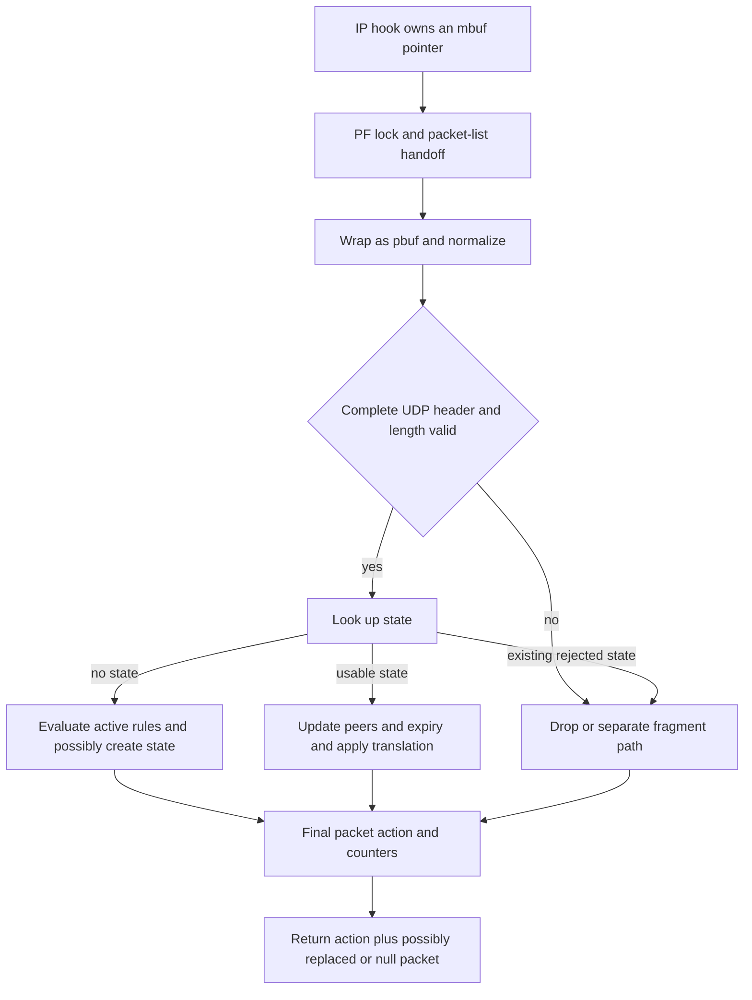
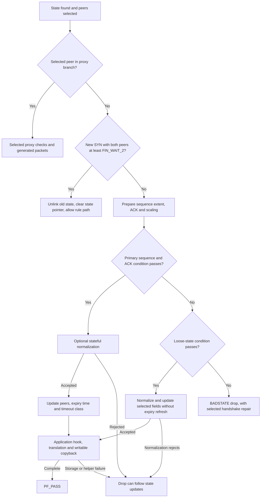
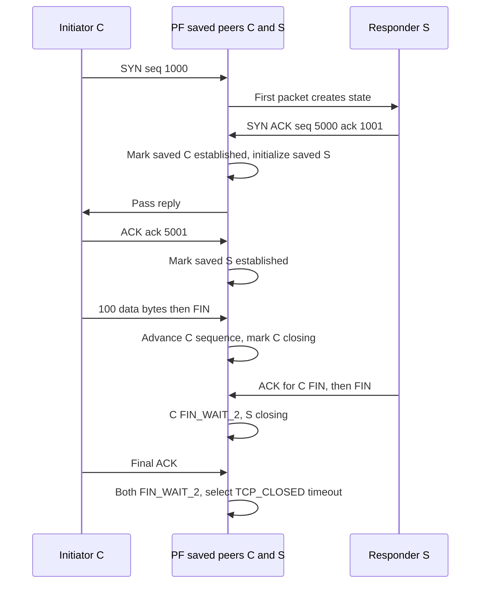
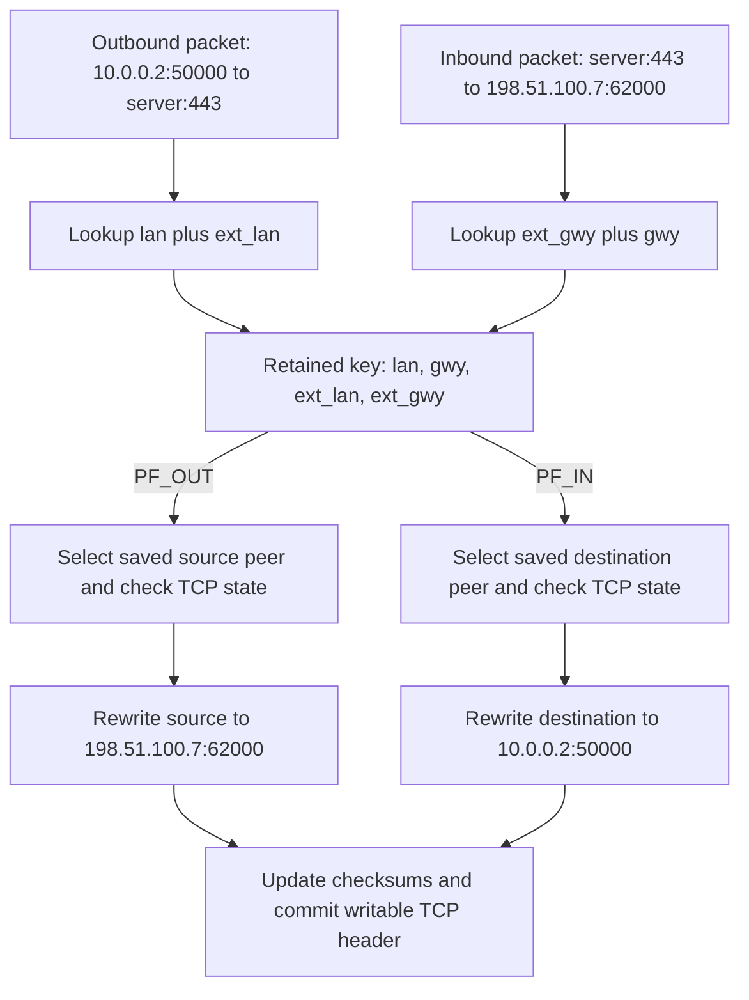
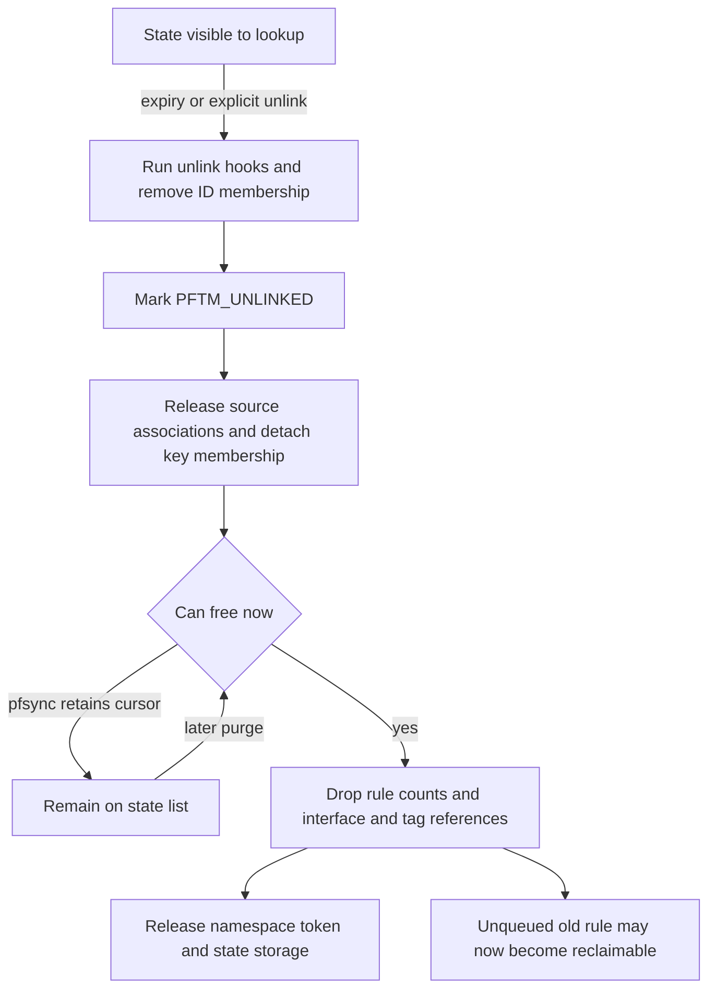

# PF rule publication, packet state and reclamation

[Networking guide](README.md) · [Policy integration](policy-extensions.md) · [Command dispatch](../../interfaces/command-dispatch-and-validation.md) · [BPF capture](bpf-capture-and-filter-lifecycle.md)

PF connects a persistent control plane to packet processing: an ioctl stages or publishes rules, packets consult existing states or evaluate rules, and later purge work removes expired state and releases references. This chapter follows the local implementation in `xnu-12377.121.6`, using ordinary IPv4 UDP and a worked TCP handshake/data/close sequence to make state progression concrete. TCP window/ACK validation, selected loose/proxy branches and same-family NAT show how packet acceptance differs from state mutation and writable-header commit. IPv6 has its own packet parser; NAT64, full TCP normalization and application helpers add separate branches. [Control implementation](../../../xnu/bsd/net/pf_ioctl.c#L1463-L1480), [IPv4 entry](../../../xnu/bsd/net/pf.c#L9714-L9808), [IPv6 entry](../../../xnu/bsd/net/pf.c#L10312).

## 1. Device access does not own a ruleset

The configured PF initialization registers a character device and creates `pf` and `pfm` nodes with root/wheel ownership and mode `0600`. `pfopen()` checks the minor and provides exclusive-open bookkeeping for `PFDEV_PFM`; it does not allocate a per-open filter table. `pfclose()` reverses that bookkeeping. It does not itself flush the global rules or states or stop filtering. [Device registration](../../../xnu/bsd/net/pf_ioctl.c#L554-L565), [open and close](../../../xnu/bsd/net/pf_ioctl.c#L650-L684).

`pfioctl()` independently requires the current credential to be superuser. It applies a command-specific securelevel allowlist and then a command-specific `FWRITE` check. The latter permits several operations, including start/stop and selected rule commands, without `FWRITE`; interpreting it as a blanket read-versus-mutation split would be inaccurate. Some table dummy requests promote the local flags to request exclusive perimeter protection. [Admission and flags](../../../xnu/bsd/net/pf_ioctl.c#L1463-L1605).

The main dispatch takes `pf_perim_lock` exclusive when those flags contain `FWRITE`, otherwise shared, then takes `pf_lock`. Packet processing normally takes the perimeter lock shared and the same mutex. The perimeter flag and mutex therefore have distinct roles: an ioctl can hold a shared perimeter lock while still serializing internal work through `pf_lock`. [Control locking](../../../xnu/bsd/net/pf_ioctl.c#L1606-L1614), [packet locking](../../../xnu/bsd/net/pf_ioctl.c#L4629-L4638).

Starting PF sets `pf_is_enabled` and `pf_status.running` and wakes the purge thread. Token-based starts track enable references separately from file descriptors. A plain stop clears running state and invalidates enable tokens; a token-based stop stops filtering when its last enable reference is removed. None of these identities is a rule ticket or state ID. [Start/stop bodies](../../../xnu/bsd/net/pf_ioctl.c#L1424-L1460), [token operations](../../../xnu/bsd/net/pf_ioctl.c#L1637-L1695).

## 2. Inactive rules become active by a pointer swap

For each rule category, `pf_ruleset` has two queues and active/inactive records containing queue pointers, pointer arrays, counts, tickets and an open flag. An anchor has its own ruleset and links into the anchor hierarchy. The ticket identifies a staged generation; the device descriptor is only the route to the ioctl. [Ruleset and anchor layout](../../../xnu/bsd/net/pfvar.h#L1212-L1243).

[bsd/net/pfvar.h, lines 1212–1228](../../../xnu/bsd/net/pfvar.h#L1212-L1228).

<!-- source-excerpt: ../../../xnu/bsd/net/pfvar.h#L1212-L1228 -->
```c
struct pf_ruleset {
	struct {
		struct pf_rulequeue      queues[2];
		struct {
			struct pf_rulequeue     *ptr;
			struct pf_rule          **__counted_by(rsize) ptr_array;
			u_int32_t                rcount;
			u_int32_t                rsize;
			u_int32_t                ticket;
			int                      open;
		}                        active, inactive;
	}                        rules[PF_RULESET_MAX];
	struct pf_anchor        *anchor;
	u_int32_t                tticket;
	int                      tables;
	int                      topen;
};
```

`pf_begin_rules()` locates or creates the ruleset, removes any previous inactive rules, increments the inactive ticket and marks it open. `DIOCADDRULE` checks the rule category, inactive ticket and pool ticket, allocates a kernel rule, and prepares its references before linking it to the inactive queue. `pf_rule_copyin()` terminates names, records creator identity, clears supplied kernel pointers/skip pointers and initializes rule lifetime counts; copying the user structure alone does not publish a usable rule. [Begin](../../../xnu/bsd/net/pf_ioctl.c#L964-L985), [add-rule path](../../../xnu/bsd/net/pf_ioctl.c#L2853-L2929), [copy sanitization](../../../xnu/bsd/net/pf_ioctl.c#L1199-L1244).

`pf_commit_rules()` verifies the open generation and ticket, performs main-ruleset matching setup when applicable, swaps the active and inactive storage, copies the ticket to the active side and recalculates skip steps. It then removes old rules from their queue and clears inactive storage/open state. `pf_rollback_rules()` removes the staged inactive rules for a matching open ticket; it does not reverse an already published active generation. [Commit](../../../xnu/bsd/net/pf_ioctl.c#L1110-L1197), [rollback](../../../xnu/bsd/net/pf_ioctl.c#L988-L1017).



The old-rule arrow denotes retained references, not reassigning an existing state to a new rule. `pf_rm_rule()` first unlinks a queued rule, sets its number to `-1`, and leaves storage alive while `states`, `src_nodes` or queue membership still require it. Final removal releases tags, address/table/interface/anchor resources and pool storage. Thus publishing a new rule list does not imply that existing states forget the rules that created them. [Rule removal and retention](../../../xnu/bsd/net/pf_ioctl.c#L773-L817).

Multi-element `DIOCXCOMMIT` needs a narrower reading than its optimistic comments suggest. It first copies and checks each transaction element, then copies each element again and commits sequentially. The second pass still handles `copyin`, table-commit and rule-commit errors by leaving through `fail`; that exit releases the current ruleset reference and returns the error. It does not undo earlier elements already committed by this invocation. This is the observable partial-progress contract in the body. [Preflight pass](../../../xnu/bsd/net/pf_ioctl.c#L4280-L4341), [commit pass and exit](../../../xnu/bsd/net/pf_ioctl.c#L4342-L4385).

## 3. Packet entry carries mutable ownership

IP input/output call `pf_af_hook()` with an `mbuf **`. The hook handles specified management/co-processor interface exemptions before taking PF protection. Thread marks prevent recursively taking the same protection; on the ordinary entry it takes the shared perimeter lock, checks enable state, then takes `pf_lock`. It detaches `m_nextpkt` while handling one packet and repairs the list afterward. Looped input uses the loopback PF interface to reconcile the local-output/input interface convention. [Hook and list handling](../../../xnu/bsd/net/pf_ioctl.c#L4613-L4704).

The IPv4 wrapper resolves delayed checksums when the selected output interface cannot perform the requested offload, changes the selected IP fields to network order, and calls `pf_test_mbuf()`. The latter wraps the mbuf in a `pbuf_t`, invokes `pf_test()`, then returns the resulting mbuf or null. IPv6 has a corresponding wrapper but different parsing and checksum preparation. [IPv4 wrapper](../../../xnu/bsd/net/pf_ioctl.c#L4708-L4761), [pbuf adapter](../../../xnu/bsd/net/pf.c#L9691-L9711), [IPv6 wrapper](../../../xnu/bsd/net/pf_ioctl.c#L4765-L4798).

`pf_test()` checks running/generated/skip state, obtains interface metadata, validates minimum length and normalizes the packet before protocol state/rule decisions. Normalization can change the packet's data storage, so it refreshes header pointers afterward. Remaining fragments follow the fragment-rule path rather than being treated as complete UDP/TCP headers. [Early decisions and normalization](../../../xnu/bsd/net/pf.c#L9733-L9860).



This diagram selects the ordinary UDP route and omits dummynet diversion and NAT64 reinjection. The action and pointer must both be inspected. In the IPv4 hook, a non-pass result with a remaining mbuf drops it and returns `EHOSTUNREACH`; a non-pass result with a null mbuf returns `EJUSTRETURN`. `pf_test()` can already have destroyed the packet before returning. Conversely, routing or SYN-proxy handling can consume a packet on a path returning pass. A pass result is not a statement that the original buffer still belongs to the caller. [Wrapper result handling](../../../xnu/bsd/net/pf_ioctl.c#L4741-L4760), [final destruction/routing](../../../xnu/bsd/net/pf.c#L10239-L10276).

## 4. A state is more than a cached matching rule

| Object | Important state | Lifetime relationship |
| --- | --- | --- |
| `pf_rule` | Match/action fields, skip pointers, rule counts and timeouts | May outlive active-list membership while states/source nodes refer to it |
| `pf_state_key` | LAN, gateway and external endpoints; address families/protocol; two tree links; state list and reference count | Several interface-specific states can share a key |
| `pf_state` | ID/creator, source/destination peers, filter/NAT/anchor rule pointers, interface, timestamps, timeout class, counters | Linked in lookup structures and the purge list; unlink and free are separate |
| `pf_pdesc` | Current packet/header pointers, address family, original/translated addresses, writable-storage status | Per-packet working representation, not a retained flow object |

Definitions: [rule](../../../xnu/bsd/net/pfvar.h#L673-L745), [key](../../../xnu/bsd/net/pfvar.h#L991-L1025), [state](../../../xnu/bsd/net/pfvar.h#L1047-L1084), [packet descriptor](../../../xnu/bsd/net/pfvar.h#L1418-L1480).

For ordinary UDP, the lookup builds both endpoint forms from the packet and attempts address-and-port-dependent, address-dependent and endpoint-independent variants when no application state is involved. `pf_find_state()` ordinarily searches LAN/external keys on output and external/gateway keys on input, then selects a matching interface-bound or floating state. NAT64 adds explicit cross-family lookup branches. IKE-related application state adds its own discriminator. [UDP key and variants](../../../xnu/bsd/net/pf.c#L7622-L7704), [direction and interface lookup](../../../xnu/bsd/net/pf.c#L1107-L1173).

The UDP caller evaluates rules only if the state helper did not pass **and** the state pointer is null. A found state marked `PFTM_PURGE` is rejected by the auxiliary check without becoming a fresh rule lookup. A state can also direct a route-related early pass. Read the state pointer together with the action. [Auxiliary decisions](../../../xnu/bsd/net/pf.c#L403-L423), [UDP state-to-rule dispatch](../../../xnu/bsd/net/pf.c#L9934-L9956).

For a new ordinary flow, `pf_test_rule()` prepares protocol ports and possible translation, walks active filter rules using mismatch skip pointers and anchor traversal, and retains the last matching rule unless `quick` stops the walk. Rule evaluation can also perform socket identity lookup, tag matching and other predicates. State creation is selected by `keep_state`, a translation rule, or TCP normalization, subject to the ICMP-error exception. It checks limits, acquires source nodes, allocates/initializes the state and key, then publishes through `pf_insert_state()`. [Rule evaluation](../../../xnu/bsd/net/pf.c#L5270-L5392), [creation predicate](../../../xnu/bsd/net/pf.c#L5754-L5765), [limits and initialization](../../../xnu/bsd/net/pf.c#L5813-L5877).

Insertion can join an existing key when the interface identity differs, but rejects a collision on the same interface. It also indexes the state by ID/creator, links the purge list and takes an interface state reference. Failure cleanup depends on the acquisition stage: the insertion-failure caller releases normalization/source-node/rule-count resources and state storage. Earlier allocation exits have different cleanup bodies; this chapter does not equate every drop return with identical rollback. [Insertion](../../../xnu/bsd/net/pf.c#L1491-L1548), [insertion failure](../../../xnu/bsd/net/pf.c#L6076-L6096), [earlier staged cleanup](../../../xnu/bsd/net/pf.c#L5837-L5870).

### Worked ordinary UDP exchange

Assume IPv4, no NAT, no application helper and a matching pass rule that keeps state. The first packet creates `src = PFUDPS_SINGLE`, `dst = PFUDPS_NO_TRAFFIC`, with `PFTM_UDP_FIRST_PACKET`. On a reverse-direction packet, peer selection swaps which saved peer is considered the current source. The source becomes at least `SINGLE`, and a destination already `SINGLE` becomes `MULTIPLE`. Once both saved peers are `MULTIPLE`, the timeout class is `PFTM_UDP_MULTIPLE`; otherwise subsequent traffic uses `PFTM_UDP_SINGLE`. This records observed directions, not a UDP handshake. [Initial peer values](../../../xnu/bsd/net/pf.c#L5916-L5920), [peer selection and update](../../../xnu/bsd/net/pf.c#L7720-L7749).

[bsd/net/pf.c, lines 7733–7749](../../../xnu/bsd/net/pf.c#L7733-L7749).

<!-- source-excerpt: ../../../xnu/bsd/net/pf.c#L7733-L7749 -->
```c
	}

	/* update states */
	if (src->state < PFUDPS_SINGLE) {
		src->state = PFUDPS_SINGLE;
	}
	if (dst->state == PFUDPS_SINGLE) {
		dst->state = PFUDPS_MULTIPLE;
	}

	/* update expire time */
	(*state)->expire = pf_time_second();
	if (src->state == PFUDPS_MULTIPLE && dst->state == PFUDPS_MULTIPLE) {
		(*state)->timeout = PFTM_UDP_MULTIPLE;
	} else {
		(*state)->timeout = PFTM_UDP_SINGLE;
	}
```

`expire` is refreshed to the current PF time, while `timeout` selects a duration policy. The actual deadline is computed later as `expire + duration`, possibly shortened by adaptive state-count thresholds. Reading `expire` alone as an absolute expiry deadline misses that calculation. [Deadline calculation](../../../xnu/bsd/net/pf.c#L1630-L1667).

For same-family NAT, the retained key additionally records original and translated endpoints. UDP state processing first makes packet storage writable, then calls `pf_change_ap()` to rewrite the applicable address/port and adjust checksums. The checksum helper treats a locally generated delayed pseudo-header checksum differently from a completed wire checksum. The next packet uses the state key; it need not repeat the original rule/pool selection. [State translation](../../../xnu/bsd/net/pf.c#L7779-L7827), [address/port checksum update](../../../xnu/bsd/net/pf.c#L2279-L2331).

### TCP lookup selects directional peers before checking a window

The IPv4 TCP path copies the fixed header into a local `tcphdr`, computes payload length from the IP/TCP header lengths, invokes TCP normalization, rejects zero ports, and then calls `pf_test_state_tcp()`. It evaluates the rule path only when that call leaves `s == NULL`. An existing state with unacceptable sequence information is therefore not simply retried against today's pass rules. [TCP dispatch](../../../xnu/bsd/net/pf.c#L9850-L9909).

The TCP helper constructs both endpoint key forms. For ordinary same-family traffic, output lookup uses the LAN/external tree; input uses external/gateway. Once a state is found, packet-local `src` and `dst` pointers select the saved peers: if packet direction equals `state_key->direction` and the family equals `af_lan`, `src = &state->src`; otherwise the pointers are reversed. **The saved `state->src` remains the state-creating side's record (the initiator in the worked handshake); the local `src` means the sender of this packet.** These peer records are PF observations, not pointers to either endpoint's `tcpcb`. [Key construction and peer selection](../../../xnu/bsd/net/pf.c#L7016-L7072), [directional tree lookup](../../../xnu/bsd/net/pf.c#L1110-L1173).

[bsd/net/pfvar.h, lines 943–955](../../../xnu/bsd/net/pfvar.h#L943-L955).

<!-- source-excerpt: ../../../xnu/bsd/net/pfvar.h#L943-L955 -->
```c
struct pf_state_peer {
	u_int32_t       seqlo;          /* Max sequence number sent	*/
	u_int32_t       seqhi;          /* Max the other end ACKd + win	*/
	u_int32_t       seqdiff;        /* Sequence number modulator	*/
	u_int16_t       max_win;        /* largest window (pre scaling)	*/
	u_int8_t        state;          /* active state level		*/
	u_int8_t        wscale;         /* window scaling factor	*/
	u_int16_t       mss;            /* Maximum segment size option	*/
	u_int8_t        tcp_est;        /* Did we reach TCPS_ESTABLISHED */
	struct pf_state_scrub   *scrub; /* state is scrubbed		*/
	u_int8_t        pad[3];
};

```

| Peer field | Use in this implementation |
| --- | --- |
| `seqlo` | Tracked sequence progress; accepted payload/SYN/FIN can advance it to `end` |
| `seqhi` | Upper bound for the peer's next accepted sequence extent; acknowledgments and advertised windows from the other side can advance it |
| `max_win` | Largest remembered window in the stored scale representation |
| `wscale` | Presence flag plus scale bits, rather than only a shift count |
| `seqdiff` | Per-peer sequence translation delta, independent of NAT address/port translation |
| `state` | PF's observed handshake/close level, used for acceptance and timeout selection |
| `scrub` | Optional stateful TCP normalization state; its checks can still reject a window match |

When rules create a TCP state, the initial sender gets `seqlo = wire_seq`, `seqhi = seqlo + payload_len + 1`, with another increment for SYN and one for FIN. The opposite peer starts with `seqhi = 1` and `max_win = 1`; its zeroed `seqlo` identifies the first-packet-from-that-end path. Initial levels are `SYN_SENT` and `CLOSED`, with `PFTM_TCP_FIRST_PACKET`. This initialization happens on rule-driven TCP state creation, not only on a guaranteed clean handshake. [Initialization](../../../xnu/bsd/net/pf.c#L5837-L5848), [TCP fields](../../../xnu/bsd/net/pf.c#L5877-L5915).

The first observed packet from the other peer can initialize normalization and sequence modulation, compute `end`, learn window scaling, establish `seqlo`, and slide `seqhi` before reaching the main acceptance condition. Therefore a later drop in that call need not leave every peer field unchanged. [First-peer path](../../../xnu/bsd/net/pf.c#L7196-L7279).

### Sequence, ACK and window checks are concrete arithmetic

For the selected peer, PF decodes `seq` from the header and computes `end = seq + payload_len`, counting SYN and FIN as one each. ACK is demodulated by subtracting the opposite peer's `seqdiff`. With no ACK flag, or selected zero-ACK/reset/early-peer cases, PF substitutes `dst->seqlo` for the local comparison. When `seq == end`, it replaces both local comparison values with `src->seqlo`, easing checks on packets that consume no sequence space; `orig_seq` still preserves the header value for the reset check. [Sequence setup](../../../xnu/bsd/net/pf.c#L7196-L7226), [established-peer and ACK adjustments](../../../xnu/bsd/net/pf.c#L7279-L7318).

`SEQ_GEQ` and `SEQ_GT` compare a signed 32-bit difference, giving the sequence-space wraparound convention used here. Do not replace them with ordinary unsigned greater-than when following a wrapped flow. [Sequence macros](../../../xnu/bsd/netinet/tcp_seq.h#L67-L75).

Window scaling also deserves a literal reading. `pf_get_wscale()` returns the presence flag with a clamped scale. For a non-SYN packet, a peer lacking `PF_WSCALE_FLAG` uses **`TCP_MAX_WINSHIFT` (14)** as the local `sws`/`dws` fallback. It does not use zero. The first response has additional negotiation/restoration logic, including saturation of a restored maximum window to `0xffff`. [Option extraction](../../../xnu/bsd/net/pf.c#L4237-L4278), [shift selection](../../../xnu/bsd/net/pf.c#L7181-L7188), [negotiation](../../../xnu/bsd/net/pf.c#L7224-L7258), [flag layout](../../../xnu/bsd/net/pfvar.h#L242-L243), [maximum shift](../../../xnu/bsd/netinet/tcp.h#L214-L214).

The primary condition tests the following exact conjunction. Here `MAXACKWINDOW = 67035`, and `ackskew = dst->seqlo - ack` in the local signed result. The ACK bounds therefore allow a limited lead/lag relative to the opposite peer's recorded sequence progress; they do not require ACK to equal one exact next byte. [Comparison inputs](../../../xnu/bsd/net/pf.c#L7312-L7318).

[bsd/net/pf.c, lines 7344–7356](../../../xnu/bsd/net/pf.c#L7344-L7356).

<!-- source-excerpt: ../../../xnu/bsd/net/pf.c#L7344-L7356 -->
```c
#define MAXACKWINDOW (0xffff + 1500)    /* 1500 is an arbitrary fudge factor */
	if (SEQ_GEQ(src->seqhi, end) &&
	    /* Last octet inside other's window space */
	    SEQ_GEQ(seq, src->seqlo - ((u_int32_t)dst->max_win << dws)) &&
	    /* Retrans: not more than one window back */
	    (ackskew >= -MAXACKWINDOW) &&
	    /* Acking not more than one reassembled fragment backwards */
	    (ackskew <= (MAXACKWINDOW << sws)) &&
	    /* Acking not more than one window forward */
	    ((th->th_flags & TH_RST) == 0 || orig_seq == src->seqlo ||
	    (orig_seq == src->seqlo + 1) || (orig_seq + 1 == src->seqlo) ||
	    (pd->flags & PFDESC_IP_REAS) == 0)) {
		/* Require an exact/+1 sequence match on resets when possible */
```

In this expression, the sequence extent must fit `src->seqhi`, and the beginning must not be more than the opposite peer's remembered scaled window behind `src->seqlo`. The RST clause permits an original sequence equal to `seqlo`, one above, or one below; its final alternative also permits packets without `PFDESC_IP_REAS`. Describing this as an unconditional exact-sequence RST requirement would contradict the expression.

Passing those comparisons still invokes `pf_normalize_tcp_stateful()` if either peer has scrub state. After it succeeds, PF raises `max_win` as needed, advances `src->seqlo` to a later `end`, and advances `dst->seqhi` using the ACK plus this packet's advertised window, retaining at least a one-byte window. State transitions and `expire` refresh happen afterward. [Normalization and sequencing updates](../../../xnu/bsd/net/pf.c#L7357-L7378).



Normalization failures retain their own reason; they are not automatically `PFRES_BADSTATE`. Proxy actions are expanded below. The normal and loose paths converge before address translation and writable copyback, so the state-update point and packet-success point are separate. [Branches through copyback](../../../xnu/bsd/net/pf.c#L7357-L7618).

### Worked TCP handshake, data and close

Assume ordinary IPv4, a pass/keep-state rule, no NAT or sequence modulation, no stateful scrub, and no limits that reject the flow. C initiates with sequence 1000; S replies with sequence 5000. Every advertised window is 4096. **Both SYNs contain a window-scale option with value zero**, so their stored flags make the later shifts zero. Merely omitting the option would select the fallback described above.

Let `C` mean saved `state->src`, `S` mean saved `state->dst`, and write a peer's sequence bounds as `(seqlo, seqhi)`. Each row follows the checked-in update expressions; these are illustrative values, not packet-test results. [Initial values](../../../xnu/bsd/net/pf.c#L5877-L5915), [reply initialization](../../../xnu/bsd/net/pf.c#L7196-L7279), [accepted updates](../../../xnu/bsd/net/pf.c#L7367-L7424).

| Packet | Relevant saved result after acceptance | Timeout class |
| --- | --- | --- |
| C→S SYN, seq=1000 | C=`(1000,1002)`, `SYN_SENT`; S=`(0,1)`, `CLOSED` | `TCP_FIRST_PACKET` |
| S→C SYN+ACK, seq=5000, ack=1001 | S=`(5001,9097)`, `SYN_SENT`; C=`(1000,5097)`, `ESTABLISHED` | `TCP_OPENING` |
| C→S ACK, seq=1001, ack=5001 | Both `ESTABLISHED`; C's `seqlo` remains 1000 because this empty packet uses the eased comparison | `TCP_ESTABLISHED` |
| C→S ACK plus 100 payload bytes, seq=1001, ack=5001 | C's `seqlo` advances to 1101 | `TCP_ESTABLISHED` |
| S→C ACK, seq=5001, ack=1101 | C's `seqhi` advances to `1101 + 4096 = 5197` | `TCP_ESTABLISHED` |
| C→S FIN+ACK, seq=1101, ack=5001 | C's `seqlo` becomes 1102 and C becomes `CLOSING` | `TCP_CLOSING` |
| S→C ACK, seq=5001, ack=1102 | C becomes `FIN_WAIT_2`; S remains `ESTABLISHED` | `TCP_CLOSING` |
| S→C FIN+ACK, seq=5001, ack=1102 | S's `seqlo` becomes 5002 and S becomes `CLOSING` | `TCP_FIN_WAIT` |
| C→S ACK, seq=1102, ack=5002 | S becomes `FIN_WAIT_2`; both peers satisfy the closed-timeout test | `TCP_CLOSED` |

These state names reuse TCP constants, but PF's two observation records are not a complete endpoint TCP state machine. An ACK advances the *opposite* peer from `SYN_SENT` to `ESTABLISHED`, or from `CLOSING` to `FIN_WAIT_2`; an accepted RST sets both to `TIME_WAIT`. The timeout choice uses ordered comparisons of these saved levels. It does not immediately unlink the state when both FINs have been seen. [State and timeout updates](../../../xnu/bsd/net/pf.c#L7380-L7424), [state constant ordering](../../../xnu/bsd/netinet/tcp_fsm.h#L75-L88).



Forwarding arrows after the handshake are omitted to keep the diagram about PF state. Each primary-path acceptance refreshes `expire`; the class selects the later duration used by purge. A new pure SYN seen when both peers are at least `FIN_WAIT_2` explicitly unlinks the old state, clears the state pointer and returns a non-pass result. The caller can then evaluate rules for that same packet because the pointer is null. This is a deliberate new-state route, distinct from a bad packet against a retained live state. [Reuse branch](../../../xnu/bsd/net/pf.c#L7165-L7179), [caller rule fallback](../../../xnu/bsd/net/pf.c#L9893-L9909).

### Loose matching and selected SYN-proxy branches

If the primary condition fails, the loose alternative requires the opposite peer to be below `SYN_SENT` or either peer to be at least `FIN_WAIT_2`, plus bounded forward/backward sequence comparisons using `MAXACKWINDOW`. This is a specific branch in `pf_test_state_tcp()`, not an assertion that every state is checked loosely or a separate `PFSTATE_SLOPPY` option in this tree. [Loose predicate](../../../xnu/bsd/net/pf.c#L7427-L7433).

It can run stateful normalization, update `max_win`, advance `src->seqlo`, advance `dst->seqhi`, and process FIN/RST. It does **not** refresh `expire` or choose a new timeout class in that branch. The adjacent comment saying `dst->seqhi` cannot be set conflicts with the immediately preceding assignment; the implemented assignment is the behavior traced here. [Loose updates and fallthrough](../../../xnu/bsd/net/pf.c#L7467-L7504).

[bsd/net/pf.c, lines 7481–7492](../../../xnu/bsd/net/pf.c#L7481-L7492).

<!-- source-excerpt: ../../../xnu/bsd/net/pf.c#L7481-L7492 -->
```c
		if (SEQ_GT(end, src->seqlo)) {
			src->seqlo = end;
		}
		/* slide the window of what the other end can send */
		if (SEQ_GEQ(ack + ((u_int32_t)win << sws), dst->seqhi)) {
			dst->seqhi = ack + MAX(((u_int32_t)win << sws), 1);
		}

		/*
		 * Cannot set dst->seqhi here since this could be a shotgunned
		 * SYN and not an already established connection.
		 */
```

When neither condition accepts, PF reports `PFRES_BADSTATE`. If both selected peers are `SYN_SENT`, it can first generate a reset and reset the selected sender's sequence/window tracking. Thus even a bad-state return can include peer mutation and a generated packet. The state pointer remains nonnull on that path. [Mismatch handling](../../../xnu/bsd/net/pf.c#L7505-L7542).

SYN proxying uses states above the ordinary `TCP_NSTATES` range and intercepted packets, rather than just a looser comparison. The following table deliberately describes the selected local branches, including their dispatch predicates. [Proxy constants](../../../xnu/bsd/net/pfvar.h#L147-L148).

| Branch | Checks and state changes | Packet ownership/result |
| --- | --- | --- |
| New state for pure SYN with `PF_STATE_SYNPROXY` | After state insertion, set saved source to `PROXY_SRC`, choose proxy sequence/MSS and generate SYN+ACK | Return `PF_SYNPROXY_DROP` for the original SYN |
| Selected `src->state == PROXY_SRC` | Require original direction; a matching retransmitted SYN regenerates SYN+ACK. An ACK must match proxy sequence+1 and original sequence+1, then pass source limits | Matching ACK changes this peer to `PROXY_DST` and falls into that block |
| Selected `src->state == PROXY_DST`, original direction | Recheck ACK/SYN flags and both numbers, record window, choose the opposite peer's proxy sequence if needed and send SYN toward its endpoint tuple | Return `PF_SYNPROXY_DROP` |
| Same block's reverse-direction arm | Requires SYN+ACK and the expected ACK, sends generated ACKs, computes both sequence deltas, initializes bounds and sets both peers `ESTABLISHED` | Return `PF_SYNPROXY_DROP` |

Sources: [state insertion and initial proxy response](../../../xnu/bsd/net/pf.c#L6076-L6131), [selected source/proxy checks](../../../xnu/bsd/net/pf.c#L7066-L7103), [second proxy block](../../../xnu/bsd/net/pf.c#L7104-L7163).

The last arm must be read together with peer selection: reverse-direction traffic ordinarily selects saved `state->dst` as local `src`, while initial creation marks saved `state->src`. The presence of a reverse arm inside `if (src->state == PF_TCPS_PROXY_DST)` is not by itself an end-to-end reachability demonstration of a complete proxy handshake from the initial marker. This chapter records the predicates and bodies without asserting that full protocol on a product configuration. [Selection and first marker](../../../xnu/bsd/net/pf.c#L7066-L7104), [initial stored marker](../../../xnu/bsd/net/pf.c#L6099-L6104).

`PF_SYNPROXY_DROP` is eventually converted to `PF_PASS` **after destroying the original pbuf and setting its pointer to null**. This is a concrete reason to inspect action and packet pointer together. Unlinking a state whose saved source is still `PROXY_DST` can itself send a reset toward the LAN-side tuple before detaching state. [Final proxy ownership handling](../../../xnu/bsd/net/pf.c#L10267-L10272), [proxy unlink action](../../../xnu/bsd/net/pf.c#L1731-L1744).

### Same-family NAT uses two endpoint views of the same TCP state

Consider outbound IPv4 translation for this illustrative flow:

| Key field | Stored endpoint |
| --- | --- |
| `lan` | Original client `10.0.0.2:50000` |
| `gwy` | Translated client `198.51.100.7:62000` |
| `ext_lan` and `ext_gwy` | Server `203.0.113.80:443` |
| `af_lan`, `af_gwy`, `direction` | `AF_INET`, `AF_INET`, `PF_OUT` |

The rule path preserves original addresses/ports in `pd->baddr`, `pd->bdaddr` and backup transport values before applying translation. For output it then builds gateway/external key fields from the translated packet and LAN/external fields from the saved originals. This allows subsequent packets to find the retained state without reselecting a NAT pool. The example assumes a rule has already selected this mapping; it does not describe the userspace rule parser or all port-selection policies. [Original tuple preservation](../../../xnu/bsd/net/pf.c#L5021-L5055), [output key construction](../../../xnu/bsd/net/pf.c#L5603-L5658).



The shared key node represents retained data, not a branch that chooses an arbitrary direction. A packet follows its corresponding path. `STATE_TRANSLATE` tests family, LAN/gateway address, or LAN/gateway port differences. After TCP state acceptance, same-family output replaces source address/port with `gwy`; input replaces destination address/port with `lan`. NAT64 takes additional family-changing branches and is outside this example. [Translation predicate](../../../xnu/bsd/net/pf.c#L458-L468), [TCP translation](../../../xnu/bsd/net/pf.c#L7558-L7602).

`pf_change_ap()` saves old address and port, writes the new endpoint, and updates checksums incrementally. For IPv4-to-IPv4, the IP checksum receives both changed address words. A completed TCP checksum receives those pseudo-header address changes **and** the port change. For locally generated output with `CSUM_TCP`/`CSUM_UDP` still set, the stored transport checksum represents an uncomplemented pseudo-header sum: the helper complements around the address updates and does not add a port delta, because ports are absent from that partial sum. The TCP caller passes `u = 0`, so UDP's special zero-checksum treatment is not selected. [Checksum implementation](../../../xnu/bsd/net/pf.c#L2279-L2331).

The same-family IPv6 branch updates eight address words in the TCP pseudo-header checksum and has corresponding `CSUM_TCPIPV6`/`CSUM_UDPIPV6` handling; there is no IPv6 header checksum to update. Cross-family conversion is separate. The hook's earlier delayed-checksum preparation also matters: a packet can reach PF with a completed checksum when the output interface cannot support the requested offload. [IPv6 checksum branch](../../../xnu/bsd/net/pf.c#L2350-L2397), [output checksum preparation](../../../xnu/bsd/net/pf_ioctl.c#L4718-L4733).

TCP sequence modulation is another independent rewrite. Initial `PF_STATE_MODULATE` assigns a nonzero sequence delta; the opposite peer gets its delta when first observed. Later packets add their sender's delta to sequence and subtract the receiver's delta from ACK. SACK blocks, when present, are demodulated by the opposite delta too, with checksum adjustment and their own writable-option copyback. None of these operations is implied merely by address translation. [Initial modulation](../../../xnu/bsd/net/pf.c#L5881-L5893), [opposite-peer and later modulation](../../../xnu/bsd/net/pf.c#L7208-L7220), [later rewrite](../../../xnu/bsd/net/pf.c#L7280-L7288), [SACK rewrite](../../../xnu/bsd/net/pf.c#L2595-L2652).

The TCP header is a local copy. After stateful scrub, modulation or NAT, `copyback` triggers `pf_lazy_makewritable()` and `pbuf_copy_back()` for the fixed header. The writable helper can replace packet storage and refresh descriptor IP pointers, or mark failure in `pd->lmw`. State/expiry updates occur earlier, so a later allocation failure can drop the packet after modifying its retained state. This is not an atomic transaction spanning state and packet bytes. [Writable helper](../../../xnu/bsd/net/pf.c#L362-L396).

[bsd/net/pf.c, lines 7605–7618](../../../xnu/bsd/net/pf.c#L7605-L7618).

<!-- source-excerpt: ../../../xnu/bsd/net/pf.c#L7605-L7618 -->
```c
	if (copyback) {
		if (pf_lazy_makewritable(pd, pbuf, copyback) == NULL) {
			REASON_SET(reason, PFRES_MEMORY);
			return PF_DROP;
		}

		/* Copyback sequence modulation or stateful scrub changes */
		pbuf_copy_back(pbuf, off, sizeof(*th), th, sizeof(*th));

		if (sk->af_lan != sk->af_gwy) {
			return pf_do_nat64(sk, pd, pbuf, off);
		}
	}
	return PF_PASS;
```

## 5. Unlinking stops lookup before storage is freed

The purge continuation takes shared perimeter protection and `pf_lock`. While running, it examines a fraction of the state list each second and periodically processes fragment/source-node expiry. When stopped, it scans the whole current state count, but `pf_purge_expired_states()` still applies its unlinked-or-expired test. The comment “purge everything if not running” does not mean the body marks all unexpired states for immediate deletion. [Purge scheduling](../../../xnu/bsd/net/pf.c#L1551-L1614), [per-state condition](../../../xnu/bsd/net/pf.c#L1804-L1834).

[bsd/net/pf.c, lines 1821–1831](../../../xnu/bsd/net/pf.c#L1821-L1831).

<!-- source-excerpt: ../../../xnu/bsd/net/pf.c#L1821-L1831 -->
```c
		next = TAILQ_NEXT(cur, entry_list);

		if (cur->timeout == PFTM_UNLINKED) {
			pf_free_state(cur);
		} else if (pf_state_expires(cur) <= pf_time_second()) {
			/* unlink and free expired state */
			pf_unlink_state(cur);
			pf_free_state(cur);
		}
		cur = next;
	}
```

`pf_unlink_state()` runs unlink hooks, removes the ID-tree entry, marks `PFTM_UNLINKED`, releases source-tracking associations and detaches the state from its key. Detachment removes/free the key only after its last state reference. The state allocation remains on the global list until `pf_free_state()`. [Unlink](../../../xnu/bsd/net/pf.c#L1731-L1754), [key detachment](../../../xnu/bsd/net/pf.c#L4431-L4456).



`pf_free_state()` can defer when a configured pfsync bulk cursor still names the state. Otherwise it decrements filter/NAT/anchor rule counts, invokes rule reclamation when appropriate, releases normalization/interface/tag and optional Skywalk namespace resources, removes the global list entry and returns the state to its pool. Logical removal from packet lookup therefore precedes final storage release. [Free and optional deferral](../../../xnu/bsd/net/pf.c#L1759-L1801).

[bsd/net/pf.c, lines 1762–1775](../../../xnu/bsd/net/pf.c#L1762-L1775).

<!-- source-excerpt: ../../../xnu/bsd/net/pf.c#L1762-L1775 -->
```c
#if NPFSYNC
	if (pfsyncif != NULL &&
	    (pfsyncif->sc_bulk_send_next == cur ||
	    pfsyncif->sc_bulk_terminator == cur)) {
		return;
	}
#endif
	VERIFY(cur->timeout == PFTM_UNLINKED);
	VERIFY(cur->rule.ptr->states > 0);
	if (--cur->rule.ptr->states <= 0 &&
	    cur->rule.ptr->src_nodes <= 0) {
		pf_rm_rule(NULL, cur->rule.ptr);
	}
	if (cur->nat_rule.ptr != NULL) {
```

## 6. Configuration, test evidence and remaining scope

PF and its normalization, rule, table, interface and pbuf files are selected by the `pf` option; PFLOG and pfsync paths have additional guards, as do IPv4, dummynet and Skywalk integration. Source presence does not establish that an unspecified product enables each path. [Build selection](../../../xnu/bsd/conf/files#L212-L221), [guarded state integration](../../../xnu/bsd/net/pf.c#L1538-L1547).

The local [bridge test](../../../xnu/tests/net_bridge.c#L3241-L3278) creates interface-specific block rules through an external `pfctl`, enables bridge member filtering and exercises blocked traffic. It is useful evidence for a packet integration route, but not a self-contained test of rule tickets, UDP peer progression or purge deferral. This work reads that source; it does not execute its system-wide control commands. Targeted searches of `tests/` and `bsd/tests/` found no direct tests naming `pf_test_state_tcp`, `PFRES_BADSTATE`, `PFTM_TCP_*`, `PF_STATE_SYNPROXY` or `DIOCGETSTATES`. The numeric TCP schedule and NAT tuple example above are source deductions, not runtime assertions. Generic TCP endpoint tests do not by themselves validate this PF state machine.

The chapter covers staged rule publication, concrete UDP and TCP state paths, the implemented sequence/ACK conditions, selected loose/proxy branches, same-family address/port/checksum rewriting and object reclamation. It does not reconstruct the external `pfctl` parser or production policy, prove a complete SYN-proxy handshake on a product, or exhaust the table subsystem, NAT64, normalization/reassembly, pfsync protocol or every application helper. BPF's capture buffers and IPsec's policy/SA ownership are separate mechanisms, linked from the networking guide.

<!-- BEGIN PLATYDOC DOCUMENTATION LICENSE -->
Original Platydoc text and diagrams are licensed under [CC BY 4.0](https://creativecommons.org/licenses/by/4.0/). Quoted source code and third-party material retain their respective licenses.
<!-- END PLATYDOC DOCUMENTATION LICENSE -->
