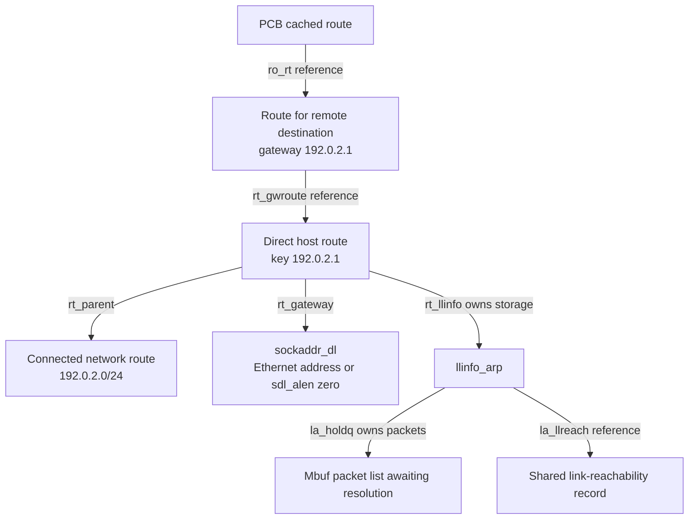
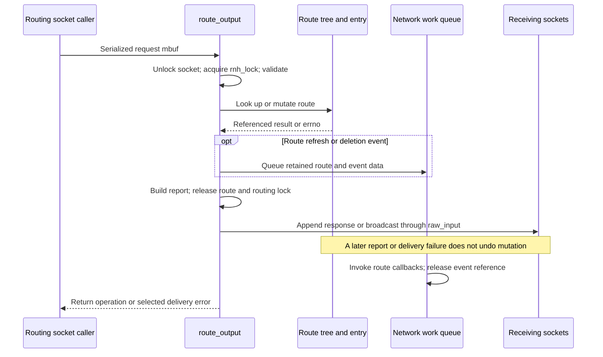
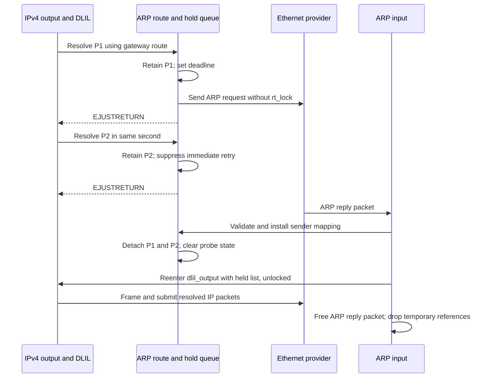

# Routing control and IPv4 ARP

[Networking](README.md) · [Route references and interfaces](packets-routes-and-interfaces.md) · [IPv6 output and neighbor discovery](ipv6-output-and-neighbor-discovery.md) · [Flowswitch routes](skywalk-flowswitch-classification-routes-and-datapaths.md)

A routing socket changes the kernel's route table; ARP supplies a link-layer destination for a directly reachable IPv4 neighbor. Both use `rtentry`, but they solve different problems. A route to a remote network can name an IPv4 gateway, while the route to that gateway carries its Ethernet address and the packets waiting for resolution. This chapter follows control-message admission, route publication, pending-packet ownership, reply processing and expiration in `xnu-12377.121.6`. The [route-reference chapter](packets-routes-and-interfaces.md#routes-a-cache-entry-is-a-reference-not-a-permanent-decision) remains the prerequisite for cached-route references, lock order and final release.

## 1. Objects: a request, a route, a next hop and a held packet

| Representation | Important state and role |
| --- | --- |
| Routing socket and `rawcb` | `PF_ROUTE`/`SOCK_RAW` endpoint; protocol selector filters address families. It receives serialized notifications, not pointers into the radix tree. |
| `rt_msghdr` followed by socket addresses | `rtm_type`, `rtm_addrs`, `rtm_flags`, `rtm_index`, `rtm_inits`, `rtm_rmx`, `rtm_seq`, `rtm_errno`. Address slots are packed according to `RTA_*` bits; there is no fixed C structure containing every address. |
| `rt_addrinfo` | Temporary indexed pointers into validated request storage or retained route/interface address objects. It is not persistent route state. |
| `rtentry` | Radix nodes/key/mask, `rt_gateway`, `rt_ifp`, referenced `rt_ifa`, metrics, flags/generation and reference count. `rt_gwroute` and `rt_parent` are separate retained route relationships. |
| `llinfo_arp` | Per-neighbor held packet queue, request count, probe deadline/flags and optional link-reachability record. Its allocation survives route deletion until the route itself is freed. |
| `sockaddr_dl` at a direct route's `rt_gateway` | Link type/index, address length and hardware-address bytes. A zero `sdl_alen` means no resolved link address. For an indirect route, `rt_gateway` instead identifies the IP next hop. |

Sources: [routing message layout](../../../platydoc-data/xnu/bsd/net/route.h#L155-L172), [route layout](../../../platydoc-data/xnu/bsd/net/route_private.h#L156-L186), [temporary address table](../../../platydoc-data/xnu/bsd/net/route.h#L264-L269), [routing socket attach](../../../platydoc-data/xnu/bsd/net/rtsock.c#L201-L238), and [ARP state/lifetime contract](../../../platydoc-data/xnu/bsd/netinet/in_arp.c#L96-L143).

The mutable ARP fields show why one generic “ARP timeout” is insufficient. From [`in_arp.c:132–143`](../../../platydoc-data/xnu/bsd/netinet/in_arp.c#L132-L143):

<!-- source-excerpt: ../../../platydoc-data/xnu/bsd/netinet/in_arp.c#L132-L143 -->
```c
	class_queue_t la_holdq;         /* packets awaiting resolution */
	struct  if_llreach *la_llreach; /* link-layer reachability record */
	u_int64_t la_lastused;          /* last used timestamp */
	u_int32_t la_asked;             /* # of requests sent */
	u_int32_t la_maxtries;          /* retry limit */
	u_int64_t la_probeexp;          /* probe deadline timestamp */
	u_int32_t la_prbreq_cnt;        /* probe request count */
	u_int32_t la_flags;
#define LLINFO_RTRFAIL_EVTSENT         0x1 /* sent an ARP event */
#define LLINFO_PROBING                 0x2 /* waiting for an ARP reply */
};

```

`rnh_lock` protects route-tree membership and the global `llinfo_arp` list. Each entry's `rt_lock` protects its ARP queue, probe state and link-reachability pointer. Operations needing both take `rnh_lock` before `rt_lock`; a reference protects storage while locks are dropped. The diagram uses an illustrative remote destination `198.51.100.9`, gateway `192.0.2.1` and connected network `192.0.2.0/24`; these are logical relationships, not a claim that every destination necessarily receives a host clone. [Lock domains](../../../platydoc-data/xnu/bsd/net/route.c#L127-L182), [ARP locking](../../../platydoc-data/xnu/bsd/netinet/in_arp.c#L96-L121).



## 2. Routing socket admission and message decoding

The registered `routesw` connects `pr_output` to `route_output()` and `pr_usrreqs` to `route_usrreqs`. `rts_send()` enters the common raw send implementation, which eventually dispatches through that output operation. `rts_attach()` deliberately bypasses the raw socket attach handler's `SS_PRIV` check, attaches its own `rawcb`, marks the socket connected and enables `SO_USELOOPBACK`. Permission to create this endpoint does not establish permission to mutate routes: `route_output()` separately permits `RTM_GET` and requires `SS_PRIV` for other operations. [Registration](../../../platydoc-data/xnu/bsd/net/rtsock.c#L2509-L2548), [send/operations table](../../../platydoc-data/xnu/bsd/net/rtsock.c#L294-L328), [raw output dispatch](../../../platydoc-data/xnu/bsd/net/raw_usrreq.c#L278-L331), [attach](../../../platydoc-data/xnu/bsd/net/rtsock.c#L201-L238), [mutation gate](../../../platydoc-data/xnu/bsd/net/rtsock.c#L410-L428).

`route_output()` starts with the socket locked, then unlocks it while keeping the socket reference and takes `rnh_lock`. It validates packet length against `rtm_msglen`, allocates contiguous kernel request storage, copies the mbuf chain and checks `RTM_VERSION`. The temporary buffer stays available through route processing and response construction. The input mbuf will become the response carrier or be freed; it is not installed in the routing table. [Entry and validation](../../../platydoc-data/xnu/bsd/net/rtsock.c#L343-L405).

`rt_xaddrs()` walks `RTAX_*` indices whose bits appear in `rtm_addrs`. It checks each address's length before treating the bytes as a `sockaddr`, rejects lengths beyond `sockaddr_storage` or the available buffer, and copies undersized but accepted addresses into zeroed `tiny_sa_storage`. Advancement uses `ROUNDUP32`, including for a 64-bit process. A zero-length address intentionally selects `sa_zero` and returns success for compatibility; the parser is not an assertion that every advertised slot contains a complete ordinary address. The operation subsequently requires a valid destination and checks IPv4/IPv6 lengths. [Parser](../../../platydoc-data/xnu/bsd/net/rtsock.c#L1214-L1319), [family/size checks](../../../platydoc-data/xnu/bsd/net/rtsock.c#L430-L481).

Scope is explicit: `RTF_IFSCOPE` makes `rtm_index` the interface constraint. IPv4's user-provided embedded scope is cleared so bytes in `sin_zero` cannot silently select an interface. The route module later constructs its internal scoped key/mask. The handler also rejects user `RTF_PROXY`, disallows the selected internal-coprocessor scope, and applies the configured management-interface entitlement gate. These checks do not substitute for later route/neighbor validation. [Scope and restricted interfaces](../../../platydoc-data/xnu/bsd/net/rtsock.c#L499-L558), [normalization](../../../platydoc-data/xnu/bsd/net/rtsock.c#L560-L573), [internal scoped keys](../../../platydoc-data/xnu/bsd/net/route.c#L1902-L2016).

`RTM_GET_SILENT` is converted to `RTM_GET` after requiring loopback delivery; its response is appended only to the requesting socket. The ordinary route protocol uses the destination's address family as the raw-socket protocol selector when known. Readers correlate request/reply metadata such as `rtm_seq`; the message stream can also contain unrelated asynchronous route/interface events. [Silent request](../../../platydoc-data/xnu/bsd/net/rtsock.c#L405-L419), [reply dispatch](../../../platydoc-data/xnu/bsd/net/rtsock.c#L850-L899), [asynchronous messages](../../../platydoc-data/xnu/bsd/net/rtsock.c#L1543-L1572).

## 3. Mutation, scoped lookup and host clones

| Operation | Execution and result |
| --- | --- |
| `RTM_ADD` | Requires a gateway address, calls `rtrequest_scoped_locked`, then applies optional interface/address selection and metrics to the returned referenced entry. |
| `RTM_DELETE` | Removes the matching tree entry, then constructs a report from the retained deleted entry. Logical deletion precedes report delivery. |
| `RTM_GET` | Uses `rt_lookup(TRUE, ...)`, then constructs current address/metric data. This route-socket lookup does not itself request protocol cloning. |
| `RTM_CHANGE` | Looks up and locks the route, changes a supplied gateway, selects interface/address, applies metrics, queues refresh work and updates metric locks. This is not a general replacement of all `rtm_flags`. |
| `RTM_LOCK` | Changes the selected `rmx_locks` bits. It does not lock a route indefinitely against all changes. |

These branches are in [add/delete](../../../platydoc-data/xnu/bsd/net/rtsock.c#L574-L645), [lookup/report](../../../platydoc-data/xnu/bsd/net/rtsock.c#L647-L763), and [change/metric locks](../../../platydoc-data/xnu/bsd/net/rtsock.c#L765-L839).

### Route construction and publication

For `RTM_ADD`, `rtrequest_common_locked()` selects and references a suitable interface address, allocates and locks an entry, builds gateway/key storage, installs the interface reference and inserts the radix nodes. A duplicate may be an existing protocol clone: that entry can be deleted and insertion retried. If insertion still fails, the new gateway/address/key/entry state is unwound and `EEXIST` returned. This retry can already have removed the older clone; treating the operation as an all-or-nothing transaction would hide that branch. [Allocation through insertion](../../../platydoc-data/xnu/bsd/net/route.c#L2266-L2360), [duplicate replacement and cleanup](../../../platydoc-data/xnu/bsd/net/route.c#L2359-L2418).

Insertion is not the end of construction. While `rnh_lock` still prevents other lookups, cloning copies metrics and retains the parent; the interface address's `ifa_rtrequest` callback adds protocol-specific state. The function then updates default-route scope and configured NECP clients, increments the family's route generation, synchronizes the entry, and adjusts affected clones. A supplied `ret_nrt` receives one reference. The route can otherwise remain cached in the table with a zero external reference count. [Post-insertion setup](../../../platydoc-data/xnu/bsd/net/route.c#L2420-L2537), [zero-reference cache/final release](packets-routes-and-interfaces.md#routes-a-cache-entry-is-a-reference-not-a-permanent-decision).

A regular output lookup uses `rtalloc1_common_locked()`. After obtaining a route, the `report` argument and `RTF_CLONING`/`RTF_PRCLONING` flags decide whether to call `RTM_RESOLVE`. A resolve derives flags, gateway, address and metrics from the parent, removes cloning/static flags, marks `RTF_WASCLONED`, usually creates a host key and scopes the clone to the parent's interface. IPv4 link-local/proxy exceptions remain unscoped. A failed clone can leave the original parent as the returned lookup result; subsequent ARP validation may reject it for lacking usable link-layer state. [Lookup/clone dispatch](../../../platydoc-data/xnu/bsd/net/route.c#L1051-L1103), [resolve construction](../../../platydoc-data/xnu/bsd/net/route.c#L2187-L2264), [ARP route validation](../../../platydoc-data/xnu/bsd/netinet/in_arp.c#L1133-L1212).

Scoped selection first considers an unscoped candidate, derives a primary interface when none was explicitly requested, and may search for a more specific route within that scope. An incompatible explicit interface can discard the unscoped result. The comparison retains a host over a scoped network route, or a nondefault route over a scoped default where allowed; a final non-scoped default must match the selected interface. It is therefore insufficient to model lookup as just a single destination longest-prefix search. [Scoped selection and fallback](../../../platydoc-data/xnu/bsd/net/route.c#L3270-L3417).

### Errors after a state change

A concrete partial-progress example is `RTM_CHANGE` with a valid new gateway plus an invalid `RTV_REFRESH_HOST` combination. The gateway update and `rt_setif()` occur before `rt_setmetrics()` rejects a mixed refresh request, a static/non-LLINFO route, or missing refresh support. There is no compensating restoration here. `RTM_ADD`, in contrast, explicitly discards the return from `rt_setmetrics()`. [Gateway mutation](../../../platydoc-data/xnu/bsd/net/rtsock.c#L765-L776), [refresh validation](../../../platydoc-data/xnu/bsd/net/rtsock.c#L948-L965), [add's ignored return](../../../platydoc-data/xnu/bsd/net/rtsock.c#L616-L627).

The ordering is visible in [`rtsock.c:793–802`](../../../platydoc-data/xnu/bsd/net/rtsock.c#L793-L802):

<!-- source-excerpt: ../../../platydoc-data/xnu/bsd/net/rtsock.c#L793-L802 -->
```c
			rt_setif(rt,
			    info.rti_info[RTAX_IFP], info.rti_info[RTAX_IFA],
			    info.rti_info[RTAX_GATEWAY], ifscope);

			if ((error = rt_setmetrics(RTM->rtm_inits,
			    &RTM->rtm_rmx, rt))) {
				int tmp = error;
				RT_UNLOCK(rt);
				senderr(tmp);
			}
```

Likewise, a successful `RTM_DELETE` reaches report allocation only after removal. Failure to allocate that report returns an error without reinstalling the route. The response buffer can later fail to fit back into its mbuf, or a receiver can lack socket-buffer space. Mutation and observation are distinct outcomes. [Delete-to-report](../../../platydoc-data/xnu/bsd/net/rtsock.c#L635-L645), [report allocation failure](../../../platydoc-data/xnu/bsd/net/rtsock.c#L714-L730), [mbuf/receive delivery](../../../platydoc-data/xnu/bsd/net/rtsock.c#L861-L898).



The sequence shows one possible ordering for deferred callbacks; `route_output()` does not wait for those callbacks before returning.

## 4. Notifications and route deletion have their own lifetimes

Routing-socket response/event delivery and in-kernel route event callbacks are separate facilities. `raw_input()` filters `rawcb` endpoints, copies messages for all but the final recipient, and appends to their receive sockbufs. Copy/admission failures do not return a route-transaction failure to the producer; the routine is `void`. `SO_USELOOPBACK` controls whether the sender receives its own ordinary message. The silent-get path stores the operation error in `rtm_errno`, then resets the local error before `sbappendaddr()` and checks that delivery error. Thus its syscall return and the response header need not report the same outcome. [Raw fanout](../../../platydoc-data/xnu/bsd/net/raw_usrreq.c#L90-L159), [loopback and silent delivery](../../../platydoc-data/xnu/bsd/net/rtsock.c#L850-L899).

`route_event_enqueue_nwk_wq_entry()` instead allocates a network-work item and retains the affected route. It snapshots a gateway socket address for the callback argument; `gwrt` itself gets no additional reference. The callback later invokes handlers using the retained route and frees that reference. Deregistration is special: it transfers the existing registration reference into queued cleanup instead of taking another. The event therefore preserves route lifetime without providing an immutable snapshot of every route field; for example, callback flags are read at callback time. [Queued event construction](../../../platydoc-data/xnu/bsd/net/route.c#L4636-L4679), [callback/deregistration](../../../platydoc-data/xnu/bsd/net/route.c#L4572-L4598).

The lifetime transfer is explicit in [`route.c:4645–4657`](../../../platydoc-data/xnu/bsd/net/route.c#L4645-L4657):

<!-- source-excerpt: ../../../platydoc-data/xnu/bsd/net/route.c#L4645-L4657 -->
```c
	/*
	 * If the intent is to de-register, don't take
	 * reference, route event registration already takes
	 * a reference on route.
	 */
	if (route_event_code != ROUTE_EVHDLR_DEREGISTER) {
		/* The reference is released by route_event_callback */
		if (rt_locked) {
			RT_ADDREF_LOCKED(rt);
		} else {
			RT_ADDREF(rt);
		}
	}
```

Deletion removes the radix node, clears `RTF_UP`, takes a temporary/reference-to-return, sets `RTF_CONDEMNED`, and optionally queues deletion events. It removes affected child routes, detaches its gateway reference, calls the interface address's protocol deletion callback, updates default-route/NECP state and increments the route generation. `arp_rtrequest(RTM_DELETE)` unlinks its `llinfo_arp`, clears `RTF_LLINFO`, purges reachability state and flushes held packets, but leaves `rt_llinfo`/`la_rt` connected until final route reclamation. Existing PCB and work-item references thus preserve an unusable route object, not an active ARP queue. [Route removal](../../../platydoc-data/xnu/bsd/net/route.c#L2018-L2185), [ARP deletion](../../../platydoc-data/xnu/bsd/netinet/in_arp.c#L1075-L1102), [ARP final free](../../../platydoc-data/xnu/bsd/netinet/in_arp.c#L283-L301).

## 5. IPv4 Ethernet output: use a link address or transfer packet ownership

`arp_ifinit()` installs `arp_rtrequest` as the interface address callback and requests cloning. The callback ignores indirect gateway routes; a connected cloning route receives an `AF_LINK` gateway template, while a resolved/direct host route receives `llinfo_arp`, callbacks and a place in the global ARP list. This is how route construction becomes neighbor state. [Interface setup](../../../platydoc-data/xnu/bsd/netinet/in_arp.c#L2273-L2287), [cloning template and LLINFO creation](../../../platydoc-data/xnu/bsd/netinet/in_arp.c#L887-L982).

For an ordinary IPv4 Ethernet packet, DLIL's protocol `pre_output` operation is `ether_inet_pre_output()`. It invokes `arp_lookup_ip()` with the packet, network destination and optional route hint. A successful lookup copies the link address and selects the Ethernet IP type; the caller can then frame/output the same mbuf. With a gateway hint, `route_to_gwroute()` obtains a referenced, locked route to the next hop. For a gateway route, `ip_output()` changes the separate `dst` socket-address pointer passed to DLIL to the route's gateway. The IP destination bytes in the packet remain the remote host; `arp_lookup_ip()` therefore asks about the next-hop IP, and the frame destination becomes that gateway's link address. [Separate next-hop destination](../../../platydoc-data/xnu/bsd/netinet/ip_output.c#L876-L880), [DLIL arguments](../../../platydoc-data/xnu/bsd/netinet/ip_output.c#L1684-L1685). [Ethernet pre-output](../../../platydoc-data/xnu/bsd/net/ether_inet_pr_module.c#L238-L273), [next-hop lookup](../../../platydoc-data/xnu/bsd/netinet/in_arp.c#L1314-L1331), [gateway-route contract](../../../platydoc-data/xnu/bsd/net/route.c#L4204-L4241).

Broadcast/multicast use direct interface/link mapping. For ordinary unicast, missing link-layer state can trigger scoped host-route creation. `IFF_NOARP`, no route, unsuitable gateway family and invalid interface state return errors. A cached address is usable only when its expiration permits use and its `sockaddr_dl` has nonzero address length; an optional reachability record can still trigger probing. [Special destinations and route creation](../../../platydoc-data/xnu/bsd/netinet/in_arp.c#L1333-L1413), [usable predicate](../../../platydoc-data/xnu/bsd/netinet/in_arp.c#L1415-L1443).

| `arp_lookup_ip()` result | Packet ownership at return | DLIL consequence |
| --- | --- | --- |
| `0` | Current packet remains with the caller; link address was supplied. A unicast reachability probe may have been sent as an additional action. | Continue framing/output. |
| `EJUSTRETURN` | ARP has queued the packet **or freed it** because retention was refused. | Skip this packet; do not free or transmit it again. |
| Ordinary errno | The current packet remains for the caller to dispose of. Retry exhaustion explicitly removes the just-enqueued packet before returning `EHOSTUNREACH`. | DLIL's error path frees it. Earlier retained packets have their own lifetime. |

Sources: [DLIL pre-output result handling](../../../platydoc-data/xnu/bsd/net/dlil_output.c#L200-L253), [retry exhaustion/tail removal](../../../platydoc-data/xnu/bsd/netinet/in_arp.c#L1561-L1589), and this exact ownership decision from [`in_arp.c:1594–1600`](../../../platydoc-data/xnu/bsd/netinet/in_arp.c#L1594-L1600):

<!-- source-excerpt: ../../../platydoc-data/xnu/bsd/netinet/in_arp.c#L1594-L1600 -->
```c
release_just_return:
	/* The packet is now held inside la_holdq or dropped */
	result = EJUSTRETURN;
	if (packet != NULL && !enqueued) {
		m_freem(packet);
		packet = NULL;
	}
```

### Queue pressure and retries

The queue is initialized with the configured per-entry `arp_maxhold` (default 16; zero becomes an effectively unbounded 32-bit queue limit). A global `arpstat.held` check against `arp_maxhold_total` (default 1024) can refuse the new packet. That check uses global atomic accounting without globally serializing all entry queues, so it is pressure control rather than proof of an exact cross-CPU hard cap. At a full per-entry queue, the code first evicts a packet below the control service class if available, otherwise the head; then it adds the new packet. This is not simply “retain only the last packet.” [Defaults](../../../platydoc-data/xnu/bsd/netinet/in_arp.c#L208-L214), [global limit](../../../platydoc-data/xnu/bsd/netinet/in_arp.c#L250-L252), [initialization/admission](../../../platydoc-data/xnu/bsd/netinet/in_arp.c#L266-L347).

The unresolved path marks a probe deadline when the first retained packet or packetless probe request arrives. For an expirable route, it permits a broadcast attempt when `la_asked == 0` or the saved expiration differs from current uptime seconds, then increments `la_asked` against `la_maxtries`. Repeated packets within the same second normally queue without another broadcast. With the default five tries, the first five permitted attempts send requests; the next permitted attempt marks `RTF_REJECT`, extends the down deadline by `arpt_down`, and returns the current packet to the caller via an error. [Queue/probe bookkeeping](../../../platydoc-data/xnu/bsd/netinet/in_arp.c#L1495-L1520), [request admission and transmission](../../../platydoc-data/xnu/bsd/netinet/in_arp.c#L1522-L1560), [exhaustion](../../../platydoc-data/xnu/bsd/netinet/in_arp.c#L1561-L1589).

`dlil_send_arp()` is called after retaining the interface address and dropping `rt_lock`; its return is not used here as evidence that a frame reached the wire. Later sends and received ARP traffic drive progress. A route hint's gateway validation rejects an unexpired `RTF_REJECT` entry as `EHOSTDOWN` or `EHOSTUNREACH`. The probe timer described below expires retained work; it does **not** emit one broadcast retransmission at each tick. [Unlocked ARP send](../../../platydoc-data/xnu/bsd/netinet/in_arp.c#L1545-L1560), [reject gate](../../../platydoc-data/xnu/bsd/net/route.c#L4385-L4393).

## 6. Reply processing and a worked unresolved-neighbor flow

The Ethernet receive adapter validates ARP hardware/protocol types, lengths and a nonbroadcast sender MAC, builds socket-address representations, updates link reachability and calls `arp_ip_handle_input()`. It always frees the incoming ARP mbuf after the handler; that mbuf is separate from the IP packets retained for resolution. [Ethernet input validation and cleanup](../../../platydoc-data/xnu/bsd/net/ether_inet_pr_module.c#L117-L165).

`arp_ip_handle_input()` retains a matching local interface address or a fallback address for the interface. It ignores its own hardware address, reports duplicate local-IP conflicts, and looks up the **sender IP's** neighbor route. Ordinary creation requires that this host be the ARP target and the sender IP be nonzero; configured gratuitous-announcement/proxy/link-local branches alter that policy. The common path rejects a mapping learned on the wrong interface and refuses to change an already populated permanent entry. It can learn from accepted requests as well as replies. [Address selection/conflicts](../../../platydoc-data/xnu/bsd/netinet/in_arp.c#L1692-L1844), [lookup](../../../platydoc-data/xnu/bsd/netinet/in_arp.c#L1846-L1860), [announcement/interface checks](../../../platydoc-data/xnu/bsd/netinet/in_arp.c#L1924-L1994), [permanent mapping check](../../../platydoc-data/xnu/bsd/netinet/in_arp.c#L2066-L2085).

Accepted sender hardware bytes replace the direct route's `sockaddr_dl` address. Dynamic expiration moves to `now + arpt_keep`; rejection is cleared; link reachability is refreshed; asked/probing counters reset. Queued route events notify dependent clients. Then the entire held packet list is detached under `rt_lock`, accounting is reduced, and DLIL is called **after unlocking**, while the route reference still protects the hint/key. The call's return is ignored here: resolution led to an output attempt, not a guarantee that the device transmitted every held packet. [Update and events](../../../platydoc-data/xnu/bsd/netinet/in_arp.c#L2087-L2157).

The ownership transfer is visible in [`in_arp.c:2164–2176`](../../../platydoc-data/xnu/bsd/netinet/in_arp.c#L2164-L2176):

<!-- source-excerpt: ../../../platydoc-data/xnu/bsd/netinet/in_arp.c#L2164-L2176 -->
```c
		_getq_all(&llinfo->la_holdq, &pkt, NULL, &held, NULL);
		m0 = pkt.cp_mbuf;
		if (arp_verbose) {
			log(LOG_DEBUG, "%s: sending %u held packets\n",
			    __func__, held);
		}
		os_atomic_add(&arpstat.held, -held, relaxed);
		VERIFY(qempty(&llinfo->la_holdq));
		RT_UNLOCK(route);
		dlil_output(ifp, PF_INET, m0, (caddr_t)route,
		    rt_key(route), 0, NULL);
		RT_REMREF(route);
		route = NULL;
```

Consider two IP packets `P1` and `P2` for `198.51.100.9` through unresolved gateway `192.0.2.1`. Assume the route and interface remain usable, queue capacity is available, and `P2` arrives within the same uptime second. This is an illustrative trace through the branches above, not an executed packet capture:

| Step | Retained queue | Decision and ownership |
| --- | --- | --- |
| `P1` reaches Ethernet pre-output | `[P1]` | Create/find the gateway's direct route, queue `P1`, mark probe deadline and send an ARP request. `EJUSTRETURN` transfers `P1` ownership. |
| `P2` reaches pre-output in the same second | `[P1, P2]` | Queue `P2`; the asked/expiration gate suppresses another immediate broadcast. |
| Valid ARP response supplies gateway hardware address | Detached list `P1 → P2` | Install address, clear probing/rejection, detach both packets under the entry lock. |
| Input handler reenters `dlil_output()` unlocked | Empty | The detached list belongs to DLIL; pre-output can now resolve the link address and continue output. |
| No reply instead | Eventually empty on deadline processing | Probe processing invalidates the cached link address and frees retained packets. Route storage can remain allocated. |



The nonordinary IPv4 link-local interface-movement branch illustrates necessary revalidation: retain the route, drop `rt_lock`, take `rnh_lock`, relock the route, reject a now-resolved parent-bound clone or condemned route, update interface/address/MTU, then drop/reacquire and check `RTF_UP` again. The gateway pointer is refreshed after those drops. Storage surviving on a reference does not make the earlier interface/gateway decision remain valid. [Lock transition and checks](../../../platydoc-data/xnu/bsd/netinet/in_arp.c#L1995-L2064).

## 7. Three independent aging decisions

| Mechanism | What triggers it and what it changes |
| --- | --- |
| ARP mapping expiration (`rt_expire`) | A dynamically learned mapping gets the configured `arpt_keep` lifetime (default 20 minutes). Periodic aging can invalidate an expired referenced mapping or remove an unreferenced dynamic route. Permanent expiration-zero entries remain. |
| Link reachability (`if_llreach`, `la_lastused`) | Recent traffic and per-IP use influence whether an otherwise usable MAC mapping should be probed. Initial unicast probes can return success and keep using the old MAC; the default unicast limit is three before falling into unresolved/broadcast processing. |
| Held-work probe deadline (`la_probeexp`, `LLINFO_PROBING`) | First pending work arms a deadline. The probe walker clears link address length, flushes queued packets and emits unreachable notification when overdue. It also counts packetless probe requests to decide whether to schedule again. |

Sources: [defaults](../../../platydoc-data/xnu/bsd/netinet/in_arp.c#L175-L210), [reachability predicate](../../../platydoc-data/xnu/bsd/netinet/in_arp.c#L466-L528), [unicast probe while permitting output](../../../platydoc-data/xnu/bsd/netinet/in_arp.c#L1443-L1491), and [aging/probe walker](../../../platydoc-data/xnu/bsd/netinet/in_arp.c#L623-L714).

Both timer handlers walk the global ARP list under `rnh_lock`, taking each entry lock inside `arptfree()`. The aging timer reschedules if it found aging entries; the probe timer reschedules if it found retained packets or packetless requests. Deadlines are checked by these walkers, so a configured interval is not an exact hardware-timer guarantee for every entry. The probe expiry branch flushes pending work and clears the link address but does not delete the route or itself clear `LLINFO_PROBING`. Later resolution/new work or teardown governs that state. [Aging scheduling](../../../platydoc-data/xnu/bsd/netinet/in_arp.c#L748-L810), [probe scheduling](../../../platydoc-data/xnu/bsd/netinet/in_arp.c#L817-L882), [expired-probe actions](../../../platydoc-data/xnu/bsd/netinet/in_arp.c#L639-L654).

For an expired entry with outstanding references, ordinary aging resets link address length, asked count and rejection so its next use resolves again. Without references, a nonstatic route can be deleted through `RTM_DELETE`. `in_arpdrain()` uses the same walker with `draining` set, protecting referenced/permanent state instead of indiscriminately freeing all neighbor objects. Static and expiration-zero properties differ: the body treats an expiration-zero entry as permanent, whereas a static entry with an expiration can still participate in parts of aging. [Reference-sensitive aging/drain](../../../platydoc-data/xnu/bsd/netinet/in_arp.c#L667-L746).

## 8. Test evidence and remaining boundaries

| In-tree test | What its assertions establish if run | What it does not establish |
| --- | --- | --- |
| [`route_output_stack_oflow_56033075.c`](../../../platydoc-data/xnu/tests/route_output_stack_oflow_56033075.c#L20-L93) | Overlarge socket addresses yield `EINVAL`; reducing their lengths to `sockaddr_storage` gets as far as an `ESRCH` lookup failure. | Successful route mutation, rollback, scope preference or ARP behavior. |
| [`test_get_route.c`](../../../platydoc-data/xnu/tests/net/test_get_route.c#L87-L125) | Two saved routing-message patterns can be written/read repeatedly without the regression crashing; it performs 1000 iterations for each. | It checks syscall success, not every returned route field or comprehensive parser correctness. |
| [`route_pcblist.c`](../../../platydoc-data/xnu/tests/route_pcblist.c#L174-L217) | The simple case asserts its AF_INET endpoint appears and compares the enumerated count with the snapshot count; the helper matches protocol selector and creator PID. | This is endpoint inventory, not routing-table publication or neighbor-resolution validation. |

These tests were read, not executed. The chapter researched the named routing/ARP bodies and their direct Ethernet/raw-socket adapters. It does not claim all radix algorithms, every routing sysctl/metric/address normalization variant, bridge/proxy/link-local races, multicast membership, IPv6 router/prefix discovery, or real driver behavior are covered. ARP providers and the wire environment determine whether a submitted request or data frame is actually transmitted. [IPv6/ND](ipv6-output-and-neighbor-discovery.md) and [IP fragmentation, reassembly and ICMP](ip-fragment-reassembly-and-icmp.md) continue the common-IP route; PF/IPsec and transport overlays remain separate mechanisms.

<!-- BEGIN PLATYDOC DOCUMENTATION LICENSE -->
Original Platydoc text and diagrams are licensed under [CC BY 4.0](https://creativecommons.org/licenses/by/4.0/). Quoted source code and third-party material retain their respective licenses.
<!-- END PLATYDOC DOCUMENTATION LICENSE -->
