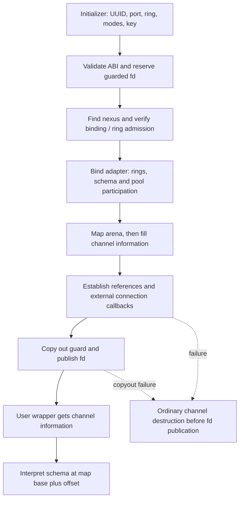
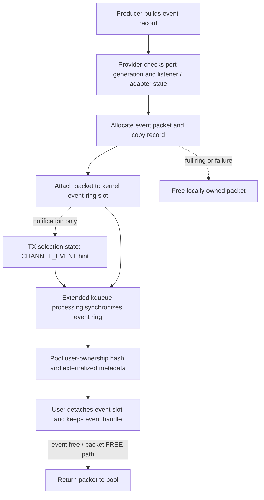

# Skywalk channel ABI, readiness, and event delivery

[Networking](README.md) · [Skywalk overview](skywalk.md) · [Controllers and ports](skywalk-controller-provider-and-port-lifetime.md) · [Channel and flow lifecycles](skywalk-lifecycles.md)

A channel fd is a control and notification endpoint for mapped rings. Userspace constructs descriptors in the mapping and asks the kernel to synchronize them; ordinary `read()`/`write()` are not the packet-transfer interface. Readiness itself can run ring synchronization. This chapter follows admission, the shared ABI, low-water decisions, kqueue hints and event-packet ownership in `xnu-12377.121.6`. The [memory](skywalk-memory-arenas-and-mapping.md) and [packet](skywalk-packets-buflets-and-pools.md) companions explain the storage and metadata beneath that interface.

For filter channels, see [netif filtering and reinjection](skywalk-netif-filters-and-reinjection.md): RX/TX ring numbers distinguish interface ingress/egress, and accepted packet handles resume an ordered filter chain. [Agent-created port assignments](skywalk-netif-agents-and-traffic-rules.md#3-binding-a-flow-does-not-activate-a-packet-receiver) precede the key-bound channel open; they do not themselves publish a packet receiver.

## What crosses the syscall boundary

| Representation | Important contents | Role |
| --- | --- | --- |
| [`ch_init`](../../../xnu/bsd/skywalk/channel/os_channel_private.h#L512) | ABI version, nexus UUID, port/ring/direction, modes, optional key, guard | User request and guarded-fd result of open. |
| [`chreq`](../../../xnu/bsd/skywalk/channel/channel_var.h#L222) | Kernel-normalized mode, ring/port selection and request state | Internal admission request; not the mapped packet ring. |
| [`kern_channel`](../../../xnu/bsd/skywalk/channel/channel_var.h#L142) | Lock, flags/refcount, identity, nexus/adapter/pool, selected ranges and map | Kernel endpoint and synchronization state. |
| [`ch_info`](../../../xnu/bsd/skywalk/channel/os_channel_private.h#L478) | Map address/size, schema offset, ring/pool geometry, thresholds | Copyout description used to interpret the existing task mapping. |
| [`__user_channel_schema`](../../../xnu/bsd/skywalk/channel/os_channel_private.h#L153) | Version/flags, ring offsets and mapping description | Shared root interpreted by the user library; `CSM_ACTIVE` is permanently cleared on deactivation. |
| [`__user_channel_ring`](../../../xnu/bsd/skywalk/channel/os_channel_private.h#L358) | User-visible indices and ring/slot layout | Shared producer/consumer ABI; user modifications require kernel validation. |
| [`__kern_channel_ring`](../../../xnu/bsd/skywalk/channel/channel_var.h#L323) | Trusted bounds/indices, owner/busy state, slots, callbacks, ready counters | Kernel representation used to validate, transfer and publish progress. |
| [`ch_selinfo`](../../../xnu/bsd/skywalk/channel/channel_var.h#L68) | Selection state, lock, optional timer, pending/destroyed flags | Waiter and knote notification, separate from packet ownership. |

The wrapper `os_channel_create_extended()` translates channel attributes into initializer flags, calls `__channel_open()`, gets `ch_info`, locates the schema at **map base plus schema offset**, and allocates user-side ring wrappers. It does not perform a separate anonymous `mmap()` to invent the kernel channel's backing. Domain connection already installed the mapping. [`User construction`](../../../xnu/libsyscall/wrappers/skywalk/os_channel.c#L441), [`channel information copyout`](../../../xnu/bsd/skywalk/channel/channel_syscalls.c#L286-L353).

## Admission precedes fd publication

`__channel_open()` checks initializer length and version, nexus UUID, key-pointer/length consistency, and mode relationships. In particular, an event-ring request requires user-packet-pool mode. It reserves a guarded fd and copies the optional key before entering `ch_open()`. The global lookup retains a nexus reference; an invalidated instance rejects new opens, low-latency mode adds privilege checks, and a named provider checks the binding prepared from process unique identity, executable UUID and key. [`Open validation and allocation`](../../../xnu/bsd/skywalk/channel/channel_syscalls.c#L137-L229), [`internal admission`](../../../xnu/bsd/skywalk/channel/channel.c#L1538-L1675).

Admission also prevents overlapping ownership of the same nexus port/ring selection, including across processes. An all-rings request conflicts with narrower existing selections; different explicitly selected rings can be admitted separately. The port's adapter can therefore be shared without making every channel owner of every ring. The [controller companion](skywalk-controller-provider-and-port-lifetime.md#a-port-binding-and-an-adapter-association-are-independent) explains why a valid UUID alone is insufficient.

`ch_connect()` validates and normalizes low-water thresholds, verifies that the provider admits user channels, and calls the domain's connect operation. `na_bind_channel()` checks ring direction/range, requested versus actual user-pool mode, defunct arena state and ring-use/exclusivity. For a first connection it constructs rings; for userspace it allocates a schema, establishes packet-pool participation and activates the adapter. The domain adapter-connect path then maps the arena. The resulting `ch_info` records map and schema locations. [`Channel connection`](../../../xnu/bsd/skywalk/channel/channel.c#L2009-L2211), [`adapter binding and staged unwind`](../../../xnu/bsd/skywalk/nexus/nexus_adapter.c#L436-L622).

After connection, list/caller references and the nexus reference are established, and an external provider is advised of the fully formed channel. Failure in that later notification closes the channel through the ordinary destructor. The syscall copies out the guard, clears the returned key address, installs channel file operations, marks close-on-exec/fork, clears `FREAD|FWRITE`, and only then publishes the descriptor. Any prepublication error destroys the provisional channel and frees the reserved file object. [`Final publication and failure cleanup`](../../../xnu/bsd/skywalk/channel/channel_syscalls.c#L229-L283).



Earlier construction stages also have local unwind labels; the diagram emphasizes the fully formed channel's cleanup. Map establishment is not packet publication: allocation/RX/event finalization subsequently publishes individual metadata ownership through separate rings.

## The operational surface and its limits

| Operation | Local dispatch and important behavior |
| --- | --- |
| `__channel_get_info` | Typed fd lookup and file I/O reference, length check, `ch_lock`, copied `ch_info`, reference drop. |
| `__channel_sync` | Validates TX/RX/user-pool mode and flags, locks the channel, serializes selected rings, validates user indices/metadata, calls provider synchronization and publishes successful progress. |
| `__channel_get_opt` | Reads supported TX/RX low-water state; unsupported options return `ENOPROTOOPT`. |
| `__channel_set_opt` | Rejects closing/defunct channels, sets supported TX/RX thresholds or interface-advisory reporting; individual options have their own locking and result-copy behavior. |
| `select` / `poll` | Channel file operations run `ch_event()` to inspect/synchronize selected TX/RX rings and arrange wakeups. |
| `kevent` | Channel filter attachment selects read, write or `EVFILT_NW_CHANNEL` behavior; processing reevaluates availability or extended hints. |
| Wrapper destruction | `os_channel_destroy()` performs guarded close, then frees user-side information/wrapper state. Kernel close releases endpoint resources through normal channel teardown. |

Sources: [`sync`](../../../xnu/bsd/skywalk/channel/channel_syscalls.c#L356), [`get/set option syscall boundary`](../../../xnu/bsd/skywalk/channel/channel_syscalls.c#L670-L781), [`option dispatch`](../../../xnu/bsd/skywalk/channel/channel.c#L2234-L2289), [`filter attachment`](../../../xnu/bsd/skywalk/channel/channel.c#L1060-L1150), [`user sync/destroy wrappers`](../../../xnu/libsyscall/wrappers/skywalk/os_channel.c#L821-L852).

The user `os_channel_sync()` wrapper exposes TX/RX requests and supplies appropriate pool flags; the kernel also handles its internal user-pool synchronization mode. Ring progress is described in [sync ownership and partial progress](skywalk-lifecycles.md#sync-is-a-validated-ownership-protocol), including why one syscall can return an error after earlier rings changed ownership.

The [diagnostics companion](skywalk-diagnostics-configuration-and-tests.md) connects these operations to ring counters, channel inspection, descriptor guards, invalid-ring termination requests and selected regression tests. A returned sync error, a guard exception and a process abort request are different observable outcomes.

## Channel thresholds and knote thresholds are different layers

`ch_ev_thresh_validate()` accepts byte or slot units and normalizes a channel threshold into a nonzero bounded value. The maximum is based on one ring's usable slots (`slots - 1`), or that slot count times provider buffer size for byte units. `ch_set_lowat_thresh()` copies and validates the requested structure, updates the channel threshold under `ch_lock`, and wakes the corresponding selected rings when it changes. Its final `sooptcopyout()` return is ignored after the state update. [`Threshold validation`](../../../xnu/bsd/skywalk/channel/channel.c#L1875-L1936), [`option update and notification`](../../../xnu/bsd/skywalk/channel/channel.c#L2368-L2437).

For read/write kqueue filters, `filt_chprocess()` calls `ch_event()` and obtains aggregate ready bytes or slots over the channel's selected rings. It then compares that count with the channel's low-water value. If the knote supplies `NOTE_LOWAT` and a larger saved value, the knote raises the effective threshold. A smaller note value does not lower the channel threshold. [`Read/write filter processing`](../../../xnu/bsd/skywalk/channel/channel.c#L677-L763).

[The TX branch uses the larger threshold and suppresses an otherwise ready event](../../../xnu/bsd/skywalk/channel/channel.c#L716-L727):

<!-- source-excerpt: ../../../xnu/bsd/skywalk/channel/channel.c#L716-L727 -->
```c
	if (events == POLLOUT) {
		lowat = ch->ch_info->cinfo_tx_lowat.cet_value;
		if ((kn->kn_sfflags & NOTE_LOWAT) &&
		    kn->kn_sdata > lowat) {
			lowat = (uint32_t)kn->kn_sdata;
		}

		data = result.tx_data;

		if (result.tx_data < lowat) {
			trigger_event = 0;
		}
```

For example, with slot units, channel threshold 4 and note threshold 6, five available slots do not deliver this knote; six do. With a note threshold of 2, the channel's threshold 4 still controls. Availability counts usable packet slots or bytes, not the number of wire transmissions completed.

A subtle implementation boundary matters when reading attachment/touch validation: those paths validate a **temporary** threshold structure containing the note's value, but do not write its normalized `cet_value` back into `kn_sdata`. The processing body above compares the saved note value. Do not assume a large note threshold is automatically replaced with the validator's clamped value. [`Knote touch`](../../../xnu/bsd/skywalk/channel/channel.c#L589-L673), [`read/write attachment`](../../../xnu/bsd/skywalk/channel/channel.c#L766-L832).

`select`/`poll` use `ch_event()` availability directly; the read/write filter's final low-water comparison belongs to `filt_chprocess()`. It would be incorrect to apply the kqueue comparison mechanically to every channel readiness interface.

## Readiness is active work, not a passive flag read

`ch_event()` runs with `ch_lock`. It rejects defunct channels, missing schema, inactive adapters and activity rejection. It establishes per-thread sync protection, selects the channel's ring ranges, and enters rings using the owner/busy protocol. For TX it runs the TX prologue, invokes provider sync, finalizes successful state and checks available slots. For RX it similarly processes returned heads and provider input before publishing and measuring availability. Ready counts are accumulated in the requested units. This means querying readiness can reclaim TX slots or make RX packets visible even without an immediately preceding explicit sync syscall. [`Readiness execution`](../../../xnu/bsd/skywalk/channel/channel.c#L1153-L1480).

When a channel spans multiple rings, its waiter can use the adapter's aggregate selection state; a single-ring selection uses that ring's selection state. If select found no work, the code records the waiter and makes one bounded recheck. Recording before the second check closes the gap where a producer could signal just after the first empty observation but before the consumer became a waiter. [`TX selection and recheck`](../../../xnu/bsd/skywalk/channel/channel.c#L1233-L1335), [`RX counterpart`](../../../xnu/bsd/skywalk/channel/channel.c#L1340-L1433).

[The TX branch records the waiter, clears its retry flag and scans again](../../../xnu/bsd/skywalk/channel/channel.c#L1326-L1335):

<!-- source-excerpt: ../../../xnu/bsd/skywalk/channel/channel.c#L1326-L1335 -->
```c
		if (want_tx && retry_tx && !is_kevent) {
			if (check_all_tx) {
				csi_selrecord_all(na, NR_TX, p, wql);
			} else {
				csi_selrecord_one(&na->na_tx_rings[first_tx],
				    p, wql);
			}
			retry_tx = FALSE;
			goto flush_tx;
		}
```

The recheck is a lost-wakeup precaution, not an unbounded polling loop. Ring ownership, validation and provider work still apply during each scan. RX has a corresponding retry arrangement; kqueue processing does not use select's waiter-record operation.

Read/write notification callbacks are intentionally weaker than readiness processing. `filt_chrw()` activates a knote, while `filt_chprocess()` obtains current state and decides whether to return it. On defunct/error paths the filter sets `EV_EOF`; the source explicitly chooses this instead of `EV_ERROR` for this notification contract. A wakeup is therefore a reason to reevaluate the channel, not a promise that a particular packet is available. [`Activation callback`](../../../xnu/bsd/skywalk/channel/channel.c#L545-L587), [`EOF processing`](../../../xnu/bsd/skywalk/channel/channel.c#L677-L714).

## Notifications, mitigation, and destruction of wait state

`na_post_event()` wakes the ring's `ch_selinfo` and, when multiplexed listeners exist, the adapter-wide selection state. `csi_selwakeup()` resets pending state, wakes select waiters when requested, and calls `KNOTE` unless already executing within kevent. That last distinction avoids recursive filter notification when readiness processing itself synchronizes rings and generates progress. [`Adapter notification`](../../../xnu/bsd/skywalk/nexus/nexus_adapter.c#L1109), [`selection wakeup`](../../../xnu/bsd/skywalk/channel/channel.c#L332-L362).

`csi_selwakeup_common()` can defer ordinary eligible wakeups through a timer to mitigate repeated notifications. Explicit no-delay, in-kevent processing, non-select notification, nonzero hint, or absent mitigation state takes the direct branch. The timer coalesces notification work; it does not own the packets or replace ring synchronization. [`Mitigation decisions`](../../../xnu/bsd/skywalk/channel/channel.c#L364-L428), [`timer callbacks`](../../../xnu/bsd/skywalk/channel/channel.c#L430-L485).

Teardown must stop this asynchronous source before freeing selection state. `csi_destroy()` atomically marks the object destroyed, takes its lock, then drops that lock while cancelling/waiting for and freeing the timer. It reacquires the lock to clear pending state, releases it, removes selection waiters, and finally destroys the lock. Waiting for a callback while retaining the lock that callback needs would violate this lifetime protocol. [`Selection-state destruction`](../../../xnu/bsd/skywalk/channel/channel.c#L249-L330).

## Extended hints and packet event records are separate transports

`EVFILT_NW_CHANNEL` handles flow-advisory updates, channel-event availability and interface-advisory updates. Its common notification path atomically ORs requested hint bits into `kn_fflags`, because event delivery and processing can run concurrently. Attachment uses the **TX selection state** and records whether a channel-event listener is attached; flow advisory can request an initial hint. Processing returns accumulated flags and clears them with the filter's historical clear-after-delivery behavior. [`Hint accumulation`](../../../xnu/bsd/skywalk/channel/channel.c#L837-L864), [`attachment`](../../../xnu/bsd/skywalk/channel/channel.c#L907-L945), [`processing`](../../../xnu/bsd/skywalk/channel/channel.c#L1026-L1057).

For a channel-event request, `che_process_channel_event()` checks event-ring mode and asks `ch_event()` to synchronize the event ring. It includes the channel-event hint only when records are available. This event-ring scan is part of the extended kevent path; ordinary select/poll do not scan the event ring. [`Event availability`](../../../xnu/bsd/skywalk/channel/channel.c#L866-L905), [`event-ring branch`](../../../xnu/bsd/skywalk/channel/channel.c#L1435-L1480).

The actual record follows a separate data path:

1. A producer calls a local `kern_channel_event_*` API with a destination interface or nexus UUID and an event such as TX status or expiration. The helper packages type/length/data into temporary storage and dispatches to the flowswitch or netif provider. The packet-based TX-status helper returns without sending an event for `KERN_SUCCESS`; these APIs are not a guarantee of a completion record for every successful transmission.
2. The flowswitch virtual-port path checks adapter activation, defunct/drop state and listener attachment. It allocates an event packet from the event ring's pool, copies the record and finalizes packet metadata.
3. Under ring ownership and sync protection it checks for a free event slot. If full, it reports `ENOBUFS` and frees the still locally owned packet. On success it attaches the packet to the kernel slot, clears the local pointer, and advances the producer index.
4. Notification targets **TX ring zero's selection state** using a channel-event hint. The payload is in the event ring, not in the kevent flags or TX packet slot.
5. Event-ring finalization inserts each packet into the pool's outstanding user-allocation hash, detaches its kernel-slot metadata, externalizes the record and publishes ring progress.
6. The user wrapper obtains a handle, detaches the user slot, and advances its head. The event remains a user-owned pool packet until `os_channel_event_free()` returns it through packet-free machinery.

Sources: [`event routing and record packaging`](../../../xnu/bsd/skywalk/channel/kern_channel_event.c#L63-L174), [`status/expiration producers`](../../../xnu/bsd/skywalk/channel/kern_channel_event.c#L176-L293), [`flowswitch event enqueue`](../../../xnu/bsd/skywalk/nexus/flowswitch/fsw_vp.c#L529-L618), [`TX-side notification`](../../../xnu/bsd/skywalk/channel/kern_channel_event.c#L295-L313), [`event-ring finalization`](../../../xnu/bsd/skywalk/channel/channel_ring.c#L1541-L1604), [`user event handle/free`](../../../xnu/libsyscall/wrappers/skywalk/os_channel.c#L2144-L2197).



[Event publication transfers metadata into the user ownership set before exposing progress](../../../xnu/bsd/skywalk/channel/channel_ring.c#L1570-L1578):

<!-- source-excerpt: ../../../xnu/bsd/skywalk/channel/channel_ring.c#L1570-L1578 -->
```c
		/*
		 * Add packet to the allocated list of user packet pool.
		 */
		pp_insert_upp_locked(pp, kqum, ch->ch_pid);

		KSD_DETACH_METADATA(ksd);
		kr_externalize_metadata_internal(kring, maxfrags, kqum, p);
		ASSERT((usd->sd_flags & ~SD_FLAGS_USER) == 0);
		slot_idx = SLOT_NEXT(slot_idx, kring->ckr_lim);
```

`kr_event_sync_prologue()` validates user consumption and requires consumed user descriptors to have been detached. Returning the slot is not itself the packet free. The event helper iterates the record headers and yields pointers into that packet's data; it does not allocate an independent copy of each payload. [`Event consumption validation`](../../../xnu/bsd/skywalk/channel/channel_ring.c#L1471-L1538), [`record iteration`](../../../xnu/libsyscall/wrappers/skywalk/os_channel_event.c#L41-L104).

The flowswitch lookup also validates the generation encoded with the destination nexus port. A late event for an earlier occupant must not be delivered merely because a new adapter now occupies the same numeric port. [`Port and generation validation`](../../../xnu/bsd/skywalk/nexus/flowswitch/fsw_vp.c#L621-L644). Queue capacity and receiver interest can cause events to be rejected or dropped; hints do not make this a reliable, unbounded completion log.

## Interface-advisory subscription crosses a lock boundary

The interface-advisory option controls whether a channel participates in the nexus's advisory-subscriber list. The implementation requires advisory memory and copies the enable/disable value. It cannot simply acquire the nexus advisory lock while holding `ch_lock`: the required order is **global Skywalk lock, nexus advisory lock, channel lock**. It drops the channel lock, acquires the earlier locks, reacquires it, and checks whether close happened in the meantime. [`Lock-order declaration`](../../../xnu/bsd/skywalk/nexus/nexus_var.h#L198-L207), [`subscription implementation`](../../../xnu/bsd/skywalk/channel/channel.c#L2295-L2365).

[After the lock drop, a closing channel is rejected before changing list membership](../../../xnu/bsd/skywalk/channel/channel.c#L2313-L2325):

<!-- source-excerpt: ../../../xnu/bsd/skywalk/channel/channel.c#L2313-L2325 -->
```c
	/*
	 * Drop ch_lock to acquire sk_lock and nx_ch_if_adv_lock due to lock
	 * ordering requirement; check if the channel is closing once ch_lock
	 * is reacquired and bail if so.
	 */
	lck_mtx_unlock(&ch->ch_lock);
	SK_LOCK();
	lck_rw_lock_exclusive(&nx->nx_ch_if_adv_lock);
	lck_mtx_lock(&ch->ch_lock);
	if (ch->ch_flags & CHANF_CLOSING) {
		err = ENXIO;
		goto done;
	}
```

Adding membership retains the channel; removing it releases that reference. Transitions from no subscribers or back to none enable/disable provider reporting. Channel close removes advisory participation before disconnecting the endpoint. Thus a subscription has both a notification effect and an ownership effect. The user-side advisory getter copies a checksummed snapshot and can return `EAGAIN` if it cannot obtain consistent data; an update hint does not make arbitrary reads of shared advisory fields atomic. [`Advisory snapshot`](../../../xnu/libsyscall/wrappers/skywalk/os_channel.c#L2199), [`close coordination`](../../../xnu/bsd/skywalk/channel/channel.c#L1754).

## Defunct, close, and tests of the observable contract

A channel can become defunct while its guarded descriptor still exists. Deactivation clears shared active state; later sync fails, and readiness can return EOF/hangup. The [lifecycle chapter](skywalk-lifecycles.md#defunct-serializes-kernel-work-and-revokes-mapped-access) explains why the kernel redirects task mappings before releasing backing objects, and why final fd destruction remains necessary. This separates user-visible inactivity, map revocation, ring teardown and final reference release.

| Local test or source fixture | Contract examined | Conditions and limits |
| --- | --- | --- |
| [`skt_ringid.c`](../../../xnu/tests/skywalk/skt_ringid.c#L82-L140) | Valid ring selections and rejection of out-of-range wrappers | Selected provider geometry and fixture setup. |
| [`skt_kqueue.c`](../../../xnu/tests/skywalk/skt_kqueue.c#L339-L427) | RX thresholds in slots/bytes, channel versus knote thresholds, insufficient then sufficient availability | User-pipe and feature-gated setup; no claim of exhaustive concurrent delivery proof. |
| [`TX low-water cases`](../../../xnu/tests/skywalk/skt_kqueue.c#L460-L604) | Writable capacity and threshold changes | Tests exercise notification under a controlled peer. |
| [`skt_shutdown.c`](../../../xnu/tests/skywalk/skt_shutdown.c#L60-L238) | Forced shutdown observed through selection, poll, EOF and later `ENXIO` | A shutdown fixture; not every ordinary close or opportunistic-defunct branch. |
| [`skt_writemem.c`](../../../xnu/tests/skywalk/skt_writemem.c#L43-L114) | Read-only schema protection and malformed shared-ring state | Expected faults/guard termination are harness outcomes, not errors to suppress. |
| [`skt_closecfd.c`](../../../xnu/tests/skywalk/skt_closecfd.c#L43) | Guarded channel descriptor restrictions | Raw close behavior differs from the supported guarded destructor. |

These tests were inspected, not run. The explanation traces the in-tree ABI, channel dispatch, read/write and extended filter paths, selected flowswitch event routing and advisory coordination. It does not specify every private event payload, netif queue implementation, external producer timing, or userspace transport library above these wrappers.

<!-- BEGIN PLATYDOC DOCUMENTATION LICENSE -->
Original Platydoc text and diagrams are licensed under [CC BY 4.0](https://creativecommons.org/licenses/by/4.0/). Quoted source code and third-party material retain their respective licenses.
<!-- END PLATYDOC DOCUMENTATION LICENSE -->
