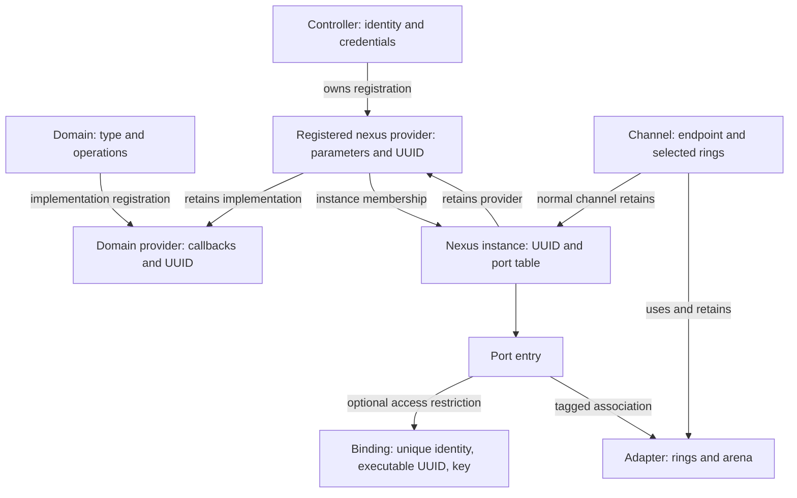
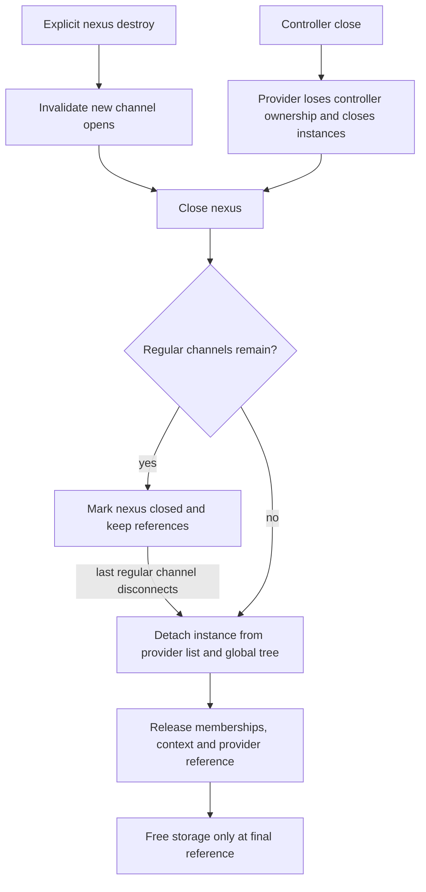

# Skywalk controllers, providers, and nexus port lifetime

[Networking](README.md) · [Skywalk overview](skywalk.md) · [Channel ABI and readiness](skywalk-channel-abi-and-readiness.md) · [Channel and flow lifecycles](skywalk-lifecycles.md)

Before a process can use a channel, a domain implementation must exist, a controller must register a provider, a provider must create a nexus instance, and the chosen port must admit that process. Controllers, both provider kinds and nexus instances have distinct UUIDs and reference counts; a port is instead an entry owned by its nexus. This chapter follows their construction and destruction in `xnu-12377.121.6`. Packet allocation and task mappings are covered by the [pool](skywalk-packets-buflets-and-pools.md) and [memory](skywalk-memory-arenas-and-mapping.md) companions.

## The object hierarchy and its two kinds of provider

For concrete implementations of two domains introduced here, continue with [Skywalk user and kernel pipes](skywalk-user-and-kernel-pipes.md). It follows paired user endpoints and their ring/adapter references, then compares the kernel-pipe callback and slot-storage lifetime.

A **domain** defines a nexus type such as netif, flowswitch, user pipe, or kernel pipe. A **domain provider** supplies the implementation for that type. A **registered nexus provider** is a controller-owned registration with checked parameters and, where supported, external callbacks. A **nexus** is an instance created from that registration. A **port** is an entry in that instance's port table; it can hold a binding, an adapter association, or both. A **channel** connects a process or kernel client to selected rings of that adapter.

| Object | Fields that establish the relationship | What it owns or retains |
| --- | --- | --- |
| [`nxdom`](../../../platydoc-data/xnu/bsd/skywalk/nexus/nexus_var.h#L359) | Type, domain operations, parameter limits | Registered domain-provider list and domain behavior. |
| [`kern_nexus_domain_provider`](../../../platydoc-data/xnu/bsd/skywalk/nexus/nexus_var.h#L293-L335) | Domain pointer, UUID, flags/refcount, `nxdom_prov_cb`, external init/fini | Implementation lifetime while registered providers refer to it. |
| [`nxctl`](../../../platydoc-data/xnu/bsd/skywalk/nexus/nexus_var.h#L71-L95) | Mutex, flags/refcount, UUID, process/credential, fd | Authority identifying the owner of registered providers; user controllers have guarded descriptors. |
| [`kern_nexus_provider`](../../../platydoc-data/xnu/bsd/skywalk/nexus/nexus_var.h#L256-L274) | `nxprov_ctl`, domain provider, UUID, checked parameters, region geometry, nexus list | Retained domain provider and the registration's instance membership. |
| [`kern_nexus`](../../../platydoc-data/xnu/bsd/skywalk/nexus/nexus_var.h#L209-L235) | Provider, UUID/id, refs/flags, channel lists, pools, port table/bitmap | Provider reference, optional pool references, instance membership and port state. |
| [`nx_port_info`](../../../platydoc-data/xnu/bsd/skywalk/nexus/nexus_var.h#L117) | Binding pointer, tagged adapter handle, optional port information | Independent access binding and adapter association. |
| [`nexus_adapter`](../../../platydoc-data/xnu/bsd/skywalk/nexus/nexus_adapter.h#L116) | References/channel count, rings, arena, callbacks | Concrete ring implementation shared according to channel/ring admission rules. |
| [`kern_channel`](../../../platydoc-data/xnu/bsd/skywalk/channel/channel_var.h#L142) | Channel lock/refcount, nexus/adapter, selected rings, schema/mapping | Endpoint and mapping lifetime; normal channels hold a nexus reference. |



Arrows distinguish membership, references, and associations; they do not imply each pointer is an independent reference. In particular, a port binding can exist before an adapter is constructed, and closing the controller does not synchronously free all channels' reachable storage.

## Initialization and configuration select the available architecture

`skywalk_init()` establishes memory, nexus, and channel facilities under the global Skywalk lock, then initializes network/protocol/flow-ID namespaces. Failure in the first group calls `skywalk_fini()` to unwind initialized facilities. `nexus_init()` creates the instance tree, initializes adapters and domains, and creates the private kernel and shared user controllers. [`Initialization order`](../../../platydoc-data/xnu/bsd/skywalk/core/skywalk.c#L470-L513), [`nexus initialization`](../../../platydoc-data/xnu/bsd/skywalk/nexus/nexus.c#L135-L190).

| Selection | Consequence in the inspected source |
| --- | --- |
| `SKYWALK` | Includes the subsystem; the corresponding source/configuration must be selected in the kernel build. |
| `CONFIG_NEXUS_USER_PIPE`, `CONFIG_NEXUS_KERNEL_PIPE`, `CONFIG_NEXUS_FLOWSWITCH`, `CONFIG_NEXUS_NETIF` | Control which domains `nxdom_attach_all()` attaches. A type in a public enum does not guarantee a domain in this build. |
| Built-in/default domain provider | Supplies each available domain's default implementation and parameter validation. External registration requires an existing default. |
| User versus kernel controller API | Changes eligible provider types, privilege checks, external callback support, and port-binding operations. |
| Provider flags and normalized geometry | Determine anonymous versus named access, user-channel admission, ring/slot/pool layout, and special netif modes. |
| `DEVELOPMENT`/`DEBUG`, runtime policy and interface capabilities | Select diagnostics, test hooks and optional behavior; none proves a production configuration enables the same path. |

See [`build selections`](../../../platydoc-data/xnu/config/MASTER#L85-L89), [`conditional domain attachment`](../../../platydoc-data/xnu/bsd/skywalk/nexus/nexus_kern.c#L88-L167), and [`parameter normalization`](../../../platydoc-data/xnu/bsd/skywalk/nexus/nexus.c#L1388-L1493). The shared controllers are explicit integration facilities. Downstream domain/configuration handlers still receive process and credential information; knowing a nexus UUID is not equivalent to owning its controller.

## Opening a controller establishes an authority object

`__nexus_open()` validates the supplied initializer length/version, creates a UUID-derived guard, reserves a guarded fd, and constructs an `nxctl` capturing the caller's credential. It copies out the guard before installing the descriptor. The published descriptor is close-on-exec/close-on-fork and uses `DTYPE_NEXUS` operations. Guard restrictions include ordinary close, duplication, socket-IPC/fileport transfer, and write. The corresponding guarded wrapper is the intended destruction interface. Failure before fd publication destroys the provisional controller and releases the reserved file object. [`Controller syscall`](../../../platydoc-data/xnu/bsd/skywalk/nexus/nexus_syscalls.c#L83-L168), [`controller allocation`](../../../platydoc-data/xnu/bsd/skywalk/nexus/nexus.c#L193-L226), [`credential initialization`](../../../platydoc-data/xnu/bsd/skywalk/nexus/nexus.c#L1151).

The controller's mutex serializes its operations. Paths that need both controller and global state acquire `nxctl_lock` before `SK_LOCK`. Provider/nexus ownership checks compare the controlling `nxctl`, not merely a caller-supplied UUID. Kernel clients can create their own controller through `kern_nexus_controller_create()` or use the designated shared controller for operations that explicitly accept it. [`Kernel controller API`](../../../platydoc-data/xnu/bsd/skywalk/nexus/nexus_kern.c#L763-L806).

## Domain-provider registration extends an implementation

`kern_nexus_register_domain_provider()` accepts a domain type, name, versioned initialization record, and output UUID. It checks required init/fini callbacks, requires a present domain and default provider, and currently permits only **netif and kernel-pipe** external domain providers. It copies the default provider's implementation callback vector, replaces init/fini with external wrappers, and inserts the resulting implementation through `nxdom_prov_add()`. This is not the same operation as registering a controller-owned nexus provider. [`External domain-provider registration`](../../../platydoc-data/xnu/bsd/skywalk/nexus/nexus_kern.c#L515-L600).

`nxdom_prov_add()` checks duplicate names within the domain, assigns identity, invokes initialization, and publishes list membership only after success. List ownership and default-provider-array ownership, where applicable, contribute separate references. Failure clears provisional registration state and frees the unregistered allocation. [`Registration and failure`](../../../platydoc-data/xnu/bsd/skywalk/nexus/nexus_kern.c#L318-L377).

Deregistration removes discoverability before freeing storage. `nxdom_prov_del()` removes the provider from its domain list, clears attached state and marks detaching. The reference formerly represented by list membership moves to a detaching queue; the worker later drops it. Other registered providers may still retain the implementation, so final `fini`/free can occur later than either the deregistration call or queue processing. [`Deregistration`](../../../platydoc-data/xnu/bsd/skywalk/nexus/nexus_kern.c#L603-L644), [`list-to-detaching-queue transition`](../../../platydoc-data/xnu/bsd/skywalk/nexus/nexus_kern.c#L380-L434), [`reference release`](../../../platydoc-data/xnu/bsd/skywalk/nexus/nexus_kern.c#L1793), [`detacher work`](../../../platydoc-data/xnu/bsd/skywalk/nexus/nexus_kern.c#L2253-L2331).

This explains why unregistering an implementation cannot invalidate a live nexus by simply freeing its callback vector. Built-in domain initialization and the external deregistration API have different lifetimes; this chapter does not claim a complete supported runtime unload of all built-in domains.

## Registering a provider fixes parameters and callback contracts

User `__nexus_register()` enters `nxprov_create()`. That function checks type-specific privileges, rejects a user registration of a kernel-pipe provider, selects the built-in default, then enters the controller/global lock order. `nxprov_create_common()` asks the domain implementation to check and normalize parameters, obtains region geometry, retains the domain provider, allocates the registered provider and publishes its UUID/controller/list relationship. Ring and memory parameters therefore become an implementation-checked registration, not an unchecked promise copied from userspace. [`User registration`](../../../platydoc-data/xnu/bsd/skywalk/nexus/nexus_syscalls.c#L171-L245), [`admission`](../../../platydoc-data/xnu/bsd/skywalk/nexus/nexus.c#L1497-L1553), [`creation`](../../../platydoc-data/xnu/bsd/skywalk/nexus/nexus.c#L1388-L1493).

Kernel `kern_nexus_controller_register_provider()` can select a domain-provider UUID and supply a versioned callback record. Validation is stricter than the nearby general comment about optional callback pairs: the actual version-1 condition requires TX/RX synchronization **and all four connection callbacks**. Ring and slot init/fini pairs must be symmetric if supplied. Netif requires the TX doorbell; other types cannot supply it. The newer netif-specific version instead requires queue-set/queue initialization, teardown, notification and capability callbacks. [`Kernel registration`](../../../platydoc-data/xnu/bsd/skywalk/nexus/nexus_kern.c#L909), [`actual callback validation`](../../../platydoc-data/xnu/bsd/skywalk/nexus/nexus_kern.c#L810-L905).

[The version-1 body makes the connection callbacks mandatory](../../../platydoc-data/xnu/bsd/skywalk/nexus/nexus_kern.c#L843-L852):

<!-- source-excerpt: ../../../platydoc-data/xnu/bsd/skywalk/nexus/nexus_kern.c#L843-L852 -->
```c
		if (init->nxpi_sync_tx == NULL || init->nxpi_sync_rx == NULL ||
		    init->nxpi_pre_connect == NULL ||
		    init->nxpi_connected == NULL ||
		    init->nxpi_pre_disconnect == NULL ||
		    init->nxpi_disconnected == NULL ||
		    NXPI_INVALID_CB_PAIRS(ring_init, ring_fini) ||
		    NXPI_INVALID_CB_PAIRS(slot_init, slot_fini)) {
			err = EINVAL;
			break;
		}
```

The later type selection also matters: kernel registration permits netif, requires external initialization for kernel pipe, requires no such initialization for flowswitch, and rejects user pipe. Passing `NULL` through the first validator alone therefore does not establish that every type accepts a callback-free provider. [`Kernel type selection`](../../../platydoc-data/xnu/bsd/skywalk/nexus/nexus.c#L1557-L1633).

## Creating an instance and understanding publication failures

`nx_create()` finds a provider belonging to the controller and rejects a closed registration. It checks requested type and supplied packet-pool compatibility, allocates lists/locks/identity, retains supplied TX/RX pools, and invokes the domain-provider nexus constructor. Only after that constructor succeeds does it retain the provider and publish the nexus in both the provider list and global instance tree. [`Construction and pool validation`](../../../platydoc-data/xnu/bsd/skywalk/nexus/nexus.c#L1862-L1955).

[The published instance has separate list, tree and caller references](../../../platydoc-data/xnu/bsd/skywalk/nexus/nexus.c#L1956-L1965):

<!-- source-excerpt: ../../../platydoc-data/xnu/bsd/skywalk/nexus/nexus.c#L1956-L1965 -->
```c
	nxprov_retain_locked(nxprov);   /* hold a ref on the nexus reg */

	STAILQ_INSERT_TAIL(&nxprov->nxprov_nx_head, nx, nx_prov_link);
	nxprov->nxprov_nx_count++;
	RB_INSERT(kern_nexus_tree, &nx_head, nx);
	os_atomic_or(&nx->nx_flags, NXF_ATTACHED, relaxed);

	nx_retain_locked(nx);   /* one for the provider list */
	nx_retain_locked(nx);   /* one for the global list */
	nx_retain_locked(nx);   /* one for the caller */
```

Failure behavior depends on where the syscall boundary lies:

| Operation | State at failing output copy | Cleanup visible in this checkout |
| --- | --- | --- |
| Controller open | Controller/file allocation exists; fd is not published | Destroys the provisional controller and releases the reserved file object. |
| Provider registration | Registered provider exists | Calls `nxprov_close()` and drops the caller reference. The cleanup assignment replaces `err` with the close result; do not infer that the original copyout error is preserved. |
| Nexus create | Instance is already in both membership structures | Drops only the caller reference. It does **not** call `nx_close()` on copyout failure, so the provider continues to own the created instance. |
| Channel open | Connected channel exists; fd is not published | Calls channel destruction and releases the reserved fd on failure. |

The distinction is visible directly in [`provider cleanup`](../../../platydoc-data/xnu/bsd/skywalk/nexus/nexus_syscalls.c#L232-L244), [`instance result copy and release`](../../../platydoc-data/xnu/bsd/skywalk/nexus/nexus_syscalls.c#L342-L357), and [`channel publication`](../../../platydoc-data/xnu/bsd/skywalk/channel/channel_syscalls.c#L137-L283). An error return is not a universal transaction rollback. A created instance whose UUID was not successfully returned is still reclaimed by later provider/controller destruction.

## A port binding and an adapter association are independent

`nxctl_nexus_bind()` copies and validates binding criteria before invoking the domain's bind operation. Matching can include a process's **unique ID** (snapshotted using a retained process, not simply a reusable PID), executable UUID, and bounded secret key. Kernel process binding is rejected in the user-identity path. Named ports require ownership checks; anonymous providers take a different path, and requesting `NEXUS_PORT_ANY` is kernel-only. `nxb_is_equal()` checks the criteria enabled by the binding, using constant-time key comparison. [`Binding preparation and dispatch`](../../../platydoc-data/xnu/bsd/skywalk/nexus/nexus.c#L644-L847), [`identity matching`](../../../platydoc-data/xnu/bsd/skywalk/nexus/nexus.c#L986-L1020).

A successful domain bind can consume the provisional key/binding into port state. Cleanup then frees only what remains locally owned. The result-copy branch ignores the return from `sooptcopyout()` after committing the binding, another reason to follow the mutation rather than assume output transfer and state commit are atomic. Unbind independently validates controller ownership and removes the binding. [`Bind completion`](../../../platydoc-data/xnu/bsd/skywalk/nexus/nexus.c#L793-L847), [`controller unbind`](../../../platydoc-data/xnu/bsd/skywalk/nexus/nexus.c#L850-L902).

The instance port bitmap uses **one for a free port**. A port is free only when it has neither an access binding nor an adapter. `nx_port_bind_info()` clears the bit and records a binding even if no channel/adapter yet exists. `nx_port_alloc()` can add an adapter to a bound entry; an unbound named port rejects user allocation with `EACCES`. An authorized lookup can instead return a retained reference to an existing adapter. Supplying a new adapter for an occupied entry fails with `EEXIST`. [`Port binding storage`](../../../platydoc-data/xnu/bsd/skywalk/nexus/nexus.c#L2795), [`allocation and adapter lookup`](../../../platydoc-data/xnu/bsd/skywalk/nexus/nexus.c#L2648-L2752).

| Binding | Adapter | Bitmap meaning and next operation |
| --- | --- | --- |
| Absent | Absent | Free; bind can reserve it, or an allowed anonymous/kernel allocation can claim it. |
| Present | Absent | Reserved for the matching identity; opening an admitted channel can construct an adapter. |
| Present | Present | Binding and active association coexist; removing either alone does not free the port. |
| Absent | Present | Adapter still occupies it; final adapter removal makes the port free. |

`nx_port_free()` clears the adapter association and decrements active-port accounting, but sets the free bit only if no binding remains. `nx_port_unbind()` frees the binding/key/port-info and sets the bit only if no adapter remains. `nx_port_defunct()` changes the tagged adapter state without erasing the association. [`Free and defunct`](../../../platydoc-data/xnu/bsd/skywalk/nexus/nexus.c#L2755-L2792), [`unbind`](../../../platydoc-data/xnu/bsd/skywalk/nexus/nexus.c#L2874-L2920).

For example, a flowswitch can reserve a port for a process before its channel is opened. Closing that channel can remove its adapter while the binding still reserves the number. Later unbind removes the remaining reservation. The [flow-owner trace](skywalk-lifecycles.md#flow-registration-process-association-port-binding-and-rollback) explains which process/flow transitions invoke these operations.

## External connection callbacks bracket channel resources

After domain connection forms a channel, `nxprov_advise_connect()` calls the external provider's pre-connect, initializes applicable ring/slot or logical-link resources, and invokes connected. Flags record how far this sequence progressed. A failure after pre-connect uses the corresponding disconnect path, rather than calling every teardown callback indiscriminately. [`Connection callback sequencing`](../../../platydoc-data/xnu/bsd/skywalk/nexus/nexus.c#L1261-L1333).

The lock transition is precise: the wrapper takes an extra channel reference, releases `ch_lock` and the global lock, then reacquires **`ch_lock` before calling the external provider**. Thus the provider is called without `SK_LOCK`, but this path does not promise an unlocked channel. On return, the wrapper drops the channel lock and reacquires global then channel order. Disconnect similarly tests the connected flag, calls pre-disconnect when appropriate, tears down initialized resources, invokes disconnected for a completed pre-connect, clears context/flags, and releases the temporary reference. [`Disconnect and lock transitions`](../../../platydoc-data/xnu/bsd/skywalk/nexus/nexus.c#L1336-L1385).

These callbacks provide the local boundary to external hardware/provider implementations. They do not reveal device queue execution, DMA completion, or firmware state; the in-tree ring and packet code establishes what the kernel hands across that boundary.

## Close removes authority before the final objects disappear

There are several different terminal transitions:

1. `nx_destroy()` validates ownership, sets `NXF_INVALIDATED` to reject new opens, calls `nx_close()`, and drops its lookup reference.
2. `nx_close()` detaches an instance with no regular channels; otherwise it marks it `NXF_CLOSED` for deferred detach. This state alone should not be read as synchronous destruction of every existing channel.
3. `nxprov_close()` disconnects controller ownership and closes its instances. It detaches immediately when none remain, or records provider-closed state for the last instance's cleanup.
4. `nxctl_close()` withdraws fd/list association and closes every provider belonging to that controller. Nested close work may release the global lock, so the provider walk restarts after each close.
5. `ch_close_common()` removes the final regular channel from a closed nexus; `nx_detach()` runs the domain destructor, removes provider/global memberships, releases context and membership references, and can finish a previously closed provider.
6. Final reference release frees storage. `nx_free()` releases retained pools and port resources; domain-provider release can finally invoke its finalizer.

See [`destroy`](../../../platydoc-data/xnu/bsd/skywalk/nexus/nexus.c#L1985), [`close/detach`](../../../platydoc-data/xnu/bsd/skywalk/nexus/nexus.c#L2059-L2174), [`provider close/detach`](../../../platydoc-data/xnu/bsd/skywalk/nexus/nexus.c#L1638-L1728), [`controller close`](../../../platydoc-data/xnu/bsd/skywalk/nexus/nexus.c#L229-L285), [`last-channel cleanup`](../../../platydoc-data/xnu/bsd/skywalk/channel/channel.c#L1754), and [`instance storage cleanup`](../../../platydoc-data/xnu/bsd/skywalk/nexus/nexus.c#L2232).

[The controller walk explicitly restarts because nested teardown can drop the global lock](../../../platydoc-data/xnu/bsd/skywalk/nexus/nexus.c#L260-L277):

<!-- source-excerpt: ../../../platydoc-data/xnu/bsd/skywalk/nexus/nexus.c#L260-L277 -->
```c
repeat:
	STAILQ_FOREACH_SAFE(nxprov, &nxprov_head, nxprov_link, tnxprov) {
		/*
		 * Close provider only for those which are owned by
		 * this control instance.  Note that if we close the
		 * provider, we need to repeat this search as the
		 * list might have been changed by another thread.
		 * That's possible since SK_UNLOCK() may be called
		 * as a result of calling nxprov_close().
		 */
		if (!(nxprov->nxprov_flags & NXPROVF_CLOSED) &&
		    nxprov->nxprov_ctl == nxctl) {
			nxprov_retain_locked(nxprov);
			(void) nxprov_close(nxprov, TRUE);
			(void) nxprov_release_locked(nxprov);
			goto repeat;
		}
	}
```



The regular-channel path is shown. Special kernel channels have a separate non-nexus-reference list and domain-specific teardown obligations; the destructor assertions require those connections to be gone as well. Do not replace those obligations with the simpler claim that every channel independently owns an ordinary nexus reference.

## Tests, invariants, and source limits

| Local evidence | Invariant to exercise or inspect | Limits |
| --- | --- | --- |
| [`skt_bind.c`](../../../platydoc-data/xnu/tests/skywalk/skt_bind.c#L153) | Duplicate bind rejection and identity/key-specific admission | Requires the selected domains and privileged fixture setup; not every binding combination or process-exit race. |
| [`skt_closenfd.c`](../../../platydoc-data/xnu/tests/skywalk/skt_closenfd.c#L43-L67) | Raw close of the guarded controller is prohibited | Expected exception behavior is part of the harness; not an ordinary successful `close()` test. |
| [`skt_ringid.c`](../../../platydoc-data/xnu/tests/skywalk/skt_ringid.c#L82-L140) | Ring selection exposes only admitted ring IDs | Complements controller/port checks; does not prove all concurrent adapter sharing safe. |
| Constructor and copyout branches above | State after partial construction differs from state after publication | Source inspection, not an injected-fault execution result. |

The inspected implementation covers initialization, registration validation, provider/instance membership, port binding, external connection sequencing and the close cascade. It does not expand netif scheduling, flowswitch lookup algorithms, every private configuration command, or device implementations. No tests or kernel were executed for this chapter.

<!-- BEGIN PLATYDOC DOCUMENTATION LICENSE -->
Original Platydoc text and diagrams are licensed under [CC BY 4.0](https://creativecommons.org/licenses/by/4.0/). Quoted source code and third-party material retain their respective licenses.
<!-- END PLATYDOC DOCUMENTATION LICENSE -->
