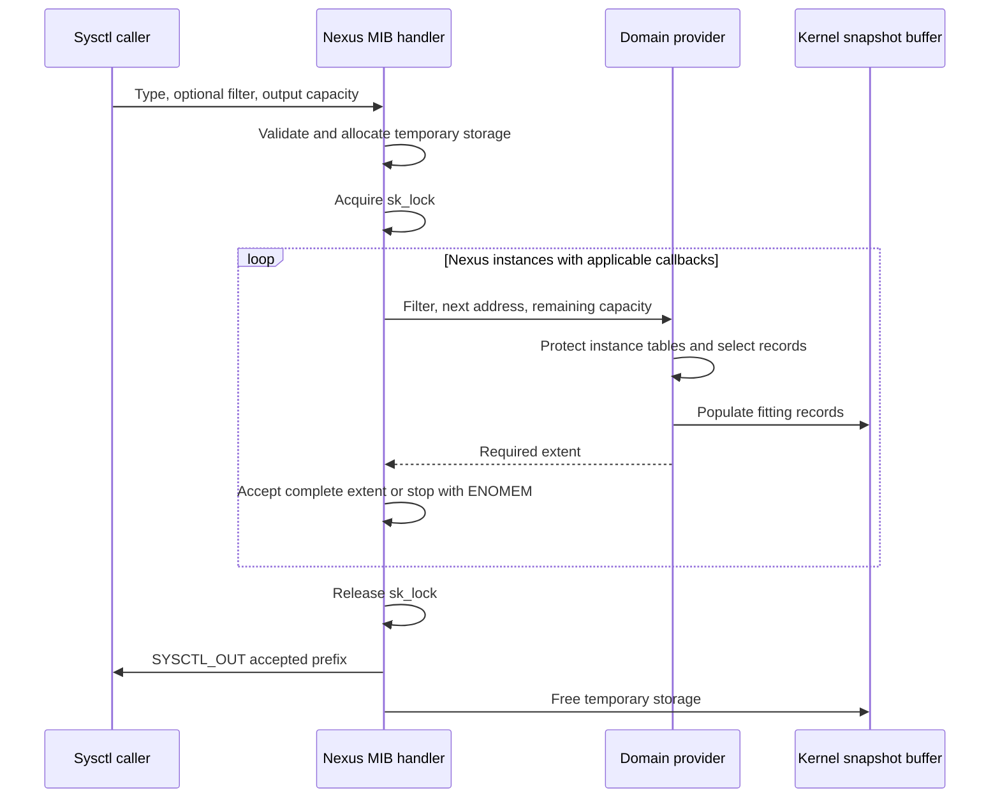
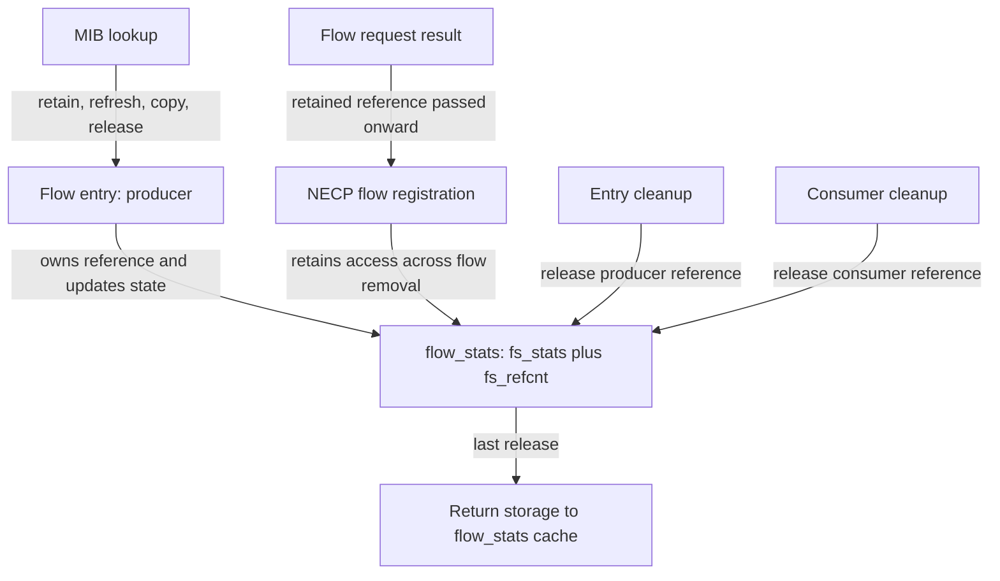
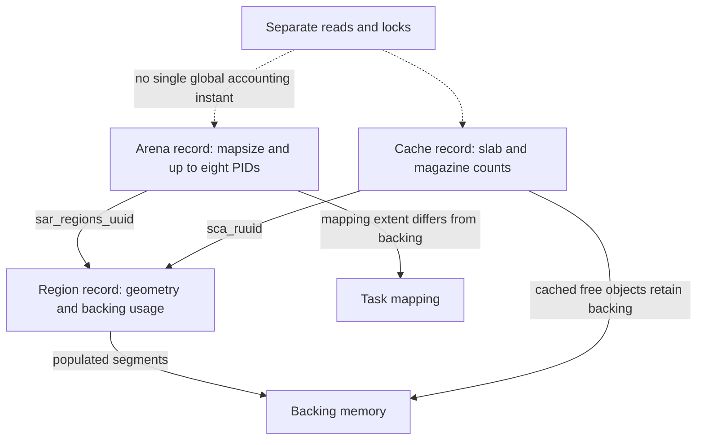
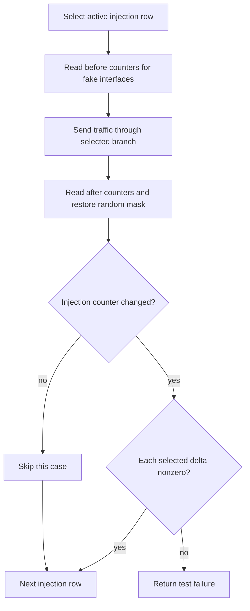

# Skywalk diagnostics, configuration and tests

[Networking guide](README.md) · [Skywalk overview](skywalk.md) · [Memory arenas](skywalk-memory-arenas-and-mapping.md) · [Packets and pools](skywalk-packets-buflets-and-pools.md)

Skywalk exposes several different kinds of evidence: live counters owned by a ring or nexus, retained statistics objects that outlive a flow, copies made by sysctl handlers, memory mapped protocol statistics, log records, and packet trace events. They answer different questions. A successful statistics read does not establish a globally consistent snapshot, and a test returning success does not necessarily establish that its injected failure occurred.

This chapter follows the `xnu-12377.121.6` implementation from producers to consumers, then connects local tests to the paths they exercise. Read [channels and readiness](skywalk-channel-abi-and-readiness.md), [provider lifetime](skywalk-controller-provider-and-port-lifetime.md), [user/kernel pipes](skywalk-user-and-kernel-pipes.md), [flowswitch delivery](skywalk-flowswitch-classification-routes-and-datapaths.md) and [netif servicing](skywalk-netif-links-queues-and-scheduling.md) for the underlying datapaths. The explanations here come from source inspection; no kernel, channel or driver tests were run.

## 1. Establish the configuration before interpreting an observation

`SKYWALK` and the four `CONFIG_NEXUS_*` options select separately compiled support. `sk_features` records the compiled Skywalk, development/debug, flowswitch, netif, user-pipe and kernel-pipe capabilities; the kernel-pipe loopback bit additionally requires development/debug. `kern.skywalk.features` exports that bitset read-only. A set bit describes compiled support, not an attached interface, registered provider, admitted channel or successful packet path. [Build options](../../../xnu/config/MASTER#L85-L89), [feature construction and publication](../../../xnu/bsd/skywalk/core/skywalk.c#L59-L87), [sysctl registration](../../../xnu/bsd/skywalk/core/skywalk.c#L195-L204).

| Selection layer | Concrete example | Consequence for an inspection |
| --- | --- | --- |
| Compile-time domain | `CONFIG_NEXUS_USER_PIPE`, `CONFIG_NEXUS_KERNEL_PIPE`, `CONFIG_NEXUS_FLOWSWITCH`, `CONFIG_NEXUS_NETIF` | A domain and its optional test provider can be absent even when Skywalk itself exists. |
| Compile-time diagnostics | `DEVELOPMENT || DEBUG` | Ring-rate tuning, injection sites, allocator tests and some topology overrides are unavailable in other builds. |
| Boot configuration | `sk_netif_q_stats` initializes `sk_netif_queue_stat_enable` | Boot policy can change whether optional queue statistics start enabled. [Parsing](../../../xnu/bsd/skywalk/core/skywalk.c#L395-L405). |
| Runtime collection | `kern.skywalk.ring_stat_enable`; `kern.skywalk.netif.netif_queue_stat_enable` | Change whether future ring/queue transfers update optional statistics; this does not enable the datapath itself. [Ring](../../../xnu/bsd/skywalk/channel/channel_ring.c#L39-L70), [queue](../../../xnu/bsd/skywalk/nexus/netif/nx_netif.c#L310-L320). |
| Runtime datapath choice | `kern.skywalk.flowswitch.ip_reass`, `rx_agg_tcp`, `rx_agg_tcp_host`, `gso_mtu` | Change actual processing: reassembly force-off/on/auto; receive aggregation; host aggregation choice; GSO extent. Their validators and consumers differ. [Definitions/validation](../../../xnu/bsd/skywalk/nexus/flowswitch/fsw_dp.c#L168-L217). |
| Per-instance state | Interface/native mode, active adapter, channel flags, pool configuration | Determines which callbacks, memory layout and counters exist. Follow the provider and netif companions instead of inferring this state from a global bit. |

For example, `ip_reass` uses a custom handler that rejects values above two. The aggregation and GSO entries shown beside it use ordinary integer handlers; the same registration pattern does not imply the same validation or behavior. Their selected packet branches are explained in [fragments/reassembly](skywalk-fragments-reassembly-and-flow-tracking.md) and [aggregation/segmentation](skywalk-tcp-aggregation-segmentation-and-offloads.md).

Dynamic nodes have their own lifetime. Attaching a flowswitch creates `kern.skywalk.flowswitch.<ifname>` and, for native development/debug instances, a `rps_nthreads` handler whose argument is the flowswitch. Teardown unregisters that node before completing interface teardown. `skoid` owns an embedded parent OID and allocated property OIDs; `skoid_destroy()` unregisters the parent, unregisters/frees leaves, and rejects a still-linked child node. The helper does not free the enclosing owner. [Attach/teardown](../../../xnu/bsd/skywalk/nexus/flowswitch/fsw.c#L504-L540), [OID representation and registration](../../../xnu/bsd/skywalk/core/skywalk_sysctl.c#L45-L104), [destruction](../../../xnu/bsd/skywalk/core/skywalk_sysctl.c#L139-L168).

The generic sysctl layer makes that unregister meaningful: it removes a dynamic OID under the geometry write lock, then waits for outstanding handler references to drain. Dispatch takes a reference before dropping the geometry lock, and its final decrement wakes unregister waiters. Unlinking therefore prevents new lookups while references bridge already-started handlers; the caller can subsequently free the property OID. This is a concrete use of the [reader/writer lock sleep protocol](../runtime/reader-writer-locks.md). [Drain](../../../xnu/bsd/kern/kern_newsysctl.c#L393-L405), [handler reference](../../../xnu/bsd/kern/kern_newsysctl.c#L1910-L1920), [release/wakeup](../../../xnu/bsd/kern/kern_newsysctl.c#L1974-L1998).

## 2. Which object owns the statistic?

| Representation | Owner and important fields | Consumer and lifetime |
| --- | --- | --- |
| `fsw_stats`, `netif_stats` | `fsw->fsw_stats`, `nif->nif_stats`; enum-indexed arrays of `uint64_t` | Copied into `sk_stats_flow_switch` / `sk_stats_net_if`; tied to the nexus instance. [Array machinery](../../../xnu/bsd/skywalk/os_stats_private.h#L957-L1017), [flowswitch export](../../../xnu/bsd/skywalk/nexus/flowswitch/fsw.c#L2160-L2174), [netif export](../../../xnu/bsd/skywalk/nexus/netif/nx_netif.c#L907-L924). |
| Ring counters | `ckr_stats`, `ckr_usr_stats`, `ckr_err_stats` | Exported with channel identity and selected TX/RX ring IDs through `nexus_channel_list`. [Population](../../../xnu/bsd/skywalk/nexus/nexus.c#L3204-L3234), [channel record](../../../xnu/bsd/skywalk/nexus/nexus.c#L3256-L3294). |
| `netif_qstats` | Each `netif_queue.nq_stats`, with totals, rates and transfer extrema | Queue records identify qset, queue index, service class and RX direction; they are not hardware DMA completion records. [Fields](../../../xnu/bsd/skywalk/nexus/netif/nx_netif.h#L96-L119), [export](../../../xnu/bsd/skywalk/nexus/netif/nx_netif.c#L978-L1041). |
| `flow_stats` | Separately allocated object containing `fs_stats` (`sk_stats_flow`) and `fs_refcnt` | Flow producer and NECP/ntstat consumers can hold different references. Flow removal does not immediately free the statistics object. [Contract and references](../../../xnu/bsd/skywalk/os_stats_private.h#L1407-L1468). |
| `__nx_stats_fsw` | Nexus arena's `arn_stats_obj`; IP/IP6/TCP/UDP/QUIC arrays | Mapped user-stack statistics exported per channel/PID and folded into closed-port totals. [Arena lookup](../../../xnu/bsd/skywalk/nexus/flowswitch/fsw.c#L2091-L2158), [fold](../../../xnu/bsd/skywalk/nexus/flowswitch/fsw.c#L2213-L2231). |
| Memory records | Arena mappings, region geometry/backing, cache magazines/slabs | Three related sysctl tables expose distinct ownership levels; UUIDs join regions to arenas/caches. [Arena](../../../xnu/bsd/skywalk/mem/skmem_arena.c#L1918-L1974), [region](../../../xnu/bsd/skywalk/mem/skmem_region.c#L2115-L2145), [cache](../../../xnu/bsd/skywalk/mem/skmem_cache.c#L2313-L2381). |

The array macros perform ordinary increments/additions. Neither their name nor the `volatile` members of other statistics structures supplies a whole-record synchronization protocol. The selected owner path supplies whatever serialization it needs; readers may see different fields at different stages. The fold helper loops over elements; the comment proposing vectorization is not evidence of an existing vector implementation. [Actual operations](../../../xnu/bsd/skywalk/os_stats_private.h#L957-L986).

The increment and fold operations are explicit. [Exact source, `os_stats_private.h` lines 957–969](../../../xnu/bsd/skywalk/os_stats_private.h#L957-L969):

<!-- source-excerpt: ../../../xnu/bsd/skywalk/os_stats_private.h#L957-L969 -->
```c
#define STATS_VAL(s_ptr, t) ((s_ptr)->_arr[(t)])
#define STATS_INC(s_ptr, t) ((s_ptr)->_arr[(t)]++)
#define STATS_DEC(s_ptr, t) ((s_ptr)->_arr[(t)]--)
#define STATS_ADD(s_ptr, t, v) ((s_ptr)->_arr[(t)] += (v))

static inline void __attribute__((always_inline))
__stats_fold(uint64_t *__counted_by(len)dst, uint64_t *__counted_by(len)src, size_t len)
{
	// TODO replace with vector instruction once veclib is ready for xnu
	size_t i;
	for (i = 0; i < len; i++) {
		dst[i] += src[i];
	}
```

Generated `*_reset()` helpers zero arrays, but the nexus statistics sysctls below do not dispatch a reset command. The writable `stats.flow` registration accepts an input filter. It is not a “write anything to clear counters” interface. Selected initialization zeroes new objects; port teardown folds counters; disabling collection and interval rollover have narrower effects described below. [Reset generator](../../../xnu/bsd/skywalk/os_stats_private.h#L979-L1006), [flow sysctl](../../../xnu/bsd/skywalk/nexus/nexus.c#L3053-L3056), [filter interpretation](../../../xnu/bsd/skywalk/nexus/nexus.c#L3430-L3468).

## 3. Sysctl dispatch, authority and private record formats

`nexus_mib_get_sysctl()` serves several nodes, using `oid_arg2` as the requested `NXMIB_*` type. A `nexus_mib_filter` optionally supplies nexus UUID, flow UUID, PID or tuple selection; providers interpret only the selections relevant to their particular operation. It is a private ABI: use the matching structures and constants, not assumptions about a permanently stable external layout. [Registrations](../../../xnu/bsd/skywalk/nexus/nexus.c#L3040-L3091), [filter parsing](../../../xnu/bsd/skywalk/nexus/nexus.c#L3408-L3468), [provider implementations](../../../xnu/bsd/skywalk/nexus/flowswitch/fsw.c#L2176-L2211), [netif dispatch](../../../xnu/bsd/skywalk/nexus/netif/nx_netif.c#L1043-L1070).

The bitmap says which selector fields are supplied; it is not a list of predicates automatically ANDed by the common dispatcher. [Exact filter structure, `os_nexus_private.h` lines 308–316](../../../xnu/bsd/skywalk/nexus/os_nexus_private.h#L308-L316):

<!-- source-excerpt: ../../../xnu/bsd/skywalk/nexus/os_nexus_private.h#L308-L316 -->
```c
struct nexus_mib_filter {
	uint32_t                nmf_type;       /* MIB type */
	uint64_t                nmf_bitmap;     /* bitmap of following fields */

	uuid_t                  nmf_nx_uuid;    /* nexus instance uuid */
	uuid_t                  nmf_flow_id;    /* flow rule id */
	pid_t                   nmf_pid;        /* owner pid */
	struct info_tuple       nmf_info_tuple; /* flow tuple */
};
```

| Read surface | Handler-level admission and output |
| --- | --- |
| `nexus_provider_list`, `nexus_channel_list` | Explicit superuser check. Provider records contain parameters and instance UUID arrays; channel records nest per-instance channel entries and ring entries. [Provider](../../../xnu/bsd/skywalk/nexus/nexus.c#L3096-L3183), [channel](../../../xnu/bsd/skywalk/nexus/nexus.c#L3296-L3406). |
| `stats.userstack` | Explicit superuser check; protocol counters from mapped arena state plus the closed-port row. [Admission](../../../xnu/bsd/skywalk/nexus/nexus.c#L3423-L3428). |
| `stats.flow` | Non-root reads must provide a correctly sized filter, matching type and `NXMIB_FILTER_INFO_TUPLE` bit. No-input enumeration requires root. The node permits the input-filter operation with `CTLFLAG_ANYBODY`; this is not unrestricted enumeration. [Exact predicate](../../../xnu/bsd/skywalk/nexus/nexus.c#L3430-L3468). |
| `stats.net_if`, `flow_switch`, `flow_owner`, `flow_route`, `flow_adv`, `netif_queue`, `llink_list` | Read-only registrations use the shared dispatcher. Do not assign them the separate controller-observer admission rule merely because both concern Skywalk. Ordinary sysctl and applicable MAC checks still surround the handler. [Nodes](../../../xnu/bsd/skywalk/nexus/nexus.c#L3048-L3091), [generic access dispatch](../../../xnu/bsd/kern/kern_newsysctl.c#L1860-L1907). |
| `stats.arena`, `stats.region`, `stats.cache` | Independent handlers explicitly require superuser. [Arena](../../../xnu/bsd/skywalk/mem/skmem_arena.c#L1976-L1990), [region](../../../xnu/bsd/skywalk/mem/skmem_region.c#L2165-L2179), [cache](../../../xnu/bsd/skywalk/mem/skmem_cache.c#L2383-L2397). |

The flow filter gate is a selection requirement, not proof that the caller owns the selected process or flow. The downstream implementation receives no process argument: it tries a flow UUID first when that bit is set, otherwise constructs an IPv4/IPv6 five-tuple key from matching address families. If both UUID and tuple bits are set, UUID selection has precedence. Neither this body nor the frontend predicate compares the flow's PID to the caller. Describe those checks literally instead of converting the comment about “the non-root user's tuple” into an ownership guarantee. [UUID/tuple ordering and retained lookup](../../../xnu/bsd/skywalk/nexus/flowswitch/fsw.c#L1727-L1788).

Some outputs apply additional field policy. Flow-route export checks `net.link.addr` through MAC when configured; failed access scrubs link-layer address information to the documented placeholder. It then walks route buckets under their shared locks. This affects the returned field, not whether the whole route exists. [Policy and traversal](../../../xnu/bsd/skywalk/nexus/flowswitch/fsw.c#L2020-L2057).

Controller authority is separate. Opening a nexus controller tries observe-stats and observe-all privileges before domain-registration privileges; selected controller operations additionally limit visibility to owned objects unless observe-all succeeds. These privileges are checked through `priv_check_cred()`. The development/debug `__priv_check` override changes this helper's behavior, not every independent root check above. [Privilege helper](../../../xnu/bsd/skywalk/core/skywalk.c#L517-L590), [controller admission](../../../xnu/bsd/skywalk/core/skywalk.c#L605-L653), [provider visibility](../../../xnu/bsd/skywalk/nexus/nexus.c#L390-L425).

## 4. A snapshot is materialized before user copy

For the shared nexus MIB path:

1. Parse/admit the input filter, then update networking uptime.
2. For an output buffer, allocate temporary kernel storage up to `SK_SYSCTL_ALLOC_MAX` (100 MiB). Allocation failure returns `ENOBUFS`. A count-only request allocates nothing.
3. Hold `sk_lock` while traversing `nx_head`. Call each domain provider's `nxdom_prov_nx_mib_get()` if present. Flowswitch additionally takes `FSW_RLOCK`; netif's logical-link/queue enumerators take `nif_llink_lock` shared.
4. Each provider returns a required record extent, and may populate only the portion fitting its supplied buffer. The outer loop accepts that provider's result only if the whole reported extent fits.
5. Release `sk_lock`, then call `SYSCTL_OUT` for the accepted prefix and free the temporary storage. A copyout error replaces the previously selected error code. The handlers do not retain a cursor for the next user call.

[Allocation and traversal](../../../xnu/bsd/skywalk/nexus/nexus.c#L3470-L3521), [copy and release](../../../xnu/bsd/skywalk/nexus/nexus.c#L3523-L3534), [limit](../../../xnu/bsd/skywalk/core/skywalk_var.h#L469-L473), [flowswitch lock](../../../xnu/bsd/skywalk/nexus/flowswitch/nx_flowswitch.c#L619-L639), [netif lock](../../../xnu/bsd/skywalk/nexus/netif/nx_netif.c#L978-L1041).



The diagram shows the callback-bearing branch; zero-capacity skips and short-buffer results are detailed below. The lock protects object traversal and lifetime during materialization. It does not stop all packet processing, freeze user-writable counters, or make every copied field belong to one instant. Once the kernel buffer is populated, the source objects can change or disappear while the user copy uses that buffer.

The capacity edge is worth reading directly. [Exact loop fragment, `nexus.c` lines 3505–3519](../../../xnu/bsd/skywalk/nexus/nexus.c#L3505-L3519):

<!-- source-excerpt: ../../../xnu/bsd/skywalk/nexus/nexus.c#L3505-L3519 -->
```c
		if (req->oldptr == USER_ADDR_NULL || buffer_space) {
			size = nx_dp->nxdom_prov_nx_mib_get(nx, &filter, scan,
			    buffer_space, p);
		}

		if (scan != NULL) {
			if (buffer_space < size) {
				/* supplied buffer too small, stop copying */
				error = ENOMEM;
				break;
			}
			scan += size;
			buffer_space -= size;
		}
		actual_space += size;
```

### Worked example: a short buffer and an exactly full buffer

Use illustrative record sizes: nexus A needs 64 bytes and nexus B needs 96 bytes. A count-only call walks both and reports 160. The set of instances may change before the next call.

- With 128 bytes, A is accepted, leaving 64. B reports 96; the outer loop sets `ENOMEM` and does not add B's extent to `actual_space`. It exports A's 64-byte prefix. B may already have populated some temporary bytes, but those bytes are outside the accepted output length.
- With exactly 64 bytes, A consumes all capacity. For B, the callback is skipped because output exists and `buffer_space == 0`; `size` remains zero. The outer loop can return success with A alone. This implementation does not guarantee an `ENOMEM` result whenever later instances exist.
- With no output pointer, the callback is allowed even at zero capacity; providers compute required extents and the complete count can be accumulated.

This is a description of the local loop, not a recommendation to rely on truncation. A reader that needs a complete table must account for enumeration changes and this exact-exhaustion behavior. The provider-list and channel-list loops have different details: both explicitly stop on an oversized next record, provider output calls `SYSCTL_OUT` unconditionally, and channel output copies only a nonempty accepted prefix. [Provider loop](../../../xnu/bsd/skywalk/nexus/nexus.c#L3153-L3182), [channel loop](../../../xnu/bsd/skywalk/nexus/nexus.c#L3376-L3405).

## 5. Flow statistics survive lookup removal

`flow_stats_alloc()` allocates aligned cache storage, zeroes it and initializes a reference count. `fe_stats_init()` fills stable identifiers, interface/process names, port, key, protocol and service class. Creation retains another statistics reference for `req->nfr_flow_stats`, allowing a consumer to hold the statistics independently of the `flow_entry`. The final flow-entry cleanup releases its reference; NECP releases its own reference on its cleanup path. The statistics cache object is freed only at zero. [Allocation](../../../xnu/bsd/skywalk/nexus/flowswitch/flow/flow_stats.c#L71-L106), [initial fields](../../../xnu/bsd/skywalk/nexus/flowswitch/flow/flow_entry.c#L992-L1030), [consumer publication](../../../xnu/bsd/skywalk/nexus/flowswitch/flow/flow_entry.c#L632-L637), [entry release](../../../xnu/bsd/skywalk/nexus/flowswitch/flow/flow_entry.c#L1149-L1166), [NECP release](../../../xnu/bsd/net/necp_client.c#L1552-L1570).



The statistics contract explicitly permits inconsistent intermediate observations and expects synchronization, where necessary, through surrounding NECP/ntstat events rather than a lock inside `flow_stats`. Descriptor fields are established at creation; state fields are refreshed lazily; traffic counters change during runtime. `flow_entry_stats_get()` first calls `fe_stats_update()` and then copies the record. Several lifecycle flags are accumulated with OR operations, while `NOWAKEFROMSLEEP` and `CONNECTION_IDLE` have explicit clear branches. AOP-offloaded tracking fields are not overwritten by the ordinary refresh because their source is NECP/shared AOP state. [Publication contract](../../../xnu/bsd/skywalk/os_stats_private.h#L1407-L1429), [state update/copy](../../../xnu/bsd/skywalk/nexus/flowswitch/flow/flow_entry.c#L1032-L1114).

A UUID/tuple MIB lookup temporarily retains a matching active flow and releases it after copying. Unfiltered enumeration also visits `fsw_linger_head` under `fsw_linger_lock`. Thus an enumeration row carrying destroyed/lingering flags need not be reachable through the same active lookup path. A retained statistics record is evidence of past/current producer state, not permission to send through a removed flow. [Lookup and linger traversal](../../../xnu/bsd/skywalk/nexus/flowswitch/fsw.c#L1739-L1816), [flag definitions](../../../xnu/bsd/skywalk/os_stats_private.h#L1380-L1400).

## 6. Ring and netif counters measure different transitions

`kr_update_user_stats()` records successful user-side prologue work: sync count, submitted/released slots and byte counts, plus bytes/slots per sync. It updates `ckr_sync_time` even when optional statistics collection is disabled. `kr_update_stats()` records actual nonzero kernel transfers, with transfer count and bytes/slots per second. The TX prologue invokes the user updater only after index checks and the nexus-specific prologue succeed; a validation failure is not a successful user transfer. [User updates](../../../xnu/bsd/skywalk/channel/channel_ring.c#L224-L292), [kernel updates](../../../xnu/bsd/skywalk/channel/channel_ring.c#L294-L359), [TX placement](../../../xnu/bsd/skywalk/channel/channel_ring.c#L686-L720).

Rate updates are activity driven, not a timer continuously refreshing a gauge. Once the accumulation interval has elapsed, the updater computes a rate from the previously accumulated work, resets the accumulator and min/max, then adds the current transfer to the next interval. The current transfer has already participated in the min/max comparisons before rollover clears those extrema; only the accumulation totals are added again afterward. Lifetime totals remain. If traffic stops, the last computed rate remains until another update. Channel export separately derives seconds-since-last-update from networking uptime. [Rate rollover](../../../xnu/bsd/skywalk/channel/channel_ring.c#L324-L359), [age export](../../../xnu/bsd/skywalk/nexus/nexus.c#L3221-L3232).

Turning `ring_stat_enable` off stops optional updates **and causes exported normal/user ring statistics to be zeroed**. It does not erase `ckr_err_stats`, which is copied unconditionally. Re-enabling collection does not execute a full reset of the underlying lifetime counters. Consequently, a zero transfer row accompanied by an error count can mean disabled collection, not a contradictory accounting result. [Actual export branch](../../../xnu/bsd/skywalk/nexus/nexus.c#L3221-L3232):

<!-- source-excerpt: ../../../xnu/bsd/skywalk/nexus/nexus.c#L3221-L3232 -->
```c
		if (kr_stat_enable == 0) {
			bzero(&scan->ncre_stats, sizeof(scan->ncre_stats));
			bzero(&scan->ncre_user_stats,
			    sizeof(scan->ncre_user_stats));
		} else {
			scan->ncre_stats = ring->ckr_stats;
			scan->ncre_stats.crs_seconds_since_last_update = now -
			    scan->ncre_stats.crs_last_update_net_uptime;
			scan->ncre_user_stats = ring->ckr_usr_stats;
		}
		scan->ncre_error_stats = ring->ckr_err_stats;
		scan->ncre_ring_id = i;
```

Queue counters follow another path. `nx_netif` updates interface packet/byte accounting before checking `sk_netif_queue_stat_enable`; disabling optional queue statistics does not suppress that preceding interface accounting. Enabled nonzero queue transfers update `nq_stats` totals and interval/EWMA fields. Enumeration holds the logical-link lock to keep link/qset/queue topology valid, then copies each queue's statistics with `memcpy`; it does not stop all producers or establish a coherent hardware snapshot. The exporter itself does not zero rows when collection is disabled, unlike the ring exporter. [Interface and queue updates](../../../xnu/bsd/skywalk/nexus/netif/nx_netif.c#L4417-L4504), [queue enumeration](../../../xnu/bsd/skywalk/nexus/netif/nx_netif.c#L978-L1041).

A netif drop counter can be very specific: `kern_netif_queue_rx_enqueue()` frees an incoming chain when the logical link is destroyed, then adds the freed count to `NETIF_STATS_LLINK_RX_DROP_BAD_STATE`. That count means rejection at this lifecycle gate; it does not identify all NIC, flowswitch or application losses. [Drop gate](../../../xnu/bsd/skywalk/nexus/netif/nx_netif.c#L4506-L4527).

## 7. Mapped protocol statistics, closed ports and system settings

For a flowswitch channel with statistics storage, schema construction publishes `csm_stats_ofs` and `csm_stats_type` identifying the arena's USTATS region. Without storage, offset zero and `NEXUS_STATS_TYPE_INVALID` explicitly denote absence. This is distinct from the global `fsw_stats` counters maintained by the kernel datapath. [Schema publication](../../../xnu/bsd/skywalk/nexus/nexus_adapter.c#L1025-L1037).

The user-stack sysctl walks open channels under `sk_lock`, skips closing channels, applies its PID selection, then takes the arena lock before accessing `arn_stats_obj`. A missing object on a defunct arena is skipped. The code currently enumerates channels rather than aggregating multiple channels by PID; its comment acknowledges that assumption. A separate PID-zero row contains `fsw_closed_na_stats`. DEFUNCT/OFF activation takes the flowswitch write lock and arena lock to fold user-stack counters; ring errors are folded separately. These values are copied from mapped user-stack state, not independently reconstructed TCP/IP observations from the BSD stack. [Open/closed export](../../../xnu/bsd/skywalk/nexus/flowswitch/fsw.c#L2062-L2158), [deactivation fold](../../../xnu/bsd/skywalk/nexus/flowswitch/fsw_vp.c#L88-L137), [fold dispatch](../../../xnu/bsd/skywalk/nexus/flowswitch/fsw.c#L2213-L2249).

A second mapped object carries **configuration**, not traffic counters. `skmem_sysctl` is versioned (`SKMEM_SYSCTL_VERSION == 3`) and contains a selected TCP settings table plus kernel IPC fields. A singleton `SKMEM_REGION_SYSCTLS` region is created with user-read-only, monolithic and no-redirect characteristics. A system arena retains the region and publishes access to the shared object. Initialization reads the registered TCP sysctl variables; a `SYSCTL_SKMEM_*` handler updates the ordinary variable and mirrors a changed value into the checked field offset. [Layout/version](../../../xnu/bsd/skywalk/os_sysctls_private.h#L150-L172), [global region](../../../xnu/bsd/skywalk/mem/skmem.c#L525-L565), [arena reference](../../../xnu/bsd/skywalk/mem/skmem_arena.c#L1130-L1145), [init and integer handler](../../../xnu/bsd/net/skmem_sysctl.c#L31-L57), [bounds/alignment check](../../../xnu/bsd/skywalk/os_sysctls_private.h#L203-L226).

This mirror lets consumers read the selected settings without querying every sysctl individually. It is not an atomic transaction across all TCP fields, and the presence of settings such as `rack` in the shared table does not mean the user-stack protocol implementation is present in XNU. The network framework side remains external; compare the [BSD TCP recovery chapter](tcp-loss-recovery-and-congestion-control.md) for the local kernel algorithm.

## 8. Memory snapshots expose backing, cache reuse and mapping separately

The arena exporter holds the global arena-list lock for traversal, then the individual arena lock while copying name/type/mapsize, mapped process IDs and region UUIDs. It reports at most `SK_STATS_ARENA_MAPPED_PID_MAX` (eight) PIDs, so the fixed array is not an exhaustive process-mapping registry. The region table supplies requested versus configured segment/object sizes, segment counts, memory-in-use/total, wire usage and allocation/free totals. A large reserved/mapped arena extent is therefore different from currently populated memory and from cached free objects. [Arena snapshot and traversal](../../../xnu/bsd/skywalk/mem/skmem_arena.c#L1918-L2037), [region values](../../../xnu/bsd/skywalk/mem/skmem_region.c#L2115-L2145).

Cache export joins `sca_uuid` to `sca_ruuid` and reports object/chunk/slab geometry, depot and magazine counts, slab allocations/failures and in-use buffers. It locks one CPU cache at a time to sum magazine rounds. Other displayed fields are sampled directly; the contention delta is clamped to zero if racing updates produce a negative intermediate result. This deliberately avoids presenting the output as an exact simultaneous conservation equation. The global cache-list lock keeps the cache objects available while records are made; user copy follows after it is released. [Cache copying](../../../xnu/bsd/skywalk/mem/skmem_cache.c#L2324-L2377), [traversal and copyout](../../../xnu/bsd/skywalk/mem/skmem_cache.c#L2418-L2444).



For a pressure investigation, compare deltas in the same object's UUID: increasing `sca_sl_alloc_fail` points to failed slab allocation, while depot/magazine counts explain why a free packet need not immediately reduce region backing. An arena disappearance and a region still present can reflect sharing/references. Those are interpretations to verify against the [allocator and mapping lifetime](skywalk-memory-arenas-and-mapping.md), not a leak diagnosis from one large number.

## 9. Logs, Kdebug, DTrace and drop taps carry different evidence

`SK_LOG` is compiled out for release watch/TV targets in the selected definition; other listed target/build combinations enable it. With logging present, `SK_ERR` and `SK_D` bypass the verbose category mask; `SK_DF` requires all bits of its requested category combination. For example, a message guarded by `SK_VERB_FSW_DP | SK_VERB_DROP` needs both bits. Rate-limited macros use per-call-site uptime/count state before calling the ordinary logger. `SK_KVA()` applies `VM_KERNEL_ADDRHIDE`, so pointer-looking identifiers are not an invitation to treat logs as raw dereferenceable addresses. [Definitions](../../../xnu/bsd/skywalk/os_skywalk_private.h#L227-L302).

Kdebug event IDs have a different path. `os_skywalk.h` groups interface, flowswitch, netif, channel and packet events. Operations such as common interrupt handling and channel refill use start/end markers, whereas ring flushes publish counts. Packet markers correlate selected packet stages through `pkt_trace_id`. For user-ring TX, the code assigns an incrementing trace ID to the **first packet of a dequeued batch**, then enters GSO or normal delivery. This is sampling at that site, not proof that every packet is individually traced. GSO-created packet metadata clears the trace ID in the selected segmentation loop. [Event definitions](../../../xnu/bsd/skywalk/os_skywalk.h#L41-L82), [interrupt markers](../../../xnu/bsd/skywalk/nexus/netif/nx_netif.c#L1887-L1954), [batch marker](../../../xnu/bsd/skywalk/nexus/flowswitch/fsw_dp.c#L4255-L4286), [GSO reset](../../../xnu/bsd/skywalk/nexus/flowswitch/fsw_dp.c#L3904-L3919).

A nonzero RX trace ID closes the flowswitch stage and starts the channel stage only when the packet is attached to an RX slot. TX AQM-to-driver markers likewise denote a software handoff. They do not prove wire transmission or application consumption. Global trace enabling, buffering, loss and consumer readout are covered by [Kdebug storage and readout](../../development/kdebug-storage-and-readout.md); Skywalk's verbose mask is not that trace filter. [RX attachment](../../../xnu/bsd/skywalk/nexus/flowswitch/fsw_dp.c#L1255-L1280), [TX handoff](../../../xnu/bsd/skywalk/nexus/netif/nx_netif.c#L4346-L4362).

The flowswitch's `dp_drop_pktq` combines four independent effects: increment `FSW_STATS_DROP` by queue length, optionally log, emit a `DTRACE_SKYWALK` drop probe, and, if drop taps exist, build a drop observation for each packet with reason/function/line before freeing the queue. With no tap listener it goes directly to free after accounting/probing. The single-packet `nofree` helper deliberately leaves ownership with its caller. `droptap_input_packet()` / `droptap_output_packet()` build a drop header, choose raw-IP versus Ethernet framing from `DROPTAP_FLAG_L2_MISSING`, and pass it to BPF tapping. [Queue and single-packet helpers](../../../xnu/bsd/skywalk/nexus/flowswitch/fsw_dp.c#L305-L361), [drop-header construction](../../../xnu/bsd/net/droptap.c#L236-L286).

A counter is an aggregate, a drop tap is a packet observation at a particular site, and a trace pair is timing evidence for selected stages. They can legitimately have different totals. This chapter does not reconstruct the external DTrace/BPF/log consumers or assume every drop uses the same helper.

## 10. Invalid shared state: the diagnostic is part of enforcement

A TX ring prologue snapshots user/kernel indices, executes `_KR_TXRING_VALIDATE`, then validates/internalizes submitted metadata through its nexus prologue. On failure it logs the ring state, calls `skywalk_kill_process()` with the specific reason combined with `SKYWALK_KILL_REASON_TX_SYNC`, and returns the invalid-index sentinel `ckr_num_slots`. The process-kill helper constructs an optional `OS_REASON_SKYWALK` payload and calls `psignal_try_thread_with_reason(p, current_thread(), SIGABRT, ...)`; failure to allocate the reason still requests the signal. This is a signal request, not an assertion that the process has synchronously exited, and it is not itself an EXC_GUARD delivery. [Prologue](../../../xnu/bsd/skywalk/channel/channel_ring.c#L658-L723), [kill helper](../../../xnu/bsd/skywalk/core/skywalk.c#L889-L909).

The error exit makes the distinction concrete. [Exact source, `channel_ring.c` lines 713–722](../../../xnu/bsd/skywalk/channel/channel_ring.c#L713-L722):

<!-- source-excerpt: ../../../xnu/bsd/skywalk/channel/channel_ring.c#L713-L722 -->
```c
error:
	SK_ERR("%s(%d) kr \"%s\" (%p) krflags 0x%x error: kh %u kt %u | "
	    "rh %u rt %u | h %u t %u |", sk_proc_name(p),
	    sk_proc_pid(p), kring->ckr_name, SK_KVA(kring), kring->ckr_flags,
	    ckr_khead, ckr_ktail, kring->ckr_rhead, ckr_rtail, head,
	    ring->ring_tail);

	skywalk_kill_process(p, err_reason | SKYWALK_KILL_REASON_TX_SYNC);

	return kring->ckr_num_slots;
```

`kr_log_bad_ring()` can additionally inspect invalid indices and attached packet lengths for diagnostics, but the acceptance decision comes from validation, not from whether logging is compiled in. The debug `disable_panic_on_sync_err` knob is a separate diagnostic policy; it should not be described as disabling every user-state check or the signal helper. [Diagnostic walk](../../../xnu/bsd/skywalk/channel/channel_ring.c#L368-L424), [knob](../../../xnu/bsd/skywalk/channel/channel_ring.c#L53-L65).

The matching `skt_badring` tests deliberately set shared head/tail to `-1` and exercise select, poll, kqueue or sync. Their declarations expect an abort-associated exception code (`SIGABRT << 24`). Assertions after those calls are explicitly fallback localization paths if the expected crash does not occur. A test that names polling is therefore also testing validation reachable through readiness processing. [Corruption and TX paths](../../../xnu/tests/skywalk/skt_badring.c#L60-L160), [expected exceptions](../../../xnu/tests/skywalk/skt_badring.c#L292-L340).

## 11. Tests are executable scenarios with configuration and outcome limits

`tests/Makefile` builds `skywalk_tests` from shared helpers, single-process test cases, and multiprocess test cases, adds a generated exception server, and signs with `skywalk_test.entitlements`. The executable depends on Darwin test infrastructure and a private CrashReporter library from the SDK. The entitlement file requests registration, observation, networking, low-latency, exception-port and AOP-related privileges. Having these source files in a checkout is not a portable Linux build or proof that a production host admits the requested topology. [Build target](../../../xnu/tests/Makefile#L1230-L1286), [entitlements](../../../xnu/tests/skywalk_test.entitlements#L4-L29).

The two driver paths differ:

- `skywalk_test` stores a main function, arguments, init/fini callbacks, required feature bits, and expected exception code/mask. Its driver starts an exception-serving thread, installs task exception ports, forks the test, restores the parent's handlers, waits for the child, calls cleanup, and compares child exit/exception observations. It queries `kern.skywalk.features`, but this selected single-test driver does **not** compare `skt_required_features` with that value before running. [Descriptor](../../../xnu/tests/skywalk/skywalk_test_driver.h#L39-L67), [initialization](../../../xnu/tests/skywalk/skywalk_test_driver.c#L141-L179), [execution/result](../../../xnu/tests/skywalk/skywalk_test_driver.c#L220-L350).
- `skywalk_mptest` provides multiple children. Its driver explicitly tests required feature bits and optional device support checks, unless `ignoreskip` permits proceeding. It creates local socketpairs for synchronization, forks/re-executes children, and aggregates their exit state; failure handling can terminate remaining children. The coordination fd is `MPTEST_SEQ_FILENO`, not a packet channel. [Feature gates](../../../xnu/tests/skywalk/skywalk_mptest_driver.c#L148-L209), [child setup](../../../xnu/tests/skywalk/skywalk_mptest_driver.c#L212-L277), [failure/cleanup](../../../xnu/tests/skywalk/skywalk_mptest_driver.c#L315-L388).

The single-test driver's `ignorefail` option can deliberately turn a failing child/exception check into overall `T_PASS`. Memory-failure variants in `skywalk_tests.c` set both `memfail=127` and `ignorefail=true`; shutdown variants also opt into ignored failures. The memory-failure sysctl is reset to zero at the end, rather than restoring the initially observed value. Do not interpret one overall pass as every assertion and failure-injection path being independently verified. [Result policy and reset](../../../xnu/tests/skywalk/skywalk_test_driver.c#L333-L359), [variant metadata](../../../xnu/tests/skywalk_tests.c#L358-L411).

### A complete counter-delta example

`skt_xfer_udp_with_errors_common()` is a useful source-matched diagnostic loop:

1. Two children establish UDP flows/channels over the fake Ethernet pair and coordinate readiness.
2. A ping-pong exchange warms ARP before measurement.
3. For each active injection-table row, the sender selects an error bit, takes a before snapshot, optionally changes the random mask, transmits, takes an after snapshot and restores that random mask.
4. `get_fsw_stats()` reads `SK_STATS_FLOW_SWITCH`, checks record alignment, selects the two named fake interfaces and sums their arrays.
5. If `_FSW_STATS_ERROR_INJECTIONS` did not change, this injection case is skipped. Otherwise each selected counter's unsigned delta must be nonzero. The test does not require an exact delta or attribute each increment to an individual packet.

[Setup/warmup](../../../xnu/tests/skywalk/skt_xfer.c#L2901-L2983), [snapshot reader](../../../xnu/tests/skywalk/skt_xfer.c#L2855-L2899), [injection/delta loop](../../../xnu/tests/skywalk/skt_xfer.c#L2992-L3060).

The skipped-injection branch is essential to interpreting the result. [Exact source, `skt_xfer.c` lines 3027–3033](../../../xnu/tests/skywalk/skt_xfer.c#L3027-L3033):

<!-- source-excerpt: ../../../xnu/tests/skywalk/skt_xfer.c#L3027-L3033 -->
```c
		/* random error injection could fail to inject at all */
		if (STATS_VAL(&stats_after, _FSW_STATS_ERROR_INJECTIONS) ==
		    STATS_VAL(&stats_before, _FSW_STATS_ERROR_INJECTIONS)) {
			T_LOG("skip non-injected error bit %d\n",
			    ic->ic_code);
			continue;
		}
```



The active injection table includes classifier, allocation, AQM/drop and route-resolution cases. Rows 33/34/40–43 shown later are under `#if 0`, and some commented rows have obsolete helper names. A definition in this table is not evidence that every listed failure runs. The kernel's bit-40 RX-capacity and bit-41 enqueue-count hooks remain visible even though those particular test rows are disabled. [Table and guards](../../../xnu/tests/skywalk/skt_xfer.c#L139-L217), [current RX hook](../../../xnu/bsd/skywalk/nexus/flowswitch/fsw_dp.c#L1246-L1253).

A helper named `sysctl_buf()` performs the usual length query/allocation/data query. Its nominal retry branches compare the syscall's return value to `ENOMEM`, while its error result is read from `errno`. Under the ordinary `sysctlbyname()` -1/errno contract, that comparison is not the intended errno test. Do not cite the helper as proof that size races are reliably retried ten times. [Actual helper](../../../xnu/tests/skywalk/skywalk_test_utils.c#L1278-L1325).

### Allocation failure injection is not a random allocator-wide failure rate

`_SK_INJECT_ERROR` first checks a selected bit, then requires `(random() & sk_inject_error_rmask) == sk_inject_error_rmask`; on a hit it increments the optional injection counter, performs an optional cleanup callback and assigns the requested failure value. Mask zero therefore always passes this particular random predicate. Each call site still determines which resource has already been acquired and whether the cleanup callback runs. [Macro](../../../xnu/bsd/skywalk/core/skywalk_var.h#L475-L494), [flowswitch wrapper](../../../xnu/bsd/skywalk/nexus/flowswitch/fsw_dp.c#L219-L231).

`kern.skywalk.mem.region_mtbf` is different. In development/debug, the segment-free-list path refuses population when the nonzero millisecond interval divides the current networking uptime, unless purging or `SKMEM_PANIC` excludes injection. It returns before `IOSKMemoryBufferCreate()`. Existing cached objects need not hit that path, so it is neither a per-packet probability nor a periodic background fault generator. The setter clamps nonzero values to its limits and publishes the value with a release store. [Population branch](../../../xnu/bsd/skywalk/mem/skmem_region.c#L1760-L1808), [setter/handler](../../../xnu/bsd/skywalk/mem/skmem_region.c#L2358-L2399).

## 12. A test map for the surrounding mechanisms

| Local scenario | State transition or assertion to follow | Scope limit |
| --- | --- | --- |
| Bad rings | User index corruption reaches validation through TX/RX sync and readiness; expected abort code | The fallback return-value assertions are not the expected successful path. [Test](../../../xnu/tests/skywalk/skt_badring.c#L60-L160). |
| Metadata corruption | Deliberately inconsistent packet length/checksum extent is submitted to TX internalization | Establishes a selected malformed-metadata scenario, not every buflet/redzone combination. [Setup](../../../xnu/tests/skywalk/skt_mangle.c#L110-L149); see [packet validation](skywalk-packets-buflets-and-pools.md). |
| Injection plus counters | Before/after flowswitch arrays, explicit injection-hit check, selected nonzero counter deltas | Optional skipped hits, disabled rows, concurrent aggregate counts and private fake-interface setup. [Loop](../../../xnu/tests/skywalk/skt_xfer.c#L2992-L3060). |
| Packet/pool memory tests | Kernel basic tests enumerate persistent, monolithic, on-demand, no-magazine, user-access and virtual-device configurations | ARM64 macOS disables the test's inhibit-cache option. [Matrix](../../../xnu/bsd/skywalk/mem/skmem_test.c#L1274-L1343), [architecture selection](../../../xnu/bsd/skywalk/mem/skmem_test.c#L41-L45). |
| Clone/reap stress | Shared clone buffer addresses/control object are checked; clones are finalized/freed and caches explicitly reaped | Selected assertion-based stress, not a proof of all allocator interleavings. [Worker](../../../xnu/bsd/skywalk/mem/skmem_test.c#L1633-L1689). |
| User-pipe backpressure, peer close and concurrent transfers | Ring saturation, capacity return and peer-lifetime cases | Follow the [pipe chapter's source-matched test map](skywalk-user-and-kernel-pipes.md#10-configuration-test-evidence-and-limits), rather than counting variants as separate mechanism coverage. |
| Flow/namespace, reassembly, filters and steering | Tuple admission, fragment ownership, reinjection progress and provider queue selection | Dedicated [namespace](skywalk-namespaces-and-flow-lookup.md), [fragment](skywalk-fragments-reassembly-and-flow-tracking.md), [filter](skywalk-netif-filters-and-reinjection.md) and [traffic-rule](skywalk-netif-agents-and-traffic-rules.md) chapters give the corresponding implementation boundaries. |

`skt_memory_main()` itself returns zero and explicitly relies on an external mechanism to detect a hang; its init/fini callbacks write `kern.skywalk.mem.test` and later restore the saved setting, driving the kernel memory tests. [Callbacks](../../../xnu/tests/skywalk/skywalk_test_common.c#L830-L848). That should prevent a misleading reading that the short function checks allocation success by itself. [Test descriptor and warning](../../../xnu/tests/skywalk/skt_memory.c#L40-L57).

The current `skywalk_tests.c` also contains a named list of known-failing test cases. That is local test-suite metadata, not a measured result of this documentation effort. More generally, test availability, inclusion in the compiled test list, admission on the target, actual execution and successful assertion coverage are five separate claims. [Known-failure list](../../../xnu/tests/skywalk_tests.c#L273-L292), [build source sets](../../../xnu/tests/Makefile#L1230-L1286).

## 13. What this inspection establishes and what remains

This companion covers configuration selection, root/filter/controller authority distinctions, nexus and memory snapshot lifetimes/partial copies, flow-stat references, ring/queue update semantics, mapped counters/settings, log/trace/drop evidence and representative test/hook paths. It does not establish a coherent snapshot across all exporters, an exhaustive reset API, or complete coverage of all diagnostic nodes and test cases.

Remaining work includes a field-by-field treatment of every protocol counter, exhaustive namespace/flow-advisory exporter details, all provider-specific diagnostics and fault injections, DTrace/BPF consumer machinery, test-harness repair and execution on admitted target configurations, and external network-framework/driver/firmware telemetry. The chapters linked above cover the local packet/memory/provider mechanisms; unavailable implementations are not filled in from counter names.

<!-- BEGIN PLATYDOC DOCUMENTATION LICENSE -->
Original Platydoc text and diagrams are licensed under [CC BY 4.0](https://creativecommons.org/licenses/by/4.0/). Quoted source code and third-party material retain their respective licenses.
<!-- END PLATYDOC DOCUMENTATION LICENSE -->
