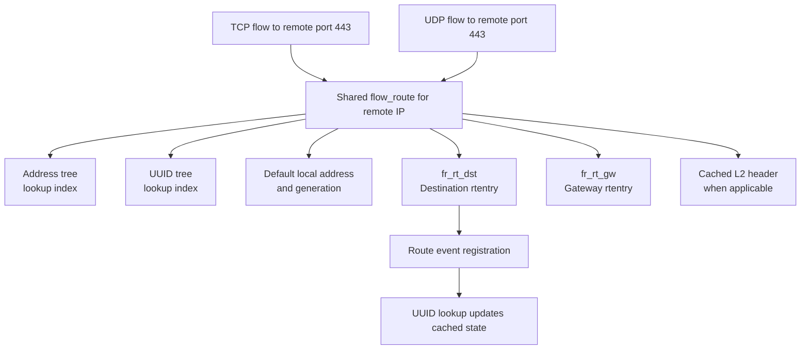
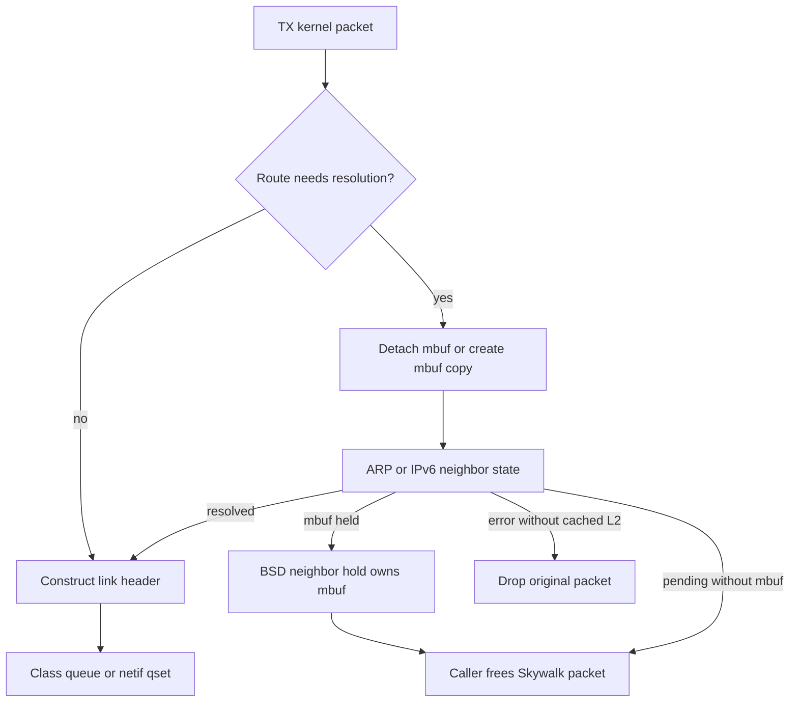
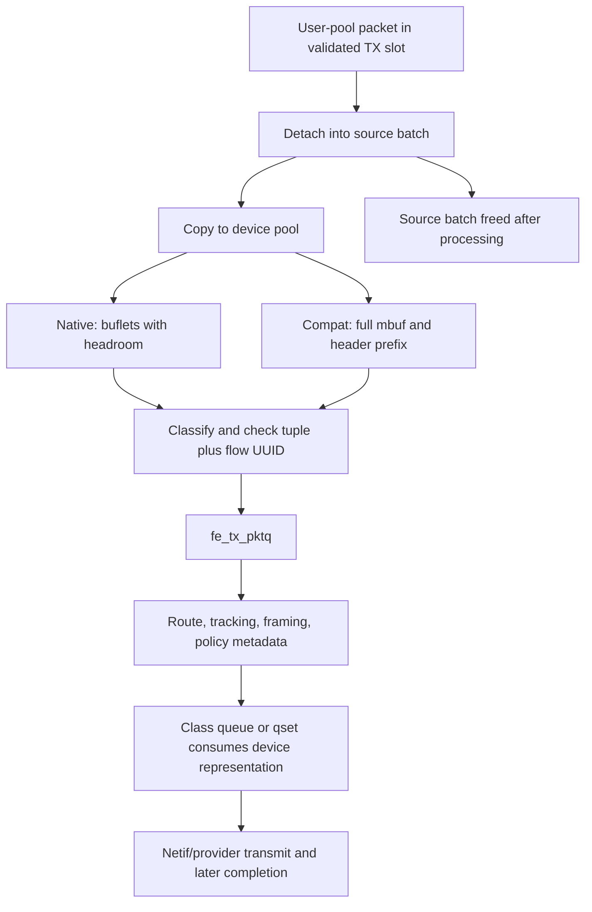
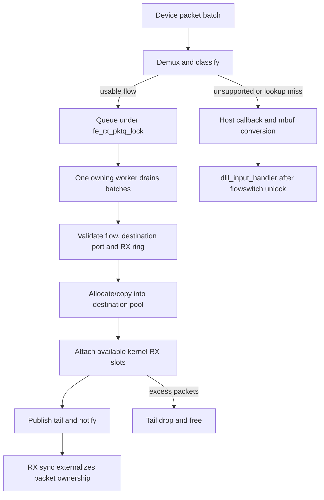

# Skywalk flowswitch classification, routes, and packet delivery

[Networking](README.md) · [Skywalk overview](skywalk.md) · [Namespaces and lookup](skywalk-namespaces-and-flow-lookup.md) · [Packet pools](skywalk-packets-buflets-and-pools.md) · [Netif queues](skywalk-netif-links-queues-and-scheduling.md)

The flowswitch joins registered flows to channel rings and network interfaces. Its hot path parses packet headers into kernel metadata, finds an entry, checks that the entry is usable, and transfers packets to a destination pool, ring, or interface queue. It also caches routes and coordinates with BSD ARP/neighbor discovery. This chapter follows the ordinary RX and non-GSO TX paths in `xnu-12377.121.6`, including partial allocation, fallback, route changes, and cleanup. Continue with [fragment ordering and flow tracking](skywalk-fragments-reassembly-and-flow-tracking.md) and [TCP aggregation, segmentation and offloads](skywalk-tcp-aggregation-segmentation-and-offloads.md) for the specialized paths.

## 1. Objects and entry points

| Object or callback | Role in the path |
| --- | --- |
| `nx_flowswitch` | Instance state: interface, device channel, flow manager, lifecycle lock, packet-copy helpers, demux/resolver/framing callbacks, reaper state. |
| `__kern_packet` and its `__flow` metadata | Payload storage and parsed IP/transport fields; flags distinguish classified, truncated, mbuf-backed, and finalized packets. |
| `flow_entry` | Key/UUID, destination nexus port, route reference, state/tracking/policy metadata, TX queue, RX queue/lock/worker, and RX/TX processing callbacks. |
| `flow_route` | Shared destination route cache, source-address choice, gateway, cached L2 header, `rtentry` references, route-event registration, use count and expiry. |
| `nexus_vp_adapter` and `__kern_channel_ring` | Registered flow's channel destination; trusted slot attachments and ring progress precede userspace publication. |
| Interface class queue / netif qset | Accepts the final TX representation and schedules it toward a provider. Enqueue success is not device completion. |

Definitions: [`nx_flowswitch`](../../../xnu/bsd/skywalk/nexus/flowswitch/nx_flowswitch.h#L206-L326), [`kernel packet`](../../../xnu/bsd/skywalk/packet/packet_var.h#L352-L480), [`parsed flow metadata`](../../../xnu/bsd/skywalk/packet/os_packet_private.h#L62-L179), [`flow entry`](../../../xnu/bsd/skywalk/nexus/flowswitch/flow/flow_var.h#L256-L392), and [`flow route`](../../../xnu/bsd/skywalk/nexus/flowswitch/flow/flow_var.h#L415-L512). [Packet and buflet ownership](skywalk-packets-buflets-and-pools.md) explains the underlying layouts.

There are two important receive entrances. `fsw_devna_rx()` accepts a provider-side packet chain, forms bounded packet batches, discards already dropped/unfinalized packets, and calls `fsw_receive()` or the configured network emulator. The older ring route uses `fsw_dev_ring_flush()` to dequeue batches from the device ring into that same receive path. User TX enters `fsw_ring_flush()` on a non-host virtual-port adapter and reaches `fsw_user_ring_flush()`. That wrapper selects normal TX or GSO and later frees the source packet batch. [`Direct RX entrance`](../../../xnu/bsd/skywalk/nexus/flowswitch/fsw_dp.c#L2591-L2648), [`ring entrances`](../../../xnu/bsd/skywalk/nexus/flowswitch/fsw_dp.c#L4220-L4311).

`fsw_ring_flush()` asserts Skywalk sync protection. `_fsw_receive()` and `dp_tx_pktq()` take the flowswitch read lock and reject a quiesced instance; TX additionally obtains an interface data-movement reference. The provider/ring entrance can execute in different calling contexts, so “the flowswitch thread” is not a universal execution model. Development/debug builds have an optional receive packet steering worker path; ordinary `fsw_receive()` directly invokes `_fsw_receive()`. [`Read-side receive`](../../../xnu/bsd/skywalk/nexus/flowswitch/fsw_dp.c#L2161-L2205), [`TX lifetime admission`](../../../xnu/bsd/skywalk/nexus/flowswitch/fsw_dp.c#L3589-L3660), [`conditional RPS dispatch`](../../../xnu/bsd/skywalk/nexus/flowswitch/fsw_dp.c#L2512-L2540).

## 2. Demultiplex the link header before parsing IP

Interface-family setup installs different callbacks. Ethernet installs Ethernet demux, route resolution and header construction. Cellular and supported raw-IP interfaces use IP-header demux and the generic route resolver, with no Ethernet framing. These are selected implementations, not assumptions inferred from a packet's source. [`Setup selection`](../../../xnu/bsd/skywalk/nexus/flowswitch/fsw.c#L393-L433), [`Ethernet setup`](../../../xnu/bsd/skywalk/nexus/flowswitch/fsw_ethernet.c#L57-L74), [`cellular setup`](../../../xnu/bsd/skywalk/nexus/flowswitch/fsw_cellular.c#L36-L45), [`IP setup`](../../../xnu/bsd/skywalk/nexus/flowswitch/fsw_ip.c#L36-L47).

Ethernet demux validates that the header fits both total packet length and the first buflet's accessible extent, removes FCS length when indicated, records L2 length and broadcast/multicast/promiscuous state, and selects an address family from EtherType. A nonlocal promiscuous unicast frame returns `AF_UNSPEC`; the caller routes it to the host path, where filtering/protocol processing still applies. Cellular demux checks the IP version directly and sets L2 length to zero. [`Ethernet demux`](../../../xnu/bsd/skywalk/nexus/flowswitch/fsw_ethernet.c#L550-L627), [`cellular demux`](../../../xnu/bsd/skywalk/nexus/flowswitch/fsw_cellular.c#L48-L78).

For compat RX, `rx_prepare_packet_mbuf()` copies an initial header-sized prefix into the kernel packet's small buffer while retaining the complete mbuf. Packet length can describe the whole packet even though the buflet contains only its prefix. `flow_pkt_classify()` therefore bounds parsing by the first buflet as well as total length:

[Source: `bsd/skywalk/nexus/flowswitch/flow/flow_classifier.c`, lines 189–201](../../../xnu/bsd/skywalk/nexus/flowswitch/flow/flow_classifier.c#L189-L201).

<!-- source-excerpt: ../../../xnu/bsd/skywalk/nexus/flowswitch/flow/flow_classifier.c#L189-L201 -->
```c
	MD_BUFLET_ADDR_ABS_DLEN(pkt, pkt_buf, bdlen, bdlim, bdoff);
	pkt_buf_cpy = pkt_buf;
	pkt_buf_size = bdlim;
	cls_len = bdlim - bdoff;
	cls_len -= pkt->pkt_l2_len;
	cls_len = (uint16_t)MIN(cls_len, pkt_len);
	VERIFY(pkt_len >= cls_len);

	/* takes care of ip6 assignment too */
	l3_hdr = pkt_buf + pkt->pkt_headroom + pkt->pkt_l2_len;
	pkt_buf_cpy = l3_hdr;
	pkt_buf_size = cls_len;
	iph = (volatile struct ip *__indexable)(void *)pkt_buf_cpy;
```

The addresses in `pkt_flow_ip_hdr` and `pkt_flow_tcp_hdr` are kernel pointers into this packet's accessible header representation. They are not offsets in a user mapping and do not establish that the whole payload is contiguous there. [`Compat preparation`](../../../xnu/bsd/skywalk/nexus/flowswitch/fsw_dp.c#L728-L774), [`parsed header pointers`](../../../xnu/bsd/skywalk/nexus/flowswitch/flow/flow_classifier.c#L249-L260), [`transport pointers`](../../../xnu/bsd/skywalk/nexus/flowswitch/flow/flow_classifier.c#L332-L355).

## 3. Classification populates metadata; it does not deliver a packet

`flow_pkt_classify()` checks enough header structure to make the flowswitch's next decisions:

| Layer | Checks and output |
| --- | --- |
| IPv4 | Minimum/header lengths, available bytes, declared total length, version; rejects options for channel TX; copies addresses/protocol, identifies fragments and their IDs. |
| IPv6 | Base-header availability/version and declared payload extent; directly recognizes a fragment header only when it immediately follows the base header. |
| Fragment continuation | Records IP information but clears transport ports and skips L4; it cannot independently recover the original transport tuple. |
| TCP | Minimum header availability, data offset and its relation to IP payload; records ports and tracking fields. |
| UDP | Minimum UDP header availability and L4 extent; records UDP header fields and computed payload length. This is not the entire BSD UDP input validation path. |
| Successful TX | Trims metadata to the declared IP length and checks MTU versus packet/segment size; marks nonempty TCP payload with starting-sequence metadata. |
| Completion | Sets `QUM_F_FLOW_CLASSIFIED` only on success; failure clears the flow metadata. |

See [`IPv4/IPv6 parsing`](../../../xnu/bsd/skywalk/nexus/flowswitch/flow/flow_classifier.c#L212-L327), [`transport parsing`](../../../xnu/bsd/skywalk/nexus/flowswitch/flow/flow_classifier.c#L329-L414), and [`output/completion`](../../../xnu/bsd/skywalk/nexus/flowswitch/flow/flow_classifier.c#L415-L455). The implementation is a fast parser for this datapath; it is not a complete extension-header walker, transport checksum validator, or TCP endpoint.

The caller decides what failure means. The classifier's introductory comment describes an `ENOTSUP` distinction, but the inspected RX caller sends **every nonzero classification result** to the host packet queue:

[Source: `bsd/skywalk/nexus/flowswitch/fsw_dp.c`, lines 2222–2234](../../../xnu/bsd/skywalk/nexus/flowswitch/fsw_dp.c#L2222-L2234).

<!-- source-excerpt: ../../../xnu/bsd/skywalk/nexus/flowswitch/fsw_dp.c#L2222-L2234 -->
```c
		af = fsw->fsw_demux(fsw, pkt);
		if (__improbable(af == AF_UNSPEC)) {
			KPKTQ_ENQUEUE(&host_pkts, pkt);
			continue;
		}

		err = flow_pkt_classify(pkt, fsw->fsw_ifp, af, TRUE);
		_FSW_INJECT_ERROR(1, err, ENXIO, null_func);
		if (__improbable(err != 0)) {
			FSW_STATS_INC(FSW_STATS_RX_FLOW_EXTRACT_ERR);
			KPKTQ_ENQUEUE(&host_pkts, pkt);
			continue;
		}
```

The normal TX caller drops **every nonzero** result. Thus unsupported or malformed input is offered to BSD for its own handling; it is not thereby accepted as a valid datagram. Channel output must pass the flowswitch's parser to continue. [`TX classification failure`](../../../xnu/bsd/skywalk/nexus/flowswitch/fsw_dp.c#L3704-L3722).

After classification, [key normalization and ordered lookup](skywalk-namespaces-and-flow-lookup.md#8-keys-are-normalized-to-local-and-remote-endpoints) select an entry. Lookup returning a retained object prevents immediate storage reclamation; it does not waive torn-down, listener-destination, offload, UUID, route, or destination-channel checks.

## 4. The route cache is shared by destination

A connected flow's `fe_route` refers to a `flow_route`; multiple transport flows to the same destination can share it. The route cache's address key omits transport ports, and construction explicitly clears the stored destination port. `fr_laddr` is the route's default source choice; an individual flow may have supplied a different valid local address. [`Route layout and contract`](../../../xnu/bsd/skywalk/nexus/flowswitch/flow/flow_var.h#L415-L461), [`key construction`](../../../xnu/bsd/skywalk/nexus/flowswitch/flow/flow_route.c#L672-L697).



`flow_route_find()` first searches an address bucket under its read lock. It can reconfigure a cached route under `fr_lock` when marked stale, when the interface address generation changed, or when stable/temporary-address preference differs. On a miss it upgrades/acquires the bucket write lock and **searches again**, since another thread may have won the creation race. It then allocates/configures, runs the nexus-specific constructor, links into both address and UUID trees, and retains references for both trees and the caller. [`Lookup and revalidation`](../../../xnu/bsd/skywalk/nexus/flowswitch/flow/flow_route.c#L575-L670), [`publication`](../../../xnu/bsd/skywalk/nexus/flowswitch/flow/flow_route.c#L698-L742).

`flow_route_configure()` runs with `fr_lock` held:

1. If the destination route is absent, down, or marked for reconfiguration, clean up old route associations and call `rtalloc1_scoped()` for the flowswitch interface.
2. Reject an unusable interface/route combination, then register for destination-route events, transferring the destination route reference to that registration.
3. Look up the gateway route and retain its separate reference where required; record on-link/gateway state. A gateway lookup failure must unwind the already registered destination association.
4. Choose/revalidate the default source address.
5. Clear `fr_want_configure` on success; on error clean up route associations and release temporary references.

See [`route lookup and registration`](../../../xnu/bsd/skywalk/nexus/flowswitch/flow/flow_route.c#L383-L470), [`gateway/source selection`](../../../xnu/bsd/skywalk/nexus/flowswitch/flow/flow_route.c#L471-L543), and [`completion`](../../../xnu/bsd/skywalk/nexus/flowswitch/flow/flow_route.c#L545-L572).

IPv4 source selection uses the route's interface address, rejecting detaching state. IPv6 calls `in6_selectsrc_core()`, supplies a temporary-address preference when appropriate, checks the selected interface, normalizes link-local scope representation, and records the interface address generation. Selected interface/address references are released before returning. [`Source selection`](../../../xnu/bsd/skywalk/nexus/flowswitch/flow/flow_route.c#L1225-L1347).

Route configuration and neighbor resolution are separate. After publishing a newly constructed cache object, `flow_route_find()` invokes the resolver outside the bucket locks. `EJUSTRETURN` is converted to success: registration can return a route that is still waiting for neighbor resolution. The caller must inspect/use the route's state later rather than treating registration as proof of a known destination MAC address. [`Initial resolver result`](../../../xnu/bsd/skywalk/nexus/flowswitch/flow/flow_route.c#L744-L770).

A hard resolver failure also occurs after tree publication. The error path releases the caller's reference but leaves the two tree references intact; a failed flow-registration attempt can therefore leave a cached route object for later reuse or pruning. Returning an error does not imply that no cache state was published. [`Tree and caller references`](../../../xnu/bsd/skywalk/nexus/flowswitch/flow/flow_route.c#L731-L746), [`error release`](../../../xnu/bsd/skywalk/nexus/flowswitch/flow/flow_route.c#L782-L789).

## 5. Ethernet resolution can transfer a packet to BSD neighbor queues

`fsw_ethernet_resolve()` locks `fr_lock` and selects the final destination for on-link traffic or the gateway for off-link traffic. It reconfigures stale route information first. When no cached link-layer information is available and a packet was supplied, it detaches an attached mbuf or converts a native packet to an mbuf **before** acquiring the `rtentry` lock; `fr_lock` remains held. The original Skywalk packet remains the caller's responsibility. [`Target selection and conversion`](../../../xnu/bsd/skywalk/nexus/flowswitch/fsw_ethernet.c#L101-L205).

For IPv4, `arp_lookup_ip()` can return a resolved Ethernet address or `EJUSTRETURN`, consuming a supplied mbuf for pending resolution. For IPv6, the implementation operates on `llinfo_nd6`: it handles permanent reachable entries, transitions no-state entries to incomplete, stores a supplied mbuf, sends neighbor solicitation and schedules the timer. In the incomplete branch shown here, a newly held mbuf replaces and frees the prior `ln_hold`; this is not an unlimited per-flow pending queue. A pending result can also occur with no mbuf, so the nonnull ownership condition matters. [`ARP result ownership`](../../../xnu/bsd/skywalk/nexus/flowswitch/fsw_ethernet.c#L252-L300), [`ND states and held packet`](../../../xnu/bsd/skywalk/nexus/flowswitch/fsw_ethernet.c#L302-L430).

[Source: `bsd/skywalk/nexus/flowswitch/fsw_ethernet.c`, lines 401–412](../../../xnu/bsd/skywalk/nexus/flowswitch/fsw_ethernet.c#L401-L412).

<!-- source-excerpt: ../../../xnu/bsd/skywalk/nexus/flowswitch/fsw_ethernet.c#L401-L412 -->
```c
			if (m != NULL) {
				if (ln->ln_hold != NULL) {
					m_freem_list(ln->ln_hold);
				}
				ln->ln_hold = m;
				m = NULL;

				SK_DF(SK_VERB_FLOW_ROUTE,
				    "packet queued while resolving %s on %s",
				    sk_sa_ntop(SA(&fr->fr_faddr), dst_s,
				    sizeof(dst_s)), ifp->if_xname);
			}
```

On exit, an unconsumed detached mbuf is reattached to its packet; an unconsumed newly allocated mbuf is freed. Consumed mbufs have already been nulled locally and must not be freed again. Hard errors clear resolved state and clean route associations. [`Resolver cleanup`](../../../xnu/bsd/skywalk/nexus/flowswitch/fsw_ethernet.c#L464-L488).

The TX caller's pending-result branch is equally important:

[Source: `bsd/skywalk/nexus/flowswitch/fsw_dp.c`, lines 3263–3276](../../../xnu/bsd/skywalk/nexus/flowswitch/fsw_dp.c#L3263-L3276).

<!-- source-excerpt: ../../../xnu/bsd/skywalk/nexus/flowswitch/fsw_dp.c#L3263-L3276 -->
```c
		if (err == EJUSTRETURN) {
			KPKTQ_REMOVE(&fe->fe_tx_pktq, pkt);
			pp_free_packet_single(pkt);
			FSW_STATS_INC(FSW_STATS_TX_RESOLV_PENDING);
			continue;
		} else if (err != 0 && (fr->fr_flags & FLOWRTF_HAS_LLINFO)) {
			/* use existing llinfo */
			FSW_STATS_INC(FSW_STATS_TX_RESOLV_STALE);
		} else if (err != 0) {
			KPKTQ_REMOVE(&fe->fe_tx_pktq, pkt);
			dp_drop_pkt_single(fsw, pkt, 1, DROP_REASON_FSW_TX_RESOLV_FAILED,
			    DROPTAP_FLAG_L2_MISSING);
			FSW_STATS_INC(FSW_STATS_TX_RESOLV_FAIL);
			continue;
```

`EJUSTRETURN` makes TX free the Skywalk packet. When conversion/detachment supplied an mbuf, that representation has taken the pending-neighbor path; the original packet does not later reappear in `fe_tx_pktq`. However, native-to-mbuf allocation failure is explicitly nonfatal to the resolver. It can initiate resolution and return `EJUSTRETURN` with no mbuf queued, after which TX still frees the original packet. A pending-resolution statistic therefore does not prove successful buffering. [`Nonfatal conversion failure`](../../../xnu/bsd/skywalk/nexus/flowswitch/fsw_ethernet.c#L186-L200), [`conditional hold and pending return`](../../../xnu/bsd/skywalk/nexus/flowswitch/fsw_ethernet.c#L400-L430).

A different resolver error can still use cached link-layer information when `FLOWRTF_HAS_LLINFO` remains set. Otherwise the packet is dropped. Cached link information can also support probing without holding the packet: an IPv6 stale neighbor transitions to delayed probing while the cached address remains usable. [`Probe path`](../../../xnu/bsd/skywalk/nexus/flowswitch/fsw_ethernet.c#L221-L246), [`IPv6 delayed probe`](../../../xnu/bsd/skywalk/nexus/flowswitch/fsw_ethernet.c#L318-L345).



This is the ownership handoff visible in XNU. It does not promise successful neighbor response, unlimited buffering, or transmission completion. [IPv6 output and neighbor discovery](ipv6-output-and-neighbor-discovery.md) follows the BSD neighbor state machine.

Cellular/raw-IP paths use `fsw_generic_resolve()`: it checks/reconfigures the route but performs no Ethernet address resolution, and marks `FLOWRTF_RESOLVED` for consistency. They must not inherit the ARP/ND or Ethernet-header steps in the diagram. [`Generic resolver`](../../../xnu/bsd/skywalk/nexus/flowswitch/fsw.c#L2310-L2387).

## 6. Normal channel TX: source packet, device packet, then queue

The [channel lifecycle](skywalk-lifecycles.md#transmit-and-receive-transfer-different-ownership) explains how TX sync validates user metadata and transfers ownership into trusted slots. `fsw_tx_ring_dequeue_pktq()` then detaches those slots, drops invalid/empty packets, records the originating nexus port/generation when channel events are enabled, and advances kernel ring indices. It groups compatible GSO/non-GSO batches. [`Dequeue`](../../../xnu/bsd/skywalk/nexus/flowswitch/fsw_dp.c#L1165-L1233).

For ordinary TX, `dp_tx_pktq()`:

1. Holds the flowswitch read lock, rejects quiesced/missing-device state, and obtains an interface data-movement reference.
2. Allocates a batch from the device TX pool with `SKMEM_NOSLEEP`. `ENOMEM` stops the batch; `EAGAIN` means only a prefix can be processed.
3. Copies each source packet into a device-pool representation. Native paths copy payload into native buflets with link/device headroom; compat paths create a complete mbuf plus the prefix needed for classification.
4. Determines IP family, classifies headers, resolves the flow key/UUID, and appends the device packet to that entry's TX queue.
5. Runs the flow's TX callback, releases batch flow references, unlocks the flowswitch, and asks netif to transmit if flows were processed.
6. Returns to `fsw_user_ring_flush()`, which frees the source batch independently of device-queue completion.

See [`batch allocation and copying`](../../../xnu/bsd/skywalk/nexus/flowswitch/fsw_dp.c#L3608-L3701), [`classify/lookup/batch`](../../../xnu/bsd/skywalk/nexus/flowswitch/fsw_dp.c#L3703-L3760), [`completion`](../../../xnu/bsd/skywalk/nexus/flowswitch/fsw_dp.c#L3762-L3781), [`native and compat copy`](../../../xnu/bsd/skywalk/nexus/flowswitch/fsw_dp.c#L2651-L2764), and [`source-batch release`](../../../xnu/bsd/skywalk/nexus/flowswitch/fsw_dp.c#L4280-L4288).



The ordinary path therefore performs a pool-to-pool copy; shared channel memory does not imply device-to-user zero-copy across this flowswitch boundary. If device allocation is partial, source packets beyond the available destination count are not transmitted and are freed when the wrapper releases the source batch.

`dp_flow_tx_process()` treats listeners separately: only a TCP RST template is accepted for abort generation; other listener TX packets are discarded. Connected flows validate their route/local-address state, optionally update dynamic qset selection, resolve and frame, and invoke flow tracking. It then fills service/policy/flow-advisory metadata, replaces the registration UUID with `fe_flowid` in the packet's scheduling representation, marks QoS, finalizes buflets, and enqueues. [`Listener restriction`](../../../xnu/bsd/skywalk/nexus/flowswitch/fsw_dp.c#L3291-L3311), [`connected TX`](../../../xnu/bsd/skywalk/nexus/flowswitch/fsw_dp.c#L3352-L3486).

Native class queues consume a kernel packet. Compat conversion transfers the attached mbuf and frees its packet wrapper before calling the mbuf enqueue API. Both enqueue paths consume their input; a returned congestion/drop indication is not permission to free the same object again. [Packet scheduling and FQ-CoDel](interface-packet-scheduling-and-fq-codel.md) explains admission, drops, ECN, and feedback. [`Compat conversion`](../../../xnu/bsd/skywalk/nexus/flowswitch/fsw_dp.c#L2896-L2947), [`consuming enqueue calls`](../../../xnu/bsd/skywalk/nexus/flowswitch/fsw_dp.c#L2992-L3051).

Ethernet framing copies a cached padded header into reserved headroom, decreases packet headroom by the actual Ethernet header length, and adjusts packet/mbuf lengths. It rechecks the source-link-address generation so a MAC address change can refresh the cached source header. These bytes become part of the packet before class-queue handoff. [`Header construction`](../../../xnu/bsd/skywalk/nexus/flowswitch/fsw_ethernet.c#L492-L547).

## 7. RX: classification miss, per-flow worker, and destination ring

`_fsw_receive()` removes packets from its input queue and prepares/demultiplexes/classifies each one. Unsupported demux, classification failure, or no usable flow goes to `host_pkts`. Fragment input may instead enter `rx_process_ip_frag()`; a null return means the packet is no longer available to this loop, including pending reassembly or an error. A selected flow enters per-flow batching. [`RX dispatch`](../../../xnu/bsd/skywalk/nexus/flowswitch/fsw_dp.c#L2218-L2247), [`fragment boundary`](../../../xnu/bsd/skywalk/nexus/flowswitch/fsw_dp.c#L677-L724).

RX batching has explicit worker ownership. Under `fe_rx_pktq_lock`, the first worker records its thread ID and schedules the flow on its local work list. Other threads may append to that flow's queue but release their extra lookup references instead of processing it concurrently. The owning worker repeatedly detaches a batch under the lock, resets byte/fragment counters, unlocks, and invokes `fe_rx_process()`. It clears its worker ID and removes the work-list entry only after observing an empty shared queue under the lock. [`Enqueue and worker selection`](../../../xnu/bsd/skywalk/nexus/flowswitch/fsw_dp.c#L1039-L1076), [`drain loop`](../../../xnu/bsd/skywalk/nexus/flowswitch/fsw_dp.c#L2077-L2114).

[Source: `bsd/skywalk/nexus/flowswitch/fsw_dp.c`, lines 2088–2107](../../../xnu/bsd/skywalk/nexus/flowswitch/fsw_dp.c#L2088-L2107).

<!-- source-excerpt: ../../../xnu/bsd/skywalk/nexus/flowswitch/fsw_dp.c#L2088-L2107 -->
```c
		lck_mtx_lock(&fe->fe_rx_pktq_lock);
		if (KPKTQ_EMPTY(&fe->fe_rx_pktq)) {
			fe->fe_rx_worker_tid = 0;
			TAILQ_REMOVE(fes, fe, fe_rx_link);
			lck_mtx_unlock(&fe->fe_rx_pktq_lock);
			break;
		}
		KPKTQ_CONCAT(&rx_pkts, &fe->fe_rx_pktq);
		KPKTQ_DISPOSE(&fe->fe_rx_pktq);
		rx_bytes = fe->fe_rx_pktq_bytes;
		rx_proc_flags = fe->fe_rx_frag_count ? FLOW_PROC_FLAG_FRAGMENTS : 0;
		fe->fe_rx_pktq_bytes = 0;
		fe->fe_rx_frag_count = 0;
		lck_mtx_unlock(&fe->fe_rx_pktq_lock);
		SK_DF(SK_VERB_FSW_DP | SK_VERB_RX, "Rx %d pkts for fe %p port %d",
		    KPKTQ_LEN(&rx_pkts), fe, fe->fe_nx_port);
		/* flow related processing (default, agg, fpd, etc.) */
		fe->fe_rx_process(fsw, fe, &rx_pkts, rx_bytes, host_mq, rx_proc_flags);
	}
	ASSERT(KPKTQ_EMPTY(&rx_pkts));
```

The default `dp_flow_rx_process()` validates route/flow viability, finds the destination adapter/ring, allocates destination-pool packets and any extra buflets, applies tracking, and copies into the destination pool when the source belongs to another pool. `flow_get_na()` rejects invalid, absent, inactive, or defunct ports; `flow_get_ring()` selects ring zero of the virtual-port adapter and rejects drop mode. A flow entry surviving teardown by reference does not imply its delivery ring survives. [`Adapter/ring selection`](../../../xnu/bsd/skywalk/nexus/flowswitch/fsw_dp.c#L1677-L1764), [`default RX processing`](../../../xnu/bsd/skywalk/nexus/flowswitch/fsw_dp.c#L1829-L1945).

The copy helper skips the L2 header, sets destination headroom/L2 length to zero, and copies metadata plus full L3 payload. For a truncated compat packet it copies the full mbuf contents, not just the classification prefix. For full native backing it copies from buflets. Depending on checksum metadata/configuration the helper also computes receive checksum information. It finalizes the destination and releases consumed mbuf backing; the caller later frees the old source packet. [`Device-to-channel copy`](../../../xnu/bsd/skywalk/nexus/flowswitch/fsw_dp.c#L570-L673).

Failed allocation or copy drops affected packets; spare destination packets and buflets are freed at cleanup. Successfully prepared packets receive the flow UUID, effective executable/policy metadata, and transport protocol. They then enter `fsw_ring_enqueue_tail_drop()`. This path publishes only as many slots as currently fit and drops the remainder; it does not wait indefinitely for userspace to drain the ring. [`Transfer and cleanup`](../../../xnu/bsd/skywalk/nexus/flowswitch/fsw_dp.c#L2019-L2074), [`tail-drop wrapper`](../../../xnu/bsd/skywalk/nexus/flowswitch/fsw_dp.c#L1659-L1673).

The actual ring update enters ring exclusion, attaches finalized metadata to free kernel slots, issues a full fence before updating `ckr_ktail`, exits exclusion, and notifies:

[Source: `bsd/skywalk/nexus/flowswitch/fsw_dp.c`, lines 1272–1282](../../../xnu/bsd/skywalk/nexus/flowswitch/fsw_dp.c#L1272-L1282).

<!-- source-excerpt: ../../../xnu/bsd/skywalk/nexus/flowswitch/fsw_dp.c#L1272-L1282 -->
```c
	/*
	 * ensure slot attachments are visible before updating the
	 * tail pointer
	 */
	os_atomic_thread_fence(seq_cst);

	r->ckr_ktail = idx_end;

	kr_exit(r);

	r->ckr_na_notify(r, kernproc, NA_NOTEF_PUSH);
```

This is kernel-ring availability. User-pool RX finalization still performs the separate externalization/outstanding-allocation transfer described in [channel ownership](skywalk-lifecycles.md#transmit-and-receive-transfer-different-ownership).



## 8. Host fallback is an actual delivery path

Before generic BSD delivery, `fsw_host_rx_cb()` invokes an optional registered flowswitch RX callback, which can consume packets. Remaining packets go through native-to-mbuf copying or compat mbuf extraction; the resulting list is accumulated in `host_mq`. After releasing the flowswitch read lock, `fsw_host_sendup()` calls `dlil_input_handler()`. The callback reference is acquired/released around its invocation. [`Host callback`](../../../xnu/bsd/skywalk/nexus/flowswitch/fsw_dp.c#L1609-L1627), [`conversion selection`](../../../xnu/bsd/skywalk/nexus/flowswitch/fsw_dp.c#L1630-L1656), [`unlock then sendup`](../../../xnu/bsd/skywalk/nexus/flowswitch/fsw_dp.c#L2270-L2282), [`DLIL entry`](../../../xnu/bsd/skywalk/nexus/flowswitch/fsw_dp.c#L1594-L1606).

A host-designated flow also has a special default RX branch: the source notes that the old host ring no longer exists, so the rare fragmented-TCP case converts directly to the host mbuf queue. It would be incorrect to draw a permanent flowswitch host RX ring as the destination for every BSD-bound packet. [`Host-port branch`](../../../xnu/bsd/skywalk/nexus/flowswitch/fsw_dp.c#L1870-L1879).

## 9. Flow viability and tracking are different from transport execution

`dp_flow_route_process()` compares a flow's recorded local-address generation with the interface's generation. If the specific local address is no longer valid, the read-side datapath cannot finish the writer-side nonviable transition itself. It increments the pending hint, atomically requests `fe_want_nonviable`, schedules the reaper if it wins, and requests route reconfiguration. Pending nonviable, nonviable, or disabled state makes the packet path stop immediately. The deferred transition is not a window in which new packets are deliberately allowed. [`Address revalidation and deferred request`](../../../xnu/bsd/skywalk/nexus/flowswitch/fsw_dp.c#L1767-L1823).

`flow_pkt_track()` updates statistics and selects local/remote tracking state according to direction. It skips state tracking on noninitial fragments and invokes TCP/UDP tracking only for `FLOWENTF_TRACK`. Those state machines support validation, close/linger and abort decisions; they are not the userspace transport implementation. The default RX path can react to `ENETRESET` by generating an abort before dropping the input. [`Tracking dispatch`](../../../xnu/bsd/skywalk/nexus/flowswitch/flow/flow_track.c#L714-L748), [`RX tracking error`](../../../xnu/bsd/skywalk/nexus/flowswitch/fsw_dp.c#L1940-L1956), [flow close/linger lifecycle](skywalk-lifecycles.md#flow-deletion-removes-visibility-before-final-lifetime-ends).

Entry construction normally installs `dp_flow_rx_process`/`dp_flow_tx_process`; eligible exact TCP flows can instead use `flow_rx_agg_tcp`. GSO selection occurs earlier at TX batch dispatch. The default path described here therefore cannot be assumed to describe aggregation, all segment/checksum rewrites, or every offloaded flow. [`Callback selection`](../../../xnu/bsd/skywalk/nexus/flowswitch/flow/flow_entry.c#L536-L567), [`GSO dispatch`](../../../xnu/bsd/skywalk/nexus/flowswitch/fsw_dp.c#L4280-L4284).

## 10. Route notifications, expiry, and reaper work

Route event callbacks carry the manager and route UUIDs. `flow_route_ev_callback()` finds the manager under its shared lookup lock, searches the route's UUID bucket, retains the route, and takes `fr_lock` before updating it. A stale notification can safely find that the manager or route no longer exists. [`Callback lookup`](../../../xnu/bsd/skywalk/nexus/flowswitch/flow/flow_route.c#L1009-L1066).

| Event | Cache action |
| --- | --- |
| Destination refresh | Request reconfiguration; clear resolved state. |
| Destination deleted | Request reconfiguration, clear resolved, mark deleted. Avoid deregistering the handler inside its own callback. |
| Link entry stale | Request a probe, clear resolved, and avoid renewing the cache's expiry merely because of this event. |
| Link entry changed/resolved | Refresh cached Ethernet address when available and mark resolved; zero-length L2 addresses are possible for other interface families. |
| Link entry deleted | Request reconfiguration and clear both cached-L2 and resolved state. |
| Link entry unreachable | Request reconfiguration and clear resolved state. |

[`Event decisions`](../../../xnu/bsd/skywalk/nexus/flowswitch/flow/flow_route.c#L1067-L1207). `flow_route_cleanup()` queues deferred handler deregistration, clears its destination-route association, releases the gateway reference, and clears on-link/gateway classification. It does not synchronously deregister within an event callback. [`Cleanup`](../../../xnu/bsd/skywalk/nexus/flowswitch/flow/flow_route.c#L1350-L1391).

The fast TX check of `FLOWRTF_RESOLVED` intentionally runs without `fr_lock`; the source explicitly allows a packet to race a route event. The resolver itself serializes configuration, but the whole fast path does not freeze routing for the duration of every packet. [`Fast-path concurrency comment`](../../../xnu/bsd/skywalk/nexus/flowswitch/fsw_dp.c#L3237-L3247).

Route references have a cache floor of two, one per lookup tree. Dropping the last external reference to an attached route sets expiry; retaining above that floor clears expiry. Pruning first scans under a read lock, attempts an upgrade, then rechecks use counts/expiry under the reference lock before removing both tree entries and dropping both tree references. Interface-down or deleted state can accelerate idle-cache removal, but an ordinary prune still preserves externally referenced routes. [`Reference protocol`](../../../xnu/bsd/skywalk/nexus/flowswitch/flow/flow_route.c#L796-L836), [`purge decisions`](../../../xnu/bsd/skywalk/nexus/flowswitch/flow/flow_route.c#L840-L930), [`best-effort prune`](../../../xnu/bsd/skywalk/nexus/flowswitch/flow/flow_route.c#L938-L981).

[Source: `bsd/skywalk/nexus/flowswitch/flow/flow_route.c`, lines 811–824](../../../xnu/bsd/skywalk/nexus/flowswitch/flow/flow_route.c#L811-L824).

<!-- source-excerpt: ../../../xnu/bsd/skywalk/nexus/flowswitch/flow/flow_route.c#L811-L824 -->
```c
	VERIFY(fr->fr_usecnt > 0);
	if (fr->fr_flags & FLOWRTF_ATTACHED) {
		if (fr->fr_usecnt-- == (FLOW_ROUTE_MINREF + 1) && renew) {
			fr->fr_expire = net_uptime() + flow_route_expire;
		}
	} else {
		/*
		 * fr is no longer in lookup tree, so there shouldn't be
		 * further usecnt, if we reach 0 usecnt, then this is the very
		 * last reference and is safe to unlock and call fr_free.
		 */
		if (--(fr->fr_usecnt) == 0) {
			should_free = true;
		}
```

The per-flowswitch reaper obtains a detach barrier and performs several kinds of work: deferred withdraw/nonviable requests; expired linger entries; pending RX-steering cleanup; idle route pruning; and cuckoo-table shrinking. It also rate-limits global cache purges, channel cache drains, provider reap callbacks, interface statistics and RX-stall detection, with memory pressure shortening the wait for reclamation work. It releases the barrier before sleeping and has an explicit termination/wakeup protocol. These are related maintenance passes with distinct ownership conditions, not one unconditional “free all idle flows” operation. [`Reaper passes`](../../../xnu/bsd/skywalk/nexus/flowswitch/fsw_dp.c#L4707-L4767), [`pressure and timed work`](../../../xnu/bsd/skywalk/nexus/flowswitch/fsw_dp.c#L4776-L4871), [`sleep and termination`](../../../xnu/bsd/skywalk/nexus/flowswitch/fsw_dp.c#L4873-L4908).

## 11. A worked UDP round trip

Assume an ordinary non-GSO channel flow on an Ethernet netif, a specific local/remote UDP tuple, and enough pool/ring capacity:

1. Registration validates the local endpoint, acquires its namespace reservation, obtains a route and creates the entry/UUID. The route may still be unresolved.
2. A channel TX packet transfers from user ownership to trusted slots during sync. The flowswitch copies it into the device pool and classifies its wire headers.
3. The normalized local/remote key selects the entry; the packet UUID must match. If ARP is unresolved, its mbuf representation can transfer to the neighbor queue and the Skywalk wrapper is freed. If resolved, the flowswitch prepends Ethernet, attaches scheduling/policy metadata and hands the packet to the queue.
4. A received reply is classified with reversed wire endpoints normalized back to the same local/remote key. The flow worker validates its destination and copies the L3 packet into the receiving channel's pool.
5. Kernel RX slots are attached and announced. RX sync externalizes metadata and transfers outstanding packet ownership to userspace.
6. Closing/deleting the flow removes lookup/publication state according to [the lifecycle chapter](skywalk-lifecycles.md). Retained flow references, pending neighbor mbufs, provider-owned TX packets and idle route-cache entries each follow their own completion or release path.

This example describes the successful branches and the principal deferred-neighbor alternative; it does not imply that every accepted TX packet reaches the device or that every incoming packet finds room in the RX ring.

## 12. Source and availability boundaries

[`skt_flowlookup.c`](../../../xnu/tests/skywalk/skt_flowlookup.c#L446-L469) contains TCP and IP-flow send/receive/listener scenarios, while [`skt_flow.c`](../../../xnu/tests/skywalk/skt_flow.c#L84-L132) checks selected flow/port arrangements. The datapath also has `DEVELOPMENT || DEBUG` error-injection sites around allocation, lookup, copying, and ring capacity. These sources help identify failure branches; no kernel/network test execution is claimed here.

The inspected code establishes XNU's parsing, lookup, route cache, neighbor handoff, default pool/ring transfer and maintenance paths. [Fragment ordering and tracking](skywalk-fragments-reassembly-and-flow-tracking.md) now explains the retained fragment queues, overlap/expiry, transport observation and abort paths; [aggregation and segmentation](skywalk-tcp-aggregation-segmentation-and-offloads.md) follows RX super packets, both GSO entrances, checksum decisions, QoS and local AOP steering lifetime. Device DMA programming and provider completion internals remain in the supplying drivers; userspace transports and policy services are separate. The [whole-Skywalk audit](../../audits/processes-vfs-networking.md) tracks remaining implementation and provider combinations.

<!-- BEGIN PLATYDOC DOCUMENTATION LICENSE -->
Original Platydoc text and diagrams are licensed under [CC BY 4.0](https://creativecommons.org/licenses/by/4.0/). Quoted source code and third-party material retain their respective licenses.
<!-- END PLATYDOC DOCUMENTATION LICENSE -->
