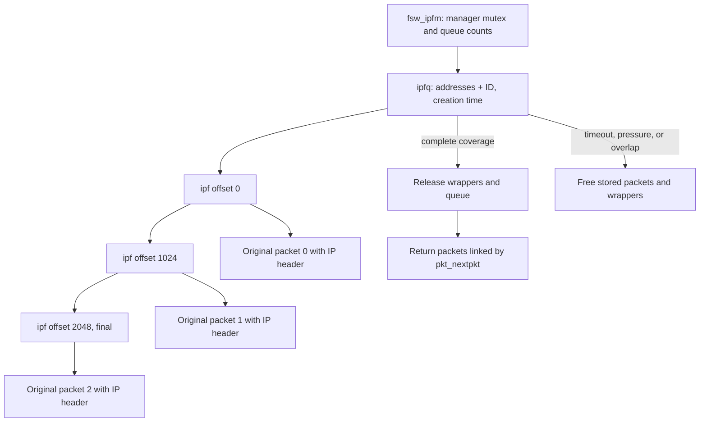
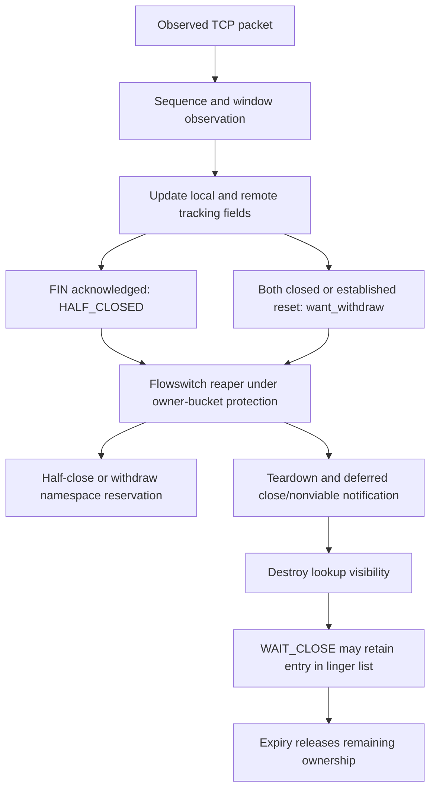

# Skywalk fragment ordering, reassembly queues, and flow tracking

[Networking](README.md) · [Flowswitch datapath](skywalk-flowswitch-classification-routes-and-datapaths.md) · [Flow lifetimes](skywalk-lifecycles.md) · [TCP aggregation and segmentation](skywalk-tcp-aggregation-segmentation-and-offloads.md)

The flowswitch needs enough transport context to select a channel, observe a connection, and release its namespace safely. Two mechanisms supply that context: a per-interface fragment manager collects an ordered set of IP fragments, and per-flow tracking observes TCP/UDP traffic. Neither object is a BSD socket or `tcpcb`. This chapter follows their implementation in `xnu-12377.121.6`, including retained packets, incomplete input, overlap, expiry, close notification, and generated abort traffic.

## 1. Where fragments enter the receive path

`_fsw_receive()` demultiplexes the link header and calls `flow_pkt_classify()` before `rx_process_ip_frag()`. Classification extracts fragment identity and offset state; a noninitial fragment has no independently usable transport ports. The manager can wait for the first fragment and return an ordered chain whose first packet supplies the lookup key. See [RX dispatch](../../../xnu/bsd/skywalk/nexus/flowswitch/fsw_dp.c#L2218-L2247), [fragment parsing](../../../xnu/bsd/skywalk/nexus/flowswitch/flow/flow_classifier.c#L212-L327), and [key normalization](skywalk-namespaces-and-flow-lookup.md#8-keys-are-normalized-to-local-and-remote-endpoints).

`rx_process_ip_frag()` has three modes. Forced-off returns the input immediately; forced-on invokes the manager; automatic mode invokes it only when the flowswitch netagent is enabled and the flow manager reports at least one flow. IPv6 support here assumes the Fragment header immediately follows the base IPv6 header. Atomic IPv6 fragments are expected to have been classified as nonfragmented traffic. This is not a general extension-header reassembly engine. [Mode and call sites](../../../xnu/bsd/skywalk/nexus/flowswitch/fsw_dp.c#L677-L724), [IPv6 wrapper](../../../xnu/bsd/skywalk/nexus/flowswitch/fsw_ip_frag.c#L341-L404).

The result is a combined **error/pointer ownership contract**:

| Return from `fsw_ip_frag_reass_v4/v6` | Packet pointer | Ownership and next action |
| --- | --- | --- |
| Zero, incomplete | `NULL` | The manager retains the input packet. The RX loop must not free or deliver it. |
| Zero, complete | First fragment | The caller receives the original packets linked in offset order by `pkt_nextpkt`; queue wrappers have been freed. |
| Error | Original input pointer | The caller still owns this input; `rx_process_ip_frag()` frees it and returns `NULL`. Other packets already stored in the queue may separately have been discarded. |

[Documented contract](../../../xnu/bsd/skywalk/nexus/flowswitch/fsw_ip_frag.c#L256-L275) and [actual publication](../../../xnu/bsd/skywalk/nexus/flowswitch/fsw_ip_frag.c#L779-L787):

[Source: `bsd/skywalk/nexus/flowswitch/fsw_ip_frag.c`, lines 779–787](../../../xnu/bsd/skywalk/nexus/flowswitch/fsw_ip_frag.c#L779-L787).

<!-- source-excerpt: ../../../xnu/bsd/skywalk/nexus/flowswitch/fsw_ip_frag.c#L779-L787 -->
```c
done:
	/* ipfm take ownership of, or return assembled packet, if no error */
	if (err == 0) {
		/* reass'ed packet if done; NULL otherwise */
		*pkt_ptr = pkt_reassed;
	}
	ipfq_sched_timeout(mgr, FALSE);
	lck_mtx_unlock(&mgr->ipfm_lock);
	return err;
```

A `NULL` from the outer RX helper therefore means either retained input or an input already freed on error. It is not an instruction to retry or reclaim the former packet handle.

## 2. The manager owns queue wrappers and original packets

`fsw_setup_ifp()` creates `fsw_ip_frag_mgr` and stores it in `fsw_ipfm`. Its caller supplies a fragment limit appropriate to the device-pool capacity. The manager records the interface and flowswitch statistics, owns a queue-list sentinel, counts both queues and fragment wrappers, and allocates a one-shot thread call for timeout work. [Attachment](../../../xnu/bsd/skywalk/nexus/flowswitch/fsw.c#L365-L404), [manager creation](../../../xnu/bsd/skywalk/nexus/flowswitch/fsw_ip_frag.c#L190-L229).

| Object | Important fields | Meaning |
| --- | --- | --- |
| `fsw_ip_frag_mgr` | `ipfm_q`, `ipfm_q_count/limit`, `ipfm_f_count/limit`, `ipfm_lock`, `ipfm_timeout_tcall` | One manager serializes fragment insertion, assembly, timeout and draining with its mutex. |
| `ipfq` | `ipfq_key`, ordered fragment links, queue links, creation timestamp, `ipfq_unfraglen`, `ipfq_nfrag`, `ipfq_is_dirty` | One incomplete datagram, or a retained dirty entry rejecting further input for that identity. |
| `ipf` | `ipf_pkt`, `ipf_off`, `ipf_len`, `ipf_mff`, predecessor/successor links | One original packet and its fragmentable byte interval. Wrapper ownership and packet ownership are distinct. |
| `ipf_key` | Source/destination bytes, address-byte length, identification | The key is address-family-sized addresses plus IP identification. It contains no transport ports and no protocol field. |

[Definitions](../../../xnu/bsd/skywalk/nexus/flowswitch/fsw_ip_frag.c#L102-L157), [key comparison](../../../xnu/bsd/skywalk/nexus/flowswitch/fsw_ip_frag.c#L790-L804).

IPv4 copies eight address bytes and preserves the identification field's representation consistently between insertion and lookup. IPv6 copies 32 address bytes and its 32-bit identification. The family distinction follows `ipfk_len`; `ipf_key_cmp()` compares that length, identification, then exactly those address bytes. Lookup walks the manager's queue list rather than using the flow manager's hash table. [Key creation](../../../xnu/bsd/skywalk/nexus/flowswitch/fsw_ip_frag.c#L286-L301), [IPv6 key](../../../xnu/bsd/skywalk/nexus/flowswitch/fsw_ip_frag.c#L376-L380), [linear lookup](../../../xnu/bsd/skywalk/nexus/flowswitch/fsw_ip_frag.c#L571-L605).



The fragment links and returned packet links are different fields. A queue wrapper can disappear while its packet remains alive in the returned chain.

## 3. Admission, ordering, overlap, and completion

`ipf_process()` performs these decisions under `ipfm_lock` after its initial length check:

1. Require every fragment with the more-fragments bit to contain a nonzero multiple of eight fragmentable bytes.
2. Find the queue by key. A dirty queue rejects this input. A miss allocates and inserts a new queue, initializes unknown unfragmentable length to `-1`, and records **creation time**.
3. Apply the per-queue fragment-count check. When offset zero arrives, establish the unfragmentable length and recheck already held fragments against the maximum IP size.
4. Allocate an `ipf` and locate the first stored fragment whose offset is greater than the new offset.
5. Compare the new interval with its neighbors. Overlap can free all stored fragments and mark the queue dirty; the incoming packet remains caller-owned on the error return.
6. Insert in offset order. Starting with `next = 0`, require every fragment's offset to equal the preceding cumulative length and require the final fragment's more-fragments bit to be clear.
7. Link original packets with `pkt_nextpkt`, free wrappers and the queue, and return the first packet.

[Admission and initial state](../../../xnu/bsd/skywalk/nexus/flowswitch/fsw_ip_frag.c#L554-L640), [first-fragment recheck](../../../xnu/bsd/skywalk/nexus/flowswitch/fsw_ip_frag.c#L642-L674), [ordering and overlap](../../../xnu/bsd/skywalk/nexus/flowswitch/fsw_ip_frag.c#L680-L728), [completion](../../../xnu/bsd/skywalk/nexus/flowswitch/fsw_ip_frag.c#L730-L777).

The complete-coverage test is small enough to show directly:

[Source: `bsd/skywalk/nexus/flowswitch/fsw_ip_frag.c`, lines 739–752](../../../xnu/bsd/skywalk/nexus/flowswitch/fsw_ip_frag.c#L739-L752).

<!-- source-excerpt: ../../../xnu/bsd/skywalk/nexus/flowswitch/fsw_ip_frag.c#L739-L752 -->
```c
	ipf_enq(f_new, f->ipf_up);
	q->ipfq_nfrag++;
	next = 0;
	for (f = q->ipfq_down; f != (struct ipf *)q; f = f->ipf_down) {
		/* there is a hole */
		if (f->ipf_off != next) {
			goto done;
		}
		next += f->ipf_len;
	}
	/* we haven't got last frag yet */
	if (f->ipf_up->ipf_mff) {
		goto done;
	}
```

The overlap code is stricter than a general “identical offset/length is always accepted” rule. After detecting overlap, it tests offset/length equality against each existing neighboring node; a differing next neighbor can select the dirty-queue branch even when the predecessor matches the new interval. It does not compare payload bytes to establish byte-for-byte duplicate identity. Its duplicate branch discards the incoming wrapper and returns `ERANGE` for the caller to free the incoming packet. Avoid replacing this implementation with a generic IPv4 or IPv6 overlap policy. [Exact predicate](../../../xnu/bsd/skywalk/nexus/flowswitch/fsw_ip_frag.c#L704-L727).

There are other comment/body differences worth preserving during upgrades. The insertion comment says to move an active queue to the front, but that block calls only `ipf_enq()` for the fragment, not `ipfq_remque()/ipfq_insque()` for its queue. The timestamp is set at queue creation and is not refreshed for each fragment. Thus the inspected code does not implement a sliding inactivity timeout or queue-level LRU update on every insertion. [Creation](../../../xnu/bsd/skywalk/nexus/flowswitch/fsw_ip_frag.c#L597-L605), [insertion](../../../xnu/bsd/skywalk/nexus/flowswitch/fsw_ip_frag.c#L730-L740).

## 4. What “reassembled” means here

The success block joins the original `__kern_packet` objects. It does not concatenate payload into one allocation, clear the fragment bits in their wire headers, or rewrite the first IP header into a full datagram. The wrappers recompute `pkt_flow_ulen` from the first packet's header, not from a newly synthesized aggregate IP header. The outer helper uses the returned pointer/count and does not consume the `tlen` output. [Packet chaining](../../../xnu/bsd/skywalk/nexus/flowswitch/fsw_ip_frag.c#L754-L777), [IPv4 metadata](../../../xnu/bsd/skywalk/nexus/flowswitch/fsw_ip_frag.c#L303-L314), [IPv6 metadata](../../../xnu/bsd/skywalk/nexus/flowswitch/fsw_ip_frag.c#L406-L417), [caller](../../../xnu/bsd/skywalk/nexus/flowswitch/fsw_dp.c#L697-L724).

`rx_flow_batch_packets()` enqueues the list with `KPKTQ_ENQUEUE_LIST()`. Its first member supplies flow lookup context, while the original fragments remain individual packets for the destination path. `fe_rx_frag_count` causes the worker to pass `FLOW_PROC_FLAG_FRAGMENTS`; `flow_rx_agg_tcp()` then explicitly chooses default RX instead of TCP aggregation. Default channel RX copies each fragment's L3 representation into the channel's pool; the host branch hands fragments to BSD mbuf delivery. [List enqueue](../../../xnu/bsd/skywalk/nexus/flowswitch/fsw_dp.c#L1036-L1069), [worker flag](../../../xnu/bsd/skywalk/nexus/flowswitch/fsw_dp.c#L2095-L2105), [aggregation bypass](../../../xnu/bsd/skywalk/nexus/flowswitch/flow/flow_agg.c#L2536-L2547), [default delivery](../../../xnu/bsd/skywalk/nexus/flowswitch/fsw_dp.c#L1869-L1888).

For example, consider IPv4 fragmentable intervals `[0,1024)`, `[1024,2048)`, and `[2048,2308)`, with the first two marked “more.” If the middle fragment arrives first, the queue has a hole at zero. If the final fragment arrives next, the hole remains. Arrival of offset zero completes the interval scan and returns three ordered packets. The receiving channel gets the fragments, not a fourth packet containing a flattened 2308-byte payload. The first fragment can contain the UDP header; subsequent ones do not independently provide UDP ports.

This is why fragment ordering and [TCP receive aggregation](skywalk-tcp-aggregation-segmentation-and-offloads.md#2-receive-aggregation-is-selected-per-flow) need separate explanations.

## 5. Resource limits, expiry, ICMP, and destruction

The defaults are 128 fragments per queue, at most 1024 queues subject to the manager's fragment capacity, a 60-second TTL, and a one-second timeout-call interval. Creation computes the queue limit as `MIN(1024, fragment_limit / 2)`. Runtime controls can change several values; the per-queue fragment control is development/debug only. [Defaults and controls](../../../xnu/bsd/skywalk/nexus/flowswitch/fsw_ip_frag.c#L78-L97), [capacity](../../../xnu/bsd/skywalk/nexus/flowswitch/fsw_ip_frag.c#L210-L227).

These are thresholds implemented by specific predicates, not exact immutable ceilings:

| Check | Literal behavior |
| --- | --- |
| Per-queue fragments | Tests existing `ipfq_nfrag > limit` before inserting the next fragment. |
| Total fragment wrappers | Rejects allocation when existing `ipfm_f_count > limit`. |
| Queue allocation | Reaps when existing queue count is `> limit`, then may allocate another queue. |
| Timeout maintenance | Reaps when total fragments or queues are `>=` their limits. |
| TTL | Expires when elapsed time since creation is `> ipfm_frag_ttl`. |

[Per-queue check](../../../xnu/bsd/skywalk/nexus/flowswitch/fsw_ip_frag.c#L609-L616), [allocation thresholds](../../../xnu/bsd/skywalk/nexus/flowswitch/fsw_ip_frag.c#L965-L979), [fragment allocation](../../../xnu/bsd/skywalk/nexus/flowswitch/fsw_ip_frag.c#L1030-L1043), [timer predicates](../../../xnu/bsd/skywalk/nexus/flowswitch/fsw_ip_frag.c#L899-L927).

Pressure reaping removes queues from the tail until only half remain; draining targets zero. Dirty queues suppress the pressure-reap ICMP callback. Timeout iteration removes expired queues and rearms a delayed call only while queues remain. The interval is clamped to at least one second. The timer is independent of the flowswitch flow/route reaper. [Reap/drain](../../../xnu/bsd/skywalk/nexus/flowswitch/fsw_ip_frag.c#L849-L885), [timer and rescheduling](../../../xnu/bsd/skywalk/nexus/flowswitch/fsw_ip_frag.c#L888-L946).

The timeout body contains two details that should not be paraphrased as stronger guarantees: it overwrites `n_freed` on each expired queue rather than accumulating it, and its dirty predicate reads the advanced iterator `q` while freeing `q->ipfq_prev`. These describe this snapshot's accounting/branch expressions, not a corrected algorithm. [Timeout loop](../../../xnu/bsd/skywalk/nexus/flowswitch/fsw_ip_frag.c#L901-L915).

Parameter and timeout errors here generate **IPv6** ICMP errors; IPv4 returns without generating one. Timeout notification applies only to offset-zero fragments. The code obtains an mbuf representation for ICMP processing, and uses `sk_async_transmit_protect()` around `icmp6_error_flag()` because this can run with `ipfm_lock` held: entering a driver workloop synchronously could deadlock. IPv6 first-fragment validation also calls `ip6_pkt_has_ulp()` before insertion. [ICMP conversion](../../../xnu/bsd/skywalk/nexus/flowswitch/fsw_ip_frag.c#L420-L471), [async output protection](../../../xnu/bsd/skywalk/nexus/flowswitch/fsw_ip_frag.c#L474-L535), [upper-layer-header check](../../../xnu/bsd/skywalk/nexus/flowswitch/fsw_ip_frag.c#L382-L401).

Destruction drops the manager mutex before `thread_call_cancel_wait()` and `thread_call_free()`, reacquires it, drains all packet queues, then destroys the mutex and storage. Waiting with the manager mutex held would prevent a running timeout callback from finishing its own locked work. This path relies on the enclosing flowswitch lifecycle to have stopped new users. [Destroy](../../../xnu/bsd/skywalk/nexus/flowswitch/fsw_ip_frag.c#L232-L253), [flowswitch teardown](../../../xnu/bsd/skywalk/nexus/flowswitch/fsw.c#L525-L542).

## 6. Transmit fragments use a different rule

Ordinary channel TX does not feed fragments to this receive manager. A first fragment resolves a normal flow, and `tx_flow_batch_packet()` records `fe_tx_is_cont_frag` plus its fragment ID. A continuation is accepted through `tx_process_continuous_ip_frag()` only if it has a nonzero ID, a previous flow is available, that flow is marked as expecting continuation, and the ID matches. The selected flow gets another reference before batching. A mismatch drops the continuation. [Batch state](../../../xnu/bsd/skywalk/nexus/flowswitch/fsw_dp.c#L1072-L1094), [continuation predicate](../../../xnu/bsd/skywalk/nexus/flowswitch/fsw_dp.c#L3477-L3506), [caller](../../../xnu/bsd/skywalk/nexus/flowswitch/fsw_dp.c#L3724-L3748).

This helper does not perform an offset-coverage or overlap scan. It uses the current batch's previous-flow state; after processing the batch, the flow's fragment-continuation fields are cleared. It must not be described as a persistent TX reassembly table. GSO-marked IP fragments are rejected by the separate segmentation path. [Batch reset](../../../xnu/bsd/skywalk/nexus/flowswitch/fsw_dp.c#L3751-L3758), [GSO rejection](../../../xnu/bsd/skywalk/nexus/flowswitch/fsw_dp.c#L4142-L4155).

## 7. Tracking records observations in each direction

`flow_entry` contains `fe_ltrack` and `fe_rtrack`. Each `flow_track` has sequence bounds, last FIN position, largest advertised window, window scale, state, SYN counters and sampled RTT state. Input selects remote tracking as `src` and local tracking as `dst`; output reverses those roles. They describe the direction of the observed packet, not two separate socket structures. [Tracking definitions](../../../xnu/bsd/skywalk/nexus/flowswitch/flow/flow_var.h#L149-L205), [direction and dispatch](../../../xnu/bsd/skywalk/nexus/flowswitch/flow/flow_track.c#L714-L746).

[Source: `bsd/skywalk/nexus/flowswitch/flow/flow_track.c`, lines 716–730](../../../xnu/bsd/skywalk/nexus/flowswitch/flow/flow_track.c#L716-L730).

<!-- source-excerpt: ../../../xnu/bsd/skywalk/nexus/flowswitch/flow/flow_track.c#L716-L730 -->
```c
	if (in) {
		src = &fe->fe_rtrack;
		dst = &fe->fe_ltrack;
	} else {
		src = &fe->fe_ltrack;
		dst = &fe->fe_rtrack;
	}

	flow_track_stats(fe, (pkt->pkt_length - pkt->pkt_l2_len), 1,
	    (pkt->pkt_flow_ulen != 0), in);

	/* skip flow state tracking on non-initial fragments */
	if (pkt->pkt_flow_ip_is_frag && !pkt->pkt_flow_ip_is_first_frag) {
		return 0;
	}
```

Statistics count the packet's L3 bytes and activity before noninitial fragments skip state tracking. TCP/UDP state updates require `FLOWENTF_TRACK`; flow construction sets it only for eligible nonlistener requests. Host aggregation instead records raw packet statistics in a batch and asserts that host traffic is not transport-tracked. [Tracking admission](../../../xnu/bsd/skywalk/nexus/flowswitch/flow/flow_entry.c#L567-L575), [host accounting](../../../xnu/bsd/skywalk/nexus/flowswitch/flow/flow_agg.c#L2117-L2126), [host completion](../../../xnu/bsd/skywalk/nexus/flowswitch/flow/flow_agg.c#L2523-L2532).

The tracker does not acquire a private mutex in `flow_pkt_track()`. It runs inside the datapath's lifetime protection and direction-specific servicing: RX uses the per-flow worker protocol, and TX is reached from protected channel/ring processing. Those mechanisms should not be relabeled as one exclusive lock covering both directions; the functions update observational fields directly and use atomic operations for selected shared flags. [RX worker](../../../xnu/bsd/skywalk/nexus/flowswitch/fsw_dp.c#L1036-L1069), [TX call](../../../xnu/bsd/skywalk/nexus/flowswitch/fsw_dp.c#L3400-L3415), [tracking body](../../../xnu/bsd/skywalk/nexus/flowswitch/flow/flow_track.c#L244-L260).

## 8. TCP window observation and close transitions

On first use, `flow_track_tcp_init()` initializes the observed source as `SYN_SENT`, records sequence bounds and window scale from options, initializes the other side as closed, and selects linger time from `2 * tcp_msl / TCP_RETRANSHZ`, clamped to 1–120 seconds. Later first traffic from the opposite side can establish state for a connection picked up midstream. This permits observation without demanding that the kernel saw a complete handshake. [Initialization](../../../xnu/bsd/skywalk/nexus/flowswitch/flow/flow_track.c#L56-L144), [opposite-side initialization](../../../xnu/bsd/skywalk/nexus/flowswitch/flow/flow_track.c#L301-L367).

The main comparison accounts for payload length, SYN/FIN consuming sequence space, scaled windows, retransmission allowance and ACK skew. It uses wrap-aware `SEQ_*` comparisons for the main sequence bounds and a `MAXACKWINDOW` allowance of `0xffff + 1500`. A reset additionally needs an exact or adjacent observed sequence in the main branch. Empty packets relax the sequence check; packets without ACK use the peer's observed sequence for the ACK comparison. [Normalization](../../../xnu/bsd/skywalk/nexus/flowswitch/flow/flow_track.c#L277-L389), [main predicate](../../../xnu/bsd/skywalk/nexus/flowswitch/flow/flow_track.c#L391-L416).

The result of that predicate is **permission to advance tracking state**, not a universal packet-validation verdict. The final mismatch branch can reset provisional SYN bookkeeping and still return zero. A looser branch handles pickup and close-edge traffic. The actual explicit errors include `ENETRESET` for inbound traffic after both sides reached at least `FIN_WAIT_2`, and `EPROTO` for selected outbound SYN rate excess. [Alternative branches](../../../xnu/bsd/skywalk/nexus/flowswitch/flow/flow_track.c#L463-L527), [closed pair](../../../xnu/bsd/skywalk/nexus/flowswitch/flow/flow_track.c#L262-L274), [rate limiting](../../../xnu/bsd/skywalk/nexus/flowswitch/flow/flow_track.c#L569-L590).

| Observation in the main accepted branch | Tracking/state effect |
| --- | --- |
| ACK of a side in `SYN_SENT`, without RST | That side becomes `ESTABLISHED`; request namespace hold after close and close notification. |
| FIN | Remember `sequence + payload length` as `fse_seqlast`; source enters `CLOSING`. |
| ACK exactly equal to peer's `fse_seqlast + 1` | Peer enters `FIN_WAIT_2`; request half-close unless both sides have finished. |
| Both sides finished | Set `fe_want_withdraw`, clear pending half-close. |
| RST with an established side | Both become `TIME_WAIT`; request withdrawal and close hold. |

[State decisions](../../../xnu/bsd/skywalk/nexus/flowswitch/flow/flow_track.c#L418-L462), [flag publication](../../../xnu/bsd/skywalk/nexus/flowswitch/flow/flow_track.c#L529-L567).



The reaper converts these hints into namespace operations; `flow_entry_teardown()` withdraws the reservation and marks the entry torn down. Destruction removes lookup membership and either releases the entry or places it on the linger list. Linger expiry and optional TCP abort are separate work. [Reaper state consumption](../../../xnu/bsd/skywalk/nexus/flowswitch/fsw_dp.c#L5070-L5109), [teardown](../../../xnu/bsd/skywalk/nexus/flowswitch/flow/flow_entry.c#L826-L860), [destroy/linger choice](../../../xnu/bsd/skywalk/nexus/flowswitch/flow/flow_entry.c#L884-L925), [linger processing](../../../xnu/bsd/skywalk/nexus/flowswitch/fsw_dp.c#L5162-L5213).

The outbound SYN limiter increments an endpoint counter and rejects after 20 qualifying observations. The counter resets when the integer uptime difference is **greater than one**, so “exactly 20 per sliding second” would overstate the implementation. `FTF_RST_RLIM` is set in several branches, but the final code contains only a SYN limiter; its name does not establish an implemented reset-rate limiter.

RTT sampling is also observational. A payload starts a sample on the opposite endpoint after a two-second sampling interval; an ACK meeting the recorded beginning-sequence check completes it. The estimate uses `(15 * old + sample) / 16`, is published in microseconds, and does not distinguish retransmission ACKs. Local RTT approximates local processing; remote RTT includes driver/network/remote delay. [RTT state and sampling](../../../xnu/bsd/skywalk/nexus/flowswitch/flow/flow_track.c#L146-L219).

## 9. UDP observations and generated abort packets

UDP tracking is deliberately small: initialize both directions to `NO_TRAFFIC`; observing a direction moves it to `SINGLE`; observing return traffic promotes the opposite direction from `SINGLE` to `MULTIPLE`. Repeating packets in one direction alone does not execute that promotion for the sending side. It neither retransmits nor maintains TCP-like windows. [UDP implementation](../../../xnu/bsd/skywalk/nexus/flowswitch/flow/flow_track.c#L621-L656).

`flow_track_tcp_want_abort()` accepts only a non-aborted, non-AOP TCP entry with at least one established side. It changes both states to `TIME_WAIT` and sets `FLOWENTF_ABORTED` before asking the caller to generate a reset. This marks the one-shot attempt even if the subsequent nonblocking mbuf allocation fails. [Abort admission](../../../xnu/bsd/skywalk/nexus/flowswitch/flow/flow_track.c#L598-L619), [allocation failure](../../../xnu/bsd/skywalk/nexus/flowswitch/flow/flow_track.c#L774-L785).

`flow_track_abort_tcp()` has three input cases: an inbound packet triggering a reply, a supplied listener reset template, or no packet and only stored tracking state. It constructs a new minimal TCP/IP mbuf, computes software checksums, binds output to the flowswitch interface/source, and calls BSD `ip_output()` or `ip6_output()`. It does not put the reset back into a user channel's TX ring. [Header construction](../../../xnu/bsd/skywalk/nexus/flowswitch/flow/flow_track.c#L756-L824), [TCP selection](../../../xnu/bsd/skywalk/nexus/flowswitch/flow/flow_track.c#L826-L857), [BSD output](../../../xnu/bsd/skywalk/nexus/flowswitch/flow/flow_track.c#L862-L912).

This snapshot has a consequential literal expression in the inbound case:

[Source: `bsd/skywalk/nexus/flowswitch/flow/flow_track.c`, lines 829–837](../../../xnu/bsd/skywalk/nexus/flowswitch/flow/flow_track.c#L829-L837).

<!-- source-excerpt: ../../../xnu/bsd/skywalk/nexus/flowswitch/flow/flow_track.c#L829-L837 -->
```c
	if (in_pkt != NULL) {
		th->th_sport = in_pkt->pkt_flow_tcp_dst;
		th->th_dport = in_pkt->pkt_flow_tcp_src;
		if (__probable(in_pkt->pkt_flow_tcp_flags | TH_ACK)) {
			/* <SEQ=SEG.ACK><CTL=RST> */
			th->th_seq = in_pkt->pkt_flow_tcp_ack;
			th->th_ack = 0;
			th->th_flags = TH_RST;
		} else {
```

Because `TH_ACK` is nonzero, the bitwise OR condition is always true. The inspected body chooses `SEQ = incoming ACK`, no ACK field, and `RST` for this case; the alternate `RST|ACK` block is not selected by testing the incoming ACK bit. The documentation records the actual body, not the apparent intended test, and does not modify kernel source.

QUIC close has a separate bounded mechanism. `flow_entry_destroy()` can supply a stateless-reset token when close parameters are present and `nolinger` is false. `flow_track_abort_quic()` ignores an all-zero token, allocates a new UDP/IP packet, creates 30 random prefix bytes with the required first-byte bit pattern, appends the fixed-size token, computes a checksum and uses BSD output. This is a reset-construction path; it is not a QUIC implementation or token-generation policy. [Close dispatch](../../../xnu/bsd/skywalk/nexus/flowswitch/flow/flow_entry.c#L907-L925), [reset construction](../../../xnu/bsd/skywalk/nexus/flowswitch/flow/flow_track.c#L916-L998), [checksum/output](../../../xnu/bsd/skywalk/nexus/flowswitch/flow/flow_track.c#L1000-L1052).

## 10. Evidence, tests, and remaining boundaries

The supplied `skt_reass.c` exercises channel UDP fragment delivery with IPv4/IPv6 lengths including 2000/2001 and 8000/8001 bytes. It has selected ICMPv6 timeout, bad fragment length, atomic-fragment and queue-limit scenarios. Some default-mode tests skip when netagent/reassembly support is absent. [Data cases](../../../xnu/tests/skywalk/skt_reass.c#L603-L638), [scenario registration](../../../xnu/tests/skywalk/skt_reass.c#L718-L770).

Useful review invariants are: an incomplete successful insertion consumes the caller's packet; an error does not return old retained fragments; completion preserves a chain of original packets; a fragment-containing batch bypasses TCP aggregation; statistics precede state-tracking skips; and tracking state changes do not themselves remove the entry from lookup tables. No kernel/network tests were run for this documentation change.

This chapter reviews the local fragment manager and the TCP/UDP observer, including caller consequences. It does not establish full RFC conformance, exhaustively verify every race or malformed-header combination, or reconstruct a userspace transport. BSD IP reassembly and BSD TCP timers are separate implementations. AOP provider behavior, policy decisions and device completion are addressed only at the local boundaries in the [offload companion](skywalk-tcp-aggregation-segmentation-and-offloads.md).

<!-- BEGIN PLATYDOC DOCUMENTATION LICENSE -->
Original Platydoc text and diagrams are licensed under [CC BY 4.0](https://creativecommons.org/licenses/by/4.0/). Quoted source code and third-party material retain their respective licenses.
<!-- END PLATYDOC DOCUMENTATION LICENSE -->
