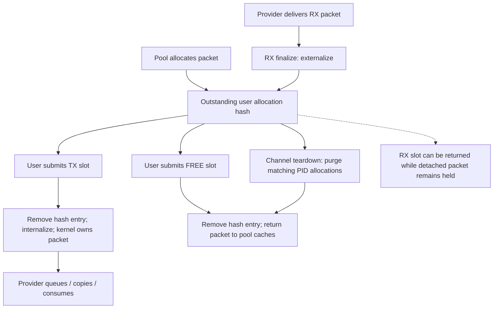

# Skywalk channel, packet-pool, and flow lifecycles

[Networking](README.md) · [Skywalk packet-path overview](skywalk.md) · [Interface lifetime](packets-routes-and-interfaces.md) · [Policy integration](policy-extensions.md)

Skywalk separates channel access, ring progress, packet ownership, and flow registration. A mapped slot is not itself a packet allocation. Returning a receive slot does not necessarily free its packet. Closing a channel and deleting its registered flows have coordinated but distinct paths. This chapter explains those contracts for the user-packet-pool and flowswitch implementations present in this checkout. The [existing Skywalk guide](skywalk.md) follows the transmit/receive data path and external-provider boundary.

## Four objects that must remain distinct

| Object | State to follow | Lifetime boundary |
| --- | --- | --- |
| `kern_channel` | `ch_lock`, refs/flags, adapter/nexus/pool pointers, selected ring ranges, schema and mapping | One endpoint/file object; can become defunct before close. |
| `nexus_adapter` and kernel rings | Adapter references/channel count, activation, arena, ring arrays and callbacks | Shared ring implementation attached to a nexus port; the last channel can trigger teardown. |
| `kern_pbufpool` | Pool lock/refcount/flags, metadata/buffer caches and regions, user-allocation hashes | Packet/buflet allocation and outstanding ownership; references can outlive close of the original pool owner. |
| `flow_owner` / `flow_entry` | Process/context/port association; flow UUID/key, lookup nodes, references, route, policy IDs, queues and tracking | Registration and packet lookup; destroyed entries can persist while references or linger work remain. |

See [`kern_channel`](../../../xnu/bsd/skywalk/channel/channel_var.h#L142), [`kernel ring`](../../../xnu/bsd/skywalk/channel/channel_var.h#L323), [`adapter`](../../../xnu/bsd/skywalk/nexus/nexus_adapter.h#L116), [`pool`](../../../xnu/bsd/skywalk/packet/pbufpool_var.h#L57), and [`flow_entry`](../../../xnu/bsd/skywalk/nexus/flowswitch/flow/flow_var.h#L256).

The pool itself distinguishes metadata caches from payload-buffer caches/regions and tracks separately allocated buflets. A packet can contain multiple buffer fragments and can carry attached mbuf/packet backing. The user view uses indices and externalized metadata; the kernel retains its own pointers, descriptors, and ownership records. These are not interchangeable with the mbuf chain rules described in [packet storage](packets-routes-and-interfaces.md#mbuf-chains-packet-lists-and-external-storage).

## Channel creation: authorization, binding, then publication

`__channel_open()` copies and validates `ch_init`, checks the ABI version/nexus UUID/key consistency, and requires user-packet-pool mode for an event ring. It allocates a guarded fd with close/dup/socket-IPC/fileport/write restrictions, copies an optional binding key, and calls `ch_open()`. After construction and successful result copyout, it installs `channel_ops`, sets close-on-exec/fork flags, removes ordinary read/write flags, and publishes the descriptor. Failure before publication follows cleanup rather than exposing a partially initialized endpoint. See [`open wrapper`](../../../xnu/bsd/skywalk/channel/channel_syscalls.c#L137).

`ch_open()` holds the global Skywalk lock while resolving the nexus and validating invalidation/port/mode conditions. For a named, nonanonymous provider it prepares `nxbind` information from process unique identity, executable UUID, and the optional key. Low-latency mode adds a privilege check. The process unique ID matters because PID reuse alone must not establish an old binding's identity. See [`ch_open()`](../../../xnu/bsd/skywalk/channel/channel.c#L1538).

The binding check is not merely a UUID lookup. `nx_port_alloc()` rejects a user allocation of an unbound named port, and an existing named binding must match the specified criteria in `nxb_is_equal()`. That helper compares unique IDs, optional executable UUIDs, and optional keys using `timingsafe_bcmp()`. Anonymous-provider and kernel callers have explicitly different branches. Do not infer general permission to open an arbitrary provider from the presence of its nexus UUID. See [`port access checks`](../../../xnu/bsd/skywalk/nexus/nexus.c#L2677) and [`binding comparison`](../../../xnu/bsd/skywalk/nexus/nexus.c#L986).

`ch_connect()` validates notification thresholds and provider support, allocates/locks the channel, invokes domain `nxdom_connect`, and then records list/caller references and a nexus reference. It notifies an external provider after the channel is fully formed. If that notification fails, it closes the constructed channel through the ordinary teardown path rather than attempting a partial ad hoc undo. See [`ch_connect()`](../../../xnu/bsd/skywalk/channel/channel.c#L2009).

Below that, `na_bind_channel()` verifies ring selection and compatibility between requested user-pool mode and adapter mode, rejects a defunct arena, creates rings for the first channel, validates their use/exclusivity, creates the user schema, and establishes the mapping. Different channels can refer to one adapter subject to ring ownership restrictions; requesting all rings conflicts with narrower ownership already established on the same port. See [`adapter binding`](../../../xnu/bsd/skywalk/nexus/nexus_adapter.c#L436) and [`port/ring conflict checks`](../../../xnu/bsd/skywalk/channel/channel.c#L1622).

## Sync is a validated ownership protocol

The user ring and kernel ring have separate indices. `ckr_khead/ckr_ktail` represent kernel progress; `ckr_rhead/ckr_rtail` preserve kernel-observed or published user-ring state. Kernel code snapshots shared indices because userspace can change its mapped view concurrently. The TX/FREE and RX/ALLOC validation rules differ and account for wraparound. A copied index is still checked against trusted kernel bounds. See [`ring fields`](../../../xnu/bsd/skywalk/channel/channel_var.h#L333), [`TX/FREE validation`](../../../xnu/bsd/skywalk/channel/channel_ring.c#L615), and [`RX/ALLOC validation`](../../../xnu/bsd/skywalk/channel/channel_ring.c#L948).

`__channel_sync()` acquires a file I/O reference, locks `ch_lock`, validates modes/flags, rejects defunct/nonpermissive adapters, and establishes per-thread sync protection. It enters each selected ring, runs its prologue, invokes `ckr_na_sync`, and publishes final state only on the successful branch. TX and RX use force-reclaim/read flags respectively; allocation/free synchronization is selected by separate flags/ring ranges. An invalid prologue becomes `EFAULT`; provider-sync failure becomes `EIO`, with process termination for selected allocation/free and invariant violations. See [`sync control flow`](../../../xnu/bsd/skywalk/channel/channel_syscalls.c#L356) and [`pool-ring dispatch`](../../../xnu/bsd/skywalk/channel/channel_syscalls.c#L544).

`kr_enter()` is an owner/busy protocol guarded by a spin lock. It allows recursive acquisition by the current owner, returns `EBUSY` for a nonwaiting acquisition against another owner, or sleeps until the owner exits. The spin lock is released during substantive ring work; `ckr_busy` and `ckr_owner` preserve exclusion. `kr_exit()` clears the owner only on the outermost release and wakes waiters. `kr_stop()` acquires and retains this exclusion while setting the stopped/locked state; `kr_start()` clears the state and releases it. See [`kr_enter()`](../../../xnu/bsd/skywalk/channel/channel_ring.c#L114), [`kr_exit()`](../../../xnu/bsd/skywalk/channel/channel_ring.c#L153), and [`stop/start`](../../../xnu/bsd/skywalk/channel/channel_ring.c#L184).

Consequently, channel locking, ring ownership, pool locking, and the flowswitch's locks solve different problems. A valid memory mapping alone grants none of the kernel-side exclusion required to mutate a packet queue or dismantle its backing arena.

## Allocation rings: packet availability can be partial

In user-packet-pool mode, allocation rings make packets available to userspace independently of TX/RX slots. `kr_alloc_sync_prologue()` validates the user's consumed head and records it. `na_packet_pool_alloc_sync_common()` reclaims those slots, computes how many unclaimed allocations remain, adjusts its working-set target, and asks `alloc_packets()` for more. Forced synchronization increases the working-set target by 50%, subject to the ring limit; ordinary synchronization can decrease it by 25% after the hold interval. Purge mode has a separate target-reduction branch. These are visible policy choices, not a promise of a fixed allocation batch. See [`allocation prologue`](../../../xnu/bsd/skywalk/channel/channel_ring.c#L1060) and [`working-set calculation`](../../../xnu/bsd/skywalk/nexus/nexus_adapter.c#L3618).

Allocation can return fewer packets than requested. The buffer-on-demand path allocates metadata and buflets separately; if buffers run short it frees packets without attached buffers. `alloc_packets()` distinguishes no progress (`ENOMEM`) from partial progress (`EAGAIN`). The ring callback uses the returned count, publishes only those packets, and itself returns zero after updating the ring. A successful sync therefore does not guarantee the desired number of packet allocations. Inspect the resulting ring availability. See [`partial allocation cleanup`](../../../xnu/bsd/skywalk/nexus/nexus_adapter.c#L3560).

[Only successful allocations enter the outstanding-user-packet set](../../../xnu/bsd/skywalk/nexus/nexus_adapter.c#L3684)

<!-- source-excerpt: ../../../xnu/bsd/skywalk/nexus/nexus_adapter.c#L3684-L3695 -->
```c
	err = alloc_packets(pp, kring->ckr_scratch,
	    PP_HAS_BUFFER_ON_DEMAND(pp) && large, &ph_cnt);
	if (__improbable(ph_cnt == 0)) {
		SK_ERR("kr %p failed to alloc %u packet s(%d)",
		    SK_KVA(kring), ph_needed, err);
		kring->ckr_err_stats.cres_pkt_alloc_failures += ph_needed;
	} else {
		/*
		 * Add packets to the allocated list of user packet pool.
		 */
		pp_insert_upp_batch(pp, pid, kring->ckr_scratch, ph_cnt);
	}
```

`pp_insert_upp_batch()` records each allocated packet in the pool's user-allocation hash, assigns its PID, updates `pp_u_bufinuse`, and records applicable external buflets. The callback then attaches packet metadata to allocation slots and externalizes it; finalization publishes the kernel-known tail/head and working-set value. Pool ownership is established before userspace receives the new metadata. See [`outstanding allocation insertion`](../../../xnu/bsd/skywalk/packet/pbufpool.c#L1542), [`allocation publication`](../../../xnu/bsd/skywalk/nexus/nexus_adapter.c#L3697), and [`allocation finalization`](../../../xnu/bsd/skywalk/channel/channel_ring.c#L1420).

`pp_alloc_packet_common()` is the deeper cache-facing allocator: it batch-allocates constructed metadata, obtains on-demand buffer objects when required, initializes each packet, and cleans up unused cache objects on incomplete construction. Pool allocation is therefore not a raw per-packet call to VM. Cache and region internals determine backing allocation; those internals are a separate layer. See [`packet construction`](../../../xnu/bsd/skywalk/packet/pbufpool.c#L1984) and [kernel allocation](../vm/kernel-allocation.md).

## Transmit and receive transfer different ownership

For TX, `kr_txprologue_upp()` holds the pool lock and resolves each user slot's metadata index by removing it from the outstanding allocation hash. It rejects an unallocated index or malformed buflet chain, internalizes and validates user metadata, resets the user slot, and attaches the packet to the kernel slot. Removing from the hash prevents that same outstanding allocation from being surrendered twice through ordinary TX/free lookup. The underlying remove helper matches the pool's metadata index; its PID field also supports accounting/purge, and should not be described as a per-call PID authentication check. See [`TX handoff`](../../../xnu/bsd/skywalk/channel/channel_ring.c#L513) and [`pp_remove_upp_locked()`](../../../xnu/bsd/skywalk/packet/pbufpool.c#L1690).

After this handoff, provider TX processing can dequeue the packet, copy it to a device pool, queue it, drop it, or use another provider-defined path. The representative flowswitch user TX path copies into device-pool packets; source user-pool packets are subsequently freed. Neither reclaimed TX slots nor successful sync establish hardware completion or remote receipt. See [the concrete flowswitch transmit trace](skywalk.md#concrete-flowswitch-transmit-path).

For RX, the user-pool finalize callback performs the opposite transfer:

[RX publication creates user ownership and detaches the kernel slot](../../../xnu/bsd/skywalk/channel/channel_ring.c#L1338)

<!-- source-excerpt: ../../../xnu/bsd/skywalk/channel/channel_ring.c#L1338-L1350 -->
```c
		VERIFY(kqum != NULL);
		/*
		 * The channel is operating in packet allocator
		 * mode, so add packet to the allocated list.
		 */
		pp_insert_upp_locked(pp, kqum, ch->ch_pid);

		KSD_DETACH_METADATA(ksd);
		/* To calculate ckr_ready_bytes by kr_rxsync_prologue */
		USD_SET_LENGTH(usd, (uint16_t)kqum->qum_len);

		kr_externalize_metadata_internal(kring, maxfrags, kqum, p);
		ASSERT((usd->sd_flags & ~SD_FLAGS_USER) == 0);
```

It inserts received packets into the outstanding allocation set, detaches kernel metadata from the RX slot, records slot length for accounting, and externalizes packet metadata. A user can detach the packet from the slot and retain it after advancing the RX head. `kr_rxprologue_upp()` requires those consumed user slots to be detached and updates readable-byte accounting; it does not free every packet merely because its former receive slot was returned. See [`RX user-pool finalization`](../../../xnu/bsd/skywalk/channel/channel_ring.c#L1321) and [`RX consumption checks`](../../../xnu/bsd/skywalk/channel/channel_ring.c#L889).

In non-user-pool mode, `kr_rxprologue()` instead detaches and batches frees of consumed slot packets. This is a material mode difference:



## Free rings and close-time reclamation

`kr_free_sync_prologue()` validates the submitted head with the TX-style bounds. `na_packet_pool_free_sync()` iterates submitted indices under the pool lock, removes each allocated packet and its buflet ownership, clears finalized/slot state, and collects packets for a batch free after unlocking. It advances kernel head/tail only through processed entries. An invalid index/chain can therefore fail after earlier packets have already been freed; the operation is not an all-or-nothing transaction. See [`free prologue`](../../../xnu/bsd/skywalk/channel/channel_ring.c#L731) and [`free callback`](../../../xnu/bsd/skywalk/nexus/nexus_adapter.c#L3469).

`pp_free_packet_array()` verifies that packets belong to the specified pool, finalizes metadata, clears each supplied array slot, returns objects to metadata/buflet caches, and frees any attached mbuf/packet chains collected by finalization. Freeing a packet can thus release associated representations as well as its immediate metadata. The positive-count batch API is not a general null/empty-list helper. See [`batch destruction`](../../../xnu/bsd/skywalk/packet/pbufpool.c#L2399).

`ch_close_common()` takes global Skywalk/channel protection, removes advisory participation, irreversibly sets `CHANF_CLOSING`, clears the fd association, and disconnects an attached channel. It removes channel-list ownership and releases the nexus reference; if the nexus was already closed and its final regular channel disappears, it detaches the nexus. Kernel special/non-nexus-reference channels have separate branches. See [`channel close`](../../../xnu/bsd/skywalk/channel/channel.c#L1754).

`na_unbind_channel()` releases ring-use ownership and decrements the adapter's channel count. On the last channel, `na_teardown()` deactivates the adapter and deletes rings/buffers. Outstanding user packets are purged for the channel's PID, the pool reference is released, caches can be reaped, the schema is freed, the channel mapping is removed, and the adapter reference is dropped. `pp_purge_upp()` traverses both packet and buflet hashes, so cleanup does not depend on finding every allocation still attached to a visible ring slot. See [`unbind`](../../../xnu/bsd/skywalk/nexus/nexus_adapter.c#L625), [`adapter teardown`](../../../xnu/bsd/skywalk/nexus/nexus_adapter.c#L692), and [`pool purge`](../../../xnu/bsd/skywalk/packet/pbufpool.c#L1745).

Defunct state is observable before descriptor close. `ch_deactivate()` permanently clears shared `CSM_ACTIVE` and follows it with a sequentially consistent fence; later sync rejects a defunct channel. Teardown paths must still reclaim mappings/references. Pool close has its own lifetime: `pp_close()` sets `PPF_CLOSED` and releases its owner reference, whereas final release invokes `pp_free()`. Pool destruction destroys metadata caches before buffer caches because metadata destructors may free attached buffers. See [`channel deactivation`](../../../xnu/bsd/skywalk/channel/channel.c#L2215), [`pool close/references`](../../../xnu/bsd/skywalk/packet/pbufpool.c#L275), and [`destruction order`](../../../xnu/bsd/skywalk/packet/pbufpool.c#L1355).

## Flow registration: process association, port binding, and rollback

A flowswitch flow is not created merely by writing packet addresses into a TX ring. One control path enters `fsw_netagent_flow_add()`, translating NECP client parameters into `nx_flow_req`: endpoints, protocol, process/effective identity, policy IDs, traffic class, tracking/advisory flags, and optional parent/demultiplexing or offload settings. It then requests `fsw_flow_add()`. This establishes the kernel integration point without claiming all userspace NECP policy or external offload behavior is available here. See [`netagent request construction`](../../../xnu/bsd/skywalk/nexus/flowswitch/fsw_netagent.c#L90).

`fsw_flow_add()` first acquires a detach barrier. It cannot hold the flowswitch writer/read lock across all potentially blocking owner work, so the barrier keeps detach from finishing while the operation runs. Add requires a live `proc_find()` result; delete deliberately does not, because process-exit notifications may arrive after the process disappears. See [`flow add`](../../../xnu/bsd/skywalk/nexus/flowswitch/fsw_flow.c#L39) and [`detach-barrier implementation`](../../../xnu/bsd/skywalk/nexus/flowswitch/fsw.c#L2276).

The flow manager selects a process owner bucket, locks it, waits for open/close busy flags, and marks open busy. A new owner may need a nexus port with a random key bound to process unique identity. Port binding requires dropping the bucket lock to maintain lock ordering; the busy flag persists across this unlock. After relocking, the code checks whether the owner/interface/agent became unusable. This is a concrete example of exclusion spanning a lock drop through explicit state, not a claim that the whole operation runs under one mutex. See [`owner serialization and binding`](../../../xnu/bsd/skywalk/nexus/flowswitch/fsw_flow.c#L99).

`flow_mgr_flow_add()` prepares the request and allocates a `flow_entry`. Allocation checks conflicting keys/parent identity, obtains an advisory slot when requested, sets route/namespace/queue/policy state, and inserts regular or parent flows into a cuckoo lookup table. All entries also enter the owner's UUID tree; child flows have separate parent/demultiplexing handling. The actual body transfers `req->nfr_route` into `fe->fe_route` and clears the request pointer. A stale comment about an extra retain should not override that visible ownership transfer. See [`request preparation`](../../../xnu/bsd/skywalk/nexus/flowswitch/flow/flow_manager.c#L920), [`entry allocation`](../../../xnu/bsd/skywalk/nexus/flowswitch/flow/flow_entry.c#L430), [`route transfer`](../../../xnu/bsd/skywalk/nexus/flowswitch/flow/flow_entry.c#L590), and [`lookup insertion`](../../../xnu/bsd/skywalk/nexus/flowswitch/flow/flow_entry.c#L650).

Failure unwinds newly created owner mappings and port bindings, clears busy flags, wakes waiters, releases the process, and removes the detach barrier. The AOP steering branch demonstrates a second-stage failure: after flow creation it asks the netif to install RX steering; failure deletes the new flow and releases the additional statistics reference that otherwise would be returned to the client. Successful software insertion alone is insufficient for that request's completion. See [`rollback and steering`](../../../xnu/bsd/skywalk/nexus/flowswitch/fsw_flow.c#L306).

## Flow deletion removes visibility before final lifetime ends

`fsw_flow_del()` takes a detach barrier and serializes on the owner's close-busy state. It finds the owner by PID/context/latency mode and calls `flow_owner_destroy_entry()` by UUID. An already absent flow is tolerated in the expected auto-close case. A PID-bound nexus binding can be removed when its channel port has been destroyed and the owner has no remaining flows. The binding operation again drops the bucket lock while retaining the busy protocol. See [`flow deletion`](../../../xnu/bsd/skywalk/nexus/flowswitch/fsw_flow.c#L382).

`flow_entry_teardown()` withdraws the local namespace reservation where applicable, removes advisory state once, and marks children nonviable. `flow_entry_destroy()` then removes lookup membership and marks the entry destroyed. The source explicitly identifies the separate references:

[Flow-table, UUID-tree, and current-operation references are distinct](../../../xnu/bsd/skywalk/nexus/flowswitch/flow/flow_entry.c#L877)

<!-- source-excerpt: ../../../xnu/bsd/skywalk/nexus/flowswitch/flow/flow_entry.c#L877-L882 -->
```c
	/*
	 * regular flow: one in flow_table, one in id_tree, one here
	 * child flow: one in id_tree, one here
	 */
	ASSERT(flow_entry_refcnt(fe) > 2 ||
	    ((fe->fe_flags & FLOWENTF_CHILD) && flow_entry_refcnt(fe) > 1));
```

Regular flows leave the packet lookup table and all flows leave the UUID tree. Destroyed does not imply that concurrent retained readers have vanished. Nor does it imply immediate release of the current reference: eligible `FLOWENTF_WAIT_CLOSE` entries enter a linger queue; QUIC has a separate optional stateless-reset handling branch; RX steering cleanup can enqueue additional work. See [`teardown`](../../../xnu/bsd/skywalk/nexus/flowswitch/flow/flow_entry.c#L816) and [`destroy`](../../../xnu/bsd/skywalk/nexus/flowswitch/flow/flow_entry.c#L869).

`fsw_linger_insert()` records an expiry, marks lingering, links the entry under `fsw_linger_lock`, and schedules the reaper. Reaping can perform transport abort work and releases expired entries; `flow_entry_release()` clears the caller's pointer and on final reference releases route, queue-set, and demultiplexing storage before `fe_free()`. This tracking is distinct from an ordinary socket's `tcpcb` timer list and should not be described as the full BSD TCP state machine. See [`linger insertion`](../../../xnu/bsd/skywalk/nexus/flowswitch/fsw_dp.c#L4477), [`expiry processing`](../../../xnu/bsd/skywalk/nexus/flowswitch/fsw_dp.c#L5189), and [`final release`](../../../xnu/bsd/skywalk/nexus/flowswitch/flow/flow_entry.c#L942).

Channel teardown connects to this control lifetime through `fsw_port_dtor()` and `flow_owner_detach_nexus_port()`. The port's binding and adapter association are separate: a port is available only when neither remains. Multiple channel references can share a port adapter subject to ring restrictions, so dropping one fd is not a general instruction to free every object reachable from the port. See [`port destruction and ownership contract`](../../../xnu/bsd/skywalk/nexus/flowswitch/fsw.c#L1472).

## Sources inspected and limits

| Area | Inspection performed and limits |
| --- | --- |
| Channel syscalls, `channel.c`, `channel_ring.c`, declarations | Read open/connect/close, selected mode checks, sync serialization, user-pool TX/RX and alloc/free validation/publication. Not every event-ring, select/knote, defunct mode, or metadata field validator was audited. |
| `nexus.c`, `nexus_adapter.c`, `pbufpool.c` | Read binding identity, adapter bind/unbind/teardown, allocation/free callbacks and partial allocation, user-allocation hash/purge, references and cache-destruction order. Arena mapping permissions, cache/slab internals, and DMA mappings remain separate work. |
| `fsw_flow.c`, `fsw_netagent.c`, flow manager/entry/owner and selected `fsw.c`/`fsw_dp.c` | Read process/port/flow installation, rollback, table membership, reference release, namespace withdrawal, port teardown and linger integration. Flow-key algorithms, every route/namespace preparation branch, reassembly/aggregation, pacing/GSO, and all reaper policies remain narrower coverage. |
| Provider boundary | The in-tree netif/flowswitch callbacks expose the handoff. Hardware queues, firmware/AOP behavior, external provider implementations, and userspace transport policy are not inferred from those interfaces. |

`SKYWALK`, `CONFIG_NEXUS_*`, provider capabilities, interface mode, and runtime policy determine which paths are available. No kernel, hardware provider, or channel program was run for this chapter.
