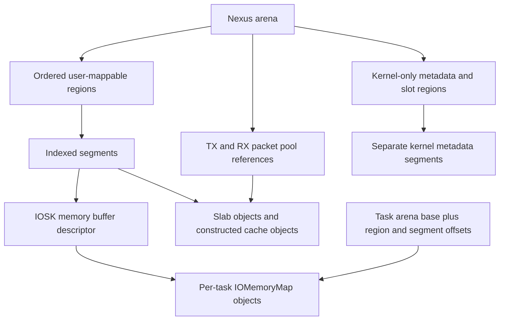
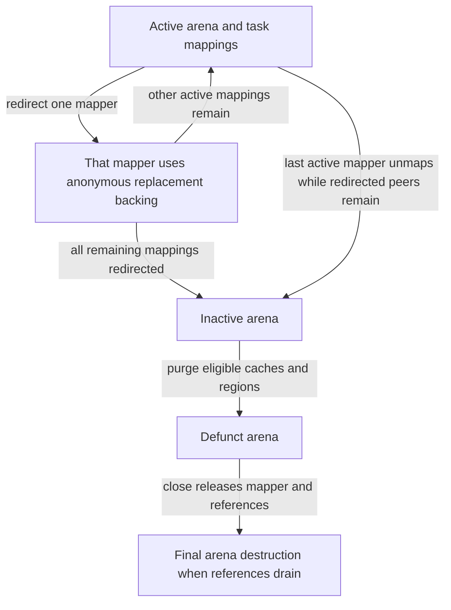

# Skywalk memory: regions, caches, arenas and task mappings

[Networking](README.md) · [Skywalk overview](skywalk.md) · [Packet pools and buflets](skywalk-packets-buflets-and-pools.md) · [Channel lifetimes](skywalk-lifecycles.md) · [IOKit CPU mappings](../drivers/memory-descriptors-and-cpu-mappings.md)

Skywalk gives a process selected packet, ring and metadata memory while retaining separate kernel-owned state. Its memory layer controls backing allocation, object reuse, permissions, mapping updates and revocation. These are different operations from moving a ring index. This chapter follows the nexus arena path in `xnu-12377.121.6` through `bsd/skywalk/mem` and the locally supplied `IOSkywalkSupport.cpp` implementation.

## The hierarchy, including what is shared

| Layer | Concrete representation and responsibility |
| --- | --- |
| Arena | [`skmem_arena`](../../../xnu/bsd/skywalk/mem/skmem_arena_var.h#L49) owns a region array, backing `IOSKArena`, active/defunct flags, references and per-task mapping list. `skmem_arena_nexus` additionally holds pools and ring/schema caches. |
| Region | [`skmem_region`](../../../xnu/bsd/skywalk/mem/skmem_region_var.h#L194) defines geometry, protections, segment indices, allocation hash, freelists, mirror and attached caches. A region describes a class of storage, not one packet. |
| Segment | [`sksegment`](../../../xnu/bsd/skywalk/mem/skmem_region_var.h#L69) identifies one region segment, its `IOSKMemoryBufferRef`, kernel address range, allocation/mapping state and index. |
| Slab and object | [`skmem_slab`](../../../xnu/bsd/skywalk/mem/skmem_cache_var.h#L93) and buffer-control records subdivide backing into cache objects. [`skmem_bufctl`](../../../xnu/bsd/skywalk/mem/skmem_cache_var.h#L41) tracks the buffer allocation and shared-use state. |
| Cache | [`skmem_cache`](../../../xnu/bsd/skywalk/mem/skmem_cache_var.h#L229), CPU magazines and shared depot reuse constructed objects before entering the slab/region layer. |
| Task mapping | [`skmem_arena_mmap_info`](../../../xnu/bsd/skywalk/mem/skmem_arena_var.h#L116) records the task, mapper handle, user virtual base/size and redirect state. |



“Mirrored metadata” does not mean the process maps the kernel's private metadata bytes. [`skmem_region_mirror()`](../../../xnu/bsd/skywalk/mem/skmem_region.c#L1022) pairs geometrically identical regions. [`skmem_region_mirror_alloc()`](../../../xnu/bsd/skywalk/mem/skmem_region.c#L1359) allocates a **separate segment at the same index** in the mirror. Constructors receive both object locations so permitted metadata can be copied/validated between them. Payload buffers may be mapped into more than one eligible arena; private kernel pointers remain in kernel-only regions.

## Region geometry and protection are chosen before mapping

[`skmem_region_params`](../../../xnu/bsd/skywalk/mem/skmem_region_var.h#L156) separates requested from configured segment/object sizes and counts. [`skmem_region_params_config()`](../../../xnu/bsd/skywalk/mem/skmem_region.c#L454) computes the usable geometry. [`skmem_region_create()`](../../../xnu/bsd/skywalk/mem/skmem_region.c#L685) validates page/object divisibility, records object/segment geometry, creates allocation-index tracking and a backing `IOSKRegion`, and translates creation flags into buffer and region specifications.

[`skmem_region_id_t`](../../../xnu/bsd/skywalk/mem/skmem_region_var.h#L104) separates user-mappable schema, rings, payload, user metadata/buflets, descriptors and advisory/statistics regions from kernel metadata, kernel buflets and kernel slot descriptors. The [nexus constructor's assertions](../../../xnu/bsd/skywalk/mem/skmem_arena.c#L460-L551) enforce several concrete rules:

- Schema and flow/nexus advisories are user read-only; guard regions are inaccessible.
- Kernel metadata and kernel slot regions must not be user-mappable.
- Payload regions are shareable; ordinary metadata/ring/schema regions have different sharing contracts.
- User slot descriptor permissions depend on user-packet-pool mode. They cannot be inferred from the ring's role alone.
- Schema and guard regions have `NOREDIRECT`, so revocation must preserve those regions' special role.

Region flags also control kernel writability, physical contiguity, I/O direction, cache inhibition, persistence, pure-data allocation and memory tagging. On the macOS target, the [creation branch](../../../xnu/bsd/skywalk/mem/skmem_region.c#L825-L850) marks ordinary non-pseudo/non-guard regions persistent to avoid unsafe fault-in contexts. Do not extrapolate one region's wiring/pageability to every platform or every region type. Pseudo regions instead create a destructible zone; they do not instantiate normal task-mappable segment backing.

## Object allocation: magazines, construction and partial success

[`skmem_cache_batch_alloc()`](../../../xnu/bsd/skywalk/mem/skmem_cache.c#L1288) first removes objects from the current CPU's loaded magazine, swaps a previous loaded magazine when possible, then obtains full magazines from the shared depot. Cache modes can disable magazines, including schema/ring caches created by the nexus arena. When the cache layer cannot satisfy the request, it releases CPU protection and asks the slab layer for raw objects.

A raw object is not necessarily ready for a caller. The cache invokes its constructor with `skmem_obj_info` for the primary object and optional mirror. Constructor failure stops construction, returns remaining raw objects to slabs and preserves already-constructed successes. Temporary object-info records can live in the raw object's storage, so the constructor cannot overwrite them and continue reading them afterward. Packet-pool constructors explicitly copy those records when necessary. See [constructor/partial-list handling](../../../xnu/bsd/skywalk/mem/skmem_cache.c#L1400-L1467) and [packet metadata construction](../../../xnu/bsd/skywalk/packet/pbufpool.c#L642).

Freeing normally returns a constructed object to magazines. `skmem_cache_batch_free_nocache()` bypasses that reuse path when destruction must happen now; shared packet backing is one consumer. [`skmem_cache_reap_now()`](../../../xnu/bsd/skywalk/mem/skmem_cache.c#L2180) either purges magazines under resize exclusion or reaps shared-depot working-set excess and previous CPU magazines. Reaping cached objects is not the same operation as revoking a task's address mapping.

## Getting a segment and its memory descriptor

[`skmem_region_alloc()`](../../../xnu/bsd/skywalk/mem/skmem_region.c#L1129) holds the region mutex while selecting or growing a free segment index. At its configured limit, it can drop region protection to reap attached caches and then retry. Nonblocking or failure-tolerant requests may return empty; a blocking request can sleep on the segment freelist. Failure to create backing for an already-selected segment has a different bounded retry/watchdog path, which preserves index synchronization for mirrored regions.

[`sksegment_freelist_remove()`](../../../xnu/bsd/skywalk/mem/skmem_region.c#L1760) creates an `IOSKMemoryBuffer`, records the kernel virtual range, makes reclaimable backing nonvolatile as applicable, wires persistent non-memtag backing, publishes the descriptor into the indexed IOSK region and invokes the client segment constructor. The constructor is the point where an external consumer may wire/map the memory for I/O. The body specifically rolls back an `ENOMEM` constructor result; it must not be described as treating every possible errno identically.

[`bsd/skywalk/mem/skmem_region.c:1842–1863`](../../../xnu/bsd/skywalk/mem/skmem_region.c#L1842-L1863):

<!-- source-excerpt: ../../../xnu/bsd/skywalk/mem/skmem_region.c#L1842-L1863 -->
```c
	sg->sg_type = SKSEG_TYPE_ALLOC;

	/* any failures after this can make a full call to sksegment_freelist_insert() */

	/*
	 * Let the client wire it and insert to IOMMU, if applicable.
	 * Try to find out if it's wired and set the right state.
	 */
	if (skr->skr_seg_ctor != NULL) {
		ret = skr->skr_seg_ctor(sg, sg->sg_md, skr->skr_private);
		/* Handle segment creation failure from driver power down */
		if (__improbable(ret != 0)) {
			if (ret == ENOMEM) {
				sksegment_freelist_insert(skr, sg, FALSE);
				goto fail;
			}
		}
	}

	sg->sg_state = IOSKBufferIsWired(sg->sg_md) ?
	    SKSEG_STATE_MAPPED_WIRED : SKSEG_STATE_MAPPED;

```

`sg_state` records whether the resulting descriptor is wired. A kernel virtual address in `sg_start` does not establish an IOVA. The actual device mapping belongs to the provider's constructor and its IOKit mapper/DMA operations; the pool/region layer passes a descriptor, not a universal device address.

The inverse [`sksegment_freelist_insert()`](../../../xnu/bsd/skywalk/mem/skmem_region.c#L1665) calls the client destructor before clearing region backing, unwires persistent memory where applicable, discards purgeable backing consistently, destroys the descriptor and clears kernel addresses/state before reusing the segment index. A destructor is where an I/O consumer must release its mapping/device ownership; freeing a CPU cache object cannot replace that synchronization.

## Constructing the arena and mapping it into a process

[`skmem_arena_create_for_nexus()`](../../../xnu/bsd/skywalk/mem/skmem_arena.c#L435) sets up packet-pool regions, user/kernel slot-descriptor regions, ring/schema caches and optional statistics/advisory objects. It reuses or retains supplied pool/advisory regions where appropriate rather than allocating every region independently. Failure destroys partially created resources; success returns an arena reference and requested pool references.

[`skmem_arena_create_finalize()`](../../../xnu/bsd/skywalk/mem/skmem_arena.c#L1360) collects **only** regions with `SKR_MODE_MMAPOK` in region-ID order into `IOSKArenaCreate()` and marks the arena active. Kernel-only metadata is omitted from the task layout. [`skmem_arena_mmap()`](../../../xnu/bsd/skywalk/mem/skmem_arena.c#L1497) checks active/nondefunct state, creates an IOSK mapper for the process task, records its address/size, retains the arena and links the mapping instance. Failed creation unwinds without publishing an apparently usable `ami_arena`.

The local IOKit code supplies the actual VM operations:

1. [`IOSKMapper::initWithTask()`](../../../xnu/iokit/bsddev/skywalk/IOSkywalkSupport.cpp#L474) creates per-region mapper objects with cumulative region offsets and reserves the arena's task virtual range with `VM_PROT_NONE` and `VM_INHERIT_NONE`.
2. [`IOSKArena::createMapperForTask()`](../../../xnu/iokit/bsddev/skywalk/IOSkywalkSupport.cpp#L730) attaches the mapper, then asks existing regions to refresh their mappings. Empty/unbacked regions stay unavailable.
3. [`IOSKRegionMapper::map()`](../../../xnu/iokit/bsddev/skywalk/IOSkywalkSupport.cpp#L365) maps a present segment descriptor at the reserved address with `kIOMapOverwrite`, adding `kIOMapReadOnly` when user writes are forbidden.
4. Later region buffer insertion/removal updates all applicable arena mappers. Redirected mappers are skipped for normal backing-map installation.

[`iokit/bsddev/skywalk/IOSkywalkSupport.cpp:387–400`](../../../xnu/iokit/bsddev/skywalk/IOSkywalkSupport.cpp#L387-L400):

<!-- source-excerpt: ../../../xnu/iokit/bsddev/skywalk/IOSkywalkSupport.cpp#L387-L400 -->
```cpp
	if (buffer->fSpec.user_writable == FALSE) {
		options |= kIOMapReadOnly;
	}

	offset = fRegionOffset + (segIndex * fRegion->getSegmentSize());
	assert((offset + fRegion->getSegmentSize()) <= fMapper->fMapSize);
	addr = fMapper->fMapAddr + offset;

	map = buffer->createMappingInTask(fMapper->fTask, addr, options);
	fMemoryMaps[segIndex] = map;
	assert((map == NULL) || (map->getLength() == fRegion->getSegmentSize()));
	if (map == NULL) {
		ret = kIOReturnVMError;
	}
```

For an **illustrative** arena with 16 KiB pages, a region beginning at arena offset `0x10000`, segment size `0x10000` and segment index 2, that segment begins at `task_arena_base + 0x30000`. An object at byte offset `0x800` within it appears at `task_arena_base + 0x30800`. These numbers illustrate the code's arithmetic; production offsets come from the configured region layout. Neither this task virtual address nor the corresponding kernel virtual address is a physical address or IOVA.

[`IOSKMemoryBuffer::initWithSpec()`](../../../xnu/iokit/bsddev/skywalk/IOSkywalkSupport.cpp#L1294) translates direction, pageability/purgeability, cache and physical-contiguity flags into IOKit buffer options. It distinguishes pure-data allocation from control allocation that may hold pointers. For kernel read-only memory it creates backing with `TASK_NULL`, then makes a secondary read-only kernel mapping and obtains the CPU pointer from that mapping. This concrete branch prevents accidentally assuming the object's original buffer pointer is always the address exposed to a kernel caller.

## Redirecting a mapping revokes backing without immediately deleting its address range

[`skmem_arena_mredirect()`](../../../xnu/bsd/skywalk/mem/skmem_arena.c#L1664) operates on one mapper instance. Through [`IOSKArena::redirectMap()`](../../../xnu/iokit/bsddev/skywalk/IOSkywalkSupport.cpp#L835), [`IOSKRegion::updateMappingsForArena()`](../../../xnu/iokit/bsddev/skywalk/IOSkywalkSupport.cpp#L1191) skips no-redirect regions and overwrites eligible populated segments using anonymous backing with the corresponding read/write permissions. [`IOSKRegionMapper::mapOverwrite()`](../../../xnu/iokit/bsddev/skywalk/IOSkywalkSupport.cpp#L441) performs the fixed-address VM overwrite; the old `IOMemoryMap` is then released. The address can remain mapped but no longer refers to the live packet/ring backing.

Only after every current mapper is redirected does the arena clear `ARF_ACTIVE` and request defunct processing. If one active mapper remains, the arena must still support it. Unmapping that final active mapper can later make all remaining mappings redirected and trigger deferred defunct work.

[`bsd/skywalk/mem/skmem_arena.c:1692–1701`](../../../xnu/bsd/skywalk/mem/skmem_arena.c#L1692-L1701):

<!-- source-excerpt: ../../../xnu/bsd/skywalk/mem/skmem_arena.c#L1692-L1701 -->
```c
		/*
		 * Mark the arena as inactive if all mapper instances are
		 * redirected; otherwise, we do this later during unmap.
		 * Once inactive, the arena will not allow further mmap,
		 * and it is ready to be defunct later.
		 */
		if (++ar->ar_maprdrcnt == ar->ar_mapcnt) {
			ar->ar_flags &= ~ARF_ACTIVE;
			*need_defunct = TRUE;
		}
```

[`skmem_arena_defunct()`](../../../xnu/bsd/skywalk/mem/skmem_arena.c#L1718) rejects an already-defunct arena or an active one (`EALREADY`/`EBUSY`), reaps caches and tears down eligible resources, then sets `ARF_DEFUNCT`. Some kernel slot-descriptor regions can survive defunct while `arn_ksd_nodefunct` indicates an external nexus owner still refers to them. See [nexus teardown](../../../xnu/bsd/skywalk/mem/skmem_arena.c#L801-L895).



[`skmem_arena_munmap_common()`](../../../xnu/bsd/skywalk/mem/skmem_arena.c#L1555) destroys the mapper, updates map/redirect counts, removes mapping-list membership and releases its arena reference. It requires the caller to hold an additional arena reference while doing this. The channel-specific wrapper invokes domain-provider defunct finalization when unmap makes deferred teardown possible. [`IOSKMapper::free()`](../../../xnu/iokit/bsddev/skywalk/IOSkywalkSupport.cpp#L576) finally releases submaps/arena retention and deallocates its reserved task range.

## Completion boundary and remaining surfaces

The local memory layer and IOSK mapping implementation establish permissions, backing replacement, references and segment callback ordering. Device-specific IOMMU programming, firmware ownership and completion must be followed in the actual provider; they cannot be inferred from the existence of a pool or arena. The [DMA preparation guide](../drivers/dma-preparation-and-mapping.md) explains descriptors and mappings at that next boundary.

This nexus path does not exhaust NECP/system arena variants, every region geometry, memory-tag implementation or all allocator self-tests. It is the memory foundation for the remaining [13-track Skywalk expansion](../../audits/processes-vfs-networking.md#a12--p1-complete-skywalk-expansion-program), especially packet metadata, rings, netif queues and provider teardown. No live mapping/protection or allocator stress test was run.

<!-- BEGIN PLATYDOC DOCUMENTATION LICENSE -->
Original Platydoc text and diagrams are licensed under [CC BY 4.0](https://creativecommons.org/licenses/by/4.0/). Quoted source code and third-party material retain their respective licenses.
<!-- END PLATYDOC DOCUMENTATION LICENSE -->
