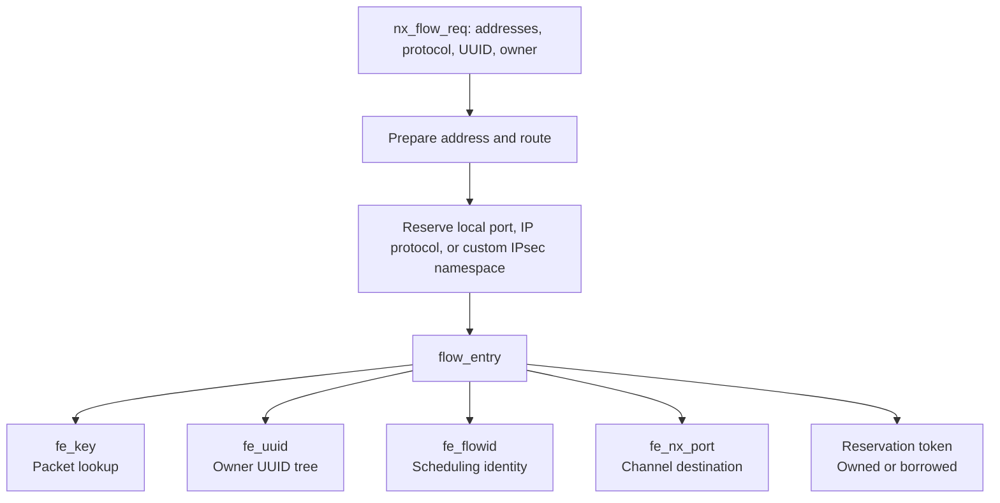
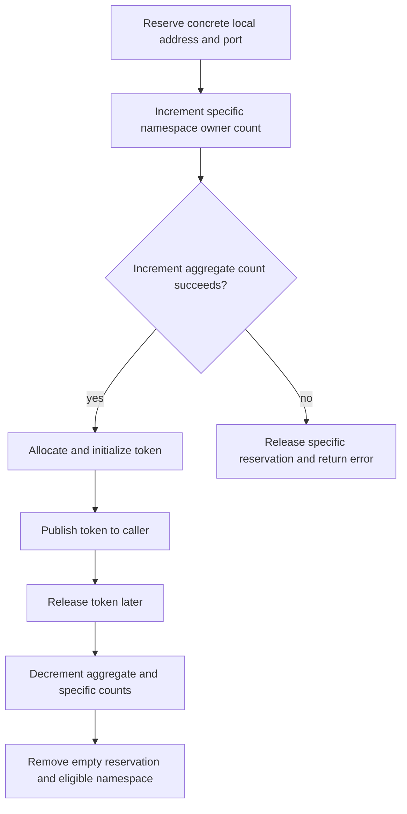
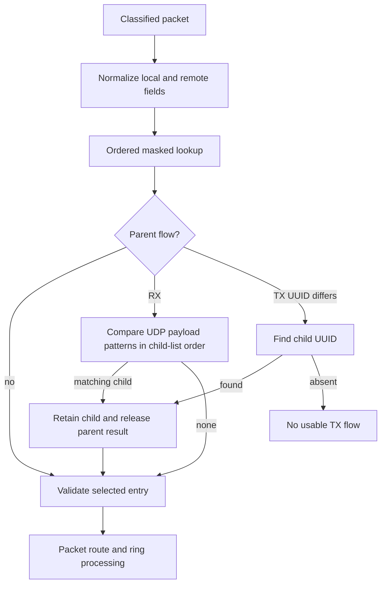

# Skywalk namespaces, flow identity, and packet lookup

[Networking](README.md) · [Skywalk overview](skywalk.md) · [Registration and teardown](skywalk-lifecycles.md) · [Classification, routes, and packet delivery](skywalk-flowswitch-classification-routes-and-datapaths.md)

A flowswitch registration needs several different identities. It reserves resources that might otherwise belong to BSD or PF, creates an entry for packet lookup, assigns a control-plane UUID, and supplies a compact identifier to packet scheduling. These operations have different keys, locks, owners, and release points. This chapter follows their implementation in `xnu-12377.121.6`; the lifecycle chapter remains the entry point for channel creation and flow registration.

## 1. Four namespaces and a destination port

| Identity | Representation and scope | What it establishes |
| --- | --- | --- |
| Local TCP/UDP port reservation | `netns_token`, backed by `<local address, address length, IP protocol>` namespaces and per-port owner counters | Whether Skywalk, a Skywalk listener, BSD, or PF may reserve that local endpoint. |
| Other IP protocol reservation | `protons_token`, globally indexed by an 8-bit protocol number | Which owner/effective-PID pair may use that protocol namespace; BSD protocols are reserved during initialization. |
| Packet lookup key | 48-byte `flow_key`, stored through `flow_entry.fe_cnode` in a flowswitch manager's cuckoo table | Which registered flow matches classified packet fields, with several supported wildcard masks. |
| Flow UUID and compact flow ID | `fe_uuid` versus 32-bit `fe_flowid` | The UUID identifies a registered flow to control/channel paths; the compact ID labels packets for scheduling and related consumers. |
| Delivery endpoint | `fe_nx_port` | A port in this flowswitch nexus, leading to a virtual-port adapter and its ring. This is neither a TCP/UDP port nor a Mach port. |

Definitions: [`ns` and `ns_token`](../../../platydoc-data/xnu/bsd/skywalk/namespace/netns.c#L109-L215), [`protons_token`](../../../platydoc-data/xnu/bsd/skywalk/namespace/protons.c#L56-L79), [`flow_key`](../../../platydoc-data/xnu/bsd/skywalk/nexus/os_nexus_private.h#L479-L512), [`flow_entry`](../../../platydoc-data/xnu/bsd/skywalk/nexus/flowswitch/flow/flow_var.h#L256-L392), and [`flowidns` domains](../../../platydoc-data/xnu/bsd/skywalk/namespace/flowidns.h#L38-L76).



These are kernel resource namespaces, not isolated network-stack containers. In particular, assigning `nt_ifp` does **not** add an interface to the reservation key. The test source explicitly checks that a wildcard binding on one flowswitch prevents the corresponding binding on another. See [`namespace representation`](../../../platydoc-data/xnu/bsd/skywalk/namespace/netns.c#L134-L180) and [`cross-flowswitch reservation test`](../../../platydoc-data/xnu/tests/skywalk/skt_flowswitch_ns_reserve.c#L947-L969).

## 2. Preparation chooses the reservation mechanism

`flow_req_prepare()` validates address families, lengths, local-address availability, multicast exclusions, ports, and child-flow demultiplexing parameters. For TCP/UDP, destination address and destination port must either both be present or both be absent. An absent destination selects listener mode. Other IP protocols require zero ports. A connected request obtains a `flow_route`; when no local address was supplied, the request adopts the route's selected source address before reserving a local endpoint. These operations can fail before a flow entry exists. See [`request validation`](../../../platydoc-data/xnu/bsd/skywalk/nexus/flowswitch/flow/flow_manager.c#L617-L788) and [`route then namespace preparation`](../../../platydoc-data/xnu/bsd/skywalk/nexus/flowswitch/flow/flow_manager.c#L790-L839).

`flow_req_prepare_namespace()` then selects:

- TCP/UDP: `flow_namespace_create()` and `netns`.
- ESP/AH: `key_reserve_custom_ipsec()`, with a separate IPsec reservation token.
- Other protocols: `protons_reserve()`.
- A child flow: no independent namespace reservation; its parent supplies the shared endpoint.

See [`selection predicates`](../../../platydoc-data/xnu/bsd/skywalk/nexus/flowswitch/flow/flow_manager.c#L466-L486), [`reservation dispatch`](../../../platydoc-data/xnu/bsd/skywalk/nexus/flowswitch/flow/flow_manager.c#L519-L615), and [`child exclusion`](../../../platydoc-data/xnu/bsd/skywalk/nexus/flowswitch/flow/flow_manager.c#L817-L824). The IPsec helper is a different ownership boundary, not an alternate `netns` owner.

`flow_namespace_create()` maps listener/reuse/wake flags, validates TCP or UDP and IPv4 or IPv6, then chooses fixed-port or ephemeral allocation:

[Source: `bsd/skywalk/nexus/flowswitch/flow/flow_namespace.c`, lines 104–113](../../../platydoc-data/xnu/bsd/skywalk/nexus/flowswitch/flow/flow_namespace.c#L104-L113).

<!-- source-excerpt: ../../../platydoc-data/xnu/bsd/skywalk/nexus/flowswitch/flow/flow_namespace.c#L104-L113 -->
```c
	}

	/* Assign an ephemeral port, if no port was specified */
	if (laddr->sin.sin_port == 0) {
		err = netns_reserve_ephemeral(token, addr, addr_len, protocol,
		    &laddr->sin.sin_port, netns_rsv_flags, nfi);
	} else {
		err = netns_reserve(token, addr, addr_len, protocol,
		    laddr->sin.sin_port, netns_rsv_flags, nfi);
	}
```

The public `netns` APIs take network-byte-order ports and addresses; `ns_reservation.nsr_port` and `ns_token.nt_port` hold the port in host byte order. The conversion happens at the common reservation entry. Applying `ntohs()` again to the stored port would produce the wrong lookup value. See [`API contract`](../../../platydoc-data/xnu/bsd/skywalk/namespace/netns.h#L31-L44), [`stored port`](../../../platydoc-data/xnu/bsd/skywalk/namespace/netns.c#L109-L114), and [`common entry`](../../../platydoc-data/xnu/bsd/skywalk/namespace/netns.c#L924-L961).

## 3. Port reservation objects and publication

`netns_lock` serializes namespace trees, reservation counts, token lists, and interface association. Paths can acquire the mutex in spin mode and convert it before allocation or other operations requiring the ordinary mutex mode. This is one shared allocator/arbitrator; per-interface lists do not supply independent collision protection. See [`lock macros`](../../../platydoc-data/xnu/bsd/skywalk/namespace/netns.c#L74-L93) and [`common reserve`](../../../platydoc-data/xnu/bsd/skywalk/namespace/netns.c#L559-L588).

| Object | Important fields | Lifetime |
| --- | --- | --- |
| `ns` | Address key/length, protocol, `ns_reservations` RB tree, reservation count, previous upward/downward ephemeral port | Ordinary empty namespaces can be cleaned up; aggregate namespaces are retained. |
| `ns_reservation` | Host-order port, `nsr_refs[]` for each owner class, `nsr_reuseport` | Shared by reservations for the same namespace/port; freed when all owner counts reach zero. |
| `ns_token` | Coordinates, owner/configuration flags, half-closed/withdrawn state, optional flow info, interface/list linkage | Returned to the caller after reservation accounting succeeds; released through `netns_release()`. |
| Global wildcard/non-wildcard slots | TCP/UDP × IPv4/IPv6 | Let wildcard requests detect otherwise separate concrete-address reservations. Non-wildcard aggregates count references and bypass their own collision checks. |

See [`object layouts`](../../../platydoc-data/xnu/bsd/skywalk/namespace/netns.c#L109-L222), [`namespace cleanup`](../../../platydoc-data/xnu/bsd/skywalk/namespace/netns.c#L367-L375), and [`reference-only aggregate`](../../../platydoc-data/xnu/bsd/skywalk/namespace/netns.c#L600-L606).

For a new concrete-address reservation, `_netns_reserve_kpi_common()` first reserves in the specific namespace, then increments the corresponding aggregate non-wildcard namespace. If the second step fails, it releases the first. Only afterward does it create the token, copy optional flow information, associate an interface, and publish the caller's pointer. The aggregate and specific reservations therefore represent the **same** caller's ownership, not two independently usable endpoint reservations. See [`reserve and rollback`](../../../platydoc-data/xnu/bsd/skywalk/namespace/netns.c#L1012-L1057) and [`token publication`](../../../platydoc-data/xnu/bsd/skywalk/namespace/netns.c#L1059-L1086).



Passing an existing token is a separate contract. `NETNS_PRERESERVED` causes assertions that address, protocol, port, and reservation flags match; without it, reusing a valid output token panics. This is an internal API invariant, not a user-facing retry protocol. [`Existing-token branch`](../../../platydoc-data/xnu/bsd/skywalk/namespace/netns.c#L961-L1001).

The disabled-module behavior also differs by layer: low-level `netns_reserve()` can return success with a null token when `netns` was not initialized, whereas `flow_namespace_create()` explicitly rejects a disabled namespace service with `ENOTSUP`. Do not interpret a low-level zero return alone as proof that an actual reservation exists. [`Low-level entry`](../../../platydoc-data/xnu/bsd/skywalk/namespace/netns.c#L1225-L1244), [`flowswitch guard`](../../../platydoc-data/xnu/bsd/skywalk/nexus/flowswitch/flow/flow_namespace.c#L59-L64).

## 4. Collision decisions: owner counts, wildcards, and reuse

The implementation makes both cross-namespace checks and an owner-specific check. The following table describes the latter; it must be read with the wildcard rules below.

| Incoming owner | Important rejection/permission decisions in the exact namespace |
| --- | --- |
| `NETNS_SKYWALK` | Reject BSD/PF ownership. Multiple connected reservations need a covering Skywalk listener: an exact listener, a same-family wildcard listener, or, for IPv4, a wildcard IPv6 listener in the fallback branch. |
| `NETNS_LISTENER` | Reject BSD/PF or an existing listener; inspect wildcard and aggregate reservations in both address families. |
| `NETNS_BSD` / `NETNS_PF` | Reject Skywalk/listener ownership. Multiple BSD/PF counts can coexist here; the BSD PCB and PF machinery still enforce their own finer rules. |

The actual branches are in [`owner-specific checks`](../../../platydoc-data/xnu/bsd/skywalk/namespace/netns.c#L695-L790). Before them, a Skywalk request checks wildcard reservations; a wildcard Skywalk request examines both IPv4 and IPv6 non-wildcard aggregates. BSD/PF wildcard checks examine the relevant family's non-wildcard Skywalk/listener counts. These are deliberately asymmetric branches, not a generic “wildcard equals every address” comparison. [`Wildcard checks`](../../../platydoc-data/xnu/bsd/skywalk/namespace/netns.c#L613-L693).

There is another qualification: `_netns_is_port_used()` ignores the current reservation object and returns false for an existing `nsr_reuseport` reservation. That bit is established when the reservation object is first allocated. Some comments saying “any entry” therefore describe the broad intent more strictly than the predicate implements. `NETNS_REUSEPORT` does not erase every owner collision check or grant the complete BSD `SO_REUSEPORT` policy by itself. See [`reuse flag initialization`](../../../platydoc-data/xnu/bsd/skywalk/namespace/netns.c#L266-L282) and the actual predicate:

[Source: `bsd/skywalk/namespace/netns.c`, lines 534–552](../../../platydoc-data/xnu/bsd/skywalk/namespace/netns.c#L534-L552).

<!-- source-excerpt: ../../../platydoc-data/xnu/bsd/skywalk/namespace/netns.c#L534-L552 -->
```c
static boolean_t
_netns_is_port_used(struct ns * gns, struct ns_reservation *curr_res, in_port_t port)
{
	struct ns_reservation *res = NULL;

	if (gns == NULL) {
		return FALSE;
	}

	res = ns_reservation_tree_find(&gns->ns_reservations, port);
	if (res != NULL && res != curr_res) {
		if (!res->nsr_reuseport) {
			return TRUE;
		}
	}

	return FALSE;
}

```

On success, `_netns_reserve_common()` increments only the selected owner counter. On failure, it removes a newly inserted empty reservation; an existing reservation and its counts remain. [`Commit or undo`](../../../platydoc-data/xnu/bsd/skywalk/namespace/netns.c#L793-L818).

The distinction from flow lookup is explicit in the source:

[Source: `bsd/skywalk/namespace/netns.c`, lines 750–754](../../../platydoc-data/xnu/bsd/skywalk/namespace/netns.c#L750-L754).

<!-- source-excerpt: ../../../platydoc-data/xnu/bsd/skywalk/namespace/netns.c#L750-L754 -->
```c
			/*
			 * XXX: Duplicate 5-tuple flows under a Skywalk
			 * listener are currently detected by flow manager,
			 * till we implement 5-tuple-aware netns.
			 */
```

For example, two different peers may legitimately share the server's local TCP port under a listener. `netns` accounts for that local-port ownership; `flow_mgr_find_conflicting_fe()` and `flow_entry_alloc()` reject an already registered matching flow, ordinarily with `EEXIST`. A port collision commonly yields `EADDRINUSE`. These are different failed decisions. [`Conflict lookup`](../../../platydoc-data/xnu/bsd/skywalk/nexus/flowswitch/flow/flow_manager.c#L1189-L1205), [`allocation conflict handling`](../../../platydoc-data/xnu/bsd/skywalk/nexus/flowswitch/flow/flow_entry.c#L448-L477).

## 5. Ephemeral allocation and BSD/PF participation

`netns_reserve_ephemeral()` uses `ipport_firstauto`/`ipport_lastauto`, plus TCP- or UDP-specific randomization policy. It obtains the selected address/protocol namespace, chooses an initial candidate either randomly or from that namespace's remembered cursor, then walks upward or downward with wraparound. Each candidate runs the ordinary collision checks. Restricted ports are skipped; `EADDRINUSE` advances to another candidate, while other errors stop the search. Exhausting the cycle returns `EADDRNOTAVAIL`. A single-port range has its own branch, and port zero is rejected. See [`range setup and UDP headroom`](../../../platydoc-data/xnu/bsd/skywalk/namespace/netns.c#L1271-L1334) and [`candidate walk`](../../../platydoc-data/xnu/bsd/skywalk/namespace/netns.c#L1335-L1412).

UDP has an additional guard: it leaves `NETNS_NS_UDP_EPHEMERAL_RESERVE`—4096 in this snapshot—ports' worth of namespace headroom based on `UINT16_MAX - ns_n_reservations`. That is not a count of currently free ports inside the configured ephemeral interval. The output port and remembered cursor are updated only after successful reservation. [`Headroom constant`](../../../platydoc-data/xnu/bsd/skywalk/namespace/netns.c#L182-L185), [`success publication`](../../../platydoc-data/xnu/bsd/skywalk/namespace/netns.c#L1393-L1412).

BSD participates without replacing its PCB hash tables. Under `SKYWALK`, `in_pcbinshash()` reserves or validates `inp_netns_token` before linking the PCB into its port/hash lists, then records its last outgoing interface. `in_pcbrehash()` changes the reservation address or creates a missing token, and asserts success on the assumption that earlier endpoint validation made the transition safe. `INP2_EXTERNAL_PORT` bypasses these ownership operations. See [`PCB insertion`](../../../platydoc-data/xnu/bsd/netinet/in_pcb.c#L2791-L2822) and [`rehash`](../../../platydoc-data/xnu/bsd/netinet/in_pcb.c#L2844-L2878); [the PCB chapter](internet-pcbs-ports-and-lifetime.md) explains its independent matching and lifetime rules.

PF's port selection also uses `NETNS_PF`; a representative UDP mapping path reserves before returning its selected translated port. This chapter establishes the shared arbitration point, not the complete PF translation algorithm. [`PF reservation call`](../../../platydoc-data/xnu/bsd/net/pf.c#L3565-L3599).

## 6. Changing an address, withdrawing, and releasing

`netns_change_addr()` is BSD-only. It holds `netns_lock`, reserves the new specific namespace first, then releases the old specific reservation, adjusts aggregate counts, and finally updates the token's address. An ordinary new-address collision leaves the old reservation intact. However, the body has an aggregate-reservation failure branch **after** the old reservation was released; its comment says this should not fail, and it does not implement a complete rollback. It is therefore too strong to describe every possible error as an atomic no-change result. The PCB caller's `VERIFY(err == 0)` is another indication of the assumed invariant. [`Address transition`](../../../platydoc-data/xnu/bsd/skywalk/namespace/netns.c#L1473-L1581).

`netns_set_ifnet()` changes reporting/lifetime association: it drops the old interface I/O reference, then tries to acquire one for the new interface and links the token to that interface or to the unbound list. Interface detach moves tokens to the unbound list; it does not release their endpoint reservations. [`Association and detach`](../../../platydoc-data/xnu/bsd/skywalk/namespace/netns.c#L1585-L1662), [`reference release`](../../../platydoc-data/xnu/bsd/skywalk/namespace/netns.c#L895-L917).

Half-close and withdraw only set token state bits. The local-port reporting path excludes withdrawn flows and conditionally excludes half-closed flows when active-only reporting is requested. These operations do not decrement owner counts. `netns_release()` clears the caller's pointer, releases aggregate and exact reservations, drops the interface association, and frees the token. `_netns_release_common()` removes reservation storage only after **all** owner counters become zero. [`State changes`](../../../platydoc-data/xnu/bsd/skywalk/namespace/netns.c#L1665-L1701), [`reporting filters`](../../../platydoc-data/xnu/bsd/skywalk/namespace/netns.c#L1835-L1860), [`release`](../../../platydoc-data/xnu/bsd/skywalk/namespace/netns.c#L1415-L1470), [`last-owner cleanup`](../../../platydoc-data/xnu/bsd/skywalk/namespace/netns.c#L859-L875).

Externally supplied reservations remain distinguishable throughout flow construction. The preparation path validates available PID/effective-PID flow information; socket tokens can lack that information. It sets `NXFLOWREQF_EXT_PORT_RSV` or `NXFLOWREQF_EXT_PROTO_RSV`, and the entry records corresponding `FLOWENTF_EXTRL_*` flags. Request cleanup and final entry cleanup avoid releasing externally owned reservations. Moving a pointer into `fe_port_reservation` does not transfer the external owner's release obligation. [`Preparation validation`](../../../platydoc-data/xnu/bsd/skywalk/nexus/flowswitch/flow/flow_manager.c#L539-L558), [`pointer/flag transfer`](../../../platydoc-data/xnu/bsd/skywalk/nexus/flowswitch/flow/flow_entry.c#L522-L534), [`request cleanup`](../../../platydoc-data/xnu/bsd/skywalk/nexus/flowswitch/flow/flow_manager.c#L841-L859), [`entry cleanup`](../../../platydoc-data/xnu/bsd/skywalk/nexus/flowswitch/flow/flow_entry.c#L1167-L1189).

## 7. Protocol tokens and compact flow IDs

`protons` uses an RB tree keyed by protocol number and one mutex. A new token receives a tree reference and a caller reference. A repeated reservation with the same stored PID/effective-PID pair retains the token; a different pair gets `EEXIST`. New-token construction normalizes an effective PID of `-1` to the owner PID, while existing-token comparisons use their supplied values; callers must respect the actual identity contract rather than assuming every helper performs normalization. [`Representation and lookup`](../../../platydoc-data/xnu/bsd/skywalk/namespace/protons.c#L56-L143), [`reservation`](../../../platydoc-data/xnu/bsd/skywalk/namespace/protons.c#L166-L227).

When release leaves only the tree reference, the module removes the token, drops that reference, clears valid/identity fields, and frees storage. Initialization reserves the protocols in both BSD Internet domain protocol lists with PID/effective PID zero. It does not create an unowned protocol merely because no Skywalk flow currently uses it. [`Release`](../../../platydoc-data/xnu/bsd/skywalk/namespace/protons.c#L145-L164), [`BSD reservations`](../../../platydoc-data/xnu/bsd/skywalk/namespace/protons.c#L244-L270).

`flowidns` supplies a separate 32-bit ID. Its top two bits encode one of four domains—IPsec, flowswitch, inpcb, PF—and each domain has its own mutex, RB tree, and allocation/release/collision counters. Allocation draws a random candidate, substitutes the domain bits, and retries collisions against live IDs, with a bounded collision assertion. The stored flow key is metadata associated with the allocated ID; this is not the flowswitch's tuple lookup hash. Release decodes the domain, finds the exact ID, removes its node, and panics if an expected live ID is missing. [`Domain encoding`](../../../platydoc-data/xnu/bsd/skywalk/namespace/flowidns.c#L57-L76), [`allocation/release`](../../../platydoc-data/xnu/bsd/skywalk/namespace/flowidns.c#L148-L226).

Flows originating from BSD can reuse `nfr_inp_flowhash` and set `FLOWENTF_EXTRL_FLOWID`; other entries allocate their own ID. Only internally owned IDs are released by final entry cleanup. During TX, packet metadata switches from the registration UUID to the compact scheduling token. See [`flow ID selection`](../../../platydoc-data/xnu/bsd/skywalk/nexus/flowswitch/flow/flow_entry.c#L596-L605), [`final release`](../../../platydoc-data/xnu/bsd/skywalk/nexus/flowswitch/flow/flow_entry.c#L1185-L1189), and [`TX metadata`](../../../platydoc-data/xnu/bsd/skywalk/nexus/flowswitch/fsw_dp.c#L3434-L3441).

## 8. Keys are normalized to local and remote endpoints

Although the fields are named `src` and `dst`, a registered key means **local** and **remote**. TX packet fields already have this orientation; RX swaps source/destination addresses and ports before lookup. Without this normalization, the incoming half of a connection would hash differently from its registration.

[Source: `bsd/skywalk/nexus/flowswitch/flow/flow_var.h`, lines 802–815](../../../platydoc-data/xnu/bsd/skywalk/nexus/flowswitch/flow/flow_var.h#L802-L815).

<!-- source-excerpt: ../../../platydoc-data/xnu/bsd/skywalk/nexus/flowswitch/flow/flow_var.h#L802-L815 -->
```c
	if (input) {
		if (flow->flow_ip_ver == IPVERSION) {
			key->fk_src4 = flow->flow_ipv4_dst;
			key->fk_sport = flow->flow_tcp_dst;
			key->fk_dst4 = flow->flow_ipv4_src;
			key->fk_dport = flow->flow_tcp_src;
		} else {
			key->fk_src6 = flow->flow_ipv6_dst;
			key->fk_sport = flow->flow_tcp_dst;
			key->fk_dst6 = flow->flow_ipv6_src;
			key->fk_dport = flow->flow_tcp_src;
		}
	} else {
		if (flow->flow_ip_ver == IPVERSION) {
```

For an illustrative IPv4 UDP flow registered as local `192.0.2.10:53000`, remote `198.51.100.20:443`, both packets below produce that same local/remote key:

| Wire direction | Wire source | Wire destination | Lookup local/remote |
| --- | --- | --- | --- |
| TX | `192.0.2.10:53000` | `198.51.100.20:443` | Local `192.0.2.10:53000`, remote `198.51.100.20:443` |
| RX | `198.51.100.20:443` | `192.0.2.10:53000` | Local `192.0.2.10:53000`, remote `198.51.100.20:443` |

The addresses are illustrative, not values copied from a running kernel. [`Packet normalization`](../../../platydoc-data/xnu/bsd/skywalk/nexus/flowswitch/flow/flow_var.h#L787-L828).

`flow_req2key()` clears the 48-byte key, sets fields and mask bits only for specified endpoints, and accepts a fixed set of masks:

| Mask | Compared/hash fields, in local/remote terms |
| --- | --- |
| `FKMASK_5TUPLE` | IP version, protocol, local address/port, remote address/port |
| `FKMASK_4TUPLE` | IP version, protocol, local address/port, remote port |
| `FKMASK_3TUPLE` | IP version, protocol, local address/port |
| `FKMASK_2TUPLE` | Protocol and local port |
| `FKMASK_IPFLOW3` | IP version, protocol, local and remote addresses |
| `FKMASK_IPFLOW2` | IP version, protocol, local address |
| `FKMASK_IPFLOW1` | Protocol |

These names count different logical endpoint components; the 5-tuple mask also includes IP version. A declared supported mask is not proof that every public registration path can construct it: `flow_req_prepare()` imposes its additional endpoint constraints first. [`Mask definitions`](../../../platydoc-data/xnu/bsd/skywalk/nexus/os_nexus_private.h#L498-L512), [`request conversion`](../../../platydoc-data/xnu/bsd/skywalk/nexus/flowswitch/flow/flow_var.h#L719-L784).

## 9. Ordered lookup and retained results

`flow_mgr_create()` installs the mask order shown above: 5, 4, 3, 2, IPFLOW3, IPFLOW2, IPFLOW1. The manager tracks counts for each mask. Lookup skips unused masks, temporarily places the candidate mask into the packet key, hashes only selected fields, and queries the cuckoo table. The first match wins. A wildcard TCP/UDP listener therefore follows the more specific TCP/UDP masks, and IP-protocol fallback follows those. This is a fixed ordered search, not a general longest-prefix algorithm. [`Mask order`](../../../platydoc-data/xnu/bsd/skywalk/nexus/flowswitch/flow/flow_manager.c#L246-L255), [`masked hash`](../../../platydoc-data/xnu/bsd/skywalk/nexus/flowswitch/flow/flow_var.h#L675-L693).

[Source: `bsd/skywalk/nexus/flowswitch/flow/flow_manager.c`, lines 1150–1163](../../../platydoc-data/xnu/bsd/skywalk/nexus/flowswitch/flow/flow_manager.c#L1150-L1163).

<!-- source-excerpt: ../../../platydoc-data/xnu/bsd/skywalk/nexus/flowswitch/flow/flow_manager.c#L1150-L1163 -->
```c
	for (int i = 0; i < FKMASK_IDX_MAX; i++) {
		size_t count = fm->fm_flow_hash_count[i];
		uint16_t mask = fm->fm_flow_hash_masks[i];
		if (count == 0 || mask == 0) {
			SK_DF(SK_VERB_FLOW | SK_VERB_LOOKUP,
			    "[%d] mask=%08x count=%zu skiped",
			    i, mask, count);
			continue;
		}
		key->fk_mask = mask;
		hash = flow_key_hash(key);
		node = cuckoo_hashtable_find_with_hash(fm->fm_flow_table, key, hash);
		SK_DF(SK_VERB_FLOW | SK_VERB_LOOKUP,
		    "[%d] mask=%08x hash %08x node %p", i, mask, hash,
```

Two-tuple matching omits IP version; after a match, the manager explicitly rejects an IPv4-only listener for an IPv6 packet. It releases that result and continues. It restores the caller's original mask before returning. [`Family guard and completion`](../../../platydoc-data/xnu/bsd/skywalk/nexus/flowswitch/flow/flow_manager.c#L1164-L1186).

The cuckoo table first examines the primary then alternate bucket under a table resize read lock. Each bucket has its own mutex; a hash match narrows the candidates, and the manager's comparison callback performs masked equality. The result is retained **before** dropping the bucket lock:

[Source: `bsd/skywalk/lib/cuckoo_hashtable.c`, lines 489–500](../../../platydoc-data/xnu/bsd/skywalk/lib/cuckoo_hashtable.c#L489-L500).

<!-- source-excerpt: ../../../platydoc-data/xnu/bsd/skywalk/lib/cuckoo_hashtable.c#L489-L500 -->
```c
		if (b->_slots[i]._hash == hash) {
			node = b->_slots[i]._node;
			while (node != NULL) {
				if (h->_obj_cmp(node, key) == 0) {
					h->_obj_retain(node);
					goto done;
				}
				node = cuckoo_node_next(node);
			}
		}
	}

```

This table is not lock-free. A returned `flow_entry` stays allocated through the retained reference, but can still be logically torn down or unusable; RX/TX callers inspect flags and release rejected results. Insertions try either bucket, then relocation, and can expand/retry on `ENOMEM`; deletion removes the node and drops the table's reference. The periodic reaper can shrink the table. See [`lookup locking`](../../../platydoc-data/xnu/bsd/skywalk/lib/cuckoo_hashtable.c#L477-L531), [`insertion and expansion`](../../../platydoc-data/xnu/bsd/skywalk/lib/cuckoo_hashtable.c#L918-L966), [`deletion`](../../../platydoc-data/xnu/bsd/skywalk/lib/cuckoo_hashtable.c#L968-L1025), and [`manager callbacks`](../../../platydoc-data/xnu/bsd/skywalk/nexus/flowswitch/flow/flow_manager.c#L84-L143).

`lookup_flow_with_pkt()` can reuse the preceding retained flow in a batch when its five-tuple matches, avoiding another table search. RX subsequently applies listener destination checks and torn-down/offload checks. TX additionally verifies that the packet's flow UUID equals the selected entry's UUID. Matching packet header bytes alone does not establish the full TX admission decision. [`Batch shortcut`](../../../platydoc-data/xnu/bsd/skywalk/nexus/flowswitch/fsw_dp.c#L777-L847), [`RX checks`](../../../platydoc-data/xnu/bsd/skywalk/nexus/flowswitch/fsw_dp.c#L1001-L1037), [`TX checks`](../../../platydoc-data/xnu/bsd/skywalk/nexus/flowswitch/fsw_dp.c#L3512-L3557).

## 10. UDP child flows add a second lookup stage

Child registration supplies a parent UUID and one or more bounded payload patterns; the preparation path restricts this mechanism to UDP and validates nonzero pattern lengths and the maximum offset-plus-length. Entry allocation requires the conflicting tuple to be the designated parent. The child enters the parent's locked child list instead of the cuckoo table, while also participating in its owner's UUID tree. [`Request validation`](../../../platydoc-data/xnu/bsd/skywalk/nexus/flowswitch/flow/flow_manager.c#L750-L783), [`parent selection`](../../../platydoc-data/xnu/bsd/skywalk/nexus/flowswitch/flow/flow_entry.c#L455-L477), [`publication`](../../../platydoc-data/xnu/bsd/skywalk/nexus/flowswitch/flow/flow_entry.c#L653-L676).

RX first finds the parent by packet key, then walks children under the parent child-list read lock. A child must be viable and have UDP payload. A matching pattern compares `(payload bytes, value, mask)`; **any** one pattern match succeeds. If the bytes are not available in the first packet buffer, the mbuf-backed path can use `m_copydata()` into scratch storage; the native short-buffer branch records an error and does not match. The first matching child is retained. TX selects a child by the packet's flow UUID, then still performs the normal TX identity/state checks. [`Payload matching`](../../../platydoc-data/xnu/bsd/skywalk/nexus/flowswitch/flow/flow_manager.c#L1230-L1298), [`RX/TX child lookup`](../../../platydoc-data/xnu/bsd/skywalk/nexus/flowswitch/flow/flow_manager.c#L1301-L1345).



This only classifies bytes according to registered patterns. It does not implement a userspace transport's handshake, retransmission, or security protocol.

## 11. Evidence, tests, and remaining work

The local tests provide useful executable descriptions: [`skt_flowswitch_ns_reserve.c`](../../../platydoc-data/xnu/tests/skywalk/skt_flowswitch_ns_reserve.c#L910-L1020) checks duplicate listeners, cross-flowswitch exclusion, BSD conflicts, and distinct TCP/UDP namespaces; [`skt_flowlookup.c`](../../../platydoc-data/xnu/tests/skywalk/skt_flowlookup.c#L446-L469) drives TCP and IP-flow send/receive/listener cases; [`cuckoo_hashtable_test.c`](../../../platydoc-data/xnu/bsd/skywalk/lib/cuckoo_hashtable_test.c#L1) exercises the underlying container. They were read as source evidence, not run as kernel tests for this documentation.

This chapter covers namespace accounting and lookup implementation. [The datapath companion](skywalk-flowswitch-classification-routes-and-datapaths.md) explains how parsed packets reach those lookups and where the selected packets go. Full NECP policy evaluation, PF/IPsec internals, payload-demultiplexing concurrency beyond the visible locks, and provider-specific offload behavior remain separate research areas; the presence of a token, pattern, or callback does not establish their complete implementation.

<!-- BEGIN PLATYDOC DOCUMENTATION LICENSE -->
Original Platydoc text and diagrams are licensed under [CC BY 4.0](https://creativecommons.org/licenses/by/4.0/). Quoted source code and third-party material retain their respective licenses.
<!-- END PLATYDOC DOCUMENTATION LICENSE -->
