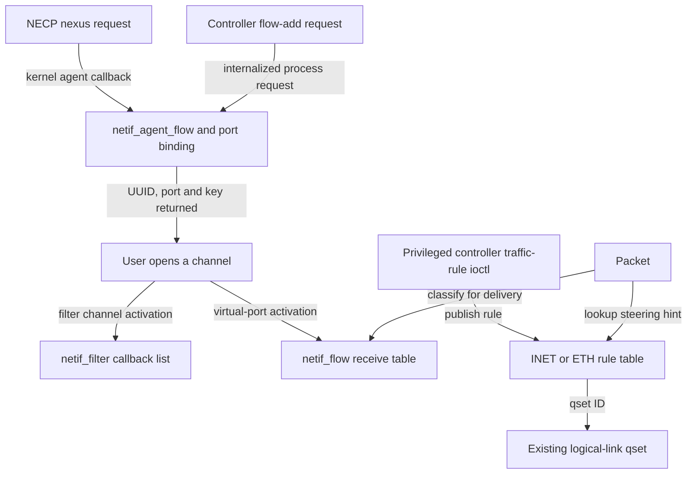
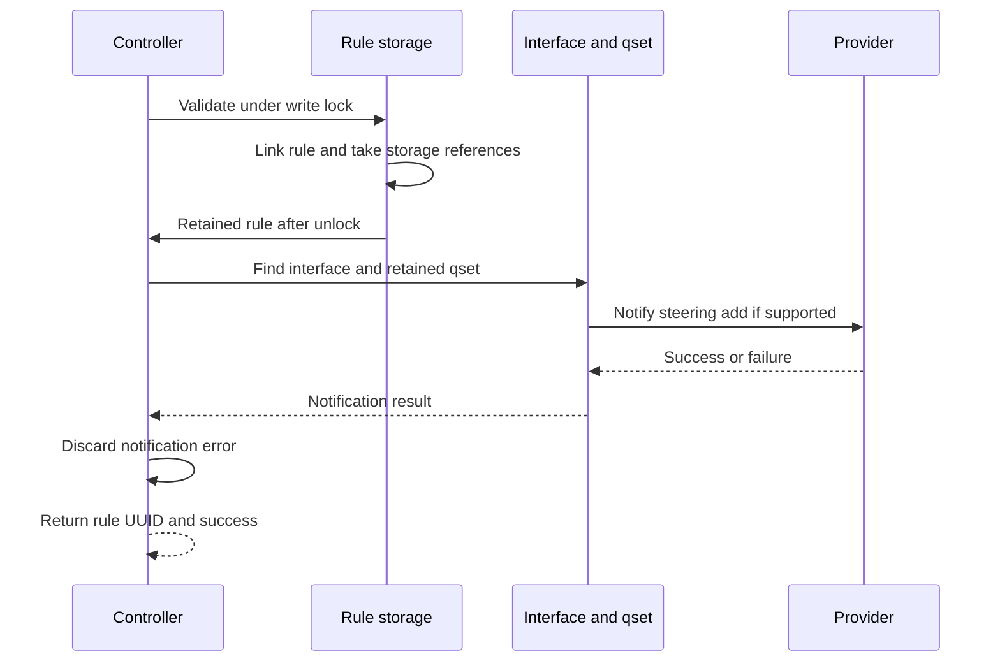

# Skywalk netif agents, virtual-port flows and traffic rules

[Networking](README.md) · [Netif servicing](skywalk-netif-links-queues-and-scheduling.md) · [Filter reinjection](skywalk-netif-filters-and-reinjection.md) · [Controllers and port lifetime](skywalk-controller-provider-and-port-lifetime.md) · [Policy overview](policy-extensions.md)

Netif has two related control mechanisms. A network-agent request can assign a process a bound port for an interface filter, custom Ethernet traffic or a low-latency IPv6 connection. A traffic-rule request can associate packet fields with a logical-link queue-set ID. Neither operation itself sends a packet. This chapter follows the local `xnu-12377.121.6` bodies from admission through publication, packet lookup and removal, and separates their state from the flowswitch's independent flow manager.

## 1. Separate control identity, receive ownership and queue selection

| Object | Identity and important fields | What it establishes |
|---|---|---|
| Netagent registration | Agent UUID, advertised features, session, kernel callback/context | An interface-associated service discoverable through network-agent/NECP machinery. |
| `netif_agent_flow` | Flow UUID, `naf_pid`, binding key, nexus port, flags, optional local/remote IPv6 addresses | Record of a port assignment or reusable low-latency assignment. Protected by `nif_agent_lock`. |
| `nxbind` and `netif_port_info` | Process unique ID plus random key; optional `netif_flow_desc` | Admission to the assigned port, and its custom-Ethernet or IPv6 receive description. |
| `netif_filter` | Port, callback and callback-reference count | Active ordered interception when a filter channel is activated. |
| `netif_flow` | Port, description, callback, table/list links and callback-reference count | Active virtual-port classification/delivery when an ordinary netif virtual channel is activated. |
| `nxctl_traffic_rule` plus INET/ETH subtype | Rule UUID/refcount/interface name, copied descriptor and steering action, optional controller-close linkage | A published rule selecting a qset ID. It does not create the qset or bind a process port. |

Sources: [`agent and netif state`](../../../xnu/bsd/skywalk/nexus/netif/nx_netif.h#L193-L203), [`port and receive-flow structures`](../../../xnu/bsd/skywalk/nexus/netif/nx_netif.h#L53-L105), [`rule base`](../../../xnu/bsd/skywalk/nexus/nexus_traffic_rule.h#L119-L134), [`INET subtype`](../../../xnu/bsd/skywalk/nexus/nexus_traffic_rule_inet.c#L35-L44).

A netif receive table is also different from the flowswitch's [masked flow-key table](skywalk-namespaces-and-flow-lookup.md). Its locally supplied implementations are simple lists keyed by EtherType or an IPv6 address pair. A traffic-rule table is a third lookup structure, organized by interface name and supported field-mask order.



The arrows identify different uses of packet classification. The figure does not imply that a traffic rule authorizes a channel or that every packet goes through all three tables.

## 2. Agent registration and the local NECP boundary

`nx_netif_agent_get_features()` advertises interposition when filters are initialized. An initialized ordinary Ethernet flow facility advertises custom-Ethernet support; a low-latency netif advertises nexus-provider support instead. Those features also set network-provider status. If there are no features, agent initialization stops. [`Feature selection`](../../../xnu/bsd/skywalk/nexus/netif/nx_netif_netagent.c#L951-L985), [`filter initialization gates`](../../../xnu/bsd/skywalk/nexus/netif/nx_netif_filter.c#L300-L329), [`flow initialization gates`](../../../xnu/bsd/skywalk/nexus/netif/nx_netif_flow.c#L840-L864).

Registration creates a kernel netagent session with `nx_netif_netagent_event` and `nif` as context, generates an agent UUID, and advertises the `Skywalk` / `NetIf` service. Its nexus data describes link frames, address assignment, unsupported assertions and user-packet-pool support. Low-latency service additionally suggests an event ring. After `netagent_register()` succeeds, initialization adds the agent UUID to the interface and sets `ADDED`. Session registration and interface association are distinct stages; failure to add the UUID unregisters the successful session. [`Registration body`](../../../xnu/bsd/skywalk/nexus/netif/nx_netif_netagent.c#L883-L933), [`interface association`](../../../xnu/bsd/skywalk/nexus/netif/nx_netif_netagent.c#L971-L1006).

There is an implementation wrinkle on registration failure: the local helper destroys the failed session and clears its pointer/UUID, but then sets `REGISTERED` unconditionally before returning the error. The initializer returns on that error; this is not evidence of a usable registration. Describe the successful path from the actual return value and later `ADDED` state, rather than treating the flag alone as proof of successful construction. [`Failure and flag order`](../../../xnu/bsd/skywalk/nexus/netif/nx_netif_netagent.c#L925-L933).

For a kernel agent, network-agent dispatch retains the registration's lock across the callback while releasing the global registration-list lock. The callback must not recursively register or unregister agents. Final registration freeing takes that lock exclusively after list removal to wait out such in-flight callbacks. This is a local lifetime boundary around the netif callback, not merely a convention attached to its function name. [`Callout locking`](../../../xnu/bsd/net/network_agent.c#L2921-L2943), [`final callback drain`](../../../xnu/bsd/net/network_agent.c#L893-L912).

`nx_netif_netagent_event()` handles insert, remove and abort. Insert chooses interposition first, then custom Ethernet, then low-latency IPv6. Other events return success without work. The add dispatcher also starts with zero error and has no final rejection branch for a request selecting none of those modes; such a call can return zero without an assignment message. The advertised capability and upstream NECP decisions therefore matter. Remove/abort both reach flow deletion; the local deletion helper ignores its `abort` argument. [`Event dispatch`](../../../xnu/bsd/skywalk/nexus/netif/nx_netif_netagent.c#L802-L880).

The local handler receives already-prepared `necp_client_nexus_parameters`. It implements assignment and cleanup, not the entire policy decision that selected this agent. The [NECP client/flow companion](necp-clients-and-flow-registration.md) follows upstream registration publication, synchronous/asynchronous assignment-buffer ownership, result copyout and close; [NECP policy evaluation](necp-policy-evaluation.md) explains how interface/agent choices are formed. Userspace Network Extension policy production and application-side channel reuse are external to these bodies. [Flowswitch transport-flow/AOP steering](skywalk-tcp-aggregation-segmentation-and-offloads.md#12-aop-flow-steering-is-a-separate-offload-lifecycle) is a separate path from this netif agent.

## 3. Binding a flow does not activate a packet receiver

The three admitted netif flow forms have different checks:

| Request | Local admission and assignment |
|---|---|
| `NXFLOWREQF_FILTER` | Must be the only request flag; filters must be initialized. Assign a process-bound port/key for a filter channel. |
| `NXFLOWREQF_CUSTOM_ETHER` | Must be the only request flag; receive flows must be initialized. Validate EtherType and attach it as port information. |
| `NXFLOWREQF_IPV6_ULA` | Only optional `LISTENER` may accompany it; netif must be low latency. Nonlisteners bind an IPv6 local/remote pair; listeners take a separate address-only route. |

All require an interface-added agent. Add rejects absence of a supported type. [`Flag admission`](../../../xnu/bsd/skywalk/nexus/netif/nx_netif_netagent.c#L351-L400).

Custom EtherType assignment rejects IP, ARP, reverse ARP, VLAN, IPv6, PAE and RSN preauthentication, and rejects values at or below `ETHERMTU`. This is not the same allowed-value set as the Ethernet **traffic-rule** facility below. The IPv6 validator requires `AF_INET6`, exact sockaddr length and a nonunspecified address; despite the ULA name, it deliberately does not require a unique-local prefix. [`EtherType validation`](../../../xnu/bsd/skywalk/nexus/netif/nx_netif_netagent.c#L176-L205), [`IPv6 validation`](../../../xnu/bsd/skywalk/nexus/netif/nx_netif_netagent.c#L121-L143).

For a nonlistener, `nx_netif_netagent_flow_bind()` resolves the PID to a referenced process, generates a random UUID key, and sets `NXBF_MATCH_UNIQUEID` and `NXBF_MATCH_KEY`. It uses `proc_uniqueid(p)`, not just the numeric PID, to prevent a later process reusing that PID from satisfying the same identity. `nxdom_bind_port()` chooses a port from `NEXUS_PORT_ANY`; on success it retains the allocated key/port information. On failure, the caller frees both provisional objects and releases the process reference. The result returns the key and chosen port in `nx_flow_req`. [`Binding construction and cleanup`](../../../xnu/bsd/skywalk/nexus/netif/nx_netif_netagent.c#L265-L330).

The critical identity fields are explicit:

[nx_netif_netagent.c:287–299](../../../xnu/bsd/skywalk/nexus/netif/nx_netif_netagent.c#L287-L299):

<!-- source-excerpt: ../../../xnu/bsd/skywalk/nexus/netif/nx_netif_netagent.c#L287-L299 -->
```c
	nfr->nfr_proc = p;
	uuid_generate_random(uuid_key);
	bzero(&nxb, sizeof(nxb));
	nxb.nxb_flags |= NXBF_MATCH_UNIQUEID;
	nxb.nxb_uniqueid = proc_uniqueid(p);
	nxb.nxb_pid = pid;
	nxb.nxb_flags |= NXBF_MATCH_KEY;
	nxb.nxb_key = sk_alloc_data(sizeof(uuid_key), Z_WAITOK | Z_NOFAIL,
	    skmem_tag_nx_key);
	nxb.nxb_key_len = sizeof(uuid_key);
	bcopy(uuid_key, nxb.nxb_key, nxb.nxb_key_len);

	err = nx_netif_netagent_fill_port_info(nif, nfr, &npi);
```

The add routine allocates a `netif_agent_flow`, obtains a MAC address for custom Ethernet/IPv6, then holds `nif_agent_lock` across binding and list publication. It copies the returned binding identity into the record and inserts it into `nif_agent_flow_list`. The separate NECP wrapper constructs a nexus-assignment message containing nexus UUID, port and key, plus MAC/endpoints where applicable. Failure to allocate that message invokes flow deletion, so a successful port bind is not the final success boundary for the complete request. [`Add publication`](../../../xnu/bsd/skywalk/nexus/netif/nx_netif_netagent.c#L477-L531), [`interpose assignment rollback`](../../../xnu/bsd/skywalk/nexus/netif/nx_netif_netagent.c#L644-L675), [`custom-Ethernet assignment`](../../../xnu/bsd/skywalk/nexus/netif/nx_netif_netagent.c#L679-L710).

Controller flow-add reaches the same core through `nx_netif_ctl_flow_add()`. It requires a nonzero flow UUID, masks request flags, checks delegated effective identity where applicable, internalizes the request, clears kernel-only pointers and overwrites `nfr_pid` with the caller PID. The direct controller route must not be documented as allowing an arbitrary caller-supplied binding PID. General controller authorization precedes this handler. [`Controller admission/internalization`](../../../xnu/bsd/skywalk/nexus/netif/nx_netif.c#L1534-L1610), [controller ownership](skywalk-controller-provider-and-port-lifetime.md).

Neither binding nor recording the agent flow installs `netif_filter` or `netif_flow`. Those appear only when the assigned port's channel activates. A request can therefore own an assignment while there is no active packet consumer.

## 4. Low-latency address reuse and listener assignments

Before creating a new record, add attempts low-latency duplicate lookup. It compares PID, IPv6-flow flag and the local/remote IPv6 **addresses** against recorded assignments. It does not compare TCP/UDP ports or a transport protocol. A match returns the existing port/key and creates no new `netif_agent_flow` for the second request UUID. This supports external channel reuse; it is not a second independently owned port. The lookup and subsequent new binding occur in separate `nif_agent_lock` intervals, so this function alone is not an atomic check-and-create transaction. [`Tuple comparison`](../../../xnu/bsd/skywalk/nexus/netif/nx_netif_netagent.c#L146-L173), [`duplicate lookup`](../../../xnu/bsd/skywalk/nexus/netif/nx_netif_netagent.c#L420-L456), [`add ordering`](../../../xnu/bsd/skywalk/nexus/netif/nx_netif_netagent.c#L490-L519).

A listener takes a different branch before allocation/binding: obtain the MAC address and generate a local IPv6 address. Generation uses `fd` as the first byte, five random bytes for the global ID, zero subnet bytes and a monotonically increasing nonzero interface-ID component. The assignment response has a zero nexus UUID, `NEXUS_PORT_ANY` and no key. There is no listener port or agent-flow record to tear down. Nonlisteners require both supplied endpoint families to be IPv6 before binding. [`Address generation`](../../../xnu/bsd/skywalk/nexus/netif/nx_netif_netagent.c#L66-L118), [`listener operation`](../../../xnu/bsd/skywalk/nexus/netif/nx_netif_netagent.c#L403-L417), [`distinct assignment responses`](../../../xnu/bsd/skywalk/nexus/netif/nx_netif_netagent.c#L717-L798).

For example, two sequential nonlistener requests with different UUIDs but the same PID/address pair can receive the same port/key. A delete lookup is by the UUID stored in the original record; the second UUID is not inserted as an alias. A consumer must preserve the intended shared-channel lifecycle rather than treating every successful assignment response as a new independent record. This is a consequence of the inspected lookup/add/delete bodies, not a claim about how the external library manages every reuse case.

## 5. Channel activation publishes the actual receive flow

An ordinary netif virtual adapter reads its `netif_port_info` under the netif write lock. For low latency it first sets up the hardware adapter. It then calls `nx_netif_flow_add()` with the port's descriptor and `netif_deliver_cb`. Failure unwinds the hardware setup; success stores the `netif_flow` pointer and sets active state. A filter channel instead inserts the ordered callback described in [filter activation](skywalk-netif-filters-and-reinjection.md#2-admission-allocation-and-activation). [`Virtual-port activation`](../../../xnu/bsd/skywalk/nexus/netif/nx_netif_vp.c#L396-L437).

The first receive flow creates a table using EtherType operations for an ordinary netif or IPv6-address-pair operations for low latency. Both local table implementations are linked lists. Insert rejects a duplicate port or matching description. Ordinary Ethernet extraction supports hardware VLAN metadata and an inline VLAN header, but accepts only a zero VLAN ID (including priority-tagged traffic). IPv6 extraction uses local=source/remote=destination for outbound validation and reverses them for incoming classification. [`Table construction and insert`](../../../xnu/bsd/skywalk/nexus/netif/nx_netif_flow.c#L256-L349), [`flow add`](../../../xnu/bsd/skywalk/nexus/netif/nx_netif_flow.c#L737-L804), [`Ethernet extraction`](../../../xnu/bsd/skywalk/nexus/netif/nx_netif_flow.c#L124-L197), [`IPv6 direction`](../../../xnu/bsd/skywalk/nexus/netif/nx_netif_flow.c#L207-L253).

Classification normally checks the relevant local MAC address: outbound source or inbound destination. Ordinary inbound multicast/broadcast is accepted at this check; outbound multicast/broadcast source is rejected. Low latency rejects multicast/broadcast at the selected address check and skips local-address equality for inbound unicast. A development `accept_all` mode bypasses ordinary classification and returns the first table entry; it should not be generalized into the production matching contract. [`MAC checks`](../../../xnu/bsd/skywalk/nexus/netif/nx_netif_flow.c#L384-L469), [`test override`](../../../xnu/bsd/skywalk/nexus/netif/nx_netif_flow.c#L256-L285).

`nx_netif_flow_classify()` acquires `nif_flow_lock`, checks enabled/table state, performs lookup and increments the matched flow's callback reference before unlocking. `nx_netif_demux()` builds same-flow chains, retaining only one reference for a continuing run, calls delivery outside the lock and releases afterward. Unmatched packets are returned through `remain` when supplied; without that output they are freed. Its zero return is not a per-packet delivery guarantee. [`Reference acquisition/release`](../../../xnu/bsd/skywalk/nexus/netif/nx_netif_flow.c#L514-L556), [`demultiplexing ownership`](../../../xnu/bsd/skywalk/nexus/netif/nx_netif_flow.c#L569-L672).

The virtual-port delivery callback uses RX ring 0 and separates packet ownership by pool. If the input already belongs to the ring's pool, it finalizes and attaches that same packet. Otherwise `nx_netif_pkt_to_pkt()` allocates/copies a destination packet and consumes the original on both success and failure; `ENOMEM` from the wrapper does not return the original to the caller. Ring-disabled delivery frees the chain, while ring exhaustion frees its unprocessed suffix. The loop increments `cnt` after each attempted copy/attachment, including copy failures; consequently its `VP_DELIVERED`/`VP_LL_DELIVERED` counter and notification condition do not prove that exactly `cnt` slots received packets. Only successful attachments update `last_slot`, which controls slot publication. [`Same-pool attachment and consuming copy`](../../../xnu/bsd/skywalk/nexus/netif/nx_netif_vp.c#L104-L131), [`ring delivery and counting`](../../../xnu/bsd/skywalk/nexus/netif/nx_netif_vp.c#L135-L203), [`copy success/error cleanup`](../../../xnu/bsd/skywalk/nexus/netif/nx_netif_util.c#L687-L698).

Receive-flow removal deletes table/list visibility under `nif_flow_lock`, waits for active callback references, destroys the table after the last flow and frees the record. Virtual-adapter deactivation then clears its pointer, tears down low-latency hardware setup and clears active state. Disable only changes admission; remove performs the reference drain. [`Flow removal`](../../../xnu/bsd/skywalk/nexus/netif/nx_netif_flow.c#L807-L837), [`adapter off`](../../../xnu/bsd/skywalk/nexus/netif/nx_netif_vp.c#L440-L461), [`enable state`](../../../xnu/bsd/skywalk/nexus/netif/nx_netif_flow.c#L890-L922).

## 6. Agent deletion, channel destruction and interface detach

Agent deletion validates flags, treats explicit listeners as a no-op and searches its list by flow UUID. It takes the nexus port from the found record rather than trusting the request. It attempts unbind, but even an unbind error removes/frees the agent record and returns zero; the code allows for the channel having already closed the port. It does not claim that every unbind attempt succeeded. [`Deletion`](../../../xnu/bsd/skywalk/nexus/netif/nx_netif_netagent.c#L561-L612).

Interface finalization first clears `ADDED` and removes the interface's agent UUID, then unregisters/destroys the session and purges its recorded assignments. Purge does not individually unbind each port: the nexus detach cleanup owns that work. The network-agent registration drain described above is part of why the callback context can be released afterward. [`Finalization`](../../../xnu/bsd/skywalk/nexus/netif/nx_netif_netagent.c#L1009-L1034), [`purge ownership`](../../../xnu/bsd/skywalk/nexus/netif/nx_netif_netagent.c#L616-L640).

This produces three separate teardown observations: the agent may no longer advertise service, a port binding may no longer admit new channel opens, and an existing adapter may still need to remove callbacks/reclaim ring packets. The [controller/lifetime](skywalk-controller-provider-and-port-lifetime.md) and [channel lifecycle](skywalk-lifecycles.md) chapters follow those broader resources.

## 7. Traffic-rule ioctl admission and stored representation

The controller fd's ioctl dispatch recognizes add-INET, add-ETH, remove-by-UUID and get-rules. Root bypasses the additional entitlement test; other callers need `com.apple.private.skywalk.traffic_rule.write` for mutation or `.read` for enumeration. The outer ioctl layer handles the fixed argument copyin/copyout; get-rules additionally copies an array through the address in its arguments. [`File operation`](../../../xnu/bsd/skywalk/nexus/nexus_syscalls.c#L52-L65), [`entitlement and dispatch`](../../../xnu/bsd/skywalk/nexus/nexus_ioctl.c#L33-L84), [`ioctl layouts`](../../../xnu/bsd/skywalk/nexus/nexus_ioctl.h#L54-L123).

An add argument supplies interface name, typed traffic descriptor, a steering-action structure and persistence flags; the kernel returns a generated rule UUID. A rule copies the descriptor/action into its INET or ETH subtype and records process name for reporting. The base record has an `os_refcnt_t`; no PID/unique-ID ownership field is present there. The process-name string is descriptive metadata, not the binding capability used by agent ports. [`Common/subtype representation`](../../../xnu/bsd/skywalk/nexus/nexus_traffic_rule.h#L119-L134), [`copied immutable rule fields`](../../../xnu/bsd/skywalk/nexus/nexus_traffic_rule_inet.c#L819-L848).

Validation and lookup are dispatched through `nxctl_traffic_rule_type`. A global read/write lock protects type storage and rule publication. A second `nxctl_lock` protects each controller's nonpersistent cleanup list. Persistent means “not removed on this controller fd's close”; it does not mean written to disk or retained across boot. [`Type operations`](../../../xnu/bsd/skywalk/nexus/nexus_traffic_rule.h#L106-L117), [`locks`](../../../xnu/bsd/skywalk/nexus/nexus_traffic_rule.c#L64-L99), [`persistent linkage decision`](../../../xnu/bsd/skywalk/nexus/nexus_traffic_rule.c#L293-L310).

## 8. Validation and mask order define rule semantics

Both families validate a syntactically extractable interface name, exact descriptor length, and a nonzero direction flag subset containing only inbound/outbound. They do not require a currently attached interface. Both require the steering-action structure's length; the inspected validators do not check `ra_type` or prove the requested qset ID exists. Actual qset lookup/provider notification happens later. [`INET validator`](../../../xnu/bsd/skywalk/nexus/nexus_traffic_rule_inet.c#L365-L456), [`ETH validator`](../../../xnu/bsd/skywalk/nexus/nexus_traffic_rule_eth.c#L187-L243).

| Family | Allowed field selections and values |
|---|---|
| INET | IP version is mandatory. The supported mask table permits protocol plus selected local/remote address/port fields, or those fields without protocol; at least one address or port is required. IPv4/IPv6 only. The stored protocol value must be TCP or UDP even when the protocol mask bit is absent. Selected addresses and ports cannot be unspecified/zero. |
| ETH | Exactly EtherType **or** remote MAC address. The combined mask is not supported. EtherType rules accept only PAE or WAI; a MAC rule rejects all-zero address. |

The INET mask table is an ordered policy, not a sorted-by-popcount calculation. All protocol-bearing masks come before protocol-omitting masks; within each half, local-address selections precede remote-only or port-only selections in the literal table order. First matching list wins. A newer rule is inserted at the head of its mask list, although duplicate detection normally prevents identical selected keys. [`INET order`](../../../xnu/bsd/skywalk/nexus/nexus_traffic_rule_inet.c#L46-L103), [`lookup order`](../../../xnu/bsd/skywalk/nexus/nexus_traffic_rule_inet.c#L586-L617), [`ETH order`](../../../xnu/bsd/skywalk/nexus/nexus_traffic_rule_eth.c#L43-L65).

For example, a protocol+local-address rule can precede a protocol+remote-address+both-ports rule even though the latter selects more fields. If both match the packet, the earlier mask's rule wins. A complete tuple precedes both. “Most specific rule wins” without defining the actual mask ordering would therefore misdescribe this implementation.

The matchers compare the **intersection** of rule and query masks. Exact duplicate search first restricts traversal to the supplied mask, then compares its selected fields. Ordinary packet-derived INET queries set every field bit, so intersection reduces to the rule's mask. A caller of the lower-level descriptor API supplying fewer bits must not assume the matcher requires every rule bit to be present. Both local matchers ignore `itd_flags`; direction flags are validated/stored and passed to the provider, but do not partition local software lookup or exact duplicate identity. Thus an otherwise identical inbound-only and outbound-only rule of the same mask collides here. [`INET matching`](../../../xnu/bsd/skywalk/nexus/nexus_traffic_rule_inet.c#L510-L583), [`ETH matching`](../../../xnu/bsd/skywalk/nexus/nexus_traffic_rule_eth.c#L296-L326).

The selected-field test begins with the intersection, not a subset requirement:

[nexus_traffic_rule_inet.c:521–531](../../../xnu/bsd/skywalk/nexus/nexus_traffic_rule_inet.c#L521-L531):

<!-- source-excerpt: ../../../xnu/bsd/skywalk/nexus/nexus_traffic_rule_inet.c#L521-L531 -->
```c
	exact = ((flags & NTR_FIND_FLAG_EXACT) != 0);
	mask = tdi0->inet_mask & tdi->inet_mask;
	if (exact) {
		ASSERT(tdi0->inet_mask == tdi->inet_mask);
	}
	ASSERT((mask & IFNET_TRAFFIC_DESCRIPTOR_INET_IPVER) != 0);
	if (tdi0->inet_ipver != tdi->inet_ipver) {
		DTRACE_SKYWALK2(ipver__mismatch,
		    uint8_t, tdi0->inet_ipver, uint8_t, tdi->inet_ipver);
		return FALSE;
	}
```

## 9. Publication succeeds before optional provider notification

Under the traffic-rule write lock, add:

1. Selects a known rule type and checks that no other family already has rules for that interface name.
2. Validates descriptor/action and rejects an exact duplicate with `EEXIST`.
3. Allocates and initializes the copied rule, including its initial reference and generated UUID.
4. Links nonpersistent rules into the requesting controller's cleanup list, taking a reference.
5. Links into per-interface/type storage, taking another reference and updating per-interface/global counts.
6. Takes a temporary reference for its caller and drops the global lock.

The per-interface count is copied into an attached `ifnet` when available. Netif attachment also retrieves preexisting counts, allowing rules to exist before the interface attaches. [`Add transaction`](../../../xnu/bsd/skywalk/nexus/nexus_traffic_rule.c#L363-L421), [`INET publication`](../../../xnu/bsd/skywalk/nexus/nexus_traffic_rule_inet.c#L646-L700), [`attachment refresh`](../../../xnu/bsd/skywalk/nexus/netif/nx_netif.c#L2883-L2886).

Notification occurs outside the rule lock. Its error is discarded before the add wrapper returns the UUID:

[nexus_traffic_rule.c:470–478](../../../xnu/bsd/skywalk/nexus/nexus_traffic_rule.c#L470-L478):

<!-- source-excerpt: ../../../xnu/bsd/skywalk/nexus/nexus_traffic_rule.c#L470-L478 -->
```c
	err = add_traffic_rule(nxctl, ifname, td, ra, flags, &ntr);
	if (err != 0) {
		return err;
	}
	(void) notify_traffic_rule(ntr, NTR_NOTIFY_FLAG_ADD);
	uuid_copy(*uuid, ntr->ntr_uuid);
	release_traffic_rule(ntr);
	return 0;
}
```

The notifier obtains an interface I/O reference, requires a logical-link provider, finds/retains a qset and calls the configured qset-extension `qe_notify_steering_info` with the copied descriptor and add/remove boolean. INET explicitly rejects a null or not-externally-initialized qset; ETH's notifier does not repeat that check. The shared callback wrapper checks the capability, then dereferences the qset to provide its driver context. The notifiers retain TODOs about detach/attach safety. These differences are implementation limits, not evidence that every valid rule was installed in hardware. [`INET notification`](../../../xnu/bsd/skywalk/nexus/nexus_traffic_rule_inet.c#L745-L791), [`ETH notification`](../../../xnu/bsd/skywalk/nexus/nexus_traffic_rule_eth.c#L488-L528), [`provider callback`](../../../xnu/bsd/skywalk/nexus/netif/nx_netif.c#L2706-L2723).



The final self-message represents the wrapper's ioctl result, not transmission. Software publication remains even when the interface was absent or notification failed; there is no automatic rollback of the rule for that failure.

## 10. From packet bytes to a retained qset

INET packet lookup parses accessible bytes beginning after `pkt_l2_len`. It checks IPv4 header/total lengths, or the fixed IPv6 header/length, then accepts only a direct TCP or UDP transport header. It does not walk IPv6 extension headers or perform IP-fragment reassembly. Source and destination are copied into `inet_laddr` and `inet_raddr`; ports are copied in their packet/network byte order. This packet helper follows the output-oriented source/destination interpretation, whereas other descriptor callers must construct the intended query themselves. [`INET parser`](../../../xnu/bsd/skywalk/nexus/nexus_traffic_rule_inet.c#L162-L334).

The query sets all INET mask bits and both direction flags. Under the traffic-rule read lock, lookup finds the first match and copies only `ras_qset_id` to its output. It does not return a rule pointer that survives unlocking. This makes immutable rule storage plus the read lock sufficient for that lookup's rule lifetime. [`Query normalization`](../../../xnu/bsd/skywalk/nexus/nexus_traffic_rule_inet.c#L312-L334), [`lookup output`](../../../xnu/bsd/skywalk/nexus/nexus_traffic_rule_inet.c#L136-L155).

The ETH helper extracts the header EtherType and destination MAC, then searches EtherType lists before destination-address lists. It is a narrower parser than the netif receive-flow VLAN parser above: do not borrow that parser's VLAN normalization or full-header validation contract for this one. For example, a PAE frame matching both a PAE rule and a destination-MAC rule selects the PAE rule first. [`ETH query/parser`](../../../xnu/bsd/skywalk/nexus/nexus_traffic_rule_eth.c#L92-L177).

`nx_netif_find_qset_with_pkt()` uses these rules only for logical-link providers. ETH rules may instead use a previously stored `PKT_F_PRIV_HAS_QSET_ID`/`pkt_priv` hint; otherwise it parses the packet. INET rules parse when their count is nonzero. The selected integer is then resolved by `nx_netif_find_qset()`, which holds link-list protection and returns a retained qset/parent link, with ordinary fallback to the default qset for an unusable hint. A copied qset ID is not a lifetime reference; this second lookup supplies that protection. [`Rule/hint selection`](../../../xnu/bsd/skywalk/nexus/netif/nx_netif_llink.c#L791-L819), [qset lookup and lifetime](skywalk-netif-links-queues-and-scheduling.md#3-queue-selection-and-admission-do-not-imply-transmission).

Consequently, publishing a rule for ID X does not prove that X remains valid, that every lookup returns exactly X, or that a driver honored the steering notification. Software lookup, qset fallback and external steering are distinct decisions.

## 11. Removal, controller close and enumeration

Explicit removal searches all rule types by UUID under the global write lock. It takes a temporary reference for later notification, unlinks controller membership for nonpersistent rules, removes type/interface membership and its reference, releases the rule's initial reference, then unlocks. Notification runs afterward and its error is again ignored. The temporary reference prevents freeing the copied descriptor while the notifier uses it; its final release invokes the type destructor if no other references remain. [`Removal`](../../../xnu/bsd/skywalk/nexus/nexus_traffic_rule.c#L426-L448), [`ioctl notification`](../../../xnu/bsd/skywalk/nexus/nexus_traffic_rule.c#L515-L530), [`type unlink and storage destruction`](../../../xnu/bsd/skywalk/nexus/nexus_traffic_rule_inet.c#L703-L743), [`final release`](../../../xnu/bsd/skywalk/nexus/nexus_traffic_rule.c#L251-L279).

The local removal body uses the passed controller for nonpersistent cleanup linkage; the generic record has no explicit owner pointer or identity check. This is not a capability scheme equivalent to the unique-ID/key-bound agent port. The supported lifetime trace here is removal using the controller that owns the nonpersistent list, plus removal of persistent rules. Do not infer safe arbitrary cross-controller nonpersistent removal merely from global UUID lookup.

Controller close detaches the whole cleanup list under `nxctl_lock`, destroys its list container, then unlocks before global removal. It clears `ON_NXCTL_LIST` on each record to avoid a second unlink, removes/optionally notifies, and releases the retained list reference. Persistent rules were never linked there. This avoids holding the controller lock throughout the global-removal loop. [`Close cleanup`](../../../xnu/bsd/skywalk/nexus/nexus_traffic_rule.c#L165-L206), [`controller destructor call`](../../../xnu/bsd/skywalk/nexus/nexus.c#L269-L284).

Enumeration holds the traffic-rule read lock while the selected type checks exact record size, verifies supplied capacity and copies records to userspace. Too-small capacity returns `ENOBUFS`; this body does not update the count to the required size on that failure. A copyout fault may leave an already-copied prefix in user memory even though the call fails. Only successful completion writes the final total count. [`Enumeration wrapper`](../../../xnu/bsd/skywalk/nexus/nexus_traffic_rule.c#L533-L560), [`INET copyout`](../../../xnu/bsd/skywalk/nexus/nexus_traffic_rule_inet.c#L880-L915), [`ETH copyout`](../../../xnu/bsd/skywalk/nexus/nexus_traffic_rule_eth.c#L617-L652).

## 12. Worked lifetimes and verification boundaries

For an interface filter, a successful agent/controller add produces port P and key K. Opening P with the matching process identity and K creates the adapter; activation inserts the callback. Packets then traverse that callback until adapter deactivation removes it and waits for executing callbacks. Agent deletion removes the assignment record and attempts unbind; it is not itself the entire ring/packet destructor. The [filter companion](skywalk-netif-filters-and-reinjection.md) follows the retained packet objects through this lifecycle.

For a nonpersistent steering rule, assume a syntactically valid interface name and descriptor but no attached interface. Add can publish the rule and return UUID R even though notification cannot find the interface. Subsequent attachment refreshes the rule count, and packet software lookup can then use the rule. Closing its controller removes the rule through the detached-list cleanup. A persistent R skips that close cleanup and requires explicit removal. The example does not promise a later replay of the original external notification.

The in-tree `skt_steering.c` exercises family exclusion, duplicate rules, invalid Ethernet masks/values and removal, while `skt_filter.c` demonstrates direct controller flow assignment and a key-bound filter channel. These were inspected as source examples, not executed. [`Steering tests`](../../../xnu/tests/skywalk/skt_steering.c#L136-L255), [`filter assignment example`](../../../xnu/tests/skywalk/skt_filter.c#L736-L789).

This chapter establishes the supplied netif control, receive-table and steering-rule bodies. It does not implement external NECP policy, provider queue programming, hardware steering, product entitlements or every race/failure permutation. Network-agent callout lifetime was followed only far enough to establish the callback/drain boundary; the complete agent protocol and socket-policy engine remain separate research areas.

<!-- BEGIN PLATYDOC DOCUMENTATION LICENSE -->
Original Platydoc text and diagrams are licensed under [CC BY 4.0](https://creativecommons.org/licenses/by/4.0/). Quoted source code and third-party material retain their respective licenses.
<!-- END PLATYDOC DOCUMENTATION LICENSE -->
