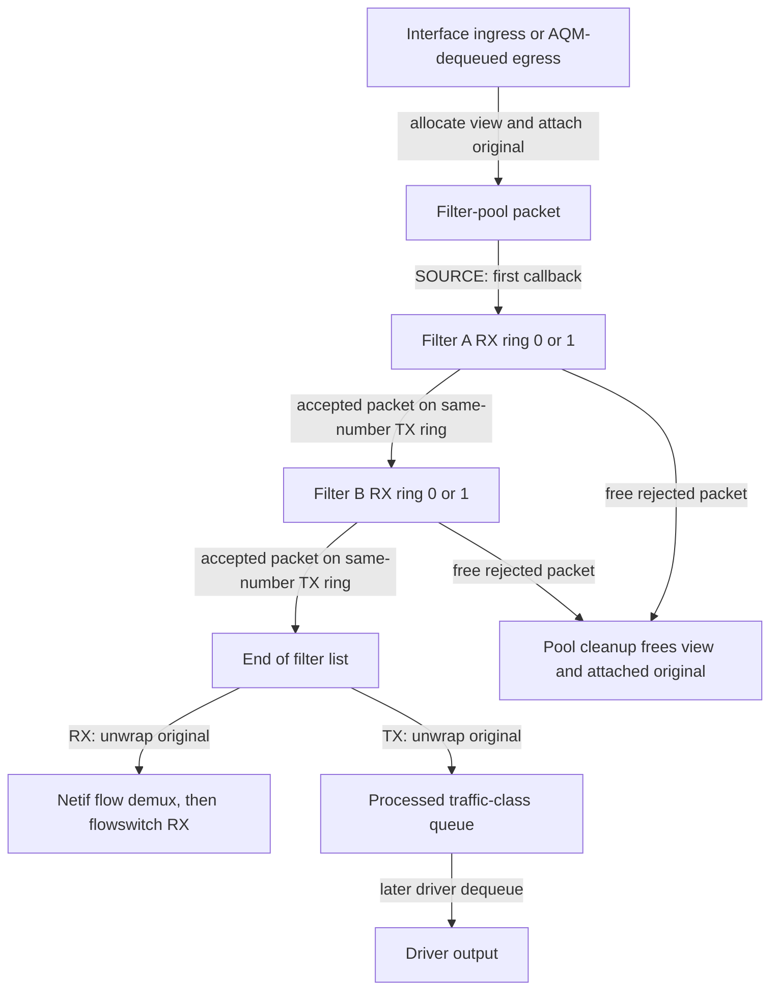

# Skywalk netif filters and packet reinjection

[Networking](README.md) · [Netif queues and driver servicing](skywalk-netif-links-queues-and-scheduling.md) · [Agents and traffic rules](skywalk-netif-agents-and-traffic-rules.md) · [Channel ABI and readiness](skywalk-channel-abi-and-readiness.md)

A netif filter intercepts interface packets, passes a view of each packet through an ordered sequence of filter adapters, and resumes the original RX or TX path only after the last filter. A userspace filter receives packets on channel RX rings and returns accepted packets on channel TX rings. The ring names describe transfer between kernel and filter process; the ring **number** separately identifies ingress or egress traffic. This chapter follows the local `xnu-12377.121.6` implementation, including native packets, compatibility mbufs, copied filter views, callback references and teardown. Socket content filtering, PF policy evaluation and BPF capture are separate mechanisms.

## 1. Objects and the two meanings of direction

| Object or field | State and ownership |
|---|---|
| `nx_netif.nif_filter_list`, `nif_filter_lock` | Ordered callback list and its mutex. Insertion is at the tail; both packet directions traverse the same order. |
| `netif_filter` | Nexus port, list linkage, callback/context and `nf_refcnt` for callbacks executing after the list lock is dropped. |
| `nexus_netif_adapter.nifna_filter` | The filter adapter's entry in that callback list. Creation of an adapter and activation of its filter are separate stages. |
| `nif_filter_pp` | Packet pool shared by this netif's filter adapters. It holds the copied view and metadata that retain the underlying packet or mbuf. |
| `nif_tx_processed_pktq[]` / `nif_tx_processed_mbq[]` | Per-traffic-class queues of accepted original output objects awaiting another driver dequeue. These are separate from the interface AQM queues. |
| `nif_filter_vp_cnt` / `nif_filter_cnt` | Number of filter adapters created / number attached to the packet path. Neither counter is the number of queued packets. |

Sources: [`netif_filter`](../../../xnu/bsd/skywalk/nexus/netif/nx_netif.h#L43-L51), [`netif filter state`](../../../xnu/bsd/skywalk/nexus/netif/nx_netif.h#L303-L315), [`adapter count distinction`](../../../xnu/bsd/skywalk/nexus/netif/nx_netif_filter_vp.c#L620-L625).

Each filter has two RX and two TX rings:

| Traffic direction | Kernel delivers to filter process | Filter process reinjects |
|---|---|---|
| Ingress, toward local receivers | Filter RX ring 0 | Filter TX ring 0 |
| Egress, toward interface output | Filter RX ring 1 | Filter TX ring 1 |

`NETIF_FILTER_RX` and `NETIF_FILTER_TX` select traffic direction. `NETIF_FILTER_SOURCE` identifies entry from the interface path; `NETIF_FILTER_INJECT` identifies return from a filter channel. The TX-sync callback chooses direction from its ring ID and resumes **after its own filter**, rather than restarting at the list head. [`Flags`](../../../xnu/bsd/skywalk/nexus/netif/nx_netif.h#L576-L579), [`ring definitions`](../../../xnu/bsd/skywalk/nexus/netif/nx_netif_filter_vp.c#L33-L37), [`direction selection`](../../../xnu/bsd/skywalk/nexus/netif/nx_netif_filter_vp.c#L390-L402).



The figure shows two filters as an example. Ring delivery may instead drop a suffix when space runs out; an accepted packet still faces ordinary receive/output checks.

## 2. Admission, allocation and activation

`nx_netif_filter_init()` requires the interface's netif-agent attachment capability, rejects low-latency netifs, and permits Ethernet, UTUN and IPsec interface families. It creates the list lock and processed queues and sets `INITIALIZED`; it does not set `ENABLED`. Device-adapter activation enables filters and netif flows. Native deactivation clears active state and disables them before waiting for an active interface starter; compatibility deactivation additionally coordinates its poller and receive interception. [`Initialization`](../../../xnu/bsd/skywalk/nexus/netif/nx_netif_filter.c#L300-L329), [`native activation/off`](../../../xnu/bsd/skywalk/nexus/netif/nx_netif.c#L2161-L2203), [`compatibility off`](../../../xnu/bsd/skywalk/nexus/netif/nx_netif_compat.c#L566-L613).

A filter flow first supplies a bound nexus port and random key, as explained in [agent-created identities](skywalk-netif-agents-and-traffic-rules.md#3-binding-a-flow-does-not-activate-a-packet-receiver). On a non-device/non-host port, adapter lookup checks the binding through `nx_port_alloc()` and chooses `netif_filter_na_create()` for `CHMODE_FILTER`. That constructor requires user-packet-pool mode, rejects event-ring mode, verifies filter initialization and retains both the netif and an interface I/O reference. General channel mapping, process binding, slot validation and close rules remain those in the [channel ABI](skywalk-channel-abi-and-readiness.md). [`Adapter selection`](../../../xnu/bsd/skywalk/nexus/netif/nx_netif.c#L3244-L3273), [`filter admission and references`](../../../xnu/bsd/skywalk/nexus/netif/nx_netif_filter_vp.c#L516-L565), [`callbacks and interface reference`](../../../xnu/bsd/skywalk/nexus/netif/nx_netif_filter_vp.c#L590-L607).

The filter arena uses ordinary Skywalk schema, ring, slot and packet metadata regions. Slot descriptors must be writable for user-pool transfer, but packet buffers are configured **user-read-only** through `PP_REGION_CONFIG_BUF_UREADONLY`. Default buffer size is the larger of maximum interface MTU plus a VLAN header and 2048 bytes; failure to obtain maximum MTU falls back to `ETHERMTU`. The default pool target is 8192 objects, with development/debug overrides. The pool is created lazily under the surrounding netif setup serialization and reused by later filter arenas. [`Region layout and buffer protection`](../../../xnu/bsd/skywalk/nexus/netif/nx_netif_filter_vp.c#L223-L304), [`pool defaults and controls`](../../../xnu/bsd/skywalk/nexus/netif/nx_netif_filter_vp.c#L40-L56), [`pool creation`](../../../xnu/bsd/skywalk/nexus/netif/nx_netif_filter_vp.c#L308-L354).

The memory-construction helper has a narrower error contract than its calls might suggest. `netif_filter_na_mem_new()` returns a region-setup error or `ENOMEM` when `pp_create()` fails. After `skmem_arena_create_for_nexus()` stores its result and error, however, the helper only asserts that a null arena has a nonzero error and then returns zero. That literal return does not establish that an arena was created or that its error propagated through this helper. [`Allocation and return boundary`](../../../xnu/bsd/skywalk/nexus/netif/nx_netif_filter_vp.c#L318-L353).

Adapter activation calls `nx_netif_filter_add()`: reject a duplicate port, allocate a callback entry, append it to the list, increment the count, then adjust the interface filter/TSO state. The adjustment uses the interface attachment I/O reference held through netif. Adding a filter changes where newly intercepted traffic goes; it does not reconstruct the route already traversed by a packet retained in another filter. [`Activation`](../../../xnu/bsd/skywalk/nexus/netif/nx_netif_filter_vp.c#L178-L205), [`list insertion and TSO update`](../../../xnu/bsd/skywalk/nexus/netif/nx_netif_filter.c#L177-L218).

## 3. The filter view owns an original packet or mbuf

The conversion routines allocate a new packet from `nif_filter_pp` without sleeping, copy a bounded packet view, and keep the original object attached. This allows a large receive packet to be inspected through a truncated view without discarding its complete original contents:

- Native packet input uses `pkt_pkt` plus `PKT_F_PKT_DATA`. A packet already carrying another packet attachment is rejected by an assertion; arbitrary chains of filter wrappers are not supported.
- Compatibility TX input uses `pkt_mbuf` plus `PKT_F_MBUF_DATA`.
- Compatibility RX may already be a packet carrying an mbuf. The new filter view copies bytes from that attached mbuf and retains the original compatibility packet as its `pkt_pkt`.

Sources: [`nonblocking allocation`](../../../xnu/bsd/skywalk/nexus/netif/nx_netif_util.c#L33-L48), [`mbuf conversion`](../../../xnu/bsd/skywalk/nexus/netif/nx_netif_util.c#L128-L235), [`packet conversion and nested-attachment restriction`](../../../xnu/bsd/skywalk/nexus/netif/nx_netif_util.c#L306-L438), [`attachment fields`](../../../xnu/bsd/skywalk/packet/packet_var.h#L368-L382).

TX views reserve interface headroom; RX views start with no added headroom. UTUN/IPsec use zero L2 length. Ethernet views record link-layer/VLAN metadata. An oversized view is capped at default buffer size minus headroom and marked `PKT_F_TRUNCATED`. Conversion also handles receive FCS length and rejects a transmit FCS or an impossibly short FCS-bearing packet. The implementation explicitly leaves a checksum-offload limitation: copied filter bytes need not have finalized checksums. A view is not proof that every byte of a large original was available for inspection. [`Copy length, FCS and checksum boundary`](../../../xnu/bsd/skywalk/nexus/netif/nx_netif_util.c#L331-L427).

Reinjection does not copy the view's bytes back over the original. The native inverse conversion clears the attachment, frees the view and returns the original pointer:

[nx_netif_util.c:466–481](../../../xnu/bsd/skywalk/nexus/netif/nx_netif_util.c#L466-L481):

<!-- source-excerpt: ../../../xnu/bsd/skywalk/nexus/netif/nx_netif_util.c#L466-L481 -->
```c
nx_netif_filter_pkt_to_pkt(struct nexus_netif_adapter *nifna,
    struct __kern_packet *fpkt, uint32_t flags)
{
#pragma unused (nifna)
	struct __kern_packet *pkt;

	__check_convert_flags(flags);
	ASSERT((fpkt->pkt_pflags & PKT_F_PKT_DATA) != 0);
	ASSERT((fpkt->pkt_pflags & PKT_F_MBUF_DATA) == 0);

	pkt = fpkt->pkt_pkt;
	ASSERT(pkt != NULL);
	KPKT_CLEAR_PKT_DATA(fpkt);
	nx_netif_free_packet(fpkt);
	return pkt;
}
```

The mbuf inverse follows the same pattern. Clearing the attachment before freeing prevents the pool destructor from freeing the object being returned. Conversely, freeing a rejected filter packet while its attachment remains intact also releases the underlying mbuf or packet. `pp_metadata_fini()` explicitly permits one packet-attachment recursion level. [`Mbuf unwrapping`](../../../xnu/bsd/skywalk/nexus/netif/nx_netif_util.c#L264-L278), [`attachment destruction`](../../../xnu/bsd/skywalk/packet/pbufpool.c#L2210-L2254).

For a hypothetical 9000-byte original and a 2048-byte filter buffer with zero headroom, the view can expose only the first 2048 bytes and is marked truncated. If accepted through the chain, unwrapping recovers the original 9000-byte object; it does not turn it into a 2048-byte packet. If dropped by freeing the view, both objects are released. This example ignores FCS adjustments and illustrates the ownership contract, not a configured product MTU.

Chain conversion can partially succeed. Each input element is detached from its original chain before conversion; failed elements are freed and counted as drops, while successful views form a new chain. A nonnull result therefore does not mean every original packet survived. [`Native chain conversion`](../../../xnu/bsd/skywalk/nexus/netif/nx_netif_util.c#L441-L463), [`mbuf counterpart`](../../../xnu/bsd/skywalk/nexus/netif/nx_netif_util.c#L238-L261).

## 4. Callback references let the list lock be dropped

`nx_netif_filter_inject()` takes `nif_filter_lock` and selects one of three results:

1. If disabled, free the entire incoming chain and return `ENETDOWN`.
2. For a source call, select the first filter and increment its callback reference. If a preceding lockless count check raced with removal of the last filter, free the chain and return `ENOENT`.
3. For a reinjection call, select the successor of the supplied filter. Retain that successor if present; a null successor means continue through the default RX/TX callback.

The default callback means “finished traversing the filters”; it is not the global default-drop policy. [`Selection and consuming errors`](../../../xnu/bsd/skywalk/nexus/netif/nx_netif_filter.c#L80-L135).

The callback runs without the list lock, then its reference is released under that lock:

[nx_netif_filter.c:157–173](../../../xnu/bsd/skywalk/nexus/netif/nx_netif_filter.c#L157-L173):

<!-- source-excerpt: ../../../xnu/bsd/skywalk/nexus/netif/nx_netif_filter.c#L157-L173 -->
```c

	/*
	 * No locks are held while calling callbacks.
	 */
	if (f != NULL) {
		err = f->nf_cb_func(f->nf_cb_arg, pkt_chain, flags);
	} else {
		err = nx_netif_default_cb(nifna, pkt_chain, flags);
	}
	lck_mtx_lock(&nif->nif_filter_lock);
	if (f != NULL) {
		if (--f->nf_refcnt == 0) {
			wakeup(&f->nf_refcnt);
		}
	}
	lck_mtx_unlock(&nif->nif_filter_lock);
	return err;
```

This reference covers the callback invocation. It does **not** remain held for the entire time that userspace retains a delivered packet. Channel/adapter lifetime and ring synchronization protect later calls using `nifna_filter`; list references protect a callback entry while delivery executes outside the list mutex. The two responsibilities should not be conflated. [`Filter TX callback and adapter ownership`](../../../xnu/bsd/skywalk/nexus/netif/nx_netif_filter_vp.c#L371-L480), [channel lifetime](skywalk-lifecycles.md#defunct-serializes-kernel-work-and-revokes-mapped-access).

Removal first unlinks the filter so new selection cannot acquire it. If it was the last filter, it purges processed TX queues. It then sleeps until already-selected callbacks release their references, frees the entry and reverses the interface filter/TSO adjustment. `msleep()` releases/reacquires the mutex; callbacks can acquire it to decrement the reference and wake the remover. [`Removal and queue purge`](../../../xnu/bsd/skywalk/nexus/netif/nx_netif_filter.c#L221-L277).

[nx_netif_filter.c:254–265](../../../xnu/bsd/skywalk/nexus/netif/nx_netif_filter.c#L254-L265):

<!-- source-excerpt: ../../../xnu/bsd/skywalk/nexus/netif/nx_netif_filter.c#L254-L265 -->
```c
	lck_mtx_lock(&nif->nif_filter_lock);
	STAILQ_REMOVE(&nif->nif_filter_list, nf, netif_filter, nf_link);
	if (--nif->nif_filter_cnt == 0) {
		nx_netif_filter_flushq(nif);
	}
	while (nf->nf_refcnt > 0) {
		DTRACE_SKYWALK1(wait__refcnt, struct netif_filter *, nf);
		(void) msleep(&nf->nf_refcnt,
		    &nif->nif_filter_lock, (PZERO + 1),
		    __FUNCTION__, NULL);
	}
	STATS_INC(nifs, NETIF_STATS_FILTER_REMOVE);
```

`nx_netif_filter_disable()` merely clears `ENABLED` under the mutex. It does not itself wait for every callback, destroy channel rings or free the pool. The wider adapter teardown performs the other quiescence work. Final filter teardown requires disabled state and zero filters, closes the shared pool only after that quiescence boundary, destroys processed queues and finally destroys the lock. [`Enable/disable`](../../../xnu/bsd/skywalk/nexus/netif/nx_netif_filter.c#L378-L410), [`final pool cleanup`](../../../xnu/bsd/skywalk/nexus/netif/nx_netif_filter.c#L348-L375).

## 5. Delivery to userspace and accepted-packet return

`netif_filter_deliver()` serializes the selected filter RX ring with `kr_enter()` and establishes synchronization protection. A drop-mode ring consumes and frees the whole chain with `ENXIO`. Otherwise it attaches packets one by one to available slots, clearing packet-chain linkage, advances the last successful slot and notifies after leaving ring protection. A full ring frees the unplaced suffix. The callback still returns zero in that partial-delivery case; zero reports completion of this delivery attempt, not lossless forwarding. [`Ring delivery`](../../../xnu/bsd/skywalk/nexus/netif/nx_netif_filter_vp.c#L75-L144).

The user can detach an RX packet and submit it on the same-number TX ring. Generic channel synchronization first internalizes and validates userspace slot/metadata changes. The filter's TX-sync callback then:

1. Chooses ingress/egress from the TX ring ID and sets `NETIF_FILTER_INJECT`.
2. Scans available slots; missing handles after internalization and zero-length packets take distinct accounting/skip paths.
3. Detaches valid packets from slots and finalizes each after detachment.
4. Builds separate chains by traffic class.
5. Advances slots for the successful work and injects each nonempty class chain after this filter.

Class chains are submitted in ascending traffic-class index order. This batching need not preserve the global interleaving of packets from different classes. Reinjection errors are traced but not propagated as the TX-sync return, which is zero. If no valid packet was collected, the callback returns before its `kern_channel_advance_slot()` call; do not infer identical progress for a ring containing only invalid/zero-length entries. [`TX synchronization`](../../../xnu/bsd/skywalk/nexus/netif/nx_netif_filter_vp.c#L371-L480).

The local example in `skt_filter.c` processes both RX rings, moves received handles to the corresponding TX ring, and syncs TX after draining a batch. It configures both user-pool and filter attributes and uses the binding key obtained from flow creation. That example illustrates pass-through ownership; it is not a byte-rewriting implementation. [`Pass-through loop`](../../../xnu/tests/skywalk/skt_filter.c#L692-L732), [`port and channel setup`](../../../xnu/tests/skywalk/skt_filter.c#L736-L800).

## 6. RX resumes after filtering; TX waits in processed queues

### Ingress

`netif_receive()` checks interface input-disable state before filtering. With filters attached it converts the chain and submits views to the first filter. `packet_is_filterable()` currently always returns true, so the apparent passthrough branch is reserved structure, not an active jumbo-packet exemption. The code specifically expects truncated filter views to cover large receive packets. [`Receive interception`](../../../xnu/bsd/skywalk/nexus/netif/nx_netif.c#L3504-L3621).

At the chain's end, `nx_netif_filter_rx_cb()` unwraps originals, runs netif virtual-port demultiplexing with `NETIF_FLOW_INJECT`, and passes the unmatched remainder to `netif_inject_rx()`. That helper requires flowswitch ownership of the device adapter, serializes RX ring 0, checks drop mode, invokes `na_rx` under synchronization protection and accounts mitigation data. Without that ownership or with a disabled ring it frees the chain. Missing `na_rx` is also a consuming drop. The hardcoded ring 0 is an explicit local RSS limitation. This route bypasses the initial filter interception rather than recursively calling `netif_receive()`. [`RX continuation`](../../../xnu/bsd/skywalk/nexus/netif/nx_netif.c#L3961-L3995), [`RX serialization and ownership`](../../../xnu/bsd/skywalk/nexus/netif/nx_netif.c#L3900-L3955).

### Egress

Native and compatibility dequeue hooks run **after** new output was dequeued from AQM. If neither filters nor the applicable default-drop policy require interception, they leave that result alone. Otherwise they consume those newly dequeued packets into filtering and replace the returned chain with packets already accepted into the processed queues. Native uses packet chains; compatibility uses mbuf chains. This extra queue is why a driver can receive an earlier filtered packet while a newer AQM packet is still waiting in userspace. [`Native dequeue`](../../../xnu/bsd/skywalk/nexus/netif/nx_netif_filter_native.c#L245-L291), [`compatibility dequeue`](../../../xnu/bsd/skywalk/nexus/netif/nx_netif_filter_compat.c#L243-L290).

At the chain's end, `nx_netif_filter_tx_cb()` unwraps to the appropriate original representation, obtains the service class, enqueues into its processed traffic-class queue and calls `ifnet_start()` to request more driver servicing. It does not enqueue back into AQM and does not claim device completion. [`TX continuation`](../../../xnu/bsd/skywalk/nexus/netif/nx_netif.c#L4002-L4048).

Processed queues have their own locks and an initial limit of 2048 packets per queue. The enqueue rejection predicate is **existing length greater than the limit**, not `existing + incoming > limit`. Thus a chain can take a queue beyond its nominal limit, and the next enqueue can then be rejected. Rejection frees the entire incoming chain and returns `ENOBUFS`. [`Queue initialization`](../../../xnu/bsd/skywalk/nexus/netif/nx_netif_filter.c#L280-L297), [`native enqueue predicate`](../../../xnu/bsd/skywalk/nexus/netif/nx_netif_filter_native.c#L120-L158), [`mbuf counterpart`](../../../xnu/bsd/skywalk/nexus/netif/nx_netif_filter_compat.c#L120-L157).

An unspecified service class dequeues from highest traffic class downward; a specified class selects its single traffic-class queue, with invalid values normalized to best effort. Packet and byte limits are checked before removing the next object, so the final packet can take the byte total over the requested byte limit. Returned counts are recomputed from the processed chain. A nonempty processed result suppresses the original AQM error; when nothing is available, an existing AQM error takes precedence over the new `EAGAIN`. Queue-length queries separately add processed counts to AQM counts. [`Selection and limits`](../../../xnu/bsd/skywalk/nexus/netif/nx_netif_filter_native.c#L61-L117), [`length and return contract`](../../../xnu/bsd/skywalk/nexus/netif/nx_netif_filter_native.c#L160-L243).

## 7. Default drop, teardown and verification boundaries

Default drop is a global switch with two accepted values. Changing it requires root or `com.apple.private.skywalk.default-drop`; the switch alone does not attach a filter. TX's `NETIF_DEFAULT_DROP_ENABLED()` additionally requires filter initialization. RX's `netif_receive()` uses a distinct condition: no attached filter, global switch set, and not a low-latency netif. Keep those predicates separate when reasoning about an unsupported interface family. With existing filters, an empty tail of the chain still takes the normal continuation. [`Sysctl admission`](../../../xnu/bsd/skywalk/nexus/netif/nx_netif_filter.c#L33-L65), [`TX macro`](../../../xnu/bsd/skywalk/nexus/netif/nx_netif.h#L222-L224), [`RX predicate`](../../../xnu/bsd/skywalk/nexus/netif/nx_netif.c#L3621-L3632).

Filter-adapter destruction unbinds/frees its port, decrements adapter count, drops the interface I/O reference and releases the netif. Pool destruction is intentionally deferred to final netif filter teardown; the nearby TODO must not be described as an implemented per-adapter pool release. Port unbinding, callback removal, ring/pool reclamation and final storage release are different events. [`Adapter destructor`](../../../xnu/bsd/skywalk/nexus/netif/nx_netif_filter_vp.c#L483-L513), [`deferred pool close`](../../../xnu/bsd/skywalk/nexus/netif/nx_netif_filter.c#L348-L375).

This trace inspected native/compat interception, virtual filter delivery, conversion/attachment cleanup, default continuation and callback removal. The in-tree filter test provides a privileged multiprocess/network setup and pass-through example; it was not executed. Generic bad-ring/internalization defenses are covered in the channel and packet companions rather than exhaustively re-audited here. The decisions of an external userspace filter, all detach interleavings, product entitlement grants and hardware output completion remain outside the demonstrated local path.

<!-- BEGIN PLATYDOC DOCUMENTATION LICENSE -->
Original Platydoc text and diagrams are licensed under [CC BY 4.0](https://creativecommons.org/licenses/by/4.0/). Quoted source code and third-party material retain their respective licenses.
<!-- END PLATYDOC DOCUMENTATION LICENSE -->
