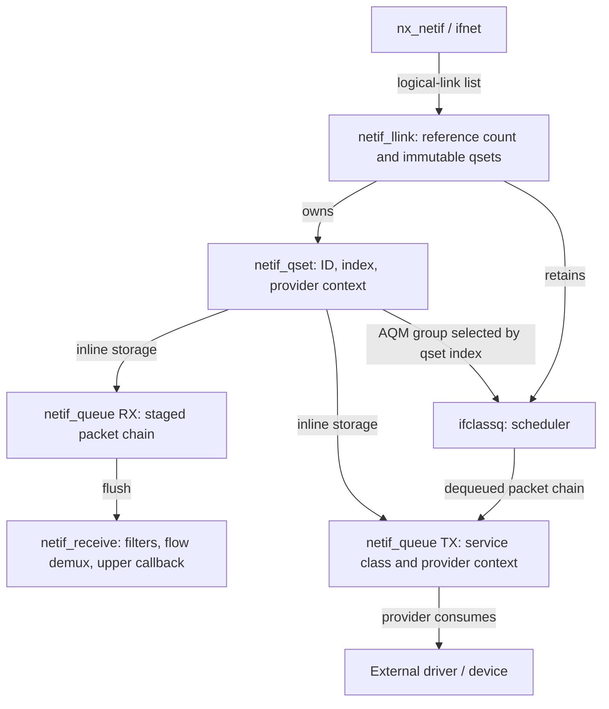
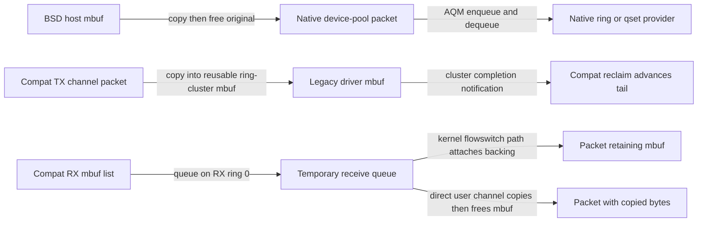

# Skywalk netif: logical links, queues, and driver servicing

[Networking](README.md) · [Skywalk overview](skywalk.md) · [Controllers and providers](skywalk-controller-provider-and-port-lifetime.md) · [Packet scheduling and FQ-CoDel](interface-packet-scheduling-and-fq-codel.md)

A netif nexus connects Skywalk packet objects to an interface provider. Its work includes selecting a queue, asking a provider to service queued output, receiving packets, and keeping those activities separate from channel synchronization and final device completion. This chapter follows the local implementation in `xnu-12377.121.6`. Native ring providers, native logical-link providers and compatibility providers have different transfer contracts; the presence of a channel alone does not select one universal path.

The [filter and reinjection companion](skywalk-netif-filters-and-reinjection.md) follows interception, retained original packets and processed TX queues. [Netif agents and traffic rules](skywalk-netif-agents-and-traffic-rules.md) explains how assigned ports become receive callbacks, and how published Ethernet/INET rules supply the qset hints used here.

## 1. Objects: a logical link is not a ring or a hardware DMA queue

The hierarchy begins at `nx_netif`, which records the nexus, `ifnet`, device/host bindings, optional flowswitch, packet-copy operations, filtering/flow state and logical-link list. A device adapter supplies rings when the chosen provider uses the ring interface. Logical-link providers instead expose queue sets through the version-2 provider callback table. See [`nx_netif`](../../../xnu/bsd/skywalk/nexus/netif/nx_netif.h#L266-L339) and [`kern_nexus_netif_provider_init`](../../../xnu/bsd/skywalk/nexus/os_nexus.h#L885-L900).

| Object | State that matters | Relationship and protection |
| --- | --- | --- |
| `netif_llink` | External `nll_link_id`, generated `nll_link_id_internal`, state, reference count, default qset, optional `nll_ifcq` | Membership is protected by `nif_llink_lock`; qset topology is fixed for the link's lifetime. |
| `netif_qset` | Parent link, encoded ID/index, default/AQM/low-latency flags, provider context, RX/TX counts, `nqs_ifcq` | Owns an inline array of `netif_queue`; retaining a qset retains its parent link. |
| `netif_queue` | Parent qset, `nq_pktq`, provider context, service class, RX/init flags, counters and mutex | Local RX staging and provider identity. Its existence is not evidence of a physical device queue or its DMA format. |
| `ifclassq` | Scheduler state, references, packet/byte counts and lock | An AQM qset points to a scheduler **group** within this object, rather than owning a separate scheduler per driver queue. |
| `__kern_channel_ring` | Slot metadata and producer/consumer indices, busy/drop state, pending notification/doorbell counters | Used by ring providers; `kr_enter()` serializes ring servicing. |

Sources: [`link/qset/queue layouts`](../../../xnu/bsd/skywalk/nexus/netif/nx_netif.h#L111-L189), [`scheduler layout`](../../../xnu/bsd/net/classq/if_classq.h#L118-L164), [ring ownership](skywalk-lifecycles.md#which-protection-prevents-which-race).



The RX queue array precedes the TX queue array. Use the actual `NETIF_QSET_RX_QUEUE`/`NETIF_QSET_TX_QUEUE` macros when interpreting offsets: TX index zero is after all RX elements. The nearby array-layout comment's second range is less precise than those macros. The encoded qset ID uses the generated internal link ID in bits 16–31 and the qset index in bits 0–15; it is not the external provider link ID. [`Array addressing and ID encoding`](../../../xnu/bsd/skywalk/nexus/netif/nx_netif.h#L128-L155).

Retaining a qset keeps all its containing link storage alive. There is no independent qset reference counter:

[`nx_netif_llink.c:148–169`](../../../xnu/bsd/skywalk/nexus/netif/nx_netif_llink.c#L148-L169):

<!-- source-excerpt: ../../../xnu/bsd/skywalk/nexus/netif/nx_netif_llink.c#L148-L169 -->
```c
SK_NO_INLINE_ATTRIBUTE
void
nx_netif_qset_retain(struct netif_qset *qset)
{
	/*
	 * Logical link is immutable, i.e. Queue Sets can't added/removed
	 * from it. We will rely on this property to simply acquire a refcnt
	 * on the logical link, which is the parent structure of a qset.
	 */
	nx_netif_llink_retain(qset->nqs_llink);
}

SK_NO_INLINE_ATTRIBUTE
void
nx_netif_qset_release(struct netif_qset **pqset)
{
	struct netif_qset *qset = *pqset;
	struct netif_llink *__single llink = qset->nqs_llink;

	*pqset = NULL;
	nx_netif_llink_release(&llink);
}
```

A final link release requires `NETIF_LLINK_STATE_DESTROYED`, destroys its qsets and driver queues, releases scheduler references and frees the link. Destroying each driver queue verifies that its packet queue is empty. A reference protects storage, not continued eligibility for enqueue or provider service. [`Final release`](../../../xnu/bsd/skywalk/nexus/netif/nx_netif_llink.c#L98-L130), [`qset destruction`](../../../xnu/bsd/skywalk/nexus/netif/nx_netif_llink.c#L173-L234), [`empty-queue invariant`](../../../xnu/bsd/skywalk/nexus/netif/nx_netif_llink.c#L372-L405).

## 2. Link construction and partial provider initialization

`nx_netif_llink_init()` enables the hierarchy only for native interfaces; development/debug builds can disable it. A legacy native ring provider receives a synthesized default link/qset based on its ring counts. A logical-link provider supplies the configuration. The synthesized low-latency variant omits AQM, whereas ordinary default operation requests AQM. Compatibility adapters do not acquire this hierarchy merely because they expose channel rings. [`Initialization gates`](../../../xnu/bsd/skywalk/nexus/netif/nx_netif_llink.c#L823-L855), [`default configuration`](../../../xnu/bsd/skywalk/nexus/netif/nx_netif_llink.c#L517-L563).

`kern_nexus_netif_llink_add()` requires an attached nexus, validates the nondefault configuration, then enters `nx_netif_llink_add()`. Validation checks default-link flag agreement, a nonzero qset count, a supplied qset array, duplicate default qsets, nonzero TX counts and the four-queue WMM condition. There is a source limitation worth preserving: it does **not** reject the absence of any default qset before returning success. Construction later `VERIFY`s that one was supplied. A valid configuration must therefore satisfy more than the validator's explicit error returns. [`Public add`](../../../xnu/bsd/skywalk/nexus/netif/nx_netif.c#L4596-L4620), [`validator`](../../../xnu/bsd/skywalk/nexus/netif/nx_netif_llink.c#L882-L929), [`construction invariant`](../../../xnu/bsd/skywalk/nexus/netif/nx_netif_llink.c#L324-L369).

Construction under the link-list write lock allocates the link/qsets, assigns IDs, initializes queues and adds the link to the list. The default AQM link shares `ifp->if_snd`; another AQM link allocates its own `ifclassq`. Each AQM qset retains that scheduler and installs the group identified by its index. Driver-managed scheduling assigns four TX queues the BE, BK, VI and VO service classes; other scheduling models use unspecified service. [`Scheduler sharing`](../../../xnu/bsd/skywalk/nexus/netif/nx_netif_llink.c#L204-L285), [`link insertion`](../../../xnu/bsd/skywalk/nexus/netif/nx_netif_llink.c#L409-L441).

The code then drops the list lock before invoking provider initialization. Local list insertion and successful external initialization are distinct events:

[`nx_netif_llink.c:465–482`](../../../xnu/bsd/skywalk/nexus/netif/nx_netif_llink.c#L465-L482):

<!-- source-excerpt: ../../../xnu/bsd/skywalk/nexus/netif/nx_netif_llink.c#L465-L482 -->
```c
	llink = nx_netif_llink_create_locked(nif, llink_init);
	lck_rw_unlock_exclusive(&nif->nif_llink_lock);
	VERIFY(llink != NULL);
	ASSERT((llink->nll_flags & NETIF_LLINK_FLAG_DEFAULT) == 0);
	err = nx_netif_llink_ext_init_queues(nif->nif_nx, llink);
	if (err != 0) {
		lck_rw_lock_exclusive(&nif->nif_llink_lock);
		nx_netif_llink_destroy_locked(nif, &llink);
		lck_rw_unlock_exclusive(&nif->nif_llink_lock);
	} else {
		/*
		 * Increment reference to keep the same pattern as default llink
		 * refcnt is 2 after this retain.
		 */
		nx_netif_llink_retain(llink);
		*pllink = llink;
	}
	return err;
```

For each qset, `nxnpi_qset_init` supplies a provider-owned context. RX and then TX `nxnpi_queue_init` calls receive that context and supply per-queue contexts. The code sets `EXT_INITED` only after each successful callback. On failure, `nx_netif_llink_ext_fini_queues()` calls fini only for successfully initialized queues, then for initialized qsets. The add path subsequently marks the link destroyed, removes list membership and releases it. This is partial-construction cleanup, not a reverse replay of every attempted callback; the provider's failing callback must obey its own failure contract. [`Initialization and success flags`](../../../xnu/bsd/skywalk/nexus/netif/nx_netif_llink.c#L982-L1043), [`conditional fini`](../../../xnu/bsd/skywalk/nexus/netif/nx_netif_llink.c#L1046-L1081).

For example, if qset initialization and RX queue 0 succeed but TX queue 0 initialization fails, RX queue 0 gets a fini call and the qset gets a fini call; the failed TX queue has no success bit and is skipped. The local queue structures are subsequently destroyed. This example assumes those are the only queues, and does not imply a callback order across multiple qsets beyond the source list traversal.

## 3. Queue selection and admission do not imply transmission

`nx_netif_find_qset()` decodes a hint and searches links/qsets under the shared list lock. A matching qset is retained before unlocking. An absent or unusable hint normally falls back to the default qset; a destroyed default link can produce null. A development experiment can choose a random qset. `nx_netif_find_qset_with_pkt()` obtains hints from Ethernet or INET traffic rules, or preserved Ethernet packet metadata; no matching rule can leave selection to the caller. The rule families are mutually exclusive on an interface. [`Hint lookup`](../../../xnu/bsd/skywalk/nexus/netif/nx_netif_llink.c#L655-L787), [`packet rule selection`](../../../xnu/bsd/skywalk/nexus/netif/nx_netif_llink.c#L791-L819).

`netif_qset_enqueue()` is the AQM path used by the flowswitch. It frees the incoming chain if the link is already destroyed. Otherwise it passes either a same-service-class chain or individual packets to `ifnet_enqueue_pkt[_chain]()`, gathering flow-control and drop counts. These callees consume ownership even on their normal rejection paths. `EQFULL` can mean a packet **was queued** but the producer should slow down; `pkt_drop` distinguishes that result from a drop. The wrapper can finally return `EIO` because some packets were flow controlled or dropped even when other packets remain queued. Retrying the original chain would reuse consumed objects. [`Qset enqueue`](../../../xnu/bsd/skywalk/nexus/netif/nx_netif_llink.c#L580-L652), [`interface consumption`](../../../xnu/bsd/net/dlil.c#L3420-L3480), [scheduler result table](interface-packet-scheduling-and-fq-codel.md#3-enqueue-results-carry-ownership-and-feedback).

Queue choice and admission are separate from the notification that asks the provider to pull packets. They are also separate from eventual device completion. The [flowswitch overview](skywalk.md#concrete-flowswitch-transmit-path) explains the preceding user-pool/device-pool conversion.

## 4. Native output: doorbells, ring refill and queue dequeue

`netif_transmit()` decides whether the caller may invoke the native doorbell immediately or should request `ifnet_start()`. Reasons for the starter thread include compatibility/virtual devices, token-bucket shaping, delayed start, pacing, RX-notify or asynchronous-transmit context, certain host calls during synchronization, an already active starter and insufficient remaining kernel stack. Interface flow control suppresses direct service. This is an execution-context decision, not a choice of transport protocol. [`Starter decision`](../../../xnu/bsd/skywalk/nexus/netif/nx_netif.c#L4060-L4122).

For an active native device adapter, `nx_netif_doorbell_internal()` selects one of two contracts:

- **Logical-link provider:** walk links and initialized qsets, calling `nx_tx_qset_notify()` with the provider qset context. The provider pulls through `kern_netif_queue_tx_dequeue()`. The local notification loop discards individual callback return values.
- **Ring provider:** use TX ring 0 for the doorbell request. `nx_netif_na_txsync()` separates reclaim/sync from doorbell work: it calls provider sync when requested, and either invokes the driver's doorbell from starter context or schedules the starter for an asynchronous request. Direct user channels take the sync-only branch.

Sources: [`doorbell dispatch`](../../../xnu/bsd/skywalk/nexus/netif/nx_netif.c#L1670-L1816), [`qset callback wrapper`](../../../xnu/bsd/skywalk/nexus/nexus_var.h#L650-L663).

`nx_netif_llink_notify_all()` holds `nif_llink_lock` shared while traversing links and invoking their qset notifications. These provider notifications therefore run inside the list-read interval, unlike the initialization and removal callbacks whose callers drop the list lock first. The callback context matters when reasoning about provider operations that also need to change the link list. [`Notification locking`](../../../xnu/bsd/skywalk/nexus/netif/nx_netif.c#L1684-L1697).

The ring-provider refill path does the following:

1. Validate limits, attachment and interface flow control; enter ring serialization and mark the thread as synchronizing.
2. Reject inactive/drop-mode state. Compute available slots using the sampled kernel tail and current ring head, including wraparound.
3. Bound dequeue by ring space and the native doorbell batch limit. If no space remains, set pending-doorbell state and return/reclaim with `EAGAIN`.
4. Dequeue AQM packets, attach each packet's metadata to a ring slot, clear packet-list linkage and advance `ckr_rhead`.
5. Invoke provider sync. Track whether more queued packets need another doorbell. Verify that every slot the provider reports consumed no longer contains valid metadata.

[`netif_ring_tx_refill()`](../../../xnu/bsd/skywalk/nexus/netif/nx_netif.c#L4206-L4406).

A busy ring is deliberately treated as an already serviced request, not a failed transmission:

[`nx_netif.c:4252–4259`](../../../xnu/bsd/skywalk/nexus/netif/nx_netif.c#L4252-L4259):

<!-- source-excerpt: ../../../xnu/bsd/skywalk/nexus/netif/nx_netif.c#L4252-L4259 -->
```c
	/*
	 * if the ring is busy, it means another dequeue is in
	 * progress, so ignore this request and return success.
	 */
	if (kr_enter(ring, canblock) != 0) {
		rc = 0;
		goto out;
	}
```

After sync, slot consumption has an explicit invariant:

[`nx_netif.c:4384–4396`](../../../xnu/bsd/skywalk/nexus/netif/nx_netif.c#L4384-L4396):

<!-- source-excerpt: ../../../xnu/bsd/skywalk/nexus/netif/nx_netif.c#L4384-L4396 -->
```c
	/*
	 * Verify that the driver has detached packets from the consumed slots.
	 */
	idx = ring->ckr_khead_pre;
	consumed = 0;
	while (idx != ring->ckr_khead) {
		struct __kern_slot_desc *ksd = KR_KSD(ring, idx);

		consumed++;
		VERIFY(!KSD_VALID_METADATA(ksd));
		idx = SLOT_NEXT(idx, ring->ckr_lim);
	}
	ring->ckr_khead_pre = ring->ckr_khead;
```

That assertion establishes transfer out of the ring's slot. It does not establish that the packet reached the wire or peer. Device DMA descriptors, completion queues and firmware scheduling remain provider-specific; use the [DMA guide](../drivers/dma-preparation-and-mapping.md) for the separately documented IOKit address/descriptor contracts.

With a logical-link provider, `kern_netif_queue_tx_dequeue()` checks link state, applies the native notify-context batch limit and passes the qset scheduler/group plus queue service class to `netif_deq_packets()`. The latter returns a packet chain and computes `pending` from queue length. `EAGAIN` can coexist with queued packets that cannot currently be dequeued, for example because of pacing. The public wrapper writes the output packet handle only when a nonnull chain exists; the caller should initialize its output rather than infer that every error clears it. [`Queue dequeue`](../../../xnu/bsd/skywalk/nexus/netif/nx_netif.c#L4548-L4581), [`AQM dequeue and pending count`](../../../xnu/bsd/skywalk/nexus/netif/nx_netif.c#L4148-L4184).

## 5. Host and compatibility paths change representation

The host adapter intercepts ordinary BSD output for a native interface. `nx_netif_host_output()` checks active/drop/size conditions, converts each mbuf to a newly allocated device-pool packet, propagates queue hints and expiry metadata, then enqueues it into AQM. `nx_netif_mbuf_to_kpkt()` copies bytes with the configured checksum-copy routine and finalizes packet metadata. The original mbuf is freed even on success. A failed prefix does not roll back packets already enqueued; remaining input mbufs are freed and the transmit kick still occurs. [`Host output`](../../../xnu/bsd/skywalk/nexus/netif/nx_netif_host.c#L435-L633), [`allocation/copy`](../../../xnu/bsd/skywalk/nexus/netif/nx_netif_host.c#L691-L756).

Compatibility TX travels in the opposite representation direction: `nx_netif_compat_na_txsync()` takes a reusable mbuf from the per-slot TX pool and `nx_netif_compat_xmit_frame()` activates its special ring cluster, copies packet bytes/checksum state, installs completion data and calls `dlil_output_handler()`. Lack of a replacement mbuf or a lower output error can stop progress before the requested ring head. The sync routine updates `ckr_khead` to the actual progress point and returns zero after reclamation; zero is not proof that every requested slot was sent. [`Compat TX sync`](../../../xnu/bsd/skywalk/nexus/netif/nx_netif_compat.c#L878-L1017), [`copy/output`](../../../xnu/bsd/skywalk/nexus/netif/nx_netif_compat.c#L1877-L1923).

The special mbuf cluster callback is the local completion bridge. It checks/clears the atomic TX-notify property and can generate `nx_netif_compat_tx_intr()`. `nx_netif_compat_tx_clean()` walks completed slots until it encounters an active cluster, replenishes missing mbufs and advances the kernel tail. Notification selection plus a second cleanup check addresses completion arriving around the request to be notified. This is not the Mach channel event-payload protocol described in the [readiness companion](skywalk-channel-abi-and-readiness.md). [`Cluster callback`](../../../xnu/bsd/skywalk/nexus/netif/nx_netif_compat.c#L215-L267), [`clean and notify`](../../../xnu/bsd/skywalk/nexus/netif/nx_netif_compat.c#L725-L856).



## 6. Receive: staging, flushing and the upper consumer

For native ring providers, `netif_rx_notify()` enters the ring, rejects stopped/detached state, synchronizes with the provider, samples the tail once and applies the input-rate limit. It detaches available packet metadata with `consume_pkts()` and passes the resulting chain to `netif_receive()`. That function can consume packets through filters, demultiplex a subset to netif flows, deliver the remainder through `na_rx`, or free them when input is disabled or no receiver exists. The callback may be a flowswitch path; it is not necessarily BSD protocol input. [`Native receive`](../../../xnu/bsd/skywalk/nexus/netif/nx_netif.c#L3739-L3819), [`upper delivery/drop`](../../../xnu/bsd/skywalk/nexus/netif/nx_netif.c#L3577-L3661).

For logical-link providers, `kern_netif_queue_rx_enqueue()` stages a packet chain on the RX queue. The `FLUSH` flag detaches all staged packets, resets the local queue and calls `netif_receive()` under synchronization protection. A destroyed link consumes/frees the incoming chain. The `count` argument is unused in this implementation; accounting derives from delivered work. Although `netif_queue` contains a mutex, this entry point does not acquire it around queue operations. Provider-side serialization and quiescence are therefore part of the call boundary; the local body is not evidence that concurrent arbitrary callers are safe. [`RX queue API body`](../../../xnu/bsd/skywalk/nexus/netif/nx_netif.c#L4507-L4545).

Compatibility receive always selects ring 0 in this snapshot. It queues incoming mbufs under `ckr_rx_queue` protection, drops incoming lists when the adapter is inactive or the queue is already beyond its allowance, then signals either polling or mitigation. The allowance is enlarged in the opportunistic-polling case to absorb wakeup latency; this is a pre-enqueue check and is not a hard post-enqueue length bound. [`Receive admission and context`](../../../xnu/bsd/skywalk/nexus/netif/nx_netif_compat.c#L1049-L1204).

During compat RX sync, released ring slots become available first. The code moves queued mbufs to a temporary queue under the queue lock, then unlocks before allocation/conversion. A kernel-only flowswitch attachment wraps retained mbuf backing; direct user delivery copies bytes into pool storage and frees the mbuf. Bad lengths are dropped. Allocation/space limits can leave unprocessed mbufs, which are prepended ahead of arrivals queued during the unlocked interval. This preserves ordering across partial import without holding the receive queue lock over copies. [`RX sync and partial batches`](../../../xnu/bsd/skywalk/nexus/netif/nx_netif_compat.c#L1274-L1519).

## 7. Mitigation and polling select when work runs

Mitigation coalesces ring notifications. `nx_netif_mit_{tx,rx}_intr()` increments request counts under a spin lock and wakes an eligible worker when one exists; without a mitigation worker it calls `nx_netif_common_intr()` directly. The common handler records a pending interrupt and calls the saved/redirected upper notification, not the currently intercepted callback, avoiding recursion. RX additionally uses thread-local notify protection because a provider's RX sync may itself notify. [`Interrupt-to-worker dispatch`](../../../xnu/bsd/skywalk/nexus/netif/nx_netif_mit.c#L430-L501), [`saved callback and recursion guards`](../../../xnu/bsd/skywalk/nexus/netif/nx_netif.c#L1884-L2002).

The regular mitigation worker snapshots the request counter, drops the spin lock, calls upstream processing and computes its mitigation interval. It delays for the configured interval, or backs off and increments requests when the ring is busy. It rechecks requests/termination before sleeping; rate-limited RX can arrange a timed wake rather than waiting indefinitely for another interrupt. The simple worker is a separate branch with its own shorter servicing loop. Cleanup sets terminating, wakes the worker and waits for its terminated flag before clearing ring pointers and destroying the lock. [`Regular worker`](../../../xnu/bsd/skywalk/nexus/netif/nx_netif_mit.c#L642-L751), [`simple worker`](../../../xnu/bsd/skywalk/nexus/netif/nx_netif_mit.c#L535-L638), [`cleanup`](../../../xnu/bsd/skywalk/nexus/netif/nx_netif_mit.c#L386-L427).

Compatibility opportunistic polling is a different feedback loop. The poll thread either processes already queued interrupt input or calls `if_input_poll()` to obtain a bounded mbuf batch. Each active iteration obtains an interface I/O reference so detach cannot dismantle its provider during the call. Packet/byte averages and high/low watermarks, constrained by sampling and mode hold times, select polling on/off. Both packet **and** byte predicates are tested in the transition branches. Mode changes are requested through `if_input_ctl()` after releasing the poll lock. A failed driver mode request is counted/logged; the helper still updates the local poll cycle rather than rolling back all state. [`Threshold decisions`](../../../xnu/bsd/skywalk/nexus/netif/nx_netif_poll.c#L99-L255), [`mode request`](../../../xnu/bsd/skywalk/nexus/netif/nx_netif_poll.c#L51-L92), [`poll thread and detach reference`](../../../xnu/bsd/skywalk/nexus/netif/nx_netif_poll.c#L301-L486).

## 8. Low-latency push and teardown boundaries

A low-latency virtual-port path bypasses AQM: it converts an input chain to provider packets and calls `nxnpi_queue_tx_push()` on the default link/qset's first TX queue. Its in/out packet handle denotes the unconsumed suffix, with zero meaning complete consumption. The caller frees every remaining packet after the callback and counts the provider's accepted packet/byte totals separately. An error value alone cannot describe how much the provider consumed. [`Callback contract`](../../../xnu/bsd/skywalk/nexus/os_nexus.h#L869-L882), [`push and suffix cleanup`](../../../xnu/bsd/skywalk/nexus/netif/nx_netif_vp.c#L481-L567).

Link removal first invokes external queue/qset fini, then drops the additional link reference and destroys list membership under the link lock. Destruction marks the link ineligible while retained qsets may keep storage alive. The remove routine borrows a list result across the unlocked provider calls; it does not itself retain that result at lookup. Concurrent provider add/remove/use must therefore obey the surrounding provider lifecycle; the local function should not be described as an independently safe arbitrary-concurrency container API. [`Removal`](../../../xnu/bsd/skywalk/nexus/netif/nx_netif_llink.c#L486-L513).

Netif cleanup has a wider barrier. Where on-the-fly detach requires it, `nx_netif_clean()` suspends data movement, drops the global Skywalk lock while draining, then clears callbacks/agents/capabilities/flows/filters/links and releases device/host adapters. Normal interface detach supplies its own quiescence. `nx_netif_llink_fini()` expects only the default link to remain, so removing all nondefault links is a prerequisite, not an automatic sweep performed there. [`Cleanup`](../../../xnu/bsd/skywalk/nexus/netif/nx_netif.c#L1426-L1480), [`link finalization`](../../../xnu/bsd/skywalk/nexus/netif/nx_netif_llink.c#L566-L576), [`final list checks`](../../../xnu/bsd/skywalk/nexus/netif/nx_netif_llink.c#L858-L878).

## 9. Configuration, tests and remaining boundaries

| Evidence | Invariant or boundary |
| --- | --- |
| `SKYWALK`, `CONFIG_NEXUS_NETIF`, provider version and native/compat flags | Source availability, provider ABI and selected runtime path are separate decisions. [`Build options`](../../../xnu/config/MASTER#L85-L91), [`provider registration checks`](../../../xnu/bsd/skywalk/nexus/nexus_kern.c#L867-L914). |
| [`skt_steering.c`](../../../xnu/tests/skywalk/skt_steering.c#L132-L220) | Exercises rule insertion/removal and rejection of concurrent Ethernet/INET rule families. It is not a hardware queue-scheduling performance test. |
| [`skt_netifcompat.c`](../../../xnu/tests/skywalk/skt_netifcompat.c#L97-L167) | Exercises detach/controller/channel lifetime permutations and expected repeated-detach errors. |
| [`skt_netifdirect.c`](../../../xnu/tests/skywalk/skt_netifdirect.c#L500-L622) | Shows direct channel TX/RX/event handling and expiry notification consumers; provider eligibility and harness setup still apply. |
| [`Queue destruction`](../../../xnu/bsd/skywalk/nexus/netif/nx_netif_llink.c#L372-L384) and [`consumed-slot verification`](../../../xnu/bsd/skywalk/nexus/netif/nx_netif.c#L4384-L4396) | Local assertions require empty staging queues and detached metadata for consumed slots; they do not prove device completion or synchronization outside the inspected boundary. |

The source paths above were read, but these tests were not run and no kernel was built. Full netif filter/agent algorithms, GSO segmentation, device-specific DMA/completion, and every traffic-rule matcher remain separate subjects. The next chapter explains the shared [interface scheduler and FQ-CoDel](interface-packet-scheduling-and-fq-codel.md), including why admission, congestion feedback, dequeue and transmission are different events.

<!-- BEGIN PLATYDOC DOCUMENTATION LICENSE -->
Original Platydoc text and diagrams are licensed under [CC BY 4.0](https://creativecommons.org/licenses/by/4.0/). Quoted source code and third-party material retain their respective licenses.
<!-- END PLATYDOC DOCUMENTATION LICENSE -->
