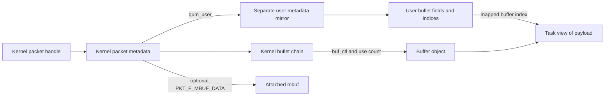
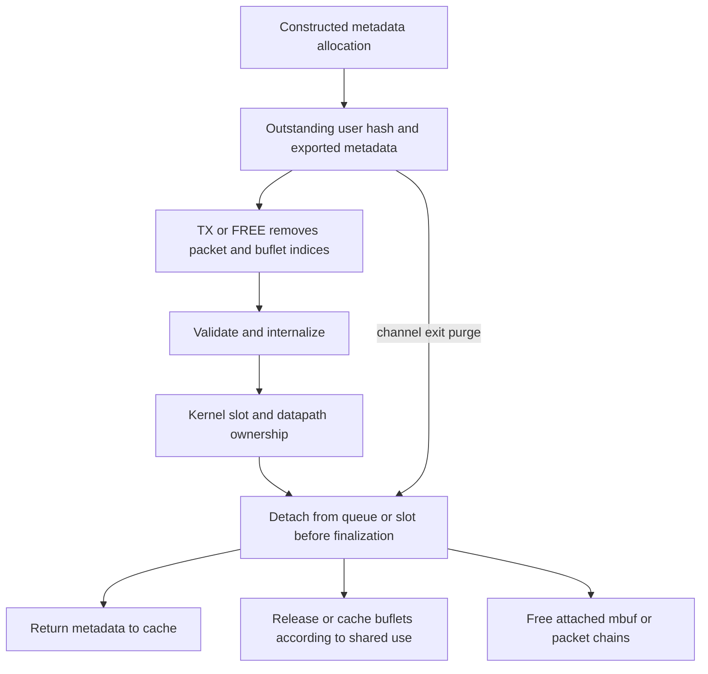

# Skywalk packets, buflets and pool ownership

[Networking](README.md) · [Skywalk memory](skywalk-memory-arenas-and-mapping.md) · [Channel and flow lifetimes](skywalk-lifecycles.md) · [Transmit overview](skywalk.md)

A Skywalk packet handle is not a payload address. It identifies metadata whose buflets describe byte ranges in allocated buffers. Kernel and user metadata are different objects, and crossing a channel boundary transfers allocation ownership as well as selected fields. This chapter follows packet creation, user handoff, validation, sharing and destruction in `xnu-12377.121.6`.

## Packet, quantum, buflet and backing object

| Object | Important state |
| --- | --- |
| [`__quantum` and user quantum](../../../xnu/bsd/skywalk/packet/os_packet_private.h#L387) | Common length, flags and metadata identity fields for the representation. |
| [`__kern_quantum`](../../../xnu/bsd/skywalk/packet/packet_var.h#L204) | Common state plus owning pool, user-metadata mirror, kernel slot association, user-allocation hash link/PID and kernel buflet state. |
| [`__kern_packet`](../../../xnu/bsd/skywalk/packet/packet_var.h#L352) | Quantum plus packet fields/options, flow/classification data, timestamp, queue linkage, completion state and optional attached mbuf/packet representation. |
| [`__buflet`](../../../xnu/bsd/skywalk/packet/os_packet_private.h#L243) | Buffer address/index, data offset and length, data limit, next-buflet address/index and flags. |
| [`__kern_buflet`](../../../xnu/bsd/skywalk/packet/packet_var.h#L47) | Common buflet plus `buf_ctl`, which identifies the actual allocated buffer object and its shared-use accounting. |
| [`__kern_buflet_ext`](../../../xnu/bsd/skywalk/packet/packet_var.h#L62) | Separately allocated buflet with its user mirror, outstanding-user hash linkage and PID accounting. |
| [`kern_pbufpool`](../../../xnu/bsd/skywalk/packet/pbufpool_var.h#L57) | Pool lock/refcount/flags, buffer sizes, max fragments, metadata/buflet/buffer caches and regions, user-allocation hash tables and segment callbacks. |

A buflet's data begins at `buf_addr + buf_doff` and spans `buf_dlen` bytes, subject to its validated limit. For kernel shared buffers, `buf_addr` can identify a span within the underlying object, whose beginning is `buf_ctl->bc_addr`. Distinct buflets can refer to the same buffer with separate use references. The user-facing internalization path in this version explicitly asserts the simpler nonshared buffer relationship; kernel sharing support is not permission to submit arbitrary shared spans from userspace.



The handle encoding returned by kernel pool APIs contains metadata type/subtype with the address. `SK_PTR_ADDR_*` decodes it. A user slot instead carries a metadata index resolved in the pool's ownership tables; it is not trusted as a kernel pointer.

## Creating the pool chooses the ownership model

[`kern_pbufpool_create()`](../../../xnu/bsd/skywalk/packet/pbufpool_kern.c#L43) validates version, requested packet/buffer counts, buffer size, fragment limit and segment callback pairing. It selects kernel-only versus user-accessible metadata, I/O direction and on-demand buffer behavior, configures regions, and calls [`pp_create()`](../../../xnu/bsd/skywalk/packet/pbufpool.c#L1028). The declarations include quantum selection, but the packet pool/common channel code has packet-specific assertions and restrictions; supported combinations must be followed through the actual caller and configuration rather than generalized from one flag.

`pp_create()` chooses shared/RX/TX region sets, checks matching geometry for user/kernel mirrors, retains the optional provider context, records constructor/destructor callbacks and builds the buffer/metadata caches. User-accessible pools have user metadata and optional user-buflet regions paired with kernel regions. Kernel-only pools do not need that mirror. [Memory arenas](skywalk-memory-arenas-and-mapping.md) assemble these regions into mappings; pool construction alone does not map every pool into a process.

The allocation contract distinguishes two modes:

- **Preconstructed buffers:** cached metadata already has the configured number of buffers. Kernel allocation requests must match `pp_max_frags`.
- **On-demand buffers:** metadata can be allocated with zero attached buffers, or a requested number up to the maximum; separate constructed buflet objects supply backing.

[`kern_pbufpool_alloc_common()`](../../../xnu/bsd/skywalk/packet/pbufpool_kern.c#L281) rejects unsupported buffer counts, zeroes the output handle and encodes a successfully allocated kernel metadata pointer. Sleeping and non-sleeping wrappers select different `skmem` flags. A valid pool handle does not make every allocation infallible.

## Constructors versus reuse initialization

[`pp_metadata_ctor_common()`](../../../xnu/bsd/skywalk/packet/pbufpool.c#L642) builds a raw cache object's long-lived metadata relationships. It computes kernel/user quantum addresses after the metadata preamble, initializes the user redzone, and associates pool identity, metadata index and required optional state. The constructor can receive object-info records stored inside the object being initialized, so it copies them locally before overwriting those bytes.

[`pp_metadata_init()`](../../../xnu/bsd/skywalk/packet/pbufpool.c#L1899) performs per-allocation reset on a constructed object: verifies the pool/mirror relationship, attaches on-demand buffers when requested, sanitizes flags, reinitializes packet metadata and initializes the chosen buflets. Reusing a cached packet is therefore not identical to constructing all backing objects from scratch.

[`pp_alloc_packet_common()`](../../../xnu/bsd/skywalk/packet/pbufpool.c#L1984) obtains a metadata batch, obtains the requested on-demand buflet batch, then initializes one packet at a time. If buffer construction fails partway through, remaining buflets and uninitialized metadata return to their caches while successfully initialized packets remain caller-owned.

The batch result makes partial success explicit:

[`bsd/skywalk/packet/pbufpool.c:2096–2106`](../../../xnu/bsd/skywalk/packet/pbufpool.c#L2096-L2106):

<!-- source-excerpt: ../../../xnu/bsd/skywalk/packet/pbufpool.c#L2096-L2106 -->
```c
	*size = i;

	if (__probable(i == n)) {
		err = 0;
	} else if (i != 0) {
		err = EAGAIN;
	} else {
		err = ENOMEM;
	}

	return err;
```

For example, requesting eight packets and receiving three with `EAGAIN` means those three handles are live allocations. Retrying all eight without first processing/freeing those three leaks or duplicates ownership. Only `ENOMEM` with zero completed entries describes an empty allocation result for this batch wrapper. The callback form can also have published each successful item before a later item fails.

## Allocation rings establish ownership before exposing indices

The existing [channel lifecycle guide](skywalk-lifecycles.md) traces the alloc/free ring callbacks. At the pool boundary, [`pp_insert_upp_common()`](../../../xnu/bsd/skywalk/packet/pbufpool.c#L1542) sets the recorded PID, inserts packet metadata into the pool's outstanding-user hash and increments usage; external buflets are inserted into their own hash. Batch insertion is protected by `pp_lock`.

Externalizing metadata then copies only permitted common fields into the user mirror. [`_QUM_EXTERNALIZE`](../../../xnu/bsd/skywalk/packet/packet_var.h#L309) excludes kernel-only flags and resets user-visible identity fields from kernel truth. [`kr_externalize_metadata_internal()`](../../../xnu/bsd/skywalk/channel/channel_ring.c#L1850) exports packet fields, sanitizes buflet count/max, exports buflet identity/offset/length state, marks user metadata finalized and clears the kernel internalized bit. Kernel pointers, optional kernel structures and private ownership state are not blindly copied into userspace.

The user receives a pool-owned allocation represented by indices plus mapped bytes. Its storage remains accessible according to arena permissions, but protocol ownership changes when it submits the index through TX or FREE.

## TX submission is lookup, removal and validation

[`kr_txsync_prologue()`](../../../xnu/bsd/skywalk/channel/channel_ring.c#L656) snapshots shared indices and validates them against the kernel's saved ring state before invoking the nexus-specific prologue. [`kr_txprologue_upp()`](../../../xnu/bsd/skywalk/channel/channel_ring.c#L516) holds the pool lock, resolves each submitted metadata index through `pp_remove_upp_locked()`, validates the user/kernel metadata identity, internalizes the packet, resets the user slot and attaches the packet to the kernel slot.

[`pp_remove_upp_locked()`](../../../xnu/bsd/skywalk/packet/pbufpool.c#L1690) removes the allocation from the hash and decrements accounting before validating/removing external buflet ownership. PID is used for accounting and purge; the lookup comparison here is the metadata index, not a fresh per-call PID authentication check. Removing the allocation means a second ordinary submission of the same still-unallocated index cannot succeed as another independent transfer.

Buflet-chain removal follows indices through the outstanding buflet hash and bounds traversal by the expected count/max. It cuts links on malformed or absent entries and reports `ERANGE`; it can have already removed earlier objects. Failure is not an all-or-nothing rollback of hash membership. The enclosing ring error path records a concrete guard/kill reason and preserves cleanup distinctions for partially reclaimed packets. See [chain validation](../../../xnu/bsd/skywalk/packet/pbufpool.c#L1627-L1687) and [TX cleanup](../../../xnu/bsd/skywalk/channel/channel_ring.c#L536-L607).

## What metadata validation actually establishes

[`kr_internalize_metadata()`](../../../xnu/bsd/skywalk/channel/channel_ring.c#L1632) preserves kernel-private state while copying allowed fields. It rejects an already-dropped user quantum; validates nonzero fragment count and kernel maximum; uses kernel buflet/mirror relationships; copies only mutable data length/offset into trusted kernel buflets; checks buffer range, object index and next-buflet index; detects total-length overflow; checks the advertised packet length; validates headroom/L2 placement and partial-checksum offsets.

[`bsd/skywalk/channel/channel_ring.c:1745–1766`](../../../xnu/bsd/skywalk/channel/channel_ring.c#L1745-L1766):

<!-- source-excerpt: ../../../xnu/bsd/skywalk/channel/channel_ring.c#L1745-L1766 -->
```c
		kbuf->buf_dlen = ubuf->buf_dlen;
		kbuf->buf_doff = ubuf->buf_doff;

		/*
		 * Check:
		 * - sanity of buflet data offset and length
		 * - kernel and user metadata use the same object index
		 * - User hasn't modified nbft_idx: we don't allow user
		 *   to construct multi buflet packets for tx.
		 */
		if (__improbable(!BUF_IN_RANGE(kbuf) ||
		    ubuf->buf_idx != kbuf->buf_idx ||
		    ubuf->buf_nbft_idx != kbuf->buf_nbft_idx)) {
			kbuf->buf_dlen = kbuf->buf_doff = 0;
			SK_ERR("%s(%d) kring %p bad bufidx 0x%x, 0x%x"
			    " 0x%x, 0x%x",
			    sk_proc_name(p), sk_proc_pid(p),
			    SK_KVA(kring), kbuf->buf_idx, ubuf->buf_idx,
			    kbuf->buf_nbft_idx, ubuf->buf_nbft_idx);
			err = ERANGE;
			goto done;
		}
```

The trusted chain is established through ownership lookup before this check; users cannot make the kernel dereference arbitrary next pointers merely by writing a virtual address into a slot. On successful internalization, the quantum is marked internalized/finalized and has the checked total length. Failure sets zero length and internalized/dropped state. The `FINALIZED` state here means the metadata passed this representation contract; it does not mean a NIC transmitted the packet.

A worked malformed request is a user changing a buflet's `buf_doff` so its length crosses the allowed data limit. Even if the metadata index belongs to a valid outstanding allocation, `BUF_IN_RANGE` fails during internalization. Owning an allocated object and presenting a valid packet layout are separate checks.

## Kernel sharing and copy modes

[`kern_packet_clone_internal()`](../../../xnu/bsd/skywalk/packet/packet_kern.c#L557) distinguishes heavy copying from light sharing. The examined implementation rejects dropped/empty sources and asserts a single buflet; its TODOs are real implementation boundaries, not evidence of general multi-fragment cloning.

Heavy clone allocates backing, copies selected packet metadata and payload bytes, and duplicates an attached mbuf when present. Light clone requires allocation of empty metadata, currently relying on on-demand pools, then copies the buflet relationship and increments shared buffer use through `_KBUF_COPY`. It does not duplicate payload bytes. Clone initialization clears finalized/classified state and trace identity as specified by the body; the recipient must establish its subsequent valid packet state.

Shared use affects destruction. [`pp_metadata_destruct_common()`](../../../xnu/bsd/skywalk/packet/pbufpool.c#L741) separates buflets whose buffer control shows multiple users into **no-cache** lists. Otherwise reusing a cached buflet with its still-shared backing could overwrite data another packet still uses. That branch connects buffer reference counting directly to cache reuse policy, rather than treating refcounts as passive statistics.

[`bsd/skywalk/packet/pbufpool.c:794–809`](../../../xnu/bsd/skywalk/packet/pbufpool.c#L794-L809):

<!-- source-excerpt: ../../../xnu/bsd/skywalk/packet/pbufpool.c#L794-L809 -->
```c
			/*
			 * bc_usecnt larger than 1 means the buffer has been cloned and is
			 * still being used by other bflts. In this case, when we free
			 * this bflt we need to explicitly ask for it to not be cached again
			 * into magzine layer to prevent immediate reuse of the buffer and
			 * data corruption.
			 */
			if (os_atomic_load(&nbuf->buf_ctl->bc_usecnt, relaxed) > 1) {
				*pp_blist_nocache_large = (struct skmem_obj *)(void *)nbuf;
				pp_blist_nocache_large =
				    &((struct skmem_obj *)(void *)nbuf)->mo_next;
			} else {
				*pp_blist_large = (struct skmem_obj *)(void *)nbuf;
				pp_blist_large =
				    &((struct skmem_obj *)(void *)nbuf)->mo_next;
			}
```

## Freeing a packet can release other packet representations

[`pp_metadata_fini()`](../../../xnu/bsd/skywalk/packet/pbufpool.c#L2210) performs pending completion callbacks where requested, detaches an attached mbuf or packet, clears representation flags and verifies that the packet is no longer linked into a queue or slot. For on-demand pools it destructs attached buflet state before returning metadata to the cache. Fixed preconstructed pools can retain their construction for reuse.

[`pp_free_packet_array()`](../../../xnu/bsd/skywalk/packet/pbufpool.c#L2399) verifies pool identity for every entry, finalizes packets, clears caller array slots, batch-frees metadata/buflets and then frees accumulated attached mbuf or packet chains. Attached packets can come from other pools, so their cleanup groups runs by owning pool. Freeing the visible wrapper can therefore release storage in another representation; treating it as “just free this descriptor” misses ownership.



## Device ownership and closing the pool

[`pp_buf_seg_ctor()`/`pp_buf_seg_dtor()`](../../../xnu/bsd/skywalk/packet/pbufpool.c#L915-L935) forward region segment lifecycle to provider callbacks with the pool, segment and IOKit memory descriptor. Wiring/IOMMU setup belongs at this explicit boundary. Packet buflet addresses are CPU views; device-visible addresses and completion obligations require the actual provider/DMA mapping contract. The previously traced flowswitch TX path can copy from a user pool into a device pool, so shared rings alone are not evidence of end-to-end zero-copy.

[`pp_close()`](../../../xnu/bsd/skywalk/packet/pbufpool.c#L320) sets `PPF_CLOSED` and releases the owner's reference. Reference release, not the flag alone, determines final destruction. [`pp_purge_upp()`](../../../xnu/bsd/skywalk/packet/pbufpool.c#L1807) cleans outstanding user packets and external buflets for the specified PID, including allocations absent from current ring slots. [`pp_destroy()`](../../../xnu/bsd/skywalk/packet/pbufpool.c#L1355) destroys metadata and buflet caches before buffer caches because their destructors still release attached buffers, then releases regions and provider context.

These mechanisms form the packet/memory foundation of the existing [whole-Skywalk program](../../audits/processes-vfs-networking.md#a12--p1-complete-skywalk-expansion-program). Full protocol classification, every packet accessor/checksum operation, netif queues and hardware callbacks remain neighboring tracks. The in-tree code supports precise ownership claims above; no live channel, malformed-ring or device test was executed for this chapter.

<!-- BEGIN PLATYDOC DOCUMENTATION LICENSE -->
Original Platydoc text and diagrams are licensed under [CC BY 4.0](https://creativecommons.org/licenses/by/4.0/). Quoted source code and third-party material retain their respective licenses.
<!-- END PLATYDOC DOCUMENTATION LICENSE -->
