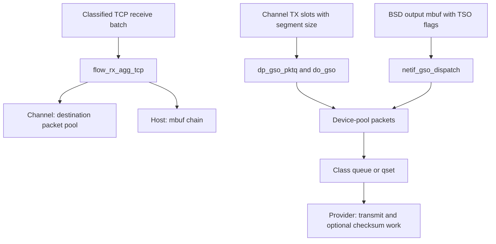
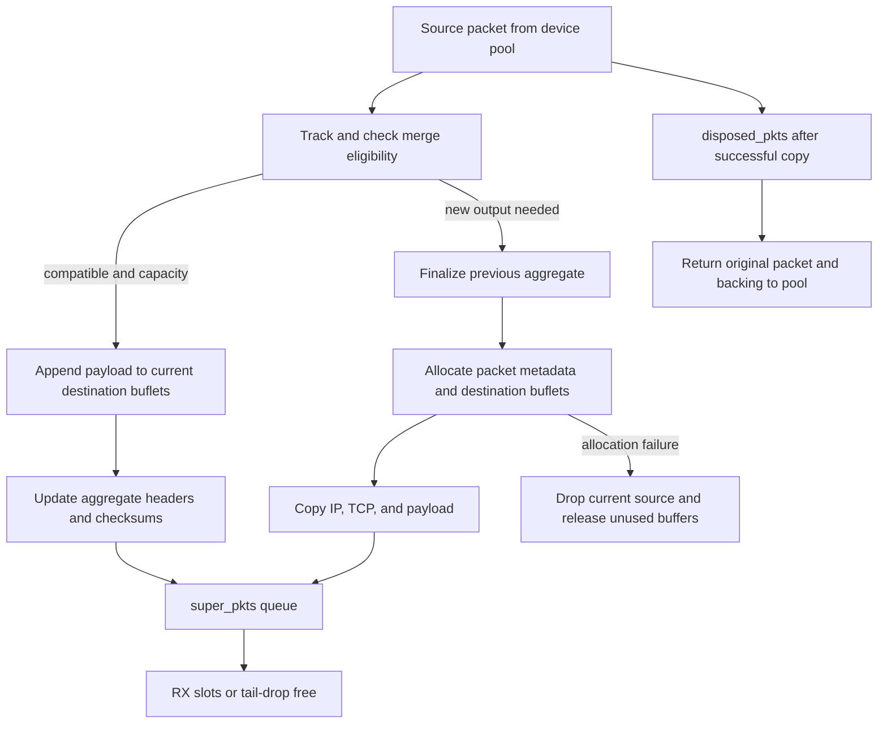
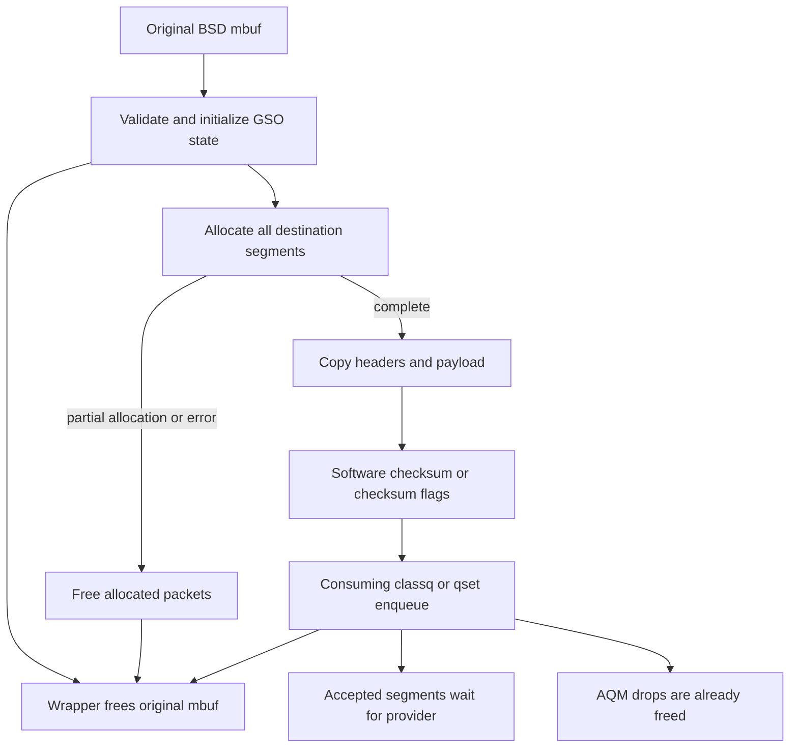

# Skywalk TCP aggregation, segmentation, and offload boundaries

[Networking](README.md) · [Flowswitch datapath](skywalk-flowswitch-classification-routes-and-datapaths.md) · [Fragments and tracking](skywalk-fragments-reassembly-and-flow-tracking.md) · [Packet pools](skywalk-packets-buflets-and-pools.md) · [Netif queues](skywalk-netif-links-queues-and-scheduling.md)

Skywalk can combine received TCP segments into larger packets, divide large transmit packets into TCP segments, or retain checksum/segmentation metadata for a device provider. These operations change packet representation and ownership at different boundaries. This chapter traces the channel and host paths in `xnu-12377.121.6`, then follows the local QoS and AOP steering decisions without assuming that the supplying driver or offloaded transport is present in this tree.

## 1. Four operations with different inputs and results

| Operation | Input | Output and implementation |
| --- | --- | --- |
| Fragment ordering | IP fragments, possibly out of order | Original fragments linked in order; [fragment manager](skywalk-fragments-reassembly-and-flow-tracking.md). |
| TCP RX aggregation | Compatible consecutive TCP packets for one flow | A larger packet or mbuf chain containing one IP/TCP header and combined payload; `flow_agg.c`. |
| Software TCP segmentation | Large TCP packet/mbuf with segment-size metadata | Newly allocated packets with separate headers, sequence numbers and segment checksums or checksum-offload flags. |
| Hardware/provider offload | Packet plus checksum/TSO flags, or a registered flow descriptor | Work delegated through the provider contract; the local request is not the device's implementation or completion. |

The RX implementation installs a callback per flow; channel TX selects GSO while taking packets from the TX ring; host TX installs an `if_output` interceptor. These are three different entry paths. [RX selection](../../../platydoc-data/xnu/bsd/skywalk/nexus/flowswitch/flow/flow_entry.c#L535-L565), [channel selection](../../../platydoc-data/xnu/bsd/skywalk/nexus/flowswitch/fsw_dp.c#L1164-L1233), [host interception](../../../platydoc-data/xnu/bsd/skywalk/nexus/netif/nx_netif_host.c#L340-L385).



The receive branch does not feed the segmentation branch automatically. They operate in opposite directions and can be configured independently.

## 2. Receive aggregation is selected per flow

`flow_entry_alloc()` initially chooses default RX. It selects `flow_rx_agg_tcp()` only when RX aggregation is enabled, the flowswitch provider allows more than one fragment/buflet, the protocol is TCP, and the key is exactly `FKMASK_5TUPLE`. A wildcard listener or other protocol does not acquire that callback merely because its packets contain TCP bytes. [Selection predicate](../../../platydoc-data/xnu/bsd/skywalk/nexus/flowswitch/flow/flow_entry.c#L559-L565):

[Source: `bsd/skywalk/nexus/flowswitch/flow/flow_entry.c`, lines 559–565](../../../platydoc-data/xnu/bsd/skywalk/nexus/flowswitch/flow/flow_entry.c#L559-L565).

<!-- source-excerpt: ../../../platydoc-data/xnu/bsd/skywalk/nexus/flowswitch/flow/flow_entry.c#L559-L565 -->
```c
	fe->fe_transport_protocol = req->nfr_transport_protocol;
	if (NX_FSW_TCP_RX_AGG_ENABLED() &&
	    (fsw->fsw_nx->nx_prov->nxprov_params->nxp_max_frags > 1) &&
	    (fe->fe_key.fk_proto == IPPROTO_TCP) &&
	    (fe->fe_key.fk_mask == FKMASK_5TUPLE)) {
		fe->fe_rx_process = flow_rx_agg_tcp;
	}
```

The callback first sends any batch marked `FLOW_PROC_FLAG_FRAGMENTS` to default RX. It checks flow/route viability, derives the native/mbuf representation from the first packet, then selects host or channel aggregation. Host automatic mode disables aggregation while IP or interface filters are present; a forced host setting overrides this automatic choice. Packet taps see the original packets before aggregation. [Dispatch and filtering](../../../platydoc-data/xnu/bsd/skywalk/nexus/flowswitch/flow/flow_agg.c#L2536-L2588).

Aggregation state is local to this callback invocation. `struct flow_agg` holds the current “super packet” or “super mbuf,” a pointer to its IP header, expected next TCP sequence and payload size, accumulated IP length, and a checksum-fixup function. It is cleared when starting a new aggregate and after finalizing one. It is not a persistent TCP receive buffer that waits across future network events. The enclosing RX worker serializes processing of the flow's queued batches. [State](../../../platydoc-data/xnu/bsd/skywalk/nexus/flowswitch/flow/flow_agg.c#L61-L112), [initialization](../../../platydoc-data/xnu/bsd/skywalk/nexus/flowswitch/flow/flow_agg.c#L860-L934), [worker protocol](skywalk-flowswitch-classification-routes-and-datapaths.md#7-rx-classification-miss-per-flow-worker-and-destination-ring).

## 3. Which packets can join an aggregate?

`flow_agg_is_ok()` first excludes FIN/SYN/RST/URG, zero payload, absence of a current aggregate, broadcast/multicast, a sequence number different from the expected next sequence, excessive total length, and a later wake packet. The size ceiling is `MIN(sk_fsw_rx_agg_tcp, IP_MAXPACKET)`. The comment says “flags other than ACK/PUSH,” but the actual mask is FIN/SYN/RST/URG; other flag bits are handled by header comparison. [Constants](../../../platydoc-data/xnu/bsd/skywalk/nexus/flowswitch/flow/flow_agg.c#L41-L50), [admission](../../../platydoc-data/xnu/bsd/skywalk/nexus/flowswitch/flow/flow_agg.c#L1223-L1281).

[Source: `bsd/skywalk/nexus/flowswitch/flow/flow_agg.c`, lines 1247–1264](../../../platydoc-data/xnu/bsd/skywalk/nexus/flowswitch/flow/flow_agg.c#L1247-L1264).

<!-- source-excerpt: ../../../platydoc-data/xnu/bsd/skywalk/nexus/flowswitch/flow/flow_agg.c#L1247-L1264 -->
```c
	if (__improbable((pkt->pkt_flow_tcp_flags & TCP_FLAGS_IGNORE) != 0 ||
	    pkt->pkt_flow_ulen == 0 || fa->fa_sobj == NULL ||
	    (pkt->pkt_link_flags & (PKT_LINKF_BCAST | PKT_LINKF_MCAST)) != 0)) {
		DTRACE_SKYWALK1(aggr__fail1a, struct __kern_packet *, pkt);
		goto done;
	}
	if (__improbable(ntohl(pkt->pkt_flow_tcp_seq) != fa->fa_tcp_seq)) {
		DTRACE_SKYWALK2(aggr__fail1b, uint32_t,
		    ntohl(pkt->pkt_flow_tcp_seq), uint32_t, fa->fa_tcp_seq);
		STATS_INC(fsws, FSW_STATS_RX_AGG_NO_SEQN_TCP);
		goto done;
	}
	if (__improbable((fa->fa_total + pkt->pkt_flow_ulen) > max_ip_len)) {
		DTRACE_SKYWALK3(aggr__fail1c, uint32_t, fa->fa_total,
		    uint32_t, pkt->pkt_flow_ulen, uint32_t, max_ip_len);
		/* We've reached aggregation limit */
		STATS_INC(fsws, FSW_STATS_RX_AGG_LIMIT);
		goto done;
```

The fast path requires a sufficiently long accessible packet/header representation, a 32-byte TCP header using the usual timestamp-option layout, a masked IP/TCP-header match, and the same payload size as the preceding accepted segment. It advances the expected sequence on success. The mask definitions identify the compared bytes; passing this prediction is not a full comparison of every packet byte. [Masks](../../../platydoc-data/xnu/bsd/skywalk/nexus/flowswitch/flow/flow_agg.c#L115-L213), [fast path](../../../platydoc-data/xnu/bsd/skywalk/nexus/flowswitch/flow/flow_agg.c#L962-L1025).

The slow path separately checks:

- IPv4 header length, TTL, TOS, DF/reserved bits and options; IPv6 base-header-only layout, flow/traffic-class bits and hop limit.
- TCP ACK number, advertised window, flags except PUSH, header length and options.
- Differing TCP options only through the recognized 12-byte timestamp layout, after verifying its option-prefix encoding.

[IP comparison](../../../platydoc-data/xnu/bsd/skywalk/nexus/flowswitch/flow/flow_agg.c#L1044-L1140), [TCP/options comparison](../../../platydoc-data/xnu/bsd/skywalk/nexus/flowswitch/flow/flow_agg.c#L1142-L1219).

`flow_agg_init_common()` initializes meaningful aggregation state only for base IPv4/IPv6 header lengths. Thus the slow path's IPv4-option comparison should not be taken as a promise that every option-bearing sequence is a usable aggregation seed. The IPv6 slow path explicitly rejects extension headers. [Initializer bounds](../../../platydoc-data/xnu/bsd/skywalk/nexus/flowswitch/flow/flow_agg.c#L865-L885).

A sequence gap, ACK/window change, nonmatching option or capacity limit starts another output packet; it does not retain the new packet awaiting a missing TCP sequence. TCP reordering/retransmission remains the destination transport's job.

## 4. Checksum failure prevents merging, not necessarily delivery

Aggregation needs both header compatibility and valid checksum evidence. The helpers use existing full-checksum flags/results when supplied, or compute IPv4-header and TCP/pseudo-header checksums while copying. A full receive checksum value of `0xffff` is treated as valid. `mbuf_csum()` normalizes compat checksum metadata; native/buflet copying uses `copy_pkt_csum()` and `copy_pkt_csum_packed()`. [Compat checksum](../../../platydoc-data/xnu/bsd/skywalk/nexus/flowswitch/flow/flow_agg.c#L317-L421), [ordinary copy](../../../platydoc-data/xnu/bsd/skywalk/nexus/flowswitch/flow/flow_agg.c#L692-L855).

Packed copy may already have written payload into unused storage before it discovers a bad TCP checksum. It saves the previous visible length and restores it on failure, resets newly used buffer lengths/offsets, and returns false. The speculative bytes are outside the restored logical packet extent. [Packed copy and rollback](../../../platydoc-data/xnu/bsd/skywalk/nexus/flowswitch/flow/flow_agg.c#L508-L684):

[Source: `bsd/skywalk/nexus/flowswitch/flow/flow_agg.c`, lines 657–678](../../../platydoc-data/xnu/bsd/skywalk/nexus/flowswitch/flow/flow_agg.c#L657-L678).

<!-- source-excerpt: ../../../platydoc-data/xnu/bsd/skywalk/nexus/flowswitch/flow/flow_agg.c#L657-L678 -->
```c
	if ((csum ^ 0xffff) != 0) {
		/*
		 * Revert whatever we did here!
		 * currm/currp should be restored to previous value.
		 * dbuf (for additional payload) should be restore to 0.
		 */
		if (currm != NULL) {
			currm->m_len = curr_oldlen;
		} else {
			currp->buf_dlen = curr_oldlen;
		}
		if (dbuf != NULL) {
			for (int i = 0; i < dbuf->dba_num_dbufs; i++) {
				if (dbuf->dba_is_buflet) {
					struct __kern_buflet *b = dbuf->dba_buflet[i];
					kern_buflet_set_data_length(b, 0);
					kern_buflet_set_data_offset(b, 0);
				} else {
					struct mbuf *m = dbuf->dba_mbuf[i];
					m->m_len = m->m_pkthdr.len = 0;
				}
			}
```

The caller then follows its nonaggregation copy path. A false result from that ordinary copy is counted and retained as checksum evidence; the packet can still become a separate output packet. It is incorrect to say that every bad checksum causes an immediate drop in this layer. The destination stack/transport must honor the checksum metadata and validate as required. [Channel fallback](../../../platydoc-data/xnu/bsd/skywalk/nexus/flowswitch/flow/flow_agg.c#L1831-L1894), [host fallback](../../../platydoc-data/xnu/bsd/skywalk/nexus/flowswitch/flow/flow_agg.c#L2278-L2328).

Successful merge updates the aggregate IP length, TCP pseudo-header/data checksum contributions, changed timestamp option values, PUSH state and segment-count metadata. Odd old aggregate length changes the byte order used when folding the appended data checksum. With `IFNET_LRO`, the selected fixup function leaves header checksums unchanged, relying on the offload representation contract. [Fixup selection](../../../platydoc-data/xnu/bsd/skywalk/nexus/flowswitch/flow/flow_agg.c#L887-L894), [IP length](../../../platydoc-data/xnu/bsd/skywalk/nexus/flowswitch/flow/flow_agg.c#L1337-L1382), [TCP update](../../../platydoc-data/xnu/bsd/skywalk/nexus/flowswitch/flow/flow_agg.c#L1391-L1489).

The comment preceding `flow_agg_merge_hdr()` claims IP ID/TTL changes and an unchanged IPv4 checksum. Its body instead preserves the existing ID/TTL and adjusts IPv4 checksum through the chosen fixup function. The compatibility checks already demand matching TTL/hop limit. Use the body when explaining the merged header.

## 5. Channel aggregation allocates destination buflets

`flow_rx_agg_channel()` obtains the receiving ring/pool and requires `pp_max_frags > 1`. Its inputs must belong to a different pool. It uses `fe_rx_largest_size` to choose default or large destination buffers and estimate a batch, capped at 32 local buffer handles. The estimate includes header overhead and is refined after processing by moving the remembered largest size one quarter toward the observed size. This is allocation sizing, not a TCP congestion-control estimator. [Pool and batch setup](../../../platydoc-data/xnu/bsd/skywalk/nexus/flowswitch/flow/flow_agg.c#L1628-L1693), [estimate](../../../platydoc-data/xnu/bsd/skywalk/nexus/flowswitch/flow/flow_agg.c#L1520-L1538), [convergence](../../../platydoc-data/xnu/bsd/skywalk/nexus/flowswitch/flow/flow_agg.c#L1590-L1605).

For each source packet:

1. Remove it from the input queue and run flow tracking. A tracking error drops it; `ENETRESET` can request a generated reset first.
2. For compat packets, advance the attached mbuf past L2 and preserve service/wake metadata.
3. If the current aggregate is compatible and its last buflet has room, copy/checksum only the new TCP payload into that space.
4. Otherwise obtain enough new buflets. Compatible data can append those buflets; incompatible input finalizes the current aggregate and allocates fresh packet metadata with zero initial buflets.
5. Attach the filled buflets, set L3-only length/headroom, flow UUID and policy metadata, and keep the original source in `disposed_pkts`.
6. Finalize the last aggregate, free spare buffer allocations, enqueue outputs to the RX ring with tail drop, and free disposed source packets.

[Tracking and packed append](../../../platydoc-data/xnu/bsd/skywalk/nexus/flowswitch/flow/flow_agg.c#L1717-L1771), [refill/drop decisions](../../../platydoc-data/xnu/bsd/skywalk/nexus/flowswitch/flow/flow_agg.c#L1774-L1815), [packet construction](../../../platydoc-data/xnu/bsd/skywalk/nexus/flowswitch/flow/flow_agg.c#L1869-L1923), [cleanup/publication](../../../platydoc-data/xnu/bsd/skywalk/nexus/flowswitch/flow/flow_agg.c#L1925-L1956).



Partial buffer allocation can leave enough to process some inputs; a later refill failure drops the affected source while previous output survives. Failure to allocate new packet metadata releases the unattached buffer array. No successful ring transfer is rolled back because a later packet failed.

For a concrete example, take three IPv4 TCP packets with 20-byte IP and TCP headers, 1000 payload bytes each, sequence numbers 10000/11000/12000, matching ACK/window/options, valid checksums, and enough destination capacity. They can become one L3 packet of `40 + 3000 = 3040` bytes, retaining starting sequence 10000 and recording three segments. The next packet at sequence 14000 cannot join: expected sequence is 13000, so another output starts. The example assumes ordinary matching headers and no limiting flags; aggregation does not repair the missing sequence interval.

## 6. Host aggregation builds mbuf chains

Host output must eventually enter BSD with mbufs. For compat input, the aggregator detaches the existing mbuf from its packet wrapper, removes excess trailers, ensures contiguous headers with `m_pullup()`, and computes/checks checksum evidence. Successful merge advances past that input's L2/IP/TCP headers, clears `M_PKTHDR` on appended storage, and links it through `m_next`. The original wrapper can then be freed without freeing the transferred mbuf. [Compat detach](../../../platydoc-data/xnu/bsd/skywalk/nexus/flowswitch/flow/flow_agg.c#L2131-L2166), [append ownership](../../../platydoc-data/xnu/bsd/skywalk/nexus/flowswitch/flow/flow_agg.c#L2366-L2392).

Native input is copied into mbufs. The batch allocator tries storage sizes derived from prior aggregation, falling back from two 16-KiB segments to 16-KiB, 4-KiB and 2-KiB allocation sizes. If a batch is insufficient, the per-packet fallback calls `mbuf_allocpacket(MBUF_DONTWAIT, ...)`; the comment calls this “blocking allocation,” but the flag says otherwise. [Batch sizing/fallback](../../../platydoc-data/xnu/bsd/skywalk/nexus/flowswitch/flow/flow_agg.c#L2029-L2088), [per-packet allocation](../../../platydoc-data/xnu/bsd/skywalk/nexus/flowswitch/flow/flow_agg.c#L2223-L2253).

There are two different chain links: `m_next` joins storage within one aggregate; `m_nextpkt` joins distinct output packets. `_finalize_smbuf()` frees unused zero-length trailing storage. The finished packet list enters `host_mq`; the caller later sends it to DLIL outside the flowswitch lock. Raw packet/byte accounting remains distinct from the number of generated super packets. [Packet-list construction](../../../platydoc-data/xnu/bsd/skywalk/nexus/flowswitch/flow/flow_agg.c#L2393-L2477), [cleanup and host queue](../../../platydoc-data/xnu/bsd/skywalk/nexus/flowswitch/flow/flow_agg.c#L2480-L2532), [host delivery](skywalk-flowswitch-classification-routes-and-datapaths.md#8-host-fallback-is-an-actual-delivery-path).

## 7. Channel TX chooses hardware or software segmentation

`fsw_tso_setup()` is limited by `kernel_is_macos_or_server()`. It requires Skywalk capability and a nonzero large-buffer size. It consults **saved original** `nif_hwassist`, because host adaptation may already have changed advertised `if_hwassist`. Original IPv4 or IPv6 TSO selects hardware mode; otherwise nonzero `sk_fsw_gso_mtu`, sufficient large-buffer capacity and a native interface select software mode. These branches do not make every configuration support every offload family. [Mode selection](../../../platydoc-data/xnu/bsd/skywalk/nexus/flowswitch/fsw.c#L322-L362), [reported limits](../../../platydoc-data/xnu/bsd/skywalk/nexus/flowswitch/fsw.c#L295-L319).

Only software mode makes `fsw_tx_ring_dequeue_pktq()` separate GSO from ordinary batches. `estimate_gso_pkts()` derives an allocation estimate from the packet's TSO family, `pkt_proto_seg_sz`, total length and minimum IP/TCP headers. TCP options make the actual header longer, so the estimate can exceed the number ultimately needed. A configured batch threshold is checked before adding the next source packet's estimate; it is not necessarily an exact segment-count ceiling. [Estimate](../../../platydoc-data/xnu/bsd/skywalk/nexus/flowswitch/fsw_dp.c#L1138-L1161), [homogeneous batching](../../../platydoc-data/xnu/bsd/skywalk/nexus/flowswitch/fsw_dp.c#L1181-L1226).

`fsw_user_ring_flush()` sends nonzero estimates to `dp_gso_pktq()` and later frees the original source batch:

[Source: `bsd/skywalk/nexus/flowswitch/fsw_dp.c`, lines 4281–4287](../../../platydoc-data/xnu/bsd/skywalk/nexus/flowswitch/fsw_dp.c#L4281-L4287).

<!-- source-excerpt: ../../../platydoc-data/xnu/bsd/skywalk/nexus/flowswitch/fsw_dp.c#L4281-L4287 -->
```c
		if (gso_pkts_estimate > 0) {
			dp_gso_pktq(fsw, &pktq, gso_pkts_estimate);
		} else {
			dp_tx_pktq(fsw, &pktq);
		}
		dp_free_pktq(fsw, &pktq);
		KPKTQ_FINI(&pktq);
```

Hardware mode goes through the ordinary device-copy/flow route with segmentation metadata preserved for the provider. The classifier allows a larger total packet when segment-size metadata is present, but still rejects a segment-size value above the interface MTU. This permission is distinct from the stronger MSS/header checks performed by software GSO. [Default copy](../../../platydoc-data/xnu/bsd/skywalk/nexus/flowswitch/fsw_dp.c#L2809-L2866), [classifier MTU branch](../../../platydoc-data/xnu/bsd/skywalk/nexus/flowswitch/flow/flow_classifier.c#L421-L440).

## 8. Channel GSO allocation and per-segment construction

`dp_gso_pktq()` takes the flowswitch read lock and an interface data-movement reference. It allocates the estimated number of device-pool packets with `SKMEM_NOSLEEP`. Unlike ordinary TX's usable partial prefix, **any nonzero allocation result** causes it to free partial device allocation and drop the source batch. This is all-or-none admission to segmentation for this batch, not a guarantee that every later segment reaches the device. [Lifetime admission](../../../platydoc-data/xnu/bsd/skywalk/nexus/flowswitch/fsw_dp.c#L4055-L4077), [allocation result](../../../platydoc-data/xnu/bsd/skywalk/nexus/flowswitch/fsw_dp.c#L4079-L4108).

[Source: `bsd/skywalk/nexus/flowswitch/fsw_dp.c`, lines 4092–4104](../../../platydoc-data/xnu/bsd/skywalk/nexus/flowswitch/fsw_dp.c#L4092-L4104).

<!-- source-excerpt: ../../../platydoc-data/xnu/bsd/skywalk/nexus/flowswitch/fsw_dp.c#L4092-L4104 -->
```c
	/*
	 * We either get all packets or none. No partial allocations.
	 */
	if (__improbable(err != 0)) {
		if (err == ENOMEM) {
			ASSERT(KPKTQ_EMPTY(&dpktq));
		} else {
			dp_free_pktq(fsw, &dpktq);
		}
		DTRACE_SKYWALK1(gso__no__mem, int, err);
		dp_drop_pktq(fsw, spktq, 1, DROP_REASON_FSW_PP_ALLOC_FAILED,
		    __LINE__, DROPTAP_FLAG_L2_MISSING);
		FSW_STATS_ADD(FSW_STATS_DROP_NOMEM_PKT, n_pkts);
```

For each source, it copies at most 128 header bytes into the first destination packet, keeps the full logical source length, and marks this destination `PKT_F_TRUNCATED`. This temporary representation gives classification access to headers without copying the entire oversized payload first. It classifies, rejects fragments, and performs ordinary flow/UUID lookup before segmentation. [Header-only copy](../../../platydoc-data/xnu/bsd/skywalk/nexus/flowswitch/fsw_dp.c#L2869-L2894), [validation and lookup](../../../platydoc-data/xnu/bsd/skywalk/nexus/flowswitch/fsw_dp.c#L4110-L4167).

`do_gso()` requires TCP, nonzero MSS, `MSS <= MTU - IP_header - TCP_header`, and enough space in one device buffer for headroom plus headers plus MSS. It clears truncated state, segment-size metadata and checksum flags, because its outputs are actual software-created segments. The payload is copied from the original source using packet-copy/checksum helpers; header bytes for later segments come from the original header. [Validation](../../../platydoc-data/xnu/bsd/skywalk/nexus/flowswitch/fsw_dp.c#L3806-L3865), [copy loop](../../../platydoc-data/xnu/bsd/skywalk/nexus/flowswitch/fsw_dp.c#L3890-L3936).

For each output it:

- Copies IP/TCP headers and the next payload interval, with a shorter final interval if needed.
- Keeps FIN/PUSH only on the final segment and CWR only on the first.
- Advances TCP sequence by payload bytes and refreshes the classified header pointers, flags, sequence and payload-length metadata.
- Updates IPv4 length/ID and header checksum, or IPv6 payload length.
- Computes the complete TCP checksum from header, payload and pseudo-header contributions.
- Appends the still-unfinalized packet to a temporary GSO queue.

[Header/checksum updates](../../../platydoc-data/xnu/bsd/skywalk/nexus/flowswitch/fsw_dp.c#L3938-L3987), [queue and deferred finalization](../../../platydoc-data/xnu/bsd/skywalk/nexus/flowswitch/fsw_dp.c#L3988-L4015).

The IPv4 ID code is version-sensitive: this function initializes `ipid` directly from `ip->ip_id` and later applies `htons((ipid)++)`, whereas host GSO below starts from `ntohs(ip_id)`. Do not silently give both paths the same host-order starting-ID calculation. [Channel initialization](../../../platydoc-data/xnu/bsd/skywalk/nexus/flowswitch/fsw_dp.c#L3867-L3878), [channel assignment](../../../platydoc-data/xnu/bsd/skywalk/nexus/flowswitch/fsw_dp.c#L3952-L3957), [host initialization](../../../platydoc-data/xnu/bsd/skywalk/nexus/netif/nx_netif_gso.c#L579-L611).

All explicit `do_gso()` errors precede its segment loop. The caller's error path therefore frees the first destination and releases the flow reference without unwinding a partially filled GSO queue. Other source packets in the batch can still succeed. Unused packets from overestimation are freed at the end. Successful segment queues join `fe_tx_pktq` and run ordinary route resolution, framing, tracking, QoS and finalization before queue handoff. A later neighbor, tracking or AQM decision can still consume/drop segments. [Batch handoff/error](../../../platydoc-data/xnu/bsd/skywalk/nexus/flowswitch/fsw_dp.c#L4168-L4216), [flow processing](../../../platydoc-data/xnu/bsd/skywalk/nexus/flowswitch/fsw_dp.c#L3350-L3474).

For an illustrative IPv4 packet with 20-byte IP and TCP headers, 4000 payload bytes, MSS 1460 and MTU 1500, software GSO creates three L3 packets of 1500, 1500 and 1120 bytes. Starting at TCP sequence 5000, their sequence numbers are 5000, 6460 and 7920. FIN/PUSH appear only on the third if set in the original; CWR appears only on the first. Link framing is added afterward, so the IP MTU calculation excludes Ethernet bytes.

## 9. Host GSO starts with a BSD mbuf

`nx_netif_host_is_gso_needed()` requires a native host adapter, kernel-only plumbing below a flowswitch, no original hardware TSO capability, and nonzero TX aggregation configuration. Activation replaces `if_output` with `netif_gso_dispatch()` when needed; deactivation restores the original output handler. `nx_netif_host_adjust_if_capabilities()` can advertise TSO supplied by this software layer, so advertised TSO alone does not prove hardware segmentation. [Decision](../../../platydoc-data/xnu/bsd/skywalk/nexus/netif/nx_netif_host.c#L47-L78), [capability adaptation](../../../platydoc-data/xnu/bsd/skywalk/nexus/netif/nx_netif_host.c#L88-L149), [callback installation](../../../platydoc-data/xnu/bsd/skywalk/nexus/netif/nx_netif_host.c#L361-L385).

The dispatcher indexes a three-entry function table using `CSUM_TSO_IPV4/IPv6`. No TSO flag selects ordinary `nx_netif_host_output()`. The TCP wrappers validate protocol, adapter/ring activity, link-header extent and contiguous minimum headers. IPv6 locates its last header with `ip6_lasthdr()`. They initialize `netif_gso_ip_tcp_state`, segment, then **always free the input mbuf**, including failure paths. This is an internal BSD-output contract with `ASSERT/VERIFY` invariants, not a standalone arbitrary-packet parser. [Dispatch table](../../../platydoc-data/xnu/bsd/skywalk/nexus/netif/nx_netif_gso.c#L759-L778), [IPv4 wrapper](../../../platydoc-data/xnu/bsd/skywalk/nexus/netif/nx_netif_gso.c#L618-L682), [IPv6 wrapper](../../../platydoc-data/xnu/bsd/skywalk/nexus/netif/nx_netif_gso.c#L689-L756).

| `netif_gso_ip_tcp_state` member | Purpose |
| --- | --- |
| `update` | Rebind IP/TCP pointers to each new destination packet. |
| `internal` | Choose IPv4/IPv6 software-checksum or checksum-offload header update. |
| `mac_hlen`, `ip_hlen`, `tcp_hlen`, `hlen` | Keep link and transport offsets separate while copying repeated headers. |
| `mss`, `tcp_seq`, `ip_id` | Segment payload size and running sequence/ID state. |
| `psuedo_hdr_csum`, `copy_data_sum` | Precomputed pseudo-header contribution and whether payload copying must also checksum. |

[State definition](../../../platydoc-data/xnu/bsd/skywalk/nexus/netif/nx_netif_gso.c#L102-L126), [initialization](../../../platydoc-data/xnu/bsd/skywalk/nexus/netif/nx_netif_gso.c#L558-L611).

`netif_gso_tcp_segment_mbuf()` allocates the complete segment count. Any partial/error result frees that allocation and returns `ENOBUFS`; the wrapper then frees the input. On success it copies the already-present link header as well as IP/TCP headers, copies payload, preserves policy UUID/IDs, service class, flow token/source, timestamp, L4S and relevant packet flags, and finalizes each destination. The original mbuf's transmit-completion timestamp request is explicitly asserted absent. [Allocation and metadata inputs](../../../platydoc-data/xnu/bsd/skywalk/nexus/netif/nx_netif_gso.c#L258-L314), [segment loop](../../../platydoc-data/xnu/bsd/skywalk/nexus/netif/nx_netif_gso.c#L316-L397).

Header flag/sequence handling matches the intended segment boundaries: final-only FIN/PUSH and first-only CWR. Unlike channel GSO, host GSO can delegate **checksums** after doing segmentation in software:

| Interface capability | Per-segment work |
| --- | --- |
| IPv4 has both IP and TCP checksum support | Update lengths/ID/sequence and set `PACKET_CSUM_IP | PACKET_CSUM_TCP`; skip payload checksum while copying. |
| IPv6 has TCP/IPv6 checksum support | Update payload length/sequence and set `PACKET_CSUM_TCPIPV6`; skip payload checksum while copying. |
| Required checksum support absent | Compute IP checksum where applicable and full TCP checksum in software. |

[Selection](../../../platydoc-data/xnu/bsd/skywalk/nexus/netif/nx_netif_gso.c#L561-L602), [IPv4 implementations](../../../platydoc-data/xnu/bsd/skywalk/nexus/netif/nx_netif_gso.c#L438-L491), [IPv6 implementations](../../../platydoc-data/xnu/bsd/skywalk/nexus/netif/nx_netif_gso.c#L510-L552).

The IPv6 update writes `ip6_plen = tcp_hlen + payload_len`; it does not add an extension-header length even though the wrapper consults `ip6_lasthdr()`. Accordingly, this trace does not assert comprehensive extension-header GSO correctness. The ordinary base-header case is the worked path.

## 10. Enqueue consumes segments even when congestion is reported

Host GSO can transfer a qset hint from the source mbuf to the first packet. `netif_gso_send()` chooses a qset from that packet, then uses a consuming chain-enqueue or consuming per-packet enqueue. Chain enqueue is disabled by output emulation or `IFEF_ENQUEUE_MULTI`. In the per-packet loop it records the first error but continues through the list; it does not leave later packets caller-owned. It releases the qset and calls `netif_transmit()`. [Hint and handoff](../../../platydoc-data/xnu/bsd/skywalk/nexus/netif/nx_netif_gso.c#L401-L418), [consuming send](../../../platydoc-data/xnu/bsd/skywalk/nexus/netif/nx_netif_gso.c#L179-L247).



An enqueue error or congestion indication therefore cannot be handled by freeing or resubmitting the old chain. Successful enqueue establishes queue ownership, not device completion. The [scheduling companion](interface-packet-scheduling-and-fq-codel.md) explains `EQFULL`, drop booleans, flow feedback and ECN.

## 11. QoS marking changes headers after flow processing

`fsw_qos_mark()` fills an invalid packet service class from the flow's default. If interface marking is disabled, it returns. When marking is enabled but the flow lacks `FLOWENTF_QOS_MARKING`, the actual switch preserves BE/BK/BK_SYS/CTL and downgrades other classes to BE. It then maps service class to DSCP using the configured Fastlane/RFC4594 mode, or a custom development/debug mode. This is a local enforcement step; the policy choosing the flow flag is upstream. [Marking policy](../../../platydoc-data/xnu/bsd/skywalk/nexus/flowswitch/fsw_qos.c#L94-L149).

IPv4 preserves ECN bits and incrementally repairs the header checksum when changing DSCP. IPv6 masks only DSCP bits in the flow word. When a compat packet also contains an attached mbuf, the helper changes both the packet header representation and its mbuf header. This prevents the classifier prefix and eventual wire mbuf from disagreeing. [Header updates](../../../platydoc-data/xnu/bsd/skywalk/nexus/flowswitch/fsw_qos.c#L35-L90).

Channel GSO segments pass through this same per-packet routine before finalization. `dp_flow_tx_process()` also replaces the registration UUID representation with the scheduling `fe_flowid`, records advisory/policy/qset metadata, and permits chain enqueue for GSO or otherwise compatible service classes. These are scheduling identifiers and publication choices, not new packet payload owners. [Metadata/QoS/finalization](../../../platydoc-data/xnu/bsd/skywalk/nexus/flowswitch/fsw_dp.c#L3416-L3471).

## 12. AOP flow steering is a separate offload lifecycle

AOP offload is not another value of the TCP segment-size field. Flow creation marks `FLOWENTF_AOP_OFFLOAD`; TCP AOP flows request kernel linger because the local contract keeps time-wait handling in the kernel. Ordinary channel TX lookup rejects an AOP-offloaded entry, and the TCP abort-admission helper excludes it. [Flag and linger](../../../platydoc-data/xnu/bsd/skywalk/nexus/flowswitch/flow/flow_entry.c#L640-L650), [TX exclusion](../../../platydoc-data/xnu/bsd/skywalk/nexus/flowswitch/fsw_dp.c#L3529-L3535), [abort exclusion](../../../platydoc-data/xnu/bsd/skywalk/nexus/flowswitch/flow/flow_track.c#L598-L618).

The visible RX steering sequence is:

1. Netif capability setup checks `IFXF_RX_FLOW_STEERING`, requests the versioned capability through the provider's configuration callback, and records its `config_fn` plus `prov_ctx`.
2. After successful flow installation, `flow_entry_add_rx_steering_rule()` converts the normalized flow key into an internet traffic descriptor, forces its direction to inbound, and requests `RX_FLOW_STEERING_ACTION_ADD_AOP` with the flow's 32-bit flow ID.
3. `nx_netif_configure_rx_flow_steering()` rejects a closed nexus or absent capability, otherwise calls the stored provider function.
4. Success sets `FLOWENTF_RX_STEERING`. Failure causes the already-created flow to be deleted and releases the extra statistics reference that would otherwise have been returned to NECP.

[Capability registration](../../../platydoc-data/xnu/bsd/skywalk/nexus/netif/nx_netif.c#L2723-L2751), [descriptor conversion](../../../platydoc-data/xnu/bsd/skywalk/nexus/flowswitch/flow/flow_entry.c#L313-L356), [add operation](../../../platydoc-data/xnu/bsd/skywalk/nexus/flowswitch/flow/flow_entry.c#L715-L783), [provider boundary](../../../platydoc-data/xnu/bsd/skywalk/nexus/netif/nx_netif.c#L2764-L2789), [post-install failure cleanup](../../../platydoc-data/xnu/bsd/skywalk/nexus/flowswitch/fsw_flow.c#L337-L368).

The rollback is explicit because publication preceded provider steering. It does not prove that an external provider returning an error has atomically undone every hardware action; that behavior belongs to its callback contract and implementation.

Destruction with `FLOWENTF_RX_STEERING` adds a retained entry to `fsw_rxstrc_head` and schedules the reaper. The worker moves the pending list under `fsw_rxstrc_lock`, drops that lock, calls removal with a null descriptor and `REMOVE_AOP`, and releases pending-list ownership. A detached device-channel path counts removal as skipped; a provider error is counted/logged. The shown worker removes the entry from its cleanup list after either result, so it does not implement an indefinite retry-until-success loop. [Destroy hook](../../../platydoc-data/xnu/bsd/skywalk/nexus/flowswitch/flow/flow_entry.c#L900-L905), [retained pending entry](../../../platydoc-data/xnu/bsd/skywalk/nexus/flowswitch/fsw_dp.c#L4545-L4584), [reaper](../../../platydoc-data/xnu/bsd/skywalk/nexus/flowswitch/fsw_dp.c#L5218-L5246), [removal callback](../../../platydoc-data/xnu/bsd/skywalk/nexus/flowswitch/flow/flow_entry.c#L786-L813).

Device steering implementation, firmware transport state and offload completion are outside these local callback bodies. They cannot be inferred from the existence of `ADD_AOP`/`REMOVE_AOP`.

## 13. Validation routes and limits

Selected checks useful when carrying these chapters to another release:

- Recheck callback-selection predicates and host automatic filter bypass.
- Verify checksum-failure fallback preserves the pre-append logical length and does not silently merge bad input.
- Distinguish spare buflets, unattached packet metadata, transferred mbufs and original source wrappers during every failure branch.
- Keep channel GSO's all-or-none allocation admission separate from ordinary TX's partial-prefix behavior.
- Verify FIN/PUSH/CWR, sequence arithmetic, IP lengths, checksum flags and headroom at each generated segment.
- Treat enqueue consumption, provider completion, and external steering cleanup as separate outcomes.

The test tree supplies helpers that change/restore RX aggregation and transfer code that inspects packet aggregation metadata; these are useful starting points, not proof of every aggregation/GSO branch. [Configuration helpers](../../../platydoc-data/xnu/tests/skywalk/skywalk_test_common.c#L2422-L2455), [received representation check](../../../platydoc-data/xnu/tests/skywalk/skt_xfer.c#L1421-L1455). No kernel, driver or network tests were executed for this documentation work.

The inspected scope is local RX aggregation, both software TCP segmentation entrances, header/checksum/ownership decisions, QoS marking and AOP steering lifetime. Detailed device TSO/DMA, all packet-copy backends, complete IPv6 extension-header support, runtime performance, userspace TCP/QUIC and external policy/firmware remain separate evidence boundaries.

<!-- BEGIN PLATYDOC DOCUMENTATION LICENSE -->
Original Platydoc text and diagrams are licensed under [CC BY 4.0](https://creativecommons.org/licenses/by/4.0/). Quoted source code and third-party material retain their respective licenses.
<!-- END PLATYDOC DOCUMENTATION LICENSE -->
