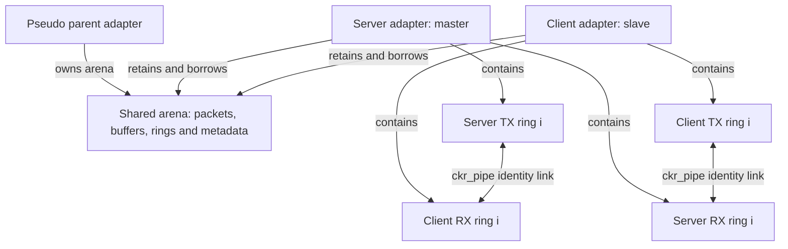
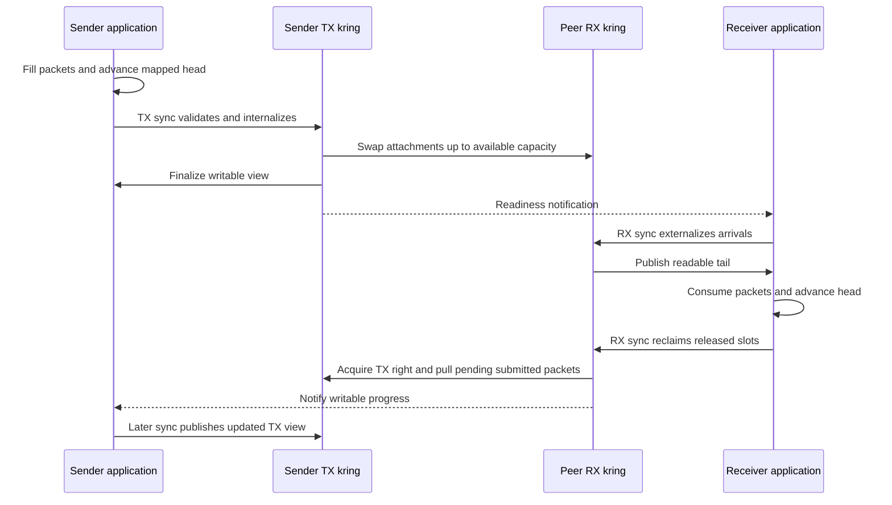
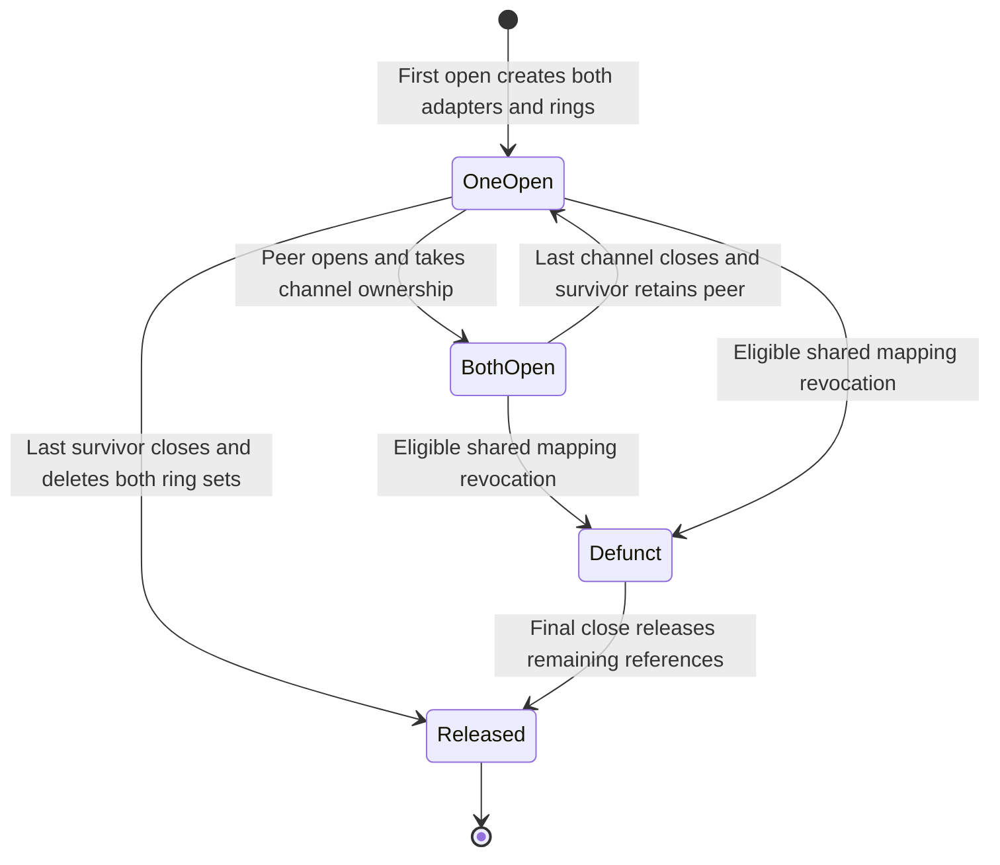
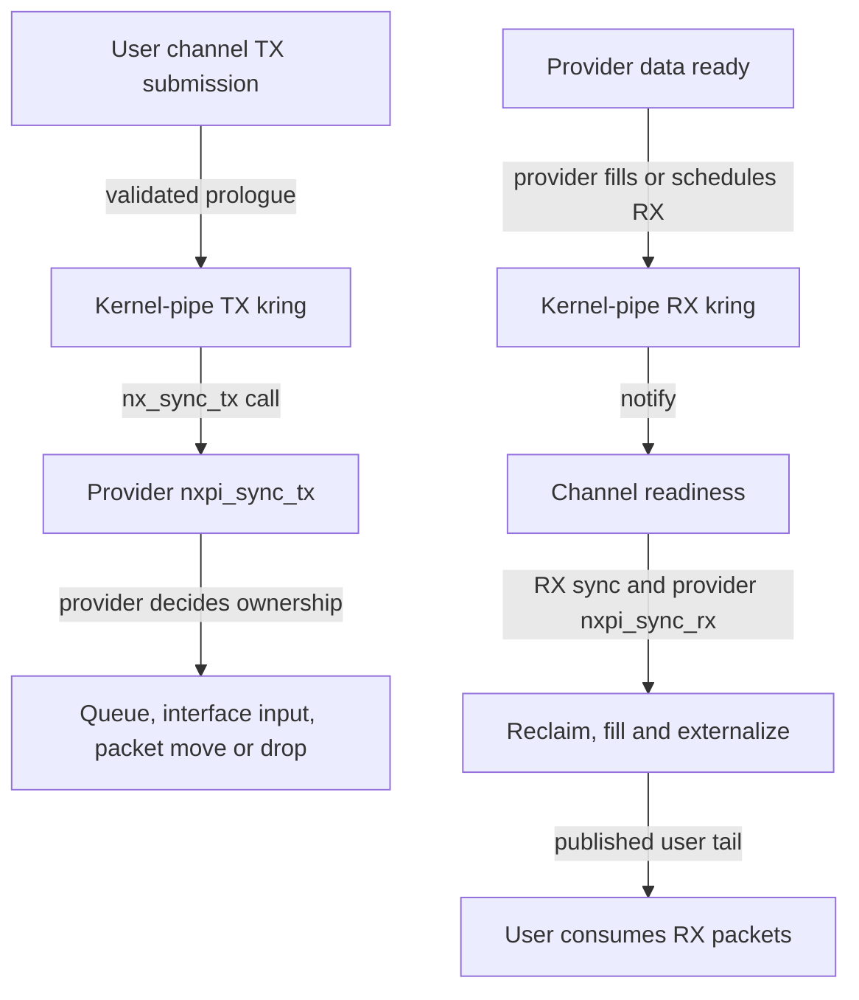
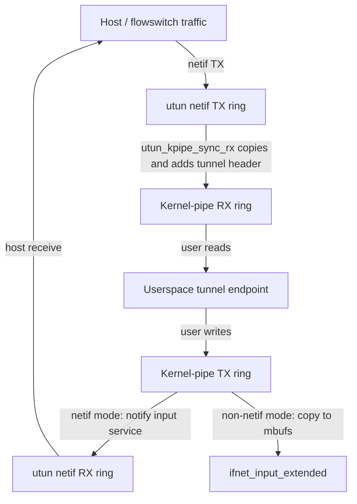

# Skywalk user and kernel pipes

[Networking](README.md) · [Controllers, providers and ports](skywalk-controller-provider-and-port-lifetime.md) · [Channel ABI and readiness](skywalk-channel-abi-and-readiness.md) · [Packet pools](skywalk-packets-buflets-and-pools.md) · [Memory arenas](skywalk-memory-arenas-and-mapping.md)

A Skywalk **user pipe** transports packets between two user-facing adapters by exchanging slot descriptors inside a shared memory arena. A **kernel pipe** presents a user channel to callbacks supplied by a kernel provider. The two domains use the same channel ABI but implement different topology, packet movement and teardown. This chapter traces those mechanisms in `xnu-12377.121.6`, including a ring-index example, provider callbacks and a local `utun` consumer.

These are packet channels, separate from [BSD byte-stream pipes and UNIX sockets](../processes/pipes-and-unix-socket-rights.md). Neither pipe domain intrinsically performs IP routing, transport reliability, encryption or flowswitch classification. A provider can connect a kernel pipe to such machinery, but that behavior comes from its callback bodies.

[IPsec interface lifecycle](ipsec-interface-lifecycle.md) follows another concrete consumer through interface control, netif/kernel-pipe packet movement, transforms and disconnect barriers. It distinguishes those provider operations from the generic pipe protocol explained here.

## 1. Endpoints, rings and memory are different objects

| Object or identity | User pipe | Kernel pipe |
| --- | --- | --- |
| Nexus and public ports | One nexus exposes client port **0** and server port **1**. Server selects the internal master role, client the slave role. | One nexus exposes client port **0**; the kernel provider is reached through callbacks, not a second public port. |
| Domain-private state | `nx_upipe` holds the parent adapter, its endpoint-user count and separate client/server `nxbind` pointers. | `nx_arg` holds the optional client `nxbind`; provider context is a separate nexus facility. |
| Adapter | Two `nexus_upipe_adapter` objects, each embedding `nexus_adapter`, pointing to a peer and retaining a common parent. | `nexus_kpipe_adapter` embeds `nexus_adapter`; it has no user-pipe peer fields. |
| Data rings | Each endpoint owns distinct TX and RX krings. TX ring **i** points to the peer's RX ring **i**, and conversely. | TX and RX rings are supplied to registered synchronization callbacks. The domain does not automatically connect them together. |
| Buffer backing | The parent owns an arena; both endpoint adapters retain and borrow it. | The adapter gets an arena through the domain provider; the nexus stores TX/RX pool pointers for kernel APIs. |
| Packet ownership mode | Slot-attached packets; `CHMODE_USER_PACKET_POOL` is rejected. | Slot-attached mode or an enabled user packet pool; provider capability and channel mode must agree. |

Sources: [port constants](../../../platydoc-data/xnu/bsd/skywalk/nexus/os_nexus.h#L96-L108), [user-pipe state](../../../platydoc-data/xnu/bsd/skywalk/nexus/upipe/nx_user_pipe.h#L60-L88), [kernel-pipe adapter](../../../platydoc-data/xnu/bsd/skywalk/nexus/kpipe/nx_kernel_pipe.h#L60-L68), [user connection selection](../../../platydoc-data/xnu/bsd/skywalk/nexus/upipe/nx_user_pipe.c#L529-L566), [kernel connection selection](../../../platydoc-data/xnu/bsd/skywalk/nexus/kpipe/nx_kernel_pipe.c#L332-L365).

The user-pipe fields that implement peer lifetime are small enough to inspect directly: [`nx_user_pipe.h:70–78`](../../../platydoc-data/xnu/bsd/skywalk/nexus/upipe/nx_user_pipe.h#L70-L78).

<!-- source-excerpt: ../../../platydoc-data/xnu/bsd/skywalk/nexus/upipe/nx_user_pipe.h#L70-L78 -->
```c
	uint32_t        pna_id;                 /* pipe identifier */
	ch_endpoint_t   pna_role;               /* master or slave */

	struct nexus_adapter *pna_parent; /* adapter that owns the memory */
	struct nexus_upipe_adapter *pna_peer; /* the other end of the pipe */
	boolean_t pna_peer_ref; /* 1 iff we are holding a ref to the peer */

	uint32_t pna_parent_slot; /* index in the parent pipe array */
};
```

`pna_peer` establishes identity; `pna_peer_ref` says whether this endpoint currently owns a reference keeping the other endpoint alive. They are not interchangeable. Likewise, a task's mapped ring, the kernel's `__kern_channel_ring`, a slot descriptor and the packet attached to that slot are distinct objects. The [channel ABI chapter](skywalk-channel-abi-and-readiness.md) describes their mapped layouts.

## 2. User-pipe creation fixes geometry and admits each side

### Provider parameters and the one-pair connection path

The domain defaults to one TX and one RX ring per endpoint, 128 slots per ring and 2 KiB buffers. Its bounds allow 2–4096 slots and 1–16 KiB buffers. User-pipe parameter adjustment requires equal **ring counts** in the two directions; it doubles temporary counts used to size the arena for both endpoints. It does not double the `nxp_tx_rings`/`nxp_rx_rings` exposed by each endpoint. The common adjustment code first copies those fields into local geometry variables and passes pointers to those locals to the domain adjustment callback. [Defaults/bounds](../../../platydoc-data/xnu/bsd/skywalk/nexus/upipe/nx_user_pipe.c#L57-L165), [domain adjustment](../../../platydoc-data/xnu/bsd/skywalk/nexus/upipe/nx_user_pipe.c#L289-L305), [temporary geometry](../../../platydoc-data/xnu/bsd/skywalk/nexus/nexus_kern.c#L1956-L1995).

TX and RX slot counts need not be identical: the transfer loop uses independent limits and modulo arithmetic for the two rings. A request for more rings does not create more public ports. `nx_upipe_dom_connect()` selects the role from the port, forces `RING_SET_DEFAULT`, and sets **`cr_pipe_id = 0`**. The parent adapter's generic pipe array can hold up to 64 pipe identifiers, but that capacity is not evidence that this domain connection API lets a user choose 64 independent pairs. [Connection normalization](../../../platydoc-data/xnu/bsd/skywalk/nexus/upipe/nx_user_pipe.c#L551-L566), [generic pipe array](../../../platydoc-data/xnu/bsd/skywalk/nexus/upipe/nx_user_pipe.c#L700-L792), [maximum](../../../platydoc-data/xnu/bsd/skywalk/nexus/upipe/nx_user_pipe.h#L60-L61).

The channel selects all rings or one ring ID through the common `na_interp_ringid()` path. Multiple channels can refer to the same endpoint adapter through distinct selected ring IDs. The earlier `ch_open()` gate rejects overlapping `{port, ring_id}` ownership, including an all-rings request overlapping any existing selection. `na_krings_use()` also checks per-ring users and exclusive flags. Thus “two endpoints” does not mean exactly two descriptors, nor does opening another descriptor manufacture independent ring indices. Conflicting admission returns `EBUSY`. [Ring selection](../../../platydoc-data/xnu/bsd/skywalk/nexus/nexus_adapter.c#L211-L248), [port/ring ownership](../../../platydoc-data/xnu/bsd/skywalk/channel/channel.c#L1618-L1649), [adapter ring admission](../../../platydoc-data/xnu/bsd/skywalk/nexus/nexus_adapter.c#L320-L373).

### Bindings and simultaneous endpoint construction

A named user-pipe provider needs the appropriate client/server binding and a matching supplied `nxbind`. `nx_upipe_dom_bind_port()` moves the prepared binding into `nup_cli_nxb` or `nup_srv_nxb`; duplicate binding returns `EEXIST`, and an unsupported port returns `EDOM`. Unbind removes that binding independently of adapter lifetime. This domain's two private binding pointers should not be mistaken for the generic flowswitch port-table association described in the controller chapter. [Bind/unbind](../../../platydoc-data/xnu/bsd/skywalk/nexus/upipe/nx_user_pipe.c#L432-L510), [credential comparison](../../../platydoc-data/xnu/bsd/skywalk/nexus/upipe/nx_user_pipe.c#L1481-L1495).

Anonymous providers bypass this binding comparison, while the surrounding nexus/channel admission checks still apply. The [binding identity rules](skywalk-controller-provider-and-port-lifetime.md#a-port-binding-and-an-adapter-association-are-independent) explain PID-derived unique identity, executable UUID and key matching; a port number alone is not that authority.

Under `SK_LOCK`, `nx_upipe_na_find()` performs the following construction:

1. Find or create the pseudo parent adapter and its arena, keeping the nexus-private parent reference.
2. Search the parent's array by pipe ID. If a pair exists, select its master or peer by requested role and retain it.
3. Otherwise allocate both endpoints, install the user-pipe synchronization/lifetime callbacks, borrow and retain the parent's arena with `NAF_MEM_LOANED`, and copy the normalized ring geometry.
4. Store the master in the parent's array, link the endpoints, and give each endpoint a parent reference. The requested endpoint retains its initially unopened peer and sets `pna_peer_ref`.
5. Return a retained requested adapter to common channel binding. `nup_pna_users` counts the two endpoint objects, not open descriptors.

See [parent lookup](../../../platydoc-data/xnu/bsd/skywalk/nexus/upipe/nx_user_pipe.c#L1497-L1547), [master/arena setup](../../../platydoc-data/xnu/bsd/skywalk/nexus/upipe/nx_user_pipe.c#L1549-L1607), [peer and reference publication](../../../platydoc-data/xnu/bsd/skywalk/nexus/upipe/nx_user_pipe.c#L1609-L1652), and [returned reference/error cleanup](../../../platydoc-data/xnu/bsd/skywalk/nexus/upipe/nx_user_pipe.c#L1705-L1730). Either public side can open first: “master” identifies the server role, not the first process to open a channel.

Common `na_bind_channel()` creates rings on the first channel, checks ring usability, creates that descriptor's schema and activates the adapter. `na_connect()` then maps the arena into the task and publishes `CSM_ACTIVE`; syscall fd publication happens later. A failure during ring setup cleans up initialized rings; failure after schema creation uses `na_disconnect()` to unmap/release the provisional channel. [Binding and rollback](../../../platydoc-data/xnu/bsd/skywalk/nexus/nexus_adapter.c#L435-L617), [mapping and rollback](../../../platydoc-data/xnu/bsd/skywalk/nexus/nexus_adapter.c#L2607-L2696), [fd publication](../../../platydoc-data/xnu/bsd/skywalk/channel/channel_syscalls.c#L137-L283).

## 3. Paired rings exchange attachments within one arena

At the first open, `nx_upipe_na_rings_create()` allocates **both endpoints'** krings, user rings and slot storage, saves the user-ring pointers in `ckr_save_ring`, then cross-links corresponding directions. Failure setting up the second side tears down the first. The two sides do not share a single producer/consumer index structure. [Setup and rollback](../../../platydoc-data/xnu/bsd/skywalk/nexus/upipe/nx_user_pipe.c#L1091-L1129).

The exact cross-link is [`nx_user_pipe.c:1131–1141`](../../../platydoc-data/xnu/bsd/skywalk/nexus/upipe/nx_user_pipe.c#L1131-L1141):

<!-- source-excerpt: ../../../platydoc-data/xnu/bsd/skywalk/nexus/upipe/nx_user_pipe.c#L1131-L1141 -->
```c
	/* cross link the krings */
	for_rx_tx(t) {
		/* swap NR_TX <-> NR_RX (skip host ring) */
		enum txrx r = sk_txrx_swap(t);
		for (i = 0; i < na_get_nrings(na, t); i++) {
			NAKR(na, t)[i].ckr_pipe =
			    NAKR(&pna->pna_peer->pna_up, r) + i;
			NAKR(&pna->pna_peer->pna_up, r)[i].ckr_pipe =
			    NAKR(na, t) + i;
		}
	}
```



The links are kernel pointers. They do not transfer packets by themselves. Separate channel schemas and task virtual mappings describe views into the common arena; a packet buffer's address in one task is not a transferable pointer into the other task. The domain creates its arena without storing pools on the nexus because user pipes are not exposed as external kernel-provider clients. [Arena construction](../../../platydoc-data/xnu/bsd/skywalk/nexus/upipe/nx_user_pipe.c#L329-L357), [borrowed arena references](../../../platydoc-data/xnu/bsd/skywalk/nexus/upipe/nx_user_pipe.c#L1563-L1578), [per-channel schema offsets](../../../platydoc-data/xnu/bsd/skywalk/nexus/nexus_adapter.c#L729-L785).

User-pipe ring setup prepopulates both TX and RX slots with packets. In contrast, ordinary kernel-pipe RX slots start without attached packets; the population helper explicitly skips them. The user-pipe TX prologue validates and internalizes submitted metadata; its TX-specific finalize callback is deliberately `NULL`. Its RX prologue is the **no-detach** variant, and RX finalize externalizes newly arrived metadata. The ordinary kernel-pipe path instead uses the normal detach/replenish callbacks, or the UPP variants. [Population call](../../../platydoc-data/xnu/bsd/skywalk/nexus/nexus_adapter.c#L2000-L2039), [domain-specific population](../../../platydoc-data/xnu/bsd/skywalk/nexus/nexus_adapter.c#L2178-L2255), [callback selection](../../../platydoc-data/xnu/bsd/skywalk/nexus/nexus_adapter.c#L1570-L1625), [TX metadata validation](../../../platydoc-data/xnu/bsd/skywalk/channel/channel_ring.c#L467-L509), [RX no-detach](../../../platydoc-data/xnu/bsd/skywalk/channel/channel_ring.c#L831-L881).

For each accepted user-pipe transmission, `nx_upipe_na_txsync_locked()` swaps the source TX and destination RX **kernel and user slot descriptor contents**. Packet data bytes stay in their existing arena buffer. The destination now refers to the transmitted packet; the sender gets the previously attached destination packet as reusable storage. No allocation-ring ownership handoff or payload copy is performed by this swap. [Transfer loop](../../../platydoc-data/xnu/bsd/skywalk/nexus/upipe/nx_user_pipe.c#L917-L949).

The actual `SD_SWAP` definition repairs each moved quantum's `qum_ksd` back-pointer. The transfer site's older comment mentions `sd_user`; the current macro is the evidence for what is updated: [`channel_var.h:653–661`](../../../platydoc-data/xnu/bsd/skywalk/channel/channel_var.h#L653-L661).

<!-- source-excerpt: ../../../platydoc-data/xnu/bsd/skywalk/channel/channel_var.h#L653-L661 -->
```c
#define SD_SWAP(_ksd1, _usd1, _ksd2, _usd2) do {                        \
	_USD_SWAP(_usd1, _usd2);                                        \
	_KSD_SWAP(_ksd1, _ksd2);                                        \
	/* swap packet attachment */                                    \
	*(struct __kern_slot_desc **)(uintptr_t)&(_ksd1)->sd_qum->qum_ksd = \
	    (_ksd1); \
	*(struct __kern_slot_desc **)(uintptr_t)&(_ksd2)->sd_qum->qum_ksd = \
	    (_ksd2); \
} while (0)
```

This is a statement about this local transfer, not an end-to-end zero-copy guarantee for arbitrary Skywalk providers. Slot attachment also expresses a protocol ownership boundary; it does not establish per-packet VM isolation between tasks mapping the arena.

## 4. Submission, transfer and user-visible completion occur separately

### Index meanings and the one-empty-slot rule

A ring with `N` slots has usable capacity `N-1`. Initialization sets `ckr_khead = ckr_rhead = 0`; TX tails start at `N-1`, RX tails at zero. [Initialization](../../../platydoc-data/xnu/bsd/skywalk/channel/channel_ring.c#L84-L98).

| Field | Meaning on the path traced here |
| --- | --- |
| User `ring_head` | TX: boundary of slots submitted by the application. RX: boundary of slots the application has consumed/released. |
| Kernel `ckr_rhead` | Last validated user head. Advancing user memory alone does not update this value. |
| TX `ckr_khead` | Next submitted source slot the kernel has not yet transferred. |
| RX `ckr_ktail` | Next destination slot at which the kernel can append an arriving packet, subject to free capacity. |
| RX `ckr_khead` | Boundary of RX slots whose release the kernel has reclaimed. |
| `ckr_rtail`, user `ring_tail` and `ring_khead` | Kernel state last published to this user-ring view by generic sync finalization; not necessarily the latest peer-driven internal progress. |

`os_channel_advance_slot()` only moves the mapped `ring_head` to the position after the last supplied slot. `os_channel_sync()` enters `__channel_sync()`, which acquires the ring's sync right, validates/internalizes new submissions, calls the domain callback and, if successful, finalizes the mapped view. The ring is protected against concurrent sync by `kr_enter()`/`kr_exit()`, while channel and adapter lifetime use their separate locks/references. [User wrappers](../../../platydoc-data/xnu/libsyscall/wrappers/skywalk/os_channel.c#L943-L980), [sync wrapper](../../../platydoc-data/xnu/libsyscall/wrappers/skywalk/os_channel.c#L820-L831), [syscall dispatch](../../../platydoc-data/xnu/bsd/skywalk/channel/channel_syscalls.c#L443-L524), [sync-right implementation](../../../platydoc-data/xnu/bsd/skywalk/channel/channel_ring.c#L100-L149).

The source's “lock” terminology includes this sleepable per-ring ownership right; it is not a spin lock held across the entire callback. `kr_enter(kr, TRUE)` can wait for another owner. User-pipe RX's comment about skipping when it cannot get the peer lock should not be read as the implemented policy: the body passes `TRUE` and waits. [RX-assisted transfer](../../../platydoc-data/xnu/bsd/skywalk/nexus/upipe/nx_user_pipe.c#L1054-L1068).

### The bounded transfer and publication fence

Under the **source TX** ring's ownership right, the transfer routine first checks `KR_DROP` on both rings. Then it computes pending TX slots and destination capacity using wrap-aware arithmetic. Its count is the smaller of those two values. A full destination moves zero packets and returns success; remaining submitted packets stay pending in TX. [Drop check and capacity](../../../platydoc-data/xnu/bsd/skywalk/nexus/upipe/nx_user_pipe.c#L874-L915).

The capacity calculation is [`nx_user_pipe.c:882–899`](../../../platydoc-data/xnu/bsd/skywalk/nexus/upipe/nx_user_pipe.c#L882-L899):

<!-- source-excerpt: ../../../platydoc-data/xnu/bsd/skywalk/nexus/upipe/nx_user_pipe.c#L882-L899 -->
```c
	/* # of new tx slots */
	n = txkring->ckr_rhead - txkring->ckr_khead;
	if (n < 0) {
		n += txkring->ckr_num_slots;
	}
	limit = n;

	/* # of rx busy (unclaimed) slots */
	b = j - rxkring->ckr_khead;
	if (b < 0) {
		b += rxkring->ckr_num_slots;
	}

	/* # of rx avail free slots (subtract busy from max) */
	m = lim_rx - b;
	if (m < limit) {
		limit = m;
	}
```

The loop starts at destination `ckr_ktail` and source `ckr_khead`, swaps one descriptor pair per packet and advances each index modulo its own ring size. It requires the source packet to have both `QUM_F_INTERNALIZED` and `QUM_F_FINALIZED`. After the swaps, a fence precedes publication of the receiver's new tail because the sender does not hold the receiver's ring ownership right. [`Publication`](../../../platydoc-data/xnu/bsd/skywalk/nexus/upipe/nx_user_pipe.c#L956-L964):

<!-- source-excerpt: ../../../platydoc-data/xnu/bsd/skywalk/nexus/upipe/nx_user_pipe.c#L956-L964 -->
```c
	/*
	 * Make sure the slots are updated before ckr_ktail reach global
	 * visibility, since we are not holding rx ring's kr_enter().
	 */
	os_atomic_thread_fence(seq_cst);

	rxkring->ckr_ktail = j;
	txkring->ckr_khead = k;
	txkring->ckr_ktail = SLOT_PREV(k, lim_tx);
```

Successful transfer notifies the destination RX ring, but the sender's callback does not run the destination's generic RX finalizer. A receiving sync/readiness pass externalizes arrivals and publishes the new user `ring_tail`. Conversely, RX-assisted movement may advance the sender's kernel head before the sender runs a finalizer that publishes its user `ring_khead`. [Sender notification](../../../platydoc-data/xnu/bsd/skywalk/nexus/upipe/nx_user_pipe.c#L834-L843), [TX publication](../../../platydoc-data/xnu/bsd/skywalk/channel/channel_ring.c#L1209-L1258), [RX externalization/publication](../../../platydoc-data/xnu/bsd/skywalk/channel/channel_ring.c#L1271-L1302), [RX finalizer](../../../platydoc-data/xnu/bsd/skywalk/channel/channel_ring.c#L1384-L1409).

### Receiver-driven progress and readiness

RX sync first calls `kr_reclaim()`, advancing RX `ckr_khead` to the validated `ckr_rhead` with a visibility fence. It then checks destination room and already-submitted work in the peer TX kring. If both exist, it acquires the peer TX right and runs the same bounded transfer routine. This is how consumption releases pressure and can immediately pull pending packets. It does **not** read a newly advanced peer user `ring_head` and internalize unsynchronized submissions: the pending count uses the peer's kernel `ckr_rhead`. [Reclaim](../../../platydoc-data/xnu/bsd/skywalk/channel/channel_ring.c#L426-L461), [RX calculations and fence](../../../platydoc-data/xnu/bsd/skywalk/nexus/upipe/nx_user_pipe.c#L1003-L1029).

The decisive branch is [`nx_user_pipe.c:1064–1070`](../../../platydoc-data/xnu/bsd/skywalk/nexus/upipe/nx_user_pipe.c#L1064-L1070):

<!-- source-excerpt: ../../../platydoc-data/xnu/bsd/skywalk/nexus/upipe/nx_user_pipe.c#L1064-L1070 -->
```c
	if (__probable(n != 0 && m != 0)) {
		(void) kr_enter(txkring, TRUE);
		n = nx_upipe_na_txsync_locked(txkring, p, flags, &ret, TRUE);
		kr_exit(txkring);
	} else {
		n = 0;
	}
```

If RX reclaimed or transferred anything, it notifies the peer TX ring. The default notifier posts channel readiness through `na_post_event()`; select/kqueue processing can perform synchronization before evaluating readable/writable low-water counts. A notification is a reason to re-evaluate state, not a payload, a completed user copy or a guarantee of room after another thread runs. The existing [readiness chapter](skywalk-channel-abi-and-readiness.md) follows these filters. [RX notification](../../../platydoc-data/xnu/bsd/skywalk/nexus/upipe/nx_user_pipe.c#L1072-L1088), [default notifier](../../../platydoc-data/xnu/bsd/skywalk/nexus/nexus_adapter.c#L1131-L1149), [readiness sync](../../../platydoc-data/xnu/bsd/skywalk/channel/channel.c#L1247-L1388).



This diagram omits error branches and the reverse direction. Every arrow naming a notification is asynchronous; arrows naming sync are calls in the calling thread.

## 5. Worked example: an eight-slot pair fills and recovers

Assume one direction, client TX to server RX, with **eight slots on each ring**, `lim = 7`, and no competing channels. Packet letters below are illustrative identities, not values observed from a running kernel. Start with TX `khead = rhead = 0`, `ktail = 7`; RX `khead = ktail = 0`.

| Step | Kernel state or transfer | What the application can observe immediately |
| --- | --- | --- |
| Client fills slots 0–6 and advances its head to 7 | Kernel TX `rhead` remains 0 until a TX prologue runs. | Client has zero writable slots. Server still has zero readable slots. An RX sync alone finds no **submitted** TX work yet. |
| Client TX sync | Prologue sets TX `rhead = 7`; `n = 7`, RX busy `b = 0`, free `m = 7`. Transfer swaps TX0↔RX0 through TX6↔RX6. TX becomes `khead = 7`, `ktail = 6`; RX `ktail = 7`. | TX finalization publishes seven reusable slots. Server's mapped tail can still be 0 until its RX processing runs. |
| Client fills its next seven slots: 7,0,1,2,3,4,5; advances head to 6; TX sync | Pending count is `6-7+8 = 7`, but RX busy is 7 and free capacity is 0. No transfer occurs; TX retains `khead = 7`, `rhead = 6`. | Success does not mean all seven packets reached RX. Client remains full. |
| Server RX sync, then consumes three arrivals and advances head to 3 | First sync publishes RX tail 7. Reading/advancing alone does not reclaim kernel capacity. | Four old arrivals remain visible before another sync. |
| Server RX sync again | Reclaim sets RX `khead = 3`; `b = 7-3 = 4`, `m = 3`. Pending TX count is 7. Swaps TX7↔RX7, TX0↔RX0, TX1↔RX1; RX `ktail = 2`, TX `khead = 2`, `ktail = 1`. | Server gets a full seven-slot readable span 3,4,5,6,7,0,1. Client's mapped `ring_khead` can still be 7, so its local count remains stale until TX processing publishes 2. |
| Client's next TX sync | RX is full, so no further packets move. Generic finalization nevertheless publishes TX `khead = 2`. Four packets remain pending: TX2–TX5. | Client now observes `8 - ((6-2) mod 8) - 1 = 3` writable slots. |

For the first swap, suppose TX0 names packet **A** and RX0 names reusable packet **B**. Afterwards RX0 names A and TX0 names B; both quantum back-pointers are repaired. A's payload buffer has not moved. Reading A does not free A from the pool: the no-detach RX prologue leaves it attached until a later swap or teardown. This separates **slot position**, **packet identity**, **buffer backing**, **kernel progress** and **published user progress**.

The arithmetic follows [the transfer loop](../../../platydoc-data/xnu/bsd/skywalk/nexus/upipe/nx_user_pipe.c#L879-L964), [RX reclaim](../../../platydoc-data/xnu/bsd/skywalk/channel/channel_ring.c#L449-L458) and [the wrapper's available-slot calculation](../../../platydoc-data/xnu/libsyscall/wrappers/skywalk/os_channel.c#L943-L962). The in-tree [`skt_fullupipe` test](../../../platydoc-data/xnu/tests/skywalk/skt_fullupipe.c#L71-L264) exercises the same distinction with 100 slots: RX cannot pull unsynchronized submissions, then can pull already-submitted packets after reclaiming space. The test was read, not executed.

## 6. Close, absent peers and defunct are separate transitions

### References keep the paired objects alive

Both endpoint adapters and both ring sets can exist before the second endpoint has any channel. This is why TX/RX callbacks can dereference `ckr_pipe` without discovering a live peer process on every call. An unopened peer can accumulate packets up to its RX capacity, after which submissions remain pending. Object existence does not guarantee a receiver is running. [Pair construction](../../../platydoc-data/xnu/bsd/skywalk/nexus/upipe/nx_user_pipe.c#L1627-L1652), [transfer capacity](../../../platydoc-data/xnu/bsd/skywalk/nexus/upipe/nx_user_pipe.c#L874-L915).

The reference handoff is:

| State transition | Reference action |
| --- | --- |
| First side opens | Its adapter retains the other endpoint and sets its own `pna_peer_ref`. |
| Second side activates | Its new channel reference replaces the peer-owned reference; activation clears the other endpoint's flag and releases the extra reference to itself. |
| Last channel on one side closes while the other side remains | Deactivation retains the closing adapter on behalf of the survivor and sets the survivor's `pna_peer_ref`. The closed side's rings remain available for the paired mechanism. |
| Last surviving side closes | Its ring-delete path tears down both sets; its destructor drops the held peer reference and each endpoint's parent reference. |

The last-channel condition comes from `na_unbind_channel()`, not merely the user-pipe callback's comments. [Common last-channel teardown](../../../platydoc-data/xnu/bsd/skywalk/nexus/nexus_adapter.c#L625-L690), [activation handoff](../../../platydoc-data/xnu/bsd/skywalk/nexus/upipe/nx_user_pipe.c#L1270-L1326).

The close-side reference is taken before the channel releases its own reference: [`nx_user_pipe.c:1313–1320`](../../../platydoc-data/xnu/bsd/skywalk/nexus/upipe/nx_user_pipe.c#L1313-L1320).

<!-- source-excerpt: ../../../platydoc-data/xnu/bsd/skywalk/nexus/upipe/nx_user_pipe.c#L1313-L1320 -->
```c
	case NA_ACTIVATE_MODE_OFF:
		SK_DF(SK_VERB_USER_PIPE,
		    "%p: case 2.b, grab peer", SK_KVA(na));
		if (!pna->pna_peer->pna_peer_ref) {
			na_retain_locked(na);
			pna->pna_peer->pna_peer_ref = TRUE;
		}
		break;
```



The states summarize endpoint activity, not exact adapter refcounts or every channel. The source saves/restores user-ring pointers during ring creation/reopening/deletion. Although surrounding historical comments describe “hidden” rings, the activation body shown above primarily changes activity and references; it does not itself clear a ring pointer. [Reopen path](../../../platydoc-data/xnu/bsd/skywalk/nexus/upipe/nx_user_pipe.c#L1195-L1233), [ring deletion](../../../platydoc-data/xnu/bsd/skywalk/nexus/upipe/nx_user_pipe.c#L1351-L1412).

The master destructor removes the pair's array entry using swap-with-last compaction and repairs the moved entry's parent index. Both endpoints drop parent references; the final decrement of `nup_pna_users` also releases the nexus-private parent reference and clears `nup_pna`. [Array removal](../../../platydoc-data/xnu/bsd/skywalk/nexus/upipe/nx_user_pipe.c#L779-L792), [endpoint destructor](../../../platydoc-data/xnu/bsd/skywalk/nexus/upipe/nx_user_pipe.c#L1414-L1444).

### Reject-on-close changes admission, not the pairing representation

`nx_upipe_dom_disconnect()` calls common disconnect, then sets nexus-wide `NXF_REJECT` if `nxp_reject_on_close` is enabled. Subsequent channel activity can fail the common permissiveness check with `ENXIO`. This is broader than releasing one ring and should not be described as automatic BSD EOF semantics. With that policy disabled, adapter/ring retention still applies; eventual capacity exhaustion is separate from rejection. [Policy branch](../../../platydoc-data/xnu/bsd/skywalk/nexus/upipe/nx_user_pipe.c#L571-L589), [sync rejection](../../../platydoc-data/xnu/bsd/skywalk/channel/channel_syscalls.c#L403-L421).

The local peer-closure regression expects `ENXIO` **with `rejectonclose = 1` in its initializer**. Its name alone does not prove every user pipe rejects activity whenever a peer descriptor closes. [Test setup](../../../platydoc-data/xnu/tests/skywalk/skt_fullupipe.c#L43-L62), [close assertion](../../../platydoc-data/xnu/tests/skywalk/skt_fullupipe.c#L332-L346).

### Defunct revokes views before final storage destruction

For an eligible user-pipe defunct operation, the domain locks the two relevant TX directions in a fixed master-first order, including the TX kring reached from its own RX ring. It marks channel rings defunct while holding the same rights the sender and RX-assisted transfer use, then releases those two rights in reverse order for each ring index. Both transfer directions therefore observe the drop state rather than continuing into revoked peer mappings. [Defunct serialization](../../../platydoc-data/xnu/bsd/skywalk/nexus/upipe/nx_user_pipe.c#L592-L639).

The shared-arena mapping lifecycle matters here: finalization is called after the arena has no valid mappings for these channels. It invokes `na_defunct()` for **both** endpoint adapters, then for the pseudo parent that owns the arena. Borrowed adapters release slots without independently destroying the shared owner's memory. The generic lifecycle chapter covers eligibility, mapping redirection and opportunistic skip conditions. [User-pipe finalization](../../../platydoc-data/xnu/bsd/skywalk/nexus/upipe/nx_user_pipe.c#L642-L684), [owner-versus-borrower teardown](../../../platydoc-data/xnu/bsd/skywalk/nexus/nexus_adapter.c#L2722-L2756), [defunct foundation](skywalk-lifecycles.md#defunct-serializes-kernel-work-and-revokes-mapped-access).

## 7. Kernel pipes delegate packet decisions to a provider

### Registration, connection and pool variants

User registration cannot create a kernel-pipe provider. The kernel registers a provider with versioned callbacks, including required TX/RX sync and connection callbacks. The default kernel-pipe domain then supplies adapter construction and channel mapping. `nx_kpipe_na_find()` checks the optional client binding and creates a new adapter on its creation path; it does not search for a retained user-pipe peer pair. Provider-specific connection policy can impose additional constraints. [Registration admission](../../../platydoc-data/xnu/bsd/skywalk/nexus/nexus.c#L1497-L1633), [required callbacks](../../../platydoc-data/xnu/bsd/skywalk/nexus/nexus_kern.c#L810-L905), [kernel-pipe find/create](../../../platydoc-data/xnu/bsd/skywalk/nexus/kpipe/nx_kernel_pipe.c#L696-L783).

The domain permits `NXPCAP_USER_PACKET_POOL` in addition to user-channel capability. With UPP enabled it sizes allocation/free rings to 128 slots, permits user writes to the relevant slot-descriptor regions, and marks the adapter `NAF_USER_PKT_POOL`. `na_bind_channel()` rejects a mismatch between that adapter flag and `CHMODE_USER_PACKET_POOL`. The ownership hash, allocation/free sync and metadata validation are the [packet-pool mechanisms](skywalk-packets-buflets-and-pools.md), not user-pipe `SD_SWAP`. [Parameter adjustment](../../../platydoc-data/xnu/bsd/skywalk/nexus/kpipe/nx_kernel_pipe.c#L474-L504), [adapter UPP setup](../../../platydoc-data/xnu/bsd/skywalk/nexus/kpipe/nx_kernel_pipe.c#L747-L763), [mode match](../../../platydoc-data/xnu/bsd/skywalk/nexus/nexus_adapter.c#L462-L480).

Kernel-pipe arena creation supplies `nx_tx_pp` and `nx_rx_pp`, allowing the provider to obtain its pools during pre-connect. The constructor requests ring/slot context storage with `na_rings_mem_setup(na, TRUE, ch)`. A nearby comment assumes IOSkywalkFamily consumers, but the local loopback and `utun` implementations below demonstrate that the actual callback boundary is also used by C providers. [Pool storage](../../../platydoc-data/xnu/bsd/skywalk/nexus/kpipe/nx_kernel_pipe.c#L507-L535), [pool lookup](../../../platydoc-data/xnu/bsd/skywalk/nexus/kpipe/nx_kernel_pipe.c#L567-L581), [context allocation](../../../platydoc-data/xnu/bsd/skywalk/nexus/kpipe/nx_kernel_pipe.c#L675-L685).

Connection proceeds through pre-connect, initialized rings/slots and connected; disconnect follows only the successfully completed stages. The wrapper drops `SK_LOCK`, retains the channel and reacquires `ch_lock` around external callbacks. A pre-connect failure does not receive disconnected; a later failure after successful pre-connect does, while pre-disconnect requires the fully connected flag. See [callback stages and partial failure](../../../platydoc-data/xnu/bsd/skywalk/nexus/nexus.c#L1261-L1384) and the [controller chapter](skywalk-controller-provider-and-port-lifetime.md#external-connection-callbacks-bracket-channel-resources).

### Sync callbacks and the kernel ring API

The kernel-pipe adapter does almost no packet work in its TX/RX sync bodies. It maps force-reclaim/force-read into `nx_sync_tx()`/`nx_sync_rx()`, which call the registered `nxpi_sync_*` with `KERN_NEXUS_SYNCF_COMMIT` when appropriate. Whether packets are copied, attached elsewhere, queued or dropped belongs to the provider. [Adapter dispatch](../../../platydoc-data/xnu/bsd/skywalk/nexus/kpipe/nx_kernel_pipe.c#L610-L637).

The actual TX dispatch is [`nexus_var.h:606–618`](../../../platydoc-data/xnu/bsd/skywalk/nexus/nexus_var.h#L606-L618):

<!-- source-excerpt: ../../../platydoc-data/xnu/bsd/skywalk/nexus/nexus_var.h#L606-L618 -->
```c
nx_sync_tx(struct __kern_channel_ring *kring, boolean_t commit)
{
	struct kern_nexus_provider *nxprov = NX_PROV(KRNA(kring)->na_nx);

	ASSERT(kring->ckr_tx == NR_TX);
	if (nxprov->nxprov_ext.nxpi_sync_tx != NULL) {
		return nxprov->nxprov_ext.nxpi_sync_tx(nxprov,
		           KRNA(kring)->na_nx, kring,
		           (commit ? KERN_NEXUS_SYNCF_COMMIT : 0));
	} else {
		return 0;
	}
}
```

The API's directions are from the **user channel's** perspective:

| Kernel API on a ring | TX ring | RX ring |
| --- | --- | --- |
| `kern_channel_available_slot_count()` | Number of submitted slots between kernel head and validated user head. | Free destination slots after subtracting unclaimed RX occupancy. |
| `kern_channel_get_next_slot(ring, NULL, …)` | Starts at `ckr_khead`; returns pending user transmission. | Starts at `ckr_ktail`; returns room for a packet destined for userspace. |
| `kern_channel_advance_slot()` | Consumes through the supplied slot through `kr_txkring_reclaim_and_refill()`. | Publishes internal `ckr_ktail` after the last filled slot. |
| `kern_channel_reclaim()` | Currently no-op advice; the provider's TX advancement does actual consumption. | Reclaims user-released positions by updating `ckr_khead`. |
| `kern_channel_notify()` | Notifies potential writable progress. | Notifies potential readable progress. It rejects a drop-state ring. |

See [available and next-slot helpers](../../../platydoc-data/xnu/bsd/skywalk/channel/channel_kern.c#L44-L158), [advance](../../../platydoc-data/xnu/bsd/skywalk/channel/channel_kern.c#L161-L190), [reclaim implementation](../../../platydoc-data/xnu/bsd/skywalk/channel/channel_ring.c#L426-L461), and [attach/detach](../../../platydoc-data/xnu/bsd/skywalk/channel/channel_kern.c#L294-L327). Slot iteration/advance require Skywalk sync protection. They are not a license to keep an unretained ring pointer and call it from arbitrary contexts.



This diagram intentionally does not connect TX to RX automatically. A loopback provider supplies that relationship; a tunnel provider supplies a different one.

### A complete local example: the development loopback provider

`nx_kpipe_loopback.c` is compiled for `DEVELOPMENT || DEBUG`. Its startup registers an external kernel-pipe domain provider, creates a controller, registers the callback vector and creates an instance. Ring/slot initialization records and checks context values; pre-connect obtains the built-in pools. The default setup uses the ordinary slot-attached mode. [Build guard and state](../../../platydoc-data/xnu/bsd/skywalk/nexus/kpipe/nx_kpipe_loopback.c#L29-L59), [callback registration](../../../platydoc-data/xnu/bsd/skywalk/nexus/kpipe/nx_kpipe_loopback.c#L533-L615), [instance creation](../../../platydoc-data/xnu/bsd/skywalk/nexus/kpipe/nx_kpipe_loopback.c#L684-L718).

Its TX callback checks both available TX submissions and RX capacity. With no pair of slots it returns success without advancing either side. Otherwise it reads and validates the TX packet/buflet, exercises metadata setters, detaches the packet from TX and attaches that **same handle** to RX. This uses the packet API, unlike user-pipe descriptor swapping. [`Packet movement`](../../../platydoc-data/xnu/bsd/skywalk/nexus/kpipe/nx_kpipe_loopback.c#L430-L434):

<!-- source-excerpt: ../../../platydoc-data/xnu/bsd/skywalk/nexus/kpipe/nx_kpipe_loopback.c#L430-L434 -->
```c
		tph = kern_channel_slot_get_packet(ring, ts);
		VERIFY(tph != 0);
		VERIFY(kern_channel_slot_detach_packet(txkring, ts, tph) == 0);
		VERIFY(kern_packet_finalize(tph) == 0);
		VERIFY(kern_channel_slot_attach_packet(rxkring, rs, tph) == 0);
```

It advances each ring through the last processed slot, records statistics, advises TX reclaim and notifies RX. Generic finalization later replenishes empty non-UPP TX slots and externalizes arrivals. Its RX callback reclaims consumed slots, enters the TX ring, runs the TX prologue/callback/finalizer, exits and notifies TX on the normal path. [Loop bounds and no-progress return](../../../platydoc-data/xnu/bsd/skywalk/nexus/kpipe/nx_kpipe_loopback.c#L350-L364), [advance/notify](../../../platydoc-data/xnu/bsd/skywalk/nexus/kpipe/nx_kpipe_loopback.c#L436-L466), [RX-assisted loopback](../../../platydoc-data/xnu/bsd/skywalk/nexus/kpipe/nx_kpipe_loopback.c#L469-L509), [non-UPP refill](../../../platydoc-data/xnu/bsd/skywalk/channel/channel_ring.c#L1104-L1165).

The test provider deliberately injects errors at registration/connection/ring/slot/sync stages. In particular error injection **9** occurs after packet movement, advancement and notification: an error does not undo that progress. At the syscall layer a nonzero sync callback becomes `EIO` and skips that ring's generic finalizer; a bad prologue produces `EFAULT` and can trigger process termination for malformed shared state. This debug provider is evidence for callback/API behavior, not proof that all its exceptional paths or every production provider are correct. [Injection macro](../../../platydoc-data/xnu/bsd/skywalk/nexus/kpipe/nx_kpipe_loopback.c#L68-L74), [post-progress injection](../../../platydoc-data/xnu/bsd/skywalk/nexus/kpipe/nx_kpipe_loopback.c#L446-L466), [syscall error mapping](../../../platydoc-data/xnu/bsd/skywalk/channel/channel_syscalls.c#L460-L518), [bad metadata termination](../../../platydoc-data/xnu/bsd/skywalk/channel/channel_ring.c#L713-L722).

## 8. A real consumer: kernel-pipe directions through utun

The local `utun` provider registers `utun_kpipe_sync_tx` and `utun_kpipe_sync_rx` with connection/ring callbacks; optional UPP is selected by its provider attributes. Ring initialization matches the channel's nexus UUID against the PCB's pipe-instance array and stores RX/TX ring pointers plus an index context. Ring finalization clears the matching pointer. [Registration](../../../platydoc-data/xnu/bsd/net/if_utun.c#L1439-L1492), [ring context](../../../platydoc-data/xnu/bsd/net/if_utun.c#L3550-L3603).

The same word “TX” changes meaning across its two channel interfaces:



For **user-to-kernel TX**, `utun_kpipe_sync_tx()` first enters the PCB data-movement lifetime gate. If the pipe is no longer allocated it returns without consuming work. In netif mode it only notifies the netif RX ring when there is submitted TX data; that callback does not itself copy the packet. In the non-netif branch it copies usable packet bytes into an mbuf, converts the leading address-family word from network order, queues the mbufs, advances the visited TX slots and passes the mbuf list to `ifnet_input_extended()`. A skipped/disabled packet can still have its TX slot consumed. [Entry/notification](../../../platydoc-data/xnu/bsd/net/if_utun.c#L3605-L3642), [mbuf conversion and consumption](../../../platydoc-data/xnu/bsd/net/if_utun.c#L3644-L3705).

For **kernel-to-user RX**, `utun_kpipe_sync_rx()` reclaims released RX slots and obtains the corresponding netif TX ring. It drops the PCB shared lock before entering that ring, reacquires the lock and revalidates that the saved ring is still the PCB's current one. This is an explicit lock-drop/revalidation boundary, not a stable-pointer assumption. [Reclaim and revalidation](../../../platydoc-data/xnu/bsd/net/if_utun.c#L3710-L3783).

It then detaches each source packet, allocates a destination packet from the kernel-pipe RX pool, builds the tunnel header, copies payload bytes, finalizes the new packet and attaches it to the RX slot. It accumulates detached source packets for later freeing and advances both rings for the progress actually made. Source detachment/selection occurs **before** destination allocation; if allocation fails, the selected source is still in the cleanup chain and its source slot is included in the consumed prefix. The source is not automatically preserved for retry merely because no destination packet was produced. [Detach/allocation ordering](../../../platydoc-data/xnu/bsd/net/if_utun.c#L3794-L3825), [header, copy and attachment](../../../platydoc-data/xnu/bsd/net/if_utun.c#L3835-L3905), [cleanup and progress](../../../platydoc-data/xnu/bsd/net/if_utun.c#L3917-L3946).

These local branches demonstrate why kernel-pipe movement must be traced through the provider: loopback moves a packet handle, user pipe swaps descriptors, and this `utun` RX path allocates and copies into another pool. The tunnel's userspace protocol implementation and every IPsec/utun mode are outside this chapter.

## 9. Kernel-pipe defunct preserves provider-facing storage until disconnect

After `na_connect()` succeeds, `nx_kpipe_dom_connect()` increments the arena's kernel-slot-descriptor **no-idle** assertion. A provider may still be using kernel ring/slot APIs when userspace mappings are defuncted. Consequently, channel defunct and final descriptor destruction have different deadlines. [`The assertion`](../../../platydoc-data/xnu/bsd/skywalk/nexus/kpipe/nx_kernel_pipe.c#L355-L365):

<!-- source-excerpt: ../../../platydoc-data/xnu/bsd/skywalk/nexus/kpipe/nx_kernel_pipe.c#L355-L365 -->
```c
	err = na_connect(nx, ch, chr, nxb, p);
	if (err == 0) {
		/*
		 * Mark the kernel slot descriptor region as busy; this
		 * prevents it from being torn-down at channel defunct
		 * time, as the (external) nexus owner may be calling
		 * KPIs that require accessing the slots.
		 */
		skmem_arena_nexus_sd_set_noidle(
			skmem_arena_nexus(ch->ch_na->na_arena), 1);
	}
```

Defunct acquires the selected TX/RX ring rights before marking them unusable; this includes providers such as `utun` that enter rings outside a channel sync syscall. Generic ring teardown depopulates attached packets and revokes user-ring state, but retains kernel slot-descriptor fields while the region is busy. Final teardown requires that busy assertion to be gone. `nx_kpipe_dom_disconnect()` decrements it before common disconnect. Retaining descriptor storage therefore does not promise its packets or user mapping remain usable. [Domain defunct](../../../platydoc-data/xnu/bsd/skywalk/nexus/kpipe/nx_kernel_pipe.c#L392-L450), [kernel slot storage gate](../../../platydoc-data/xnu/bsd/skywalk/nexus/nexus_adapter.c#L2051-L2130), [disconnect decrement](../../../platydoc-data/xnu/bsd/skywalk/nexus/kpipe/nx_kernel_pipe.c#L371-L389).

Provider callbacks must also stop their own asynchronous work. `utun_nexus_pre_disconnect()` calls `utun_wait_data_move_drain()`: it clears data-path readiness, then waits for the in-flight data-movement count to reach zero. `utun_data_move_begin()` increments only while ready; `utun_data_move_end()` decrements and wakes drainers. On the normal successful connection path, connected/disconnected balance an `ifnet` I/O reference, and ring-fini removes the PCB's ring pointers. The failed `ifnet_get_ioref()` branch returns `ENXIO`; this normal-path description does not claim every callback failure has identical reference effects. This lifetime gate complements ring serialization and the arena no-idle count; none substitutes for the others. [Connection/disconnection](../../../platydoc-data/xnu/bsd/net/if_utun.c#L3496-L3547), [data movement gate/drain](../../../platydoc-data/xnu/bsd/net/if_utun.c#L3982-L4041).

The loopback provider similarly distinguishes disabling its public instance from final domain-provider release: stop closes the instance and provider/controller, deregisters the domain provider, and uses final `kplo_dom_fini()` to clear busy state and wake the waiter. Existing references can delay finalization. [Stop](../../../platydoc-data/xnu/bsd/skywalk/nexus/kpipe/nx_kpipe_loopback.c#L721-L783), [final callback](../../../platydoc-data/xnu/bsd/skywalk/nexus/kpipe/nx_kpipe_loopback.c#L99-L114).

## 10. Configuration, test evidence and limits

Both domains require their respective `CONFIG_NEXUS_USER_PIPE`/`CONFIG_NEXUS_KERNEL_PIPE` attachment under Skywalk. Domain presence, controller privilege, provider capabilities, named binding and channel mode are separate checks. Both reject event-ring and low-latency channel requests on these paths. The user-pipe domain always rejects UPP; kernel-pipe capability can enable it. [Build/domain selection](../../../platydoc-data/xnu/config/MASTER#L85-L89), [domain attachment](../../../platydoc-data/xnu/bsd/skywalk/nexus/nexus_kern.c#L88-L167), [user rejected modes](../../../platydoc-data/xnu/bsd/skywalk/nexus/upipe/nx_user_pipe.c#L529-L549), [kernel rejected modes](../../../platydoc-data/xnu/bsd/skywalk/nexus/kpipe/nx_kernel_pipe.c#L332-L347).

| In-tree evidence read | Mechanism it exercises or documents | Scope limit |
| --- | --- | --- |
| [`skt_fullupipe.c`](../../../platydoc-data/xnu/tests/skywalk/skt_fullupipe.c#L43-L264) | Full RX, pending TX, receiver-assisted transfer, stale versus synchronized user views. | Uses 100 equal-sized slots and one ring per direction; not every asymmetric/wrap/race case. |
| [`skt_upipepeerclosure` in the same file](../../../platydoc-data/xnu/tests/skywalk/skt_fullupipe.c#L267-L361) | Peer close followed by rejected sync. | Explicit reject-on-close configuration, not unconditional EOF semantics. |
| [`skt_bind.c`](../../../platydoc-data/xnu/tests/skywalk/skt_bind.c#L407-L438) | Anonymous binding rejection and named client/server key setup through common helpers. | Does not exhaust identity/privilege combinations. |
| [`skt_ringid.c`](../../../platydoc-data/xnu/tests/skywalk/skt_ringid.c#L44-L142) | Four-ring registration, all-ring versus selected-ring exposure, invalid ID rejection. | Ring enumeration, not concurrent packet ordering across all rings. |
| [`skt_pllupipe.c`](../../../platydoc-data/xnu/tests/skywalk/skt_pllupipe.c#L29-L68) | Parallel endpoint worker setup, with related readiness variants later in the file. | Its own TODO calls out a multiple-rings-per-channel variant. |
| [`skt_shutdown2.c`](../../../platydoc-data/xnu/tests/skywalk/skt_shutdown2.c#L154-L193) | User/kernel-pipe shutdown while select/poll/kqueue waits. | Relies on test prerequisites and the debug kernel-pipe provider; not a result from this documentation work. |
| [`skywalk_test_common.c`](../../../platydoc-data/xnu/tests/skywalk/skywalk_test_common.c#L799-L829) and [`nx_kpipe_loopback.c`](../../../platydoc-data/xnu/bsd/skywalk/nexus/kpipe/nx_kpipe_loopback.c#L850-L869) | Enables the development loopback provider and discovers its nexus UUID. | Build-conditional sysctls and injected errors do not establish production availability. |
| [`skt_utun27302538.c`](../../../platydoc-data/xnu/tests/skywalk/skt_utun27302538.c#L181-L205) | Named regressions for cleanup of a `utun` kernel pipe while a channel is in kevent. | A focused regression family, not all provider disconnect interleavings. |

The review follows the two domain implementations, shared adapter/ring helpers, local channel wrappers, the development loopback provider, and selected `utun` callback/cleanup bodies. No kernel or in-tree test was built or run. External IOSkywalkFamily/provider bodies, userspace tunnel services, every provider callback implementation and a complete concurrency proof remain outside the available trace. 

<!-- BEGIN PLATYDOC DOCUMENTATION LICENSE -->
Original Platydoc text and diagrams are licensed under [CC BY 4.0](https://creativecommons.org/licenses/by/4.0/). Quoted source code and third-party material retain their respective licenses.
<!-- END PLATYDOC DOCUMENTATION LICENSE -->
