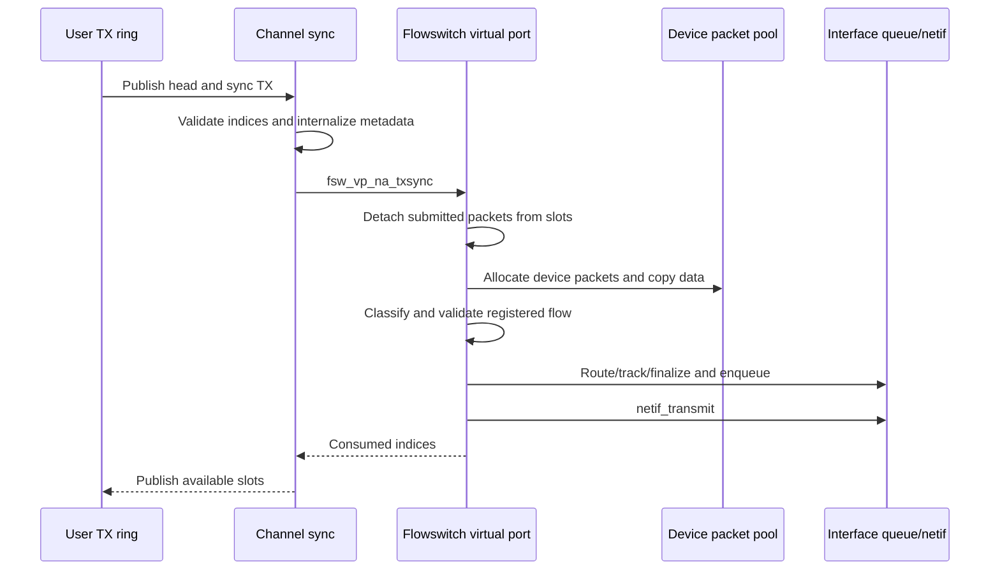

# Skywalk channels and flowswitch

[Back to networking](README.md)

For creation and teardown, allocation/free rings, detached RX packets, flow installation, and linger, continue with [Skywalk lifecycles](skywalk-lifecycles.md).

For the control interface, read [controllers, providers and port lifetime](skywalk-controller-provider-and-port-lifetime.md), then [channel ABI, readiness and event delivery](skywalk-channel-abi-and-readiness.md). They explain how a client is admitted, when a descriptor is published, and why a wakeup and a packet-ownership transfer are separate operations.

For packet transformations, continue with [fragment reassembly and passive flow tracking](skywalk-fragments-reassembly-and-flow-tracking.md) and [TCP aggregation, segmentation and offload handoffs](skywalk-tcp-aggregation-segmentation-and-offloads.md). [Netif filtering and reinjection](skywalk-netif-filters-and-reinjection.md) follows retained original packets through read-only filter views; [agents and traffic rules](skywalk-netif-agents-and-traffic-rules.md) explains local rule publication and selection.

## Objects and the userspace boundary

For the storage below these objects, read [packets, buflets and pools](skywalk-packets-buflets-and-pools.md) and [memory arenas and task mappings](skywalk-memory-arenas-and-mapping.md). They explain separate user/kernel metadata, allocator backing, validation, mapping permissions and revocation.

Skywalk provides packet-oriented channels backed by rings and mapped memory, with nexus providers implementing different connections. It is not one replacement `tcp_output()` routine. Netif, flowswitch, user-pipe, and kernel-pipe nexus types have different operations and peers. `SKYWALK` and `CONFIG_NEXUS_*` options are declared in [`config/MASTER`](../../../xnu/config/MASTER#L85); provider registration and interface capabilities impose further runtime requirements.

| Object | Fields to follow | Role |
| --- | --- | --- |
| [`kern_channel`](../../../xnu/bsd/skywalk/channel/channel_var.h#L142) | `ch_lock`, `ch_na`, `ch_nexus`, `ch_pp`, ring ranges, `ch_schema`, `ch_mmap`, flags | One endpoint and its mapped view |
| [`kern_nexus`](../../../xnu/bsd/skywalk/nexus/nexus_var.h#L209) | Provider, UUID, channel list, port table, RX/TX pools | A provider instance with attachment points |
| [`nexus_adapter`](../../../xnu/bsd/skywalk/nexus/nexus_adapter.h#L116) | Ring arrays, arena, references, interface/provider linkage, callbacks | Ring/endpoint implementation attached to a nexus port |
| [`__kern_channel_ring`](../../../xnu/bsd/skywalk/channel/channel_var.h#L323) | Kernel/user heads and tails, slot arrays, busy state, pool, `ckr_na_sync` | Protected kernel state for one ring |
| [`kern_pbufpool`](../../../xnu/bsd/skywalk/packet/pbufpool_var.h#L57) | Lock/references, caches, metadata/buffer regions, user-allocation hashes | Allocation, validation, and reclamation of packet storage |
| [`__kern_packet`](../../../xnu/bsd/skywalk/packet/packet_var.h#L352) | Quantum metadata, common packet data, next-packet link, flow metadata, optional mbuf/packet backing | A packet representation distinct from an mbuf |

[`__channel_open()`](../../../xnu/bsd/skywalk/channel/channel_syscalls.c#L137) creates a `DTYPE_CHANNEL` descriptor and calls `ch_open()`. The latter resolves the nexus, checks its state and port range, constructs binding information for nonanonymous providers, and connects the endpoint. Process unique identity, executable UUID, optional keys, and mode-specific privileges can participate. A channel cannot safely be modeled as an arbitrary user pointer to a kernel ring.

The ring ABI exposes descriptors/metadata rather than trusting user-supplied kernel pointers. The kernel maintains its own slot descriptors and copied indices because userspace can modify its view concurrently. Packet pools track outstanding user allocations and buflet chains. A buflet describes a packet-buffer fragment; metadata, buffer storage, and ring slots have separate lifetimes.

## TX sync validates and transfers ownership

[`__channel_sync()`](../../../xnu/bsd/skywalk/channel/channel_syscalls.c#L356) resolves a channel fd with an I/O reference, locks `ch_lock`, validates sync mode/flags, rejects defunct or inactive endpoints, and enters Skywalk sync protection. It scans the channel's selected ring range and serializes each ring with `kr_enter()`.

For TX it runs `kr_txsync_prologue()`, the ring's provider-specific `ckr_na_sync()`, and `kr_txsync_finalize()` on success. RX and allocation/free rings have corresponding routines. The control flow is explicit: invalid user state is handled before provider transmission, and failure does not authorize blindly advancing all indices.

[`kr_txsync_prologue()`](../../../xnu/bsd/skywalk/channel/channel_ring.c#L658) snapshots user `ring_head` and kernel indices, applies the ring-range/invariant checks, and invokes `ckr_prologue`. For user-packet-pool mode, [`kr_txprologue_upp()`](../../../xnu/bsd/skywalk/channel/channel_ring.c#L513) holds the pool lock, resolves each user metadata index through `pp_remove_upp_locked()`, validates/internalizes metadata and buflets, resets the user slot descriptor, and attaches the packet to the kernel slot. Missing allocations and invalid metadata are rejected; selected invariant failures call `skywalk_kill_process()` with a reason.

[`pp_remove_upp_locked()`](../../../xnu/bsd/skywalk/packet/pbufpool.c#L1690) removes a packet from the outstanding-user-allocation hash and updates accounting before validating/removing associated buflet ownership. This makes the handoff an ownership transition, not just incrementing an index over otherwise unchanged objects. Later freeing returns packets through `pp_free_packet*()` and the pool's caches. Pool references/close state protect the allocator across dependent objects.

[`kr_txsync_finalize()`](../../../xnu/bsd/skywalk/channel/channel_ring.c#L1209) recomputes writable slots/bytes, calls the configured finalize callback, and publishes kernel-known tail/head state into the userspace ring. `ckr_busy`, owner/waiters, and ring state prevent simultaneous sync/modification and support disabling rings before structural teardown. Channel locking, ring serialization, pool locking, and flowswitch locks have different purposes; a mapped page does not eliminate the need for any of them.

## Concrete flowswitch transmit path

[`fsw_vp_na_txsync()`](../../../xnu/bsd/skywalk/nexus/flowswitch/fsw_vp.c#L186) either flushes an active attached port or detaches/frees submitted packets when the ring cannot transmit. For a user port, `fsw_ring_flush()` selects `fsw_user_ring_flush()`. [`fsw_tx_ring_dequeue_pktq()`](../../../xnu/bsd/skywalk/nexus/flowswitch/fsw_dp.c#L1169) moves submitted packets from kernel slots to a packet queue and advances `ckr_khead`/`ckr_ktail`.

The normal non-GSO branch enters [`dp_tx_pktq()`](../../../xnu/bsd/skywalk/nexus/flowswitch/fsw_dp.c#L3608). It takes flowswitch read protection, checks quiescence/device attachment, obtains interface data-movement protection, allocates packets from the device TX pool, and calls `dp_copy_to_dev()`. It then demultiplexes IP, classifies packets, looks up flows, and batches by flow. Source user-pool packets are freed by the surrounding user-ring flush after processing. Consequently this representative path performs a copy between pools; claims that all channel traffic bypasses copying would contradict it.

[`tx_lookup_flow()`](../../../xnu/bsd/skywalk/nexus/flowswitch/fsw_dp.c#L3510) rejects torn-down/offload-only cases and validates the packet flow ID against the flow entry. [`flow_entry`](../../../xnu/bsd/skywalk/nexus/flowswitch/flow/flow_var.h#L256) stores a key/hash, nexus port, receive/transmit queues, processing callbacks, and policy identifiers. A packet's addresses alone do not establish permission to transmit it on any flow.

[`dp_flow_tx_process()`](../../../xnu/bsd/skywalk/nexus/flowswitch/fsw_dp.c#L3350) checks route viability, performs flow tracking, sets flow/policy/traffic-class metadata, finalizes packets, and enqueues into an interface class queue or queue set. `netif_transmit()` then selects starter-thread or doorbell servicing. The exact queue implementation and pacing/GSO branches are separate reading routes; sync completion does not certify physical transmission.

Continue with [namespaces and flow lookup](skywalk-namespaces-and-flow-lookup.md) for reservation/key ownership, and [classification, routes and datapaths](skywalk-flowswitch-classification-routes-and-datapaths.md) for packet parsing, route invalidation and RX/TX decisions.

## Netif and receive-side integration

The [netif queue companion](skywalk-netif-links-queues-and-scheduling.md) follows logical links, qsets, provider initialization, native/compat/host transfer, polling and completion. The shared [interface scheduler chapter](interface-packet-scheduling-and-fq-codel.md) explains AQM admission, FQ-CoDel, pacing, ECN and flow-control feedback.

[`nx_netif_na_txsync()`](../../../xnu/bsd/skywalk/nexus/netif/nx_netif.c#L1755) checks interface attachment/flow control, performs provider sync/reclaim where appropriate, and arranges a doorbell or interface start. [`nx_sync_tx()`](../../../xnu/bsd/skywalk/nexus/nexus_var.h#L606) invokes the external provider's `nxpi_sync_tx`; `nx_tx_doorbell()` similarly delegates. Hardware queue management beyond these callbacks requires the actual provider/driver. Compatibility netif code in [`nx_netif_compat.c`](../../../xnu/bsd/skywalk/nexus/netif/nx_netif_compat.c) and the packet's optional mbuf backing show that mbuf and Skywalk representations coexist.

On receive, device-ring/notification paths can reach `fsw_receive()` and [`_fsw_receive()`](../../../xnu/bsd/skywalk/nexus/flowswitch/fsw_dp.c#L2170). The latter prepares packets, demultiplexes/classifies them, handles fragments, and looks up a receiving flow. Selected packets are batched into flow processing. Unclassified or unmatched packets can be placed on the host path, converted/enqueued for host delivery, and sent upward by `fsw_host_sendup()` after releasing the flowswitch lock. This is why the presence of a flowswitch does not mean all traffic avoids the BSD stack.

For a user-ring destination, [`fsw_ring_enqueue_pktq()`](../../../xnu/bsd/skywalk/nexus/flowswitch/fsw_dp.c#L1236) serializes the ring, attaches packets to available slots, publishes the updated tail after a memory fence, and invokes the notification callback. Channel select/knote hooks and low-water thresholds connect available slots/packets to readiness. RX sync subsequently reconciles the user's consumption with kernel state.

This trace covers ring and pool handoff plus representative flowswitch processing. [Skywalk lifecycles](skywalk-lifecycles.md) expands pool ownership, partial sync, defunct, flow installation/rollback, deletion, and close. Continue with [controllers and ports](skywalk-controller-provider-and-port-lifetime.md) for registration and authority, [channel ABI and readiness](skywalk-channel-abi-and-readiness.md) for options, thresholds and event ownership, [packets, buflets and pools](skywalk-packets-buflets-and-pools.md) for metadata validation, and [memory arenas and mapping](skywalk-memory-arenas-and-mapping.md) for backing and task protections. Receive aggregation, the remaining [flow algorithms](../../../xnu/bsd/skywalk/nexus/flowswitch/flow), and device-specific provider behavior remain separate work.

<!-- BEGIN PLATYDOC DOCUMENTATION LICENSE -->
Original Platydoc text and diagrams are licensed under [CC BY 4.0](https://creativecommons.org/licenses/by/4.0/). Quoted source code and third-party material retain their respective licenses.
<!-- END PLATYDOC DOCUMENTATION LICENSE -->
