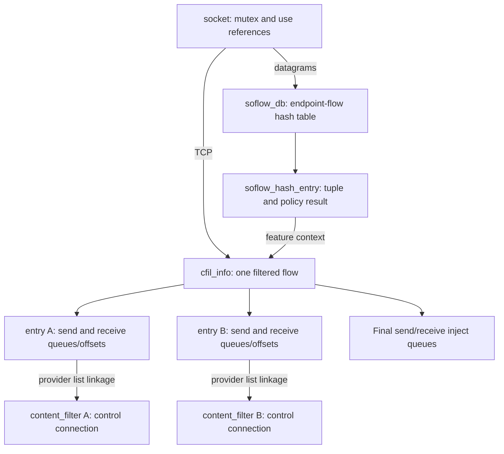
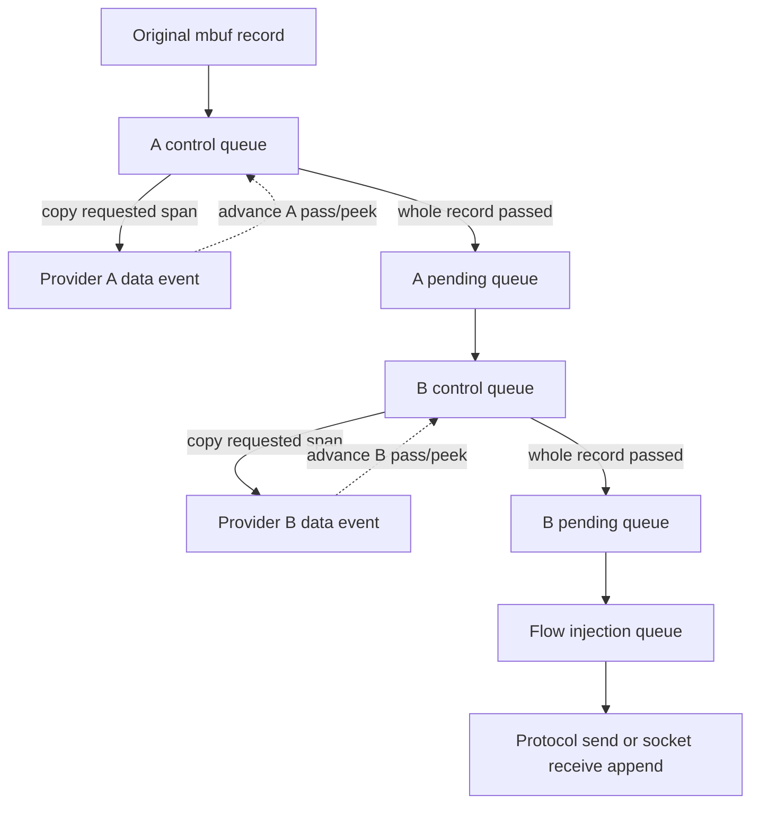
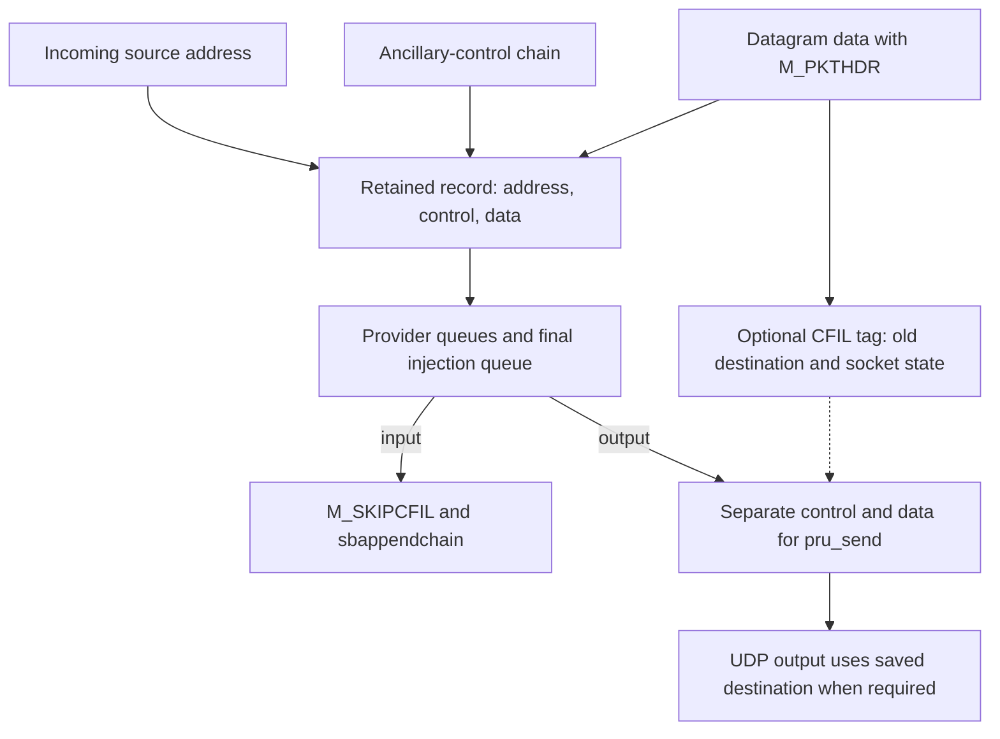

# BSD socket content filtering: byte verdicts, retained data and reinjection

[Networking](README.md) · [Policy overview](policy-extensions.md#content-filters-retain-and-reinject-data) · [Socket I/O ownership](socket-lifecycle-and-io.md) · [Kernel control transport](kernel-control-sockets-and-network-statistics.md) · [UDP](udp-send-receive-and-errors.md)

A socket content filter receives copies of selected outgoing or incoming bytes while XNU retains the original mbufs. The provider returns absolute pass/peek offsets or drops the flow; it does not return replacement payload. Permitted originals proceed through any later filters and then enter the protocol send path or socket receive buffer. This chapter follows the `CONTENT_FILTER` implementation in `xnu-12377.121.6`, including the differences between TCP sockets and per-datagram flows, asynchronous control messages, partial progress and teardown. [Skywalk netif filters](skywalk-netif-filters-and-reinjection.md) intercept interface packets through channels and have a different representation and contract.

## 1. Where the mechanism enters the socket stack

TCP attaches filtering during active IPv4/IPv6 connect and passive child creation. `cfil_sock_attach()` runs with the socket locked, selects eligible Internet TCP streams, obtains the NECP filter result and builds the socket's filtering state. An MPTCP subflow, a content-filter skip flag, and the flow-divert skip case take separate bypass branches. The presence of this mechanism does not establish support for arbitrary protocol operations or TCP urgent-data semantics. [Active connect](../../../platydoc-data/xnu/bsd/netinet/tcp_usrreq.c#L640-L664), [IPv6 connect](../../../platydoc-data/xnu/bsd/netinet/tcp_usrreq.c#L801-L823), [passive child](../../../platydoc-data/xnu/bsd/netinet/tcp_input.c#L2549-L2572), [eligibility macro](../../../platydoc-data/xnu/bsd/net/content_filter.c#L586-L592), [attachment](../../../platydoc-data/xnu/bsd/net/content_filter.c#L3017-L3122).

The data hooks occur before ordinary protocol transmission or receive-buffer publication:

| Boundary | Operation and ownership |
| --- | --- |
| `sosend()` | Calls `sflt_data_out()` first, then `cfil_sock_data_out()`, then `pru_send`. `EJUSTRETURN` means a filter consumed the data/control ownership; the generic path clears its pointers and reports local progress. |
| `sbappendstream()` and related receive append paths | Run input filters before inserting data. Content-filter retention prevents those bytes from becoming application-readable yet. |
| `sbappendaddr()` | Obtains a datagram flow, then invokes socket filters and content filtering with peer address and ancillary data. On `EJUSTRETURN`, it does not free the retained chains; other errors retain normal cleanup semantics. |
| Later reinjection | Output calls the protocol directly through `sosend_reinject()`. Input marks `M_SKIPCFIL` and calls the selected receive append routine. |

[Send sequence and consumed pointers](../../../platydoc-data/xnu/bsd/kern/uipc_socket.c#L2416-L2462), [stream append](../../../platydoc-data/xnu/bsd/kern/uipc_socket2.c#L982-L1045), [datagram input boundary](../../../platydoc-data/xnu/bsd/kern/uipc_socket2.c#L1348-L1393), [reinjection](../../../platydoc-data/xnu/bsd/net/content_filter.c#L4487-L4534).

Consequently, a successful application send can precede a filtering verdict. Likewise, delivery of a data event to the provider does not publish those bytes to the peer or receiving application. Socket-filter callbacks named `sflt_*`, content-filter state named `cfil_*`, and the protocol's `pru_send` are three distinct stages.

## 2. Provider admission, transport units and policy selection

`cfil_init()` registers `com.apple.content-filter` as a privileged, extended kernel control with 512 KiB send and receive defaults and connect/disconnect/send/getopt/setopt/receive callbacks. It does not select stream-control mode, so the kernel control layer requires `SOCK_DGRAM`; that layer checks superuser credentials for `CTL_FLAG_PRIVILEGED`. These are the local registration/admission checks, not a reconstruction of application entitlements or Network Extension provider installation. [Registration](../../../platydoc-data/xnu/bsd/net/content_filter.c#L2614-L2636), [control-socket type and privilege](../../../platydoc-data/xnu/bsd/kern/kern_control.c#L455-L472).

There are three identifiers to keep separate:

| Identifier | Meaning |
| --- | --- |
| Kernel control `sc_unit` / `cf_kcunit` | Selects one of eight controller slots, numbered 1–8; also indexes `cfi_entries[unit - 1]`. |
| `cf_necp_control_unit` | A provider-configured policy selector used in a bitwise intersection with the socket/flow's NECP filter result. It is not the kernel control slot number. |
| `cfi_sock_id` / `cfm_sock_id` | Identifies a filtered TCP socket or a particular datagram flow for multiplexed event/action messages. It is not a pointer or process fd. |

Connect allocates `content_filter`, publishes it in `content_filters[]`, initializes its attached-entry list and increments `cfil_active_count`. Out-of-range or occupied slots fail with `EINVAL` or `EADDRINUSE`. `CFIL_OPT_NECP_CONTROL_UNIT` requires at least a 32-bit value and refuses replacement once the stored selector is nonzero; setting zero does not satisfy that nonzero guard. The body has eight slots irrespective of the older introductory comment about different platform counts. [Controller creation](../../../platydoc-data/xnu/bsd/net/content_filter.c#L1246-L1317), [selector option](../../../platydoc-data/xnu/bsd/net/content_filter.c#L2375-L2391), [slot limit](../../../platydoc-data/xnu/bsd/net/content_filter.c#L362-L390).

TCP attachment bypasses zero, `NECP_FILTER_UNIT_NO_FILTER`, userspace-only results and the no-active-controller case. `cfil_info_attach_unit()` selects every registered provider whose selector intersects the result, then orders entries by ascending **numeric selector value**; equal values follow the existing entries. This is neither exact-equality selection nor simply ascending kernel control slot order. [Policy gating](../../../platydoc-data/xnu/bsd/net/content_filter.c#L3042-L3068), [matching and ordering](../../../platydoc-data/xnu/bsd/net/content_filter.c#L2748-L2801).

Initial attach dispatch selects the first ordered entry. Later providers receive attach when their control queue is serviced; publication of all entries does not mean every provider has already received an event. Attaching sets `SOF_CONTENT_FILTER`, increments `so_usecount`, saves connection direction/addresses and caches the filter result plus policy generation. Attach enqueue `ENOMEM`/`ENOBUFS` is treated as recoverable. If no provider selector matches, the TCP function has already allocated `so_cfil` but returns without setting the successful-attachment flag/reference; its zero return alone is not proof of an active provider association. [TCP publication and dispatch](../../../platydoc-data/xnu/bsd/net/content_filter.c#L3065-L3120), [first-entry selection](../../../platydoc-data/xnu/bsd/net/content_filter.c#L3460-L3483).

## 3. The objects that own state and data

| Object | State and lifetime |
| --- | --- |
| `content_filter` | One connected provider: kernel control reference/unit, policy selector, controller flags, attached-entry list and optional signing state. |
| `cfil_info` | One TCP socket or datagram flow: socket pointer, flow ID, flags, cached policy result/generation, socket-flow backpointer, reference count, ordered entries and separate send/receive aggregate state. |
| `cfil_entry` | One provider's participation in that flow: controller linkage, ordered linkage, event/action timestamps, event flags and independent send/receive offset/queue state. |
| `cfe_buf` | `cfe_pass_offset`, `cfe_peek_offset`, `cfe_peeked`, `cfe_ctl_q`, `cfe_pending_q` for one provider and direction. |
| `cfi_buf` | Whole-direction pending cursors and mbuf charges, cached common pass limit and the final `cfi_inject_q`. |
| `cfil_queue` | Queue of original mbuf records plus absolute `q_start`/`q_end`; each record can itself contain an `m_next` chain. |

[Provider and queue definitions](../../../platydoc-data/xnu/bsd/net/content_filter.c#L372-L417), [entry and per-provider buffers](../../../platydoc-data/xnu/bsd/net/content_filter.c#L424-L456), [whole-flow buffers and references](../../../platydoc-data/xnu/bsd/net/content_filter.c#L483-L533), [queue primitives](../../../platydoc-data/xnu/bsd/net/content_filter.c#L1042-L1177).

Allocation initializes all pass, peek and peeked offsets to zero, so new data is initially neither permitted nor requested for inspection. TCP publishes the object through `so_cfil`; datagram filtering links it from `soflow_hash_entry.soflow_feat_ctxt`. Its 64-bit ID combines the low 32 bits of socket generation in the upper half and a TCP PCB flow hash or datagram flow hash in the lower half. `os_refcnt_t` protects `cfil_info` storage independently from the socket use reference. [Allocation, offset initialization and ID construction](../../../platydoc-data/xnu/bsd/net/content_filter.c#L2661-L2745), [reference helpers](../../../platydoc-data/xnu/bsd/net/content_filter.c#L612-L623), [datagram linkage](../../../platydoc-data/xnu/bsd/net/content_filter.c#L6477-L6491).



The figure combines the alternative TCP and datagram ownership routes; one flow does not use both routes simultaneously. Two providers are illustrative, and each direction has its own counters.

## 4. Absolute offsets and whole-record release

Offsets count bytes in one direction from zero. An event interval `[start,end)` contains `end - start` bytes. They are not TCP sequence numbers, packet numbers or offsets into a user buffer. A pass limit can authorize future data without requesting copies. A peek limit requests copies without authorizing delivery. `cfe_peeked` is the highest position already copied or implicitly passed. [`cfil_msg_data_event`](../../../platydoc-data/xnu/bsd/net/content_filter.h#L245-L272), [action fields](../../../platydoc-data/xnu/bsd/net/content_filter.h#L323-L347).

The actual update body only increases limits and raises peek to at least the new pass limit:

[Source: `bsd/net/content_filter.c`, lines 4744–4761](../../../platydoc-data/xnu/bsd/net/content_filter.c#L4744-L4761).

<!-- source-excerpt: ../../../platydoc-data/xnu/bsd/net/content_filter.c#L4744-L4761 -->
```c
	/* Record updated offsets for this content filter */
	if (pass_offset > entrybuf->cfe_pass_offset) {
		entrybuf->cfe_pass_offset = pass_offset;

		if (entrybuf->cfe_peek_offset < entrybuf->cfe_pass_offset) {
			entrybuf->cfe_peek_offset = entrybuf->cfe_pass_offset;
		}
		updated = 1;
	} else {
		CFIL_LOG(LOG_INFO, "pass_offset %llu <= cfe_pass_offset %llu",
		    pass_offset, entrybuf->cfe_pass_offset);
	}
	/* Filter does not want or need to see data that's allowed to pass */
	if (peek_offset > entrybuf->cfe_pass_offset &&
	    peek_offset > entrybuf->cfe_peek_offset) {
		entrybuf->cfe_peek_offset = peek_offset;
		updated = 1;
	}
```

A smaller or equal pass value does not revoke permission. A supplied peek value changes state only when greater than both the current pass and current peek. `CFM_MAX_OFFSET` is `UINT64_MAX`, so supplying it as peek advances the limit to that maximum; do not interpret the header comment as a separate “leave peek unchanged” sentinel. Zero fields cause the controller action dispatcher to skip a direction when both pass and peek for that direction are zero. [Maximum definition](../../../platydoc-data/xnu/bsd/net/content_filter.h#L395-L395), [direction dispatch](../../../platydoc-data/xnu/bsd/net/content_filter.c#L2110-L2137).

The controller queue first advances over **fully permitted records**, moving those originals to the pending queue. If permission stops inside the first record, it advances `cfe_peeked` through the permitted prefix but does not split or release that record. It then copies requested, not-yet-peeked spans into data events. A failed copy/enqueue leaves the original queued and does not advance the successful-peek cursor. [Pass scan](../../../platydoc-data/xnu/bsd/net/content_filter.c#L4160-L4223), [peek scan and cursor update](../../../platydoc-data/xnu/bsd/net/content_filter.c#L4240-L4315).

This differs from the broad file-level description of “pending means sent to userspace and awaiting verdict.” In the inspected implementation, **successful peeking alone does not move a record from `cfe_ctl_q` to `cfe_pending_q`**. The whole-record pass scan performs that move, and pending service immediately attempts the next provider or final injection queue. Queue names must be read together with their bodies. [Queue description](../../../platydoc-data/xnu/bsd/net/content_filter.c#L218-L244), [actual move](../../../platydoc-data/xnu/bsd/net/content_filter.c#L4207-L4223), [pending service](../../../platydoc-data/xnu/bsd/net/content_filter.c#L4615-L4709).

## 5. Multiple filters and a numeric example

`cfil_data_common()` enters the first attached ordered provider. `cfil_data_filter()` transfers the original into that provider's control queue and returns `EJUSTRETURN` even if servicing reports an error: the socket must not free data now owned by a queue. Pending service walks later ordered entries. An attached later provider consumes the record with the same contract; detached entries can return zero and be skipped. Only a record passing every remaining provider enters the whole-flow injection queue. [Initial ordered dispatch](../../../platydoc-data/xnu/bsd/net/content_filter.c#L5285-L5323), [unconditional consumed return](../../../platydoc-data/xnu/bsd/net/content_filter.c#L4386-L4412), [next-provider handoff](../../../platydoc-data/xnu/bsd/net/content_filter.c#L4669-L4703).



Consider two queued TCP data records of 100 and 80 bytes, covering `[0,100)` and `[100,180)`, with A before B. Assume all allocations and event enqueues succeed and the provider attach handshake is complete when each provider acts:

| Action | Exact consequence |
| --- | --- |
| A requests `pass=0, peek=60` | A sees a copy of `[0,60)`. Both originals remain held by A. B has no data yet. |
| A requests `pass=60, peek=100` | A sees the remaining `[60,100)` span. Passing 60 bytes does not split/release the 100-byte first record. |
| A advances pass to 100 | The first original moves through A's pending queue to B's control queue. The second remains at A. |
| B requests `pass=100` | The first record passes the final provider and can be reinjected. An absent peek request does not prevent pass. |
| A advances pass to 180; B advances pass only to 150 | B holds the entire 80-byte second record even though the cumulative permission reaches 150. |
| B advances pass to 180 | The second record can leave filtering. Injection still has its own error/delivery outcome. |

The example describes queue records selected by the kernel path, not an assertion that each application `write()` creates exactly one record. The same whole-record constraint preserves datagram boundaries. After a direction has no pending bytes, `cfil_set_socket_pass_offset()` caches the minimum pass value across attached providers. Future data entirely below that common limit can bypass queueing while updating every entry's offsets consistently. This cache is recomputed only when the aggregate pending span is empty, not on every provider action. [Common-limit calculation](../../../platydoc-data/xnu/bsd/net/content_filter.c#L4818-L4878), [fast-path decision](../../../platydoc-data/xnu/bsd/net/content_filter.c#L5272-L5286), [entry cursor update](../../../platydoc-data/xnu/bsd/net/content_filter.c#L5177-L5215).

## 6. Events, action validation and the initial verdict

All control records begin with `cfil_msg_hdr`: total length, version, type, operation and flow ID. Events include attached, closed, data-in/out, disconnect-in/out and statistics. Actions include data-update, drop, bless-client, set-signing-key and qualify-flow. This is asynchronous messaging multiplexing many filtered flows over one provider connection. [Header and operation numbers](../../../platydoc-data/xnu/bsd/net/content_filter.h#L150-L193).

`cfil_ctl_send()` checks nonnull controller/data, total available length, version, action type and declared length bounded by available bytes. It then validates operation-specific **exact declared sizes**; update/drop use `cfil_msg_action`. Recognized special operations dispatch separately. The callback frees its incoming action mbuf on every exit, so a failed action does not give userspace a kernel-owned retry buffer. [Parsing](../../../platydoc-data/xnu/bsd/net/content_filter.c#L1920-L2034), [action cleanup](../../../platydoc-data/xnu/bsd/net/content_filter.c#L2163-L2178).

For update/drop, it rechecks controller identity, finds and locks the target socket, resolves its flow context, obtains a live `cfil_info` reference, rejects already-dropped or unattached entries, and requires that an attach event was successfully sent. It then enables `CFEF_DATA_START` and records action time. Success of connection setup alone therefore does not start data-event streaming; a provider action is the handshake boundary. [Lookup and action admission](../../../platydoc-data/xnu/bsd/net/content_filter.c#L2035-L2090), [control-queue handshake](../../../platydoc-data/xnu/bsd/net/content_filter.c#L4134-L4149).

A data-update processes output before input. An output error can prevent the input update in the same message; these are not transactional, all-or-nothing changes. `EJUSTRETURN` is normalized to success. `cfil_action_data_pass()` updates offsets, services injection and refreshes the common pass limit, but ignores the injection helper's return value; an accepted action is not a delivery acknowledgement. [Direction sequence](../../../platydoc-data/xnu/bsd/net/content_filter.c#L2110-L2146), [pass wrapper](../../../platydoc-data/xnu/bsd/net/content_filter.c#L4884-L4922).

TCP connection notification has an additional gate: `soisconnected()` consults `cfil_sock_connected_pending_verdict()`. When a protocol connects before the initial verdict, CFIL records that pending notification. Receiving a data-update marks `CFIF_INITIAL_VERDICT` and re-enters `soisconnected()` before processing byte offsets; drop also releases that gate after its drop work. This is one socket-level initial-verdict flag, not proof that every provider has passed every byte. [Socket notification hook](../../../platydoc-data/xnu/bsd/kern/uipc_socket2.c#L190-L204), [gate and completion](../../../platydoc-data/xnu/bsd/net/content_filter.c#L2881-L2925), [update-before-offset behavior](../../../platydoc-data/xnu/bsd/net/content_filter.c#L2103-L2110), [drop ordering](../../../platydoc-data/xnu/bsd/net/content_filter.c#L2155-L2157).

Attach events contain protocol/type, connection direction, process/delegation identities, addresses, audit tokens and a domain-name field. Data events carry addresses, offset range, current delegated-process metadata, flags and copied bytes. `m_copym_mode()` creates the event's data representation; this is a separate mbuf chain and can share external storage under ordinary mbuf-copy rules. The retained original is not transferred to the provider. Failed `ctl_enqueuembuf()` frees the event copy. [Attach construction](../../../platydoc-data/xnu/bsd/net/content_filter.c#L3500-L3578), [data construction and enqueue](../../../platydoc-data/xnu/bsd/net/content_filter.c#L3973-L4078), [mbuf backing](mbuf-allocation-caches-and-pressure.md).

Signing is another distinct boundary: `SET_CRYPTO_KEY` installs a provider key; the local implementation uses HMAC-SHA256 over a domain-separated `cfil_crypto_data` record and optional extra data. The data-event signing function constructs **flow identity/address metadata**, not a digest of the copied content bytes, and may suppress later signing once the local address is current. A `cfd_signature` field is therefore not proof of a per-payload signature. Provider verification/key provisioning is external to this chapter. [Key installation](../../../platydoc-data/xnu/bsd/net/content_filter.c#L5136-L5173), [signed data-event fields](../../../platydoc-data/xnu/bsd/net/content_filter.c#L3267-L3326), [cryptographic input and HMAC](../../../platydoc-data/xnu/bsd/net/content_filter_crypto.c#L93-L167).

## 7. Controller backpressure and a source-level retry limitation

Event delivery checks the controller-wide `CFF_FLOW_CONTROLLED` flag before allocating/copying. An `ENOBUFS` enqueue failure marks both the entry and controller as flow-controlled; `ENOMEM` is recorded separately. While that shared flag is set, other flows multiplexed on the same provider can be prevented from enqueueing events too. Retained data remains in the original flow's queues. [Data-event flow control](../../../platydoc-data/xnu/bsd/net/content_filter.c#L3967-L3971), [failure publication](../../../platydoc-data/xnu/bsd/net/content_filter.c#L4080-L4102), [attach equivalent](../../../platydoc-data/xnu/bsd/net/content_filter.c#L3583-L3607).

`cfil_ctl_rcvd()` clears the controller-wide flag when the provider receives data. Its subsequent code is written as though it will select a blocked entry, retain it, release the global lock, lock the socket and service both directions. However, the actual selection loop has no successful-match `break`:

[Source: `bsd/net/content_filter.c`, lines 2470–2482](../../../platydoc-data/xnu/bsd/net/content_filter.c#L2470-L2482).

<!-- source-excerpt: ../../../platydoc-data/xnu/bsd/net/content_filter.c#L2470-L2482 -->
```c
		/* Find an entry that is flow controlled */
		TAILQ_FOREACH(entry, &cfc->cf_sock_entries, cfe_link) {
			if (entry->cfe_cfil_info == NULL ||
			    entry->cfe_cfil_info->cfi_so == NULL) {
				continue;
			}
			if ((entry->cfe_flags & CFEF_FLOW_CONTROLLED) == 0) {
				continue;
			}
		}
		if (entry == NULL) {
			break;
		}
```

With ordinary `TAILQ_FOREACH` traversal this finishes with `entry == NULL`, and the following branch exits before the service body. Thus this snapshot's callback clears controller flow control but does **not** establish the advertised immediate per-entry retry. Later data or an offset-advancing action can enter queue service again. Do not promise that merely draining the control socket promptly resends every blocked event. This observation records the supplied implementation; it does not alter XNU. [Full callback and unreachable-after-normal-traversal service body](../../../platydoc-data/xnu/bsd/net/content_filter.c#L2420-L2525), [queue traversal macro](../../../platydoc-data/xnu/bsd/sys/queue.h#L668-L671).

## 8. Reinjection consumes data before reporting its result

After all required providers pass a record, it sits in `cfi_inject_q`. The injection helper removes it and reduces aggregate pending charges **before** the protocol call:

[Source: `bsd/net/content_filter.c`, lines 4495–4508](../../../platydoc-data/xnu/bsd/net/content_filter.c#L4495-L4508).

<!-- source-excerpt: ../../../platydoc-data/xnu/bsd/net/content_filter.c#L4495-L4508 -->
```c
		/* Remove data from queue and adjust stats */
		cfil_queue_remove(inject_q, data, datalen);
		cfi_buf->cfi_pending_first += datalen;
		cfi_buf->cfi_pending_mbcnt -= mbcnt;
		cfi_buf->cfi_pending_mbnum -= mbnum;
		cfil_info_buf_verify(cfi_buf);

		if (outgoing) {
			error = sosend_reinject(so, NULL, data, NULL, 0);
			if (error != 0) {
				cfil_info_log(LOG_ERR, cfil_info, "CFIL: Error: sosend_reinject() failed");
				CFIL_LOG(LOG_ERR, "CFIL: sosend() failed %d", error);
				break;
			}
```

`sosend_reinject()` extracts a leading ancillary-control chain if present and calls `pru_send` directly. It does not run the ordinary `sosend()` filtering sequence again. The protocol send interface consumes the transferred chain; a nonzero return cannot be treated as an instruction to resubmit or free that same record. In particular, `CFIF_RETRY_INJECT_OUT` protects a later attempt to drain the **remaining** queue, not restoration of the failed record that was already removed. [Direct protocol call](../../../platydoc-data/xnu/bsd/kern/uipc_socket.c#L2517-L2563), [retry publication](../../../platydoc-data/xnu/bsd/net/content_filter.c#L4558-L4574), [socket send ownership](socket-lifecycle-and-io.md#sending-prepare-reserve-access-then-surrender-the-mbufs).

Input sets `M_SKIPCFIL`, then uses `sbappendstream()` for TCP or `sbappendchain()` for datagram records. The stream append recognizes/clears the marker and skips its filter hooks. Datagram chain append directly links and charges the already-assembled record without invoking those hooks or checking available space. A successful append requests a batched reader wakeup; output requests a writer wakeup after at least one successful injection. Input append failure does not set the injection helper's `error` variable in this body; for example, stream append can free input under `SB_DROP` and return zero without causing CFIL to requeue it. [Input selection and wakeups](../../../platydoc-data/xnu/bsd/net/content_filter.c#L4511-L4556), [stream append ownership](../../../platydoc-data/xnu/bsd/kern/uipc_socket2.c#L982-L1042), [direct datagram record append](../../../platydoc-data/xnu/bsd/kern/uipc_socket2.c#L1279-L1309).

Socket-buffer space release can invoke `cfil_sock_buf_update()`, which checks the direction's retry bit, acquires filter access to the sockbuf and services the queue. Datagram sockets apply equivalent logic across their retained flow contexts. These calls resume queued work without a new provider verdict, but do not rewind already-consumed sends. [TCP retry callback](../../../platydoc-data/xnu/bsd/net/content_filter.c#L5872-L5925), [datagram retry](../../../platydoc-data/xnu/bsd/net/content_filter.c#L6998-L7055).

## 9. Held bytes still consume socket capacity

Retaining data outside `so_snd`/`so_rcv` must not create unlimited apparent socket space. `cfi_pending_last` advances when data enters CFIL; `cfi_pending_first` advances when data bypasses or leaves CFIL. Mbuf capacity and count are separate charges. `cfil_data_length()` begins at the `M_PKTHDR` data portion when a record has leading address/control mbufs; its capacity/count loop follows that data chain. [Length/accounting representation](../../../platydoc-data/xnu/bsd/net/content_filter.c#L987-L1037), [admission charges](../../../platydoc-data/xnu/bsd/net/content_filter.c#L5242-L5270).

`sbspace()` subtracts `cfil_sock_data_space()` with saturation at zero, and `tcp_sbspace()` has a corresponding adjustment. For TCP, “data space” uses the larger of the pending byte span and mbuf-capacity charge, while `cfil_sock_data_pending()` uses the smaller. The latter is used by readiness/close decisions and is not interchangeable with the conservative space charge. Space excludes the current content-filter send owner to avoid charging its own reinjection against itself. Datagram pending-space helpers instead sum the larger value across flows. [Generic space](../../../platydoc-data/xnu/bsd/kern/uipc_socket2.c#L2302-L2326), [TCP space](../../../platydoc-data/xnu/bsd/netinet/tcp_subr.c#L3694-L3716), [distinct TCP helpers](../../../platydoc-data/xnu/bsd/net/content_filter.c#L5786-L5864), [datagram aggregation](../../../platydoc-data/xnu/bsd/net/content_filter.c#L6716-L6780).

For datagrams, exceeding the configured per-flow mbuf-number or capacity threshold returns `EPIPE` and increments a tail-drop counter. The body reverses the newly added mbuf charges but **does not reverse `cfi_pending_last` or the byte-observation counter** before returning. Consequently those cursors are not proof that every counted byte remains backed by a queued record after threshold failure. The tail-drop counter later requests flow cleanup. [Threshold branch](../../../platydoc-data/xnu/bsd/net/content_filter.c#L5252-L5266), [cleanup predicate](../../../platydoc-data/xnu/bsd/net/content_filter.c#L7195-L7218).

## 10. Datagram flow identity, ancillary data and saved socket state

A datagram socket can communicate with several peers. `soflow_db` contains endpoint-flow entries keyed by local/remote addresses and ports; each can carry its own policy result, generation and CFIL context. The socket send and receive paths obtain a referenced flow before policy/filter work and release the temporary reference afterward. `soflow_get_flow()` tries full lookup then remote-only matching, refreshes incomplete local information from socket/control metadata, and only creates a new entry when direction is known. This is more specific than “one socket always has one filter state.” [Database fields](../../../platydoc-data/xnu/bsd/kern/socket_flows.h#L31-L101), [lookup and reference acquisition](../../../platydoc-data/xnu/bsd/kern/socket_flows.c#L1159-L1244), [send integration](../../../platydoc-data/xnu/bsd/kern/uipc_socket.c#L2067-L2097), [receive integration](../../../platydoc-data/xnu/bsd/kern/uipc_socket2.c#L1350-L1393).

`cfil_sock_udp_handle_data()` requires the supplied flow/database, consumes the **flow's** stored filter selector, and bypasses skip/no-filter/userspace-only cases. A missing required flow returns `EPIPE`. `cfil_sock_udp_get_info()` creates and attaches context, takes one socket use reference per filtered flow and publishes the feature pointer/ID. Its cache comparison can preserve an existing flow for unchanged policy generation or the preserve-connections option; otherwise it closes/unlinks the old CFIL context and creates a new one. It does not necessarily destroy the underlying endpoint-flow entry. [Datagram gate](../../../platydoc-data/xnu/bsd/net/content_filter.c#L6506-L6585), [replacement and publication](../../../platydoc-data/xnu/bsd/net/content_filter.c#L6393-L6503), [NECP publication into flow results](../../../platydoc-data/xnu/bsd/net/necp.c#L10835-L10849).

Before queueing the first filter, CFIL makes a single record with `sbconcat_mbufs()`: incoming address, optional ancillary control, then data; outgoing has no leading address record. A `KERNEL_TAG_TYPE_CFIL_UDP` tag on the data stores socket state-change count, options, PCB flags and the original peer address/port. Data events inspect the data portion, while the retained ancillary/address chain survives to reinjection. The tag allocation is nonblocking and its return is ignored by `cfil_data_common()`, so a saved-state tag is not guaranteed for every admitted record. [Concatenation and ignored tag result](../../../platydoc-data/xnu/bsd/net/content_filter.c#L5290-L5306), [saved-state tag](../../../platydoc-data/xnu/bsd/net/content_filter.c#L7307-L7344), [record concatenation](../../../platydoc-data/xnu/bsd/kern/uipc_socket2.c#L1200-L1307).



UDP output unlinks the tag and takes ownership of freeing it. IPv4 restores the saved peer for an unconnected/reconnected socket as applicable and considers saved `SO_DONTROUTE`/`SO_BROADCAST` bits. IPv6 compares socket state-change count and destination/scope before deciding to use saved peer information. Thus an application changing its UDP peer while a datagram is held need not redirect that old datagram to the new peer. The exact protocol branch and presence of the tag still matter. [Tag transfer](../../../platydoc-data/xnu/bsd/net/content_filter.c#L7348-L7378), [IPv4 saved destination](../../../platydoc-data/xnu/bsd/netinet/udp_usrreq.c#L1697-L1725), [saved options](../../../platydoc-data/xnu/bsd/netinet/udp_usrreq.c#L2108-L2117), [IPv6 comparison](../../../platydoc-data/xnu/bsd/netinet6/udp6_output.c#L231-L253).

Non-TCP/UDP datagram protocols have optional-IP-header rules. Data events flag headers where applicable; incoming IPv4 raw/ICMP filtering can postpone stripping until reinjection, using saved PCB options. This chapter traces those hooks without claiming a complete raw-socket or extension-header specification. [Event flag construction](../../../platydoc-data/xnu/bsd/net/content_filter.c#L4021-L4043), [strip helper](../../../platydoc-data/xnu/bsd/net/content_filter.c#L4416-L4443).

## 11. Lock ordering and references across waits

The socket mutex protects ordinary per-flow state. `cfil_lck_rw` protects the global provider array/lists and controller linkage; socket-linked modifications also need the relevant socket protection. Never infer that holding a `cfil_info` reference supplies either lock. Provider disconnect and action lookup explicitly separate storage references from obtaining a valid locked socket. [Locking contract](../../../platydoc-data/xnu/bsd/net/content_filter.c#L264-L291), [disconnect handoff](../../../platydoc-data/xnu/bsd/net/content_filter.c#L1405-L1446).

Flow-ID lookup scans the TCP, UDP and raw PCB lists. TCP requires generation and flow hash; datagram lookup first locates the generation-bearing socket, then resolves the complete feature ID in its flow database. `cfil_socket_safe_lock()` obtains a PCB wanted reference, drops the PCB list lock, acquires a socket use reference/mutex and rechecks the PCB state while releasing the wanted reference. It avoids waiting for a socket mutex while holding the PCB table lock. [Lookup](../../../platydoc-data/xnu/bsd/net/content_filter.c#L1700-L1778), [wanted-reference handoff](../../../platydoc-data/xnu/bsd/net/content_filter.c#L1673-L1697), [feature-ID resolution](../../../platydoc-data/xnu/bsd/kern/socket_flows.c#L657-L693).

`cfil_acquire_sockbuf()` waits while another operation holds `SB_LOCK` or another content-filter thread owns `sb_cfil_thread`. `msleep()` releases/reacquires the socket's protocol-selected mutex. On first ownership it sets both `sb_cfil_thread` and `SB_LOCK`; nested calls from that owner increment `sb_cfil_refs`. Last release clears both and wakes lock waiters. The function can return `EPIPE` after acquiring ownership when the flow is dropped, so callers still execute release. Its old comment saying it does not set `SB_LOCK` is contradicted by the actual assignment. [Acquire](../../../platydoc-data/xnu/bsd/net/content_filter.c#L1548-L1613), [release](../../../platydoc-data/xnu/bsd/net/content_filter.c#L1617-L1647).

Callers must reconsider attachment after sleeping because close/provider detach can run while the socket mutex is released. The controller-disconnect path retains `cfil_info`, drops the global lock, finds/locks the socket by ID, passes both directions, reacquires the global lock and rechecks linkage before unlinking. It drops that global lock again before a final `CFIL_INFO_FREE`, because final destruction takes it internally. [Revalidation and final-reference release](../../../platydoc-data/xnu/bsd/net/content_filter.c#L1455-L1520).

## 12. Policy changes, blessing, drop and provider disconnect

For TCP data, a newly required filter on a pre-existing unfiltered eligible socket returns `EPIPE` unless preservation is enabled. A changed positive selector on an existing filtered socket either updates the cached selector when policy generation is unchanged/preservation applies, or rejects data. This path does not rebuild the provider-entry chain on every selector change. The preserve-connections global flag is enabled only when every connected provider examined by the option update requests preservation. Datagram replacement follows the different per-flow behavior above. [TCP output policy gates](../../../platydoc-data/xnu/bsd/net/content_filter.c#L5355-L5386), [input equivalent](../../../platydoc-data/xnu/bsd/net/content_filter.c#L5438-L5469), [preservation aggregation](../../../platydoc-data/xnu/bsd/net/content_filter.c#L1320-L1344).

`BLESS_CLIENT` finds a socket by NECP client UUID. If already filtered it passes both directions for the calling provider; otherwise it sets `SOF1_CONTENT_FILTER_SKIP`. This is not an unconditional rewrite of every provider's offsets. `QUALIFY_FLOW` forwards UUID/protocol/local/remote fields plus the caller's configured selector to `necp_client_qualify_flow()`; it is a policy/client-flow operation, separate from queued byte permission. [Bless](../../../platydoc-data/xnu/bsd/net/content_filter.c#L5070-L5101), [qualify handoff](../../../platydoc-data/xnu/bsd/net/content_filter.c#L5104-L5133).

`DROP` marks the flow `CFIF_DROP`, flushes queues and marks the issuing entry detached. Without a datagram flow database it calls `sosetdefunct()`/`sodefunct()` to disconnect the socket; with per-datagram state it avoids making the entire shared socket defunct. Further data on the dropped flow fails. Guard-proxy/flow-divert verdict hooks are additional calls, not evidence that CFIL implements the remote diversion provider. [Drop body](../../../platydoc-data/xnu/bsd/net/content_filter.c#L4997-L5067), [queue flush](../../../platydoc-data/xnu/bsd/net/content_filter.c#L4926-L4994).

Controller disconnect takes a different route from DROP: it marks `CFF_DETACHING`, forces attach/data-start flags for retained entries, and attempts `CFM_MAX_OFFSET` pass/peek in both directions before unlinking the provider. These pass results are ignored and queue state may remain; disconnect is not a guarantee that every retained byte has reached its destination. Final removal frees the provider's stats/signing state, clears its slot and decrements active count. When this is the last provider, cached flow policy state is cleared for later reevaluation. [Disconnect draining/unlinking](../../../platydoc-data/xnu/bsd/net/content_filter.c#L1378-L1510), [controller finalization](../../../platydoc-data/xnu/bsd/net/content_filter.c#L1521-L1543).

## 13. Shutdown, close and delayed protocol teardown

Shutdown-read can proceed because the process has declined further input. Shutdown-write may wait for outgoing filtering: CFIL records `CFIF_SHUT_WR`, attempts disconnect events, and returns `EJUSTRETURN` for write-only shutdown when pending data remains. A combined shutdown is reduced to read-only work for the immediate call. After injection drains output, CFIL invokes the final protocol shutdown. Outgoing disconnect events themselves return `EBUSY` while that provider's control queue is nonempty; incoming disconnect has no equivalent queue-empty gate. [Shutdown decisions](../../../platydoc-data/xnu/bsd/net/content_filter.c#L5498-L5575), [event ordering](../../../platydoc-data/xnu/bsd/net/content_filter.c#L3641-L3665), [deferred completion](../../../platydoc-data/xnu/bsd/net/content_filter.c#L4578-L4587), [socket shutdown integration](../../../platydoc-data/xnu/bsd/kern/uipc_socket.c#L4403-L4417).

Socket close calls CFIL wait, closed notification/final flush, then detach. TCP close waits with `msleep(PSOCK | PCATCH)` and the configurable `cfil_close_wait_timeout` (default 1000 ms), rechecking context after wakeup. A timeout or interrupt stops the wait. A zero-error wakeup can repeat the loop, so this is a per-wait timeout, not proof of an absolute one-second total close bound. The special loopback/no-initial-verdict case can suppress waiting. [Close integration](../../../platydoc-data/xnu/bsd/kern/uipc_socket.c#L1130-L1139), [TCP wait](../../../platydoc-data/xnu/bsd/net/content_filter.c#L5703-L5781), [default and special case](../../../platydoc-data/xnu/bsd/net/content_filter.c#L391-L395), [no-wait predicate](../../../platydoc-data/xnu/bsd/net/content_filter.c#L594-L610).

Passing `CFM_MAX_OFFSET` in both directions marks a provider entry effectively detached. During close-wait, empty send/receive control queues also satisfy the effective-detach branch; this flag is distinct from clearing the provider pointer or freeing `cfil_info`. Datagrams iterate flow contexts, wait on a selected attached flow, and revalidate its ID-to-context mapping after sleeping. Timeout marks the selected entry detached. [Effective detach](../../../platydoc-data/xnu/bsd/net/content_filter.c#L4777-L4805), [datagram close wait](../../../platydoc-data/xnu/bsd/net/content_filter.c#L6595-L6681), [outer datagram wait](../../../platydoc-data/xnu/bsd/net/content_filter.c#L6928-L6946).

The closed path attempts closed events, gives passed output one final injection opportunity, sets `CFIF_SOCK_CLOSED` and drains retained queues. Detach drops CFIL's socket use reference and object reference. Final `cfil_info_free()` removes provider/global/statistics linkage and drains every remaining injection/control/pending queue before freeing storage. Closed-event transport errors do not prevent this cleanup. [Closed path](../../../platydoc-data/xnu/bsd/net/content_filter.c#L5583-L5621), [TCP detach](../../../platydoc-data/xnu/bsd/net/content_filter.c#L3125-L3142), [final release](../../../platydoc-data/xnu/bsd/net/content_filter.c#L2805-L2874).

CFIL can also defer PCB death or TCP FIN time-wait handling while filtered data is pending. Flags record the postponed operation; injection completion checks them and calls the corresponding helper again. These are local protocol-lifetime dependencies, separate from waiting for the provider's control socket to disconnect. [Delayed PCB death](../../../platydoc-data/xnu/bsd/net/content_filter.c#L2935-L2964), [delayed TCP time-wait](../../../platydoc-data/xnu/bsd/net/content_filter.c#L2975-L3004), [completion checks](../../../platydoc-data/xnu/bsd/net/content_filter.c#L4596-L4609).

## 14. Datagram garbage collection and cleanup boundaries

The first connected provider installs CFIL feature callbacks in socket-flow tracking. CFIL requests cleanup when a provider has not acted for at least ten integer seconds while data exceeds its pass limit, or when a tail-drop threshold was exceeded. The mbuf threshold initialization takes the larger of the base capacity and one thirty-second of configured cluster capacity, then derives a count threshold. These are policy values in the local source, not universal product limits. [Feature registration](../../../platydoc-data/xnu/bsd/net/content_filter.c#L1277-L1280), [timeout/defaults](../../../platydoc-data/xnu/bsd/net/content_filter.c#L697-L710), [threshold initialization](../../../platydoc-data/xnu/bsd/net/content_filter.c#L2652-L2656), [cleanup decision](../../../platydoc-data/xnu/bsd/net/content_filter.c#L7152-L7248).

The socket-flow GC thread combines its own idle predicate with feature requests, collects candidate sockets under its global lock, then validates/locks sockets after dropping that lock. Cleanup removes CFIL state for feature expiry; removal of the whole flow entry additionally depends on the generic flow-expiry flag. **Cleanup returns early when both `soflow_db_count == 1` and `soflow_db_only_entry != NULL`.** The count alone is insufficient: insertion caches the newly inserted entry, while removing that cached entry clears the pointer without replacing it with a surviving entry. A two-entry database reduced to one by removing the cached entry can therefore have a null cache and continue through cleanup. The ten-second action threshold remains an eligibility condition, not an unconditional deadline for freeing every stalled datagram filter context. [Candidate collection/handoff](../../../platydoc-data/xnu/bsd/kern/socket_flows.c#L1450-L1514), [two-part bypass predicate and separate cleanup flags](../../../platydoc-data/xnu/bsd/kern/socket_flows.c#L1398-L1447), [cache publication](../../../platydoc-data/xnu/bsd/kern/socket_flows.c#L780-L782), [cache clearing on removal](../../../platydoc-data/xnu/bsd/kern/socket_flows.c#L457-L461).

CFIL unlink clears both the hash entry's feature pointer/ID and the context's hash-entry backpointer under its global lock, then drops the per-flow socket reference. GC attempts closed events with the former hash entry available, releases the CFIL reference and lets final release drain queued data. Database detach uses a related path without requiring a successful event; dropping the database finally clears `SOF_CONTENT_FILTER`. Existing temporary references can postpone storage release after logical unlink. [Unlink](../../../platydoc-data/xnu/bsd/net/content_filter.c#L6304-L6342), [GC and detach callbacks](../../../platydoc-data/xnu/bsd/net/content_filter.c#L7251-L7303), [database feature teardown](../../../platydoc-data/xnu/bsd/kern/socket_flows.c#L453-L475).

## 15. Verification and remaining boundaries

The inspected path covers registered-provider admission, policy-result consumption, ordered entries, byte-offset operations, original/event-copy ownership, both reinjection directions, datagram saved state, locking, shutdown and final cleanup. It also records version-specific body/comment differences: queue transitions after pass rather than peek, the controller receive callback's missing selection break, sockbuf `SB_LOCK` assignment, accounting after threshold rejection and the single-entry GC bypass. Those details should be re-read when importing another release.

Useful review cases are a partial-record pass, two providers with different pass limits, control enqueue exhaustion, output reinjection failure with a suffix still queued, UDP peer change while data is retained, DROP on one of several datagram flows, and provider disconnect during a sockbuf wait. These are source-derived verification cases; no kernel/provider tests were executed. The supplied userspace provider policy, Network Extension service, key verification, complete NECP rule precedence, all raw/OOB variants, every statistics-report field and a full concurrency audit remain outside this chapter. The kernel control transport and broader socket/PCB lifetime chapters provide the adjacent mechanisms.

<!-- BEGIN PLATYDOC DOCUMENTATION LICENSE -->
Original Platydoc text and diagrams are licensed under [CC BY 4.0](https://creativecommons.org/licenses/by/4.0/). Quoted source code and third-party material retain their respective licenses.
<!-- END PLATYDOC DOCUMENTATION LICENSE -->
