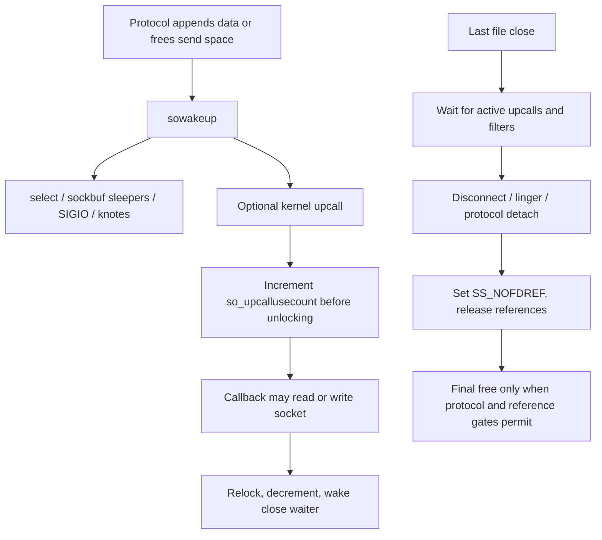

# Socket lifetime, buffering, and I/O ownership

[Networking](README.md) · [Socket overview](sockets.md) · [TCP connections](tcp-connections-and-timers.md)

A socket operation crosses several ownership boundaries before any packet reaches an interface. A file descriptor selects a `fileproc`/`fileglob`; that file object references a socket; the socket dispatches through `protosw`; the protocol may retain data, hand it to filters, or construct packets. A successful send means bytes were accepted by that local path. It does not establish remote receipt, and a failed operation does not necessarily return an mbuf to its caller. This chapter follows the concrete socket contracts in this checkout. See [`socket_common()`](../../../platydoc-data/xnu/bsd/kern/uipc_syscalls.c#L270), [`socketops`](../../../platydoc-data/xnu/bsd/kern/sys_socket.c#L100), and [`sosend()`](../../../platydoc-data/xnu/bsd/kern/uipc_socket.c#L2045).

Use the [socket structure companion](../../structures/sockets-and-protocol-attachments.md) for allocation, field access, protocol associations and references, and [socket-buffer records](../../structures/socket-buffers-and-record-queues.md) for embedded queue headers, storage charges, serialization and flush. These separate endpoint lifetime from the packet storage held by an operation.

## The objects and independent forms of protection

`socket_common()` reserves a descriptor/file object, installs `socketops`, calls socket creation, assigns the socket as file data, and publishes the descriptor after initialization. `socreate_internal()` selects an address family/type/protocol using the protocol registry and calls `pru_attach`. TCP attaches Internet and TCP PCBs; other families have different state. Kernel sockets can exist without user descriptors. See [`creation`](../../../platydoc-data/xnu/bsd/kern/uipc_syscalls.c#L270), [`protocol selection`](../../../platydoc-data/xnu/bsd/kern/uipc_socket.c#L471), and [descriptor lifetime](../processes/descriptors-ipc.md).

| State | What it protects or describes |
| --- | --- |
| File I/O reference | Keeps the descriptor's file object valid across a syscall; acquiring it is separate from locking the socket. |
| `so_usecount` | Socket use references, including selected operations and protocol/timer ownership. |
| `so_retaincnt` | Explicit kernel retention; `soclose()` handles the disappearing fd differently when this is nonzero. |
| Protocol-selected socket mutex | Serializes socket/protocol state. For ordinary TCP this is the PCB mutex; protocols can use the domain mutex or different lock callbacks. |
| `SB_LOCK` | Serializes an operation on a send or receive data queue even while it drops the socket mutex. It is a flag/wait protocol, not an independently embedded mutex. |
| `so_upcallusecount` | Prevents close from completing teardown while an unlocked socket upcall is active. |
| `SS_NOFDREF`, `SOF_PCBCLEARING` | Distinguish removal of descriptor ownership from protocol teardown readiness. |

Sources: [`socket` fields](../../../platydoc-data/xnu/bsd/sys/socketvar.h#L131), [`socket_lock()` dispatch](../../../platydoc-data/xnu/bsd/kern/uipc_socket.c#L7237), [`sblock()`](../../../platydoc-data/xnu/bsd/kern/uipc_socket2.c#L2489), [`soclose()`](../../../platydoc-data/xnu/bsd/kern/uipc_socket.c#L1332), [`upcall protection`](../../../platydoc-data/xnu/bsd/kern/uipc_socket2.c#L649).

The two embedded socket buffers account for payload and storage separately:

[Socket-buffer occupancy, record pointers, and thresholds](../../../platydoc-data/xnu/bsd/sys/socketvar.h#L167)

<!-- source-excerpt: ../../../platydoc-data/xnu/bsd/sys/socketvar.h#L167-L180 -->
```c
	struct sockbuf {
		uint32_t       sb_cc;          /* actual chars in buffer */
		uint32_t       sb_hiwat;       /* max actual char count */
		uint32_t       sb_mbcnt;       /* chars of mbufs used */
		uint32_t       sb_mbmax;       /* max chars of mbufs to use */
		uint32_t       sb_ctl;         /* non-data chars in buffer */
		uint32_t       sb_lowat;       /* low water mark */
		struct mbuf     *sb_mb;         /* the mbuf chain */
		struct mbuf     *sb_mbtail;     /* the last mbuf in the chain */
		struct mbuf     *sb_lastrecord; /* first mbuf of last record */
		struct socket   *sb_so;         /* socket back ptr for kexts */
		struct selinfo  sb_sel;         /* process selecting rd/wr */
		struct timeval  sb_timeo;       /* timeout for read/write */
		uint32_t       sb_flags;       /* flags, see below */
```

`sb_cc` counts buffered bytes, including non-payload portions tracked by `sb_ctl`; `sb_mbcnt` accounts for mbuf/storage consumption. `sb_hiwat` and `sb_mbmax` constrain different resources. `sb_mb` names the first record, `m_next` chains its fragments, and `m_nextpkt` connects records. `sb_mbtail` and `sb_lastrecord` accelerate append operations and must remain consistent when receive removes headers or data. TCP uses this representation for a byte stream; datagram protocols preserve record boundaries. See [`sockbuf conventions`](../../../platydoc-data/xnu/bsd/kern/uipc_socket2.c#L731), [`sbappendstream()`](../../../platydoc-data/xnu/bsd/kern/uipc_socket2.c#L982), and [`sbappendaddr()`](../../../platydoc-data/xnu/bsd/kern/uipc_socket2.c#L1320).

`sblock()` waits on the appropriate socket buffer's flags while atomically releasing/reacquiring the protocol mutex through `msleep()`. It has special content-filter recursion/exclusion handling. `sbwait()` instead waits on `sb_cc` for data or space, using the socket buffer timeout and interruptibility setting. Confusing these waits obscures whether a thread lacks queue ownership or lacks data/capacity. Both recheck defunct/draining state because close can change it while they sleep. See [`sblock()`](../../../platydoc-data/xnu/bsd/kern/uipc_socket2.c#L2489), [`sbunlock()`](../../../platydoc-data/xnu/bsd/kern/uipc_socket2.c#L2595), and [`sbwait()`](../../../platydoc-data/xnu/bsd/kern/uipc_socket2.c#L537).

## Sending: prepare, reserve access, then surrender the mbufs

`write()` enters `pru_sosend` through `soo_write()`. Explicit `sendmsg`/`sendto` enter `sendit()`, which constructs the destination address and `MT_CONTROL` chain and passes a `uio` describing payload bytes. Small addresses can use stack storage; larger ones are allocated and freed after protocol send. A control buffer shorter than `cmsghdr` is rejected before submission. MAC checks may reject the operation while those objects are still local. See [`file-operation dispatch`](../../../platydoc-data/xnu/bsd/kern/sys_socket.c#L136), [`sendit()`](../../../platydoc-data/xnu/bsd/kern/uipc_syscalls.c#L1322), and [`sendmsg_nocancel()`](../../../platydoc-data/xnu/bsd/kern/uipc_syscalls.c#L1497).

The generic `sosend()` locks/references the socket and calls `sosendcheck()` to establish queue access and capacity. The latter checks defunct/shutdown state, consumes a pending `so_error`, verifies connection/address requirements, and accounts for both data and control bytes. An atomic message larger than the configured send-buffer limit fails with `EMSGSIZE`; temporary shortage can wait or return `EWOULDBLOCK`. Stream sends can progress in portions. Interface feedback can also stop a stream sender even when byte capacity appears sufficient. See [`sosendcheck()`](../../../platydoc-data/xnu/bsd/kern/uipc_socket.c#L1858).

When waiting for capacity, `sosendcheck()` releases `SB_LOCK` while retaining the socket lock, sleeps, then restarts the checks and reacquires queue ownership. This permits another sender to make progress and means a wakeup is not a reservation of a specific amount of space. The special preconnect-data and filter-recursion paths have their own conditions; do not generalize their behavior to ordinary nonblocking sends. See [`capacity wait and restart`](../../../platydoc-data/xnu/bsd/kern/uipc_socket.c#L1950).

For user payload, `sosend()` builds an mbuf chain and performs `uiomove()` while the socket mutex is dropped. The socket reference and queue serialization remain meaningful across that unlock. After relocking, it computes `PRUS_OOB`, `PRUS_EOF`, or `PRUS_MORETOCOME` as applicable, invokes socket filters, then configured content filters, then `pru_send`. Both filter families can consume data with `EJUSTRETURN`. Content-filter ownership can outlive the syscall: permitted bytes are later reinjected. See [`copy and handoff`](../../../platydoc-data/xnu/bsd/kern/uipc_socket.c#L2370), [`filter sequence`](../../../platydoc-data/xnu/bsd/kern/uipc_socket.c#L2413), and [policy retention](policy-extensions.md#content-filters-retain-and-reinject-data).

The decisive cleanup boundary is visible here:

[Protocol delivery consumes the local data and control ownership](../../../platydoc-data/xnu/bsd/kern/uipc_socket.c#L2445)

<!-- source-excerpt: ../../../platydoc-data/xnu/bsd/kern/uipc_socket.c#L2445-L2462 -->
```c
			error = (*so->so_proto->pr_usrreqs->pru_send)
			    (so, sendflags, top, addr, control, p);
			if (error == EJUSTRETURN) {
				error = 0;
			}

packet_consumed:
			if (dontroute) {
				so->so_options &= ~SO_DONTROUTE;
			}

			clen = 0;
			control = NULL;
			top = NULL;
			mp = &top;
			if (error) {
				goto out_locked;
			}
```

After `pru_send`, `top` and `control` are cleared even when the returned error is nonzero. Before that boundary, the generic send cleanup frees chains it still owns. Consequently, callers cannot retry by resubmitting the same kernel mbuf merely because `sosend()` failed. Its documented contract consumes data/control buffers on return. TCP's ordinary `tcp_usr_send()` appends stream data to `so_snd` before output; its later packet representations do not replace the retained retransmission data. See [`sosend` contract](../../../platydoc-data/xnu/bsd/kern/uipc_socket.c#L2002), [`cleanup`](../../../platydoc-data/xnu/bsd/kern/uipc_socket.c#L2486), and [`tcp_usr_send()`](../../../platydoc-data/xnu/bsd/netinet/tcp_usrreq.c#L1153).

`sendit()` measures progress by the change in `uio_resid`, suppressing selected interruption/would-block errors after partial progress. `EPIPE` can generate `SIGPIPE` unless suppressed by the socket or call:

[Translate local send progress into the syscall result](../../../platydoc-data/xnu/bsd/kern/uipc_syscalls.c#L1384)

<!-- source-excerpt: ../../../platydoc-data/xnu/bsd/kern/uipc_syscalls.c#L1384-L1396 -->
```c
		if (uio_resid(uiop) != len && (error == ERESTART ||
		    error == EINTR || error == EWOULDBLOCK)) {
			error = 0;
		}
		/* Generation of SIGPIPE can be controlled per socket */
		if (error == EPIPE && !(so->so_flags & SOF_NOSIGPIPE) &&
		    !(flags & MSG_NOSIGNAL)) {
			psignal(p, SIGPIPE);
		}
	}
	if (error == 0) {
		*retval = (int)(len - uio_resid(uiop));
	}
```

This is a local completion rule. TCP acknowledgment removes acknowledged bytes later; a content-filter decision, interface enqueue, device completion, peer ACK, and peer application read are distinct events. See [TCP acknowledgment and close](tcp-connections-and-timers.md).

## Receiving: dequeue is separate from userspace copyout

`recvit()` obtains a file reference, validates the requested length, and calls `pru_soreceive` with separate output pointers for sender address and control messages. After payload processing it copies those metadata outputs to userspace, then frees their temporary kernel representations and drops the file reference. An address/control copyout can fail after payload bytes or a record have already been consumed; there is no transaction that automatically reconstructs the original socket queue. See [`recvit()`](../../../platydoc-data/xnu/bsd/kern/uipc_syscalls.c#L2195).

The generic receive path acquires a socket use reference and `SB_LOCK`, then tests queue state. If an error or receive shutdown is pending but buffered data exists, it can deliver that data before exposing the terminal condition. Without buffered data, an error can be returned and cleared unless peeking; shutdown produces EOF subject to content-filter pending-data conditions. A socket marked defunct is different from a normal peer half-close. See [`soreceive()`](../../../platydoc-data/xnu/bsd/kern/uipc_socket.c#L3202) and [`restart/error/EOF checks`](../../../platydoc-data/xnu/bsd/kern/uipc_socket.c#L3370).

For each fragment, receive chooses among three ownership modes:

| Mode | Queue and output behavior |
| --- | --- |
| Ordinary user copy | Copy to the `uio`, trim or detach consumed mbufs, update queue accounting, then free detached storage. |
| Kernel mbuf-return caller | Return whole consumed mbufs directly; a partial fragment can require `m_copym()`. Allocation failure restores the residual count for that attempted partial copy. |
| `MSG_PEEK` | Advance local offsets/pointers without consuming the socket's records; duplicate any metadata returned to the caller. |

See [`data-copy and detach loop`](../../../platydoc-data/xnu/bsd/kern/uipc_socket.c#L3600). Whole-fragment user copies can be delayed and collected into a detached list so `sodelayed_copy()` copies outside the socket lock. The queue has already changed; a subsequent `uiomove()` failure does not imply all bytes remain available to retry. After dropping the lock, the code checks whether its expected queue head still matches before continuing, since reset or other protocol work may have changed state. See [`delayed-copy revalidation`](../../../platydoc-data/xnu/bsd/kern/uipc_socket.c#L3640) and [`sodelayed_copy()`](../../../platydoc-data/xnu/bsd/kern/uipc_socket.c#L3957).

`MSG_WAITALL` is implemented as repeated consumption and waiting, not as an atomic reservation of the whole requested length. The loop keeps queue serialization against other readers, handles errors/EOF, and calls `pru_rcvd` when the protocol needs notification that space has opened. That callback can drop the socket lock and allow more input. Receive therefore checks the queue again before `sbwait()`; sleeping based on the old empty observation could miss the only wakeup. Signals/timeouts can end a wait-all operation with a short result. See [`wait-all loop`](../../../platydoc-data/xnu/bsd/kern/uipc_socket.c#L3778).

Datagram truncation is explicit. If an atomic record still has data after the caller's capacity is exhausted, ordinary behavior sets `MSG_TRUNC` and drops the remainder unless peeking. `SO_DONTTRUNC` instead reports `MSG_RCVMORE`. `M_EOR`, urgent-data boundaries, and subsequent records also affect stopping conditions. These distinctions are lost if all `soreceive()` returns are described as arbitrary stream short reads. See [`record truncation`](../../../platydoc-data/xnu/bsd/kern/uipc_socket.c#L3865).

## Ancillary data can carry references, not just bytes

Address/control records precede data in the receive chain. `soreceive_addr()` may temporarily detach a complete record before a MAC check that requires dropping the socket mutex. Append operations do not take `SB_LOCK`, so merely holding that flag would not freeze the record list. A denied record is freed; an allowed record is reinserted before any records that arrived while unlocked. See [`soreceive_addr()`](../../../platydoc-data/xnu/bsd/kern/uipc_socket.c#L2823).

`soreceive_ctl()` similarly detaches all control mbufs from the first record before performing potentially unlocked externalization. For `SOL_SOCKET`/`SCM_RIGHTS`, the domain's `dom_externalize` callback translates kernel file references into receiver-visible descriptors. The function then refreshes its next-record observation because new records may have arrived. Other control types are returned without that rights conversion. See [`control extraction`](../../../platydoc-data/xnu/bsd/kern/uipc_socket.c#L2971), [`externalization`](../../../platydoc-data/xnu/bsd/kern/uipc_socket.c#L3075), and [local descriptor transfer](../processes/descriptors-ipc.md#pipes-and-transferred-file-references).

Peeking must not expose internal file pointers:

[SCM_RIGHTS peek returns sanitized control data](../../../platydoc-data/xnu/bsd/kern/uipc_socket.c#L2949)

<!-- source-excerpt: ../../../platydoc-data/xnu/bsd/kern/uipc_socket.c#L2949-L2962 -->
```c
/*
 * When peeking SCM_RIGHTS, the actual file descriptors are not yet created
 * so clear the data portion in order not to leak the file pointers
 */
static void
sopeek_scm_rights(struct mbuf *rights)
{
	struct cmsghdr *cm = mtod(rights, struct cmsghdr *);

	if (cm->cmsg_level == SOL_SOCKET && cm->cmsg_type == SCM_RIGHTS) {
		VERIFY(cm->cmsg_len <= rights->m_len);
		memset(cm + 1, 0, cm->cmsg_len - sizeof(*cm));
	}
}
```

The peek branch duplicates each control mbuf without calling externalization and sanitizes the rights payload. If duplication fails it frees the copies already made, leaving the original socket control data in place. This is different from an ordinary receive that has transferred the control records out of the socket. Finally, `copyout_control()` translates supported ABI details and marks `MSG_CTRUNC` when the user control area cannot hold complete output. Full UNIX-domain reference internalization/garbage collection and every ancillary type are separate reading tasks. See [`peek handling`](../../../platydoc-data/xnu/bsd/kern/uipc_socket.c#L2991) and [`copyout_control()`](../../../platydoc-data/xnu/bsd/kern/uipc_syscalls.c#L2038).

## Wakeups and close complete a different lifetime



`sowakeup()` fans out one state change to the different notification mechanisms. With an unlocked upcall it increments `so_upcallusecount` before releasing the socket mutex, invokes the callback, relocks, and wakes a close waiter when the final upcall ends. Readiness reports a state observed under locking; it is not exclusive ownership of the next record. Another reader or acceptor can consume the work before the notified thread runs. See [`sowakeup()`](../../../platydoc-data/xnu/bsd/kern/uipc_socket2.c#L625).

`soclose_locked()` waits for upcalls and configured content filters, prevents new listener children by clearing `SO_ACCEPTCONN`, removes/aborts queued children, disconnects, applies linger, and detaches protocol state where needed. Completed accept children require explicit removal: the ordinary final-free path deliberately preserves an object still on the completed accept queue. The close path eventually sets `SS_NOFDREF`, notifies knotes, drops domain/use references, and invokes `sofree()`. See [`close sequence`](../../../platydoc-data/xnu/bsd/kern/uipc_socket.c#L1114) and [`accept-queue final-free gate`](../../../platydoc-data/xnu/bsd/kern/uipc_socket.c#L991).

Protocol cleanup may still defer. TCP can retain state for FIN/ACK, timers, or output already executing below the socket layer. `soclose()` also distinguishes sockets retained by kernel clients. `shutdown()` has separate read/write-side semantics and does not itself remove the descriptor; `soshutdownlock()` coordinates filter notification, receive flushing, and `pru_shutdown` as appropriate. See [`kernel-retained close`](../../../platydoc-data/xnu/bsd/kern/uipc_socket.c#L1332), [`shutdown`](../../../platydoc-data/xnu/bsd/kern/uipc_socket.c#L4340), and [TCP teardown](tcp-connections-and-timers.md).

## Sources inspected and limits

| Source area | Depth and boundary |
| --- | --- |
| `uipc_syscalls.c`, `sys_socket.c` | Read creation, accept/connect integration, send/receive wrappers, metadata copyout, and file dispatch. Batched send/receive variants and every ioctl/option remain outside this chapter. |
| `socketvar.h`, `uipc_socket.c`, `uipc_socket2.c` | Read queue/accounting fields, send capacity/consumption, receive copy/peek/control/wait-all, buffer locking/waits, wakeup/upcall, and close gates. This is not a concurrency proof of every protocol. |
| TCP and policy integration | Read the selected protocol consumption and teardown calls; link dedicated TCP and policy chapters. Full UNIX-domain rights garbage collection, all filter providers, MPTCP, and ancillary-data formats are not claimed. |

No kernel or network test was run. The excerpts describe the checked-in bodies; build options and registered protocol callbacks select the actual behavior.

<!-- BEGIN PLATYDOC DOCUMENTATION LICENSE -->
Original Platydoc text and diagrams are licensed under [CC BY 4.0](https://creativecommons.org/licenses/by/4.0/). Quoted source code and third-party material retain their respective licenses.
<!-- END PLATYDOC DOCUMENTATION LICENSE -->
