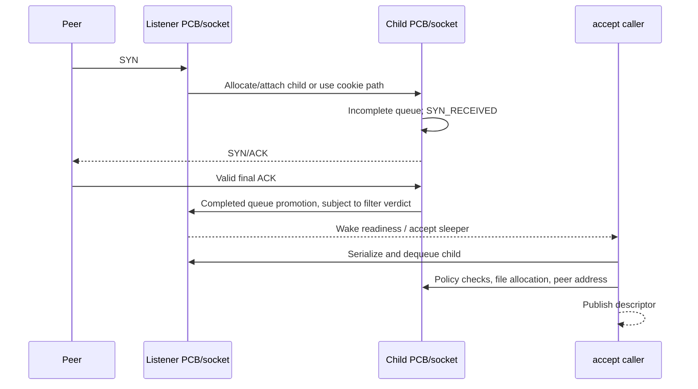
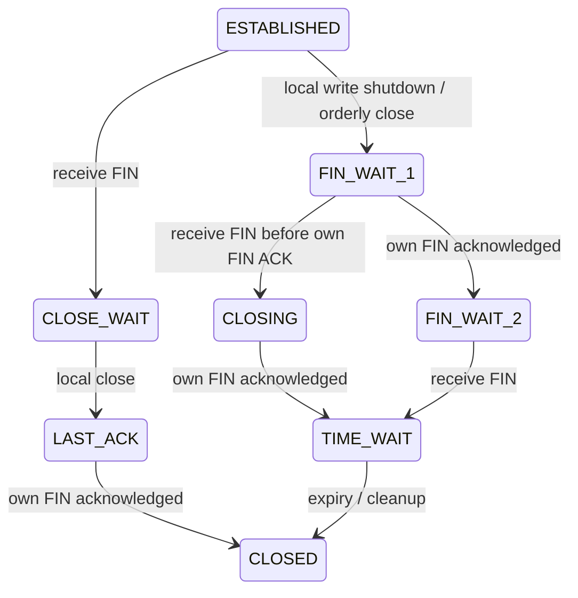

# TCP connections, accept queues, loss timers, and close

[Networking](README.md) · [Socket I/O and lifetime](socket-lifecycle-and-io.md) · [TCP/IP overview](tcp-ip-interfaces.md)

The [Internet PCB and transport structure companion](../../structures/internet-pcbs-and-transport-storage.md) follows combined allocation, tuple/hash fields, lookup references, embedded timers and separately allocated transport state. Read it beside the connection transitions below.

TCP has several state machines at once: the wire protocol in `tcpcb.t_state`, socket connection/half-close flags, listener queues, buffered sequence data, and asynchronous timer/output ownership. A transition to `ESTABLISHED` is not the same event as publishing an accepted fd; closing that fd is not the same event as freeing the PCB. This guide traces those boundaries through the current implementation rather than treating the standard TCP state diagram as a complete kernel design. See [`tcpcb`](../../../platydoc-data/xnu/bsd/netinet/tcp_var.h#L422), [`socket`](../../../platydoc-data/xnu/bsd/sys/socketvar.h#L131), and [`tcp_usrreqs`](../../../platydoc-data/xnu/bsd/netinet/tcp_usrreq.c#L1412).

For the multipath connection above these TCP subflows, read [MPTCP sessions and subflows](mptcp-sessions-and-subflows.md). It distinguishes connection-level data sequence numbers and acknowledgments from each subflow's TCP state, then follows reinjection, ordered delivery and cleanup.

## One connection and its synchronization

| Record | Fields or role |
| --- | --- |
| `socket` | Send/receive buffers, connection flags, pending error, listen queues, user/kernel references, readiness callbacks. |
| `inpcb` | Local/remote address/port tuple; protocol-table links; socket pointer; TCP pointer; mutex; route/interface/policy state; lifetime/wanted accounting. |
| `tcpcb` | Protocol state, `snd_una/nxt/max`, `rcv_nxt`, windows, congestion/recovery state, reassembly queue, timers, and scheduler entry. |
| `tcptimerentry` / global timer list | Connection's earliest timer/runtime and active modes, linked into a shared scheduling structure. |

Sources: [`inpcb`](../../../platydoc-data/xnu/bsd/netinet/in_pcb.h#L160), [`tcpcb`](../../../platydoc-data/xnu/bsd/netinet/tcp_var.h#L422), [`timer scheduling`](../../../platydoc-data/xnu/bsd/netinet/tcp_timer.c#L2291).

For normal TCP, socket locking uses the PCB mutex through `tcp_lock()`/`tcp_unlock()`. An MPTCP subflow can instead redirect to the parent connection's locking and revalidate that relationship. Global tuple tables have their own `ipi_lock`; timer lists have a mutex; socket-buffer serialization has its own flag/wait protocol. None is interchangeable with holding an arbitrary reference to `tcpcb`. See [`TCP lock selection`](../../../platydoc-data/xnu/bsd/netinet/tcp_subr.c#L3523) and [socket locking](socket-lifecycle-and-io.md#the-objects-and-independent-forms-of-protection).

`tcp_attach()` reserves socket buffers, calls `in_pcballoc()` for the combined TCP `inp_tp` allocation, configures IPv4/IPv6 and buffer-autosizing state, initializes the embedded TCP PCB, and starts in `TCPS_CLOSED`. Its defensive null-result branch around `tcp_newtcpcb()` temporarily suppresses the no-fd indication while detaching the PCB so the enclosing socket-creation cleanup still owns the socket. In this snapshot, however, `tcp_newtcpcb()` selects and returns the already allocated embedded `tcb`; a separate null-result check around bandwidth-measurement setup clears only its feature flag. That helper itself performs a waiting allocation and immediately initializes the result, without an explicit null-return path. The real allocation boundary is the earlier `in_pcballoc()`, not a second TCP-record allocation. See [`tcp_attach()`](../../../platydoc-data/xnu/bsd/netinet/tcp_usrreq.c#L3094-L3153), [embedded initialization](../../../platydoc-data/xnu/bsd/netinet/tcp_subr.c#L1330-L1335), [bandwidth check and TCP return](../../../platydoc-data/xnu/bsd/netinet/tcp_subr.c#L1413-L1445), [bandwidth allocator](../../../platydoc-data/xnu/bsd/netinet/tcp_subr.c#L2119-L2125), and [transport storage](../../structures/internet-pcbs-and-transport-storage.md).

## Active open: publish the tuple, then drive the handshake

`connectit()` checks policy and socket state, invokes `soconnectlock()`, and either returns `EINPROGRESS` for a nonblocking connection still in progress or sleeps on `so_timeo`. A second nonblocking connect while already connecting yields `EALREADY`. The blocking loop checks `SS_ISCONNECTING` and `so_error` after each wake; it does not wait for a specific packet. The syscall consumes the socket error when returning it. See [`connectit()`](../../../platydoc-data/xnu/bsd/kern/uipc_syscalls.c#L1011).

TCP's connect callback first rejects dead/missing PCB state and can route through content filters or flow diversion. The ordinary `tcp_usr_connect_common()` validates address-family combinations and delegates tuple setup to `tcp_connect()` or `tcp6_connect()`. IPv4-mapped IPv6 has explicit compatibility checks. These are real alternate paths, so the conventional SYN trace is not a promise about every socket selected as TCP. See [`tcp_usr_connect()`](../../../platydoc-data/xnu/bsd/netinet/tcp_usrreq.c#L635), [`common connect`](../../../platydoc-data/xnu/bsd/netinet/tcp_usrreq.c#L496), and [policy extensions](policy-extensions.md).

`tcp_connect()` binds a local port if necessary, chooses a usable local address/interface, checks existing tuple conflicts including selected TIME_WAIT cases, and rehashes the PCB under table synchronization. It drops/reacquires the socket lock while obtaining table/lookup protection, so tuple establishment must handle concurrent state changes. The resulting connection is marked connecting, seeded with an initial sequence number, and given an initial handshake timeout:

[Initialize the active-open protocol and socket state](../../../platydoc-data/xnu/bsd/netinet/tcp_usrreq.c#L1591)

<!-- source-excerpt: ../../../platydoc-data/xnu/bsd/netinet/tcp_usrreq.c#L1591-L1600 -->
```c
	tp->request_r_scale = tcp_get_max_rwinscale(tp, so);

	soisconnecting(so);
	tcpstat.tcps_connattempt++;
	TCP_LOG_STATE(tp, TCPS_SYN_SENT);
	tp->t_state = TCPS_SYN_SENT;
	tp->t_timer[TCPT_KEEP] = tcp_offset_from_start(tp, TCP_CONN_KEEPINIT(tp));
	tp->iss = tcp_new_isn(tp);
	tcp_sendseqinit(tp);
	tp->t_connect_time = tcp_now;
```

`tcp_connect_complete()` normally calls `tcp_output()`. The preconnect-data/TFO path can postpone output until data is supplied, setting enough MSS/window state to permit it. NECP notification can also drop/reacquire the socket lock. Thus connect initiation, first SYN transmission, socket wakeup, and successful connect return are separate observable steps. See [`tcp_connect_complete()`](../../../platydoc-data/xnu/bsd/netinet/tcp_usrreq.c#L438).

In `tcp_input()`'s `SYN_SENT` case, unacceptable ACK sequence values are rejected before state advancement. A valid SYN/ACK initializes receive state, acknowledges the SYN, negotiates relevant options, and transitions to `ESTABLISHED`; a pending local FIN can instead lead directly to `FIN_WAIT_1`. The connection indication eventually reaches the socket helpers that wake connect waiters and readiness consumers. See [`SYN_SENT validation`](../../../platydoc-data/xnu/bsd/netinet/tcp_input.c#L4159) and [`SYN/ACK transition`](../../../platydoc-data/xnu/bsd/netinet/tcp_input.c#L4277).

## Passive open: the listener and child have different lifetimes

`solisten()` checks that the socket is an eligible connection-oriented endpoint, consults filters, and invokes `pru_listen`. The TCP operation binds an unbound port and changes its PCB to `LISTEN`. The generic socket then stores a bounded backlog; this body maps nonpositive or excessive values to `somaxconn`. Admission is subsequently governed by both queue counts and tunables rather than blindly treating backlog as an exact completed-connection count. See [`solisten()`](../../../platydoc-data/xnu/bsd/kern/uipc_socket.c#L829), [`tcp_usr_listen()`](../../../platydoc-data/xnu/bsd/netinet/tcp_usrreq.c#L382), and [`sonewconn_internal()` admission](../../../platydoc-data/xnu/bsd/kern/uipc_socket2.c#L326).

For the ordinary allocation path, `sonewconn_internal()` creates a child, inherits selected credentials/options/policy state and buffer limits, sets `SS_NOFDREF`, and attaches its protocol. It drops the listener's per-socket lock around attachment and rechecks `SO_ACCEPTCONN` afterward: a listener could have closed while allocation/attachment progressed. It then links the child into `so_incomp`, records `so_head`, increments queue accounting, and marks setup in progress to protect against overflow cleanup. See [`child construction and revalidation`](../../../platydoc-data/xnu/bsd/kern/uipc_socket2.c#L372).

TCP's input path does not always allocate a child on the SYN. When SYN-cookie conditions are satisfied, it can send a cookie response, release the listener reference, and return without allocating a connected socket yet. Other paths allocate a temporary child, carry a `dropsocket` cleanup indication until setup commits, initialize sequence/options state, enter `SYN_RECEIVED`, and start a handshake timer. Queue pressure can trigger a drop-and-retry attempt. See [`passive input allocation/cookie path`](../../../platydoc-data/xnu/bsd/netinet/tcp_input.c#L2346) and [`child sequence/state setup`](../../../platydoc-data/xnu/bsd/netinet/tcp_input.c#L2708).

After a valid handshake, `soisconnected()` clears connecting/disconnecting flags and normally moves a child from incomplete to completed queue:

[Promote an existing child to the completed accept queue](../../../platydoc-data/xnu/bsd/kern/uipc_socket2.c#L222)

<!-- source-excerpt: ../../../platydoc-data/xnu/bsd/kern/uipc_socket2.c#L222-L227 -->
```c
		if (so->so_head == head && (so->so_state & SS_INCOMP)) {
			so->so_state &= ~SS_INCOMP;
			so->so_state |= SS_COMP;
			TAILQ_REMOVE(&head->so_incomp, so, so_list);
			TAILQ_INSERT_TAIL(&head->so_comp, so, so_list);
			head->so_incqlen--;
```

Before doing so, the helper checks whether a content filter is awaiting its initial verdict. That can defer user-visible connection completion. Queue promotion takes listener/accept-list protection and revalidates the child's relationship. Wakeups occur with deliberate lock drops because a callback can itself accept a connection. See [`soisconnected()`](../../../platydoc-data/xnu/bsd/kern/uipc_socket2.c#L192).

`accept_nocancel()` waits for `so_comp`, then acquires accept-list serialization and rechecks it. It removes the child **before** `falloc()`, since descriptor allocation may block and another acceptor could otherwise take the same child. It clears `so_head`/`SS_COMP`, retains the listener across unlocked policy/filter work, allocates the file descriptor, synchronizes nonblocking/async flags, and requests the peer address through `soacceptlock()`. Descriptor allocation failure closes the detached child rather than requeueing it. See [`accept dequeue and allocation`](../../../platydoc-data/xnu/bsd/kern/uipc_syscalls.c#L551).

`tcp_usr_accept()` principally obtains the peer address and checks connection state. It does not perform the TCP handshake: the connection was represented by the child before userspace obtained its fd. A completed queue entry can also encounter disconnection during the accept race, which is why child locking and state/error checks remain necessary. See [`tcp_usr_accept()`](../../../platydoc-data/xnu/bsd/netinet/tcp_usrreq.c#L902) and [`soacceptlock()`](../../../platydoc-data/xnu/bsd/kern/uipc_socket.c#L1391).



## Buffered data, acknowledgment, and loss are separate mechanisms

The [loss-recovery and congestion-control companion](tcp-loss-recovery-and-congestion-control.md) develops the algorithms behind this section: cumulative ACK release, SACK-hole maintenance, RACK transmission ordering, retransmission selection and congestion-window changes. Timer registration and connection-reference ownership remain the subject of this chapter.

`tcp_usr_send()` appends stream data to `so_snd`; `tcp_output()` chooses what can be sent from sequence state, advertised window, congestion window, and recovery policy. It builds packet representations while leaving unacknowledged data available in the socket buffer. The packet accepted by IP is therefore not the authoritative copy of TCP's outstanding byte stream. See [`send`](../../../platydoc-data/xnu/bsd/netinet/tcp_usrreq.c#L1153) and [`output`](../../../platydoc-data/xnu/bsd/netinet/tcp_output.c#L1015).

`snd_una` identifies the oldest unacknowledged sequence, `snd_nxt` the next output position, and `snd_max` the furthest transmitted sequence. ACK handling removes acknowledged data with `sbdrop()`, advances sequence state, updates RTT/recovery information, and makes send capacity available. Duplicate ACK/SACK/RACK paths can diagnose loss without waiting for the retransmission timer; they are not interchangeable with the timer's recovery branch. This chapter inspects the timer dispatch and representative ACK/state transitions, not every congestion algorithm. See [`established ACK path`](../../../platydoc-data/xnu/bsd/netinet/tcp_input.c#L3800) and [`general ACK/FIN accounting`](../../../platydoc-data/xnu/bsd/netinet/tcp_input.c#L5705).

Receive similarly separates packet acceptance from readable bytes. In-order payload can be appended directly, while out-of-order segments use TCP reassembly and do not immediately advance the contiguous stream. FIN consumes a sequence position only when the receive path recognizes it in order; the state handler marks receive shutdown, requests ACK output, and advances `rcv_nxt`. The socket can deliver already buffered bytes before EOF. See [`reassembly processing`](../../../platydoc-data/xnu/bsd/netinet/tcp_input.c#L623), [`FIN handling`](../../../platydoc-data/xnu/bsd/netinet/tcp_input.c#L6197), and [receive ownership](socket-lifecycle-and-io.md#receiving-dequeue-is-separate-from-userspace-copyout).

## Timers own references and must revalidate after locking

The [Internet PCB companion](internet-pcbs-ports-and-lifetime.md) explains the underlying wanted-count CAS/sentinel protocol, tuple lookup and GC gates. This section follows its use by TCP timer work.

The current implementation does not merely run a periodic timer callback against every PCB without lifetime protection. `tcp_sched_timers()` records each connection's earliest timer in a shared list and adds a socket use reference when inserting a new entry:

[A timer-list entry keeps its socket alive](../../../platydoc-data/xnu/bsd/netinet/tcp_timer.c#L2338)

<!-- source-excerpt: ../../../platydoc-data/xnu/bsd/netinet/tcp_timer.c#L2338-L2345 -->
```c
			tp->t_inpcb->inp_socket->so_usecount++;

			LIST_INSERT_HEAD(&listp->lhead, te, te_le);
			tp->t_flags |= TF_TIMER_ONLIST;

			listp->entries++;
			if (listp->entries > listp->maxentries) {
				listp->maxentries = listp->entries;
```

`tcp_run_timerlist()` holds the list mutex while choosing work, obtains an Internet-PCB wanted reference, records the next list entry, drops the list mutex, and calls `tcp_run_conn_timer()`. The latter locks/references the socket and releases/rechecks the wanted reference. If teardown won the race, it removes the timer and stops. It also rechecks timer index/runtime because another thread may have canceled or rescheduled work while the timer thread waited for the socket lock. See [`global timer walk`](../../../platydoc-data/xnu/bsd/netinet/tcp_timer.c#L2128) and [`connection timer revalidation`](../../../platydoc-data/xnu/bsd/netinet/tcp_timer.c#L1965).

Timer values are relative to the connection's timer-start bookkeeping, with an earliest runtime used for scheduling. `tcp_run_conn_timer()` runs the due timer and stops using the TCP pointer if the handler returns null, including close/deferred-close paths. Otherwise it adjusts remaining timers relative to the current clock and processes other expired timers. `tcp_remove_timer()` removes list membership and drops the socket use count taken at insertion. The global scheduler chooses among fast/medium/slow service modes and accounts for timer drift. These are implementation scheduling choices; they do not alter the meaning of a peer ACK. See [`remaining timer processing`](../../../platydoc-data/xnu/bsd/netinet/tcp_timer.c#L2025), [`timer removal`](../../../platydoc-data/xnu/bsd/netinet/tcp_timer.c#L1852), and [`list rescheduling`](../../../platydoc-data/xnu/bsd/netinet/tcp_timer.c#L2220).

| Timer | Current branch behavior |
| --- | --- |
| `TCPT_REXMT` | Increase retry shift; evaluate retry/time/FIN/sleep limits; save state for first-timeout recovery; back off the interval; reset retransmission position; invoke congestion timeout handling and output. |
| `TCPT_PERSIST` | Probe a closed advertised window, with independent idle/persist-stop termination rules. |
| `TCPT_KEEP` | Bound incomplete handshakes; for configured established connections send keepalive/probe traffic or drop after the idle limit. |
| `TCPT_DELACK` | Convert a pending delayed ACK to `TF_ACKNOW` and call output. |
| `TCPT_PTO` | Send an eligible tail-loss/interface probe; eligibility includes connection/recovery/SACK conditions and special interface-change handling. |
| `TCPT_DELAYFR` | Delayed loss-recovery handling for reordering-sensitive cases; a separate path from ordinary retransmission expiry. |
| `TCPT_REORDER` | Invoke `tcp_rack_reordering_timeout()` when RACK is enabled; the RACK loss-detection algorithm is outside this chapter's detailed trace. |
| `TCPT_2MSL` | Finish selected TIME_WAIT/FIN_WAIT_2 cleanup, with state-specific close/drop behavior. |

Sources: [`tcp_timers()`](../../../platydoc-data/xnu/bsd/netinet/tcp_timer.c#L1022), [`persist/keepalive`](../../../platydoc-data/xnu/bsd/netinet/tcp_timer.c#L1429), [`delayed ACK/PTO`](../../../platydoc-data/xnu/bsd/netinet/tcp_timer.c#L1578), [`delayed fast recovery`](../../../platydoc-data/xnu/bsd/netinet/tcp_timer.c#L1800).

The retransmission branch has more than exponential backoff. It can enforce caller-configured drop deadlines, accommodate long sleep, save pre-timeout state for spurious-timeout recovery, abandon ineffective tail-loss probes, reset reordering recovery, attempt path-MTU black-hole handling, and notify the route layer after repeated loss. Ultimately it sets `snd_nxt = snd_una`, updates recovery boundaries, exits fast recovery, and calls output. Congestion callbacks remain algorithm-specific; the chapter does not claim a single fixed congestion-control algorithm or universal timeout duration. See [`retry/drop conditions`](../../../platydoc-data/xnu/bsd/netinet/tcp_timer.c#L1079), [`RTO/path recovery`](../../../platydoc-data/xnu/bsd/netinet/tcp_timer.c#L1260), and [`retransmission output`](../../../platydoc-data/xnu/bsd/netinet/tcp_timer.c#L1360).

## Half-close, TIME_WAIT, and actual teardown

The common transitions below describe selected normal paths, excluding simultaneous-open/TFO/MPTCP and policy-specific exceptions:



`tcp_usrclosed()` converts established active close to `FIN_WAIT_1`, passive half-close to `LAST_ACK`, and selected embryonic states directly to cleanup. In `SYN_RECEIVED`, it records `TF_NEEDFIN` so later handshake progression incorporates the close. Input ACK processing advances `FIN_WAIT_1` to `FIN_WAIT_2`, `CLOSING` to TIME_WAIT, and completes `LAST_ACK`; received FIN performs the complementary transitions. FIN_WAIT_2 has a timeout to prevent indefinite retention in the relevant closed-receive case. See [`local close state`](../../../platydoc-data/xnu/bsd/netinet/tcp_usrreq.c#L3204), [`ACK transitions`](../../../platydoc-data/xnu/bsd/netinet/tcp_input.c#L5798), and [`received FIN transitions`](../../../platydoc-data/xnu/bsd/netinet/tcp_input.c#L6214).

Orderly FIN is not the only close path. `tcp_disconnect()` drops a connection with unread receive data/reassembly or defunct processing, closes embryonic state, and uses abortive behavior for enabled zero linger. Otherwise it marks disconnecting, flushes receive data, updates local-close state, and requests output. This is why closing without reading pending data cannot be explained solely by the normal four-way FIN exchange. See [`tcp_disconnect()`](../../../platydoc-data/xnu/bsd/netinet/tcp_usrreq.c#L3162).

Even `tcp_close()` may defer cleanup after canceling timers:

[Do not tear down a PCB while lower-layer output can still use it](../../../platydoc-data/xnu/bsd/netinet/tcp_subr.c#L1814)

<!-- source-excerpt: ../../../platydoc-data/xnu/bsd/netinet/tcp_subr.c#L1814-L1818 -->
```c
	if ((tp->t_flags & TF_CLOSING) ||
	    inp->inp_sndinprog_cnt > 0) {
		tp->t_flags |= TF_CLOSING;
		return NULL;
	}
```

`tcp_ip_output()` can drop the socket mutex around IP output while incrementing `inp_sndinprog_cnt`. Immediate PCB/route destruction would let that output return and republish route state into a detached connection. `TF_CLOSING` records that cleanup must resume after outstanding output completes. Final close removes flow integration, tears down protocol resources, detaches the Internet PCB, and calls `soisdisconnected()` after detach because notifications may unlock the socket. See [`close deferral contract`](../../../platydoc-data/xnu/bsd/netinet/tcp_subr.c#L1782), [`output handoff`](../../../platydoc-data/xnu/bsd/netinet/tcp_output.c#L3616), and [`final detach`](../../../platydoc-data/xnu/bsd/netinet/tcp_subr.c#L2030).

## Sources inspected and limits

| Area | Inspection |
| --- | --- |
| Socket/TCP user requests | Read attach, listen, connect/common IPv4/IPv6 dispatch, accept, shutdown, disconnect, and local-close state; generic accept/connect and queue helpers. |
| TCP input | Read selected passive child/cookie setup, SYN_SENT/SYN_RECEIVED transitions, ACK/FIN state changes, and representative established acknowledgment/reassembly relationships. Full TCP validation, SYN-cookie cryptography, congestion, SACK/RACK, ECN, and all simultaneous-open/TFO branches were not audited. |
| Timers and close | Read timer list/reference/lock handoff, per-connection revalidation, retransmission/persist/keepalive/delayed-ACK branches, probe/recovery boundaries, and close deferral/final detach. Exact runtime tuning and hardware/network behavior were not measured. |

For packet construction, routes, and interface completion continue with [packet/route/interface lifecycle](packets-routes-and-interfaces.md). Filter diversion and multipath have separate state machines described at their boundaries in [policy extensions](policy-extensions.md).

<!-- BEGIN PLATYDOC DOCUMENTATION LICENSE -->
Original Platydoc text and diagrams are licensed under [CC BY 4.0](https://creativecommons.org/licenses/by/4.0/). Quoted source code and third-party material retain their respective licenses.
<!-- END PLATYDOC DOCUMENTATION LICENSE -->
