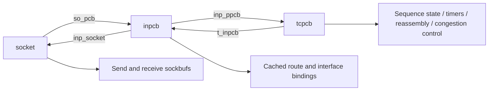

# TCP, IP, interfaces, and mbufs

[Back to networking](README.md)

The detailed follow-ups are [TCP connections and timers](tcp-connections-and-timers.md) and [packet storage, routes, and interface teardown](packets-routes-and-interfaces.md).

## State for one TCP connection



[`inpcb`](../../../platydoc-data/xnu/bsd/netinet/in_pcb.h#L160) contains the per-socket mutex, local/foreign ports and addresses, protocol-table/hash linkage, state/wanted count, interface binding, cached route, policy results, and `inp_ppcb`. [`tcpcb`](../../../platydoc-data/xnu/bsd/netinet/tcp_var.h#L422) adds `t_state`, timers, reassembly queue, flags, and TCP sequence/window state. `snd_una` is the oldest unacknowledged sequence, `snd_nxt` the next transmission position, `snd_max` the furthest sent position, and `rcv_nxt` the next expected receive position. `snd_wnd` represents the peer-advertised window; `snd_cwnd` is congestion-control state. They constrain different things.

[`tcp_attach()`](../../../platydoc-data/xnu/bsd/netinet/tcp_usrreq.c#L3094) reserves socket-buffer space, allocates the Internet PCB, configures address-family/buffer settings, creates the TCP PCB, and enters `TCPS_CLOSED`. [`tcp_connect()`](../../../platydoc-data/xnu/bsd/netinet/tcp_usrreq.c#L1483) binds a local port if needed, selects a local address/interface, handles existing tuple conflicts, and updates PCB-table state. The caller/handshake code then drives TCP output. The PCB lookup and table update deliberately release/reacquire socket locks to respect table-lock ordering; this is not just filling four address fields.

## Ordinary established-connection transmit

The representative path is:

```text
send/write
  → sosend
  → tcp_usr_send
  → sbappendstream(so_snd)
  → tcp_output
  → tcp_ip_output
  → ip_output_list or ip6_output_list
  → dlil_output
  → ifnet output/queue implementation
  → driver/provider
```

[`tcp_usr_send()`](../../../platydoc-data/xnu/bsd/netinet/tcp_usrreq.c#L1153) validates the PCB and policy-sensitive cases, handles ancillary data, appends ordinary stream data to `so_snd`, and invokes `tcp_output()`. EOF and implied-connect requests add different work. Once appended, the send buffer owns the stream data.

[`tcp_output()`](../../../platydoc-data/xnu/bsd/netinet/tcp_output.c#L1015) decides whether and what to send from connection state, available buffered bytes, windows, congestion/recovery state, and flags. It constructs TCP/IP headers and options and may build packet lists. Payload construction can use `m_copym_mode()`/`m_copym_with_hdrs()` on the send-buffer chain. That creates transmission representations while retaining the send-buffer data for acknowledgment/retransmission. TSO, pacing, retransmission, and SACK add branches; this reading did not audit all their algorithms.

[`tcp_ip_output()`](../../../platydoc-data/xnu/bsd/netinet/tcp_output.c#L3616) assembles route/output arguments including interface constraints and traffic class. It copies route state out of the PCB, increments `inp_sndinprog_cnt`, and may unlock the socket while calling IP. The unlock is conditional: the normal established path excludes conditions such as active SACK/recovery, upcalls, and MPTCP subflows. It relocks afterward and processes output/flow-control results. The outstanding-send accounting matters to teardown while lower layers execute.

`ip_output_list()`/`ip6_output_list()` consume packets or packet lists, apply routing and configured policy/filter/security behavior, handle network-layer constraints, and send toward DLIL. A TCP packet-list batch may be split into individual calls when chaining is unsuitable, including IPsec-related cases. Ownership and list shape can change below TCP; its cleanup frees only the unsubmitted remainder after an error. See [`ip_output.c`](../../../platydoc-data/xnu/bsd/netinet/ip_output.c#L292) and [policy hooks](policy-extensions.md).

Successful local enqueue is not a TCP acknowledgment. In the ACK path, [`tcp_input()`](../../../platydoc-data/xnu/bsd/netinet/tcp_input.c#L3800) computes newly acknowledged bytes, updates congestion/RTT/recovery state, calls `sbdrop(&so->so_snd, acked)`, and advances `snd_una`. That is where acknowledged stream bytes can leave the send buffer and space becomes available to writers.

## Receive from an interface to a reader

For an Ethernet/IPv4/TCP host-stack path:

```text
ifnet_input[_extended]
  → interface-selected DLIL input handler
  → dlil_input_packet_list_common
  → if_demux and attached if_proto input
  → ether_inet_input → proto_input(PF_INET)
  → ip_proto_input → first/second pass → ip_proto_dispatch_in
  → tcp_input → socket receive buffer
  → sorwakeup → reader/select/kevent
```

[`ifnet_input_common()`](../../../platydoc-data/xnu/bsd/net/dlil.c#L2073) validates the packet list, takes interface data-movement protection when needed, updates packet metadata/accounting, and invokes the configured input function. Input may be synchronous or queued; the driver callback does not necessarily run the entire protocol stack inline.

[`dlil_input_packet_list_common()`](../../../platydoc-data/xnu/bsd/net/dlil_input.c#L766) separates packets using `m_nextpkt`, obtains the interface from context or `m_pkthdr.rcvif`, invokes `if_demux`, applies interface filters, and finds a referenced `if_proto` attachment for the resulting family. It batches compatible packets for `dlil_ifproto_input()`. [`ether_inet_input()`](../../../platydoc-data/xnu/bsd/net/ether_inet_pr_module.c#L173) sends IPv4 packets into `proto_input(PF_INET, ...)`; [`in_dinit()`'s registration code](../../../platydoc-data/xnu/bsd/netinet/in_proto.c#L297) connects PF_INET to `ip_proto_input`.

The actual IPv4 entry in this snapshot is [`ip_proto_input()`](../../../platydoc-data/xnu/bsd/netinet/ip_input.c#L1670), with first/second-pass and packet-chaining helpers, rather than a single monolithic `ip_input()` function. [`ip_proto_dispatch_in()`](../../../platydoc-data/xnu/bsd/netinet/ip_input.c#L656) invokes IP input filters and dispatches via `ip_protox[ip_p]->pr_input`, using the domain lock only when the destination protocol does not provide its own locking.

[`tcp_input()`](../../../platydoc-data/xnu/bsd/netinet/tcp_input.c#L2788) parses/checks the segment and finds an `inpcb` through IPv4/IPv6 tuple lookup. It obtains the socket protection and revalidates relevant state; policy and connection state can invalidate an apparent match. In the established in-order-data path it updates receive sequence/ACK state, removes protocol headers, and calls `sbappendstream_rcvdemux()`. That indirection accommodates receive filters and multipath handling. It arranges read wakeups and an immediate or delayed ACK. Out-of-order segments use reassembly paths instead of simply appending to the reader's stream.

The application later enters `soreceive()` to consume buffered bytes. Incoming ACK processing, incoming payload processing, and application reads can all change whether a socket is ready. Readiness means an operation can make progress or observe a terminal/error condition, not that an entire application message has arrived.

## DLIL, routes, and driver lifetime

[`ifnet`](../../../platydoc-data/xnu/bsd/net/if_var_private.h#L722) represents an interface: name/index, flags/capabilities, addresses, queues, driver context, callbacks, and lifetime/locking state. [`if_proto`](../../../platydoc-data/xnu/bsd/net/if_var_private.h#L517) is an address-family attachment to that interface with input, pre-output, event, and media-related operations. It is distinct from the socket `protosw`.

[`dlil_output()`](../../../platydoc-data/xnu/bsd/net/dlil_output.c#L65) takes `ifnet_datamov_begin()` protection so detach cannot invalidate an active data transfer, obtains a protocol attachment, runs its pre-output callback, frames packets, applies interface filters, and calls `if_output_dlil`. Queued/multi-enqueue variants can call `ifnet_start()` to arrange driver servicing. The IPv4 Ethernet [`ether_inet_pre_output()`](../../../platydoc-data/xnu/bsd/net/ether_inet_pr_module.c#L238) uses `arp_lookup_ip()` to obtain the next-hop link address. Neighbor resolution can defer packet progress; an interface call does not guarantee immediate hardware transmission.

[`rtentry`](../../../platydoc-data/xnu/bsd/net/route_private.h#L156) stores radix-tree nodes, gateway, `rt_ifp`, interface address, metrics, flags, and reference/lock state. The synchronization commentary in [`route.c`](../../../platydoc-data/xnu/bsd/net/route.c#L156) distinguishes routing-tree `rnh_lock` from per-entry `rt_lock`. Removing a route from the tree does not immediately free a referenced entry. Scoped lookup APIs, cached PCB routes, route generation, and interface restrictions mean selecting a route is richer than a single global destination lookup. Full route mutation and neighbor-cache algorithms were not audited here.

[`lo_output()`](../../../platydoc-data/xnu/bsd/net/if_loop.c#L284) is a useful self-contained example: it sets receive-interface/loopback metadata, marks checksum validity, removes the loopback header, updates statistics, and calls `ifnet_input_extended()`. Loopback traffic re-enters the input machinery without requiring physical hardware.

## Mbuf ownership

[`m_hdr`](../../../platydoc-data/xnu/bsd/sys/mbuf.h#L134) distinguishes `m_next` (fragments of a chain) from `m_nextpkt` (packets/records in a list). `m_data` and `m_len` describe this fragment; `M_PKTHDR` enables packet-wide metadata such as total length, receive interface, checksum information, and flow identifiers. `M_EXT` means data lives in external storage described by `m_ext`, with reference information and potentially a custom free callback. Layout varies across configuration; use the field macros instead of assuming a fixed inline arrangement.

[`m_copym_mode()`](../../../platydoc-data/xnu/bsd/kern/uipc_mbuf.c#L3051) can share external storage by incrementing its reference count while allocating new mbuf headers; inline data is copied. Therefore a new mbuf chain does not always mean a private writable payload. [`m_freem()`](../../../platydoc-data/xnu/bsd/kern/uipc_mbuf.c#L2869) walks `m_next` through `m_free()`; freeing a packet list requires the list-aware operation or explicit `m_nextpkt` iteration. Functions such as `m_pullup()` can change the chain/head while making bytes contiguous. Always re-read a callee's ownership contract and use returned/replaced pointers.

## UDP and IPv6 reading branches

Continue with [Internet PCBs, ports and lifetime](internet-pcbs-ports-and-lifetime.md), [UDP send/receive/errors](udp-send-receive-and-errors.md), and [IPv6 output and neighbor discovery](ipv6-output-and-neighbor-discovery.md) for the concrete paths behind these entry points.

UDP uses Internet PCBs but not the TCP sequence/retransmission state machine. [`udp_send()`](../../../platydoc-data/xnu/bsd/netinet/udp_usrreq.c#L2688) selects normal output or flow diversion; `udp_output()` builds the datagram's network representation. On input, [`udp_append()`](../../../platydoc-data/xnu/bsd/netinet/udp_usrreq.c#L962) assembles address/control information, strips headers, calls `sbappendaddr()`, and wakes readers on success. These are record-oriented receive semantics.

IPv6 has [`ip6_proto_input()`/`ip6_input()`](../../../platydoc-data/xnu/bsd/netinet6/ip6_input.c#L334), [`ip6_output_list()`](../../../platydoc-data/xnu/bsd/netinet6/ip6_output.c#L272), and [`udp6_input()`](../../../platydoc-data/xnu/bsd/netinet6/udp6_usrreq.c#L258), with scope IDs, extension-header and neighbor-discovery paths that should be read separately. The TCP PCB supports both address families. ICMP, multicast, raw sockets, ARP/ND, bridging, tunnels, and packet schedulers are substantial neighboring components; their complete implementations were not included in this trace.

<!-- BEGIN PLATYDOC DOCUMENTATION LICENSE -->
Original Platydoc text and diagrams are licensed under [CC BY 4.0](https://creativecommons.org/licenses/by/4.0/). Quoted source code and third-party material retain their respective licenses.
<!-- END PLATYDOC DOCUMENTATION LICENSE -->
