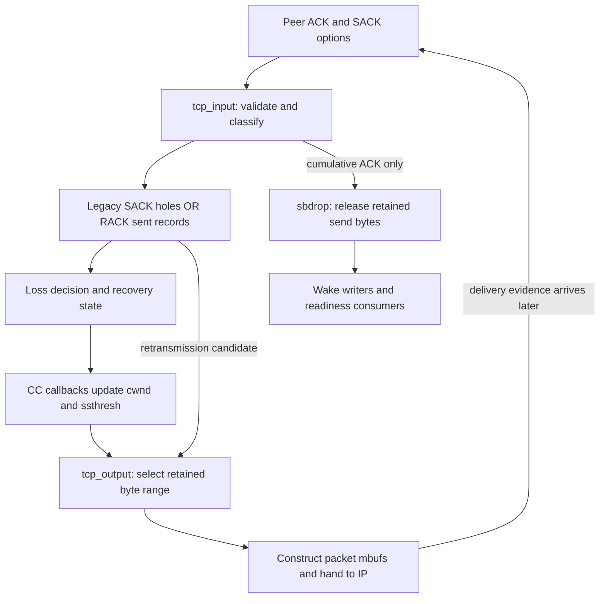
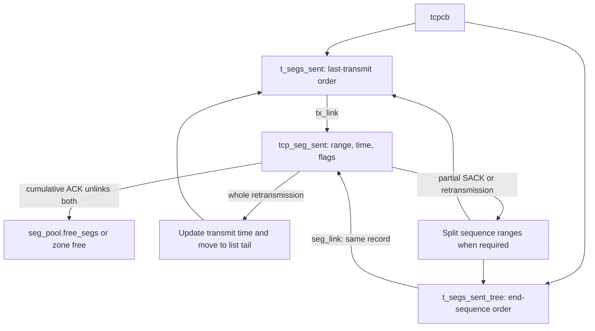
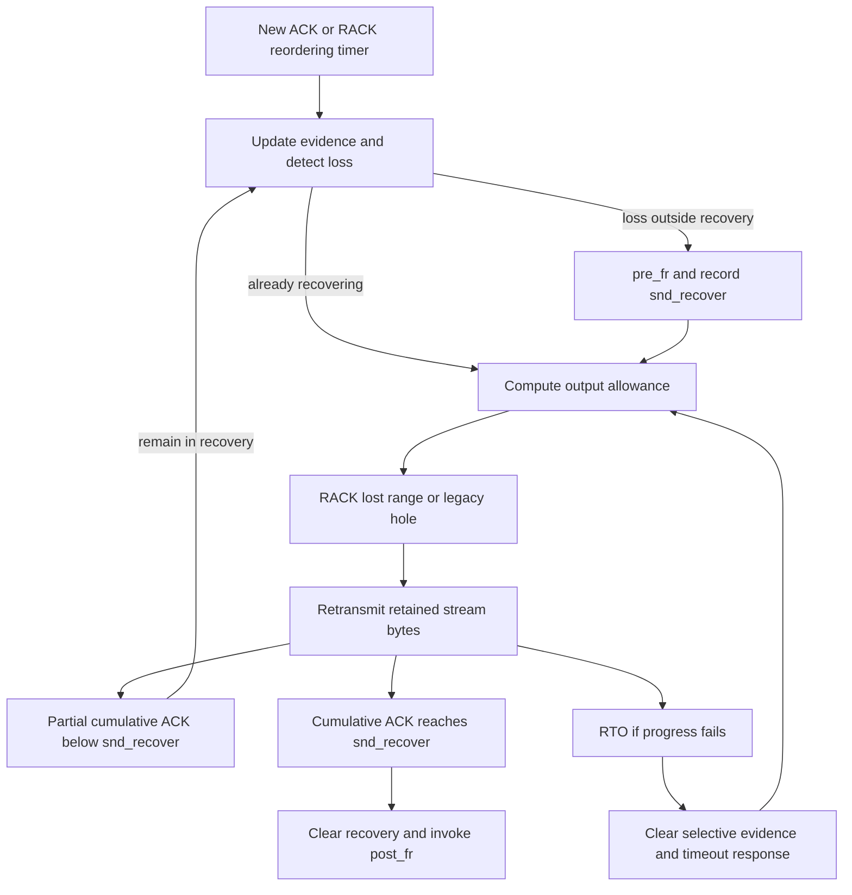
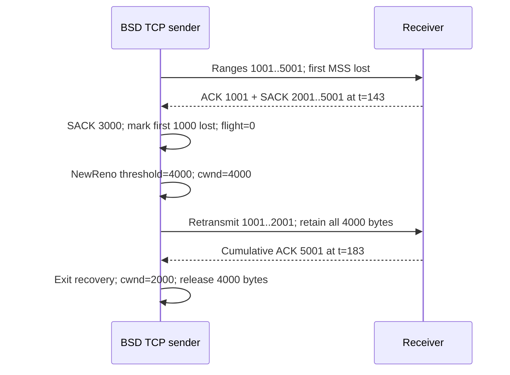

# TCP loss recovery and congestion control

[Networking](README.md) · [Connections, timers and close](tcp-connections-and-timers.md) · [Socket buffering](socket-lifecycle-and-io.md) · [Packet scheduling](interface-packet-scheduling-and-fq-codel.md)

A BSD TCP sender must retain bytes until they are cumulatively acknowledged, infer which transmissions were lost, choose retransmissions, and limit how much traffic it injects. These are separate decisions. SACK describes received sequence ranges; RACK uses transmission times and delivery evidence to classify loss; congestion control changes the permitted window. This chapter follows their interaction in `xnu-12377.121.6`, including the separate legacy SACK-hole and RACK representations. It complements the connection chapter's handshake, timer-reference and teardown explanations.

The subject is the local BSD `tcpcb`. [Skywalk's passive TCP flow tracking](skywalk-fragments-reassembly-and-flow-tracking.md) and [packet aggregation/segmentation](skywalk-tcp-aggregation-segmentation-and-offloads.md) do not supply this sender's socket buffer, recovery state or congestion algorithm. A record named a segment here is bookkeeping for a sequence range, potentially covering a TSO aggregate; it is not necessarily one physical packet or an owned mbuf. See [`tcp_seg_sent`](../../../xnu/bsd/netinet/tcp_var.h#L217-L242) and [output registration](../../../xnu/bsd/netinet/tcp_output.c#L3317-L3337).

## 1. State and execution context

TCP input reaches the established connection with its socket lock held. Protocol state, send-buffer accounting and the per-connection scoreboards are updated in that serialized context. Normal socket locking selects the Internet PCB mutex; MPTCP can redirect to parent locking. The timer scheduler obtains lifetime references and revalidates after taking the socket lock before executing these same recovery operations. A pointer in a RACK list or SACK hole is not an independent socket reference. See [input lock assertion](../../../xnu/bsd/netinet/tcp_input.c#L3518-L3527), [`tcp_lock()`](../../../xnu/bsd/netinet/tcp_subr.c#L3523-L3580) and [timer locking/lifetime](tcp-connections-and-timers.md#timers-own-references-and-must-revalidate-after-locking).

| State | Meaning in this implementation |
| --- | --- |
| `so->so_snd` | Authoritative retained stream bytes, including unsent data and data not cumulatively acknowledged. Packet mbufs made for IP output are separate representations. |
| `snd_una`, `snd_nxt`, `snd_max` | Oldest cumulatively unacknowledged position, next output position, and furthest transmitted position. Retransmission can move `snd_nxt` backward without moving `snd_max`. |
| `snd_wnd`, `snd_cwnd`, `snd_ssthresh` | Peer-advertised send allowance, congestion allowance, and the algorithm's slow-start threshold. These are byte counts, not packet counts. |
| `snd_recover`, `TF_FASTRECOVERY` | Sequence boundary and flag for a recovery episode. `snd_recover` also has non-recovery uses, including timeout bookkeeping. A sent FIN requires a boundary adjustment. |
| `snd_holes`, `snd_numholes`, `snd_fack`, `sackhint` | Legacy sender scoreboard of missing byte ranges, its count, furthest forward ACK/SACK boundary and retransmission/accounting hints. |
| `t_segs_sent`, `t_segs_sent_tree`, `t_segs_acked`, `seg_pool` | RACK's transmission-ordered list, sequence-indexed RB tree, temporary deletion list and retained free-record pool. |
| `rack`, `bytes_sacked`, `bytes_lost`, `bytes_retransmitted` | Latest eligible delivered transmission and reordering state, plus current flight-estimate counters. These counters are not lifetime totals. |
| `tcp_cc_index`, `t_ccstate`, `_t_ccstate` | Index into a callback table, optional pointer to algorithm state, and the embedded state storage. |
| `t_timer[]`, `t_latest_tx`, `t_srtt`, `t_rttvar` | Scheduled timer offsets, latest scheduled transmit time including pacing, and fixed-point RTT estimates. |

Sources: [sequence/window fields](../../../xnu/bsd/netinet/tcp_var.h#L464-L489), [SACK records](../../../xnu/bsd/netinet/tcp_var.h#L189-L215), [RACK records/counters](../../../xnu/bsd/netinet/tcp_var.h#L874-L899), [CC storage](../../../xnu/bsd/netinet/tcp_var.h#L720-L721), [socket-to-output path](tcp-connections-and-timers.md#buffered-data-acknowledgment-and-loss-are-separate-mechanisms).

Sequence comparisons use the `SEQ_*` helpers to handle wrapping sequence numbers; the examples below deliberately avoid wraparound. TCP timestamps have millisecond granularity (`TCP_RETRANSHZ = 1000`). `t_srtt` and `t_rttvar` include fractional scaling and must not be inserted into millisecond arithmetic without their shifts. See [sequence helpers](../../../xnu/bsd/netinet/tcp_seq.h#L73-L85), [clock units](../../../xnu/bsd/netinet/tcp_var.h#L91-L97) and [RTT shifts](../../../xnu/bsd/netinet/tcp_var.h#L1698-L1705).



The diagram omits handshake, receive-data and error branches. An ACK processing pass need not change every box; a SACK-only update can change delivery evidence without freeing any send-buffer bytes.

## 2. ACK processing: delivery evidence is not buffer release

### Validate first and retain the old `snd_una` for accounting

The general established-state handler rejects ACKs beyond `snd_max` and ACKs too far behind the accepted window, using rate-limited challenge/drop behavior. It then separates a DSACK report from ordinary SACK blocks and processes selective delivery evidence. The ordinary SACK validator requires a nonempty block above both the cumulative ACK and `snd_una`, with its end no later than `snd_max`. DSACK has its own bounded validation because it can refer to bytes already cumulatively acknowledged. See [ACK admission](../../../xnu/bsd/netinet/tcp_input.c#L5087-L5135), [SACK range predicate](../../../xnu/bsd/netinet/tcp_sack.c#L117-L123), and [DSACK extraction](../../../xnu/bsd/netinet/tcp_sack.c#L885-L965).

For an advancing cumulative ACK, `BYTES_ACKED(th, tp)` is `th_ack - snd_una`. The old `snd_una` must remain available while RTT, CC and buffer accounting use that delta. The general path performs these operations in the following order, with intervening protocol-specific branches:

1. Resolve a partial versus completed recovery episode; completed recovery clears the flag and calls `post_fr`.
2. Compute acknowledged bytes, check for a spurious retransmission and update RTT.
3. Reset retry state, cancel retransmission/PTO/reordering timers if everything is acknowledged, or restart RTO when appropriate.
4. Remove/trim cumulatively acknowledged RACK records; update delivery boundaries.
5. Process ECN feedback, then call `ack_rcvd` only when not in or just exiting fast recovery.
6. Drop cumulatively acknowledged bytes from `so_snd`, handle the FIN sequence position separately, advance `snd_una`, and ensure `snd_nxt` is not behind it.
7. Run RACK loss detection on the updated state, request output when needed, and arrange a writer wakeup.

Sources: [recovery completion](../../../xnu/bsd/netinet/tcp_input.c#L5505-L5538), [ACK/RTT/timers](../../../xnu/bsd/netinet/tcp_input.c#L5568-L5634), [ECN and CC](../../../xnu/bsd/netinet/tcp_input.c#L5645-L5731), [release and state publication](../../../xnu/bsd/netinet/tcp_input.c#L5732-L5795).

The release branch is small enough to show exactly. An ACK beyond buffered data can acknowledge the local FIN; it must not be passed as a larger byte count to `sbdrop()`.

[tcp_input.c, lines 5732–5741](../../../xnu/bsd/netinet/tcp_input.c#L5732-L5741)

<!-- source-excerpt: ../../../xnu/bsd/netinet/tcp_input.c#L5732-L5741 -->
```c
		if (acked > so->so_snd.sb_cc) {
			tp->snd_wnd -= so->so_snd.sb_cc;
			sbdrop(&so->so_snd, (int)so->so_snd.sb_cc);
			ourfinisacked = 1;
		} else {
			sbdrop(&so->so_snd, acked);
			tcp_sbsnd_trim(&so->so_snd);
			tp->snd_wnd -= acked;
			ourfinisacked = 0;
		}
```

SACKed bytes remain in the send buffer until the cumulative ACK crosses them. This matters if later recovery discards selective evidence: the sender still has the stream bytes. A call to `tcp_output()` consumes neither these bytes nor their logical retransmission obligation merely because IP accepted an mbuf. See [RTO clearing selective evidence](../../../xnu/bsd/netinet/tcp_timer.c#L1274-L1277), [packet-list construction](../../../xnu/bsd/netinet/tcp_output.c#L3317-L3337) and [socket-buffer ownership](socket-lifecycle-and-io.md).

### The predicted ACK path is a distinct implementation path

Header prediction handles an eligible pure advancing ACK in congestion avoidance when recovery/SACK conditions permit it. It computes RTT, updates RACK records, invokes `congestion_avd`, drops bytes and advances `snd_una`, then updates timers and wakeup/output decisions. It does not simply jump into the general `ack_rcvd` callback. For NewReno the distinction is observable in arithmetic: the predicted callback increases its window after `t_bytes_acked > snd_cwnd`, whereas the general congestion-avoidance branch uses `>=`. Describe the selected branch when calculating an exact window progression. See [prediction eligibility and execution](../../../xnu/bsd/netinet/tcp_input.c#L3795-L3903), [NewReno predicted ACK](../../../xnu/bsd/netinet/tcp_newreno.c#L142-L158) and [general ACK](../../../xnu/bsd/netinet/tcp_newreno.c#L178-L207).

RTT sampling is also separate from RACK's delivery clock. `tcp_compute_rtt()` uses eligible timestamp echoes or the connection's timed sequence. `tcp_xmit_timer()` maintains base/current/smoothed RTT and variance, caps extreme samples, and has a recovery-specific recomputation path. RACK maintains the RTT of its latest eligible delivered transmission. Neither value is interchangeable with the scheduler reference protecting the timer callback. See [sample selection](../../../xnu/bsd/netinet/tcp_input.c#L6753-L6794), [RTT estimator](../../../xnu/bsd/netinet/tcp_input.c#L6872-L6997) and [RACK sample](../../../xnu/bsd/netinet/tcp_rack.c#L150-L195).

## 3. Legacy SACK: represent what is missing

### Scoreboard shape and mutation

When `TCP_RACK_ENABLED(tp)` is false, `tcp_sack_doack()` represents gaps using `struct sackhole`. A hole's half-open interval `[start, end)` is missing according to the current scoreboard; `rxmit` is the next byte within it to retransmit. The list is ordered in sequence space. `snd_fack` records the rightmost boundary represented by forward acknowledgment evidence. `sackhint.nexthole` and byte counters accelerate output decisions. The receiver-side `sackblks` maintained by `tcp_update_sack_list()` are a different object: they describe what this endpoint will report to its peer. See [hole declarations](../../../xnu/bsd/netinet/tcp_var.h#L189-L206), [sender update](../../../xnu/bsd/netinet/tcp_sack.c#L416-L504), and [receiver report generation](../../../xnu/bsd/netinet/tcp_sack.c#L130-L228).

The sender combines valid incoming SACK blocks with a synthetic cumulative-ACK block when existing holes need trimming, sorts the small block array by end sequence, then walks blocks and holes from the right. New forward evidence can append a hole; intersecting evidence can delete a hole, advance its start, retreat its end, or split it in two. Retransmission counters are removed before mutation and recomputed for the resulting interval; the retransmit cursor is clamped to valid bounds. Removal repairs `nexthole` before freeing storage. See [sorting and tail insertion](../../../xnu/bsd/netinet/tcp_sack.c#L429-L557), [trim/split cases](../../../xnu/bsd/netinet/tcp_sack.c#L564-L660) and [insert/remove helpers](../../../xnu/bsd/netinet/tcp_sack.c#L280-L321).

A worked scoreboard example, with RACK disabled and `snd_una=1001`, `snd_max=9001`:

| Received evidence | Resulting holes | What remains retained |
| --- | --- | --- |
| ACK `1001`, SACK `[7001,9001)` | `[1001,7001)`; `snd_fack=9001` | All 8,000 stream bytes, since the cumulative ACK did not advance. |
| ACK `1001`, SACK `[3001,5001)` | `[1001,3001)` and `[5001,7001)` if the split allocation succeeds | Still all 8,000 bytes; a new SACK report adds delivery knowledge. |
| Cumulative ACK `3001` | First hole is removed; `[5001,7001)` remains | 2,000 bytes are released; `[3001,9001)` remains in the send buffer. |

The example illustrates `[start,end)` arithmetic and assumes no wraparound, allocation rejection, ECN or other concurrent protocol event. Its transitions follow the cited trim/split branches; it is not a packet-capture result.

### Allocation limits change the fidelity of evidence

The BSD hole allocator checks the per-connection hole limit and TCP's memory hard limit, then performs a `Z_WAITOK | Z_NOFAIL` typed-zone allocation and accounts its size. The declared `sack_globalmaxholes` tunable is annotated as retained for uTCP; this allocator does not check that variable. Do not infer a BSD global-hole-count gate from the sysctl name. See [tunable declarations](../../../xnu/bsd/netinet/tcp_sack.c#L104-L115).

[tcp_sack.c, lines 242–259](../../../xnu/bsd/netinet/tcp_sack.c#L242-L259)

<!-- source-excerpt: ../../../xnu/bsd/netinet/tcp_sack.c#L242-L259 -->
```c
	if (tp->snd_numholes >= tcp_sack_maxholes ||
	    tcp_memacct_hardlimit()) {
		/*
		 * We only check for hardlimit, because properly handling SACK
		 * will allow us to recover quicker (and thus free memory).
		 */
		tcpstat.tcps_sack_sboverflow++;
		return NULL;
	}

	hole = zalloc_flags(sack_hole_zone, Z_WAITOK | Z_NOFAIL);
	tcp_memacct_add(kalloc_type_size(sack_hole_zone));

	hole->start = start;
	hole->end = end;
	hole->rxmit = start;

	tp->snd_numholes++;
```

If adding the rightmost hole is rejected, `tcp_sack_doack()` skips blocks it cannot represent beyond `snd_fack` and still trims the representable scoreboard, including the cumulative-ACK interval. If an interior split cannot allocate a second hole, the old hole remains unsplit; the SACKed interior is not subtracted as if the split had succeeded. Thus rejection can cause coarser retransmission knowledge rather than connection failure or send-buffer release. `tcps_sack_sboverflow` records this admission failure. See [tail failure](../../../xnu/bsd/netinet/tcp_sack.c#L527-L552) and [split commitment](../../../xnu/bsd/netinet/tcp_sack.c#L620-L649).

### Selecting bytes to retransmit

`tcp_sack_output()` chooses the next hole with `rxmit < end` and returns retransmission accounting. Despite its hint-based optimization comment, this checkout also invokes the debug traversal unconditionally and falls back to its result if the cached hint/count disagrees. `tcp_output()` bounds a hole retransmission by available congestion/receiver allowance and `snd_recover`, chooses bytes at `rxmit - snd_una` in the retained buffer, writes that sequence into the packet, then advances the hole cursor and retransmitted-byte counter. See [hint verification](../../../xnu/bsd/netinet/tcp_sack.c#L783-L812), [allowance and recovery boundary](../../../xnu/bsd/netinet/tcp_output.c#L1312-L1362) and [cursor advancement](../../../xnu/bsd/netinet/tcp_output.c#L2944-L2954).

For a partial cumulative ACK inside a legacy SACK recovery episode, `tcp_sack_partialack()` sets the congestion window to flight size plus one or two MSS, capped by `snd_ssthresh`; it can construct a final hole up to `snd_recover` when existing evidence leaves that tail uncovered. When normal scoreboard/new-data selection cannot make progress, output has a bounded rescue retransmit from the recovery tail. That rescue branch explicitly excludes RACK. Following RTO, `tcp_sack_adjust()` can move `snd_nxt` over newly reported delivered intervals. See [partial ACK](../../../xnu/bsd/netinet/tcp_sack.c#L689-L740), [rescue retransmit](../../../xnu/bsd/netinet/tcp_output.c#L1471-L1499) and [post-timeout adjustment](../../../xnu/bsd/netinet/tcp_sack.c#L821-L851).

## 4. RACK: retain transmissions and identify delivery in time

### One record, two indexes

RACK uses `tcp_seg_sent` rather than the legacy hole list. Its `start_seq/end_seq` represent a byte interval, `xmit_ts` its recorded transmission time, and flags distinguish selective delivery, inferred loss, a currently accounted retransmission and any historical retransmission. The last two flags have different jobs: flight accounting versus ambiguity/reordering detection. The record participates in a time-ordered list and a tree ordered by `end_seq`; temporary acknowledgment and free-pool links support deletion/reuse. See [record and pool](../../../xnu/bsd/netinet/tcp_var.h#L217-L242), [tree comparison](../../../xnu/bsd/netinet/tcp_subr.c#L4154-L4170) and [RACK state](../../../xnu/bsd/netinet/tcp_var.h#L874-L899).



The edges show index membership and mutation, not separate ownership of packet payloads. A record can cover multiple wire segments because output may use TSO. Partial SACKs therefore sometimes require splitting one record into SACKed and unsacked pieces; partial cumulative ACKs can move a surviving record's `start_seq`. See [partial SACK splitting](../../../xnu/bsd/netinet/tcp_subr.c#L4604-L4766) and [partial cumulative ACK](../../../xnu/bsd/netinet/tcp_subr.c#L4535-L4555).

Output appends bookkeeping after constructing/queuing an outgoing packet but before the lower-layer handoff completes. A whole RACK retransmission updates the existing record and moves it to the time-list tail; a partial retransmission splits off the retransmitted prefix with a new timestamp. New data creates a new record. The sequence tree and transmission list thus need not have the same order after retransmission. `t_latest_tx` can incorporate scheduled pacing, so it should not be described as a hardware-confirmed wire timestamp. See [output registration](../../../xnu/bsd/netinet/tcp_output.c#L3325-L3337), [whole/partial retransmit insertion](../../../xnu/bsd/netinet/tcp_subr.c#L4274-L4328), and [timestamp field contract](../../../xnu/bsd/netinet/tcp_var.h#L481-L481).

### Allocation fallback and record cleanup

`tcp_seg_alloc_init()` first reuses a zeroed connection-local record. Otherwise it checks TCP's memory hard limit and uses `Z_NOPAGEWAIT | Z_ZERO`, which can fail. A record is returned to a per-connection cache of up to 64 entries on ordinary deletion; excess entries are freed and removed from TCP memory accounting. The cache limit is not a cap of 64 outstanding transmissions. See [allocation](../../../xnu/bsd/netinet/tcp_subr.c#L4173-L4194), [pool limit](../../../xnu/bsd/netinet/tcp_var.h#L236-L242) and [deletion](../../../xnu/bsd/netinet/tcp_subr.c#L4812-L4822).

Allocation failure during insertion or a SACK split invokes this fallback:

[tcp_subr.c, lines 4861–4867](../../../xnu/bsd/netinet/tcp_subr.c#L4861-L4867)

<!-- source-excerpt: ../../../xnu/bsd/netinet/tcp_subr.c#L4861-L4867 -->
```c
void
tcp_rack_free_and_disable(struct tcpcb *tp)
{
	TCP_LOG(tp, "not enough memory to allocate segment, disabling RACK");
	tcp_segs_sent_clean(tp, true);
	tp->t_flagsext &= ~TF_RACK_ENABLED;
}
```

`tcp_segs_sent_clean(tp, true)` unlinks both indexes, releases cached records and clears flight counters before the flag is cleared. A caller holding a pointer to an old record must stop using it; the SACK split path explicitly rechecks `TCP_RACK_ENABLED()` after a helper that may disable RACK. The current `tcp_sack_doack()` RACK branch returns after that processing; it does not convert the same ACK into a fully rebuilt hole scoreboard. Subsequent eligible processing uses the non-RACK path. The authoritative send bytes survive this loss of optimization state. See [cleanup](../../../xnu/bsd/netinet/tcp_subr.c#L4825-L4859), [pointer revalidation](../../../xnu/bsd/netinet/tcp_subr.c#L4756-L4762) and [branch exit](../../../xnu/bsd/netinet/tcp_sack.c#L477-L495).

### ACK/SACK updates and flight accounting

A cumulative ACK gathers completed records using the sequence tree, removes them from both indexes, adjusts SACK/loss/retransmission counters and returns records to the pool. A fast case cleans the entire list when no currently tracked retransmissions prevent using the final record. A SACK marks retained records as delivered and adjusts counters without removing the underlying stream bytes. Marking a previously lost retransmission as SACKed removes the old loss/retransmission contribution before adding the SACK contribution. See [cumulative deletion](../../../xnu/bsd/netinet/tcp_subr.c#L4428-L4469), [all/partial ACK paths](../../../xnu/bsd/netinet/tcp_subr.c#L4473-L4555) and [selective delivery accounting](../../../xnu/bsd/netinet/tcp_subr.c#L4558-L4601).

`tcp_flight_size()` exposes the distinction between evidence and buffer size:

[tcp_output.c, lines 599–606](../../../xnu/bsd/netinet/tcp_output.c#L599-L606)

<!-- source-excerpt: ../../../xnu/bsd/netinet/tcp_output.c#L599-L606 -->
```c
	ret = tp->snd_nxt - tp->snd_una - tp->sackhint.sack_bytes_acked;

	if (TCP_RACK_ENABLED(tp)) {
		/* In flight is bytes sent - bytes that left the network + bytes retransmitted */
		const uint32_t bytes_sent = SEQ_MAX(tp->snd_max, tp->snd_nxt) - tp->snd_una;
		const uint32_t bytes_not_in_flight = tp->bytes_sacked + tp->bytes_lost;
		ret = bytes_sent - bytes_not_in_flight + tp->bytes_retransmitted;
	}
```

For RACK, inferred lost bytes are discounted, retransmissions believed in flight are added, and SACKed bytes are discounted. A lost retransmission clears the currently-retransmitted flag and subtracts its contribution without adding the same sequence range to `bytes_lost` twice. The helper logs an invalid negative RACK estimate and clamps a negative result to zero; its legacy branch also needs that clamp when RTO rewinds `snd_nxt`. These are estimates for output allowance, not an assertion that the socket buffer has been drained. See [retransmission-loss accounting](../../../xnu/bsd/netinet/tcp_subr.c#L4789-L4809) and [negative estimate handling](../../../xnu/bsd/netinet/tcp_output.c#L608-L624).

## 5. RACK loss detection and its reordering timer

### Which delivered transmission supplies the clock?

`tcp_rack_update_segment_acked()` selects the most recently sent eligible delivered segment, ordered first by transmit timestamp and then by end sequence when timestamps tie. It records that transmission in `rack.xmit_ts/end_seq`, records the observed RTT and marks `rack.advanced`. A zero-millisecond RTT is promoted to one millisecond. For retransmitted ranges, the routine rejects ambiguous samples when the timestamp echo precedes the most recent transmission or lies in the future, or when the measured RTT is below the base RTT. An accepted later transmission cancels the old reordering timer so loss detection can recompute it. See [ordering](../../../xnu/bsd/netinet/tcp_rack.c#L62-L67) and [sample validation/publication](../../../xnu/bsd/netinet/tcp_rack.c#L150-L195).

The detector walks `t_segs_sent` only while the latest eligible delivered transmission was sent after the candidate. It skips SACKed records and already lost records that have not been retransmitted. A packet merely being old is not enough for ordinary ACK-driven RACK loss inference: later-transmission delivery is part of the evidence. RTO has its own broader loss-marking routine. See [ordered scan](../../../xnu/bsd/netinet/tcp_rack.c#L244-L280) and [RTO marking](../../../xnu/bsd/netinet/tcp_rack.c#L337-L352).

### Reordering allowance is state dependent

With no observed reordered packets, the allowance is zero when already in fast recovery, when duplicate-ACK evidence meets `t_rexmtthresh`, or during RTO recovery. Otherwise the body computes `reo_wnd_multi * base_rtt / 4`, caps that intermediate value at twice SRTT, then applies a two-millisecond floor. Because the floor is applied last, the final result can exceed twice a very small SRTT. It is not a universal fixed fraction or a strict final `2*SRTT` upper bound. See [`tcp_rack_reordering_window()`](../../../xnu/bsd/netinet/tcp_rack.c#L94-L121).

For a candidate, the actual deadline is explicit:

[tcp_rack.c, lines 124–142](../../../xnu/bsd/netinet/tcp_rack.c#L124-L142)

<!-- source-excerpt: ../../../xnu/bsd/netinet/tcp_rack.c#L124-L142 -->
```c
static uint32_t
tcp_rack_detect_segment_lost(struct tcpcb *tp, struct tcp_seg_sent *seg,
    uint32_t reordering_window, bool *loss_detected)
{
	/* After the segment is sent, wait for (RTT + reordering window) */
	uint32_t wait_ts = seg->xmit_ts + tp->rack.rtt + reordering_window;
	if (TSTMP_GEQ(tcp_now, wait_ts)) {
		/*
		 * Segment should be marked as lost as it was sent
		 * (RTT + reordering window) time ago.
		 */
		tcp_mark_seg_lost(tp, seg);
		if (loss_detected != NULL) {
			*loss_detected = true;
		}
		return 0;
	}
	return wait_ts - tcp_now;
}
```

If candidates still need time, the scan takes the **maximum** remaining wait, not the earliest per-record deadline. `tcp_rack_detect_loss_and_arm_timer()` schedules that remaining wait plus the two-millisecond floor through `tcp_offset_from_start()` and cancels PTO while waiting. At expiry, `tcp_rack_reordering_timeout()` rechecks loss, saves state and enters recovery if necessary, and calls output. The timer value is the algorithm's requested deadline; scheduler service granularity and drift still apply as described in the connection chapter. See [maximum wait choice](../../../xnu/bsd/netinet/tcp_rack.c#L270-L280), [arming](../../../xnu/bsd/netinet/tcp_rack.c#L290-L313), and [expiry](../../../xnu/bsd/netinet/tcp_rack.c#L318-L333).

For example, with observed reordering, base RTT 40 ms, SRTT 50 ms and multiplier one, the allowance is 10 ms. A candidate sent at time 100 with the latest delivered-transmission RTT of 40 becomes eligible at time 150. If the qualifying ACK arrives at 143, its remaining wait is seven milliseconds; if it is the only pending candidate, the requested reordering timer is nine milliseconds from now. This is illustrative arithmetic, not a guarantee the callback executes at 152 exactly.

DSACK helps distinguish retransmission from reordering. The first duplicate SACK block is removed from ordinary selective-delivery processing, and TLP-specific duplicates are identified separately. RACK can increment reordered-packet evidence for a retransmitted range covered by DSACK, or for a previously un-retransmitted range delivered below `snd_fack`. Qualifying DSACK rounds increase the multiplier, capped at 255, and reset persistence to 16 recovery episodes. Persistence decreases on recovery exit, and a later update resets the multiplier when persistence reaches zero. See [DSACK preprocessing](../../../xnu/bsd/netinet/tcp_sack.c#L901-L965), [reordering observations](../../../xnu/bsd/netinet/tcp_rack.c#L422-L445) and [window adaptation](../../../xnu/bsd/netinet/tcp_rack.c#L203-L235).

## 6. Recovery entry, output and completion

The general duplicate-ACK path increments `t_dupacks` by at least one, or by newly SACKed full-MSS units when larger. It evaluates early retransmit for a small remaining flight, and invokes RACK loss detection before output can select retransmissions. Legacy recovery can begin from its duplicate-ACK threshold; RACK's entry condition is detected loss. Separate legacy reordering/delayed-recovery state can postpone entry. These thresholds and timers should not be collapsed into “three duplicate ACKs always retransmit.” See [duplicate evidence and early retransmit](../../../xnu/bsd/netinet/tcp_input.c#L5241-L5284), [small-flight threshold adjustment](../../../xnu/bsd/netinet/tcp_input.c#L1440-L1508), and [entry predicates](../../../xnu/bsd/netinet/tcp_input.c#L5362-L5419).

The duplicate-ACK entry branch saves previous state, calls `CC_ALGO(tp)->pre_fr`, enters fast recovery, records a recovery boundary and clears relevant timers. SACK/RACK recovery uses `snd_cwnd = snd_ssthresh`. The standalone `tcp_enter_fast_recovery()` used by the reordering timer, advancing-ACK loss detection and selected ECN/TLP paths makes corresponding state changes. These are related implementations, not a single universal call site. See [duplicate-ACK entry](../../../xnu/bsd/netinet/tcp_input.c#L5390-L5455) and [shared helper](../../../xnu/bsd/netinet/tcp_input.c#L883-L910).

A local comment/body discrepancy is worth retaining: `tcp_enter_fast_recovery()` clears `TF_CWND_NONVALIDATED` before testing it later in the same helper, so that helper's subsequent nonvalidated adjustment branch is not selected by an initially set flag. Other entry paths and the `pre_fr` callback can observe their own earlier state; do not infer every comment in this helper describes reachable behavior. See [the exact ordering](../../../xnu/bsd/netinet/tcp_input.c#L890-L909).

For RACK output, the candidate is the first time-ordered record marked lost and not currently retransmitted, excluding SACKed records. A retransmission is limited to MSS and available allowance; RACK retransmission selection does not perform TSO. `tcp_output()` starts with `min(snd_wnd,snd_cwnd) - flight_size`. On its first recovery selection in that output invocation, if this is nonpositive, the body permits an MSS to keep recovery moving; subsequent selections clamp negative allowance to zero. After retransmissions, new data can use the remaining congestion allowance and receiver window. See [`tcp_rack_output()`](../../../xnu/bsd/netinet/tcp_rack.c#L385-L414) and [output allowance](../../../xnu/bsd/netinet/tcp_output.c#L1312-L1337), [new-data allowance](../../../xnu/bsd/netinet/tcp_output.c#L1443-L1469).



RACK partial ACKs do not call the legacy SACK/NewReno partial-ACK window-inflation helpers. A cumulative ACK reaching `snd_recover` exits the ordinary recovery branch and calls `post_fr`; that ACK is not also passed through normal `ack_rcvd` growth. The FIN boundary and ECN-specific recovery conditions remain explicit exceptions. See [partial versus full recovery ACK](../../../xnu/bsd/netinet/tcp_input.c#L5505-L5538) and [growth exclusion](../../../xnu/bsd/netinet/tcp_input.c#L5718-L5731).

Output errors need not undo every inference or return all counters to their prior values. The lower-layer error path rolls back selected legacy retransmit/sequence bookkeeping, but explicitly leaves RACK transmission ordering for subsequent loss detection. Output may drop the socket mutex around IP processing while `inp_sndinprog_cnt` protects close deferral. Recovery records therefore cannot replace the socket/PCB lifetime protocol. See [error rollback distinction](../../../xnu/bsd/netinet/tcp_output.c#L3433-L3499) and [output versus close](tcp-connections-and-timers.md#half-close-time_wait-and-actual-teardown).

## 7. Tail-loss probes, reordering expiry and RTO

| Mechanism | Evidence or trigger | Principal action |
| --- | --- | --- |
| ACK-driven RACK | A later transmission was delivered, and a candidate's RTT-plus-reordering deadline elapsed | Mark candidate lost, enter/continue fast recovery, select its retained bytes. |
| `TCPT_REORDER` | Qualifying candidates need more reordering time | Re-evaluate elapsed time, enter recovery only if loss is now detected. |
| `TCPT_PTO` / tail-loss probe | Eligible outstanding tail with insufficient feedback | Send new data if possible, otherwise retransmit the last segment to solicit feedback. |
| `TCPT_REXMT` / RTO | Retransmission deadline expires without sufficient progress | Apply retry/backoff/drop rules, discard selective-delivery confidence, reposition output and invoke first-timeout CC response. |
| `TCPT_PERSIST` | Peer window prevents progress | Probe the closed window; this has different admission and lifetime limits from inferred congestion loss. |

Sources: [RACK](../../../xnu/bsd/netinet/tcp_rack.c#L290-L352), [PTO](../../../xnu/bsd/netinet/tcp_timer.c#L1648-L1798), [RTO](../../../xnu/bsd/netinet/tcp_timer.c#L1079-L1423), [persist](../../../xnu/bsd/netinet/tcp_timer.c#L1429-L1497).

### PTO sends a probe before declaring a timeout recovery

`tcp_set_pto()` requires an established SACK connection, outstanding new data with `snd_nxt == snd_max`, no fast recovery or RTO shift, and no sent-probe/reordering flags that exclude it. Interface heuristics can suppress it. The requested interval is `2*SRTT`, plus delayed-ACK allowance when at most one MSS remains or two milliseconds otherwise, capped by the current RTO. The timer is offset from the latest scheduled transmission. See [eligibility and calculation](../../../xnu/bsd/netinet/tcp_timer.c#L3068-L3114).

At ordinary PTO expiry the handler rechecks eligibility. If there is unsent data within the receiver window it moves `snd_nxt` to `snd_max`; otherwise it rewinds to the last MSS or remaining shorter tail. It temporarily increases `snd_cwnd` by one MSS, clears RTO so output can rearm it, and invokes output. If output left neither RTO nor persist armed despite data/handshake work, the handler repairs that state. It then removes the temporary window increase and records the probe boundary. Interface-change probing shares this timer case but has explicit exceptions and SYN handling. See [probe choice](../../../xnu/bsd/netinet/tcp_timer.c#L1652-L1729), [temporary allowance and timer repair](../../../xnu/bsd/netinet/tcp_timer.c#L1737-L1797).

A probe ACK can indicate either needless duplication or recovered loss. `tcp_bad_rexmt_check()` uses timestamps/timing/DSACK evidence; if a retransmitted tail probe really recovered the final packet, it reduces the congestion window via an enter/exit recovery operation. Sending a probe is therefore not itself equivalent to applying the first-RTO congestion response. See [probe outcome](../../../xnu/bsd/netinet/tcp_input.c#L1371-L1405).

### RTO invalidates selective assumptions and restarts progress

The retransmission handler increments retry state, checks deadlines/limits, saves pre-timeout state on the first timeout, and backs off the retransmission interval. It clears legacy holes. For RACK it clears SACKed flags and marks loss, including the oldest unacknowledged range. It resets `snd_nxt = snd_una`, sets a recovery boundary, requests output and invokes `after_timeout` only when `t_rxtshift == 1`; repeated timeouts do not repeatedly apply that same threshold-reduction callback. It leaves fast recovery before output. Interface-feedback handling, MTU black-hole detection, route hints and terminal drops are additional branches documented in the connection chapter. See [first-timeout save](../../../xnu/bsd/netinet/tcp_timer.c#L1130-L1139), [backoff and scoreboard reset](../../../xnu/bsd/netinet/tcp_timer.c#L1260-L1277), [reposition/CC/output](../../../xnu/bsd/netinet/tcp_timer.c#L1360-L1423).

Spurious-retransmission recovery uses saved window/threshold/recovery state, timestamp echoes before the retransmit or a bounded timing heuristic when timestamps are unavailable, and DSACK tracking of retransmitted intervals. ECN evidence prevents classifying the retransmission as harmless in `tcp_detect_bad_rexmt()`. Restoration is not always an exact assignment of the old window: timestamp-capable recovery rebuilds it using remaining flight and a bounded newly acknowledged contribution, then applies at least the initial-window floor. It also repairs send-buffer trim policy and requests RTT recomputation. See [save](../../../xnu/bsd/netinet/tcp_timer.c#L884-L916), [detection](../../../xnu/bsd/netinet/tcp_input.c#L1274-L1299), [restoration](../../../xnu/bsd/netinet/tcp_input.c#L1308-L1358), and [DSACK interval proof](../../../xnu/bsd/netinet/tcp_subr.c#L4121-L4137).

## 8. Congestion-control dispatch and storage

`tcp_cc_init()` installs local NewReno, background LEDBAT, CUBIC and Prague implementations in a fixed callback array. `CC_ALGO(tp)` indexes it using `tcp_cc_index`. New PCB selection uses NewReno when configured; a development/debug override selects LEDBAT; otherwise L4S policy chooses Prague or CUBIC. These are source defaults and selection rules, not evidence that every shipped connection uses one algorithm. See [table initialization](../../../xnu/bsd/netinet/tcp_cc.c#L52-L73), [selection](../../../xnu/bsd/netinet/tcp_subr.c#L1369-L1391), and [callback structure](../../../xnu/bsd/netinet/tcp_cc.h#L178-L231).

| Callback | Called for |
| --- | --- |
| `init`, `cleanup`, `switch_to` | Connection initialization, relinquishing the old algorithm and adopting a replacement. Implementations maintain socket counts and reset appropriate algorithm state. |
| `cwnd_init`, `after_idle` | Initial or resumed-transfer window/state. |
| `congestion_avd` | Eligible predicted in-sequence ACK processing. |
| `ack_rcvd` | General advancing ACK outside recovery, with the old `snd_una` still available. |
| `pre_fr`, `post_fr` | Loss/selected congestion-event response and ordinary full recovery completion. |
| `after_timeout` | First RTO congestion response in the timer path. |
| `delay_ack` | Receiver ACK policy; different from allocating send allowance. |
| `set_bytes_acked`, `process_ecn` | Prague's unmarked-byte growth accounting and CE feedback processing. Other installed algorithms leave these optional callbacks unset. |

Despite its name, `tcp_cc_allocate_state()` does not allocate a heap object in this checkout: for CUBIC, Prague and LEDBAT it points `t_ccstate` at the embedded `_t_ccstate` and zeroes it on first attachment. That storage is a union of algorithm-specific representations. A later switch calls old `cleanup`, changes the index, makes storage available and invokes new `switch_to`; it must not interpret stale union state as a fresh algorithm without its reset routine. See [embedded state union](../../../xnu/bsd/netinet/tcp_var.h#L309-L382), [storage helper](../../../xnu/bsd/netinet/tcp_cc.c#L204-L214) and [switch sequence](../../../xnu/bsd/netinet/tcp_input.c#L7667-L7686).

Congestion-window changes can request trimming of an automatically sized send buffer, but that changes its target/capacity policy rather than immediately discarding unacknowledged bytes. `tcp_cc_resize_sndbuf()` sets `sb_idealsize`/`SB_TRIM`; cumulative ACK handling later releases payload and trims. Several CC routines also recompute pacing state: rate derives from `cwnd/SRTT`, is doubled during slow start and capped by a configured maximum. The pacer stores that rate and a burst size. Updating pacer state is not proof every output packet uses pacing; output has its own algorithm/configuration gates. See [send-buffer policy](../../../xnu/bsd/netinet/tcp_cc.c#L75-L109), [pacer state](../../../xnu/bsd/netinet/tcp_pacing.c#L120-L164) and [output pacing gate](../../../xnu/bsd/netinet/tcp_output.c#L1578-L1591).

## 9. NewReno and CUBIC: actual window decisions

### NewReno

NewReno's general ACK callback performs byte counting. Below `snd_ssthresh` it increases by the acknowledged byte count capped at two MSS when `snd_nxt == snd_max`, otherwise one MSS. Above the threshold it accumulates bytes and adds an MSS once the current window has been acknowledged. Its predicted ACK callback has the separate strict comparison and receiver-window condition described earlier. The ordinary pre-recovery reduction is concrete:

[tcp_newreno.c, lines 215–221](../../../xnu/bsd/netinet/tcp_newreno.c#L215-L221)

<!-- source-excerpt: ../../../xnu/bsd/netinet/tcp_newreno.c#L215-L221 -->
```c
	win = min(tp->snd_wnd, tp->snd_cwnd) /
	    2 / tp->t_maxseg;
	if (win < 2) {
		win = 2;
	}
	tp->snd_ssthresh = win * tp->t_maxseg;
	tcp_cc_resize_sndbuf(tp);
```

On full recovery completion, `post_fr` compares the bytes still outstanding beyond this ACK with `snd_ssthresh`. If smaller, it sets `cwnd = max(remaining, MSS) + MSS`; otherwise it uses `snd_ssthresh`. Thus an empty flight finishes at two MSS, not necessarily at the threshold. The first established-state timeout halves the bounded previous window into the threshold and sets `cwnd` to one MSS. See [ACK growth](../../../xnu/bsd/netinet/tcp_newreno.c#L163-L207), [completion](../../../xnu/bsd/netinet/tcp_newreno.c#L225-L255), [timeout](../../../xnu/bsd/netinet/tcp_newreno.c#L262-L299).

### CUBIC

CUBIC retains an epoch start, prior maximum, origin, epoch period, a TCP-friendly candidate window and byte counters; its pre-loss statistics include an average and deviation of observed maxima. The normal initialization body overwrites file-scope initial constants with a 0.3 reduction, 0.7 beta and 0.85 fast-convergence factor. A static initializer showing beta 0.8 is therefore not the initialized normal CUBIC value. See [constants and initialization](../../../xnu/bsd/netinet/tcp_cubic.c#L71-L88) and [state](../../../xnu/bsd/netinet/tcp_var.h#L309-L328).

The local mechanisms are:

- **Epoch/growth target:** `tcp_cubic_update()` chooses an origin/period from the distance between current bounded window and last maximum, evaluates a cubic target using elapsed time plus an RTT term, and `tcp_cubic_congestion_avd()` converts the target gap into bytes that must be acknowledged before adding an MSS. It compares a separate TCP-friendly candidate when applicable; it does not assign the cubic target directly to `snd_cwnd`. [Target](../../../xnu/bsd/netinet/tcp_cubic.c#L142-L195), [increment decision](../../../xnu/bsd/netinet/tcp_cubic.c#L265-L319).
- **Slow start:** the actual body caps one ACK's increase at `tcp_initial_cwnd(tp)`, currently ten MSS. An earlier comment in that branch mentions two MSS; the body uses the initial-window bound. [Slow start](../../../xnu/bsd/netinet/tcp_cubic.c#L323-L352), [initial window](../../../xnu/bsd/netinet/tcp_cc.h#L284-L288).
- **Loss entry:** clear epoch/TCP-friendly counters, choose a window from the receiver/congestion bound or nonvalidated-flight estimate, update the previous-maximum statistics, subtract the configured reduction, round to MSS and enforce a two-MSS minimum threshold. [Pre-recovery](../../../xnu/bsd/netinet/tcp_cubic.c#L356-L436).
- **Completion and RTO:** completion uses remaining flight versus threshold, with the same two-MSS empty-flight behavior; a qualified timeout uses a one-MSS congestion window and may first reset/reduce its state. [Completion/timeout](../../../xnu/bsd/netinet/tcp_cubic.c#L440-L501).

For a normal initialized CUBIC connection whose pre-loss bounded window is 10 MSS, with no nonvalidated adjustment, the reduction produces a 7-MSS threshold before recovery output. NewReno's corresponding pre-recovery calculation produces 5 MSS. These are local arithmetic examples, not predictions of throughput or a statement that both algorithms will produce the same loss timing.

## 10. Worked RACK recovery with NewReno

This illustrative trace selects an established, SACK-negotiated connection with RACK and NewReno enabled, TFO/ECN/pacing disabled, no FIN, no prior reordering, MSS 1,000 bytes and receiver window at least 16,000 bytes. It assumes all bookkeeping allocations and output calls succeed, no extra application data arrives until recovery finishes, and no spurious-retransmit evidence is reported. Initial `snd_una=1001`, `snd_nxt=snd_max=5001`, `snd_cwnd=8000`; the four retained ranges were sent at TCP times 100, 101, 102 and 103 ms. The first range is lost.

| Event | Source-driven state transition |
| --- | --- |
| Receiver receives and queues `[2001,5001)` but lacks `[1001,2001)` | It reports cumulative ACK `1001` with SACK `[2001,5001)`. The gap prevents delivery of these bytes to its application, and no send bytes are released. |
| That ACK arrives at time 143 | RACK marks 3,000 bytes SACKed. The latest delivered transmission is the range ending at `5001`, sent at 103, yielding `rack.rtt=40`. The duplicate evidence increases by three MSS units; the small-flight threshold may also be reduced. |
| Loss scan | No reordering has been seen and duplicate evidence meets the threshold, so allowance is zero. The first range's deadline is `100+40=140`, already passed. It becomes lost. Flight estimate becomes `4000 - 3000 - 1000 + 0 = 0`. |
| Recovery entry | `snd_recover=5001`. NewReno computes `ssthresh=max(2,8000/2/1000)*1000=4000`. The SACK/RACK entry branch sets `cwnd=4000`. |
| Recovery output | RACK selects `[1001,2001)`, uses send-buffer offset zero and retransmits one MSS. The record moves to the transmit-list tail at time 143; `bytes_retransmitted=1000`, so estimated flight is now 1,000. There is no unsent data to fill the remaining allowance. |
| Cumulative ACK `5001` arrives at time 183 | It reaches `snd_recover`; recovery clears and NewReno `post_fr` sees zero remaining flight, setting `cwnd=2000`, with `ssthresh=4000`. The general ACK-growth callback is skipped for this recovery-exit ACK. RACK removes all completed records and counters. |
| Buffer release | `sbdrop()` releases 4,000 bytes: the lost/retransmitted first MSS **and** the 3,000 previously SACKed bytes. `snd_una` becomes `5001`. All-outstanding-data timer cancellation and writer wakeup follow the ACK path. |
| Next 2,000 bytes are sent and cumulatively acknowledged | Below `ssthresh`, NewReno's general slow-start branch adds `min(2000,2*MSS)=2000`, bringing `cwnd` to 4,000 under the selected assumptions. Subsequent congestion-avoidance growth depends on whether the predicted or general ACK path is selected. |

The arithmetic combines [duplicate-ACK accounting and RACK invocation](../../../xnu/bsd/netinet/tcp_input.c#L5241-L5284), [RACK deadlines](../../../xnu/bsd/netinet/tcp_rack.c#L94-L142), [recovery entry/output](../../../xnu/bsd/netinet/tcp_input.c#L5422-L5455), [NewReno loss/completion](../../../xnu/bsd/netinet/tcp_newreno.c#L211-L255), and [cumulative cleanup](../../../xnu/bsd/netinet/tcp_input.c#L5505-L5792). The elapsed-time comparison, recovery threshold and bytes released are three different calculations; none can be substituted for the others.



## 11. ECN, Prague and background traffic boundaries

Classic ECN reports congestion without requiring a missing sequence range. In the general ACK path an ECE indication can invoke recovery-window reduction and set `TE_INRECOVERY`/CWR state; later partial-ACK logic distinguishes ECN recovery from loss recovery. That does not manufacture a SACK hole or RACK lost record. A subsequent duplicate ACK can clear the ECN-only recovery indication so loss handling proceeds. See [classic ECN](../../../xnu/bsd/netinet/tcp_input.c#L5685-L5714), [loss after ECN](../../../xnu/bsd/netinet/tcp_input.c#L5230-L5239) and [partial ACK exemption](../../../xnu/bsd/netinet/tcp_input.c#L5505-L5514).

Prague supplies additional callbacks and state for Accurate ECN. Input records cumulatively acknowledged bytes before CC runs, processes peer feedback into marked-byte/packet counts, and calls `process_ecn`. Prague subtracts newly CE-marked bytes from its growth credit, updates a smoothed marking fraction at its sequence-defined round boundary, and can reduce the window by half that scaled fraction once the CWR round permits it. Loss recovery uses a separate `in_loss` state; `prague_cwr()` does not apply another CE reduction while that state is set. Subsequent unmarked bytes can grow the window through Prague's post-CE path. See [initial byte credit](../../../xnu/bsd/netinet/tcp_input.c#L3540-L3547), [callback dispatch](../../../xnu/bsd/netinet/tcp_input.c#L2217-L2233), [marking estimator](../../../xnu/bsd/netinet/tcp_prague.c#L396-L443), [growth and CE processing](../../../xnu/bsd/netinet/tcp_prague.c#L240-L275), [CE processing/round gates](../../../xnu/bsd/netinet/tcp_prague.c#L486-L546).

The window-reduction body is more precise than the preceding formula comment, which places parentheses differently:

[tcp_prague.c, lines 465–478](../../../xnu/bsd/netinet/tcp_prague.c#L465-L478)

<!-- source-excerpt: ../../../xnu/bsd/netinet/tcp_prague.c#L465-L478 -->
```c
	uint64_t reduction =
	    (tp->snd_cwnd * alpha) >> (ALPHA_SHIFT + 1);
	tp->snd_cwnd -= reduction;

	/* If no more increase due to non-CE acked bytes, then round it */
	if (tp->t_ccstate->prague_bytes_acked == 0) {
		tp->snd_cwnd = tcp_round_to(tp->snd_cwnd, tp->t_maxseg);
	}
	/* Should be at least 2 MSS */
	if (tp->snd_cwnd < 2 * tp->t_maxseg) {
		tp->snd_cwnd =  2 * tp->t_maxseg;
	}

	tp->snd_ssthresh = tp->snd_cwnd;
```

With `alpha` scaled by `2^ALPHA_SHIFT`, the subtraction represents `cwnd * (1 - alpha/2)` before rounding/minimum handling. It does **not** implement `cwnd * (1-alpha) / 2`. Prague's packet-loss path instead uses its cubic beta reduction and sets the loss-state flags. See [loss reduction](../../../xnu/bsd/netinet/tcp_prague.c#L279-L317).

L4S enablement is evaluated before established state from developer/interface/global/per-connection policy and can select Prague. Negotiating Accurate ECN is a separate state computation. Preserve literal predicates when checking this version: `tcp_set_l4s()` tests `(t_flagsext & TF_L4S_DISABLED) == 1`, while the declared mask is `0x10000000`; that term does not act like a nonzero-bit test in this body. This chapter does not silently replace it with the intent described by the comment or claim a runtime correction elsewhere. See [L4S predicate](../../../xnu/bsd/netinet/tcp_output.c#L510-L538), [flag value](../../../xnu/bsd/netinet/tcp_var.h#L697-L699), and [socket-option flag updates](../../../xnu/bsd/netinet/tcp_usrreq.c#L2751-L2770).

| Algorithm/path | Local mechanism established here | Remaining depth |
| --- | --- | --- |
| NewReno | ACK byte counting, predicted/general difference, loss threshold, full recovery completion, first-RTO response and worked RACK interaction. | Every non-SACK partial-ACK, early-retransmit and application-limited sequence. |
| CUBIC | Initialization, epoch/target-to-increment conversion, bounded ACK growth, pre/post-loss and timeout state. | Full numeric stability/convergence analysis and every nonvalidated-window case. |
| Prague | Local selection, ACK/CE callback ordering, CE versus loss state, marked-byte growth subtraction and scaled-alpha reduction. | Complete Accurate ECN negotiation/option/counter-wrap state machine and deployment behavior. |
| LEDBAT / LEDBAT++ | Background callback selection; current/base-RTT delay comparison and gain/multiplicative-decrease paths, with the plus-plus switch. [ACK/gain path](../../../xnu/bsd/netinet/tcp_ledbat.c#L195-L299), [general ACK](../../../xnu/bsd/netinet/tcp_ledbat.c#L380-L436). | A complete delay-history, periodic slowdown and receiver-rLEDBAT numerical walkthrough. |
| Receive background policy | Separate `tcp_rcv_cc_algo` changes receiver-side policy rather than replacing sender loss evidence. [Interface](../../../xnu/bsd/netinet/tcp_cc.h#L240-L269), [selection](../../../xnu/bsd/netinet/tcp_input.c#L7689-L7701). | Full receiver advertised-window algorithm and traffic-management interactions. |

## 12. Configuration, tests and teardown

`tcp_rack` is sampled when creating the PCB. The effective predicate additionally requires SACK and excludes TFO. It can later become false because record allocation failed. A global sysctl default therefore does not establish the selected path for a particular existing connection. See [default](../../../xnu/bsd/netinet/tcp_sysctls.c#L53-L54), [PCB initialization](../../../xnu/bsd/netinet/tcp_subr.c#L1337-L1342), [effective gate](../../../xnu/bsd/netinet/tcp_var.h#L910-L914) and [allocation fallback](../../../xnu/bsd/netinet/tcp_subr.c#L4861-L4867).

Likewise, inspect actual reads of tunables: the SACK global-hole variable and some CUBIC compatibility controls remain declared for shared/uTCP compatibility, while selected BSD functions use their own current bodies. Global names, source comments and default values alone do not show which branches a running product executes. This chapter traces the BSD bodies cited above; it does not reconstruct the userspace TCP implementation. See [compatibility sysctl comments](../../../xnu/bsd/netinet/tcp_sysctls.c#L36-L54), [SACK compatibility declaration](../../../xnu/bsd/netinet/tcp_sack.c#L104-L113).

The following local test bodies were inspected, not executed. They cover adjacent API behavior; none of these tests establishes the numerical recovery trace above as a passing kernel experiment.

| Local test | What its body checks | What it does not establish |
| --- | --- | --- |
| [`test_sysctl_tcp_info.c`](../../../xnu/tests/net/test_sysctl_tcp_info.c#L145-L215) | Queries connection information, validates state and nonzero sequence values for an established connection; surrounding cases exercise access authority. | It logs `cwnd` but does not assert a SACK/RACK/CC window trajectory. |
| [`sockopt_tcp.c`](../../../xnu/tests/sockopt_tcp.c#L109-L177) | NODELAY/NOOPT/NOPUSH round trips and a positive readable MSS; [retransmit-drop timeout option](../../../xnu/tests/sockopt_tcp.c#L273-L284). | No packet-loss injection, SACK scoreboard exhaustion or timing-ordered retransmit assertion in these inspected cases. |
| [`test_sysctl_tcp_keepidle.c`](../../../xnu/tests/net/test_sysctl_tcp_keepidle.c#L38-L89) | Reads keepalive parameters and changes/restores `keepidle`. | Does not exercise RACK reordering deadlines or RTO backoff behavior. |
| [`tcp_listen_tfo.c`](../../../xnu/tests/net/tcp_listen_tfo.c#L45-L88) | Rejects resumed `connectx()` on a listening socket and a subsequent send. | Does not validate RACK with TFO; the local effective RACK gate excludes that mode. |

For diagnostics, the source provides per-connection/global recovery counters, CC event tracing and exported TCP information. These can make a future runtime investigation distinguish RACK expiry, SACK entry, PTO and RTO; their presence is not a completed performance test. See [RACK entry counters](../../../xnu/bsd/netinet/tcp_input.c#L5437-L5444), [CC event identifiers](../../../xnu/bsd/netinet/tcp_cc.h#L118-L143), and [TCP information population](../../../xnu/bsd/netinet/tcp_usrreq.c#L1891-L1938).

Final close frees SACK holes, DSACK retransmission records and RACK records including the free pool, then relinquishes CC state through `cleanup` and selects the null algorithm. This is after the close path's protection against outstanding lower-layer output. An ordinary cumulative ACK can free bookkeeping before close, but cannot destroy the PCB while timer/output/socket users still own it. See [scoreboard cleanup](../../../xnu/bsd/netinet/tcp_subr.c#L1961-L1983), [algorithm cleanup](../../../xnu/bsd/netinet/tcp_subr.c#L2011-L2019) and [PCB lifetime](internet-pcbs-ports-and-lifetime.md).

The inspected paths establish representation, selection, accounting and selected fallback behavior. They do not establish every TCP state/option combination, MPTCP coupling, all receiver reassembly attacks, congestion-controller fairness, full pacing/offload timing, or a concurrency proof. Kernel and network experiments were not run; the external peer, physical network and userspace transport providers are outside this source-based account.

<!-- BEGIN PLATYDOC DOCUMENTATION LICENSE -->
Original Platydoc text and diagrams are licensed under [CC BY 4.0](https://creativecommons.org/licenses/by/4.0/). Quoted source code and third-party material retain their respective licenses.
<!-- END PLATYDOC DOCUMENTATION LICENSE -->
