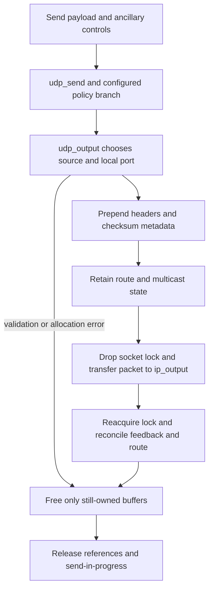

# UDP: sending a datagram, receiving a record and reporting errors

[Networking](README.md) · [PCB lookup and lifetime](internet-pcbs-ports-and-lifetime.md) · [Socket I/O](socket-lifecycle-and-io.md) · [IPv6 output](ipv6-output-and-neighbor-discovery.md)

UDP connects the socket record interface to IP packets without a TCP-style connection state machine or reliable retransmission queue. A successful send means the local output path accepted the operation; a receive becomes visible only after demultiplexing, policy and socket-buffer admission. This chapter follows the IPv4 implementation in `xnu-12377.121.6` and the distinct IPv6 entry points.

For the expanded IPv6 path, continue with [IPv6 sockets and options](ipv6-sockets-and-packet-options.md), [source selection](ipv6-source-selection-and-scopes.md) and [multicast/MLD](ipv6-multicast-membership-and-mld.md). They trace the native/mapped split, scoped tuple matching, option ownership and receive filters in detail.

## Endpoint state and entry points

[`udp_attach()`](../../../xnu/bsd/netinet/udp_usrreq.c#L2386) allocates Internet-PCB state and reserves socket buffers; [`udp_bind()`](../../../xnu/bsd/netinet/udp_usrreq.c#L2415) and [`udp_connect()`](../../../xnu/bsd/netinet/udp_usrreq.c#L2453) publish local and foreign tuples through the shared PCB layer. UDP's per-socket lock is the PCB mutex: [`udp_lock()`/`udp_unlock()`](../../../xnu/bsd/netinet/udp_usrreq.c#L2750-L2807) optionally adjust `so_usecount` around it. `udbinfo` owns UDP's shared PCB lookup state, whereas each socket owns its receive buffer and pending error.

| Representation | Meaning |
| --- | --- |
| Socket + `inpcb` | Endpoint defaults, local/foreign tuple, route cache, policy, send-in-progress and receive state. |
| Payload mbuf chain with `M_PKTHDR` | One outgoing datagram, not a userspace pointer. `m_pkthdr.len` is the total payload length before headers. |
| Control mbuf chain | Per-message ancillary options; separately parsed and consumed. |
| `udpiphdr` / `udphdr` | Header construction and wire UDP ports/length/checksum. |
| Receive `sockbuf` record | Source address, optional ancillary controls and payload, later consumed by generic receive. |

## Worked send: unconnected socket, implicit local port

Consider an IPv4 datagram socket that has not been bound or connected, sending a small payload to a specified destination. This is an illustrative API sequence, not a claim about a fixed ephemeral port number:

```c
/* Illustrative userspace sequence. Error handling omitted here. */
int fd = socket(AF_INET, SOCK_DGRAM, 0);
sendto(fd, payload, payload_size, 0, (struct sockaddr *)&peer, sizeof(peer));
```

Generic socket I/O constructs the payload/control mbufs and invokes the protocol's send entry. [`udp_send()`](../../../xnu/bsd/netinet/udp_usrreq.c#L2688) consumes those buffers even on its missing-PCB error path. NECP/flow-divert can redirect the operation before ordinary UDP output; the standard branch enters [`udp_output()`](../../../xnu/bsd/netinet/udp_usrreq.c#L1653), under socket protection, with Skywalk asynchronous-transmit protection when configured.

`udp_output()` parses control data, extracts `IP_PKTINFO`, service/traffic information and per-packet options, and frees the control chain. A packet-info interface takes precedence over the bound-interface default. It validates the IP packet-length limit and existing flow-control state before building headers. Referenced interfaces are retained across unlocked work and released on exit. See [option and interface setup](../../../xnu/bsd/netinet/udp_usrreq.c#L1727-L1790).

For a supplied destination, the function rejects an already connected socket in the ordinary path (`EISCONN`). It chooses a source address if needed, and implicitly allocates a local port through `in_pcbsetport()` while coordinating bind-in-progress state. The foreign address/port are per-send variables: it does not have to connect and disconnect the PCB merely to send one packet. This avoids disturbing input lookup and accidentally unbinding the local port. If no destination was supplied and the PCB lacks a foreign address, output returns `ENOTCONN`. See [source and destination selection](../../../xnu/bsd/netinet/udp_usrreq.c#L1849-L1954).

`inp_sndinprog_cnt` covers output work that will drop socket protection. Every exit after incrementing it decrements it; the last sender clears applicable feedback state and wakes waiters. This state has a different purpose from the lookup wanted count described in the [PCB chapter](internet-pcbs-ports-and-lifetime.md).

## Headers, checksum and ownership across IP output

[`M_PREPEND` and header construction](../../../xnu/bsd/netinet/udp_usrreq.c#L1969-L2025) add the IP/UDP header and initialize source/destination ports and UDP length. Header allocation can fail with `ENOBUFS`. The code initializes a pseudoheader checksum and sets checksum flags/offsets so later IP processing or supported hardware can complete the payload checksum. IPv4 no-checksum configuration differs from the CLAT46 branch, which requires checksum generation.

Before dropping the socket lock, output retains multicast state where applicable and copies the PCB route into a local `route` with its own reference. It annotates the packet with flow identity, service class, protocol and process attribution. The actual transfer is explicit:

[`bsd/netinet/udp_usrreq.c:2173–2179`](../../../xnu/bsd/netinet/udp_usrreq.c#L2173-L2179):

<!-- source-excerpt: ../../../xnu/bsd/netinet/udp_usrreq.c#L2173-L2179 -->
```c
	socket_unlock(so, 0);
	error = ip_output(m, inpopts, &ro, soopts, mopts, &ipoa);
	m = NULL;
	socket_lock(so, 0);
	if (mopts != NULL) {
		IMO_REMREF(mopts);
	}
```

`ip_output()` consumes the packet for success and failure. Setting `m = NULL` prevents UDP cleanup from freeing it again. After reacquiring socket protection, UDP processes flow advisory results, updates policy/statistics, and synchronizes the local cached route back into the PCB. `FADV_SUSPENDED` can become `ENOBUFS`; ordinary flow-controlled queue feedback can mark the socket without treating the current tail-enqueued packet as a failed send. See [feedback and route reconciliation](../../../xnu/bsd/netinet/udp_usrreq.c#L2205-L2298).

The [release tail](../../../xnu/bsd/netinet/udp_usrreq.c#L2301-L2326) frees a still-owned packet, releases an interface reference, frees content-filter saved context, decrements send-in-progress, and wakes waiters when required. A later output failure can occur after an implicit bind succeeded; an error return does not promise the socket is back in its original unbound state.



## Receive: validation before endpoint lookup

[`udp_input()`](../../../xnu/bsd/netinet/udp_usrreq.c#L351) starts with an IP-delivered mbuf chain and incoming interface. It strips IPv4 options on this path, pulls up the IP/UDP header when needed, rejects destination port zero, checks UDP length against IP payload length, trims excess bytes, saves the IP header for possible ICMP generation and validates checksum. `m_pullup()` failure already consumed the input chain; callers must not free the old pointer again. See [validation](../../../xnu/bsd/netinet/udp_usrreq.c#L400-L464).

Broadcast/multicast take a fanout path rather than a single tuple lookup. It filters matching PCBs and multicast memberships, applies policy, and uses `m_copy()` when reuse permits continued delivery. The copy can share external mbuf storage; it is not necessarily a full byte copy. Each delivery transfers one chain to `udp_append()`, and a failed copy prevents further fanout. An unmatched multicast/broadcast datagram is dropped without an ICMP port-unreachable response. See [fanout and copy ownership](../../../xnu/bsd/netinet/udp_usrreq.c#L600-L683) and [mbuf allocation/sharing](mbuf-allocation-caches-and-pressure.md).

The unicast path also recognizes configured UDP-encapsulated IPsec and keepalive cases before ordinary endpoint delivery. Otherwise it looks up the four-tuple with wildcard fallback. Successful lookup carries a wanted reference. The socket handoff and closing-endpoint check are:

[`bsd/netinet/udp_usrreq.c:826–833`](../../../xnu/bsd/netinet/udp_usrreq.c#L826-L833):

<!-- source-excerpt: ../../../xnu/bsd/netinet/udp_usrreq.c#L826-L833 -->
```c
	udp_lock(inp->inp_socket, 1, 0);

	if (in_pcb_checkstate(inp, WNT_RELEASE, 1) == WNT_STOPUSING) {
		udp_unlock(inp->inp_socket, 1, 0);
		IF_UDP_STATINC(ifp, cleanup);
		drop_reason = DROP_REASON_UDP_SOCKET_CLOSING;
		goto bad;
	}
```

Only a surviving endpoint proceeds through policy checks and construction of source-address/control records. The source address is mapped into a `sockaddr_in6` for applicable mapped-IPv6 sockets. Header bytes are removed from the delivered data chain; payload byte zero is now the datagram payload, not the IP header.

## Socket-buffer admission and record delivery

[`udp_append()`](../../../xnu/bsd/netinet/udp_usrreq.c#L962) supplies the multicast helper path; the unicast body has equivalent source/control preparation and calls [`sbappendaddr()`](../../../xnu/bsd/kern/uipc_socket2.c#L1320). This helper is an ownership boundary: it invokes socket/content filters, constructs source-address plus control plus data records, and appends to `so_rcv`. On failure it frees ordinary Internet datagram buffers; an `EJUSTRETURN` filter result can instead mean that a filter retained the data. Therefore a false return is not permission for UDP to free the chain again.

The UDP caller increments its failed-admission counter when append returns zero; success invokes `sorwakeup()`. Readiness and receive wakeups belong to the socket buffer, not to a destination process selected by the packet. A later `recvfrom()`/`recvmsg()` consumes the record through [generic socket receive](socket-lifecycle-and-io.md), preserving datagram boundaries and applying its truncation/control-copy rules. Empty payloads still have record semantics; byte count alone does not describe all readiness behavior.

## Local errors, missing listeners and asynchronous errors

| Event | Result and owner |
| --- | --- |
| Local validation/header allocation/route failure | Send reports an errno; each layer frees the packet it still owns. Prior successful implicit bind may remain. |
| No receiving unicast PCB | UDP may restore the saved IP header and transfer the packet to `icmp_error()` for port unreachable. Blackhole, rate limiting, broadcast/multicast and other configured exceptions can suppress this. |
| Receive-buffer/filter rejection | Packet is consumed or retained by the receive/filter contract; local receiver does not necessarily see a per-datagram error. |
| ICMP-derived asynchronous error | [`udp_ctlinput()`](../../../xnu/bsd/netinet/udp_usrreq.c#L1038) uses quoted headers/ports for lookup and lifetime handoff. [`udp_notify()`](../../../xnu/bsd/netinet/udp_usrreq.c#L1030) sets `so_error` and wakes readers/writers. |
| Path-MTU notification for an NECP-associated endpoint | The [`PRC_MSGSIZE` branch](../../../xnu/bsd/netinet/udp_usrreq.c#L1095-L1108) can notify NECP instead of also setting `so_error`. |

Follow [IP reassembly and ICMP feedback](ip-fragment-reassembly-and-icmp.md#receiving-icmp-quoted-headers-become-transport-control-input) for the input quote parser, borrowed callback parameters and domain-to-socket lock handoff. A send success therefore cannot predict receiver admission, ICMP generation or later delivery. Conversely, an error notification can arrive after the original send call returned.

## IPv6 and configuration boundaries

[`udp6_send()`](../../../xnu/bsd/netinet6/udp6_usrreq.c#L1213) validates address-family/mapped-address rules and chooses mapped IPv4 or native IPv6 output; [`udp6_output()`](../../../xnu/bsd/netinet6/udp6_output.c#L154) handles scope/source selection and IPv6 options, and [`udp6_input()`](../../../xnu/bsd/netinet6/udp6_usrreq.c#L258) has its own checksum and demultiplexing path. Do not apply IPv4 optional-checksum rules or source-selection shortcuts to native IPv6. Follow [IPv6 output and neighbor discovery](ipv6-output-and-neighbor-discovery.md) below that boundary.

`NECP`, `CONTENT_FILTER`, `FLOW_DIVERT`, `IPSEC` and `SKYWALK` guard distinct paths; a source branch is not evidence that every product enables it. Local test scenarios include [UDP disconnect](../../../xnu/tests/udp_disconnect.c), [zero-byte UDP readiness](../../../xnu/tests/socket_0byte_udp_poll_58140856.c), and [mapped-v6 fragmentation options](../../../xnu/tests/v4mappedv6_dontfrag.c). These were identified as follow-up API checks, not executed or used as a claim of transport conformance.

<!-- BEGIN PLATYDOC DOCUMENTATION LICENSE -->
Original Platydoc text and diagrams are licensed under [CC BY 4.0](https://creativecommons.org/licenses/by/4.0/). Quoted source code and third-party material retain their respective licenses.
<!-- END PLATYDOC DOCUMENTATION LICENSE -->
