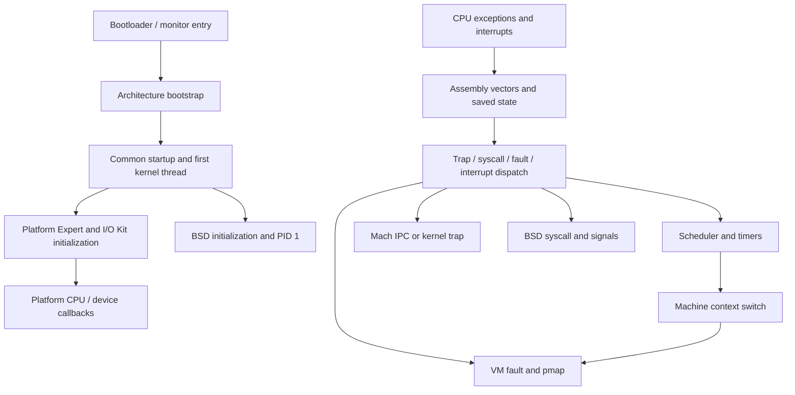

# Platform, boot, and machine execution

[Guide index](../../README.md) · [Architecture](../../architecture.md)

This subsystem makes a compiled XNU kernel run on a particular CPU and platform: it establishes initial execution state, starts common kernel services, translates hardware exceptions into kernel operations, switches CPU context, and manages hardware address translations. Platform Expert (`pexpert`) connects boot arguments and device descriptions to early kernel setup and I/O Kit callbacks. The code is distributed across architecture directories rather than contained in one module. [`files.arm64`](../../../xnu/osfmk/conf/files.arm64), [`startup.c`](../../../xnu/osfmk/kern/startup.c#L521), [`pe_init.c`](../../../xnu/pexpert/arm/pe_init.c#L436).

The arrows summarize interfaces, not one universal build configuration. ARM64 PPL and SPTM builds select different early boot and pmap implementations. x86_64 has separate entry, page-table, and power paths; `osfmk/i386` contains much of its implementation despite the directory name. [`ARM build selection`](../../../xnu/osfmk/conf/files.arm64#L10), [`x86 bootstrap`](../../../xnu/osfmk/i386/i386_init.c#L693).

## Reading route

For a selector-by-selector view of system calls, use the [machine entry-point catalog](../../interfaces/machine-entry-points.md). It connects ARM64 SVC/platform/time paths and x86 syscall classes to the complete BSD and Mach catalogs. The [AST chapters](../runtime/ast-mechanism.md) explain deferred work before those entries return.

1. [Boot to PID 1](boot.md): follow one configured machine from its assembly entry through startup phases, I/O Kit lockdown, root mounting, and launchd loading.
2. [Exceptions, interrupts, and CPU execution](execution.md): start with the execution map, then follow [ARM64 exception entry](arm64-exception-entry.md) and [ARM64 exception return](arm64-exception-return.md) through exact assembly/C paths and source excerpts. The overview also covers CPU bringup and context-switch boundaries.
3. [EL1, EL2, and protected execution](exception-levels-and-monitors.md): distinguish guest `hvc` calls, SPTM hooks and interrupted-domain resumption, legacy PPL fragments, and implementation supplied outside this tree.
4. [Hardware mappings and pmap backends](hardware-mappings.md): compare PPL, SPTM, and x86 while tracking reverse mappings, physical addresses, and TLB completion.
5. [Platform services, power, and shared interfaces](platform-services.md): connect device-tree data, CPU callbacks, sleep/hibernate, commpage, and virtualization interfaces.
6. [CPU startup, offline, idle, and system sleep](cpu-power-lifecycle.md): follow ARM64 transition serialization, scheduler versus interrupt readiness, timer/IPI departure, saved idle-thread context, and absolute-time restoration.
7. [Hibernation image creation](hibernation-image-creation.md): trace preparation, page selection/discard, metadata compaction, image encoding, encryption boundaries, and polling-driver transfers. Continue with [hibernation restore](hibernation-restore.md) for physical collisions, temporary mappings, SPTM handoff, VM rebuild, late-page read, and cleanup.
8. [x86 sleep and resume](x86-sleep-and-resume.md): follow ACPI callback boundaries, assembly context save/restore, temporary CR3, TSC rebasing, deep idle, and secondary CPU restart. Read [system sleep and wake](../drivers/system-sleep-and-wake.md) for root-domain policy and device coordination.

For one complete fault path, read [EL0 exception entry](arm64-exception-entry.md), [Mach exception delivery](../ipc/exception-delivery.md), then [exception return](arm64-exception-return.md). The first establishes the interrupted CPU state, the second follows the handler's port/reply or Unix signal, and the third restores validated state and resumes execution.

For kernel accesses to user pointers, read [ARM64 copyin, copyout and fault recovery](arm64-user-memory-copy.md). It connects range validation, PAN/MTE selection, assembly recovery tables, VM faults, saved-state changes and partial-copy errors.

For instruction-level explanations, follow [ARM64 assembly walkthroughs](arm64-assembly-walkthroughs.md) through the exception vectors, register spills, stack changes, dispatch and return. Then read [thread switching, entry and exit](arm64-context-switching.md) for `cswitch.s`, manufactured first-dispatch state, saved kernel contexts, continuations, stack handoff and deferred destruction. These connect to the scheduler and pmap chapters without treating a thread switch as an exception-level transition.

Use [runtime](../runtime/README.md) for scheduling decisions and wait/lock primitives, [VM](../vm/README.md) for address-space policy and page ownership, [IPC](../ipc/README.md) for message transport and exception RPCs, [processes](../processes/README.md) for BSD lifecycle/syscalls, [drivers](../drivers/README.md) for matching and power-management policy, and [security](../security/README.md) for monitor policy and Exclaves. Here, the focus is the machine transition connecting those layers.

## Sources inspected and limits

This is a static review of selected paths in this checkout. No kernel image was built or booted, and no hardware behavior was measured. Conditional code describes supported source paths, not a verified configuration of a particular Apple product.

| Depth | Sources | Reviewed scope and limits |
|---|---|---|
| Deep path review | [`start.s`](../../../xnu/osfmk/arm64/start.s), [`arm_init.c`](../../../xnu/osfmk/arm/arm_init.c), [`start_sptm.s`](../../../xnu/osfmk/arm64/sptm/start_sptm.s), [`arm_init_sptm.c`](../../../xnu/osfmk/arm64/sptm/arm_init_sptm.c) | Cold entry, common C initialization, selected secondary/resume and early-mapping paths. Every register/SoC branch not audited. |
| Deep path review | [`startup.c`](../../../xnu/osfmk/kern/startup.c), [`startup.h`](../../../xnu/osfmk/kern/startup.h), [`bsd_init.c`](../../../xnu/bsd/kern/bsd_init.c), selected [`kern_sig.c`](../../../xnu/bsd/kern/kern_sig.c#L3467)/[`kern_exec.c`](../../../xnu/bsd/kern/kern_exec.c#L8069) | Phase ordering, bootstrap thread, I/O Kit/BSD boundary, PID 1 AST and executable selection. Full exec is covered in the process guides; root-device discovery is covered only at selected boundaries. |
| Deep path review | [`locore.s`](../../../xnu/osfmk/arm64/locore.s), [`sleh.c`](../../../xnu/osfmk/arm64/sleh.c), [`bsd_arm64.c`](../../../xnu/osfmk/arm64/bsd_arm64.c), [`ast.c`](../../../xnu/osfmk/kern/ast.c), [`pcb.c`](../../../xnu/osfmk/arm64/pcb.c), [`cswitch.s`](../../../xnu/osfmk/arm64/cswitch.s), [`machine_routines_asm.h`](../../../xnu/osfmk/arm64/machine_routines_asm.h), [`status.c`](../../../xnu/osfmk/arm64/status.c) | Vector offsets/mapping, user/kernel frame and stack selection, register spilling, SVC/fault/IRQ/FIQ routing, AST/PFZ continuations, state authentication/mutation and final restore/eret. Not a formal verification of every configuration, debug trap or exception class. |
| Deep caller-path review | [`arm64_hypercall.c`](../../../xnu/osfmk/arm64/arm64_hypercall.c), [`hv_hvc.h`](../../../xnu/osfmk/arm64/hv_hvc.h), SPTM hooks/resume selector in [`locore.s`](../../../xnu/osfmk/arm64/locore.s#L1696-L1743), [`sptm.h`](../../../xnu/osfmk/arm64/sptm/sptm.h) | Guest hypercall ABI/results, protected-call preemption/AST hooks, result storage and interrupted-domain resumption; legacy PPL dispatch/state fragments. Host EL2 and monitor implementations, external transition macros, and full guarded-register semantics are unavailable. |
| Deep selected ARM64 power-path review | [`processor.c`](../../../xnu/osfmk/kern/processor.c), [`machine.c`](../../../xnu/osfmk/kern/machine.c), [`cpu.c`](../../../xnu/osfmk/arm64/cpu.c), [`machine_routines.c`](../../../xnu/osfmk/arm64/machine_routines.c), [`hibernate_arm64.c`](../../../xnu/osfmk/arm64/hibernate_arm64.c), selected [`IOHibernateIO.cpp`](../../../xnu/iokit/Kernel/IOHibernateIO.cpp#L1691) | CPU registration/start/completion, offline serialization and timer/IPI drain, idle and saved-context resume, absolute-time handling, VM queue synchronization and image-entry/halt boundary. Image serialization/restore and x86 power now have dedicated chapters below; external CPU driver hardware sequencing and CPU availability policy remain outside this ARM trace. |
| Deep hibernation and x86 power paths | [`IOHibernateIO.cpp`](../../../xnu/iokit/Kernel/IOHibernateIO.cpp), [`IOHibernateRestoreKernel.c`](../../../xnu/iokit/Kernel/IOHibernateRestoreKernel.c), [`IOPolledInterface.cpp`](../../../xnu/iokit/Kernel/IOPolledInterface.cpp), [`hibernate.c`](../../../xnu/osfmk/kern/hibernate.c), hibernation sections of [`vm_resident.c`](../../../xnu/osfmk/vm/vm_resident.c#L8824), architecture hibernate/restore files, [`acpi.c`](../../../xnu/osfmk/i386/acpi.c), [`start.s`](../../../xnu/osfmk/x86_64/start.s#L350), [`pmCPU.c`](../../../xnu/osfmk/i386/pmCPU.c), selected `mp.c`, `i386_init.c`, `rtclock.c`, `model_dep.c` bodies | Setup/timeout/resource ownership, queue flush and bitmap selection, physical collision replay, VM compaction/rebuild, polled read/write/cleanup, legacy versus SPTM restore interfaces, x86 saved continuation/time/facility/secondary restart. Bootloader authentication, secure-HMAC producer, monitor bodies, firmware, and concrete power/storage driver algorithms remain external; no hardware validation. |
| Focused path review | ARM [`cpu.c`](../../../xnu/osfmk/arm64/cpu.c), [`machine_routines.c`](../../../xnu/osfmk/arm64/machine_routines.c), [`rtclock.c`](../../../xnu/osfmk/arm/rtclock.c); x86 [`start.s`](../../../xnu/osfmk/x86_64/start.s), [`i386_init.c`](../../../xnu/osfmk/i386/i386_init.c), [`idt64.s`](../../../xnu/osfmk/x86_64/idt64.s) | CPU setup, timer and callback boundaries; representative x86 comparison rather than symmetric instruction-level coverage. |
| Deep selected paths, expanded in [VM](../vm/README.md) | [`SPTM pmap.c`](../../../xnu/osfmk/arm64/sptm/pmap/pmap.c), [`legacy pmap.c`](../../../xnu/osfmk/arm/pmap/pmap.c), [`x86 pmap.c`](../../../xnu/osfmk/x86_64/pmap.c), [`pmap_x86_common.c`](../../../xnu/osfmk/i386/pmap_x86_common.c), related headers | Table geometry, root/leaf allocation, reverse mappings, enter/remove/protect/disconnect, table reclamation, ASID/PCID activation, nesting and TLB completion. External monitor bodies, all hardware variants, and complete code-signing policy remain outside review. |
| Interface survey with selected bodies | [`pexpert`](../../../xnu/pexpert), [`IOStartIOKit.cpp`](../../../xnu/iokit/Kernel/IOStartIOKit.cpp), [`IOCPU.cpp`](../../../xnu/iokit/Kernel/IOCPU.cpp), sleep/hibernate, commpage, and virtualization files linked below | Early platform data and callback contracts, representative sleep/resume and publication paths. Driver-specific power sequencing, firmware, hypervisor implementation, and monitor bodies are outside the review. |

The SPTM interface header includes externally supplied `sptm/sptm_xnu.h`; its implementation is not in this tree. Legacy pmap comments also refer to `doc/arm/PPL.md`, which is absent here. Follow the available call sites without treating those missing components as inspected implementation. [`sptm.h`](../../../xnu/osfmk/arm64/sptm/sptm.h#L30), [`pmap_ppl_interface.c`](../../../xnu/osfmk/arm/pmap/pmap_ppl_interface.c#L30).

The [protected-security expansion](../security/protected-execution.md) adds detailed SPTM/TXM call and policy lifetimes, Exclaves scheduler/upcall execution, physical ownership and service boundaries. Use it alongside the machine-transition descriptions here.

<!-- BEGIN PLATYDOC DOCUMENTATION LICENSE -->
Original Platydoc text and diagrams are licensed under [CC BY 4.0](https://creativecommons.org/licenses/by/4.0/). Quoted source code and third-party material retain their respective licenses.
<!-- END PLATYDOC DOCUMENTATION LICENSE -->
