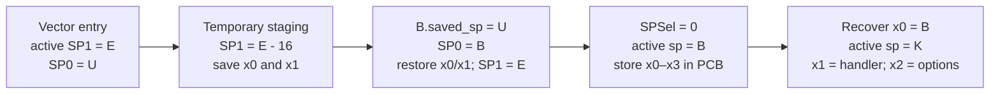
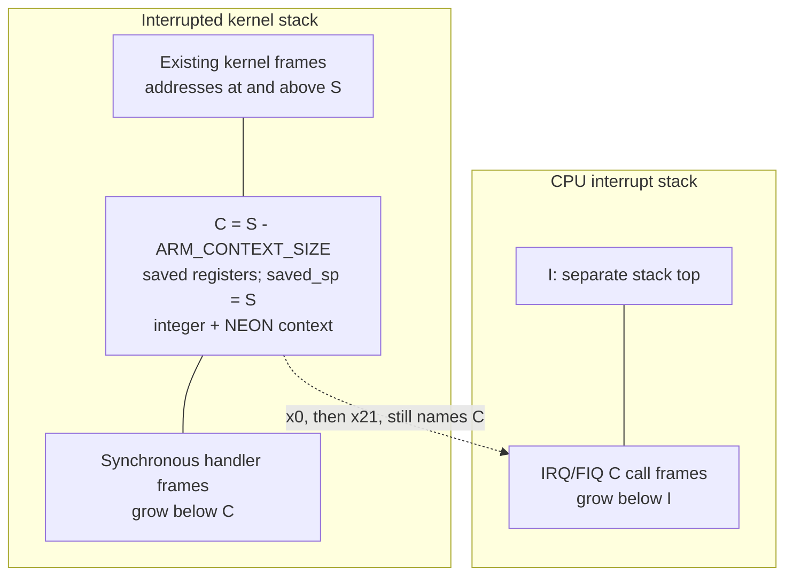
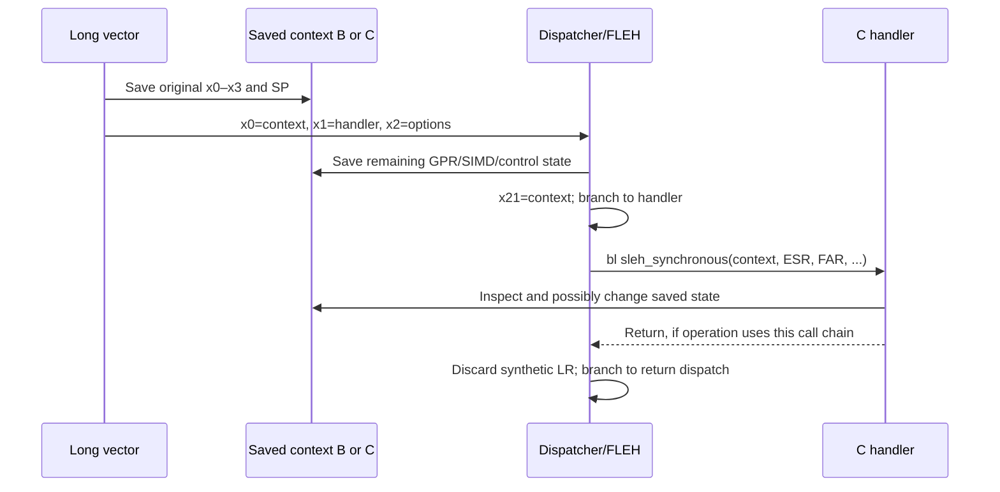
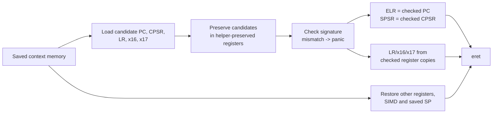

# ARM64 exception assembly: five instruction walkthroughs

[Platform](README.md) · [Exception entry](arm64-exception-entry.md) · [Exception return](arm64-exception-return.md) · [Thread context switching](arm64-context-switching.md)

This chapter follows five instruction sequences in [`locore.s`](../../../xnu/osfmk/arm64/locore.s) and its included macros. The aim is to make each register substitution and stack change readable. The existing entry/return guides explain the complete control-flow map; this chapter concentrates on the instructions that construct a context, enter C, and restore execution. Scheduler stack switches, continuations and initial thread entry are covered in [thread context switching](arm64-context-switching.md).

The central distinction is between **the address containing interrupted state** and **the active stack used by the handler**. They often differ. A second distinction is between an architectural exception return address in `ELR_EL1` and the ordinary link register `x30`/`lr`. An exception does not make those two registers interchangeable.

## Before following the instructions

For these paths the CPU supplies the exception return PC and previous processor state through `ELR_EL1` and `SPSR_EL1`; syndrome/address registers supply exception-dependent information. XNU reads them explicitly. The hardware has not populated an `arm_context_t`, pushed every general register, or called C. Software must preserve registers before using them as scratch. The relevant reads are in [`SPILL_REGISTERS`](../../../xnu/osfmk/arm64/exception_asm.h#L172); the vector selection and stack setup are in [`locore.s`](../../../xnu/osfmk/arm64/locore.s#L535).

The boot path installs the vector address in `VBAR_EL1`; the non-SPTM and SPTM setup differ. The existing [entry guide](arm64-exception-entry.md#how-the-cpu-finds-these-vectors) traces both. A lower-EL AArch64 synchronous exception selects `Lel0_synchronous_vector_64`, whereas an interrupted EL1 SP0 execution selects the corresponding SP0 vector. The `.align 7` slots establish the vector-table spacing; they are not C function calls.

Use these names for addresses in the walkthrough:

| Name | Meaning |
| --- | --- |
| `T` | Current `thread *`, read from `TPIDR_EL1`. |
| `B` | User saved-context address obtained from `T->machine.upcb`. |
| `U` | Interrupted user's stack pointer. |
| `E` | Initial exception-stack pointer, selected as SP1 on vector entry. |
| `K` | Thread kernel-stack top returned by `LOAD_KERN_STACK_TOP`. |
| `I` | CPU interrupt-stack top returned by `LOAD_INT_STACK_THREAD`. |
| `S` | Interrupted kernel SP0 for the same-EL example. |
| `C` | A kernel context allocated at `S - ARM_CONTEXT_SIZE`. |

These are symbolic addresses, not invented layout constants. [`genassym.c`](../../../xnu/osfmk/arm64/genassym.c#L190) emits `ARM_CONTEXT_SIZE` from `sizeof(arm_context_t)` and `SS64_*`/`NS64_*` offsets from `offsetof`. The [C context](../../../xnu/osfmk/mach/arm/thread_status.h#L1220) contains integer and NEON saved-state objects, each with its own header/layout. In particular, `SS64_X0` is not an assertion that the first byte of `arm_context_t` is x0.

| Assembly operand | Generated C target | Width of the illustrated access |
| --- | --- | --- |
| `[B, SS64_X0]` in `stp x0,x1` | `ss.ss_64.x[0]`, then adjacent x1 | Two 8-byte registers. |
| `[B, SS64_X28]` in `stp x28,fp` | Last array register, then `ss.ss_64.fp` | Two 8-byte registers; `fp` is x29. |
| `[B, SS64_SP]` / `[B, SS64_PC]` | Saved SP / saved PC | 8 bytes each. |
| `[B, SS64_CPSR]` in `str w23` | Saved 32-bit processor state | 4 bytes; the C layout has separate padding. |
| `[B, NS64_Q0]` in `stp q0,q1` | First two saved 128-bit SIMD registers | Two 16-byte registers. |

The generating declarations are at [`SS64 offsets`](../../../xnu/osfmk/arm64/genassym.c#L195) and [`NS64 offsets`](../../../xnu/osfmk/arm64/genassym.c#L241); the fields are in [`arm_saved_state64`](../../../xnu/osfmk/mach/arm/thread_status.h#L416) and [`arm_neon_saved_state64`](../../../xnu/osfmk/mach/arm/thread_status.h#L1073). No generated `assym.s` from a particular product build is assumed here.

## 1. EL0 entry: use SP as a destination address, then replace it with a kernel stack

The short lower-EL vector invokes `MAP_KERNEL` and `BRANCH_TO_KVA_VECTOR` before reaching the long handler. With `__ARM_KERNEL_PROTECT__`, [`MAP_KERNEL`](../../../xnu/osfmk/arm64/locore.s#L198) reads `TTBR0_EL1` into x18, sets its low ASID bit, writes it back, then writes `TCR_EL1_BOOT` and synchronizes. The branch macro uses x18 to walk `thread → CpuDatap → cpu_exc_vectors` and loads the selected handler address. Without that configuration the branch is direct. This is why x18 has a special preservation policy here; it is already scratch before the ordinary spill.

At the long vector, SP1 points to the exception stack and `SP_EL0` still contains `U`. The early save is:

[Preserve x0/x1, capture the user SP, and select PCB storage](../../../xnu/osfmk/arm64/locore.s#L909)

<!-- source-excerpt: ../../../xnu/osfmk/arm64/locore.s#L909-L922 -->
```asm
	stp		x0, x1, [sp, #-16]!					// Save x0 and x1 to the exception stack
#if __ARM_KERNEL_PROTECT__
	mov		x18, #0 						// Zero x18 to avoid leaking data to user SS
#endif
	mrs		x0, TPIDR_EL1						// Load the thread register
	LOAD_USER_PCB	dst=x0, src=x0, tmp=x1		// Load the user context pointer
	mrs		x1, SP_EL0							// Load the user stack pointer
	str		x1, [x0, SS64_SP]					// Store the user stack pointer in the user PCB
	msr		SP_EL0, x0							// Copy the user PCB pointer to SP0
	ldp		x0, x1, [sp], #16					// Restore x0 and x1 from the exception stack
	msr		SPSel, #0							// Switch to SP0
	stp		x0, x1, [sp, SS64_X0]				// Save x0, x1 to the user PCB
	stp		x2, x3, [sp, SS64_X2]				// Save x2, x3 to the user PCB
	mrs		x1, TPIDR_EL1						// Load the thread register
```

| Instruction, in execution order | State change and reason |
| --- | --- |
| `stp x0,x1,[sp,#-16]!` | Predecrement active SP1 from `E` to `E-16`; save the two user values there. The `!` writes the new address into SP. This is a temporary 16-byte staging record. |
| Conditional `mov x18,#0` | Prevent the mapping/vector scratch value from being saved as user register state on protected-kernel builds. |
| `mrs x0,TPIDR_EL1` | Replace live x0 with `T`; its interrupted value is safe at `E-16`. |
| `LOAD_USER_PCB dst=x0,src=x0,tmp=x1` | Load `B`. The macro computes the `TH_UPCB` field address, loads its pointer, and conditionally authenticates it using the address/discriminator. x1 is scratch. |
| `mrs x1,SP_EL0; str x1,[x0,SS64_SP]` | Copy `U` into `B`'s saved-SP field **before** overwriting SP0. |
| `msr SP_EL0,x0` | Set the inactive SP0 to `B`. Execution still uses SP1. This instruction does not change exception level. |
| `ldp x0,x1,[sp],#16` | Recover the interrupted x0/x1 values from SP1, then return SP1 to `E`. |
| `msr SPSel,#0` | Make SP0 the active SP. From this point `sp == B`, so the following stores target the PCB, not userspace. |
| Two `stp` instructions | Store interrupted x0–x3 into their PCB fields. These registers can now become dispatcher arguments. |
| `mrs x1,TPIDR_EL1` | Establish `T` for the following stack-selection macro. |

[`LOAD_USER_PCB`](../../../xnu/osfmk/arm64/machine_routines_asm.h#L174) expands to an address calculation, pointer load and `AUTDA_DIVERSIFIED`; the latter conditionally authenticates and handles failure. This pointer check is separate from the later signature over saved control-flow state.

The macro's [remaining tail](../../../xnu/osfmk/arm64/locore.s#L926) handles optional SME state and finishes with `mov x0,sp`, so x0 becomes `B`. The synchronous path then chooses a real handler stack:

[Select the kernel stack and branch to the common dispatcher](../../../xnu/osfmk/arm64/locore.s#L976)

<!-- source-excerpt: ../../../xnu/osfmk/arm64/locore.s#L976-L988 -->
```asm
.macro EL0_64_VECTOR_SWITCH_TO_KERN_STACK
	LOAD_KERN_STACK_TOP	dst=x1, src=x1, tmp=x0
	mov		x0, sp
	mov		sp, x1
.endmacro

el0_synchronous_vector_64_long:
	EL0_64_VECTOR	sync
	EL0_64_VECTOR_SWITCH_TO_KERN_STACK
	adrp	x1, EXT(fleh_synchronous)@page			// Load address for fleh
	add		x1, x1, EXT(fleh_synchronous)@pageoff
	mov		x2, #(FLEH_DISPATCH64_OPTION_SYNC_EXCEPTION)
	b		fleh_dispatch64
```

`LOAD_KERN_STACK_TOP` is allowed to clobber x0 as its temporary. Therefore `mov x0,sp` deliberately recovers `B` **before** `mov sp,x1` changes active SP0 to `K`. The `adrp`/`add` pair forms the handler address, first its page then its page offset; it does not dereference a function-pointer object. x2 receives the spill-option word. The final `b` transfers control without overwriting LR, whose interrupted value still has to be saved by the dispatcher.



For a lower-EL IRQ/FIQ, [`EL0_64_VECTOR_SWITCH_TO_INT_STACK`](../../../xnu/osfmk/arm64/locore.s#L967) instead loads `I`, recovers x0 from the old SP, and changes the active stack. **The saved context remains `B` in both cases.**

## 2. EL1 SP0 entry: create a context below the interrupted stack pointer

An interrupted kernel call chain must survive. The ordinary same-EL SP0 macro does not substitute a user PCB. It allocates an `arm_context_t` below `S`.

[Build the kernel context and optionally move handler execution to the interrupt stack](../../../xnu/osfmk/arm64/locore.s#L607)

<!-- source-excerpt: ../../../xnu/osfmk/arm64/locore.s#L607-L626 -->
```asm
.macro EL1_SP0_VECTOR
	msr		SPSel, #0							// Switch to SP0
	sub		sp, sp, ARM_CONTEXT_SIZE			// Create exception frame
	stp		x0, x1, [sp, SS64_X0]				// Save x0, x1 to exception frame
	stp		x2, x3, [sp, SS64_X2]				// Save x2, x3 to exception frame
	add		x0, sp, ARM_CONTEXT_SIZE			// Calculate the original stack pointer
	str		x0, [sp, SS64_SP]					// Save stack pointer to exception frame
	INIT_SAVED_STATE_FLAVORS sp, w0, w1
	mov		x0, sp								// Copy saved state pointer to x0
.endmacro

.macro EL1_SP0_VECTOR_SWITCH_TO_INT_STACK
	// SWITCH_TO_INT_STACK requires a clobberable tmp register, but at this
	// point in the exception vector we can't spare the extra GPR.  Instead note
	// that EL1_SP0_VECTOR ends with x0 == sp and use this to unclobber x0.
	mrs		x1, TPIDR_EL1
	LOAD_INT_STACK_THREAD	dst=x1, src=x1, tmp=x0
	mov		x0, sp
	mov		sp, x1
.endmacro
```

| Instruction group | Effect |
| --- | --- |
| `msr SPSel,#0` | Select the interrupted kernel SP0, whose value is `S`. Initial vector handling was using SP1. |
| `sub sp,sp,ARM_CONTEXT_SIZE` | Reserve context storage at `C = S - sizeof(arm_context_t)`. |
| Two `stp` instructions | Save original x0–x3 into `C`; they can now be scratch. |
| `add x0,sp,ARM_CONTEXT_SIZE; str x0,[sp,SS64_SP]` | Reconstruct `S` and record it as the stack pointer to restore. Saving `C` here would resume with the exception allocation still active. |
| `INIT_SAVED_STATE_FLAVORS` | Initialize integer/NEON flavor/count fields using w0/w1, whose previous values are already saved. |
| `mov x0,sp` | Export `C` as the context argument. |
| Interrupt-stack macro's `mrs`/`LOAD_INT_STACK_THREAD` | Find `I` through the current thread's CPU-data pointer; x0 is temporary during this load. |
| `mov x0,sp; mov sp,x1` | Recover `C` before replacing the active SP with `I`. |

For the ordinary synchronous case, handler execution continues below `C`. For IRQ/FIQ, the frame stays on the interrupted stack while the handler uses the CPU interrupt stack. The [IRQ vector](../../../xnu/osfmk/arm64/locore.s#L709) selects those macros explicitly.



This is a layout relationship, not a claim that every kernel exception can safely use its interrupted SP. The [synchronous vector](../../../xnu/osfmk/arm64/locore.s#L628) first stages x0/x1 on the exception stack and checks relevant syndrome classes for a potentially corrupt kernel stack. SPTM IRQ/FIQ paths have a separate [redzone check](../../../xnu/osfmk/arm64/locore.s#L675) before creating the frame. SP1 exceptions use different fatal/recovery paths. Those exceptional cases are covered in [exception entry](arm64-exception-entry.md#same-el-entry-the-interrupted-kernel-stack-stays-meaningful).

The interrupt [prologue](../../../xnu/osfmk/arm64/locore.s#L1289) publishes the context in `CPU_INT_STATE` and increments preemption accounting. Its [epilogue](../../../xnu/osfmk/arm64/locore.s#L1318) clears that pointer, decrements the count, and loads the thread kernel-stack top before common return. Thus the IRQ C handler's SP does not determine the final restored SP; `SS64_SP` does.

## 3. Spill first, then call C: follow the changing jobs of x0, x1, x21 and LR

Both entry cases reach `fleh_dispatch64` with x0=context, x1=handler, x2=options, and a usable kernel or interrupt stack. Original x0–x3 and SP are already saved. The dispatcher optionally signs its handler address with `pacia x1,sp`, then invokes the spill macro.

[The general-register spill saves values before reusing the registers](../../../xnu/osfmk/arm64/exception_asm.h#L172)

<!-- source-excerpt: ../../../xnu/osfmk/arm64/exception_asm.h#L172-L188 -->
```asm
	.if \mode != KERNEL_MODE
	stp		x2, x3, [x0, SS64_X2]
	.endif
	stp		x4, x5, [x0, SS64_X4]
	stp		x6, x7, [x0, SS64_X6]
	stp		x8, x9, [x0, SS64_X8]
	stp		x10, x11, [x0, SS64_X10]
	stp		x12, x13, [x0, SS64_X12]
	stp		x14, x15, [x0, SS64_X14]
	stp		x16, x17, [x0, SS64_X16]
	stp		x18, x19, [x0, SS64_X18]
	stp		x20, x21, [x0, SS64_X20]
	stp		x22, x23, [x0, SS64_X22]
	stp		x24, x25, [x0, SS64_X24]
	stp		x26, x27, [x0, SS64_X26]
	stp		x28, fp,  [x0, SS64_X28]
	str		lr, [x0, SS64_LR]
```

The `.if` is an assembler-time macro choice. On this call `mode == KERNEL_MODE`, so the x2/x3 stores are omitted: live x2 now contains options, not the interrupted x2. Each remaining `stp` saves an adjacent pair at a generated offset. The final pair stores x28 and `fp`/x29; `str lr` preserves the interrupted x30 separately. The `KERNEL_MODE` macro argument describes the spill convention, **not** whether the interrupted execution was EL0 or EL1.

The [next part](../../../xnu/osfmk/arm64/exception_asm.h#L190) stores q0–q31, then uses already-saved x24/x25 to read FPSR/FPCR and stores their 32-bit values. It reads ELR/SPSR into x22/x23 and FAR/ESR into x20/x21. The PAC signing path passes the selected PC/CPSR/LR/x16/x17 values to `ml_sign_thread_state`; it saves the live handler address and LR around that helper's custom ABI. Afterwards the dispatcher may clear now-unneeded live user values, but their saved copies remain intact.

The dispatcher finally assigns x21=context and x22=handler, performs configured accounting, and uses `braa x22,sp` or `br x22`. This is another **branch**, not a C-style call. [`fleh_dispatch64`](../../../xnu/osfmk/arm64/locore.s#L1063) and its [final branch](../../../xnu/osfmk/arm64/locore.s#L1142) establish these register roles.

[The synchronous first-level handler prepares ordinary C arguments](../../../xnu/osfmk/arm64/locore.s#L1175)

<!-- source-excerpt: ../../../xnu/osfmk/arm64/locore.s#L1175-L1180 -->
```asm
	ARM64_JUMP_TARGET
	mrs		x1, ESR_EL1							// Load exception syndrome
	mrs		x2, FAR_EL1							// Load fault address
	mrs		lr, ELR_EL1
	/* NB: lr might not be a valid address (e.g. instruction abort). */
	PUSH_FRAME
```

| Instruction | Meaning at this point |
| --- | --- |
| `ARM64_JUMP_TARGET` | Configuration-dependent indirect-branch target marking; no user register argument is supplied by it. |
| `mrs x1,ESR_EL1` | Set C argument 2 to the syndrome. x22 had carried the dispatch target; intervening helper calls need not preserve the earlier x1 value. |
| `mrs x2,FAR_EL1` | Set C argument 3 to the fault address, replacing the dispatch/spill scratch value. Validity depends on the exception class. |
| `mrs lr,ELR_EL1` | Load the interrupted PC into the live LR for the synthetic unwind frame. Original x30 is already safely stored in `SS64_LR`. |
| `PUSH_FRAME` | Expand to `stp fp,lr,[sp,#-16]!; mov fp,sp`. This creates a 16-byte unwind record on the handler stack; it is not the full exception context. |

The [`PUSH_FRAME` and pop macros](../../../xnu/osfmk/arm64/asm.h#L182) explain why the return sequence uses `POP_FRAME_WITHOUT_LR`: it restores FP and advances SP while discarding the stored link-register slot. No ordinary `ret` should jump to that synthetic record.

On SPTM builds the handler has additional lockdown checks before the following continuation:

[The explicit PC/FAR stores, C call, and return dispatcher branch](../../../xnu/osfmk/arm64/locore.s#L1201)

<!-- source-excerpt: ../../../xnu/osfmk/arm64/locore.s#L1201-L1215 -->
```asm
Lfleh_synchronous_continue:
	/* We've had our chance to lockdown, release PC/FAR */
	str		x25, [x0, SS64_PC]
	str		x2,  [x0, SS64_FAR]
#endif /* CONFIG_SPTM */

	bl		EXT(sleh_synchronous)
	POP_FRAME_WITHOUT_LR

#if XNU_MONITOR && !CONFIG_SPTM
	CHECK_EXCEPTION_RETURN_DISPATCH_PPL
#endif

	mov		x28, xzr		// Don't need to check PFZ if there are ASTs
	b		exception_return_dispatch
```

Here `bl sleh_synchronous` sets live LR to the next assembly instruction. If C returns, execution reaches the pop; x21 still carries the context as a callee-preserved register. `mov x28,xzr` disables the interrupt-only PFZ check for this return, and `b exception_return_dispatch` enters the state-based return path.

[`sleh_synchronous`](../../../xnu/osfmk/arm64/sleh.c#L770) derives `state = &context->ss`, decodes ESR and verifies user/kernel origin. Its [SVC branch](../../../xnu/osfmk/arm64/sleh.c#L940) requires a 64-bit user context and calls `handle_svc`; that [function](../../../xnu/osfmk/arm64/sleh.c#L2743) reads the saved trap number and selects platform, Mach or BSD handling. Handler results modify the saved state, not a live x0 that can simply be carried unchanged through all these calls. For example, the [absolute-time trap](../../../xnu/osfmk/arm64/sleh.c#L2790) writes the result into saved x0.



### A configuration-sensitive spill-option caveat

`FLEH_DISPATCH64_OPTION_SYNC_EXCEPTION` selects `DONT_SPILL_ELR_FAR` on SPTM builds. However, this invocation passes x2 as the option register, and the PAC-signing branch [overwrites w2 with the CPSR](../../../xnu/osfmk/arm64/exception_asm.h#L237) before a helper documented to clobber x2. The later [option test](../../../xnu/osfmk/arm64/exception_asm.h#L278) still names that register. The visible code therefore does not justify a configuration-independent claim that the original option word survives and always defers those first stores. The explicit stores in `fleh_synchronous` above are clear. This is a configuration-sensitive static-source ambiguity, not a confirmed runtime defect or security conclusion. The compiled configuration and external monitor guarantees have not been established by this walkthrough.

## 4. Returning is a loop over saved state, not a single `ret`

[`exception_return_dispatch`](../../../xnu/osfmk/arm64/locore.s#L1690) loads saved CPSR through x21 and tests `PSR64_MODE_EL_MASK`. The mode bits choose `return_to_kernel` or `return_to_user`; the current handler itself is already running in the kernel in both cases.

For user return, x3 is freshly loaded from `TPIDR_EL1` before the AST check:

[Read pending work only after masking exceptions](../../../xnu/osfmk/arm64/locore.s#L1818)

<!-- source-excerpt: ../../../xnu/osfmk/arm64/locore.s#L1818-L1823 -->
```asm
	msr		DAIFSet, #DAIFSC_ALL				// Disable exceptions
	ldr		x4, [x3, ACT_CPUDATAP]				// Get current CPU data pointer
	ldr		w0, [x4, CPU_PENDING_AST]			// Get ASTs
	cbz		w0, no_asts							// If no asts, skip ahead

	cbz		x28, user_take_ast					// If we don't need to check PFZ, just handle asts
```

| Instruction | Why it matters |
| --- | --- |
| `msr DAIFSet,#DAIFSC_ALL` | Mask the configured debug/asynchronous/IRQ/FIQ classes at this boundary. It does not clear pending AST bits. |
| `ldr x4,[x3,ACT_CPUDATAP]` | Obtain the CPU associated with the current thread now; an earlier C path may have blocked/migrated. |
| `ldr w0,[x4,CPU_PENDING_AST]` | Read the current processor's pending work into a scratch register, not saved user x0. |
| `cbz w0,no_asts` | Skip AST handling if the word is zero. |
| `cbz x28,user_take_ast` | Synchronous returns take pending work directly. Interrupt returns can first test the recognized commpage PFZ; that separate rule is explained in the return guide. |

[Handle work and retry the check if C returns](../../../xnu/osfmk/arm64/locore.s#L2128)

<!-- source-excerpt: ../../../xnu/osfmk/arm64/locore.s#L2128-L2132 -->
```asm
user_take_ast:
	PUSH_FRAME
	bl		EXT(ast_taken_user)							// Handle all ASTs, may return via continuation
	POP_FRAME_WITHOUT_LR
	b		check_user_asts								// Now try again
```

Each iteration constructs/discards a temporary unwind frame around `ast_taken_user`; it does not consume the PCB. The final `b` repeats the check, allowing newly posted work to be seen. If user preemption blocks with a continuation, [`thread_preempted`](../../../xnu/osfmk/kern/ast.c#L91) later calls `thread_exception_return`; [`arm64_thread_exception_return`](../../../xnu/osfmk/arm64/locore.s#L1783) reloads the PCB into x21 and enters this return path. It need not resume the old `bl ast_taken_user` instruction's call chain.

Kernel return differs: [`return_to_kernel`](../../../xnu/osfmk/arm64/locore.s#L1748) checks saved IRQ masking, current preemption nesting and `AST_URGENT`, and restores SP to the kernel context before eligible preemption. The interrupted kernel frames must remain resumable. See [context switching](arm64-context-switching.md) for the saved-stack versus continuation mechanics.

## 5. Authenticate candidates, restore registers, and stop using the context address

The final path first does `mov sp,x21`, making active SP0 point at the saved context. This is a deliberate temporary addressing state like the early EL0 spill, not the final stack for resumed execution.

With `__ARM_KERNEL_PROTECT__`, the [return-mapping calculation](../../../xnu/osfmk/arm64/locore.s#L1936) checks the destination mode, computes the restore label's offset from `ExceptionVectorsBase`, adds `ARM_KERNEL_PROTECT_EXCEPTION_START`, and branches to that alias. The CPU is still executing at EL1. Moving to the retained mapping now allows later instructions to reduce kernel visibility without removing their own instruction mapping.

[Load and authenticate restore candidates before writing hardware return state](../../../xnu/osfmk/arm64/locore.s#L1951)

<!-- source-excerpt: ../../../xnu/osfmk/arm64/locore.s#L1951-L1957 -->
```asm
Lexception_return_restore_registers:
	mov 	x0, sp								// x0 = &pcb
	// Loads authed $x0->ss_64.pc into x1 and $x0->ss_64.cpsr into w2
	AUTH_THREAD_STATE_IN_X0	x20, x21, x22, x23, x24, x25, el0_state_allowed=1

	msr		ELR_EL1, x1							// Load the return address into ELR
	msr		SPSR_EL1, x2						// Load the return CPSR into SPSR
```

The [authentication macro](../../../xnu/osfmk/arm64/machine_routines_asm.h#L56) initially loads saved CPSR into w2, saved PC into x1, and x16/x17 from the context. On PAC builds it preserves additional scratch registers, then uses this sequence:

[Preserve the exact candidate values across the custom checker ABI](../../../xnu/osfmk/arm64/machine_routines_asm.h#L88)

<!-- source-excerpt: ../../../xnu/osfmk/arm64/machine_routines_asm.h#L88-L98 -->
```asm
	mov		\tmp1, x1
	mov		\tmp2, x2
	ldr		x3, [x0, SS64_LR]
	mov		x4, x16
	mov		x5, x17
	bl		EXT(ml_check_signed_state)
	mov		x1, \tmp1
	mov		x2, \tmp2
	mov		x16, x4
	mov		x17, x5
	msr		SPSel, #0
```

| Operation | Data dependency |
| --- | --- |
| `mov \tmp1,x1; mov \tmp2,x2` | Preserve candidate PC/CPSR; on this invocation the temporaries are x20/x21. Consequently x21 now ceases to be the persistent context pointer. SP and x0 carry that address instead. |
| `ldr x3,[x0,SS64_LR]` | Load the candidate original LR, distinct from the helper-call LR. |
| `mov x4,x16; mov x5,x17` | Preserve the candidates the checker will authenticate while its custom ABI clobbers live x16/x17. |
| `bl ml_check_signed_state` | Check the selected values against the saved signature. [`ml_check_signed_state`](../../../xnu/osfmk/arm64/machine_routines_asm.s#L1895) compares and branches to panic on mismatch. |
| Following `mov` instructions | Recover the same checked candidates from registers instead of reloading potentially changed memory. |
| `msr SPSel,#0` | Return to SP0 after the macro's configured stack selection for authentication. |

The macro [restores LR from x3](../../../xnu/osfmk/arm64/machine_routines_asm.h#L107) and recovers its scratch inputs. The caller then writes the checked PC/CPSR into `ELR_EL1`/`SPSR_EL1`. Saved-state authentication covers selected control-flow values; it does not authenticate the saved SP, every GPR or all SIMD bytes. The [hash implementation](../../../xnu/osfmk/arm64/machine_routines_asm.s#L1800) also deliberately masks the EL0 carry bit used by BSD syscall result encoding.



The intervening [restore code](../../../xnu/osfmk/arm64/locore.s#L1959) handles FPSR/FPCR and either NEON or active streaming SME state, then configured tag/synchronization work. Ordinary GPR restoration deliberately skips x16/x17/LR, already loaded and checked, and handles x18 according to the platform policy.

[The final loads consume the context pointer last](../../../xnu/osfmk/arm64/locore.s#L2076)

<!-- source-excerpt: ../../../xnu/osfmk/arm64/locore.s#L2076-L2095 -->
```asm
	// Skip x16, x17 - already loaded + authed by AUTH_THREAD_STATE_IN_X0
	// Skip x18 - already restored or trashed above (below with __ARM_KERNEL_PROTECT__)
	ldr		x19, [x0, SS64_X19]
	ldp		x20, x21, [x0, SS64_X20]
	ldp		x22, x23, [x0, SS64_X22]
	ldp		x24, x25, [x0, SS64_X24]
	ldp		x26, x27, [x0, SS64_X26]
	ldr		x28, [x0, SS64_X28]
	ldr		fp, [x0, SS64_FP]
	// Skip lr - already loaded + authed by AUTH_THREAD_STATE_IN_X0

	// Restore stack pointer and our last two GPRs
	ldr		x1, [x0, SS64_SP]
	mov		sp, x1

#if __ARM_KERNEL_PROTECT__
	ldr		w18, [x0, SS64_CPSR]				// Stash CPSR
#endif /* __ARM_KERNEL_PROTECT__ */

	ldp		x0, x1, [x0, SS64_X0]				// Restore the GPRs
```

The x20/x21 pair now restores interrupted values; it must no longer be used for the handler's bookkeeping. `ldr x1,[x0,SS64_SP]` loads `U` or `S`; `mov sp,x1` installs it as SP0. Yet x0 still points at the kernel context, so the last `ldp x0,x1,[x0,SS64_X0]` can recover both registers using the **old** base value. It has no writeback operand. After that instruction, x0 is no longer a context pointer, and this path performs no more context loads.

On protected-kernel builds the preceding `ldr w18,[x0,SS64_CPSR]` saves mode information for the mapping branch. This is a separate memory load; actual exception return uses the PC/CPSR already installed in hardware. An EL0 destination writes `TCR_EL1_USER`, then changes the ASID selection:

[Select the user ASID after the return code is in its retained mapping](../../../xnu/osfmk/arm64/locore.s#L2113)

<!-- source-excerpt: ../../../xnu/osfmk/arm64/locore.s#L2113-L2126 -->
```asm
	/* Switch to the user ASID (low bit clear) for the task. */
	mrs		x18, TTBR0_EL1
	bic		x18, x18, #(1 << TTBR_ASID_SHIFT)
	msr		TTBR0_EL1, x18
	mov		x18, #0

#if defined(ERET_IS_NOT_CONTEXT_SYNCHRONIZING)
	isb		sy
#endif /* defined(ERET_IS_NOT_CONTEXT_SYNCHRONIZING) */

Lskip_ttbr1_switch:
#endif /* __ARM_KERNEL_PROTECT__ */

	ERET_NO_STRAIGHT_LINE_SPECULATION
```

`bic` clears the same ASID bit that entry's `orr` set. x18 is cleared before returning to userspace; required instruction barriers are configuration-dependent. The final macro expands to [`eret` followed by a straight-line speculation-limiting sequence](../../../xnu/osfmk/arm64/proc_reg.h#L3825). `eret` consumes ELR/SPSR to resume the chosen PC and state; it does not pop the synthetic C frame and does not branch through live LR. For a kernel return, the EL0 mapping-reduction branch is skipped.

## Configuration boundaries and reading checks

| Condition | What changes in these walkthroughs |
| --- | --- |
| `__ARM_KERNEL_PROTECT__` | Entry/return translation configuration and vector alias branch; x18 is mapping scratch. This is distinct from ordinary GPR preservation. |
| `HAS_APPLE_PAC` / compiler pointer-authentication features | Saved-state signing/checking, handler branch authentication, and loaded PCB/stack-pointer authentication are separate operations with separately guarded code. |
| `CONFIG_SPTM` | Synchronous lockdown staging, IRQ/FIQ redzone handling, and protected-domain return choices; the spill option-register caveat above must not be hidden by a comment-only description. |
| `HAS_ARM_FEAT_SME` / `HAS_MTE` | Extra matrix/tag state and synchronization. The common NEON/GPR excerpt alone does not describe the entire configured machine state. |
| `XNU_MONITOR`, Watchtower and other platform guards | Additional return dispatch/check-in paths; ordinary `eret` is not a universal description of every monitor transition. |

For an interrupt that occurred during SPTM/TXM/SK execution, [`xnu_return_to_gl2`](../../../xnu/osfmk/arm64/locore.s#L1706) selects a dedicated resume boundary. The monitor's internal register/context restoration is external to this source. Follow [exception levels and monitors](exception-levels-and-monitors.md), [SPTM](../security/sptm.md), [TXM](../security/txm.md), and [Exclaves execution](../security/exclaves-execution.md) rather than extending the ordinary EL0/EL1 trace by assumption.

The decisive reading checks are: identify the active SP bank; track `B`/`C` independently of handler SP; verify each register was saved before becoming scratch; distinguish `b`/`br` from `bl`; find where x21 stops naming the context; and ensure the final loads cannot accidentally reload a value after its authentication. These checks apply to the actual instruction sequences above without requiring a guessed stack-size constant.

This chapter read the selected vector, spill, dispatcher, synthetic-frame, AST, authentication and restore bodies, their offset definitions, and the relevant synchronous C boundary. It does not rederive every syndrome handler, debug/MTE/SME branch, fatal SP1 path, CPU workaround, or monitor implementation. Exact excerpts are mechanically checked against the checkout; the path was not booted or single-stepped on hardware.

<!-- BEGIN PLATYDOC DOCUMENTATION LICENSE -->
Original Platydoc text and diagrams are licensed under [CC BY 4.0](https://creativecommons.org/licenses/by/4.0/). Quoted source code and third-party material retain their respective licenses.
<!-- END PLATYDOC DOCUMENTATION LICENSE -->
