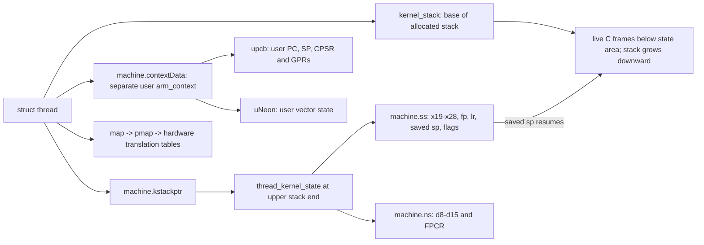
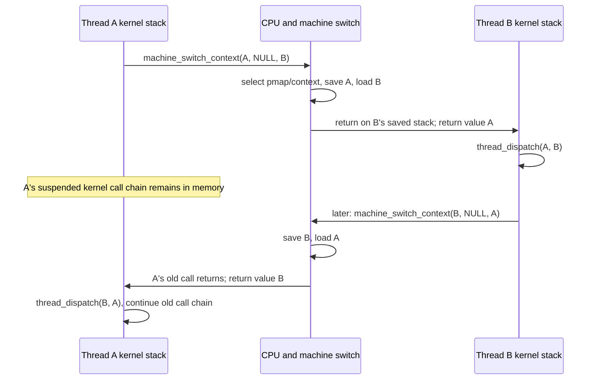
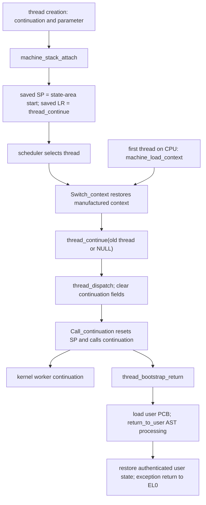
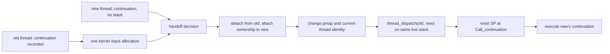

# ARM64 thread switching, first entry, continuations and exit

[Platform](README.md) · [Scheduler execution](../runtime/scheduler-execution.md) · [Exception assembly walkthroughs](arm64-assembly-walkthroughs.md) · [Thread objects](../runtime/objects-and-lifecycle.md)

A thread can enter the kernel without being switched out, switch out while already executing in the kernel, resume a saved kernel call chain, start a continuation on a reset stack, or terminate without ever returning. These operations use different saved state and different return instructions. This chapter follows their connection through `thread_invoke()`, ARM64 `pcb.c` and `cswitch.s`, then back into the scheduler or `locore.s`. Scheduling policy and queue selection are covered in [scheduler execution](../runtime/scheduler-execution.md).

The central distinction is between **a saved user execution state** and **a saved kernel function-call context**. An exception can save the former before a kernel wait later saves the latter. The kernel context switch returns with `ret`/`retaa`; the eventual exception-return path authenticates saved user state where configured, restores it, and executes `eret`. The local `ERET_NO_STRAIGHT_LINE_SPECULATION` macro contains ordinary `eret`, followed by its speculation barrier sequence; it does not select an authenticated ERET instruction. Switching threads does not by itself perform an EL1-to-EL0 transition. [`cswitch.s`](../../../platydoc-data/xnu/osfmk/arm64/cswitch.s#L179-L190), [`locore.s`](../../../platydoc-data/xnu/osfmk/arm64/locore.s#L2098-L2126), [`ERET macro`](../../../platydoc-data/xnu/osfmk/arm64/proc_reg.h#L3825-L3838), [full return path](arm64-exception-return.md).

## 1. The objects and the three forms of saved state

| Object or field | Meaning during a switch |
| --- | --- |
| `thread->continuation`, `parameter`, `wait_result` | A restart function, its stored argument pointer and the reason the wait completed. Storing the pointer does not retain the object it names. A non-null continuation permits abandoning the old kernel call chain. [`thread_invoke()`](../../../platydoc-data/xnu/osfmk/kern/sched_prim.c#L2999-L3036), [`thread_continue()`](../../../platydoc-data/xnu/osfmk/kern/sched_prim.c#L4002-L4046). |
| `thread->kernel_stack`, `reserved_stack` | Attached kernel stack and optional stack reservation used by scheduler allocation/handoff rules; both fields can name the same allocation. [`reservation`](../../../platydoc-data/xnu/osfmk/kern/sched_prim.c#L3069-L3072), [`stack attachment/handoff`](../../../platydoc-data/xnu/osfmk/arm64/pcb.c#L975-L1113). |
| `thread->machine.kstackptr` | Pointer to `thread_kernel_state` at the upper end of the kernel stack, authenticated when loaded in assembly on applicable configurations. It is not the current live `sp`. [`LOAD_KERN_STACK_TOP`](../../../platydoc-data/xnu/osfmk/arm64/machine_routines_asm.h#L148-L162). |
| `thread_kernel_state.machine` | First member of the stack's state area; ARM64 makes it an `arm_kernel_context_t`, containing the kernel GPR and NEON contexts. [`thread_kernel_state.h`](../../../platydoc-data/xnu/osfmk/kern/thread_kernel_state.h#L33-L49), [`arm/thread.h`](../../../platydoc-data/xnu/osfmk/arm/thread.h#L86), [`thread_status.h`](../../../platydoc-data/xnu/osfmk/mach/arm/thread_status.h#L1226-L1230). |
| `machine.contextData`, `upcb`, `uNeon` | Separately allocated user `arm_context_t`, with user GPR and full NEON saved-state structures. Kernel-task threads have null values here. [`machine_thread_create()`](../../../platydoc-data/xnu/osfmk/arm64/pcb.c#L604-L644). |
| Exception frame and `machine.kpcb` | Kernel exception handling has its own saved-state bookkeeping and stack frames. This is distinct from the compact context in `kstackptr`; see [exception entry](arm64-exception-entry.md). [`machine_thread`](../../../platydoc-data/xnu/osfmk/arm/thread.h#L100-L140). |
| `thread->map->pmap` | Hardware translation context selected before the register/stack switch when necessary. [`machine_switch_pmap_and_extended_context()`](../../../platydoc-data/xnu/osfmk/arm64/pcb.c#L437-L491). |
| `machine.CpuDatap`, `TPIDR_EL1`, CPU active-thread state | Which CPU owns the running machine context and which thread assembly should treat as current. [`CPU-data transfer`](../../../platydoc-data/xnu/osfmk/arm64/pcb.c#L337-L354), [`set_thread_registers`](../../../platydoc-data/xnu/osfmk/arm64/cswitch.s#L194-L232). |

The kernel register layout is intentionally compact:

[`osfmk/mach/arm/thread_status.h:453–466`](../../../platydoc-data/xnu/osfmk/mach/arm/thread_status.h#L453-L466)

<!-- source-excerpt: ../../../platydoc-data/xnu/osfmk/mach/arm/thread_status.h#L453-L466 -->
```c
struct arm_kernel_saved_state {
	uint64_t x[10];     /* General purpose registers x19-x28 */
	uint64_t fp;        /* Frame pointer x29 */
	uint64_t lr;        /* Link register x30 */
	uint64_t sp;        /* Stack pointer x31 */
	/* Some things here we DO need to preserve */
	uint8_t pc_was_in_userspace;
	uint8_t ssbs;
	uint8_t dit;
	uint8_t uao;
#if HAS_MTE
	uint8_t tco;
#endif
} __attribute__((aligned(16)));
```

`x[0]` here is register `x19`, not `x0`. The saved kernel NEON portion contains eight 64-bit `d` values and `fpcr`; it does not contain every 128-bit user vector. The switch is implemented as a function call and preserves the register set required across that call. User exception entry has already dealt with user registers when switching follows a user trap. [`arm_kernel_neon_saved_state`](../../../platydoc-data/xnu/osfmk/mach/arm/thread_status.h#L1098-L1102), [`save_general_registers`](../../../platydoc-data/xnu/osfmk/arm64/cswitch.s#L43-L110).



The diagram shows ownership and placement rather than scale. Normally `kstackptr = kernel_stack + kernel_stack_size - sizeof(thread_kernel_state)`. An SPTM development/debug option can deliberately reduce that position for overflow testing. Generated assembly offsets, rather than duplicated numeric structure offsets, connect the C fields to the assembly operands. [`pcb.c`](../../../platydoc-data/xnu/osfmk/arm64/pcb.c#L989-L1014), [`genassym.c`](../../../platydoc-data/xnu/osfmk/arm64/genassym.c#L136-L143).

## 2. From a scheduler decision to the machine switch

`thread_block_reason()` records the continuation and parameter, selects a candidate, and calls `thread_invoke()`. The latter runs at scheduler interrupt level and handles same-thread selection, stack handoff, target stack allocation and ordinary switching. A selected thread with no immediately available stack can be deferred while the scheduler retries selection. A thread becoming runnable therefore does not imply it has already acquired a CPU or a usable stack. [`block loop`](../../../platydoc-data/xnu/osfmk/kern/sched_prim.c#L3874-L3944), [`invoke`](../../../platydoc-data/xnu/osfmk/kern/sched_prim.c#L2999-L3036), [`stack choices`](../../../platydoc-data/xnu/osfmk/kern/sched_prim.c#L3075-L3240).

The ordinary different-thread path reaches:

[`osfmk/kern/sched_prim.c:3308–3313`](../../../platydoc-data/xnu/osfmk/kern/sched_prim.c#L3308-L3313)

<!-- source-excerpt: ../../../platydoc-data/xnu/osfmk/kern/sched_prim.c#L3308-L3313 -->
```c
	assert(continuation == self->continuation);
	thread = machine_switch_context(self, continuation, thread);
	assert(self == current_thread_volatile());
	TLOG(1, "thread_invoke: returning machine_switch_context: self %p continuation %p thread %p\n", self, continuation, thread);

	assert(continuation == NULL && self->continuation == NULL);
```

There are two timelines hidden in that assignment. Thread A executes the call to leave the CPU. Much later, another switch restores A's stack and registers, causing this call in A's old call chain to return. The returned `thread` identifies the thread that just left the CPU; it need not be the original target A chose. `self`, restored from A's own context, once again correctly identifies A. XNU explains this explicitly immediately above the call. [`nonlocal return contract`](../../../platydoc-data/xnu/osfmk/kern/sched_prim.c#L3282-L3305).

After the return, `thread_dispatch(thread, self)` performs departure accounting and scheduling/termination processing for the thread that just left, while executing on the resumed thread's stack. A newly constructed stack instead reaches the same cleanup through `thread_continue()`. This ordering is what makes it possible to discard an outgoing continuation's stack safely. [`resumed path`](../../../platydoc-data/xnu/osfmk/kern/sched_prim.c#L3322-L3328), [`new-stack path`](../../../platydoc-data/xnu/osfmk/kern/sched_prim.c#L4012-L4024), [`departure implementation`](../../../platydoc-data/xnu/osfmk/kern/sched_prim.c#L3446-L3516).



This example assumes both threads preserve their stacks and the second switch returns directly from B to A. Real schedules can pass through many other threads and CPUs.

## 3. The C wrapper changes address space and extended context

ARM64 `machine_switch_context()` rejects an identical old/new thread and, when PAN is available, panics if invoked with PAN disabled. It performs configured counter work, calls `machine_switch_pmap_and_extended_context()`, and then invokes the assembly `Switch_context`. [`pcb.c`](../../../platydoc-data/xnu/osfmk/arm64/pcb.c#L499-L534).

The helper considers both the pmap and the conditional MTE security override:

[`osfmk/arm64/pcb.c:454–465`](../../../platydoc-data/xnu/osfmk/arm64/pcb.c#L454-L465)

<!-- source-excerpt: ../../../platydoc-data/xnu/osfmk/arm64/pcb.c#L454-L465 -->
```c
	new_pmap = new->map->pmap;
	bool pmap_changed = old->map->pmap != new_pmap;
	bool sec_override_changed =
#if HAS_MTE
	    ml_thread_get_sec_override(old) != ml_thread_get_sec_override(new);
#else
	    false;
#endif

	if (pmap_changed || sec_override_changed) {
		pmap_switch(new_pmap, new);
	} else {
```

When neither changes, the code still executes a `DSB ISH` and requests context synchronization. Its comment explains the migration hazard: cache/TLB maintenance and its completing barrier must execute on the appropriate processing element; a thread cannot rely on issuing the completing barrier after migration to another CPU. When the pmap changes, the helper relies on `pmap_switch()` for the corresponding TTBR-update barrier behavior. [`barrier rationale`](../../../platydoc-data/xnu/osfmk/arm64/pcb.c#L466-L486), [pmap context/TLB details](../vm/pmap-tlb-and-cache.md).

Under the matrix-state configuration, the helper also processes matrix context before the pmap selection. It transfers `CpuDatap` and the encoded per-CPU base from old to new, clears those fields on old, and updates `TPIDR_EL0`, including the configured user `x18` preservation policy. `set_thread_registers` later refreshes the CPU/cluster bits of that register rather than independently recreating every policy bit. [`extended context`](../../../platydoc-data/xnu/osfmk/arm64/pcb.c#L437-L491), [`CPU ownership and TPIDR_EL0`](../../../platydoc-data/xnu/osfmk/arm64/pcb.c#L337-L425), [`assembly comment`](../../../platydoc-data/xnu/osfmk/arm64/cswitch.s#L200-L226).

Two threads using the same pmap can switch without installing a different user root. Two different maps can require a translation-context change even when the kernel virtual addresses of the switch code remain accessible. ASID allocation, user/kernel roots, maintenance completion and SPTM versus legacy programming are detailed in [pmap translations](../vm/pmap-translation-walkthroughs.md) and [TLB/cache operations](../vm/pmap-tlb-and-cache.md). The register switch should not be understood as a mandatory flush of every translation.

## 4. `Switch_context`: the complete register-transfer body

The ABI is `x0 = old`, `x1 = continuation`, `x2 = new`. The short assembly body makes the two ways of leaving a thread explicit:

[`osfmk/arm64/cswitch.s:375–386`](../../../platydoc-data/xnu/osfmk/arm64/cswitch.s#L375-L386)

<!-- source-excerpt: ../../../platydoc-data/xnu/osfmk/arm64/cswitch.s#L375-L386 -->
```asm
LEXT(Switch_context)
	ARM64_PROLOG
	cbnz	x1, Lswitch_threads					// Skip saving old state if blocking on continuation
	LOAD_KERN_STACK_TOP	dst=x3, src=x0, tmp=x4	// Get the old kernel stack top
	save_general_registers	x3, 4
Lswitch_threads:
	set_thread_registers	x2, x3, x4
	LOAD_KERN_STACK_TOP	dst=x3, src=x2, tmp=x4
	load_general_registers	x3, 4
	set_process_dependent_keys_and_sync_context	x2, x3, x4, x5, w6
	cswitch_epilogue

```

| Instruction or macro | State change |
| --- | --- |
| `cbnz x1, Lswitch_threads` | A continuation replaces the old call chain, so no resumable old kernel register context is saved. |
| `LOAD_KERN_STACK_TOP ... src=x0` | Load/authenticate the old thread's state-area pointer. |
| `save_general_registers x3, 4` | Save old callee-preserved registers, return address, live stack pointer, FPCR and configured status fields. |
| `set_thread_registers x2, ...` | Publish the incoming thread in the CPU's current-thread registers/fields. |
| `LOAD_KERN_STACK_TOP ... src=x2` | Obtain the incoming state area. |
| `load_general_registers x3, 4` | Restore the incoming register values and switch `sp` to the incoming saved stack pointer. |
| `set_process_dependent_keys_and_sync_context` | Perform configured key/context synchronization before the return. |
| `cswitch_epilogue` | Return through the incoming saved `lr`, authenticated where configured. |

The beginning of the save operation shows the ordinary call ABI directly:

[`osfmk/arm64/cswitch.s:49–62`](../../../platydoc-data/xnu/osfmk/arm64/cswitch.s#L49-L62)

<!-- source-excerpt: ../../../platydoc-data/xnu/osfmk/arm64/cswitch.s#L49-L62 -->
```asm
#if __has_feature(ptrauth_calls)
	paciasp
#endif
	stp		x19, x20, [$0, SS64_KERNEL_X19]
	stp		x21, x22, [$0, SS64_KERNEL_X21]
	stp		x23, x24, [$0, SS64_KERNEL_X23]
	stp		x25, x26, [$0, SS64_KERNEL_X25]
	stp		x27, x28, [$0, SS64_KERNEL_X27]
	stp		fp, lr, [$0, SS64_KERNEL_FP]
	strb	wzr, [$0, SS64_KERNEL_PC_WAS_IN_USER]
	mov		x$1, sp
	str		x$1, [$0, SS64_KERNEL_SP]
#if HAS_ARM_FEAT_SSBS2
#if APPLEVIRTUALPLATFORM
```

`paciasp` signs the saved return address when `ptrauth_calls` is enabled. Restore loads the incoming `lr` **and** incoming `sp`; `retaa` authenticates the return in that incoming context. `LOAD_KERN_STACK_TOP` separately authenticates the data pointer with an address-diversified field discriminator. Return-address authentication and stack-pointer field authentication protect different values. [`restore`](../../../platydoc-data/xnu/osfmk/arm64/cswitch.s#L120-L134), [`epilogue`](../../../platydoc-data/xnu/osfmk/arm64/cswitch.s#L179-L190), [`pointer load`](../../../platydoc-data/xnu/osfmk/arm64/machine_routines_asm.h#L148-L162).

The call-clobbered argument/temporary registers are not all restored as a user exception frame would be. In particular, the implementation preserves `x0` as the outgoing-thread return value while loading the incoming callee-preserved context. That is how the incoming scheduler obtains the correct argument for `thread_dispatch()`. The resulting control transfer is an EL1 function return. If the incoming thread has userspace state, that separate state remains in its user PCB for a later exception return; kernel-task threads have no user PCB. [`user-state allocation distinction`](../../../platydoc-data/xnu/osfmk/arm64/pcb.c#L603-L636).

## 5. Current-thread registers and conditional CPU state

`set_thread_registers` establishes several distinct identities:

| Register/field | Value and purpose |
| --- | --- |
| `TPIDR_EL1` | Incoming `thread *`, used by low-level code to find the current thread. |
| `cpu_data.cpu_active_thread` | Incoming thread recorded in the current CPU's data structure. |
| Low CPU/cluster bits of `TPIDR_EL0` | Current execution location; `bfi` preserves the other bits established by the C path. |
| `TPIDRRO_EL0` | Incoming `machine.cthread_self`, exposing the configured user thread-pointer value. |
| `CONTEXTIDR_EL1` | Low 32 bits of the incoming `thread_id`; this is not the pmap's translation root or its ASID allocation algorithm. |

All assignments are visible in [`set_thread_registers`](../../../platydoc-data/xnu/osfmk/arm64/cswitch.s#L194-L232). Scheduler `processor->active_thread` bookkeeping occurs in the surrounding common scheduler code and should not be confused with this assembly update to CPU data. [`scheduler publication`](../../../platydoc-data/xnu/osfmk/kern/sched_prim.c#L3241-L3279).

The save/restore macros conditionally preserve SSBS, DIT, UAO and MTE TCO fields; virtual-platform SSBS handling adds a runtime availability check. The process-dependent-key macro gates its ROP/JOP work on `HAS_APPLE_PAC && HAS_PARAVIRTUALIZED_PAC`; its other synchronization branches include the configured MTE user-region handling and the per-CPU context-sync flag. These branches must be read with their actual build conditions. They do not establish that every ARM64 product executes every key operation on each switch. [`saved controls`](../../../platydoc-data/xnu/osfmk/arm64/cswitch.s#L63-L90), [`restored controls`](../../../platydoc-data/xnu/osfmk/arm64/cswitch.s#L135-L167), [`keys and synchronization`](../../../platydoc-data/xnu/osfmk/arm64/cswitch.s#L234-L301).

## 6. First dispatch: manufacture the return that has never happened

A new thread has no suspended call chain to restore. `machine_stack_attach()` creates the minimal kernel context that makes the ordinary restore machinery enter `thread_continue()`:

[`osfmk/arm64/pcb.c:1009–1014`](../../../platydoc-data/xnu/osfmk/arm64/pcb.c#L1009-L1014)

<!-- source-excerpt: ../../../platydoc-data/xnu/osfmk/arm64/pcb.c#L1009-L1014 -->
```c
	current_el = (uint32_t) __builtin_arm_rsr64("CurrentEL");
	context = &((thread_kernel_state_t) thread->machine.kstackptr)->machine;
	savestate = &context->ss;
	savestate->fp = 0;
	savestate->sp = (uint64_t)kstackptr;
	savestate->pc_was_in_userspace = false;
```

The remaining initialization sets saved `lr` to `thread_continue` and initializes FPCR. With Apple PAC, the code signs that entry address using the saved stack pointer; the non-PAC branch assigns it directly. This is a manufactured **kernel return target**, not the user's entry PC. [`initial LR and FPCR`](../../../platydoc-data/xnu/osfmk/arm64/pcb.c#L1015-L1035).

When a normal switch selects this context, restoring `sp` and returning through `lr` enters `thread_continue(old_thread)`. The first thread on a CPU has a related entry:

[`osfmk/arm64/cswitch.s:313–320`](../../../platydoc-data/xnu/osfmk/arm64/cswitch.s#L313-L320)

<!-- source-excerpt: ../../../platydoc-data/xnu/osfmk/arm64/cswitch.s#L313-L320 -->
```asm
LEXT(machine_load_context)
	ARM64_PROLOG
	set_thread_registers 	x0, x1, x2
	LOAD_KERN_STACK_TOP	dst=x1, src=x0, tmp=x2	// Get top of kernel stack
	load_general_registers 	x1, 2
	set_process_dependent_keys_and_sync_context	x0, x1, x2, x3, w4
	mov		x0, #0								// Clear argument to thread_continue
	cswitch_epilogue
```

`machine_load_context()` has no outgoing thread to dispatch, so it sets `x0` to null before entering the manufactured return target. The common `thread_continue()` contract explicitly accepts that case. Bootstrap calls the loader after establishing its initial thread/processor context. [`startup loader call`](../../../platydoc-data/xnu/osfmk/kern/startup.c#L1057-L1090), [`thread_continue()`](../../../platydoc-data/xnu/osfmk/kern/sched_prim.c#L3993-L4046).

For a user thread created by the shown Mach creation paths, the continuation is `thread_bootstrap_return`. That label reaches `arm64_thread_exception_return`, loads the user PCB and enters `return_to_user`. The already prepared user state provides the eventual PC/SP. Creating the thread, attaching a kernel stack, initializing user state, making it runnable and finally returning to user execution are separate stages. [`thread creation choice`](../../../platydoc-data/xnu/osfmk/kern/thread.c#L1632-L1649), [`bootstrap return`](../../../platydoc-data/xnu/osfmk/arm64/locore.s#L1768-L1799), [executable loading](../../cross-cutting/executable-loading.md).



## 7. Continuations discard a call chain, not the thread

`thread_continue()` captures the continuation/parameter, dispatches the outgoing thread, clears its own continuation fields and calls `call_continuation()`. The default is to enable interrupts; bootstrap and idle-thread cases stay interrupt-disabled. [`sched_prim.c`](../../../platydoc-data/xnu/osfmk/kern/sched_prim.c#L4012-L4046).

`Call_continuation` then resets the stack and frame pointer:

[`osfmk/arm64/cswitch.s:334–342`](../../../platydoc-data/xnu/osfmk/arm64/cswitch.s#L334-L342)

<!-- source-excerpt: ../../../platydoc-data/xnu/osfmk/arm64/cswitch.s#L334-L342 -->
```asm
LEXT(Call_continuation)
	ARM64_PROLOG
	mrs		x4, TPIDR_EL1						// Get the current thread pointer

	/* ARM64_TODO arm loads the kstack top instead of arg4. What should we use? */
	LOAD_KERN_STACK_TOP	dst=x5, src=x4, tmp=x6
	mov		sp, x5								// Set stack pointer
	mov		fp, #0								// Clear the frame pointer

```

After configured context synchronization, it saves the callback, parameter and wait result across the optional interrupt-enable call. It passes `x0 = parameter`, `x1 = wait_result`, then invokes the continuation:

[`osfmk/arm64/cswitch.s:353–363`](../../../platydoc-data/xnu/osfmk/arm64/cswitch.s#L353-L363)

<!-- source-excerpt: ../../../platydoc-data/xnu/osfmk/arm64/cswitch.s#L353-L363 -->
```asm

	mov		x0, x21								// Set the first parameter
	mov		x1, x22								// Set the wait result arg
#ifdef HAS_APPLE_PAC
	mov		x21, THREAD_CONTINUE_T_DISC
	blraa	x20, x21							// Branch to the continuation
#else
	blr		x20									// Branch to the continuation
#endif
	mrs		x0, TPIDR_EL1						// Get the current thread pointer
	b		EXT(thread_terminate)				// Kill the thread
```

The callback must retain everything it needs in persistent state or the supplied parameter. Pointers to abandoned automatic variables do not become safe just because the same physical stack allocation is reused. The state reset removes the old C call chain; the thread object, user saved state and relevant owned resources continue to exist.

The last two instructions handle a continuation that returns by calling `thread_terminate(current_thread())`. For an ordinary kernel worker, that enters the cooperative kernel-thread termination path described below. Idle threads are a special case: `thread_terminate()` rejects their termination with a panic. [`termination rules`](../../../platydoc-data/xnu/osfmk/kern/thread_act.c#L322-L356).

## 8. Stack handoff: execution continues while stack ownership changes

If the outgoing thread supplied a continuation and the target lacks a kernel stack, `thread_invoke()` can choose a handoff rather than allocating another stack. It applies reserved-stack restrictions and captures the target's continuation/parameter first. [`selection of handoff`](../../../platydoc-data/xnu/osfmk/kern/sched_prim.c#L3075-L3108).

`machine_stack_handoff(old, new)` detaches the old stack, assigns it to new, reconstructs new's `kstackptr`, performs reserved-stack bookkeeping, switches pmap/extended context, and calls `machine_set_current_thread(new)`. In an SPTM build it also handles the old overflow redzone mapping so ownership does not carry a stale mapping into the new thread. [`pcb.c`](../../../platydoc-data/xnu/osfmk/arm64/pcb.c#L1045-L1113).

There is no `load_general_registers` in this path: execution is still using the existing live stack while its ownership/current-thread identity changes. Common scheduler code then dispatches old and invokes new's continuation, which resets `sp` before entering new's actual work. The old thread can later receive a stack initialized for its own continuation. [`scheduler handoff completion`](../../../platydoc-data/xnu/osfmk/kern/sched_prim.c#L3140-L3183), [`machine_set_current_thread`](../../../platydoc-data/xnu/osfmk/arm64/cswitch.s#L438-L443).



The same-thread selection path can also call a continuation without any different-thread context switch. A continuation is an execution-resumption contract; it does not necessarily imply a CPU migration, a new thread, or a different address space. [`same-thread invoke`](../../../platydoc-data/xnu/osfmk/kern/sched_prim.c#L3184-L3218).

## 9. Kernel entry, preemption and user return

For a user trap or interrupt, `locore.s` first constructs the appropriate exception state and enters the C handler. If that work blocks, the scheduler can switch kernel contexts as above. When the thread resumes, it completes the handler or continuation before the user-return path restores its user PCB. Thus the interrupted user's PC and the scheduler's saved `lr` identify different points in two nested execution histories. [Instruction walkthrough](arm64-assembly-walkthroughs.md), [entry](arm64-exception-entry.md), [return](arm64-exception-return.md).

The kernel-return path can take an urgent scheduling AST only when the interrupted state and preemption count permit it; the assembly switches to the thread stack before calling `ast_taken_kernel()`. The user-return path checks pending ASTs and can defer them for the configured user preemption-free zone before reaching final restoration. [`kernel AST path`](../../../platydoc-data/xnu/osfmk/arm64/locore.s#L1747-L1765), [`user AST path`](../../../platydoc-data/xnu/osfmk/arm64/locore.s#L1796-L1878).

A user return can therefore encounter signals, suspension or scheduling work before the final privilege transition. Conversely, an ordinary syscall return that has no blocking/preemption need does not require a `Switch_context` at all. A machine context switch also need not involve an EL2 monitor transition; the [protected execution guide](exception-levels-and-monitors.md) identifies those separate entry/exit contracts.

## 10. Termination: stop execution before reclaiming its storage

Thread termination has multiple observable milestones:

1. `thread_terminate_internal()` clears `active`, requests abort handling, interrupts an existing wait or starts an unstarted thread so it can process termination. A caller terminating another thread waits for it to stop as required by this interface. [`thread_act.c`](../../../platydoc-data/xnu/osfmk/kern/thread_act.c#L280-L319).
2. The thread performs its own final cleanup through the APC/termination path. Kernel threads cannot be externally terminated without cooperation; self-termination explicitly invokes APC processing because they do not pass through the user-return AST loop. [`thread_terminate()`](../../../platydoc-data/xnu/osfmk/kern/thread_act.c#L338-L356).
3. `thread_terminate_self()` disables IPC access, removes callbacks, releases per-thread subsystem state and cancels/drains active timers before marking `TH_TERMINATE`, entering an uninterruptible wait and blocking. [`cleanup`](../../../platydoc-data/xnu/osfmk/kern/thread.c#L462-L606), [`timer drains and final block`](../../../platydoc-data/xnu/osfmk/kern/thread.c#L607-L715).
4. After another thread takes over the CPU, `thread_dispatch()` marks `TH_TERMINATE2` once, removes runnable accounting and enqueues termination work. [`departure`](../../../platydoc-data/xnu/osfmk/kern/sched_prim.c#L3691-L3749).
5. The termination worker rolls up accounting, removes task and active-thread-list membership, moves the thread to the global `terminated_threads` list, performs applicable join notification and drops its reference. Crash-inspection state can postpone this reaping. Final reference release performs destruction separately. [`worker`](../../../platydoc-data/xnu/osfmk/kern/thread.c#L999-L1089), [`last-reference destruction`](../../../platydoc-data/xnu/osfmk/kern/thread.c#L740-L825).

The state transition preventing duplicate queue insertion is short:

[`osfmk/kern/sched_prim.c:3695–3707`](../../../platydoc-data/xnu/osfmk/kern/sched_prim.c#L3695-L3707)

<!-- source-excerpt: ../../../platydoc-data/xnu/osfmk/kern/sched_prim.c#L3695-L3707 -->
```c
				/* Only the first call to thread_dispatch
				 * after explicit termination should add
				 * the thread to the termination queue
				 */
				if ((thread_state & (TH_TERMINATE | TH_TERMINATE2)) == TH_TERMINATE) {
					should_terminate = TRUE;
					thread_state |= TH_TERMINATE2;
				}

				timer_stop(&thread->runnable_timer, processor->last_dispatch);

				thread_state &= ~TH_RUN;
				thread->state = thread_state;
```

The terminating thread blocks with `thread_terminate_continue`; that continuation deliberately panics if executed. Its purpose is to make the old stack discardable, not to supply a future normal restart. [`final block`](../../../platydoc-data/xnu/osfmk/kern/thread.c#L711-L715), [`continuation body`](../../../platydoc-data/xnu/osfmk/kern/thread.c#L450-L456).

`thread_deallocate_complete()` requires zero references and `TH_TERMINATE2`, asserts that the thread is not queued or waking, and then destroys remaining IPC/BSD/ledger/turnstile/voucher resources, any retained stack and the machine state. ARM64 `machine_thread_destroy()` handles its allocated user/architecture state. A stopped thread object can remain alive while references or inspection still require it; freeing the current live stack at the initial termination request would violate the entire departure sequence. [`destruction`](../../../platydoc-data/xnu/osfmk/kern/thread.c#L749-L825), [`ARM64 machine destruction`](../../../platydoc-data/xnu/osfmk/arm64/pcb.c#L755-L822).

```mermaid
stateDiagram-v2
    [*] --> Active
    Active --> Inactive: termination request and abort/AST
    Inactive --> FinalWait: thread cleans itself; TH_TERMINATE; block
    FinalWait --> OffCPU: another context runs; TH_TERMINATE2
    OffCPU --> Inspection: crash inspection retains thread
    Inspection --> Reaper: inspection releases for reaping
    OffCPU --> Reaper: termination queue
    Reaper --> Referenced: active membership removed; worker reference dropped
    Referenced --> Destroyed: last reference; machine and storage cleanup
    Destroyed --> [*]
```



Here `Referenced` describes the possible lifetime after worker cleanup; if the worker drops the final reference, destruction can proceed immediately. Userspace pthread library bookkeeping and process exit have additional contracts; continue with [pthread/workqueue lifecycle](../processes/pthread-workqueue-lifecycle.md) and [process transitions](../processes/process-transitions.md).

## 11. Idle, CPU shutdown and architecture limits

`Idle_context()` saves the same compact kernel register context, moves to the CPU interrupt stack and branches to `cpu_idle`. `Idle_load_context()` restores it and returns. `Shutdown_context()` similarly saves the thread context, disables interrupts, switches to the interrupt stack and branches to `cpu_doshutdown`. These are CPU-power entry/exit mechanisms connected to the idle thread, rather than ordinary thread-object termination. [`cswitch.s`](../../../platydoc-data/xnu/osfmk/arm64/cswitch.s#L395-L436), [CPU power lifecycle](cpu-power-lifecycle.md).

The walkthrough is for the local ARM64 implementation. Common thread/scheduler/termination code is shared, but x86 register layouts, stack-switch assembly, CR3/PCID operations and return mechanisms must be traced in their own implementation; [x86 pmap](../vm/pmap-x86.md) and [x86 sleep/resume](x86-sleep-and-resume.md) cover selected adjacent paths. 
This was a static source review, including the adjacent creation, handoff, return and destruction bodies. It is not a runtime trace or a proof of all matrix-state, debug, PAC, MTE, scheduler or protected-monitor configurations.

<!-- BEGIN PLATYDOC DOCUMENTATION LICENSE -->
Original Platydoc text and diagrams are licensed under [CC BY 4.0](https://creativecommons.org/licenses/by/4.0/). Quoted source code and third-party material retain their respective licenses.
<!-- END PLATYDOC DOCUMENTATION LICENSE -->
