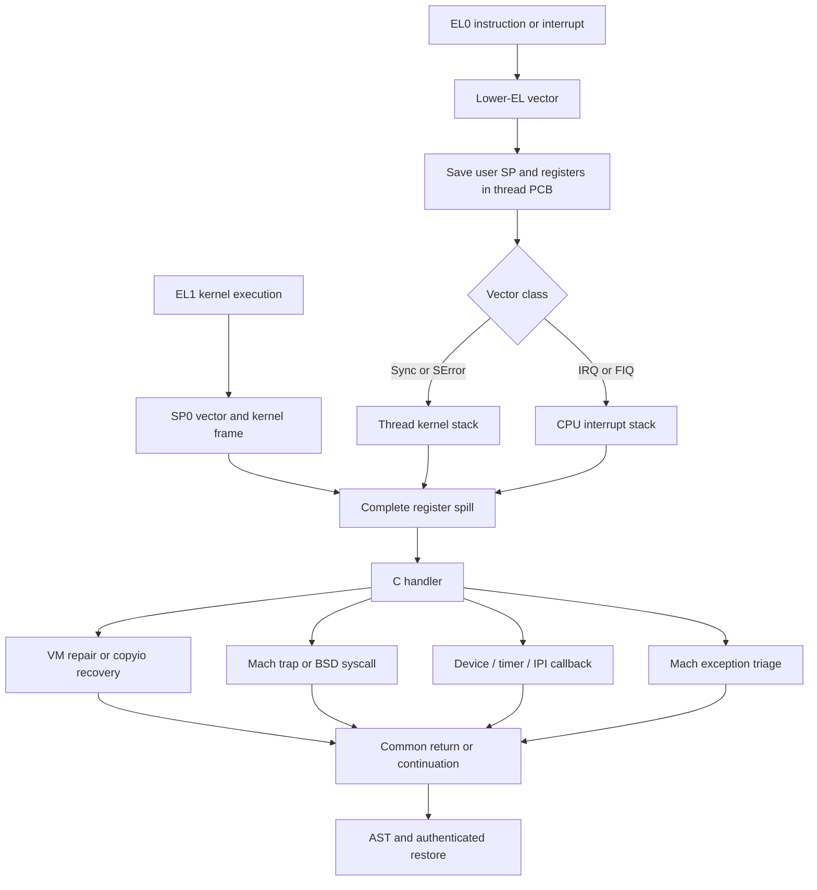

# ARM64 exception entry: from a vector to a kernel operation

[Execution overview](execution.md) · [Exception return](arm64-exception-return.md) · [Exception levels and monitors](exception-levels-and-monitors.md)

An exception does not directly call a C handler with a ready-made register structure. XNU first establishes which stack it can use, preserves registers before using them as temporaries, builds or locates an `arm_context`, and then calls a handler. The context and the stack on which the handler runs are often different allocations. Follow both pointers through [`locore.s`](../../../xnu/osfmk/arm64/locore.s#L908) and [`exception_asm.h`](../../../xnu/osfmk/arm64/exception_asm.h#L172).

This trace covers the AArch64 EL0-to-EL1 path and same-EL kernel exceptions in this checkout. EL1-to-monitor or hypervisor transitions have separate entry contracts, described in [exception levels and monitors](exception-levels-and-monitors.md). Configuration macros below describe source alternatives; they do not identify the build configuration of an arbitrary Apple device.

## How the CPU finds these vectors

The non-SPTM bootstrap installs `ExceptionVectorsBase` in `VBAR_EL1`, using the `MSR_VBAR_EL1_X0` wrapper where protected-register configurations require it. With `__ARM_KERNEL_PROTECT__`, the first boot initially uses the kernelcache mapping; subsequent CPU resets can use the prepared fixed exception mapping. Later, `arm_vm_prepare_kernel_el0_mappings()` maps the pages spanning `ExceptionVectorsBase` through `ExceptionVectorsEnd` at `ARM_KERNEL_PROTECT_EXCEPTION_START` and updates the boot CPU's VBAR. The mapping is an execution bridge retained when the broader kernel mappings are removed; “EL0 mapping” here does not mean the vector instructions execute at EL0. [`start.s`](../../../xnu/osfmk/arm64/start.s#L728), [`VBAR wrapper`](../../../xnu/osfmk/arm64/start.s#L45), [`arm_vm_init.c`](../../../xnu/osfmk/arm64/arm_vm_init.c#L770).

The SPTM cold-start path instead writes `ExceptionVectorsBase` after rebasing/signing the image and before the `FIXUPS_COMPLETE` call. The adjacent comment says SPTM validates and locks VBAR after that call. The externally supplied domain-entry macro and monitor implementation are not present here. [`start_sptm.s`](../../../xnu/osfmk/arm64/sptm/start_sptm.s#L145).

`ExceptionVectorsBase` is aligned to 16 KiB with kernel protection and 4 KiB otherwise. Each implemented vector slot is aligned to 128 bytes. There are four categories for each of EL1 using SP0, EL1 using SP1, and lower-EL AArch64 execution: synchronous, IRQ, FIQ, and SError. The source does not implement a fourth group of lower-EL AArch32 entry handlers in this table; remaining space is padded. [`locore.s`, table](../../../xnu/osfmk/arm64/locore.s#L526).

[EL0 synchronous and IRQ vector slots](../../../xnu/osfmk/arm64/locore.s#L576)
<!-- source-excerpt: ../../../xnu/osfmk/arm64/locore.s#L576-L585 -->
```asm
Lel0_synchronous_vector_64:
	MAP_KERNEL
	BRANCH_TO_KVA_VECTOR el0_synchronous_vector_64_long, 8

	.text
	.align 7
Lel0_irq_vector_64:
	MAP_KERNEL
	BRANCH_TO_KVA_VECTOR el0_irq_vector_64_long, 9

```

| Origin and selected stack | Synchronous | IRQ | FIQ | SError |
|---|---|---|---|---|
| EL1, SP0 | `+0x000` | `+0x080` | `+0x100` | `+0x180` |
| EL1, SP1 | `+0x200` | `+0x280` | `+0x300` | `+0x380` |
| Lower EL, AArch64 | `+0x400` | `+0x480` | `+0x500` | `+0x580` |

Offsets follow the ordered `.align 7` slots in [`ExceptionVectorsBase`](../../../xnu/osfmk/arm64/locore.s#L535). The vector identifies the broad category before C runs. ESR decoding is needed to subdivide synchronous exceptions, not to decide whether this was an IRQ or FIQ. In a protected-kernel build the EL0 slots first execute `MAP_KERNEL`: set the low ASID bit in `TTBR0_EL1`, load `TCR_EL1_BOOT`, and execute the specified barriers. This changes the kernel-accessible translation configuration while preserving the task's translation-root relationship. [`MAP_KERNEL`](../../../xnu/osfmk/arm64/locore.s#L198).

[MAP_KERNEL: select the kernel ASID](../../../xnu/osfmk/arm64/locore.s#L200)
<!-- source-excerpt: ../../../xnu/osfmk/arm64/locore.s#L200-L203 -->
```asm
	/* Switch to the kernel ASID (low bit set) for the task. */
	mrs		x18, TTBR0_EL1
	orr		x18, x18, #(1 << TTBR_ASID_SHIFT)
	msr		TTBR0_EL1, x18
```

`BRANCH_TO_KVA_VECTOR` then obtains `thread → machine.CpuDatap → cpu_exc_vectors`, indexes the long-handler address, and branches into the kernelcache mapping. `cpu_data_init()` supplies the address of `exc_vectors_table`; without kernel protection the macro uses a direct branch. `HAS_MTE` first clears `PSTATE.TCO`, restoring tag checking disabled by hardware on exception entry. [`branch macro`](../../../xnu/osfmk/arm64/locore.s#L234), [`vector pointer initialization`](../../../xnu/osfmk/arm64/cpu.c#L850).

## Structures and registers that carry the interrupted execution

| Object or register | Relevant contents | Meaning on this path |
|---|---|---|
| `TPIDR_EL1` | Current `thread *` | Used before calling C to find PCB, CPU data, and stack pointers; updated by `set_thread_registers` during context switch. |
| `thread.machine.upcb` | Pointer to `arm_saved_state_t` inside `contextData` | Persistent user GPR state. Non-kernel threads get a separately allocated `arm_context_t`; kernel-task threads have no user PCB. |
| `thread.machine.kstackptr` | Authenticated kernel-stack top | Stack used for the user synchronous/SError handler and later user-return work. |
| `cpu_data.istackptr`, `excepstackptr` | Authenticated interrupt/exception-stack pointers | Per-CPU storage; separate from the thread's kernel stack and user PCB. |
| `arm_context.ss`, `.ns` | Integer/exception state, NEON state | Container consumed by assembly offsets and C handlers. |
| `arm_saved_state64` | `x[29]`, `fp`, `lr`, `sp`, `pc`, `cpsr`, `far`, `esr`, optional `jophash` | Full integer register snapshot plus syndrome/address and a signature over selected control-flow state. |
| `ELR_EL1`, `SPSR_EL1` | Exception return PC and interrupted PSTATE | Captured into `pc` and `cpsr`; later restored to hardware for `eret`. |
| `ESR_EL1`, `FAR_EL1` | Syndrome and fault address | Interpretation depends on exception class; FAR is not a valid fault address for every exception. |

Definitions and setup: [`machine_thread`](../../../xnu/osfmk/arm/thread.h#L118), [`cpu_data`](../../../xnu/osfmk/arm/cpu_data_internal.h#L140), [`arm_saved_state64`](../../../xnu/osfmk/mach/arm/thread_status.h#L416), [`arm_context`](../../../xnu/osfmk/mach/arm/thread_status.h#L1220), [`machine_thread_create`](../../../xnu/osfmk/arm64/pcb.c#L603), [`set_thread_registers`](../../../xnu/osfmk/arm64/cswitch.s#L187). `genassym.c` derives `TH_UPCB`, `ACT_CPUDATAP`, `ARM_CONTEXT_SIZE`, and `SS64_*` from these C definitions; assembly offsets are not a second manually maintained layout. [`genassym.c`](../../../xnu/osfmk/arm64/genassym.c#L162).

There are also smaller `arm_kernel_context`/`arm_kernel_saved_state` structures for scheduler context switching. Do not confuse those callee-preserved kernel registers with the full asynchronous exception snapshot. [`thread_status.h`](../../../xnu/osfmk/mach/arm/thread_status.h#L456), [`cswitch.s`](../../../xnu/osfmk/arm64/cswitch.s#L367).

## EL0 entry: preserve the user stack pointer, then stop using it

The lower-EL vector starts on the exception stack. `EL0_64_VECTOR` briefly saves x0/x1 there, authenticates and loads the current thread's PCB pointer, records `SP_EL0` into the PCB, and temporarily makes SP0 point at that PCB. Once `SPSel` selects SP0, stores through `sp` write saved registers into the PCB; they do not write to the userspace stack. x0/x1 are restored from the exception stack before SP0 is selected. With kernel protection x18 has already been used as scratch and is zeroed before spilling. [`EL0_64_VECTOR`](../../../xnu/osfmk/arm64/locore.s#L908), [`LOAD_USER_PCB`](../../../xnu/osfmk/arm64/machine_routines_asm.h#L174).

[EL0_64_VECTOR: save the user SP and select PCB storage](../../../xnu/osfmk/arm64/locore.s#L909)
<!-- source-excerpt: ../../../xnu/osfmk/arm64/locore.s#L909-L923 -->
```asm
	stp		x0, x1, [sp, #-16]!					// Save x0 and x1 to the exception stack
#if __ARM_KERNEL_PROTECT__
	mov		x18, #0 						// Zero x18 to avoid leaking data to user SS
#endif
	mrs		x0, TPIDR_EL1						// Load the thread register
	LOAD_USER_PCB	dst=x0, src=x0, tmp=x1		// Load the user context pointer
	mrs		x1, SP_EL0							// Load the user stack pointer
	str		x1, [x0, SS64_SP]					// Store the user stack pointer in the user PCB
	msr		SP_EL0, x0							// Copy the user PCB pointer to SP0
	ldp		x0, x1, [sp], #16					// Restore x0 and x1 from the exception stack
	msr		SPSel, #0							// Switch to SP0
	stp		x0, x1, [sp, SS64_X0]				// Save x0, x1 to the user PCB
	stp		x2, x3, [sp, SS64_X2]				// Save x2, x3 to the user PCB
	mrs		x1, TPIDR_EL1						// Load the thread register

```

Next, the macro leaves the context address in x0 and the thread pointer in x1. The synchronous and SError vectors load the thread's kernel-stack top into the active SP; IRQ/FIQ vectors load the per-CPU interrupt-stack top. In both cases x0 still names the PCB. These pointer-loading macros authenticate the pointers when pointer authentication is compiled in, using the field's address and discriminator. [`stack selection`](../../../xnu/osfmk/arm64/locore.s#L967), [`pointer authentication macros`](../../../xnu/osfmk/arm64/machine_routines_asm.h#L135).

[The synchronous long vector selects a kernel stack and handler](../../../xnu/osfmk/arm64/locore.s#L982)
<!-- source-excerpt: ../../../xnu/osfmk/arm64/locore.s#L982-L988 -->
```asm
el0_synchronous_vector_64_long:
	EL0_64_VECTOR	sync
	EL0_64_VECTOR_SWITCH_TO_KERN_STACK
	adrp	x1, EXT(fleh_synchronous)@page			// Load address for fleh
	add		x1, x1, EXT(fleh_synchronous)@pageoff
	mov		x2, #(FLEH_DISPATCH64_OPTION_SYNC_EXCEPTION)
	b		fleh_dispatch64
```

`fleh_dispatch64` receives x0=context, x1=first-level handler, x2=spill options. `SPILL_REGISTERS KERNEL_MODE` saves the remaining GPRs and q0–q31, FPSR, and FPCR, then captures ELR/SPSR/ESR/FAR. The early vector has already saved x0–x3 and SP. The name `KERNEL_MODE` selects the spill macro's calling convention; it does not mean the interrupted instruction necessarily ran in the kernel. [`dispatcher`](../../../xnu/osfmk/arm64/locore.s#L1049), [`spill implementation`](../../../xnu/osfmk/arm64/exception_asm.h#L172).

The default syndrome/return-state publication ends as follows. The option is intended to defer the two address stores, but the PAC path reuses its register before this test; see the [configuration-sensitive spill-option caveat](arm64-assembly-walkthroughs.md#a-configuration-sensitive-spill-option-caveat). The later explicit stores in `fleh_synchronous` remain visible in the SPTM path:

[SPILL_REGISTERS: conditional PC/FAR publication](../../../xnu/osfmk/arm64/exception_asm.h#L278)
<!-- source-excerpt: ../../../xnu/osfmk/arm64/exception_asm.h#L278-L289 -->
```asm
.ifnb \options_register
	tbnz	\options_register, SPILL_REGISTERS_OPTION_DONT_SPILL_ELR_FAR_SHIFT, Lspill_registers_skip_elr_far_\@
.endif /* options_register != NONE */

	str		x20, [x0, SS64_FAR]
	str		x22, [x0, SS64_PC]

.ifnb \options_register
Lspill_registers_skip_elr_far_\@:
.endif /* options_register != NONE */
	str		x21, [x0, SS64_ESR]
	str		w23, [x0, SS64_CPSR]
```

Under `HAS_APPLE_PAC`, the spill calls `ml_sign_thread_state` to populate `jophash` from selected control-flow values. Fatal spill options poison that signature. This is separate from authenticating the PCB pointer or the first-level-handler address. `fleh_dispatch64` signs the handler address against the stack pointer and uses `braa` where enabled. After a user-origin snapshot it sanitizes FPCR and clears unused live GPRs, preventing arbitrary incoming values from becoming incidental kernel register state. It preserves the context in x21 and handler in x22, performs configured user/kernel accounting, and branches to the handler. [`signature and spill options`](../../../xnu/osfmk/arm64/exception_asm.h#L218), [`dispatcher sanitization`](../../../xnu/osfmk/arm64/locore.s#L1072), [`final dispatch`](../../../xnu/osfmk/arm64/locore.s#L1127).

`HAS_ARM_FEAT_SME` adds separate matrix-state handling. The EL0 macro saves SVCR and, when streaming mode is active, Z/P state before stopping streaming mode; ZA is handled during context switch. The NEON snapshot alone is therefore not the entire machine state on those configurations. [`SME entry`](../../../xnu/osfmk/arm64/locore.s#L926).

## Same-EL entry: the interrupted kernel stack stays meaningful

A kernel exception is still an EL1 exception even though execution jumps through a vector and may change stacks. Normal kernel execution here uses SP0; the initial exception-stack staging lets the entry path examine a potentially corrupt kernel SP before trusting it. `EL1_SP0_VECTOR` selects SP0, allocates `ARM_CONTEXT_SIZE` below the interrupted SP, saves x0–x3, records the original SP, initializes flavors, and gives x0 the frame address. Thus the full context is on the interrupted kernel stack, unlike the persistent user PCB. [`EL1_SP0_VECTOR`](../../../xnu/osfmk/arm64/locore.s#L607).

[EL1_SP0_VECTOR: allocate a context on the interrupted kernel stack](../../../xnu/osfmk/arm64/locore.s#L607)
<!-- source-excerpt: ../../../xnu/osfmk/arm64/locore.s#L607-L616 -->
```asm
.macro EL1_SP0_VECTOR
	msr		SPSel, #0							// Switch to SP0
	sub		sp, sp, ARM_CONTEXT_SIZE			// Create exception frame
	stp		x0, x1, [sp, SS64_X0]				// Save x0, x1 to exception frame
	stp		x2, x3, [sp, SS64_X2]				// Save x2, x3 to exception frame
	add		x0, sp, ARM_CONTEXT_SIZE			// Calculate the original stack pointer
	str		x0, [sp, SS64_SP]					// Save stack pointer to exception frame
	INIT_SAVED_STATE_FLAVORS sp, w0, w1
	mov		x0, sp								// Copy saved state pointer to x0
.endmacro
```

For synchronous exceptions, the entry checks ESR classes that might indicate stack corruption, then `CHECK_KERNEL_STACK` validates SP_EL0 against the thread kernel stack or CPU interrupt stack. Failure constructs a fatal context on the exception stack and routes to `fleh_invalid_stack`. IRQ/FIQ paths first build the kernel frame and then switch handler execution to the interrupt stack. SPTM variants add a redzone check and a slow path that can map a stack redzone page after preserving registers. [`stack validation`](../../../xnu/osfmk/arm64/locore.s#L370), [`synchronous entry`](../../../xnu/osfmk/arm64/locore.s#L628), [`redzone handling`](../../../xnu/osfmk/arm64/locore.s#L652), [`IRQ/FIQ entry`](../../../xnu/osfmk/arm64/locore.s#L709).

SP1 vectors describe an exception while already using the exception stack. They are not the ordinary syscall path. Before its first potentially faulting memory access, the SP1 synchronous path checks whether ELR points back into its own critical spilling region and validates exception-stack bounds. If spilling cannot safely proceed it initiates configured lockdown and waits for the watchdog, with a special XNUPOST recovery path. Successful spilling normally reaches fatal handling; KTRR's narrowly recognized MMU-enable instruction-abort case and development debugger/test paths are explicit exceptions. IRQ/FIQ/SError on SP1 directly select panic handlers. [`SP1 vector`](../../../xnu/osfmk/arm64/locore.s#L751), [`KTRR exception`](../../../xnu/osfmk/arm64/locore.s#L1018), [`SP1 C handler`](../../../xnu/osfmk/arm64/sleh.c#L669), [`SP1 panic handlers`](../../../xnu/osfmk/arm64/locore.s#L1660).

## First-level synchronous handling and SPTM ordering

`fleh_synchronous` reads live ESR, FAR, and ELR, builds an unwindable frame, and calls `sleh_synchronous(context, esr, far, did_initiate_panic_lockdown)`. The extra fourth argument matters on SPTM builds. There, `FLEH_DISPATCH64_OPTION_SYNC_EXCEPTION` requests deferred ELR/FAR spilling, subject to the [option-register caveat](arm64-assembly-walkthroughs.md#a-configuration-sensitive-spill-option-caveat). A kernel-origin exception passes the stackless lockdown eligibility check; user-origin entry checks whether lockdown is already active. The handler then explicitly stores PC/FAR into the context; the request alone does not prove that every configured earlier spill omitted those stores. [`spill option`](../../../xnu/osfmk/arm64/exception_asm.h#L155), [`SPTM synchronous entry`](../../../xnu/osfmk/arm64/locore.s#L1182), [`kernel check`](../../../xnu/osfmk/arm64/locore.s#L1218).

[Synchronous handler: release PC/FAR after the SPTM gate](../../../xnu/osfmk/arm64/locore.s#L1201)
<!-- source-excerpt: ../../../xnu/osfmk/arm64/locore.s#L1201-L1204 -->
```asm
Lfleh_synchronous_continue:
	/* We've had our chance to lockdown, release PC/FAR */
	str		x25, [x0, SS64_PC]
	str		x2,  [x0, SS64_FAR]
```

After lockdown, new user synchronous exceptions wait for debugger synchronization instead of continuing ordinary handling. These are visible XNU-side control-flow rules; they do not expose SPTM's own implementation. Legacy PPL dispatch fragments have missing transition pieces and deliberate configuration-error directives in this public tree. See [exception levels and monitors](exception-levels-and-monitors.md) before trying to assemble a complete monitor crossing from these labels. [`blocked_user_sync_exception`](../../../xnu/osfmk/arm64/locore.s#L1263), [`PPL return fragment`](../../../xnu/osfmk/arm64/locore.s#L56).

## C dispatch: an SVC, a page fault, and a debug trap are different routes

`sleh_synchronous` extracts `ESR_EC(esr)` and independently checks the saved CPSR to determine whether the interrupted context was user or kernel. It validates the context, records tracing/accounting, handles platform errors before possible CPU migration, and inherits interrupt masks from the saved state before ordinary dispatch. For user exceptions it sanitizes the saved FAR: it is retained only for classes where it is meaningful, and cleared for synchronous external aborts where validity cannot be trusted. [`sleh_synchronous`](../../../xnu/osfmk/arm64/sleh.c#L770).

| Syndrome class or vector | Next operation | Relevant distinction |
|---|---|---|
| `ESR_EC_SVC_64` | `handle_svc` | Requires a 64-bit user state. The software call number comes from x16, not the ESR immediate. |
| `DABORT_EL0`, `IABORT_EL0` | `handle_abort` → `handle_user_abort` | Separate syndrome inspectors derive access type, then VM or user exception policy decides the result. |
| `DABORT_EL1` | `handle_kernel_abort` | May resolve kernel paging or recover from a protected copy; unresolved faults can panic. |
| `IABORT_EL1` | Kernel instruction-fetch panic | Apart from explicit expected-fault testing, not the normal user-page-fault route. |
| `BRK_AARCH64` | Kernel breakpoint handler or user breakpoint exception | Saved execution mode selects the policy. |
| Debug step/watchpoint classes | Class-specific handlers | Kernel watchpoints may disable debug state and resume; not every debug event becomes a user breakpoint RPC. |
| IRQ/FIQ vector | `sleh_irq` / `sleh_fiq` | Dispatch is selected by the vector, outside this synchronous class switch. |
| SError vector | `sleh_serror` → `arm64_platform_error` | Asynchronous platform-error path, separate from a synchronous VM abort. |

Sources: [`class switch`](../../../xnu/osfmk/arm64/sleh.c#L937), [`SVC-number accessor`](../../../xnu/osfmk/mach/arm/thread_status.h#L1031), [`x16 register definition`](../../../xnu/osfmk/arm64/proc_reg.h#L2887), [`IRQ/FIQ`](../../../xnu/osfmk/arm64/sleh.c#L3003), [`SError`](../../../xnu/osfmk/arm64/sleh.c#L3138).

`handle_svc` first handles the platform trap and updates cached credentials. Negative call numbers select Mach traps, with absolute/continuous time handled directly; nonnegative numbers select BSD syscall handling. `mach_syscall` negates the number, validates `mach_trap_table`, gathers arguments, runs configured filters, calls the selected function, and places its result in saved x0. An IPC request can enter through `mach_msg2_trap`, but its Mach message ID is decoded later by the destination server. [`handle_svc`](../../../xnu/osfmk/arm64/sleh.c#L2743), [`mach_syscall`](../../../xnu/osfmk/arm64/bsd_arm64.c#L194), [Mach IPC](../ipc/README.md).

[handle_svc: Mach and BSD dispatch](../../../xnu/osfmk/arm64/sleh.c#L2765)
<!-- source-excerpt: ../../../xnu/osfmk/arm64/sleh.c#L2765-L2786 -->
```c
	if (trap_no < 0) {
		switch (trap_no) {
		case MACH_ARM_TRAP_ABSTIME:
			handle_mach_absolute_time_trap(state);
			return;
		case MACH_ARM_TRAP_CONTTIME:
			handle_mach_continuous_time_trap(state);
			return;
		}

		/* Counting perhaps better in the handler, but this is how it's been done */
		thread->syscalls_mach++;
		mach_syscall(state);
	} else {
		/* Counting perhaps better in the handler, but this is how it's been done */
		thread->syscalls_unix++;
		p = get_bsdthreadtask_info(thread);

		assert(p);

		unix_syscall(state, thread, p);
	}
```

BSD `unix_syscall` uses `sysent`, with an indirect-call case when x16 is zero and the syscall number is in x0. Its return encoder handles success, errno/carry, instruction restart, and already-prepared state. Those modifications are important to the [authenticated return](arm64-exception-return.md#changing-the-saved-result-or-resume-pc). [`systemcalls.c`](../../../xnu/bsd/dev/arm/systemcalls.c#L90), [`number decoding`](../../../xnu/bsd/dev/arm/systemcalls.c#L468), [`return encoding`](../../../xnu/bsd/dev/arm/systemcalls.c#L496).

For aborts, `handle_abort` separates decoding from policy: instruction faults request read/execute; data faults inspect WnR and cache-maintenance semantics to choose read or read/write. On a serviceable user VM fault, `handle_user_abort` strips top-byte tags for non-execute access, tries `arm_fast_fault` for non-translation faults, then calls `vm_fault` with `THREAD_ABORTSAFE`. `KERN_SUCCESS` or `KERN_ABORTED` returns to the exception-return path; other results continue into configured fatal policies or Mach exception triage. No `pc += 4` is applied to a resolved page fault: resuming the saved state retries the instruction. [`inspectors`](../../../xnu/osfmk/arm64/sleh.c#L1563), [`user abort`](../../../xnu/osfmk/arm64/sleh.c#L1920).

[handle_user_abort: the VM call and successful return](../../../xnu/osfmk/arm64/sleh.c#L1967)
<!-- source-excerpt: ../../../xnu/osfmk/arm64/sleh.c#L1967-L1981 -->
```c
		if (result != KERN_SUCCESS) {

			{
				/* We have to fault the page in */
				result = vm_fault(map, vm_fault_addr, fault_type,
				    /* change_wiring */ FALSE, VM_KERN_MEMORY_NONE, THREAD_ABORTSAFE,
				    /* caller_pmap */ NULL, /* caller_pmap_addr */ 0);
			}
		}
		if (thread->t_rr_state.trr_fault_state != TRR_FAULT_NONE) {
			thread_reset_pcs_done_faulting(thread);
		}
		if (result == KERN_SUCCESS || result == KERN_ABORTED) {
			return;
		}
```

Kernel data aborts choose `kernel_map` if the address is kernel, no thread exists, or there is no recovery entry; a permitted user-address copy uses the thread map. A recovery entry can cause `handle_kernel_abort_recover` to write an error into x0 and replace the saved PC with a validated copyio recovery address. This remains an EL1 return to kernel code. It is not a user Mach exception. [`kernel abort`](../../../xnu/osfmk/arm64/sleh.c#L2542), [`map selection`](../../../xnu/osfmk/arm64/sleh.c#L2599), [`recovery-state update`](../../../xnu/osfmk/arm64/sleh.c#L2185). The [VM guide](../vm/README.md) explains paging; the [IPC exception guide](../ipc/kernel-rpc-and-exceptions.md) follows failures that reach `exception_triage`.

## Interrupt bookkeeping before the C callback

`BEGIN_INTERRUPT_HANDLER` increments per-CPU interrupt counters and the current thread's preemption count, then publishes the saved context in `cpu_int_state`. The context may be a user PCB or a kernel-stack frame; the handler stack is the CPU interrupt stack in either case. This publication allows interrupt-time code to identify the interrupted state without pretending an interrupt owns a new thread. [`locore.s`](../../../xnu/osfmk/arm64/locore.s#L1289).

[Interrupt prologue: preemption and interrupted-context publication](../../../xnu/osfmk/arm64/locore.s#L1299)
<!-- source-excerpt: ../../../xnu/osfmk/arm64/locore.s#L1299-L1305 -->
```asm
	/* Increment preempt count */
	ldr		w1, [x22, ACT_PREEMPT_CNT]
	add		w1, w1, #1
	str		w1, [x22, ACT_PREEMPT_CNT]
	/* Store context in int state */
	str		x0, [x23, CPU_INT_STATE] 			// Saved context in cpu_int_state
.endmacro
```

`sleh_irq` calls `PE_handle_ext_interrupt` on `USE_APPLEARMSMP`, otherwise the registered `IOInterruptHandler` with its target/refCon/nub/source. `sleh_fiq` checks configured fast IPI, timer, then performance-monitor sources; the fast-IPI branch acknowledges the pending bit and executes ISB before `cpu_signal_handler` to close a lost-notification window. Its residual path calls `rtclock_intr(TRUE)` while explicitly acknowledging that not every residual FIQ is known to be a timer. [`IRQ dispatch`](../../../xnu/osfmk/arm64/sleh.c#L3003), [`FIQ classification and acknowledgment`](../../../xnu/osfmk/arm64/sleh.c#L3035).

The C epilogue finishes accounting and tracing. Assembly `END_INTERRUPT_HANDLER` clears `cpu_int_state`, decrements preemption count, returns to the thread kernel-stack top, and issues `sevl` for a CPU-local wake event. IRQ/FIQ then set x28 to request a commpage PFZ check on user return; synchronous/SError returns clear it. The saved CPSR chooses whether the common dispatcher resumes EL0 or EL1. [`epilogue`](../../../xnu/osfmk/arm64/locore.s#L1318), [`return dispatcher`](../../../xnu/osfmk/arm64/locore.s#L1690).



## Sources inspected and limits

The trace follows vector bodies, spill/pointer-authentication macros, selected boot installation, PCB allocation, synchronous dispatch, abort handling, IRQ/FIQ bookkeeping, and the corresponding return path. Excerpts preserve actual source lines; they are not pseudocode. It does not audit every syndrome, every SoC register workaround, matrix-state lifecycle, panic-lockdown policy, or external monitor code, and it was not validated by booting a kernel. For a reproducible reading route start at [`EL0_64_VECTOR`](../../../xnu/osfmk/arm64/locore.s#L908), follow x0 and `sp` independently through [`fleh_dispatch64`](../../../xnu/osfmk/arm64/locore.s#L1063), then select one branch of [`sleh_synchronous`](../../../xnu/osfmk/arm64/sleh.c#L770) before reading [exception return](arm64-exception-return.md).
