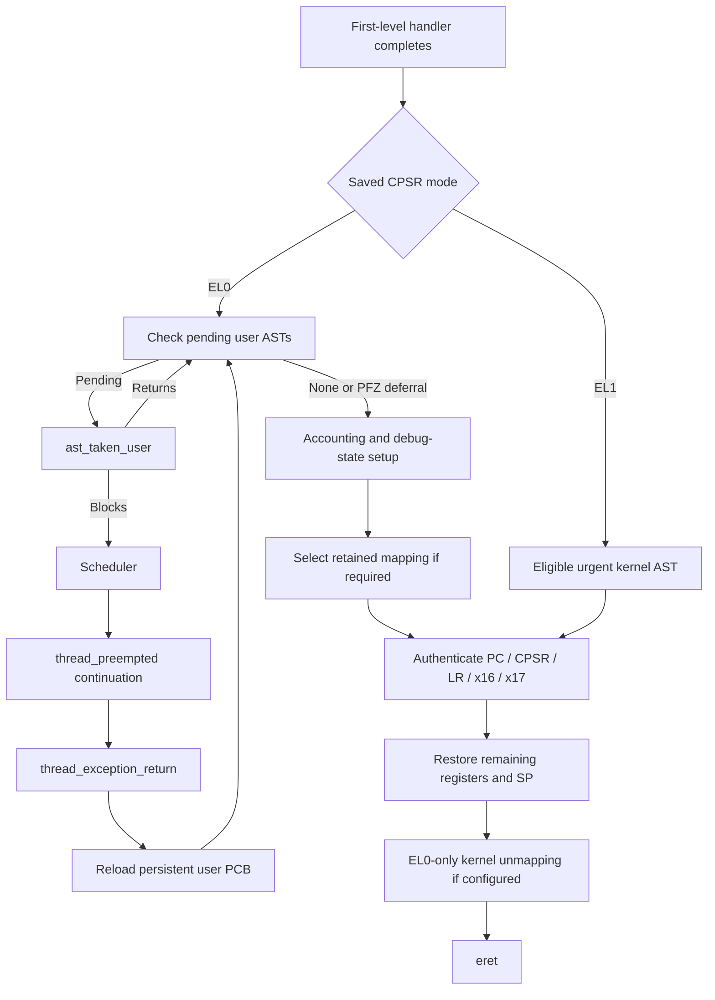

# ARM64 exception return: ASTs, continuations, and authenticated restore

[Execution overview](execution.md) · [Exception entry](arm64-exception-entry.md) · [Exception levels and monitors](exception-levels-and-monitors.md)

For the complete common AST subsystem behind this assembly loop, read [AST transport and callback protocols](../runtime/ast-mechanism.md) and the [all-flavor reference](../runtime/ast-flavors.md). These cover producers, remote IPIs, per-thread versus per-CPU state, and subsystem-specific clear/retry/lifetime rules.

The return path restores an `arm_context`; it does not necessarily unwind the C call chain that originally entered the kernel. An ordinary synchronous or interrupt handler can branch into the shared return dispatcher. A blocked syscall, a delivered exception, or a preempted user thread can instead resume through a continuation that reloads the thread's persistent user PCB. Both eventually attempt user AST processing and register restore. [`exception_return_dispatch`](../../../xnu/osfmk/arm64/locore.s#L1690), [`thread_exception_return`](../../../xnu/osfmk/arm64/sleh.c#L695), [`arm64_thread_exception_return`](../../../xnu/osfmk/arm64/locore.s#L1783).

## Which execution is being resumed?

On the ordinary handler path x21 holds the context pointer established by `fleh_dispatch64`. Its saved CPSR determines whether to resume kernel or user execution:

[Common return dispatch selects the saved execution level](../../../xnu/osfmk/arm64/locore.s#L1690)
<!-- source-excerpt: ../../../xnu/osfmk/arm64/locore.s#L1690-L1694 -->
```asm
exception_return_dispatch:
	ldr		w0, [x21, SS64_CPSR]
	tst		w0, PSR64_MODE_EL_MASK
	b.ne		EXT(return_to_kernel) // return to kernel if M[3:2] > 0
	b		return_to_user
```

A same-EL exception such as a recoverable kernel data abort returns to EL1. A user SVC or fault returns to EL0. These are different uses of the same low-level restore machinery; reaching `exception_return` by itself says nothing about the destination privilege level. The authenticated PC/CPSR loaded later determine the architectural return. Monitor-domain resumption has additional dispatch, including `xnu_return_to_gl2` in SPTM builds, and belongs to the [monitor guide](exception-levels-and-monitors.md). [`return dispatcher`](../../../xnu/osfmk/arm64/locore.s#L1690), [`SPTM resume selector`](../../../xnu/osfmk/arm64/locore.s#L1706), [`restore`](../../../xnu/osfmk/arm64/locore.s#L1951).

| Entry into return machinery | Context source | Consequence |
|---|---|---|
| `fleh_synchronous` / `fleh_serror` | x21 from the original spill | Ordinary C handler completed; PFZ checking is disabled for this return. |
| `fleh_irq` / `fleh_fiq` | x21 from the interrupted execution | Interrupt epilogue has left the interrupt stack; PFZ checking may defer a user AST. |
| `thread_exception_return` → `arm64_thread_exception_return` | Reload `current_thread()->machine.upcb` | Can resume after the old kernel call frames were discarded by a continuation. |
| `thread_syscall_return(error)` | `get_user_regs(current_thread())` | Writes the Mach result into saved x0, closes tracing as required, then uses the common user-return route. |
| `thread_bootstrap_return` | Newly initialized thread PCB | New thread begins through the same user-return checks after configured bootstrap hooks. |

Sources: [`synchronous tail`](../../../xnu/osfmk/arm64/locore.s#L1207), [`interrupt tails`](../../../xnu/osfmk/arm64/locore.s#L1338), [`SError tail`](../../../xnu/osfmk/arm64/locore.s#L1390), [`C continuation return`](../../../xnu/osfmk/arm64/sleh.c#L695), [`Mach syscall return`](../../../xnu/osfmk/arm64/sleh.c#L3176), [`bootstrap return`](../../../xnu/osfmk/arm64/locore.s#L1769).

The C `thread_exception_return` closes a still-open synchronous exception trace, clears `el0_synchronous_trap`, performs configured KASAN cleanup, and calls the assembly helper. That helper reloads the PCB rather than trusting a pointer retained in an abandoned handler frame:

[arm64_thread_exception_return reloads the user PCB](../../../xnu/osfmk/arm64/locore.s#L1783)
<!-- source-excerpt: ../../../xnu/osfmk/arm64/locore.s#L1783-L1787 -->
```asm
LEXT(arm64_thread_exception_return)
	ARM64_PROLOG
	mrs		x0, TPIDR_EL1
	LOAD_USER_PCB	dst=x21, src=x0, tmp=x28
	mov		x28, xzr
```

This works because user state is allocated separately from the thread's kernel stack. `machine_thread_create` sets `contextData`, `upcb`, and `uNeon`; an exception save uses that allocation, and scheduler continuations need not preserve the old kernel call chain. Kernel-context switching has its own smaller save area. [`PCB allocation`](../../../xnu/osfmk/arm64/pcb.c#L603), [`context switch`](../../../xnu/osfmk/arm64/cswitch.s#L375), [runtime scheduling](../runtime/scheduling.md).

## Changing the saved result or resume PC

The eventual restore reads the modified context. For a Mach trap, normal `mach_syscall` return stores its result in saved x0; the continuation alternative `thread_syscall_return` does the same before `thread_exception_return`. A BSD syscall uses `arm_prepare_u64_syscall_return`: `ERESTART` moves the saved PC back four bytes, `EJUSTRETURN` leaves prepared state alone, and other errors set errno in x0, clear x1, and set carry for libc's error path. Success encoding depends on the `sysent` return type. [`Mach result`](../../../xnu/osfmk/arm64/bsd_arm64.c#L77), [`continuation result`](../../../xnu/osfmk/arm64/sleh.c#L3176), [`BSD result`](../../../xnu/bsd/dev/arm/systemcalls.c#L496).

[BSD syscall restart and error-result encoding](../../../xnu/bsd/dev/arm/systemcalls.c#L502)
<!-- source-excerpt: ../../../xnu/bsd/dev/arm/systemcalls.c#L502-L513 -->
```c
	if (error == ERESTART) {
		add_user_saved_state_pc(regs, -4);
	} else if (error != EJUSTRETURN) {
		if (error) {
			ss64->x[0] = error;
			ss64->x[1] = 0;
			/*
			 * Set the carry bit to execute cerror routine.
			 * ARM64_TODO: should we have a separate definition?
			 * The bits are the same.
			 */
			ss64->cpsr |= PSR64_CF;
```

Changing a signed control-flow field cannot be treated like changing an ordinary result register. On PAC builds `add_user_saved_state_pc` invokes `MANIPULATE_SIGNED_USER_THREAD_STATE`: authenticate the old state, verify it is user state, update the PC, and sign the resulting state again with interrupts safely masked. The kernel copyio recovery path similarly validates its recovery-table entry before changing a kernel state's PC through `MANIPULATE_SIGNED_THREAD_STATE`. [`PC helper`](../../../xnu/osfmk/mach/arm/thread_status.h#L645), [`mutation macro`](../../../xnu/osfmk/mach/arm/thread_status.h#L518), [`copyio recovery`](../../../xnu/osfmk/arm64/sleh.c#L2185).

A repaired VM fault normally leaves the saved instruction address intact, so execution retries it. A breakpoint, exception RPC reply, signal setup, or syscall restart may deliberately change the state by a different policy. The machine return code validates and restores that state; the higher-level handler decides what execution should resume. [`user VM completion`](../../../xnu/osfmk/arm64/sleh.c#L1979), [Mach exceptions](../ipc/kernel-rpc-and-exceptions.md), [BSD processes](../processes/README.md).

## Returning to EL1: only an eligible urgent preemption

`return_to_kernel` first checks the interrupted CPSR's IRQ-mask bit. If IRQs were disabled there, it skips the AST check. Otherwise it reads the thread's preemption count, masks exceptions, and skips preemption if that count is nonzero. Only `AST_URGENT` causes `ast_taken_kernel` to run. Before that call it sets SP to x21, the kernel exception frame, so preemption can safely use the thread's stack rather than the interrupt stack. [`return_to_kernel`](../../../xnu/osfmk/arm64/locore.s#L1748).

[Kernel return: interrupt mask, preemption nesting, and urgency](../../../xnu/osfmk/arm64/locore.s#L1751)
<!-- source-excerpt: ../../../xnu/osfmk/arm64/locore.s#L1751-L1764 -->
```asm
	tbnz	w0, #DAIF_IRQF_SHIFT, exception_return  // Skip AST check if IRQ disabled
	mrs		x3, TPIDR_EL1                           // Load thread pointer
	ldr		w1, [x3, ACT_PREEMPT_CNT]               // Load preemption count
	msr		DAIFSet, #DAIFSC_ALL                    // Disable exceptions
	cbnz	x1, exception_return_unint_tpidr_x3     // If preemption disabled, skip AST check
	ldr		x1, [x3, ACT_CPUDATAP]                  // Get current CPU data pointer
	ldr		w2, [x1, CPU_PENDING_AST]               // Get ASTs
	tst		w2, AST_URGENT                          // If no urgent ASTs, skip ast_taken
	b.eq	exception_return_unint_tpidr_x3
	mov		sp, x21                                 // Switch to thread stack for preemption
	PUSH_FRAME
	bl		EXT(ast_taken_kernel)                   // Handle AST_URGENT
	POP_FRAME_WITHOUT_LR
	b		exception_return
```

`ast_taken_kernel` adds semantic checks: idle threads manage their own preemption, a racing handler might already have consumed urgency, and a thread preparing to wait must not be preempted through this route. If eligible, it consumes `AST_PREEMPTION` and calls `thread_block_reason` with `THREAD_CONTINUE_NULL`. Its caller must resume and return normally, preserving the interrupted kernel call chain. In contrast, user preemption can use a continuation because only the PCB is needed to return to userspace. [`ast_taken_kernel`](../../../xnu/osfmk/kern/ast.c#L119), [`thread_preempted_in_kernel`](../../../xnu/osfmk/kern/ast.c#L105).

This explains why “pending AST” does not mean “the thread can be switched immediately.” The saved interrupt state, current preemption nesting, and pending wait state are independent constraints checked at the boundary. It also explains why a synchronous kernel fault need not imply a privilege transition or a task-level exception.

## Returning to EL0: pending ASTs can change the path

`return_to_user` resets the I/O-tier override, asserts zero preemption nesting in assertion builds, and masks exceptions before reading `cpu_pending_ast`. There is both per-thread AST state and per-CPU pending state; `ast_propagate` merges relevant thread state onto the processor. A context switch can therefore change which CPU is responsible for delivering the thread's pending work. [`assembly loop`](../../../xnu/osfmk/arm64/locore.s#L1797), [`AST representation`](../../../xnu/osfmk/kern/ast.h#L89), [`ast_propagate`](../../../xnu/osfmk/kern/ast.c#L532).

[User return checks CPU-local pending AST state](../../../xnu/osfmk/arm64/locore.s#L1818)
<!-- source-excerpt: ../../../xnu/osfmk/arm64/locore.s#L1818-L1823 -->
```asm
	msr		DAIFSet, #DAIFSC_ALL				// Disable exceptions
	ldr		x4, [x3, ACT_CPUDATAP]				// Get current CPU data pointer
	ldr		w0, [x4, CPU_PENDING_AST]			// Get ASTs
	cbz		w0, no_asts							// If no asts, skip ahead

	cbz		x28, user_take_ast					// If we don't need to check PFZ, just handle asts
```

With pending work, assembly calls `ast_taken_user` and retries the check if it returns. The C function starts with interrupts disabled, may enable interrupts for handlers, and may block instead of returning. A one-time AST check would be insufficient: handlers can set new reasons, and a continuation can resume on another processor. [`ast_taken_user`](../../../xnu/osfmk/kern/ast.c#L165).

[The assembly user-AST retry loop](../../../xnu/osfmk/arm64/locore.s#L2128)
<!-- source-excerpt: ../../../xnu/osfmk/arm64/locore.s#L2128-L2132 -->
```asm
user_take_ast:
	PUSH_FRAME
	bl		EXT(ast_taken_user)							// Handle all ASTs, may return via continuation
	POP_FRAME_WITHOUT_LR
	b		check_user_asts								// Now try again
```

The user AST handler proceeds in stages:

1. Urgent preemption consumes the preemption reasons and blocks using `thread_preempted` as a continuation.
2. `ast_propagate` catches concurrent per-thread updates, including kevent ASTs that deliberately do not send an IPI.
3. It consumes per-thread/KPERF/DTrace reasons, enables interrupts, and runs configured handlers. These include BSD work, MAC user-return processing, asynchronous thread control, and other feature-specific actions.
4. With scheduler interrupt priority restored, it consumes nonurgent preemption reasons and calls `csw_check` under the thread lock. If a switch is still appropriate, it blocks through the same continuation; otherwise it clears the pending preemption timer.
5. SPTM builds clean up a temporarily mapped kernel stack redzone page when present, then execute return-to-user assertions.

Sources: [`user AST stages`](../../../xnu/osfmk/kern/ast.c#L165), [`configured handlers`](../../../xnu/osfmk/kern/ast.c#L311). These are selected mechanisms, not an exhaustive catalogue of every AST bit or its subsystem policy.

The continuation makes the restart contract explicit:

[The user-preemption continuation restarts exception return](../../../xnu/osfmk/kern/ast.c#L91)
<!-- source-excerpt: ../../../xnu/osfmk/kern/ast.c#L91-L99 -->
```c
static void __attribute__((noinline, noreturn, disable_tail_calls))
thread_preempted(__unused void* parameter, __unused wait_result_t result)
{
	/*
	 * We've been scheduled again after a userspace preemption,
	 * try again to return to userspace.
	 */
	thread_exception_return();
}
```

After the scheduler runs this thread again, it starts another attempt to return to userspace through `thread_exception_return`. It does not return through the old `ast_taken_user` invocation. This is also the pattern to recognize when a blocking Mach IPC operation ultimately calls `thread_syscall_return`: the saved PCB remains the stable user-visible execution record. [IPC message path](../ipc/message-path.md), [`thread_syscall_return`](../../../xnu/osfmk/arm64/sleh.c#L3176).

### The commpage preemption-free zone exception

Interrupt returns set x28 to permit one PFZ check; synchronous/SError and explicit continuation returns clear it. When ASTs are pending and x28 is set, assembly tests the saved PC with `commpage_is_in_pfz64`. If it is inside that region, the kernel writes 1 to saved x15 and bypasses AST handling for this return. The comment documents coordination with commpage code: x15 is available there to request delayed preemption after leaving the region. This prevents delivery of suspension or signal work while the user sequence holds its spinlock. x28 is cleared before the test so the check is not repeated within the same loop. [`PFZ branch`](../../../xnu/osfmk/arm64/locore.s#L1823), [`commpage implementation`](../../../xnu/osfmk/arm/commpage/commpage_asm.s).

[PFZ deferral records a delayed-preemption request in saved x15](../../../xnu/osfmk/arm64/locore.s#L1837)
<!-- source-excerpt: ../../../xnu/osfmk/arm64/locore.s#L1837-L1844 -->
```asm
	ldr		x0, [x21, SS64_PC]					// Load pc from machine state
	bl		EXT(commpage_is_in_pfz64)			// pc in pfz?
	cbz		x0, restore_and_check_ast			// No, deal with other asts

	mov		x0, #1
	str		x0, [x21, SS64_X15]					// Mark x15 for userspace to take delayed preemption
	mov		x0, x19								// restore x0 to asts
	b		no_asts								// pretend we have no asts
```

`commpage_is_in_pfz64` recognizes the configured commpage text range under `CONFIG_ARM_PFZ`; otherwise it returns zero. When the commpage sequence exits that range, `PREEMPT_SELF_THEN` checks and clears x15 and calls `_preempt_self`, which enters the kernel using x16 = -58 (`pfz_exit`). The trap itself simply returns `KERN_SUCCESS`; the useful effect is that this synchronous entry reaches the AST loop without another PFZ deferral. [`range test`](../../../xnu/osfmk/arm/commpage/commpage.c#L286), [`commpage continuation`](../../../xnu/osfmk/arm/commpage/commpage_asm.s#L201), [`trap table`](../../../xnu/osfmk/kern/syscall_sw.c#L168), [`pfz_exit`](../../../xnu/osfmk/kern/syscall_subr.c#L88).

[Commpage delayed preemption reenters through the ordinary SVC path](../../../xnu/osfmk/arm/commpage/commpage_asm.s#L544)
<!-- source-excerpt: ../../../xnu/osfmk/arm/commpage/commpage_asm.s#L544-L546 -->
```asm
	// Make syscall to take delayed preemption
	mov		x16, #-58	// -58 = pfz_exit
	svc		#0x80
```

PFZ deferral is not a general privilege for arbitrary userspace to suppress ASTs, and it does not skip the final saved-state authentication. It is a recognized-PC path selected for specific interrupt returns. When no AST work is taken, configured accounting switches to user execution and `arm_debug_set` installs the thread's debug state if it differs from the CPU's live state. A Watchtower configuration also contains a CPACR-mediated monitor check; that is separate from the common EL1-to-EL0 return contract. [`post-AST preparation`](../../../xnu/osfmk/arm64/locore.s#L1852), [monitor boundaries](exception-levels-and-monitors.md).

## Authenticating precisely the values that will be restored

`exception_return_unint_tpidr_x3` makes SP point at the saved context. Under `__ARM_KERNEL_PROTECT__`, an EL0 return first branches to the fixed exception mapping, computing the target by its offset from `ExceptionVectorsBase`. Execution must already be in the retained mapping before the final TCR change removes broader kernel mappings. A kernel return skips this alias branch. [`return mapping selection`](../../../xnu/osfmk/arm64/locore.s#L1907).

At `Lexception_return_restore_registers`, `AUTH_THREAD_STATE_IN_X0` loads PC/CPSR/x16/x17/LR and checks them when `HAS_APPLE_PAC` is enabled. The call explicitly permits EL0 state because this restore serves both user and kernel returns. Only after successful authentication are PC and CPSR written to ELR_EL1 and SPSR_EL1. [`restore entry`](../../../xnu/osfmk/arm64/locore.s#L1951).

[Authenticate before installing ELR_EL1 and SPSR_EL1](../../../xnu/osfmk/arm64/locore.s#L1951)
<!-- source-excerpt: ../../../xnu/osfmk/arm64/locore.s#L1951-L1957 -->
```asm
Lexception_return_restore_registers:
	mov 	x0, sp								// x0 = &pcb
	// Loads authed $x0->ss_64.pc into x1 and $x0->ss_64.cpsr into w2
	AUTH_THREAD_STATE_IN_X0	x20, x21, x22, x23, x24, x25, el0_state_allowed=1

	msr		ELR_EL1, x1							// Load the return address into ELR
	msr		SPSR_EL1, x2						// Load the return CPSR into SPSR
```

Three authentication operations seen in this path have different purposes:

| Operation | Protected value | Source |
|---|---|---|
| `LOAD_USER_PCB`, stack-pointer load macros | Pointer loaded from a thread or CPU-data field, diversified by storage address and a field discriminator | [`machine_routines_asm.h`](../../../xnu/osfmk/arm64/machine_routines_asm.h#L135) |
| `pacia` / `braa` in the dispatcher | First-level-handler branch target, using the active stack pointer as modifier | [`fleh_dispatch64`](../../../xnu/osfmk/arm64/locore.s#L1063) |
| `ml_sign_thread_state` / `ml_check_signed_state` | Signature over saved control-flow state, with context-address and PC/EL binding | [`machine_routines_asm.s`](../../../xnu/osfmk/arm64/machine_routines_asm.s#L1786) |

The state signature covers PC, CPSR, LR, x16, and x17. It is not a checksum over every saved GPR, the saved SP, or the NEON state. `COMPUTE_THREAD_STATE_HASH` chains `pacga` operations, diversifies by the context address, and binds subsequent stages to PC/EL-related state. For an EL0 state it deliberately excludes the carry flag, allowing the BSD syscall error encoder to update carry without re-signing. [`hash macro`](../../../xnu/osfmk/arm64/machine_routines_asm.s#L1800).

[The EL0 carry flag is deliberately excluded from the signature](../../../xnu/osfmk/arm64/machine_routines_asm.s#L1801)
<!-- source-excerpt: ../../../xnu/osfmk/arm64/machine_routines_asm.s#L1801-L1808 -->
```asm
	/*
	 * Mask off the carry flag for EL0 states so we don't need to re-sign when
	 * that flag is touched by the system call return path.
	 */
	tst		x2, PSR64_MODE_EL_MASK
	b.ne	1f
	bic		x2, x2, PSR_CF
1:
```

`ml_check_signed_state` verifies that interrupts are masked and checks its stack-mode requirements on non-SPTM builds, recomputes the hash, and compares it with `SS64_JOPHASH`. Mismatch invokes `panic_with_thread_kernel_state`. It does not silently sanitize a corrupted PC. [`checker`](../../../xnu/osfmk/arm64/machine_routines_asm.s#L1846), [`comparison and panic`](../../../xnu/osfmk/arm64/machine_routines_asm.s#L1895).

An especially useful detail is the macro's handling of memory races. It retains the exact loaded values across the check instead of loading them again afterward. Otherwise authentication could validate one PC and restore a different value modified in memory. The custom checker ABI clobbers x1/x2/x16/x17, so explicit temporary registers preserve those candidates:

[Restore the exact PC/CPSR/x16/x17 values that were authenticated](../../../xnu/osfmk/arm64/machine_routines_asm.h#L88)
<!-- source-excerpt: ../../../xnu/osfmk/arm64/machine_routines_asm.h#L88-L98 -->
```asm
	mov		\tmp1, x1
	mov		\tmp2, x2
	ldr		x3, [x0, SS64_LR]
	mov		x4, x16
	mov		x5, x17
	bl		EXT(ml_check_signed_state)
	mov		x1, \tmp1
	mov		x2, \tmp2
	mov		x16, x4
	mov		x17, x5
	msr		SPSel, #0
```

LR is likewise restored from the already-authenticated x3. On pointer-authentication-call builds the macro temporarily selects SP1; after checking it returns to SP0. The final general-register restore deliberately skips x16/x17/LR because replacing them with fresh memory reads would discard that guarantee. [`macro tail`](../../../xnu/osfmk/arm64/machine_routines_asm.h#L107), [`GPR restore`](../../../xnu/osfmk/arm64/locore.s#L2066).

## Finishing the restore without losing the mapping beneath it

The remaining sequence restores the architectural state in a constrained order:

1. Restore FPSR and conditionally update FPCR. Restore q0–q31 unless an active streaming SME state requires restoring Z/P registers instead; writing NEON registers afterward would truncate that state. ZA is managed elsewhere during context switch.
2. For `HAS_MTE`, apply the user exclude-tag mask only when returning to EL0 and perform configured reseeding. Honor pending context-synchronization requirements and clear `cpu_data.sync_on_cswitch`.
3. Restore ordinary GPRs, preserving x0/x1 until the context pointer is no longer needed and keeping the already-authenticated control-flow registers. Restore the saved SP into active SP0, then the last x0/x1 pair.
4. For a protected-kernel EL0 return, load `TCR_EL1_USER`, clear the task ASID's low bit in TTBR0_EL1, and clear x18. Required barriers depend on CPU configuration. An EL1 return bypasses this unmapping.
5. Execute `ERET_NO_STRAIGHT_LINE_SPECULATION`.

Sources: [`FP/SIMD/SME restore`](../../../xnu/osfmk/arm64/locore.s#L1959), [`MTE and synchronization`](../../../xnu/osfmk/arm64/locore.s#L2020), [`GPR/SP restore`](../../../xnu/osfmk/arm64/locore.s#L2066), [`translation switch`](../../../xnu/osfmk/arm64/locore.s#L2097).

The protected-kernel ASID switch is the inverse of `MAP_KERNEL` on entry:

[Switch back to the task user ASID and clear x18](../../../xnu/osfmk/arm64/locore.s#L2113)
<!-- source-excerpt: ../../../xnu/osfmk/arm64/locore.s#L2113-L2117 -->
```asm
	/* Switch to the user ASID (low bit clear) for the task. */
	mrs		x18, TTBR0_EL1
	bic		x18, x18, #(1 << TTBR_ASID_SHIFT)
	msr		TTBR0_EL1, x18
	mov		x18, #0
```

Without `__ARM_KERNEL_PROTECT__`, x18 is zeroed or restored according to `MACHDEP_TPIDR_FLAG_PRESERVE_X18`, which carries the relevant entitlement/translation policy. With kernel protection x18 serves the mapping transition and is cleared on EL0 return. The implementation therefore does not promise that every exception always round-trips an arbitrary user x18 value. [`x18 policy`](../../../xnu/osfmk/arm64/locore.s#L1910).

Finally, the return macro is an architectural exception return followed by a speculation-limiting sequence, not a normal function `ret`:

[ERET_NO_STRAIGHT_LINE_SPECULATION](../../../xnu/osfmk/arm64/proc_reg.h#L3825)
<!-- source-excerpt: ../../../xnu/osfmk/arm64/proc_reg.h#L3825-L3839 -->
```asm
.macro ERET_NO_STRAIGHT_LINE_SPECULATION
eret
#if __ARM_SB_AVAILABLE__
sb                              // Technically unnecessary on Apple micro-architectures, may restrict mis-speculation on other architectures
#else /* __ARM_SB_AVAILABLE__ */
isb                             // ISB technically unnecessary on Apple micro-architectures, may restrict mis-speculation on other architectures
nop                             // Sequence of six NOPs to pad out and terminate instruction decode group */
nop
nop
nop
nop
nop
#endif /* !__ARM_SB_AVAILABLE__ */
.endmacro

```

`eret` uses the previously loaded ELR/SPSR to resume the selected execution mode and interrupt state. The instructions following it address straight-line speculation; they are not additional instructions in the resumed user program. Its companion `ERET_IS_NOT_CONTEXT_SYNCHRONIZING` branches make explicit that required synchronization cannot always be assumed to come from the return instruction itself. [`return macro`](../../../xnu/osfmk/arm64/proc_reg.h#L3825), [`pending ISB handling`](../../../xnu/osfmk/arm64/locore.s#L2038).



## Reading checks and limits

For a debugger walk, identify whether x21 describes a user PCB or a kernel-stack frame, whether the return came through `arm64_thread_exception_return`, and whether execution is before or after `AUTH_THREAD_STATE_IN_X0`. Do not interpret a saved kernel fault as an EL0 transition solely because it uses common return labels. Do not assume a C frame must still exist after a blocking user AST. Those distinctions follow directly from [`entry`](../../../xnu/osfmk/arm64/locore.s#L607), [`continuation return`](../../../xnu/osfmk/arm64/locore.s#L1783), and [`authentication`](../../../xnu/osfmk/arm64/machine_routines_asm.h#L56).

This page deeply reviews the shared ARM64 return labels, AST control flow, saved-state authentication/mutation macros, and selected result encoders. It surveys SME, MTE, debug-state, and Watchtower branches only where they affect return ordering. It does not prove cryptographic security, reconstruct unavailable monitor implementations, validate every compile-time combination, or report a boot/runtime test. Follow [runtime](../runtime/README.md) for scheduler and continuation lifetime, [IPC](../ipc/README.md) for blocking message operations and exception replies, and [exception levels and monitors](exception-levels-and-monitors.md) for protected-domain return contracts.

<!-- BEGIN PLATYDOC DOCUMENTATION LICENSE -->
Original Platydoc text and diagrams are licensed under [CC BY 4.0](https://creativecommons.org/licenses/by/4.0/). Quoted source code and third-party material retain their respective licenses.
<!-- END PLATYDOC DOCUMENTATION LICENSE -->
