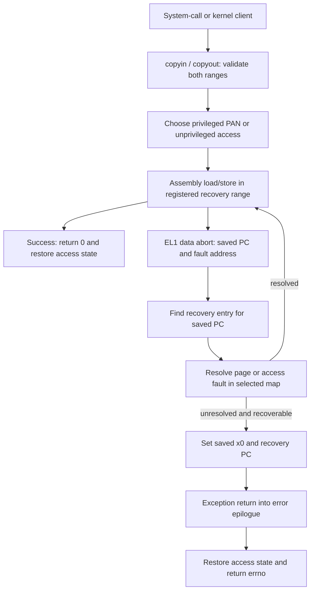

# ARM64 user-memory access: copyin, copyout and fault recovery

[Platform guide](README.md) · [Exception entry](arm64-exception-entry.md) · [Fault resolution](../vm/fault-resolution.md) · [User-lock operations](../processes/events-threads.md)

Many BSD and Mach operations accept an address in the caller's address space. The kernel cannot treat that integer as an ordinary trusted pointer: the range may be unmapped, another thread may change its mappings, a page may need to be faulted in, and a copy may fail after modifying part of the destination. On ARM64, `copyio.c`, assembly copy routines, and the synchronous exception handler implement this boundary together. This chapter follows this checkout's ARM64 path; it does not assume that every system call transfers user memory.

## 1. The objects are addresses, a map and a recoverable instruction range

| Item | Meaning during the operation |
| --- | --- |
| `user_addr_t user_addr` | An address interpreted in the selected map, not a physical address or a kernel pointer |
| `current_thread()->map` | The map used by these wrappers; the code tests its `pmap` to distinguish ordinary user access from permitted kernel-to-kernel cases |
| Kernel buffer pointer | Storage whose range and allocator bounds are checked independently of the user range |
| `copyio_recovery_entry` | A static association between a range of kernel instruction addresses and an error-return instruction address |
| `arm_saved_state_t` | The faulting CPU register state; recovery changes its return value and instruction pointer |
| `thread->machine.recover_esr/recover_far` | The recorded exception syndrome and fault address when the handler redirects to recovery |
| `thread->recover` | A flag temporarily used around VM fault handling; it is not the table of recovery instruction ranges |

The representation and lookup of the table are in [`sleh.c`](../../../xnu/osfmk/arm64/sleh.c#L319-L360); the copy wrapper selects the map in [`copyin`](../../../xnu/osfmk/arm64/copyio.c#L403-L432). The static table avoids installing a caller-selected arbitrary recovery PC for each copy.



The diagram omits configuration-specific guard and tag-fault branches, which are discussed below. “Resolved” means the faulting instruction can execute again, not that the whole copy restarts from its original address.

## 2. Validation separates a bad user argument from a kernel programming error

[`copy_validate_user_addr`](../../../xnu/osfmk/arm64/copyio.c#L273-L312) checks the map bounds and addition overflow. Relevant MTE configurations first canonicalize an enabled task's tagged address for the range check. Ordinary top-byte-tagged addresses are otherwise rejected by the `ARM_TBI_USER_MASK` check. A map-bounds failure returns `EFAULT`; the latter tag check returns `EINVAL`.

[`copy_validate_kernel_addr`](../../../xnu/osfmk/arm64/copyio.c#L315-L336) checks overflow, kernel virtual/physmap bounds and `zone_element_bounds_check`. Invalid kernel-buffer geometry is a kernel error and can panic. KASAN builds additionally check stores into the kernel destination for copyin and loads from the kernel source for copyout. These checks validate buffer geometry; they neither pin all user pages nor make their contents immutable.

[`copy_validate`](../../../xnu/osfmk/arm64/copyio.c#L344-L386) also limits size and enforces natural alignment for `COPYIO_ATOMIC`. Its implementation returns `EINVAL` above `copysize_limit_panic`, despite the older comment above the constant describing a panic. If the selected map uses `kernel_pmap`, a caller that allows kernel-to-kernel access gets the internal sentinel `EXDEV`; disallowed callers get `EFAULT`.

The complete wrapper shows where this sentinel is consumed. It is not normally returned to the system-call caller. [`copyin`](../../../xnu/osfmk/arm64/copyio.c#L403-L432):

<!-- source-excerpt: ../../../xnu/osfmk/arm64/copyio.c#L403-L432 -->
```c
copyin(const user_addr_t user_addr, void *kernel_addr, vm_size_t nbytes)
{
	vm_map_t map = current_thread()->map;
	user_addr_t guarded_user_addr;
	int result;

	if (__improbable(nbytes == 0)) {
		return 0;
	}

	result = copy_validate(map, user_addr, (uintptr_t)kernel_addr, nbytes,
	    COPYIO_IN | COPYIO_ALLOW_KERNEL_TO_KERNEL);
	if (result == EXDEV) {
		guarded_user_addr = copy_ensure_address_space_spec(map, user_addr);
		return copyin_kern(guarded_user_addr, kernel_addr, nbytes);
	}
	if (__improbable(result)) {
		return result;
	}

	guarded_user_addr = copy_ensure_address_space_spec(map, user_addr);

	return WRAP_COPYIO(USER_ACCESS_READ, map,
	           _bcopyin(guarded_user_addr, kernel_addr, nbytes));
}

/*
 * copy{in,out}_atomic{32,64}
 * Read or store an aligned value from userspace as a single memory transaction.
 * These functions support userspace synchronization features
```

The zero-length shortcut precedes validation. Nonzero copies use [`copy_ensure_address_space_spec`](../../../xnu/osfmk/arm64/copyio.c#L238-L270) after validation to force the address-space select bit to the selected user or kernel regime under speculation. The helper verifies that this did not change the validated address. This is address-selection hardening, not a second address translation.

## 3. PAN and tagged access surround the copy, including its error return

The privileged path temporarily clears PAN, performs the assembly operation, then restores PAN. The wrapper receives the assembly operation's error code before restoring access state, so an ordinary recovered fault still passes through the disabling step. [`access helpers and WRAP_COPYIO_PAN`](../../../xnu/osfmk/arm64/copyio.c#L120-L169):

<!-- source-excerpt: ../../../xnu/osfmk/arm64/copyio.c#L162-L169 -->
```c
#define WRAP_COPYIO_PAN(_dir, _map, _op)                                    \
	({                                                                      \
	        int _ret;                                                       \
	        user_access_enable(_dir, (_map)->pmap);                         \
	        _ret = _op;                                                     \
	        user_access_disable(_dir, (_map)->pmap);                        \
	        _ret;                                                           \
	})
```

Under `HAS_MTE`, [`WRAP_COPYIO`](../../../xnu/osfmk/arm64/copyio.c#L186-L208) selects a privileged operation or its `_unprivileged...` counterpart. The latter uses unprivileged memory instructions whose treatment of user access/tag state differs from an ordinary EL1 load/store. If the privileged operation returns `EAGAIN` after the exception handler enables MTE soft mode, the wrapper retries using the unprivileged operation. This is a specific tag-policy transition, not the general rule for every translation fault.

`userspace_access_is_tagged()` considers task settings and a thread override; `unprivileged_user_access_disable()` clears the thread's `in_unprivileged_access` state. Inspect these guards when describing a particular build. The presence of the MTE branch in source does not establish that it executes on all ARM64 machines. [`selection and state`](../../../xnu/osfmk/arm64/copyio.c#L105-L159), [`tag-fault recovery`](../../../xnu/osfmk/arm64/sleh.c#L2280-L2455).

## 4. The assembly exports both a copy routine and its recovery contract

`_bcopyin` receives source user VA in `x0`, destination kernel VA in `x1`, and byte count in `x2`. `_bcopyout` uses the same source/destination register convention with the address-space roles reversed. Both establish a frame and invoke `BCOPY_IMPL`; neither changes the caller's map or creates a permanent mapping.

The `COPYIO_RECOVER_RANGE` macro emits start, end and recovery offsets into `__TEXT,__copyio_vectors`, relative to `copyio_recover_table`. MTE builds append flags controlling permitted recovery from kernel-side tag faults. The start is inclusive and end exclusive in the C lookup. [`table construction`](../../../xnu/osfmk/arm64/machine_routines_asm.s#L39-L88), [`range lookup`](../../../xnu/osfmk/arm64/sleh.c#L348-L360).

The copyin assembly places the protected range around the memory operation and clears scratch registers containing user-controlled values before a successful return. [`_bcopyin`](../../../xnu/osfmk/arm64/machine_routines_asm.s#L625-L646):

<!-- source-excerpt: ../../../xnu/osfmk/arm64/machine_routines_asm.s#L625-L646 -->
```asm
	.globl EXT(_bcopyin)
LEXT(_bcopyin)
	COPYIO_STACK_PROLOG
	PUSH_FRAME
	COPYIO_RECOVER_RANGE _bcopyin_end

	BCOPY_IMPL x0, x1, x2, _bcopyin_end

_bcopyin_end:	
	mov		x0, xzr
	/*
	 * x3, x4, x5 and x6 now contain user-controlled values which may be used to form
	 * addresses under speculative execution past the _bcopyin(); prevent any
	 * attempts by userspace to influence kernel execution by zeroing them out
	 * before we return.
	 */
	mov		x3, xzr
	mov		x4, xzr
	mov		x5, xzr
	mov		x6, xzr
	POP_FRAME
	ARM64_STACK_EPILOG EXT(_bcopyin)
```

The error epilogue preserves the error value already put in `x0` by the exception handler. It unwinds the frame and returns to the C wrapper. It does not execute the copy's successful-return instruction that would overwrite `x0` with zero. [`copyio_error`](../../../xnu/osfmk/arm64/machine_routines_asm.s#L477-L480):

<!-- source-excerpt: ../../../xnu/osfmk/arm64/machine_routines_asm.s#L477-L480 -->
```asm
copyio_error:
	POP_FRAME							// Return the error populated in x0
	                                    // by the exception handler
	ARM64_STACK_EPILOG
```

## 5. A page fault can complete the mapping or convert the access to EFAULT

[`handle_kernel_abort`](../../../xnu/osfmk/arm64/sleh.c#L2542-L2737) first finds a recovery entry using the saved PC. For a user address with such an entry, it selects `thread->map`; a kernel address or an unprotected access selects `kernel_map`. The latter deliberately avoids legitimizing an accidental raw user-pointer access merely because a user mapping happens to exist.

For eligible VM faults:

1. A nontranslation fault first tries `arm_fast_fault`, which can resolve reference/modify or permission state without the full VM fault path.
2. If necessary and the interrupted context permits VM fault handling, `vm_fault` resolves the address. The code avoids unsafe VM locking when interrupts were disabled, apart from stated early-boot/hibernation exceptions.
3. Around `vm_fault`, it temporarily marks `thread->recover` and restores its previous value afterward. Recoverable copy faults request `THREAD_UNINT` so VM does not abort early in a way this copy path cannot restart.
4. Successful resolution returns from the handler without changing the saved PC. Exception return retries the interrupted memory instruction.
5. If resolution fails and recovery is permitted, guard-object reporting can occur, then the handler selects the registered error epilogue. A kernel fault without a valid recovery path can panic instead.

The error handoff records ESR/FAR, sets saved `x0`, and updates the saved PC. PAC-enabled builds manipulate signed state through `MANIPULATE_SIGNED_THREAD_STATE` and validate that the recovery record is a properly aligned member of the static table. The alternative path also checks the table bounds/alignment. [`handle_kernel_abort_recover_with_error_code`](../../../xnu/osfmk/arm64/sleh.c#L2185-L2233).

This produces an EL1-to-EL1 exception-return path: the kernel was copying when it faulted, so the saved state resumes kernel execution at either the same load/store or the error epilogue. The later system-call return to EL0 is a separate operation. See [exception entry](arm64-exception-entry.md) and [exception return](arm64-exception-return.md) for register saving and the final `eret`.

## 6. Strings and atomic words have different completion contracts

| Operation | Contract visible in this implementation |
| --- | --- |
| `copyin` / `copyout` | Byte-range transfer; zero length succeeds; ordinary failure returns an error without a byte-count result |
| `copyinstr` | Copies through a NUL or the maximum; zero maximum returns `ENAMETOOLONG`; `lencopied` starts at zero and is published unless the result is `EFAULT` |
| `copyin_atomic32/64`, `copyout_atomic32/64` | Naturally aligned single-value access; alignment is checked before the assembly operation |
| Kernel-to-kernel fallback | Permitted ordinary wrappers use `bcopy`; this is separate from recoverable access to a user map |

Sources: [`copyinstr`](../../../xnu/osfmk/arm64/copyio.c#L551-L576), [`atomic wrappers`](../../../xnu/osfmk/arm64/copyio.c#L434-L548), [`kernel fallbacks`](../../../xnu/osfmk/arm64/copyio.c#L389-L400).

`_bcopyinstr` loads and stores a byte before testing for NUL, so a successful length includes the terminator. Exhausting the maximum returns `ENAMETOOLONG`; the destination contains the bytes already written. A recoverable abort bypasses the normal final length store in assembly, and the C wrapper suppresses `lencopied` publication for `EFAULT`. [`string assembly`](../../../xnu/osfmk/arm64/machine_routines_asm.s#L901-L944).

## 7. Worked partial-copy example and caller responsibilities

Assume a 16 KiB user page size, a 64-byte copyin starting 32 bytes before a page boundary, and a valid kernel destination. The second user page may be absent but backed by a valid VM object. In that case a fault can populate the page and resume the copy. If the next page instead has no permitted mapping, the routine can return `EFAULT` after bytes in the destination have already changed. The precise number copied is not an API guarantee, because the assembly can use grouped loads/stores.

This example follows the recovery branches; it is not a measured instruction trace. A caller must not publish the destination as a fully validated request merely because it allocated the buffer first. Copying a structure also does not recursively validate pointers inside it. The caller must validate counts, arithmetic, embedded addresses, permissions and operation-specific invariants before acting on them.

A successful copyin gives the kernel its copied bytes; it does not freeze the original user object for a subsequent second copy. Conversely, copyout errors do not undo kernel state changes performed before the copyout. This is why syscall and IPC chapters describe output publication separately from resource creation and cleanup. See [completion and partial failure](../../cross-cutting/completion-and-failure.md).

## Inspection boundary

This chapter follows the ARM64 C validation/wrapping code, registered assembly recovery ranges, string/word variants, and the kernel-abort map/recovery decisions. It does not claim a runtime test, an exhaustive audit of optimized `BCOPY_IMPL` instructions, or a proof of every MTE/PAC hardware configuration. VM paging, pmap protection changes and syscall-specific transaction semantics remain in their linked chapters.

<!-- BEGIN PLATYDOC DOCUMENTATION LICENSE -->
Original Platydoc text and diagrams are licensed under [CC BY 4.0](https://creativecommons.org/licenses/by/4.0/). Quoted source code and third-party material retain their respective licenses.
<!-- END PLATYDOC DOCUMENTATION LICENSE -->
